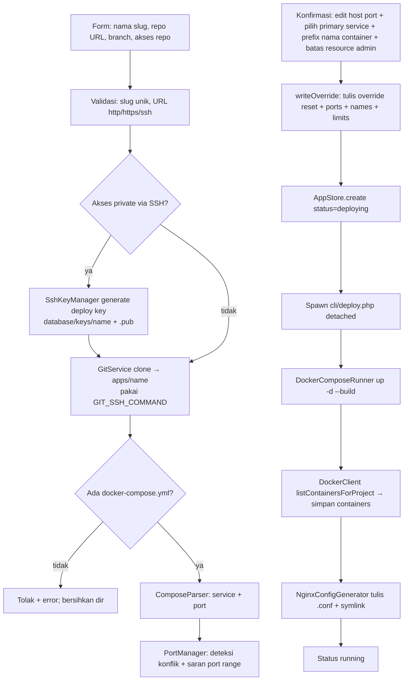
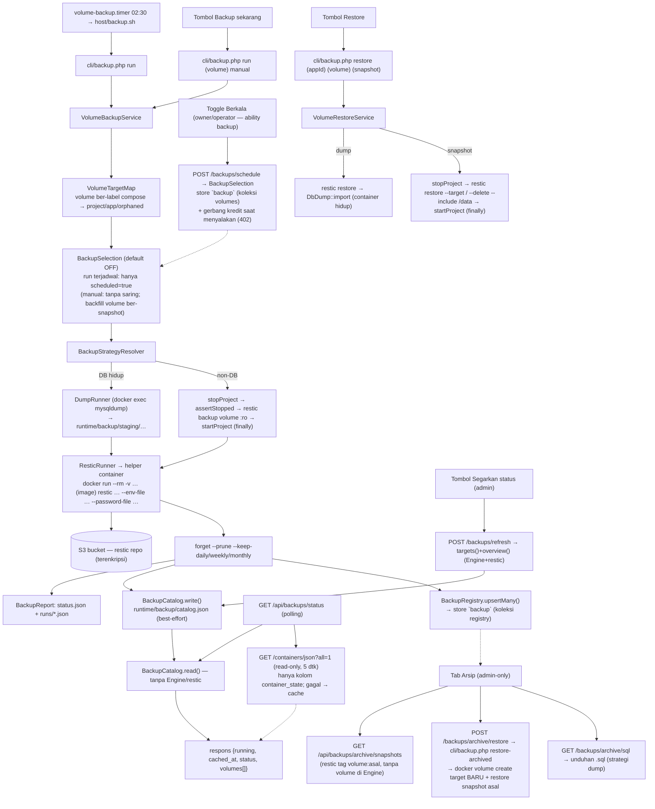
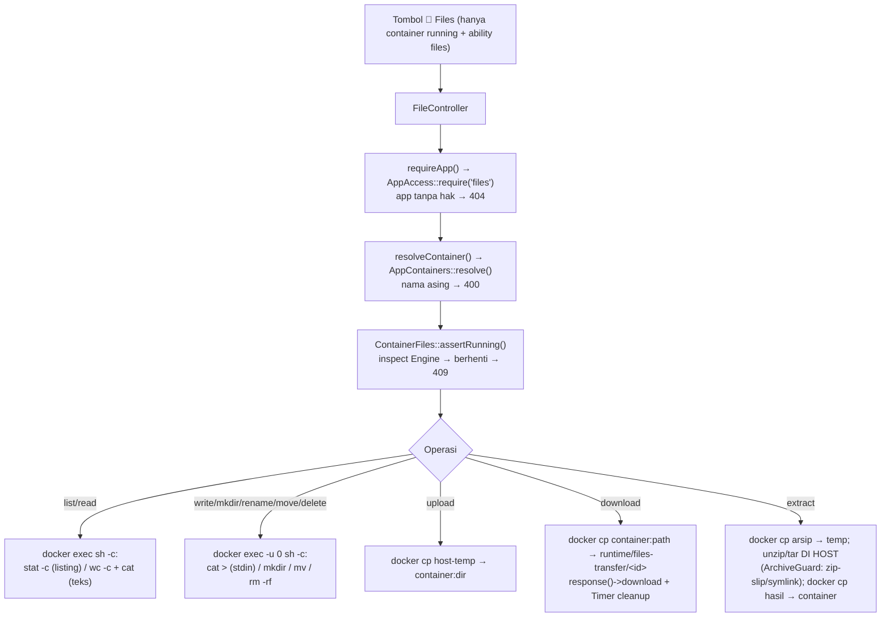
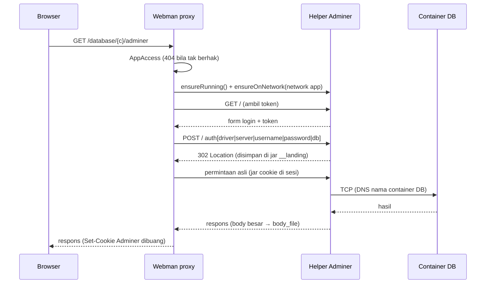
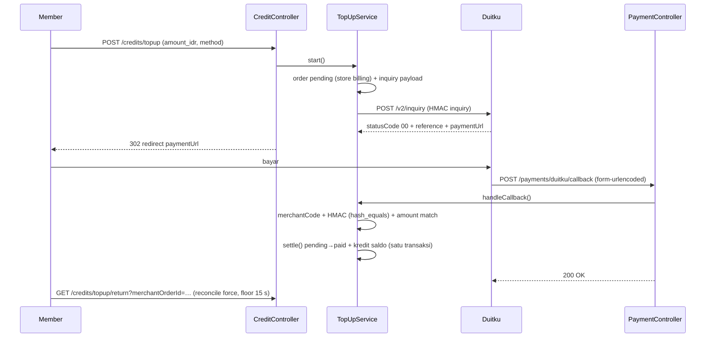
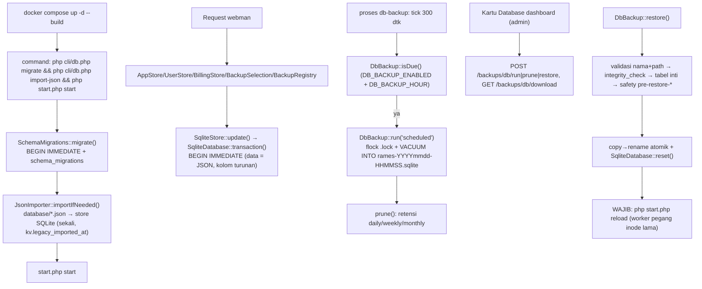
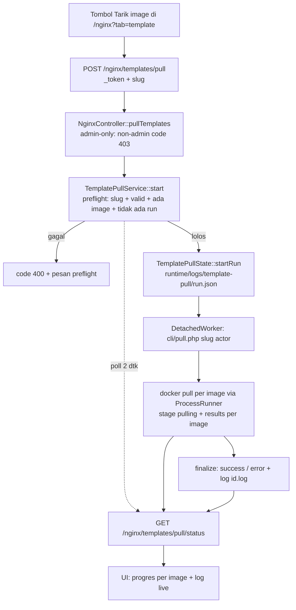
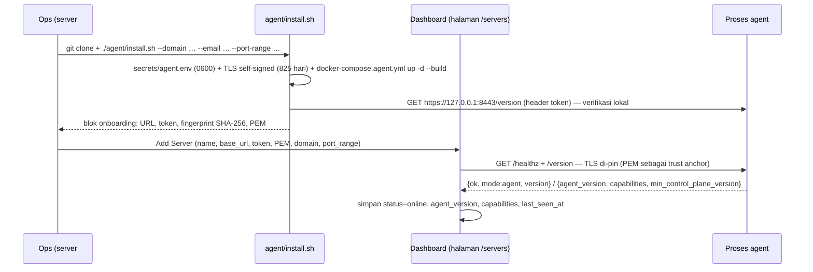

# ARCHITECTURE.md — Rames (Deploy Dashboard)

Dokumen ini menjelaskan **struktur kode** dan **cara kerja** project. Untuk spesifikasi kebutuhan & keputusan produk, lihat [`SPECS.md`](./SPECS.md).

---

## 1. Ringkasan

Rames (Phase 1) adalah aplikasi **Webman (PHP 8.1+)** yang berjalan **di dalam container Docker sebagai root**, mengelola:

- **App** — project yang di-deploy dari repo Git berisi `docker-compose.yml`
- **Container** — hasil `docker compose` tiap app (dijalankan pada daemon Docker *host* lewat socket)
- **Reverse proxy** — config Nginx ditulis ke direktori host (di-mount), Nginx native di host mem-forward subdomain ke port app

Arsitektur disiapkan agar logika eksekusi (`DeployerInterface`) bisa diekstrak menjadi **agent HTTP terpisah** di fase berikutnya (multi-server) tanpa merombak controller/business logic.

**Status multi-server (F0–F4 mendarat & terverifikasi; sisa eksplisit di §8):** ekstraksi itu sudah dilakukan. Kode & image yang **sama** kini berjalan dalam dua peran runtime (`config('deploy.mode')`, dari `RAMES_MODE`): **control plane** (`dashboard` — UI, login, registry server, timer) dan **agent** (eksekutor di server tempat app berjalan, tanpa UI, listener TLS sendiri). Control plane memilih deployer per app lewat `DeployerFactory::createForApp()` → `LocalDeployer` (server `local`) atau `AgentDeployer` (HTTP ke agent, job async). Alur lengkapnya di §5.21–§5.26; **preflight create app** — ketersediaan direktori `apps/<name>` di server agent lewat `POST /apps/check` — dijalankan **sebelum** record app dibuat (§5.22, GOTCHA §8 no. 36).

---

## 2. Diagram Arsitektur (Phase 1)

```mermaid
flowchart TB
    subgraph Host
        N[Nginx native<br/>:80 / :443]
        DNS[DNS wildcard *.APP_DOMAIN]
        NAvail[/etc/nginx/sites-available]
        NEnab[/etc/nginx/sites-enabled]
        WH[Watcher host - inotifywait + nginx -s reload<br/>(belum dipasang)]
    end

    subgraph Dashboard[rames-webman container]
        App[Webman HTTP]
        Lib[app/library - logika bisnis]
        DClient[DockerClient - Engine API]
        DCRun[DockerComposeRunner - CLI compose]
        NGGen[NginxConfigGenerator]
        GSvc[GitService]
        Worker[cli/deploy.php - background worker]
    end

    Daemon[(Docker Engine host)]

    App --> Lib
    App -- spawn detached --> Worker
    Lib --> GSvc
    Lib --> DClient
    Lib --> DCRun
    Lib --> NGGen
    Worker --> DCRun
    Worker --> DClient
    Worker --> NGGen
    DClient -- unix socket --> Daemon
    DCRun -- unix socket --> Daemon
    Daemon --> AppA[App A containers]
    Daemon --> AppB[App B containers]
    NGGen -- tulis .conf --> NAvail
    NAvail -. symlink .-> NEnab
    NAvail -- notifikasi perubahan --> WH
    WH -- reload --> N
    DNS -.-> N
    N -- proxy_pass 127.0.0.1:host_port --> AppA
    N -- proxy_pass 127.0.0.1:host_port --> AppB
```

**Poin kunci:**
- Dashboard **tidak** menjalankan `nginx -s reload` langsung ke host via shell — ia hanya menulis file `.conf` ke direktori yang di-mount; reload diaktifkan watcher host (`nginx -t && nginx -s reload`, SPECS §8.3) atau, sementara watcher belum ada, via helper container `--network host --pid host` yang me-chroot ke root host pada Docker socket (`NginxReloader`, SPECS §8.4).
- Semua operasi Docker dijalankan lewat `/var/run/docker.sock` yang di-mount → berjalan pada **daemon Docker host** (bukan daemon di dalam container).

### Diagram multi-server (F0–F4)

Satu kode, satu image, dua peran runtime (`RAMES_MODE`). Control plane tidak pernah mengeksekusi app milik server agent di hostnya sendiri.

```mermaid
flowchart TD
    subgraph CP["Server #1 — control plane (RAMES_MODE=dashboard)"]
        UI[View + Controller<br/>Webman HTTP :8787]
        RES[ServerResolver + DeployerFactory]
        DB[(SQLite rames.sqlite<br/>users, servers, apps, billing)]
        AW[cli/deploy.php worker lokal]
        LCP[LocalDeployer]
        AW --> LCP
    end

    subgraph A1["Server agent #2..N (RAMES_MODE=agent)"]
        AG[webman HTTP + TLS<br/>listener AGENT_BIND :8443]
        AUTH[AgentAuthMiddleware global<br/>token+timestamp+nonce+signature]
        AJ[AgentController / AgentJobController<br/>AgentAppProjection + AgentArtifactMaterializer]
        AGW[worker cli/deploy.php detached<br/>RAMES_JOB_ID]
        LG[LocalDeployer + app/library yang sama]
        ADB[(SQLite agent<br/>proyeksi app + agent-jobs)]
        AG --> AUTH --> AJ
        AJ -- spawn detached --> AGW --> LG
        AJ --- ADB
    end

    UI --> RES --> DB
    RES -->|server_id=local| LCP
    RES -->|"HTTP JSON ≤30 s<br/>token + pinning TLS"| AG
    AW -.->|POST /jobs, GET /jobs/{id}, /jobs/{id}/log| AG
    A1 -- "state eksekusi (pull)" --> RES
```

- **Control plane**: `resolveCreateServer()` (create app) + `DeployerFactory::createForApp()` (semua operasi) menentukan server; app ber-`server_id` agent selalu lewat `AgentDeployer`.
- **Agent**: hanya route mesin yang didaftarkan (tanpa UI); `AgentJobController` memproyeksikan app (`AgentAppProjection`), mematerialisasi artefak (`AgentArtifactMaterializer`), lalu spawn worker lokal.
- **Dua basis data terpisah** (metadata di control plane, proyeksi + state eksekusi di agent) — kepemilikan data per bidang di §5.25.
- **Op per server bukan hanya deploy** (F2–F4): Nginx/SSL (§5.27), log/terminal (§5.28), file manager (§5.29), monitoring (§5.30), database/Adminer + network/volume (§5.31), dan data backup/restore/dump (§5.32) semuanya dieksekusi **di server pemilik resource** lewat route agent / job — tidak ada jalur mundur ke host control plane.

---

## 3. Mode Menjalankan (Environment)

- Dashboard = container `rames-webman` (berjalan sebagai **root**), akses `http://host:{APP_PORT}`.
- Kode di-mount dengan path **sama dengan host** — `"${PWD}:${PWD}"` + `working_dir: ${PWD}`. Ini **krusial**: karena `docker compose` dieksekusi *di dalam container* tetapi daemon-nya *di host*, relative volume mount di `docker-compose.yml` milik app harus terselesaikan ke **path host yang valid**. Memakai `/app` membuat bind jadi `/app/apps/...` yang tidak dikenal daemon.
- `docker.sock` di-mount → dashboard mengeksekusi `docker compose` pada daemon host.
- Direktori Nginx host (`sites-available`/`sites-enabled`) di-mount → dashboard menulis file config; reload dilakukan watcher/manual di host.
- `/etc/letsencrypt` host di-mount → certbot (container) menulis sertifikat; nginx host membaca dari path yang sama.
- Named volume **`rames`** di-mount ke `/var/lib/rames` (di luar bind `${PWD}:${PWD}`) → menyimpan basis data SQLite `rames.sqlite` + snapshot backup-nya (§5.19); tidak hilang saat `git clean`/update dashboard. Berlabel `rames.role=dashboard-db` agar dikecualikan dari fitur backup volume app (§5.15).
- Container memakai `dns:` eksplisit (`DNS_1`/`DNS_2`) karena `/etc/resolv.conf` host pada environment ini bermasalah (symlink rusak) sehingga resolver internal Docker tak punya upstream.
- **Urutan bootstrap container (penting untuk provisioning).** `command:` compose menjalankan `composer install` (bila `vendor/autoload.php` belum ada — penanda berkas, bukan direktori `vendor/`, agar instalasi yang terputus tidak membuat bootstrap terlewat) → `php cli/db.php migrate` → `php cli/db.php import-json` → `php start.php start`, sedangkan container sudah berstatus `running` sejak detik pertama rantai itu. Karena itu "container running" **bukan** tanda dashboard siap. Satu-satunya jalur provisioning user admin adalah `host/create-admin.sh` (dipakai `host/install.sh`, bisa manual): ia memprobe `GET /healthz` dari **dalam** container (port internal `8787`, bukan `APP_PORT` host) sampai JSON `"ok":true` — tanda vendor terpasang + skema SQLite termigrasi + server listening — baru memanggil `php webman make:admin` (SPECS §6.3).
> **GOTCHA — "container `running`" ≠ "dashboard siap".** **Gejala**: `sudo ./host/install.sh` mencetak `PHP Warning: require_once(/…/vendor/autoload.php): Failed to open stream` + `PHP Fatal error: Failed opening required '…/vendor/autoload.php'` tepat setelah baris "Membuat user admin pertama", lalu dashboard tidak bisa dilogin; `docker exec rames-webman php webman make:admin` manual pun gagal sama. **Sebab**: `State.Running=true` sudah terpenuhi sejak detik pertama bootstrap `command:` compose, sedangkan `composer install` + `cli/db.php migrate` masih berjalan — `make:admin` menabrak `vendor/autoload.php`/skema DB yang belum siap. **Penangkal**: ukur kesiapan dari `GET /healthz` **dari dalam** container (`"ok":true`), bukan dari `.State.Running` — pola `host/create-admin.sh`; jalur manual wajib menunggu `docker compose logs webman` menunjukkan server listening.
- **Mode runtime `agent` (`RAMES_MODE=agent`)** — server #2..N memakai kode & image yang sama dengan mode dashboard, tetapi:
  - `config/route.php` hanya mendaftarkan route mesin (`GET /healthz`, `GET /version`, `POST /jobs`, `GET /jobs/{id}`, `GET /jobs/{id}/log`, `GET /apps/{id}`, `GET /apps/{id}/nginx`, `POST /nginx/check`, `POST /apps/check`) dan **hanya bila `AGENT_TOKEN` terisi** (fail-closed: tanpa token tidak ada route sama sekali → semua 404);
  - `config/middleware.php` memasang **`AgentAuthMiddleware` saja** (bukan CSRF/Auth sesi) — middleware bersifat global, jadi mode harus digerbangi di sini juga, bukan hanya di `route.php`;
  - `config/process.php` mengganti **hanya** tiga hal pada proses `webman`: `listen` → `http://{AGENT_BIND}` (default `0.0.0.0:8443`), `transport` → `ssl`, dan `context.ssl.local_cert`/`local_pk` (`verify_peer=false`). TLS diterminasi **di proses agent sendiri** (bukan Nginx host) supaya objek yang di-pin control plane adalah sertifikat agent;
  - **Fail-fast TLS**: `AGENT_TLS_CERT`/`AGENT_TLS_KEY` wajib ada & terbaca; tanpa itu startup dibatalkan (`RuntimeException`), tidak ada mode "tanpa TLS";
  - `agent/install.sh` menyiapkan `secrets/agent.env` (0600) + sertifikat self-signed (825 hari) + `docker-compose.agent.yml` (project `rames-agent`, container `rames-agent`) dan mencetak blok onboarding.
- **Timer**: mode agent tidak memasang timer dashboard (monitor/billing/backup DB/template pull); mode `dashboard` tidak tersentuh oleh perubahan mode.
- **Firewall**: port agent (default `8443`) hanya boleh dibuka untuk IP control plane — allowlist lewat firewall server, bukan UI.

> **GOTCHA — image dashboard wajib memuat plugin `buildx`.** **Gejala**: deploy app gagal dengan `Docker Compose requires buildx plugin to be installed` lalu `Building the --mount option requires BuildKit` (build `docker compose up --build` berhenti di `RUN --mount=…`). **Sebab**: image dashboard hanya memasang `docker-cli` + `docker-cli-compose`; tanpa plugin `docker-cli-buildx`, Compose **jatuh ke legacy builder** yang tidak mendukung `--mount`/cache mount. **Penangkal**: paket `docker-cli-buildx` dipasang di `Dockerfile`, dan paket docker (`docker-cli`/`docker-cli-compose`/`docker-cli-buildx`) diambil eksplisit dari repo `main`+`community` CDN resmi Alpine — mirror aliyun kadang sudah menyinkronkan indeks tanpa menyediakan berkas `.apk`-nya (`HTTP 404`), dan apk memakai entri repo pertama tanpa fallback. Container lama harus di-**recreate** setelah image dibangun ulang (memasang paket di container berjalan hanya bertahan sampai recreate); agent memakai image yang sama sehingga ikut terperbaiki.

> **GOTCHA — data runtime DILARANG masuk Docker build context.** **Gejala**: self-update dari dashboard gagal di tahap build dengan `checking context: no permission to read from '…/database/env/<app>.env'`, lalu helper rollback ke SHA lama — dashboard tetap versi lama. **Sebab**: tanpa `.dockerignore`, seluruh direktori repo dikirim sebagai build context; `database/env/*.env` (0600, pemilik root/uid lain), `database/keys/`, serta direktori runtime lain tidak terbaca oleh proses yang men-tar context, dan **legacy builder** (dipakai selama plugin `buildx` belum ada di image yang sedang berjalan) men-tar context secara eager sehingga build berhenti sebelum Dockerfile dieksekusi — bukan masalah Dockerfile. **Penangkal**: `.dockerignore` di root repo mengecualikan seluruh data runtime/secret (`database/`, `apps/`, `runtime/`, `nginx-status/`, `webroot/`, `secrets/`) plus `.git/`, `vendor/`, `tests/`; builder tidak menuruni direktori yang dikecualikan, jadi berkas tanpa izin pun aman, dan context mengecil (≈2 MB) sehingga update lebih cepat. **WAJIB**: Dockerfile sengaja **tanpa `COPY`/`ADD`** (kode dibaca dari bind mount `${PWD}:${PWD}`) — jangan menambah `COPY` yang menunjuk direktori yang dikecualikan tanpa menyesuaikan `.dockerignore`.

---

## 4. Komponen & Lapisan

### 4.1 Lapisan HTTP — `app/controller/`

Controller hanya **mediator**: tidak memuat logika bisnis, tidak menyimpan state di properti (Webman persistent → `controller_reuse=false`), dan **tidak** memanggil `session()`/`request()` di konstruktor.

| Controller | Tanggung jawab |
|---|---|
| `AuthController` | Login/logout, session, regenerasi session id (anti fixation), migrasi kepemilikan app lama (best-effort) |
| `AppController` | Wizard create app (**tiga mode**: clone repo Git, paste/upload compose, dan **template** galeri siap-pakai §5.1c), termasuk **pemilih server tujuan** (admin, bila >1 server) di tiap form masuk + langkah konfirmasi — satu pintu payload `serverFormContext()` + penegakan fail-fast `resolveCreateServer()` (§5.22, GOTCHA §8 no. 27), halaman detail & halaman versi (`/apps/{id}/versions`), aksi (rebuild/rollback/stop/start/delete dengan mode preserve/purge volume — tombol Delete di tab khusus "Hapus App"), set/hapus custom domain, kelola environment variable app (simpan + auto-recreate, import `.env.example`, upload `.env` mode `merge`/`replace` tanpa auto-recreate — §5.37), kelola external network (shared network lintas-app via compose override), kelola **nama container** (prefix `container_name`, §5.12), kelola **batas resource CPU/memori per service** (tab **Sumber Daya** — admin-only untuk mengubah, read-only untuk user lain, §5.12a), kelola **kepemilikan & sharing** (tab Akses: tambah/ubah/cabut member, transfer owner), endpoint polling status. Daftar app difilter ke app yang boleh diakses user + **filter query-string** `?name=`/`?domain=`/`?owner=` (SPECS §8e) lewat `AppFilter` (nilai efektif trim/lowercase dari controller; `owner` admin-only) **Gerbang kredit** (`BillingGate`, §5.18) di **10 titik** (aktor exempt/admin ⇒ bebas; app milik admin ⇒ bebas untuk siapa pun; sisanya menilai aktor + pembayar/owner) — 2 jalur create (`confirmCreate`/`templateDeploy`, sebelum efek samping) + 8 jalur yang menyalakan/menciptakan container (`rebuild`/`rollback`/`start`/`saveCompose`/`saveEnv`/`saveNetworks`/`saveContainerNames`/`saveLimits`); pemilih CPU/RAM saat create kini juga untuk **owner/member** (plafon `BILLING_MAX_CPUS`/`BILLING_MAX_MEMORY_MB` via `Pricing::assertWithinCaps()`), batas atas skala slider dihitung `limitsScaleMax()` (member → plafon billing; admin/bukan member → kapasitas host, fallback plafon config), sedangkan mengubah limit setelah app jadi tetap admin-only. **Anti-escape**: `transferOwner()` ke pemilik bebas tagihan (admin) atas app berjalan milik member ⇒ app dihentikan otomatis (§5.18) |
| `TerminalController` | Terminal container (`docker exec`): buka sesi interaktif (open), stream output (SSE), kirim input, tutup sesi, dan one-shot run command; container divalidasi milik app **dan** user berhak (ability `terminal`); audit log ke `runtime/logs/terminal/` |
| `LogController` | Log container app (`docker logs`) untuk popup modal di detail app: `GET /api/apps/{id}/logs?container=&tail=`; ability `logs` (Viewer ke atas); nama container selalu divalidasi milik app (`AppContainers::resolve`) sebelum menyentuh Engine. Juga **log deploy on-demand**: `GET /api/apps/{id}/deploy-log?offset=N[&tail=1]` → teks ≤256 KiB + `X-Rames-Offset` (pembacaan via `DeployLog`; ability `logs`) |
| `FileController` | File manager container (§5.16): jelajah/`read`/`write`/`mkdir`/`rename`/`delete`/`upload`/`download`/`extract` untuk container app yang **berjalan**; ability `files` (operator+); container divalidasi `AppContainers::resolve` (jalur sama dengan `TerminalController`); semua logika bisnis di `app\library\Files\*` (controller hanya mediator — envelope `{code:0,data}` / `{code:<status>,msg}`, audit ke `runtime/logs/files/`). **Multi-server (F3b, §5.29)**: app di server `kind=agent` dijalankan **di agent** (`AgentDeployer::file*()` → `/files/*` agent; Engine host control plane tidak disentuh) — envelope agent diteruskan apa adanya (kode domain 409/413/415/404), unduhan/unggahan **streaming** dengan plafon `AgentDeployer::MAX_TRANSFER_BYTES` |
| `NginxController` | **Halaman Config `/nginx`** — tiga tab: **Update Rames** (panel self-update, §5.14), **Nginx** (status reload Nginx host terakhir + tombol Reload), **Template** (katalog template §5.1c + tombol **Tarik image** — `docker pull` seluruh image template, §5.20). Tab awal dari `?tab=` (whitelist `TABS`), daftar tab dikirim sebagai `$tabs` (view tidak membaca request), dan header menampilkan versi PHP runtime (`$php_version` = `PHP_VERSION` worker). Endpoint: `GET /nginx`, `POST /nginx/reload`, `POST /nginx/templates/pull` & `GET /nginx/templates/pull/status`. **Admin-only → 404 non-admin** (`index()` melempar `AppAccessDenied`; seam `isAdmin()`), dan menu **Config** disembunyikan dari member di UI |
| `DatabaseController` | Halaman `/database`: daftar container DB (difilter kepemilikan app — non-admin tanpa container eksternal) + **reverse proxy Adminer** per container (`/database/{container}/adminer…`, §5.17). **`findOwningApp()` adalah titik otorisasi tunggal** (dipakai daftar & proxy): koneksi Engine, helper, dan kredensial hanya disentuh setelah otorisasi lolos; penolakan `AppAccessDenied` → **404**. Proxy hanya mediator ke `app\library\Adminer\*` (state hanya di sesi; tanpa properti controller) |
| `VolumeController` | Halaman `/volumes`: daftar volume ber-label compose + bersihkan volume **yatim** (ditinggalkan app yang dihapus dengan mode preserve); daftar disaring ke app yang boleh diakses, purge hanya admin. Kolom **Ukuran** (storage terpakai per volume) dimuat asinkron dari `GET /api/volumes/usage` (`VolumeUsage::summarize` atas `GET /system/df`) agar render halaman tidak menunggu Engine menelusuri filesystem |
| `BackupController` | Halaman `/backups` + API backup volume ke S3 (§5.15): `GET /api/backups/status` (**cache + `container_state` live** — satu panggilan Engine read-only `GET /containers/json?all=1` hanya untuk kolom **Status container**), `GET /api/backups/snapshots`, `POST /backups/run` (ability `backup`), `POST /backups/restore` (ability `restore`), serta `POST /backups/refresh` (**admin global** — non-admin → **404**) dan `POST /backups/schedule` (**ability `backup`** — owner/operator; viewer/stranger → **404**; volume yatim admin-only; gerbang kredit hanya saat menyalakan, menilai **aktor lalu penanggung biaya/owner** via `billingPayerFor()` → **402** dengan pesan khusus bila owner yang kurang saldo). Endpoint **arsip** (§5.15): `GET /api/backups/archive/snapshots`, `POST /backups/archive/restore`, `GET /backups/archive/sql` — semuanya **admin-only → 404** non-admin. Respons status disanitasi `publicStatus()` (daftar-putih — `volumes`/`error` mentah dibuang) + baris volume disaring `BackupAccess::visible()`; flag `scheduled` di-merge **segar** saat respons (`withScheduled()`) lengkap dengan `can_schedule` (`BackupAccess::can('backup', …)`) + biaya baris (`backup_gb`, `backup_credits_month` — `BackupUsage`+`Pricing`; peta GB dibaca **sekali** per respons, bukan per baris); `data.archived` (riwayat volume terhapus) **admin-only** (`[]` untuk non-admin) dengan `restorable` per baris (`archivedRows()`). Halaman panduan `GET /backups/guide` (**admin-only → 404** non-admin) merender Markdown repo `host/restic-setup.md` lewat `Markdown::toHtml()` (helper statik `guideHtml()`; fail-safe `''` bila berkas tak ada/kosong/tak terbaca) ke view `backup/guide.php` (kotak `.guide-content`, **tanpa** `backup.js`) |
| `NetworkController` | Halaman `/networks`: daftar network Docker (built-in diberi label & dilindungi, milik app aktif ditandai "dikelola app"), buat shared network (bridge/overlay/macvlan + IPAM + flag attachable/internal), detail network (container terhubung + connect/disconnect), hapus network dengan proteksi berlapis (built-in / dipakai container / milik app aktif ditolak). Operasi global (buat/hapus/connect/disconnect) hanya admin; daftar disaring per app yang boleh diakses |
| `MonitorController` | Halaman global `/monitor` (nav sidebar) + `GET /api/monitor/overview` (metrik host + seluruh container) & `GET /api/monitor/host` (metrik host saja, untuk polling ringan kartu host — tanpa Engine). Read-only, tanpa state, tanpa CSRF. Otorisasi bertingkat: admin melihat semua container di host (termasuk container eksternal), user lain hanya container milik app yang boleh diakses (§5.13). **Multi-server (F3c, §5.30)**: `overview` juga mengembalikan agregat `data.servers[]` (entri lokal + tiap server agent, metrik dibaca **di** server itu); server agent mati ⇒ `status:'offline'` + `error` tersanitasi **tanpa** menggagalkan halaman; `host` tetap server lokal saja |
| `UserController` | Kelola user — **khusus admin**: tambah/hapus user, ubah role (admin/member), ganti password, serta **set/hapus `email`** user (`POST /users/{id}/email`, prasyarat top-up Duitku §5.18); halaman `/users` menampilkan saldo kredit read-only (`CreditAccount::allBalances()`). Menghapus user **mengalihkan app miliknya** ke admin yang menghapus; bila pemilik lama pihak yang ditagih (member) & billing aktif, app hasil transfer yang masih hidup **dihentikan otomatis** (anti-escape billing — `AppStopper::stopTransferredToExemptOwner`, §5.18) |
| `CreditController` | Halaman & aksi kredit (§5.18): `GET /credits` (member = saldo/pemakaian/ledger/top-up **via modal** `#topupModal`; admin = semua user + deposit + penagihan manual), `POST /credits/deposit` & `POST /credits/charge` (**admin-only → 404** non-admin), `POST /credits/email` (**warisan/BC** — UI kini memakai `/profile/email`; hanya email user login — anti IDOR), `POST /credits/topup` + `GET /credits/topup/return` (order id dari `?order=` **atau** `?merchantOrderId=`; order milik user login; kosong/non-skalar → 404; order `pending` ⇒ `TopUpService::reconcile(force: true)`; `resultCode`/`reference` dari browser **tidak dipercaya** — hanya memilih pesan flash dan hanya bila `resultCode` ada), `GET /api/credits/methods` (satu-satunya jalur yang menyentuh jaringan, dipanggil JS saat **modal top-up pertama dibuka** — `shown.bs.modal`, bukan saat load): sebelum menambah `group`, kanal **disaring ulang** `DuitkuClient::isAllowedMethod()` (**defense-in-depth** — kanal di luar allowlist/`HARD_EXCLUDE_METHODS`, mis. `VC`/`OL`, tak bisa tampil walau `paymentMethods()` regresi); tiap item `data` diberi key **`group`** (`PaymentMethodCatalog::decorate()`) dan daftar **diurutkan per grup kanonik** (stabil di dalam grup); payload view `GET /credits` memuat **`methodGroups`** (`[{label,codes:[…]}]`, dari `groupedCodes()`) di samping `methods` lama (kompatibilitas/fallback). Mediator murni: seluruh logika di `app\library\Billing\*`; tanpa state properti lintas-request. Untuk admin, `topupIssues()` (dari `DuitkuClient::configurationIssues()`) menjelaskan **alasan top-up nonaktif** di `/credits`, dan — **non-blocking** — `topupWarnings` (`DuitkuClient::configurationWarnings()`) + `topupCallbackUrl`/`topupReturnUrl` (getter lokal, tanpa jaringan; `[]`/`''` bila seam melempar) memberi diagnostik path callback/tunnel/return; member menerima `[]`/`''` (tidak melihat detail infrastruktur) |
| `ProfileController` | Halaman **Profil** self-service (`GET /profile`, semua user login; view `app/view/profile/index.php`): kartu **Edit profil** (form email → `POST /profile/email`, `maxlength=50`) + kartu **Akun** baca-saja (username, badge peran, saldo). **Anti-IDOR**: `id`/`user_id` dari request diabaikan mutlak — id selalu dari `current_user()`. Mediator murni: validasi email (≤50 karakter + `FILTER_VALIDATE_EMAIL`) **tidak diduplikasi** — didelegasikan penuh ke `UserStore::setEmail()`; email kosong = hapus; input non-skalar (`email[]=…`) → flash + redirect `/profile` (**bukan** 500); sukses/gagal selalu redirect `/profile`. Seam pengujian `UserStore` berpath temp; tanpa state properti lintas-request |
| `PaymentController` | Callback pembayaran Duitku **publik** (`POST /payments/duitku/callback`, §5.18): verifikasi `TopUpService::handleCallback()` (merchantCode + signature HMAC `hash_equals` + kecocokan amount + idempotensi) lalu memetakan hasil ke status HTTP (404 fitur/kredensial mati; 400 payload cacat; 403 verifikasi gagal; 200 `OK` tentatif agar Duitku tidak retry). Tanpa session, tanpa data sensitif di respons; audit ringkas ke `runtime/logs/billing/` |
| `DomainController` | **Satu halaman `/domains`** untuk domain + SSL (dua tab: **Semua Domain** = tabel app + parkir, **Domain Parkir** = CRUD) — SPECS §8j, §5.38. Mediator tipis: `GET /domains` & `GET /api/domains/status` terbuka **semua user login** (baris app `AppAccess::visible()` + `can_ssl` per baris; baris parkir hanya admin), sedangkan CRUD parkir + aktivasi SSL parkir **admin-only → 404** non-admin (dievaluasi sebelum store). `GET /ssl` ⇒ `legacySsl()` **302 `/domains`**. Payload `domain/index`: `rows`, `domains`, `isAdmin`, `tab`, `active`, `maxHtmlBytes`, `appDomain`, `errors`, `sslSupported`; `domain/form`: `domain`, `input`, `errors`, `isEdit`, `active`, `maxHtmlBytes`, `appDomain`, `wwwSuggestion`, `ssl` (`status/message/error/expires_at/can_ssl/form_url/ajax_url`). Seam `store()`/`content()`/`manager()`/`parkedSslEnabler()`/`renderView()`; **tanpa state properti** lintas-request |
| `SslController` | Jalur SSL **app** yang tetap dipakai halaman `/domains`: `enable()` (`POST /ssl/{id}/enable`, 302 → `/domains` + flash) & `apiEnable()` (`POST /api/ssl/{id}/enable`) berbagi satu inti `enableDomain()`; `apiStatus()` (`GET /api/ssl/status`) = **alias kompatibel** baris app saja. Baris dirakit `SslDomainRows::appRows()` (satu sumber dengan `/domains`); `GET /ssl` sendiri kini ditangani `DomainController::legacySsl()` (302) |
| `IndexController` | Halaman utama dashboard (`view('index/hello')`) |
| `HealthController` | `GET /healthz` (**publik**, §5.14): status + SHA/branch dari `.git` (tanpa proses git) — dipakai helper self-update untuk memutuskan sehat/rollback, dan bisa dipakai monitoring eksternal |
| `UpdateController` | Endpoint self-update dashboard (§5.14): `GET /api/update/status` (semua user login), `POST /api/update/check`, `POST /api/update/start`, `POST /api/update/rollback` (admin). Panel-nya di halaman `/nginx` |

| `ServerController` | Halaman & aksi **registry server** (multi-server F0, §5.26, SPECS §7.14) — admin-only → **404** non-admin (`guard()` → `ServerAccess::requireManageServers()`): `GET /servers` (daftar), `GET /servers/create` + `POST /servers` (Add Server: name/kind/base_url/token/PEM/domain/port_range/notes), `GET/POST /servers/{id}` (edit; baris lokal hanya `domain`/`notes` via `ServerResolver::validateLocal()`), `POST /servers/{id}/delete`, `POST /servers/{id}/test` (**Test connection**: panggil agent `GET /healthz`/`/version` dengan pinning → simpan `status`/`agent_version`/`capabilities`/`last_seen_at`), `GET /api/servers` (daftar untuk JS, **tanpa** token/PEM). Token & PEM tidak pernah dirender ulang (`publicServer()`/`formServer()` membuang/mengosongkannya) |
| `AgentController` | Route mesin agent (mode `RAMES_MODE=agent`, §5.21): `GET /healthz` (`{ok, service, mode:'agent', version}`, dipakai **Test connection** + monitoring) & `GET /version` (`{agent_version, capabilities, min_control_plane_version}`; `capabilities` = op yang benar-benar didukung = `DeployWorkerLauncher::MODES`). Keduanya **butuh token** (tidak ada route publik di agent) |
| `AgentJobController` | Route job & proyeksi app di agent (§5.23): `POST /jobs` (validasi op terhadap `DeployWorkerLauncher::MODES` — termasuk op F2 `nginx_write`/`nginx_remove`/`nginx_reload`/`ssl_issue`/`ssl_revoke` + payload app → upsert proyeksi `AgentAppProjection` → materialisasi artefak `AgentArtifactMaterializer` → spawn worker detached; balas `{job_id, op, log_offset}`; **PID worker disimpan di rekaman job** untuk pembatalan), `GET /jobs/{id}` (status), `GET /jobs/{id}/log?offset=N` (potongan log deploy app ≤256 KiB + header `X-Rames-Offset`; pembaca diarahkan ke `DeployWorkerLauncher::logDir()`), **`POST /jobs/{id}/cancel`** (hentikan worker + grup build lewat `DeployCanceller`, status proyeksi ikut dipulihkan; job `done`/`error` ⇒ 409), `GET /apps/{id}` (state eksekusi untuk pull, whitelist `APP_FIELDS` — tanpa `env`/deploy key), `GET /apps/{id}/nginx` (perakitan config Nginx vhost dilakukan **di agent**), `POST /nginx/check` (preflight `ensureWritable()` app-less, bukan job), `POST /apps/check` (preflight **ketersediaan direktori app** sebelum create — read-only, bukan job, §5.22). Semua lewat middleware token |
| `AgentLogController` | Log container app **di server agent** (F3a multi-server, §5.28): `GET /apps/{id}/logs?container=&tail=&timestamps=` membaca Engine server itu (`DockerClient` agent) dan mengembalikan teks yang sama bentuknya dengan `LogController` lokal. Container divalidasi `AgentDeployer::containerRef()` (bentuk nama + keanggotaan data proyeksi). **Tanpa state** & **tanpa audit** (identitas user hanya ada di control plane) |
| `AgentTerminalController` | Sesi terminal app **di server agent** (F3a multi-server, §5.28): `POST /terminal/open` (`DockerExec::open()` di host itu), `GET /terminal/{token}/stream` (SSE chunked), `POST /terminal/{token}/input`, `POST /terminal/{token}/close`. Tiap panggilan membawa `app_id` (query/body) sehingga validasi "token milik app ini" tetap satu sumber di `DockerExec::sessionInfo($token, $appId)`. **Sesi TIDAK ditutup saat klien drop** — hanya `close`, proses keluar, atau prune TTL. Audit **tidak** ditulis di agent |
| `AgentFilesController` | File manager **di server agent** (F3b multi-server, §5.29): `GET /files/list\|read\|download` + `POST /files/write\|mkdir\|rename\|delete\|move\|upload\|extract`. Memakai library yang sama dengan jalur lokal (`ContainerFiles`/`PathGuard`/`FilesInput`/`TextContent`/`ArchiveGuard`) sehingga batas 2 MiB editor, 5000 entri listing, tolak biner, dan **zip-slip** tetap berlaku; sumber app = proyeksi agent (`app_id` di query/body), container divalidasi (`AppContainers::resolve`) & wajib berjalan (409). Envelope galat domain HTTP **200** (`{code:<status>,msg}`) **kecuali** `/files/download` yang memakai HTTP nyata (409/413/404) supaya control plane membedakan JSON galat dari isi berkas. Batas transfer `AgentDeployer::MAX_TRANSFER_BYTES`; berkas temp selalu dibersihkan. **Tanpa** otorisasi user (ditangani control plane); audit tidak ditulis di agent |
| `AgentDockerController` | Monitoring **di server agent** (F3c multi-server, §5.30): `GET /system/host-usage` (`/proc` server ini via `ResourceCollector::hostSnapshot()`) & `GET /monitor/containers` (statistik container Engine server ini via `ResourceCollector::collect()`, `DockerClient` server ini). Selalu metrik **server ini** — `/proc`/Engine host control plane tidak pernah dipakai. Tanpa otorisasi/penyaringan (tanggung jawab `MonitorController`); kegagalan Engine ⇒ `error` terisi, bukan respons gagal |
| `AgentAdminerController` | Database/Adminer **di server agent** (F3d multi-server, §5.31): `GET /database/containers` (deteksi container DB Engine server ini via `DbContainerDetector`) & proxy `ANY /adminer/{container}[/{path:.*}]`. Body permintaan diteruskan **mentah** (multipart/unduhan utuh — HTML Adminer tidak pernah disunting), `X-Forwarded-Prefix` dari control plane dipakai helper untuk merakit URL, dan **jar cookie** dititipkan control plane lewat header `X-Rames-Adminer-Jar` (base64 JSON, tidak pernah ke browser). Otorisasi & kepemilikan container tetap diputuskan control plane; agent hanya memvalidasi bentuk nama & memastikan container itu container DB server ini |
| `AgentNetworkController` | Network & volume **di server agent** (F3d, §5.31): `GET /networks`, `GET /networks/{id}`, `GET /volumes`, `POST /networks/create\|{id}/connect\|{id}/disconnect\|{id}/delete` — semuanya memakai Engine server ini. Penolakan **sambungan lintas server** ada di control plane (`NetworkController::assertContainerServer()`): shared network hanya bermakna dalam satu server |

### 4.2 Middleware — `app/middleware/`

| Middleware | Peran |
|---|---|
| `CsrfMiddleware` | Validasi token CSRF untuk semua POST/PUT/PATCH/DELETE. **Dua pengecualian sempit (path-presisi, larangan repo #17):** (1) proxy Adminer `#^/database/[^/]+/adminer(/|$)#`; (2) **callback Duitku** `#^/payments/duitku/callback$#` — **eksak & hanya POST** (pengecualian Adminer tidak dilebarkan; route lain termasuk `/credits/deposit` tetap wajib token). Callback diverifikasi di `PaymentController` (signature HMAC + amount + idempotensi, tanpa session) |
| `AuthMiddleware` | Lindungi semua route kecuali `/login` & aset statis; JSON 401 untuk request `/api/*` yang tidak login; **menyinkronkan user session dengan store `auth`** pada setiap request (user dihapus → sesi dibuang; role berubah → langsung berlaku). `PUBLIC_PATHS` memuat **`/payments/duitku/callback`** (path eksak, tanpa sesi — Duitku pengirim mesin tanpa cookie kita; keamanannya dari verifikasi di controller, bukan autentikasi) |
| `StaticFile` | Tolak akses path berisi `/.` (bawaan webman) |
| `AgentAuthMiddleware` | Autentikasi mesin-ke-mesin **mode `agent` saja** (plan §4.1): bearer token `hash_equals()` → `X-Rames-Timestamp` (toleransi ±60 s) → `X-Rames-Nonce` (sekali pakai, cache lintas-worker `NonceStore` di `runtime/agent-nonces.json`, TTL 120 s) → `X-Rames-Signature` **opsional** (bila header ada, wajib valid: HMAC-SHA256 `"{timestamp}\n{METHOD}\n{path}\n{sha256(body)}"` dengan key = token). Gagal apa pun ⇒ **401 tanpa detail** (tak ada oracle header mana yang salah). Di mode `dashboard` middleware ini **no-op mutlak**. Middleware bersifat **global**, jadi mode digerbangi di `config/middleware.php` — bukan hanya `config/route.php` |

Terdaftar global di `config/middleware.php` dengan urutan: CSRF → Auth → StaticFile. **(mode `agent`)** daftar global diganti `AgentAuthMiddleware` saja — route agent tidak melewati sesi/CSRF dashboard (kalau tidak, `/healthz` agent akan gagal).

### 4.3 Lapisan Bisnis — `app/library/`

Semua logika bisnis ada di sini (controller tidak boleh berisi logika). Modul:

| Modul | Kelas | Peran |
|---|---|---|
| **Storage** | `SqliteDatabase` | Handle PDO SQLite tunggal (per berkas, per proses, §5.19): PRAGMA `journal_mode=WAL`/`synchronous=NORMAL`/`foreign_keys=ON`/`busy_timeout=5000`, transaksi `BEGIN IMMEDIATE` re-entrant (`transaction()`), `snapshot()` (`VACUUM INTO`), `integrityCheck()` (`PRAGMA integrity_check`), migrasi otomatis sekali per proses, impor legacy otomatis saat koneksi pertama (`maybeImportLegacy()`, best-effort), kunci cache handle = **identitas berkas** (`realpath#dev:ino`) sehingga berkas yang di-restore dibuka ulang; `reset()` untuk tes |
| | `SqliteStore` | API identik `JsonStore` (`path()`/`read()`/`write()`/`update()`) di atas SQLite: kolom `data` = dokumen JSON (**sumber kebenaran**) + kolom turunan terindeks + `ord` (urutan list); satu store = 1..N koleksi (list bila `idField` terisi, map via `path`). `update()` = satu transaksi (baca→mutator→tulis balik) |
| | `SchemaMigrations` | Definisi kanonik store→koleksi (`storeDefinitions()`) + migrasi berversi (`schema_migrations`, `LATEST`); nama tabel fisik `{store}_{koleksi}` (`tableName()`, mis. `apps_apps`, `auth_users`, `billing_users`, `billing_usage`, `billing_orders`, `backup_volumes`, `backup_registry`, `parked_domains`); nama kolom turunan dari dot-path (`.`→`_`) |
| | `JsonImporter` | Impor **sekali** `database/{apps,auth,billing,backup}.json` → SQLite (idempoten lewat flag `kv.legacy_imported_at`; store yang sudah berisi baris tidak ditimpa; berkas JSON lama **tidak** dihapus) + `exportToJson()` untuk rollback ke JSON |
| | `DbBackup` | Snapshot `VACUUM INTO` ke `{db_backup_dir}/rames-YYYYmmdd-HHMMSS.sqlite` + retensi harian/pekanan/bulanan (`keep_*`, pola `forget --keep-*`), mutex `flock` non-blocking (`<dir>/.lock`; busy → `skipped`), `restore()` defensif (basename+`realpath`, `integrity_check`, tabel inti `apps_apps`/`auth_users`/`billing_users`, safety snapshot `pre-restore-*`, ganti berkas atomik, `SqliteDatabase::reset()`), `isDue()`, `list()`/`download()`; `state.json` di `runtime/db-backup/` |
| | `JsonStore` | Baca/tulis **JSON cache runtime** (bukan data domain) dengan `flock` + salinan `<file>.bak`; `update()` atomik (tulis in-place, ownership file host terjaga). Dipakai `UpdateState` (check.json), state network Adminer, `BackupCatalog`/`BackupReport`, `DbBackup::state()` |
| | `AppStore` | CRUD entri app di **store `apps` (SQLite, §5.19)** + kepemilikan (`owner_id`, `members`): `addMember()`, `removeMember()`, `transferOwner()`, `transferAllFrom()`, `ownedBy()`, `assignMissingOwners()`; `path()` = path berkas `.sqlite` |
| | `AppFilter` | **Satu-satunya tempat pencocokan filter daftar app** (`?name=`/`?domain=`/`?owner=`, SPECS §8e): `apply()`/`matches()`/`normalize()`/`isActive()`; `domain` memakai domain efektif `app_subdomain_of()` atau `custom_domain`; `owner` cocok persis. **Statik murni** — tanpa I/O, tanpa state, **tanpa otorisasi** (pemanggil `AppController::index()` yang memutuskan filter mana yang berhak dihormati, mis. `owner` hanya admin); pengaman daftar tetap `AppAccess::visible()` |
| | `ServerStore` | Registry **server** (multi-server F0, §5.26): store logis `servers` di SQLite yang sama (tabel `servers_servers` — invarian `{store}_{tabel}`), API gaya `AppStore` (`all()`, `find()`, `findByName()`, `nameExists()`, `create()`, `update()`, `delete()`, `local()`); `ServerStore::LOCAL_ID = 'local'` = baris dashboard ini sendiri (di-seed migrasi v2, tidak bisa dihapus). `$filePath` di konstruktor = seam tes |
| | `ParkedDomainStore` | Store logis **`parked`** (tabel `parked_domains`, §5.38/SPECS §8j) — **metadata** domain parking; API gaya `AppStore` (`path()`, `all()`, `find()`, `byDomain()`, `domains()`, `create()`, `update()`, `delete()`). Id `pd_` + 12 hex; `all()` urut `domain` case-insensitive; keunikan `domain` ditegakkan di **dalam transaksi tulis** `SqliteStore::update()`. **Isi HTML tidak di sini** (berkas `database/parked/{id}/index.html`, `ParkedDomainContent`) |
| **Auth** | `UserStore` | CRUD user di store `auth` (SQLite); hash bcrypt, `password_verify`; **role global** `admin`/`member` (`roleOf()`, `isAdmin()`, `changeRole()`, `countAdmins()`, `listWithRoles()`) + migrasi lazy dokumen lama (user pertama = admin) |
| | `AppAccess` | **Satu-satunya pintu otorisasi app**: `roleFor()`, `can(ability, app, user)`, `require()` (melempar `AppAccessDenied`), `visible()` (filter daftar app), `abilitiesFor()`; stateless (aman untuk worker persistent). Ability `limits` (batas CPU/memori per service, §5.12a) eksklusif admin |
| | `AppAccessDenied` | Exception `extends BusinessException` yang merender **404** (JSON untuk `/api/*`, halaman 404 untuk request biasa) — menyembunyikan keberadaan app milik user lain |
| | `OwnershipMigrator` | Migrasi idempoten: app tanpa `owner_id` di-assign ke admin pertama |
| | `ServerAccess` | Otorisasi registry server (multi-server, keputusan admin-only): **statik murni** — `canManageServers()`/`requireManageServers()` (kelola server; pelanggar → `AppAccessDenied` = **404**), `canSelectServer()` (memilih server saat create), `visibleServers()` (member hanya melihat server yang menaungi app yang boleh ia lihat). Tidak menyalin logika role — memanggil `AppAccess` |
| **Support** | `ProcessRunner` | Eksekusi command eksternal via `proc_open` (**array + `bypass_shell`** → tanpa shell, bebas command injection) + timeout; memasang `SIGCHLD=SIG_DFL` selama proses hidup agar git/docker compose tidak kehilangan `waitpid()` dan exit code tetap terbaca (§4.4). **`runStreaming($argv, …, $onChunk)`** meneruskan potongan stdout/stderr saat diterima (log build live); galat sink diabaikan agar proses tetap jalan |
| | `LogChunkReader` | Pembaca potongan berkas log berbasis offset (≤256 KiB per panggilan, dipangkas ke batas baris) — **satu implementasi** untuk log job agent (`AgentJobStore::readLog()`) dan log deploy (`DeployLog`); murni statik tanpa I/O state |
| | `SigchldGuard` | Penjaga disposisi `SIGCHLD` worker persistent: `disableIgnore()`, `withDefault()`, `ignoreAndReap()`, `isIgnored()`; murni statik, no-op bila pcntl tidak tersedia (§4.4) |
| | `DetachedWorker` | Spawn worker CLI **detached** (`pcntl_fork` + `posix_setsid` + `pcntl_exec`, **tanpa shell**) untuk aksi panjang dari request HTTP — dipakai `DeployWorkerLauncher` (semua op app) & `TemplatePullService` (§5.20); anak me-reset `SIGCHLD` ke `SIG_DFL` **sebelum** exec (pola `SigchldGuard`), induk `SIG_IGN` agar anak auto-reap. **Semantik env**: `spawn()` **selalu** menggabung lingkungan pemanggil dengan env tambahan (`$envp = array_merge(getenv() ?: [], array_map('strval', $env))`) karena `pcntl_exec` memakai `execve()` ⇒ argumen `envp` **menggantikan** seluruh lingkungan (array kosong = lingkungan kosong, **bukan** pewarisan; salah ⇒ worker kehilangan `RAMES_DB_DIR`/`RAMES_MODE`/`PATH`/`HOME` — GOTCHA §8 no. 39). `AppController::spawnWorker()` **hanya mendelegasikan** ke `DeployWorkerLauncher` (tak ada fork+exec di controller); sisa penyatuan tinggal `BackupController::spawnWorker()` (tech debt — GOTCHA §5.20) |
| | `Markdown` | Konversi **Markdown → HTML aman** untuk panduan template (§5.1c): `toHtml()` (statik murni, `html_input=escape` + `allow_unsafe_links=false` + `ExternalLinkExtension` → tautan eksternal `target="_blank"`/`rel="noopener noreferrer"`; converter juga mendaftarkan `TableExtension` → **tabel pipe GFM**, selain `CommonMarkCoreExtension` + `ExternalLinkExtension`); input kosong/whitespace **atau** kegagalan apa pun → `''` (panduan tak boleh menggagalkan halaman). Converter dibangun sekali (lazy static) |
| **Git** | `GitService` | `git clone` (depth 1) & `git pull --ff-only`; mendukung repo private via deploy key SSH (`GIT_SSH_COMMAND`) |
| | `SshKeyManager` | Generate/read/hapus pasangan kunci SSH (deploy key per app) di `database/keys/` |
| **Docker** | `ComposeParser` | Parse `docker-compose.yml` (short/long syntax port, IP binding) via `symfony/yaml` |
| | `PortManager` | Deteksi konflik port terhadap `apps.json`, saran port dari range, validasi port |
| | `DockerClient` | Client Engine API (Guzzle + `CURLOPT_UNIX_SOCKET_PATH`): list/inspect container, **log container `containerLogs()` (`/containers/{id}/logs`, respons multiplexed)**, **monitoring `containersOverview()` (`/containers/{id}/stats` + `/json` untuk banyak container sekaligus — fan-out paralel `CurlMultiHandler`, karena satu `stats` butuh ±1 detik)**, list volume (per project / semua), **pemakaian disk `getDiskUsage()` (`/system/df`, sumber ukuran terpakai volume)**, list/inspect/buat network, connect/disconnect container ke network, hapus network, ping |
| | `ContainerLogs` | Pembersihan stream log multiplexed (`demultiplex()` — buang header 8 byte per frame; teks polos container TTY dikembalikan apa adanya) + normalisasi `tail` (`normalizeTail()`, `tailOptions()`); murni statik |
| | `AppContainers` | Resolusi container milik app: `resolve($app, $name)` (validasi nama — dipakai terminal, log, & file manager) dan `defaultContainer($app)` (container service `primary_service`, else pertama) |
| | `AppPorts` | Resolusi port app: `all($app)` (gabungan semua port publish tiap container), `forContainer($container)` (**dedupe** — Engine mengembalikan satu entri `Ports[]` per alamat IP untuk publish dual-stack IPv4+IPv6, plus fallback field lama `internal_port`/`host_port`), `proxiedContainerPort($app)` (port yang di-proxy Nginx — menghormati `primary_port`, fallback port pertama service primary), `primaryHostPort($app)` (target `proxy_pass`; dipakai `LocalDeployer` & view detail), **`hasHostPort($app)`** (penentu "app punya target `proxy_pass`": `false` ⇒ app tanpa vhost/subdomain, §5.1), `hostPortFor()`; murni statik tanpa I/O |
| | `VolumeUsage` | Pemetaan & format ukuran volume dari `GET /system/df` (`map()`, `summarize()`, `human()` — satuan SI seperti `docker system df`); murni statik tanpa I/O sehingga mudah diuji |
| | `ContainerStats` | Penafsiran `stats` + `inspect` menjadi baris monitoring (CPU% ala `docker stats`, memori dikurangi page cache cgroup, uptime dari `StartedAt`, restart count, health, PID) + `aggregate()` untuk total; murni statik tanpa I/O supaya rumusnya teruji |
| **Files** | `PathGuard` | Validasi & normalisasi path/nama file manager container — murni statik tanpa I/O (teruji tanpa Docker). `normalize()` (wajib absolut, selesaikan `.`/`..`, tolak keluar akar + karakter kontrol), `assertDeletable()` (tolak akar `/`), `assertName()` (tolak `/`/`\`, awalan `-`, `.`/`..`, > 255 byte), `resolveChild()`, `parentOf()`, `contains()`. Semua path dari request **wajib** lewat sini sebelum masuk `docker exec`/`docker cp` |
| | `TextContent` | Deteksi berkas teks vs biner + batas edit: `isBinary()` (NUL / bukan UTF-8 / rasio kontrol > 1%), `isTooLarge()` (batas `MAX_TEXT_BYTES` = **2 MiB**); murni statik |
| | `ArchiveGuard` | Validasi arsip sebelum/tanpa ekstraksi: `kind()` (`.zip`/`.tar.gz`/`.tgz`), `entryError()`/`unsafeEntry()` (**zip-slip** — tolak entri absolut/drive Windows/komponen `..`), `parseZipTotal()` (`unzip -l`), `escapingSymlink()` (symlink keluar direktori ekstraksi ditolak), `measure()` (`MAX_ENTRIES` = 10000, `MAX_EXTRACT_BYTES` = 1 GiB) |
| | `ListingParser` | Parse keluaran `stat -c` dari dalam container → daftar entri direktori; pemisah kendali field US (`\x1f`) & record RS (`\x1e`) dipilih karena nama berkas boleh memuat spasi. `typeOf()` memetakan deskripsi tipe GNU **&** BusyBox, `sortEntries()` (direktori dulu, lalu nama case-insensitive); murni statik |
| | `FileError` | Exception domain file manager yang membawa status HTTP (`public readonly int $status`); `FileController` memetakannya langsung ke `{code:<status>,msg}` (akses tidak sah tetap di `AppAccessDenied` → 404) |
| | `FilesInput` | Penerjemah field request → parameter operasi (logika murni, satu sumber kontrak dengan UI `public/js/app-files.js`): `text()` (`text` fallback `content`; kedua absen → 400), `mkdirTarget()` (`path` induk + `name`), `renameTarget()` (`to` diprioritaskan, fallback `name`), `moveSource()` (tolak akar `/`), `moveTarget()` (`path` sumber + `dest` direktori + `name` opsional; tolak tujuan di dalam sumber) |
| | `ContainerFiles` | Seluruh logika bisnis file manager (controller hanya mediator). Guard `assertRunning()` (container hidup → else **409**); baca `list()`/`read()`; mutasi `write()`/`mkdir()`/`rename()`/`move()`/`delete()`; transfer `uploadOne()`/`downloadToTemp()`/`extract()`; temp `cleanup()`/`scheduleCleanup()` (`Workerman\Timer`) + `prune()`. **Semua operasi `docker exec` sebagai root** (`ROOT_USER = '0'`) agar tidak `permission denied`; entri **baru** dari exec dipulihkan kepemilikannya ke user image (`ownerSpec()` dari inspect `Config.User` + `restoreOwner()` best-effort non-rekursif; `missingAncestors()` untuk rantai `mkdir -p`). `move()` validasi berurutan sebelum efek samping (404 sumber, 400 tujuan, 409 bentrok) lalu `mv` sebagai root. `docker cp` unggah/unduh **tidak** menerima `-u` (kepemilikan tetap user image). `docker exec` lewat `DockerExec` (array + `sh -c` **di dalam container**, tiap argumen `escapeshellarg`), perintah host (`docker cp`/`unzip`/`tar`) lewat `ProcessRunner` (array + `bypass_shell`); byte ditransfer via `runtime/files-transfer/` (bukan memori PHP); parser listing portabel Alpine (BusyBox) & Debian (GNU); timeout `deploy.files_timeout`/`deploy.files_transfer_timeout` |
| **System** | `HostUsage` | Metrik host — "total VM" halaman `/monitor`: CPU% (delta jiffies dua sampel `/proc/stat`), memori (`MemTotal`/`MemAvailable`), load, uptime, jumlah CPU; murni statik, path `/proc` bisa di-override (`HOST_PROC_PATH`), file tak terbaca → `null` (UI menampilkan N/A) |
| **Monitor** | `ResourceCollector` | Perakit data monitoring: aturan visibilitas container (hanya project app yang boleh diakses; container eksternal hanya admin) + penggabungan keluaran Engine menjadi baris siap tampil; statik, container ID di-resolve live (tanpa ubah `apps.json`) |
| | `DockerComposeRunner` | CLI `docker compose` untuk **orkestrasi**: up/down/build/stop/start/pull; `removeVolumes()` untuk `docker volume rm` (teardown selektif). `up(..., $onOutput)` meneruskan output build live lewat `ProcessRunner::runStreaming()` (dipakai `LocalDeployer` → log deploy), `null` = perilaku lama (buffer). **`pull()` tetap tidak dipakai**: tarik image template (§5.20) memanggil `docker pull` per image lewat `ProcessRunner` karena image diambil dari **katalog template**, bukan project compose app |
| | `DockerExec` | Eksekusi `docker exec` ke container app: one-shot `runCommand()` (`sh -c`, timeout, opsi `$user` opt-in) & sesi interaktif `open()` — PTY via `script` (util-linux) + IPC berbasis FIFO di `runtime/terminal/{token}/` (proses detached, aman lintas-worker); `writeInput()/readOutput()/isRunning()/closeSession()`. **Resolusi shell** (`resolveShell()`, §5.9): permintaan eksplisit → whitelist `ALLOWED_SHELLS`; `''`/`SHELL_AUTO` → probe container (`SHELL_PROBE_COMMAND`) → `shellFromProbe()` (murni, prioritas `SHELL_PROBE_PRIORITY` = `bash`>`ash`>`sh`), gagal probe → `sh`. Env sesi `TERM=xterm-256color` |
| **Db** | `DbContainerDetector` | **Dua tingkat klasifikasi (jangan dicampur)**: (a) `isDbContainer()`/`detectAll()`/`detectForApp()` = heuristik murah image (`mysql`/`mariadb`/`percona`) **atau** env `MYSQL_*`/`MARIADB_*`, dipakai halaman `/database` (**tanpa** exec); (b) `isDumpableForBackup()` = kelayakan untuk pemilihan strategi backup — image DB → `true`; sinyal env-only (image bukan DB) diverifikasi benar-benar punya `mysqldump`/`mariadb-dump` (`canRunDumpTool()`, memoize per id, timeout 10 dtk, gagal → `false` → strategi `snapshot`). `detectAll($apps, $includeUnowned)`: memetakan container → app pemilik; `$includeUnowned=false` (halaman `/database` non-admin) hanya mengembalikan container milik app yang diberikan — container app user lain & eksternal tidak di-inspect maupun ditampilkan. `detectForApp()` untuk tab Database di detail app |
| | `DbConnectionResolver` / `DbCredentialResolver` | Resolusi **alamat & kredensial** koneksi DB: host+port internal dari inspect (`internalPort()`) & kredensial dari env app/container — prioritas pasangan user aplikasi (`MYSQL_USER`/`MARIADB_USER`/`DB_USERNAME`/`DB_USER`) di atas root. Dipakai backup (`DumpRunner`/`DbDump`) **dan** proxy Adminer (§5.17). Tidak ada lagi klien PDO di dalam dashboard (`DbClient` dihapus) |
| | `DbDump` | Export/import **dump logis** database (dipakai backup/restore volume, §5.15). **Guard tool**: bila `mysqldump`/`mariadb-dump` (export) atau `mysql`/`mariadb` (import) tidak ada di container → pesan jelas ke stderr + `exit 127` (bukan `sh: --host=… not found`). **Higiene kredensial**: password **tidak pernah** di string command/argv host — dikirim sebagai **baris pertama stdin** (`IFS= read -r __pw`) lalu hanya dipakai sebagai `MYSQL_PWD` untuk pemanggilan tool (`export()` menulis baris password ke pipe; `import()` mengirim `password"\n"+SQL`). Batasan: password tak boleh mengandung newline. Timeout restore `deploy.db_import_timeout`. Kelola user DB kini lewat Adminer (§5.17), bukan modul sendiri (`DbUserManager` dihapus) |
| **Adminer** | `AdminerHelper` | Helper container Adminer standalone (§5.17): jalankan/pastikan `docker run -d` (`--restart unless-stopped` **tanpa** `--rm`, label `rames.role=adminer-helper`, `PHP_CLI_SERVER_WORKERS`, log `json-file` dibatasi) pada network **internal** `rames-helpers`; attach dashboard + helper ke network app target; `baseUrl()` = `http://<container>:8080`; static murni `buildRunArgv()`/`targetNetwork()`/`databaseHost()`; spawn lewat `ProcessRunner` + `SigchldGuard`. **Prune oportunis** `pruneIdleNetworks()`/`ensureOffNetwork()` melepas network app yang idle ≥ `adminer_network_ttl` (catatan `runtime/adminer-helper/networks.json`, `0700`/`0600`, tanpa kredensial via `JsonStore`) — dipanggil dari `ensureRunning()`; network `rames-helpers` tak pernah dilepas |
| | `AdminerProxy` (+ `LimitedTempSink`, `AdminerTempDir`, `AdminerProxyError`, `AdminerProxyLimitExceeded`) | Reverse proxy HTTP **satu permintaan** ke helper: auto-login **sisi server** (`GET /` ambil token → `POST /` `auth[…]` → `Location` disimpan sebagai landing), jar cookie **di sesi** (bukan browser; `Set-Cookie` & hop-by-hop dibuang), `X-Forwarded-Prefix` (HTML Adminer **tidak** disunting), klien Guzzle `HandlerStack`+`CurlHandler` eksplisit + `expect=>false`, `stream=>true` + `LimitedTempSink` (batas 64 MiB, byte ke berkas temp), pemulihan sesi basi **sekali** (GET pulih; mutasi gagal → `session_expired` 409). `normalizePath()` menolak bentuk ter-encode `%2e`/`%2f`/`%5c`; header `X-Forwarded-*` klien dibuang & `X-Forwarded-Proto`/`For` dibentuk dari konteks dashboard. `AdminerTempDir` = berkas respons `runtime/adminer-proxy/` direktori `0700`/berkas `0600`, prune TTL 3600 s. Stateless — jar by-reference dari pemanggil |
| **Domain** | `ParkedDomainValidator` | Validasi domain parking (SPECS §8j) — **statik murni** tanpa I/O kecuali `assertDomainAvailable()`: `normalizeDomain()` (trim/lowercase/buang satu titik akhir), `isValidDomain()` (FQDN ≤ 253, label DNS ≤ 63, TLD alfabet ≥ 2, tolak IP/`localhost`/wildcard/underscore/spasi/path/`..`), `normalizeRedirectTarget()` + `isValidRedirectTarget()` (http(s), host FQDN/IPv4, port 1–65535, path absolut; tolak userinfo/query/fragment/spasi/kontrol/karakter quoting direktif (`"`, `'`, `\\`, `<`, `>`, `{`, `}`, `$`, `;`, backtick, pipe, `^`)/segmen `..` termasuk `%2e%2e`, ≤ 2048), `normalizeRedirectCode()` (hanya 301/302, default 301), `assertHtmlSize()` (≤ `MAX_HTML_BYTES` = 1 MiB), `suggestedWwwVariant()`; `assertDomainAvailable(domain, AppStore, ParkedDomainStore, excludeId)` menolak bentrok FQDN efektif app (`app_subdomain_of()`), `custom_domain`, & entri parkir lain |
| | `ParkedDomainContent` | Penyimpanan **berkas** konten mode `html` (`{PARKED_ROOT}/{id}/index.html`, bukan SQLite): `dirFor()`/`pathFor()`/`read()`/`write()`/`remove()`/`ensureWritable()`; id **wajib** `ID_PATTERN = /^pd_[a-f0-9]{12}\z/` dan diperiksa **sebelum** operasi filesystem (anti path traversal); `$rootPath` wajib absolut tanpa segmen `..`; tulis atomik `index.html.tmp` + `rename()` |
| | `ParkedDomainManager` | Orkestrasi transaksional "uji dulu + rollback" (§5.38): `create()` (1–2 entri bila `add_www`) / `update()` / `delete()` → store + content + `ParkedNginxConfig` + `NginxReloader`, reload **sekali**; **tidak pernah melempar**, selalu `{ok, error, reloaded, rolled_back}`; fase 1 hanya `server_id='local'` (`LOCAL_ONLY_MESSAGE`). Field `ssl_*` diisi default saat create; **rename domain** me-reset `ssl_*` + me-revoke cert lama **best-effort**, `delete()` juga me-revoke best-effort (kegagalan revoke = `PERINGATAN`, bukan pembatalan) |
| **Nginx** | `NginxConfigGenerator` | Render & tulis config `.conf` + symlink ke `sites-enabled`; `ensureWritable()` fail-fast; render multi server block per app (subdomain + custom domain, redirect 301, blok `listen 443 ssl`, `location /.well-known/acme-challenge/`); **redirect block juga menerima `ssl`**: blok 80 tetap ACME + `301` ke https, blok `listen 443 ssl` meneruskan `301` ke target (subdomain redirect punya cert sendiri — SPECS §8b); **serve block HTTP 80 & HTTPS 443 meneruskan WebSocket** (`proxy_http_version 1.1` + `proxy_set_header Upgrade`/`Connection`), sedangkan redirect block & blok ACME tetap bersih (tanpa direktif WS); `write()` **atomik** (`.tmp.{hex}` → `rename()`) sehingga watcher/reload host tidak melihat `.conf` terpotong |
| | `NginxRoutes` | **Satu sumber kebenaran** bentuk data rute proxy tambahan per app (`apps.json` `nginx_routes`, §5.6a): `normalize()`/`parse()` **fail-fast** (validasi ketat `path` absolut + `target` http(s) tanpa userinfo/query/`..`, batas `MAX` = 20, tolak `/`, prefix `/.well-known` yang dicadangkan ACME, segmen `..` pada `path` — dicek terpisah dari regex agar `.` tetap sah, mis. `/a.b/` diterima, dan duplikat). `parse()` memvalidasi **per baris** sehingga kesalahan format/isi menyebut **nomor baris textarea** (`Baris N: …`); kesalahan lintas-entri (duplikat, `MAX`) muncul dari `normalize()` akhir tanpa nomor baris tetapi menyebut nilai path. Sedangkan `all($app)` **best-effort** (entri rusak dilewati, rute valid tetap dipakai, hasil ≤ `MAX`, tanpa throw → data `apps.json` rusak tidak menggagalkan deploy); `toText()` untuk textarea. Murni statik & stateless |
| | `NginxConfigGuard` | Penjaga penyimpanan rute proxy dengan alur "uji dulu, rollback bila gagal" (§5.6a): `applyRoutes($appId, $routes)` = snapshot rute lama → `AppStore::update()` → `DeployerInterface::writeNginxConfig()` → `NginxReloader::reload()`; bila tulis config atau uji/reload gagal → pulihkan `nginx_routes` lama + tulis ulang config lama (best-effort), host tidak di-reload. **Tidak pernah melempar**: selalu mengembalikan 4 kunci `{ok, reloaded, rolled_back, error}`; `rolled_back=false` + `PERINGATAN: rollback gagal` = pemulihan `apps.json` gagal (rute baru tertinggal), dan `rolled_back=true` + `PERINGATAN: config lama gagal ditulis ulang` = rute pulih tetapi config di disk bisa belum bersih. Instance (dependensi disuntikkan: `NginxReloader`/`DeployerInterface`/`AppStore`) & tanpa state lintas-request. `applySubdomain($appId, $subdomain)` (§5.6b) memakai pola sama: snapshot `SUBDOMAIN_STATE_KEYS` (`subdomain` + `ssl_status`/`ssl_stage`/`ssl_message`/`ssl_error`/`ssl_expires_at`/`needs_ssl`) → simpan label + reset status SSL → tulis config → reload; gagal ⇒ `rollbackState()` memulihkan state **dan** config lama (reload tidak dipanggil bila tidak ada config valid) |
| | `NginxStatusReader` | Baca status reload terakhir watcher (`last-reload.json`) |
| | `ParkedNginxConfig` | Render & tulis config **domain parking** (SPECS §8j.6, §5.38): satu entri = satu berkas `_parked_{id}.conf` (+ symlink) lewat `NginxConfigGenerator::write()`; mode `html` ⇒ `root {PARKED_ROOT}/{id}` + `index index.html` + `try_files $uri $uri/ =404`, mode `redirect` ⇒ `return 301\|302 {target}$request_uri`; `location ^~ /.well-known/acme-challenge/` **hanya di blok 80**. SSL per entri: bila `ssl_status='active'` **dan** cert/key benar-benar ada ⇒ blok `listen 443 ssl` (`{letsencryptPath}/live/{domain}/{fullchain,privkey}.pem`); `html` memakai 80 → 301 https + 443 menyajikan konten, `redirect` memakai kode/target yang sama di 80 & 443 (tanpa redirect ganda). Status `active` tanpa cert ⇒ **fallback HTTP-only** (cegah `nginx -t` global gagal). `render()` memvalidasi **ulang** domain/target/path (`assertPath()`: wajib absolut, tolak spasi/kutip/`;`/`{}`/`#`/`\`/`$`/`..`). Prefiks `_parked_` tidak bisa bentrok dengan config app (nama app tak boleh berawalan `_`) |
| | `NginxReloader` | Reload nginx HOST via helper container (`--network host --pid host --privileged`, chroot ke root host) pada Docker socket; `--network host` wajib agar resolusi DNS & konektivitas uji identik dengan nginx host (chroot membaca `/etc/resolv.conf` host — mis. `nameserver 127.0.0.1`; SPECS §8.4); tulis `last-reload.json`; dipakai tombol "Reload Nginx" di halaman `/nginx` + auto-reload setelah set/hapus custom domain, deploy/rebuild, dan SSL (best-effort) |
| **SSL** | `SslIssuer` | Terbitkan/revoke sertifikat Let's Encrypt via certbot (HTTP-01 webroot / DNS-01 Cloudflare), cek kedaluwarsa cert; pesan galat `issue()`/`revoke()` dirakit helper `failureText()` yang **menggabungkan `stdout` + `stderr`** certbot (blok diagnosa `Detail:` ditulis ke `stdout`) — lihat GOTCHA §8 no. 26; preflight `assertChallengePathServable()` (berbasis bit mode) menolak webroot tak-*traversable* **sebelum** certbot dipanggil — menghemat rate limit — dan `challengeForbiddenHint()` menambah langkah diagnosa saat keluaran memuat `Invalid response` + token `403`; `--work-dir`/`--logs-dir` certbot mengikuti `deploy.certbot_work_dir`/`certbot_logs_dir` (env `CERTBOT_WORK_DIR`/`CERTBOT_LOGS_DIR`) lewat `dirSetting()` — GOTCHA §8 no. 28 |
| | `SslDomainRows` | Pemetaan store → baris tabel **"Semua Domain"** (SPECS §8a/§8j): `appRows($apps)` — app tanpa host port dilewati; tanpa `custom_domain` ⇒ satu baris `serve` slot `ssl`; dengan `custom_domain` ⇒ baris custom (`serve`, slot `custom_ssl`) **lalu** subdomain (`redirect`, slot `ssl`) — urutan dikunci; `parkedRows($parked)` ⇒ `kind='parked'`, `role='parkir'`. Kunci baris: `kind`, `id`, `role`, `ssl_slot`, `app_id`, `app_name`, `domain`, `is_custom`, `ssl_*`. **Statik murni**: tanpa filter/otorisasi/I/O tulis — pemanggil menyaring `AppAccess::visible()` & menghitung `can_ssl`; objek `app` dibuang `DomainController` sebelum payload |
| | `ParkedSslIssuer` | Penerbitan cert **domain parkir** (SPECS §8j.6a): `issue($id)` validasi entri/domain → certbot (`SslIssuer::issue`, `--keep-until-expiring`) → simpan `active` + `ssl_expires_at` → tulis config (`ParkedNginxConfig`, blok 443) → reload. Status `active` + cert ada ⇒ **reconcile tanpa certbot** (tulis config + reload). Gagal terbit ⇒ `failed` + expiry `null`; gagal config/reload **setelah cert terbit** ⇒ `failed` + expiry **dipertahankan** (`markConfigFailed`) agar Retry tidak menerbitkan ulang. Idempoten; tidak pernah menjalankan certbot dua kali untuk cert valid |
| | `ParkedSslEnabler` | Mediator aktivasi SSL parkir (SPECS §8j.6a): validasi entri/domain publik → tolak `active`/`pending` sebagai info → set `pending` + `ssl_stage='queued'` **sebelum** spawn → `DetachedWorker` menjalankan `cli/parked-ssl.php {id}`; gagal spawn ⇒ `failed` + `ssl_error` (Retry muncul). Seam `$spawn` untuk tes (tanpa certbot/worker nyata) |
| **Deploy** | `DeployerInterface` | Abstraksi eksekusi deploy — implementasinya kini dipilih per server oleh `DeployerFactory::createForApp()` (`LocalDeployer` untuk server `local`/kind `local`, `AgentDeployer` untuk `kind=agent`); termasuk `rollback()`, `apply()` (deploy ulang app mode compose tanpa git/build) dan `applyEnv()` (terapkan env var tanpa rebuild source) |
| | `ComposeSource` | Mode sumber app **compose** (create app dari file `docker-compose.yml` yang di-paste/di-upload, tanpa repo Git): `isCompose()`/`source()`, validasi & penyimpanan file unggahan (nama relatif aman, batas ukuran, tolak override generated), `assertDeployable()` (wajib `image:`, tolak `build:`), deteksi file utama, baca/tulis compose, daftar file sumber, serta `planHostPorts()` (port lama dipertahankan, konflik digeser via `PortManager`). **Pemilik tunggal urutan kanonik `compose_files`** — `orderFiles()` (base → `docker-compose.override.yml` reset → `.override.ports.yml` → `.override.names.yml` → `.override.limits.yml` → sisa override generated pada urutan asli, env paling akhir; duplikat & nama kosong dibuang); `AppController::orderComposeFiles()` hanya mendelegasikan ke sini. Juga `filterMissingGenerated($dir, $files)` — membuang **entri daftar** override generated (`GENERATED_PREFIX`) yang filenya sudah tidak ada di disk, tanpa pernah membuang base dan tanpa mengembalikan daftar kosong (§5.12a GOTCHA). Juga `declaresPorts($dir, $files)` — "apakah compose app mem-publikasikan `ports:`?" (mengabaikan `ports: !reset []`) untuk prasyarat Nginx sebelum container ada (§5.1). Murni statik |
| | `ComposeBinds` | Penyiapan **source bind mount** sebelum `docker compose up`: kumpulkan device volume bernama (`driver_opts` + `o: bind`) & bind mount service (short/long syntax), substitusi `${PWD}`/`${VAR}`, buat direktori yang belum ada di dalam direktori app, dan laporkan yang tidak bisa dibuat (file / di luar direktori app) sebagai petunjuk pada pesan error `compose up` (`missingHint()`); murni statik. **Semantik `create_host_path` (dihormati)**: `collect()` menyertakan kunci **`create`** (dibaca dari `bind.create_host_path`; absen/`true` ⇒ `true`, `false` ⇒ `false`, string `"false"` diperlakukan konservatif sebagai `false`), dan `ensure()` hanya membuat direktori bila `create` **dan** path berada di dalam direktori app — entri `create_host_path: false` **selalu** masuk `missing` dengan alasan eksplisit (`compose menetapkan create_host_path: false — buat dulu di host (dashboard sengaja TIDAK membuatnya otomatis)`) sehingga `up` gagal + hint bind muncul. Tujuannya: mencegah direktori root-owned dibuat diam-diam saat path salah ketik; **perilaku default (tanpa kunci) tidak berubah** |
| | `ContainerNames` | Override **nama container** (`container_name`) per app (§5.12): skema `{prefix}-{service}`, validasi prefix, tolak service ber-replica, deteksi bentrok nama se-host (`usedFromEngine`/`usedFromApps`), serta `sync()`/`writeOverride()`/`removeOverride()` untuk `docker-compose.override.names.yml`; murni statik |
| | `ResourceLimits` | Override **batas maksimum CPU/memori per service** per app (§5.12a, SPECS §7.6b): field `limits` (map service → `{cpus, memory_mb}`), `normalize()`/`of()`, **`cpuScale($maxCpus, $current = null)`**/**`memoryScale($maxMemoryMb, $current = null)`** (skala slider form create: `[null, 0.5, 1, 2, …]`/`[null, 512, 1024, …]`; `null` di indeks 0 = "tanpa batas/default akun"; prefill off-grid dalam jangkauan disisipkan menaik; di luar jangkauan → `index 0`+`value null`; konstanta `SCALE_CPU_START`/`SCALE_CPU_STEP`/`SCALE_MEMORY_START_MB`/`SCALE_MEMORY_STEP_MB`), **`fromInput($posted, $services)`** (validasi whitelist service terhadap base compose + normalkan + buang entri tidak aktif — dipakai controller via `AppController::resolveLimits()`), `services()`/`detect()` (whitelist service + rencana keluarga field mengikuti base compose), `writeOverride()`/`removeOverride()`/`sync()` untuk `docker-compose.override.limits.yml`, dan **`persist($store, $app, $dir, $posted)`** — satu transaksi transparan: validasi nilai selalu dulu → parse base **hanya bila ada batas aktif** → tulis/hapus file → baru persist `limits`+`compose_files` (urutan via `ComposeSource::orderFiles()`); gagal tulis ⇒ state app tidak berubah. Fail-fast bila base compose tidak konsisten antar keluarga field Compose. Murni statik |
| | `SubdomainManager` | Kebijakan & penerapan **subdomain app** (§5.6b, SPECS §7.11): field `apps.json.subdomain` menyimpan **label** slug; FQDN efektif dirakit `app_subdomain_of()`. `normalize()` (trim+lowercase), `isValidLabel()` (delegasi `app_subdomain_valid()`), `assertAvailable($label, $name, $excludeId)` (keunikan atas **FQDN efektif** app lain — termasuk fallback `name` — + bentrok `custom_domain` **+ bentrok domain parkir** bila `ParkedDomainStore` disuntikkan; `null` = pemeriksaan parkir dilewati untuk kompatibilitas), dan `change($appId, $label)` = orkestrasi validasi → `NginxConfigGuard::applySubdomain()` (uji+rollback). `change()` mengembalikan `{ok,noop,effective,previous,reloaded,rolled_back,error}`; label kosong = hapus field (kembali ke `name`); idempoten (FQDN sama → `noop`). Stateless, dependensi disuntikkan (`AppStore` + opsional `NginxConfigGuard`/`ServerResolver`/`ParkedDomainStore`) |
| | `DeployLog` | Pembaca log deploy per app (`runtime/logs/deploy/{appId}.log`) untuk modal on-demand: `read($appId, $offset, $tail)` → `{text, offset}` lewat `LogChunkReader`; `tail=1` mulai dari ekor log (diselaraskan ke awal baris) agar yang tampil adalah deploy terakhir. Id divalidasi (cegah path traversal). Juga `append()` (jejak `[cancelled]`) dan `lastAgentJobId()` (cadangan pencarian job agent dari log). Stateless (path direktori saja) |
| | `DeployCanceller` | Pembatalan deploy yang **benar-benar menghentikan build**: worker deploy adalah pemimpin sesi (`posix_setsid`), jadi sinyal dikirim ke **grup proses** (`-pid`) agar `docker compose`/build ikut mati. Keamanan: PID hanya dipakai bila `/proc/<pid>/cmdline` memuat `cli/deploy.php` + argumen app yang sama, milik euid ini, PID > 1; tanpa `worker_pid` proses dicari lewat scan `/proc`. Untuk app agent, job agent dibatalkan lebih dulu (`AgentDeployer::cancelJob()`). Setelah henti: status app dipulihkan (`running` bila container lama hidup, selain itu `stopped`), field `worker_pid`/`agent_job_id` dibersihkan, dan `[cancelled]` ditulis ke log. Stateless (dependensi disuntikkan untuk uji) |
| | `LocalDeployer` | Implementasi lokal: up → collect container → tulis config Nginx (termasuk custom domain & redirect subdomain). `renderNginxConfig()` meneruskan `ssl` **per slot**: subdomain redirect memakai `ssl_status` (slot `ssl`), custom domain memakai `custom_ssl_status` (slot `custom_ssl`); target redirect memakai `https` **hanya** bila `custom_ssl_status=active` (perilaku disengaja — SPECS §8b). `rollback()` = fetch+checkout ref lama + rebuild, auto-restore ke versi aktif bila gagal, catat `deploy_history`; `applyEnv()` = tulis env + external networks + `up -d` (recreate); deploy/rebuild/rollback ikut `sync()` env + external networks + nama container + batas resource (§5.12a). `teardown()` (§5.4): lepas **container asing** (`detachForeignContainers()` — container di network project yang **bukan** milik project, mis. helper `rames-adminer`/dashboard) **sebelum** `compose down` agar network project bisa dihapus; container project tak pernah dilepas; kegagalan pembersihan network **non-fatal** → `PERINGATAN` ke `runtime/logs/deploy/teardown.log` |
| | `EnvManager` | Kelola environment variable app: tulis managed env file (`database/env/{name}.env`, dipakai compose via `--env-file`) + override env (`docker-compose.override.env.yml`, inject `environment:` literal ke semua service); parse `.env.example` untuk import; parser strict `.env` upload `parseEnvContent()` (batas ukuran `MAX_UPLOAD_BYTES`, tolak NUL/biner/non-UTF8, validasi kunci & quote/escape, pesan tanpa nilai) + penggabungan murni `mergeUploaded()` (mode merge/replace, §5.37); `sync()` idempoten |
| | `ServerResolver` | **Satu titik resolusi server** (multi-server F0/F1, plan §4.2 — mencegah "app remote dijalankan lokal"): `resolve($id)`/`resolveForApp($app)`/`serverForApp($app)` (id tak dikenal ⇒ **melempar**, bukan jatuh ke lokal), `local()`, `all()`, `validate()`/`validateLocal()` (payload form Add Server & aturan baris `local`: field identitas dikunci, hanya `domain`/`notes` boleh diubah), `option()`, `assertReadyForCreate()` (server nonaktif/offline/tanpa capability `deploy` ditolak), dan accessor statik murni `isLocal()`, `domainFor()`, `domainForAppOrLocal()`, `configDomain()`, `portRange()`, `baseUrl()`, `token()`, `tlsCertPem()`, `agentPort()`, `fingerprintFromPem()`. **Memo per-proses** `self::$memo` (snapshot registry divalidasi cap berkas DB **path+mtime+size** termasuk `-wal`/`-shm`, `forgetMemo()`) — pengecualian sadar larangan cache lintas-request (§8 GOTCHA) |
| | `AgentDeployer` | Implementasi `DeployerInterface` untuk server `kind=agent` (§5.23): operasi panjang → **job async** agent (`POST /jobs` → polling `GET /jobs/{id}` + `GET /jobs/{id}/log?offset=N`, tiap panggilan ≤30 s, total dibatasi `deploy.deploy_timeout`); baris log baru diteruskan ke `$logger($stage, $message)` sehingga log & UI sama dengan deploy lokal. Setelah job dibuat, id-nya dikirim sebagai stage `job` (worker menyimpannya di `apps.agent_job_id`) agar pembatalan tahu job mana yang harus dihentikan; **`cancelJob($id)`** memanggil `POST /jobs/{id}/cancel` di agent. State eksekusi **ditarik** sesudah job (`GET /apps/{id}`); op yang belum didukung (Nginx/volume project — F2/F3) ⇒ `AgentError('unsupported')`, **DILARANG** fallback ke `LocalDeployer`. Sebelum `POST /jobs` ia memaketkan artefak via `AgentArtifactPackager`. **Preflight create app**: `assertAppTargetAvailable($app)` (`POST /apps/check`, payload sempit `{id,name,repo_url?}` — tanpa `env`/deploy key/token; `repo_url` hanya untuk app repo) — `available:false` ⇒ `RuntimeException` ramah (server + nama app + tindakan), `AgentError` `NOT_FOUND` (agent lama tanpa endpoint itu) ⇒ **dilewati** (degradasi sengaja, guard jalur job tetap berlaku), `available` absen/bukan boolean pada respons 2xx ⇒ **fail-closed** `bad_response` + pesan aksi, galat lain (transport/TLS/5xx) ⇒ `AgentError` ber-`label()`. Pesan **dari `AgentDeployer`** (jalur job & preflight) selalu lewat satu pintu `AgentError::sanitizeForServer()` melalui `sanitize()` privat — meradaksi token, header `Authorization`/signature, blok PEM, dan `base_url`/host internal agent (menggantikan helper `token()` privat). **Batasnya**: pesan yang lahir di `AgentClient` (`decode()`/`errorDetail()` — mis. galat `POST /jobs` dari `runJob()`/`postJob()` serta `pullApp()`/`appState()`) baru lewat `AgentError::sanitize()` (token/`Authorization`/signature), sehingga blok PEM/`base_url` belum dibuang di sana — temuan pra-eksisting **C-1**, kandidat perbaikan terpisah (GOTCHA no. 25 tetap mewajibkan pintu itu untuk pesan yang tampil ke user) |
| | `AppNginxReloader` | Reload Nginx **di server pemilik app** (F3b, §5.27/§5.29): `extends NginxReloader` supaya bisa diserahkan apa adanya ke `NginxConfigGuard` — app lokal ⇒ `NginxReloader` lama, app agent ⇒ `AgentDeployer::reloadNginx()` (job `nginx_reload`). `server_id` tak dikenal / deployer bukan `AgentDeployer` ⇒ **melempar** (fail-fast, bukan reload host lokal). Kegagalan reload agent dikembalikan sebagai `ok=false` + pesan (kontrak guard), bukan sukses palsu. Tanpa state; seam uji `$app`/resolver/klien/reloader lokal |
| | `AppSslRevoker` | Cabut sertifikat SSL **di server pemilik app** (F3b, §5.27): app lokal ⇒ `SslIssuer::revoke()`, app agent ⇒ `AgentDeployer::revokeSsl()` (job `ssl_revoke`). Server tak dikenal / agent tak mendukung op ⇒ **melempar** (tidak ada "sukses palsu" & tidak mencabut cert di host control plane). Seam uji resolver/klien/issuer lokal |
| | `DeployWorkerLauncher` | Peluncur worker deploy **detached** bersama untuk `AppController::spawnWorker()` & `AgentJobController`: `php cli/deploy.php <appId> <mode> [ref] [actorId]` (posisi argumen stabil), `pcntl_fork` + `pcntl_exec` lewat `Support\DetachedWorker` (bukan `proc_open` yang blocking; spawn **selalu** mewarisi lingkungan pemanggil + overlay env — GOTCHA §8 no. 39), `SigchldGuard` (`SIG_IGN` di HTTP worker, `SIG_DFL` sebelum exec), `MODES` = daftar op kanonik (`deploy|rebuild|rollback|apply|stop|start|teardown|apply_env` + op F2 `nginx_write|nginx_remove|nginx_reload|ssl_issue|ssl_revoke`, satu sumber dengan `cli/deploy.php`), plus `logPath()`/`logDir()` untuk `log_offset` |
| **Agent** | `AgentClient` | Klien HTTP control plane → agent: `base_url` **wajib https://** (tanpa fallback plain/`verify=false`), token + `X-Rames-Timestamp`/`X-Rames-Nonce`/`X-Rames-Signature` (canonical HMAC-SHA256, identik karakter-per-karakter dengan `AgentAuthMiddleware`; `canonical()` diekspos untuk tes), timeout ≤30 s (`MAX_TIMEOUT`, connect 5 s), path PEM hasil materialisasi dipakai sebagai `verify`; `health()`, `version()`, `postJob()`, `jobStatus()`, `jobLog($id, $offset)`, `get()`, `post()`. Handler Guzzle injectable (uji tanpa jaringan), readonly ⇒ tanpa state lintas-request |
| | `AgentError` | Exception kegagalan komunikasi/konfigurasi agent dengan `reason` mesin-terbaca: `unreachable`, `tls_failed`, `unauthorized`, `not_found`, `bad_response`, `server_error`, `unsupported`, `invalid_config` (fail-fast sebelum efek samping). **Higienitas kredensial**: pesan disanitasi supaya token/signature/`Authorization` tidak bocor (`[redacted]`, pola `DuitkuClient::sanitize()`) |
| | `TlsPinMaterializer` | Materialisasi PEM sertifikat agent ke `runtime/agent-tls/{serverId}.crt` (pola `runtime/files-transfer/`) untuk dipakai sebagai **trust anchor-nya sendiri** (`verify` → path itu), bukan membandingkan `CURLINFO_CERTINFO` sendiri. PEM disimpan di dalam dokumen `servers` (self-signed = publik, bukan secret); `fingerprint()` (SHA-256, dinormalkan huruf kecil tanpa `:`) untuk tampilan & deteksi rotasi |
| | `NonceStore` | Cache anti-replay nonce (plan §4.1) — lintas-worker, disimpan di `runtime/agent-nonces.json` via `JsonStore`; pemeriksaan "sudah dipakai?" + penyisipan terjadi di **satu** `update()` di bawah `flock` (dua request paralel dengan nonce sama tidak bisa lolos bersamaan). Nilai disimpan **ter-hash** (`sha256`), TTL 120 s (2× jendela timestamp) dengan prune oportunistik; jam di-inject untuk tes |
| | `AgentJobStore` | Registry job **di sisi agent** (§5.23): satu job = satu berkas JSON (`runtime/agent-jobs/{id}.json` via `JsonStore`) + log terpisah (`{id}.log`); bentuk `{id, op, app_id, status, stage, message, error, created_at, started_at, finished_at, payload}`; `status ∈ pending|running|done|error`; `readLog($appId, $offset)` (batas `MAX_LOG_READ` 256 KiB, dipotong di batas baris) & `logOffset()`. `payload` disimpan **setelah redaksi rekursif** nilai ber-kunci sensitif (`token`, `password`, `secret`, `*key*`, `authorization`, `signature`, `credential`) ⇒ token/kredensial tidak pernah masuk `runtime/agent-jobs/*.json` |
| | `AgentAppProjection` | Proyeksi dokumen app **di server agent** (§5.25): `upsert($app)` menulis ke `AppStore` milik agent dengan aturan kepemilikan data — `METADATA` ditimpa dari payload job (control plane menang), `EXECUTION` (`status`,`stage`,`message`,`error`,`containers`,`deploy_history`,`ssl_status`) **tidak pernah** ditimpa bila app sudah ada, dan `server_id` payload **dipetakan ke `local`** (agent tidak mengenal registry control plane; tanpa pemetaan `DeployerFactory::createForApp()` di agent melempar). Siklus hidup baris proyeksi: `forget($id)` membuang proyeksi app (dipanggil worker agent sesudah job `teardown` ber-`forget`, yaitu saat app dihapus di control plane) dan `upsert()` membuang **baris basi bernama sama dengan id berbeda** sebelum `create()` — tanpa keduanya, nama app yang sudah dihapus memblokir semua job untuk nama itu (500 `projection_failed`, GOTCHA §8 no. 34) |
| | `AgentArtifactPackager` | Kumpulkan artefak di **control plane** untuk dikirim di payload job: file compose utama (app `compose`/repo/`compose_content` metadata, `composeOf()`), isi **deploy key** SSH (app repo private), slug **template**, dan **berkas override port** (`files` — diregenerasi `portOverrideFiles()` dari metadata `host_ports`, §5.24). Kontrak keluaran (`KEYS`) = satu-satunya bentuk yang dipahami `AgentArtifactMaterializer` — jangan menambah kunci tanpa mengubah keduanya. Batas diketahui: berkas pendukung non-template belum dilacak, berkas non-UTF-8 ditolak (payload JSON) |
| | `AgentArtifactMaterializer` | Materialisasi artefak **di agent** (`validate()` → `materialize()`), dipanggil `AgentJobController` **sebelum** worker di-spawn: tulis file compose, deploy key 0600 (direktori 0700), jalankan `TemplateCatalog::materialize()` bila ada slug template (slug wajib ada di checkout agent — bila tidak, **fail-fast**). Menulis marker `.rames-artifact.json`; `sanitizeError()` membuang isi rahasia dari pesan galat; batas ukuran mengikuti `ComposeSource` (`MAX_FILES` 64). Clone analisis sementara memakai direktori `CLONE_TMP_PREFIX` dan `REMOTE_TIMEOUT` ≤30 s untuk operasi remote. **Siklus hidup**: `dropStaleDir($app)` membuang direktori `apps/<name>` yang penanda kepemilikannya milik **id app lain** (sisa app yang sudah dihapus; dipanggil `AgentJobController` sesudah proyeksi) dan `forget($app)` membuang seluruh artefak app (direktori + deploy key + managed env) saat app dihapus di control plane. **Preflight read-only**: `appDirState($app)` → `{state,available,message}` (dipakai `POST /apps/check`) — `free` (path tak ada/direktori kosong), `owned` (penanda milik app ini, **atau** direktori tanpa penanda berisi checkout `.git` ber-remote origin **sama** dengan `repo_url` payload), `stale` (penanda milik id app lain ⇒ nanti dibuang `dropStaleDir()`) ⇒ `available=true`; `blocked` ⇒ `available=false` bila direktori non-kosong tanpa penanda & bukan checkout remote sama, path ada tetapi bukan direktori (berkas/symlink dangling), atau remote berbeda (pesan menyebut repo lain, userinfo diredaksi). Probe `git remote get-url origin` (`REMOTE_TIMEOUT`) **hanya** bila direktori non-kosong, tanpa penanda, `.git` berupa direktori, dan payload membawa `repo_url`; tanpa mutasi disk apa pun |
| **Template** | `TemplateCatalog` | Katalog **template app siap-pakai** (§5.1c) dari folder repo `templates/<slug>/` (`template.yml` + `docker-compose.yml` + `guide.md` + `files/`): `all()`/`find()`/`require()` (template rusak dikembalikan dengan `valid=false` + pesan error agar galeri menampilkannya, bukan menghilangkannya), validasi (image prebuilt tanpa `build:`, tolak `container_name` & replica > 1 & `name:` level atas — nama container/project dikelola dashboard per app; `ports:` opsional; tiap `${VAR}` tanpa default wajib dideklarasikan di `env[]`), `readGuide()` (baca `guide.md` ke kunci `guide`; batas `GUIDE_MAX_BYTES`, **non-fatal** — file hilang/kosong/terlalu besar/gagal baca → `''` dan `valid` **tidak** terpengaruh), `materialize()` (tulis compose + file pendukung ke direktori app lewat `ComposeSource::store()`; `guide.md` **tidak** ikut), serta `resolveEnv()`/`generatedKeys()` (nilai input → default → auto-generate rahasia → tolak bila wajib), dan `images($template)` (statik murni: daftar image prebuilt seluruh service — urut sesuai urutan service, tanpa duplikat, service ber-`build:`/tanpa `image` dilewati; dibaca dari peta service hasil parse (`withImageRefs()`), **bukan** regex atas isi compose — dipakai tombol tarik image §5.20). Instance-based seperti `EnvManager` (path bisa di-override → mudah diuji) |
| | `TemplatePullService` | Orkestrasi **tarik image template** (§5.20, SPECS §7.13): `preflight()` (slug tidak kosong, template ada & `valid`, punya image prebuilt, tidak ada run berjalan), `start()` (tulis kerangka `run.json` lalu spawn worker detached `cli/pull.php <slug> <actor>`, kembalikan `{id, images}`; spawn gagal → `finalize('error')` + `RuntimeException`), `panel()` (ringkasan UI `enabled/running/run/log_tail/logs`; menutup run yang ditinggalkan worker sebagai `error`), `isWorkerRunning()`. Spawn lewat `Support\DetachedWorker` (lingkungan pemanggil **selalu** diwariskan — GOTCHA §8 no. 39). Seam spawn (callable) untuk tes; stateless |
| | `TemplatePullState` | Status & log run tarik image (`TEMPLATE_PULL_RUN_DIR`, default `runtime/logs/template-pull`): `run.json` (kontrak `{id,slug,title,stage,message,result,error,started_at,finished_at,actor,images,results,log,pid}`) + `<id>.log` (keluaran mentah `docker pull`). `startRun()`/`update()` (patch run berbeda `id` tidak mewarisi kerangka lama)/`finalize()`/`isRunning()` (`posix_kill($pid, 0)`; `pid<=0` dianggap hidup), `logTail()`/`logs()`/`appendLog()` — nama log divalidasi pola whitelist + dikurung di `run_dir`; penulisan JSON atomik (tmp + `rename` + `LOCK_EX`); pola `UpdateState`, tanpa cache properti |
| | `NetworkManager` | Kelola external network app: tulis `docker-compose.override.networks.yml` (deklarasi `external: true` + `networks: [default, <ext>]` ke semua service; merge compose `networks` union); `sync()` idempoten; dipanggil controller & `LocalDeployer` agar file konsisten dengan `apps.json` |
| | `DeployerFactory` | Satu-satunya titik pembuatan `DeployerInterface` dan **sadar server** (§5.26): `create()` = server lokal (perilaku lama, hook uji `DEPLOYER_CLASS`), `createFor($server, ?AgentClient)` memilih `LocalDeployer`/`AgentDeployer` (`kind` tak dikenal ⇒ **RuntimeException**), `createForApp($app)` = pintu tunggal F1+ (resolve `server_id` → pilih implementasi), plus `assertAppTargetAvailable($server, $app, ?AgentClient)` = satu pintu **preflight create app** (§5.22) yang dipanggil `AppController::createAndDeploy()`: `kind=local` ⇒ no-op (jalur lokal tidak punya guard direktori — `createPreview()` membersihkan `apps/<name>` sendiri), `kind=agent` ⇒ delegasi `AgentDeployer::assertAppTargetAvailable()` (`POST /apps/check`), `kind` kosong/tak dikenal ⇒ fail-fast dari `createFor()` (tidak menebak "mungkin lokal"). Server `kind=agent` **tidak pernah** menjadi `LocalDeployer` |
| **Update** | `RepoInfo` | Pembacaan keadaan repo Git dashboard: `sha()`/`branch()`/`remoteUrl()` dibaca **langsung dari `.git`** (tanpa proses → murah untuk `/healthz`), sedangkan `headCommit()`/`trackedChanges()`/`untrackedFiles()` memakai git CLI dengan `-c safe.directory=<root>` (dashboard root ≠ pemilik berkas). `remoteHead()` = `git ls-remote` yang **tidak menyentuh repo lokal**; `compareUrl()` menyusun tautan compare GitHub/GitLab. Seluruh parser dipisah statik agar teruji |
| | `UpdateState` | Dua berkas status dengan **satu penulis masing-masing** (§5.14): `runtime/update/check.json` (ditulis dashboard) & `runtime/logs/update/run.json` + `<id>.log` (ditulis helper). Menyediakan pembacaan ternormalisasi, `isRunning()`, `finalize()` untuk run yang ditinggalkan helper, daftar/ekor log (nama divalidasi & dikurung di `run_dir`), serta serah-terima kepemilikan direktori ke uid pemilik repo agar helper bisa menulis |
| | `UpdateChecker` | Cek pembaruan = bandingkan SHA HEAD lokal dengan `git ls-remote origin refs/heads/<branch>` (tanpa `fetch` → tidak menulis objek/ref sebagai root); menulis `check.json` yang dibaca badge nav & panel. Kegagalan (jaringan/remote/detached HEAD) dikembalikan sebagai pesan, bukan exception |
| | `UpdateService` | Orkestrasi: `selfContext()` (inspect container dashboard sendiri via Engine → image, project, service, `dns`) + `chooseHelperNetwork()` (network helper = network non-internal milik project compose, biasanya `<project>_default`; network internal atau milik project lain ditolak) untuk membangun perintah `docker run` helper (`buildHelperCommand()`, array tanpa shell, uid pemilik repo + `--group-add` gid socket), `preflight()` (fail-fast: repo bersih, branch, helper ada, tidak ada run berjalan, dan **kepemilikan repo** — lihat §5.14), `start()` (tulis plan + status awal lalu spawn helper detached; menolak **sebelum** menyentuh repo bila preflight gagal), `panel()` (ringkasan UI + deteksi run macet). Helper statik **murni** (tanpa I/O lain, hanya `stat`/`fileowner`) untuk kepemilikan: `repoUid()`/`repoGid()` (`fileowner`/`filegroup` direktori repo = uid:gid helper), `helperWritablePaths()` (empat path: root, `.git`, `.git/objects`, `.git/refs`), `unwritableHelperPaths()` (path yang tidak lolos + mode oktal untuk pesan galat), `canUidWritePath()` (model **DAC** dari stat: owner/group/other + bit mode, direktori butuh `w`+`x`, berkas cukup `w`, path tak ada ⇒ tidak bisa ditulis, uid 0 ⇒ boleh) — **bukan** `is_writable()`, yang dievaluasi sebagai root dan hampir selalu `true` — plus `gitDirOwnershipError()` (murni `fileowner`/`filegroup`/`is_dir`, **tanpa menjalankan git**): menolak `.git` yang **bukan direktori** (layout `gitdir:`/worktree) atau `.git` yang **owner-nya ≠ owner direktori repo** (git sendiri menolak dengan `detected dubious ownership`; repo ini sengaja tidak menambah `safe.directory`) |
| | `AgentVersionGate` | Gerbang **versi & kapabilitas** control plane ↔ agen (§5.33): statik murni tanpa I/O/jaringan. `CODEBASE_VERSION` = **satu-satunya** angka versi kode ini (dirujuk `AgentController::VERSION`; jangan menyalinnya), `MIN_AGENT_VERSION`, `MIN_CONTROL_PLANE_VERSION`; `capabilities($server)` + `supports($server,$op)` (**capabilities diutamakan atas string versi**; capabilities kosong = "belum diuji" ⇒ tidak ditolak di sini), `check($server,$op)` (errors/warnings untuk UI `/servers`), `assertCompatible()` (→ `AgentError` `unsupported`), `assertControlPlaneCompatibleWithAgent()` (dipakai sisi **agen**; versi control plane kosong/terlalu tua ⇒ ditolak, termasuk permintaan `self_update`) |
| **Backup** | `VolumeBackupService` | Orkestrasi **satu run** backup volume → S3 via restic (§5.15): ambil `BackupRunLock`, enumerasi target (`VolumeTargetMap`), proses **serial per app** (dump untuk container DB hidup, snapshot untuk volume non-DB via stop→snapshot→start dengan start ulang di `finally`), retensi `forget --keep-*` per volume, tulis `BackupReport`; staging dibersihkan di `finally`. Tanpa state lintas-request. Pada run **terjadwal** (`trigger=schedule`, tanpa `volumes` eksplisit) hanya volume bertanda `scheduled=true` yang diproses (`BackupSelection`); `volumes` eksplisit (manual) **tidak** disaring. `catalog()` = baca cache `BackupCatalog` **tanpa** Engine/restic (dipakai `GET /api/backups/status`); `refreshCatalog()` = hitung live (`targets()`+`overview()`) lalu tulis cache; akhir run menulis cache **best-effort** (kegagalan cache tidak menggagalkan run). Kedua jalur cache ini juga memanggil `BackupSelection::backfill()` untuk baris `snapshots > 0` (seleksi berkala default **OFF**/opt-in → volume ber-snapshot otomatis tetap terjadwal). `snapshotCountsByVolume()` (dipakai `overview()` saat refresh/akhir run) memakai timeout **pendek** `SNAPSHOT_COUNT_TIMEOUT` (15 dtk) — **bukan** `VOLUME_BACKUP_TIMEOUT` (3600 dtk) — agar S3 lambat/down tidak menggantung UI; timeout → jumlah snapshot `0`. Akhir run juga mencatat riwayat permanen tiap volume `ok` (`recordRegistry()` → `BackupRegistry`); `refreshCatalog()`/akhir run menyinkronkan jumlah snapshot + prune (`syncRegistryCounts()`; guard peta-kosong §5.15) lalu mem-backfill riwayat volume ber-snapshot yang belum tercatat (`backfillRegistry()` → `BackupRegistry::backfill()`); `archived()` = entri riwayat yang **bukan** volume katalog (murni baca berkas, dipakai tab **Arsip**) |
| | `BackupSelection` | Flag seleksi backup **berkala per volume** (opt-in) di store `backup` (SQLite), koleksi `volumes` (tabel `backup_volumes`, §5.19) — dahulu `database/backup.json`: `isScheduled()` (**default OFF**/opt-in bila entri/kunci `scheduled` absen), `setScheduled()` (validasi nama volume fail-fast lalu tulis via `SqliteStore::update`), `backfill(array $names)` (untuk nama **tanpa entri eksplisit** → tulis `{"scheduled":true,"updated_at":<ISO>,"updated_by":"system"}` dalam satu `SqliteStore::update`; validasi nama via `VolumeStateGuard::assertVolumeName` **sebelum** menulis; idempotent — entri eksplisit ON/OFF tidak ditimpa), `explicit()` (entri yang pernah ditulis UI, untuk memulihkan toggle). Memo **per instance** (instance dibuat per request/run — bukan properti lintas-request); path `.sqlite` bisa di-override saat tes |
| | `BackupRegistry` | Riwayat permanen volume yang **pernah ter-backup** (agar volume yang sudah dihapus tetap bisa dipulihkan, §5.15): **berbagi store `backup`** dengan `BackupSelection` tetapi **hanya** menyentuh koleksi `registry` (`volumes` milik seleksi) — satu store, dua koleksi. Entri: `project, app_id, app_name, strategy, first_backed_up_at, last_backed_up_at, last_snapshot, snapshots, bytes`. `upsertMany()` (satu `SqliteStore::update`; `first_backed_up_at` dipertahankan, field absen mempertahankan nilai lama), `backfill()` (idempotent — sisipkan entri awal untuk volume ber-`snapshots > 0` yang **belum tercatat**; `last_snapshot: null`, `bytes: 0`, `first_/last_backed_up_at` dari `at`/sekarang; nama invalid dibuang; hanya koleksi `registry` disentuh — dipanggil `VolumeBackupService::backfillRegistry()` **setelah** `syncCounts()`, §5.15), `read()`, `syncCounts()` (segarkan `snapshots` + **prune** entri yang snapshot-nya habis — **kecuali** peta counts kosong `[]` = "tidak diketahui" ⇒ mutasi **tidak** dijalankan, GOTCHA §5.15), `remove()`. Stateless; path `.sqlite` bisa di-override saat tes |
| | `BackupCatalog` | Cache baris ringkasan volume di `runtime/backup/catalog.json` (gitignored): `read()` (tanpa Engine/restic; berkas absen ⇒ `volumes=[]`, `cached_at=null`), `write($rows)` (menyegel `cached_at`). Baris disanitasi ke daftar-putih kunci (`name, project, app_id, app_name, orphaned, strategy, container_state, last_run_at, last_ok, last_message, snapshots`) — kunci di luar daftar dibuang. Ditulis **hanya** saat run selesai atau tombol Segarkan — **bukan** saat polling. Stateless; path bisa di-override saat tes |
| | `VolumeRestoreService` | Restore sadar-strategi (§5.15): **dump** → `restic restore` ke direktori sementara lalu `DbDump::import()` ke container DB hidup; **snapshot** → `stopProject` → `restic restore --target / --delete --include /data` pada volume `rw` → `startProject` (`finally`). Fail-fast (nama volume, id snapshot, snapshot ada, kepemilikan) sebelum efek samping; **tanpa** `docker volume rm`. Mendukung **restore arsip** ke volume **baru** (§5.15): `planArchiveRestore()` (gate murni dipakai bersama controller & CLI), `archiveVolumeCreateArgv()`/`archiveVolumeRemoveArgv()` (argv `docker volume create`/`rm` statik murni), `extractSnapshotSql()` (unduh `.sql` dari snapshot dump) |
| | `ResticRunner` | Pembungkus restic di **helper container** (`docker run --rm … <image> restic …`): argv dibangun **array** lewat method statik murni (`build*Argv()`, teruji `tests/ResticArgvTest.php`), passphrase via `--password-file` (`/restic-password:ro`), kredensial S3 via `--env-file`, **DNS helper via `--dns`** (diisi `HelperImageResolver`), validasi regex nama volume/id snapshot, timeout `VOLUME_BACKUP_TIMEOUT`; operasi `backup`/`snapshots`/`restore`/`forget`/`check` |
| | `BackupStrategyResolver` | Statik murni: pilih `dump` (penanda `is_db` — dari `DbContainerDetector::isDumpableForBackup()` — **dan** container hidup) vs `snapshot` (sisanya; `VOLUME_BACKUP_DB_DUMP_ENABLED=false` ⇒ selalu snapshot) |
| | `VolumeStateGuard` | Penjaga keadaan: `containersForVolume()` (Engine filter `volume=<n>`, penanda `is_db` dari **`DbContainerDetector::isDumpableForBackup()`** — sadar-kapabilitas, bukan heuristik tampilan), `assertStopped()` (tolak snapshot bila ada container `running`), `stopProject()`/`startProject()` (`docker compose stop\|start`, **tanpa** `-v`); validasi nama volume/project |
| | `VolumeTargetMap` | Statik murni: pemetaan volume ber-label `com.docker.compose.project` → `{name, project, app_id, app_name, orphaned}` + `filterAccessible()` |
| | `BackupAccess` | Satu pintu otorisasi backup: mendelegasikan ke `AppAccess` (tidak menyalin role); volume yatim hanya admin global; `visible()` menyaring daftar |
| | `CredentialEnvFile` | Env-file kredensial S3 **per-run** (chmod 0600 **sebelum** tulis, dihapus di `finally`, `sweepStale()` sisa run crash) — satu sumber kebenaran backup & restore. Baris ditulis **mentah** `KEY=VALUE` **tanpa kutip** (wajib: `docker run --env-file` tidak mengupas kutip) + normalisasi `\r`/`\n` |
| | `HelperImageResolver` | Penentu image helper: override `VOLUME_BACKUP_IMAGE` → image container dashboard (inspect diri sendiri) → fail-fast; keputusan murni `choose()`. Inspect yang sama juga mengambil **DNS dashboard** (`HostConfig.Dns`) lewat `dns()`/`chooseDns()` (satu panggilan Engine, memoize; best-effort `[]` bila Engine tak terjangkau/DNS kosong) untuk diteruskan `ResticRunner` sebagai `--dns` |
| | `DumpRunner` | Dump logis container DB (memakai `DbDump`/`DbCredentialResolver`/`DbConnectionResolver`) ke `runtime/backup/staging/{project}/{timestamp}/`; kredensial lewat `MYSQL_PWD` |
| | `BackupRunLock` | `flock(LOCK_EX\|LOCK_NB)` pada `runtime/backup/run.lock` — cegah run harian vs manual tumpang tindih; `withLock()` |
| | `BackupReport` | Baca/tulis `runtime/backup/status.json` + `runs/*.json` via `JsonStore`; daftar-putih kunci + redaksi pola kredensial |
| | `BackupDispatcher` | Router eksekusi backup/restore/dump **antar server** (F4, §5.32): volume server agent ⇒ job agent (`AgentDeployer::backupRun()/restoreVolume()/dbDump()`), volume lokal ⇒ jalur lokal worker. Server lokal/tak dikenal/disabled, volume yatim, dan app yang terdaftar di **server lain** ⇒ `RuntimeException` **sebelum efek samping** (tanpa fallback lokal); `assertSupported()` menolak op yang belum didukung di agent (`restore-archived`); hasil backup dicatat di registry control plane dengan kunci ter-scope server. Hook uji CLI: `RAMES_BACKUP_DISPATCHER_CLASS` |
| | `DumpStaging` | Retensi & potong-berkas staging dump logis (`.sql`) di **sisi mana pun yang menjalankan dump** (§5.34): `prune($keep,$maxAgeSeconds)` membatasi jumlah dump terbaru per project + umur maksimum (`deploy.volume_backup_dump_keep`, `volume_backup_dump_max_age_days`), `chunk()`/`dumpChunk()` melayani pembacaan bertahap (dipakai endpoint agent `GET /backups/dump`); path root dari `DumpRunner::stagingRoot()`; **tidak pernah** menghapus berkas di luar root staging |
| | `VolumeArchiveRestore` | Pemulihan volume **arsip** (volume yang sudah dihapus, tanpa app) ke volume target **baru** di **server tempat worker berjalan** (§5.34): `docker volume create` → `restic restore` → `docker volume rm` bila gagal; `VolumeStateGuard` tetap ditegakkan (snapshot filesystem hanya sah tanpa container yang me-mount). Dipakai jalur lokal (`cli/backup.php restore-archived`) **dan** jalur agent (mode `restore_archived` `cli/deploy.php`) — implementasi yang sama, tidak ada salinan |
| | `BackupJobRunner` | Eksekutor backup/restore/dump **di server tempat ia berjalan** (worker agent, op `backup_run\|restore\|db_dump`): memakai `VolumeBackupService(recordHistory:false)`/`VolumeRestoreService`/`DumpRunner` server itu (termasuk `VolumeStateGuard::assertStopped()`), kredensial dari env/berkas 0600 **server itu**, dan **tidak** menulis riwayat backup (riwayat milik control plane). Hook uji CLI: `RAMES_BACKUP_RUNNER_CLASS` |
| **Billing** | `Pricing` | Statik murni tanpa I/O — satu sumber rumus harga: `rates()`, `hourlyCredits()`, `hourlyCreditsForService()`, `estimate()`, `requiredDeposit()`, `format()`, `assertWithinCaps()` (plafon `BILLING_MAX_CPUS`/`BILLING_MAX_MEMORY_MB` — **hanya ditegakkan untuk member**, app/aktor bebas tagihan dikecualikan), `defaultCpus()`/`defaultMemoryMb()` — plus tarif backup: `backupMonthlyRate()` (`BILLING_RATE_BACKUP_PER_GB_MONTH`, fallback 1000), `backupCredits(gb, seconds, daysInPeriod)` (akrual per tick, **tanpa** pembulatan), `backupMonthlyEstimate(gb)` (estimasi 1 bulan, 2 desimal) |
| | `BillingStore` | Penyimpanan store `billing` di SQLite (**terpisah** dari `apps`/`auth`, §4.5/§5.19) via `SqliteStore`: `users()`, `usage()`, `orders()`, `update()`; normalisasi (4 kunci, saldo 2 desimal, prune ledger `BILLING_LEDGER_KEEP`; field `usage.*.backup_gb`/`backup_credits_pending` di-cast **hanya bila kunci ada** sehingga baris lama tetap sah, `backup_credits_pending` dibulatkan **4 desimal** — sedangkan `credits_pending` CPU/RAM tetap 2 — dan item ledger `backup_gb`/`monthly` ikut dinormalkan). `$path` di konstruktor = seam tes |
| | `CreditAccount` | Operasi saldo di atas `BillingStore`: `balance()`, `allBalances()`, `ledger()` (terbaru dulu), `deposit(userId, amount, by, note, type, reference)` (validasi jenis `deposit|topup|adjust`, nol ditolak, cap `BILLING_ADMIN_DEPOSIT_MAX`), `charge()` / `applyCharge()` (potongan boleh membuat saldo negatif; `applyCharge` menerima `&$data` agar atomik dengan reset periode) |
| | `UsageMeter` | Meteran per app: `sampleReport($seconds, $now)` = **satu-satunya** tempat keputusan "boleh diakru" → mengembalikan `accrued`, `skipped` (`appId => {server_id, cause, detail}`), `servers`; `sample(seconds, now)` = pintasan `sampleReport()['accrued']` (BC). Akrual inkremental **hanya** app `running` milik owner non-admin (admin gratis) **yang container-nya teramati hidup di server pemilik app** (`UsageProbe` — syarat yang sama untuk CPU/RAM **dan** backup); `period` tanpa retroaktif; `server_id` ditulis ke baris `usage`; setiap app yang dilewati **selalu** dicatat ke log billing (satu baris per server). `summary()` = ringkasan pemakaian berjalan untuk UI (`server_id`, `hourly`, `estimate_month`, plus `backup_gb`/`backup_credits`/`backup_monthly` dengan pembulatan tampilan 2 desimal; `estimate_month` = CPU/RAM + backup). Harga via `Pricing`, parsing limit via `ResourceLimits`; GB backup via `BackupUsage` (dibaca sekali per tick, tanpa Docker). Akumulasi tersimpan `backup_credits_pending` dibulatkan **4 desimal** per tick (bias pembulatan 2 desimal menumpuk jadi drift pada tarif backup besar; tagihan tetap 2 desimal di `Invoicer`) |
| | `UsageProbe` | Pengamat container **per server** — **satu-satunya** sumber bukti "app hidup, dan di server mana" (F4b): `observe($apps)` mengelompokkan app per `AppStore::serverIdOf()` lalu **satu pembacaan per server per tick** — server `local` ⇒ `DockerClient::listContainers()` host ini, server agent ⇒ `AgentDeployer::containerStats()` (`GET /monitor/containers` **server itu**); Engine host control plane **tidak pernah** dipakai untuk app agent. State dianggap hidup = `LIVE_STATES` (`running`/`paused`/`restarting`); cause yang dilaporkan: `server_unreachable` / `container_not_running` / `server_unknown`. Isolasi galat **per server** (`try/catch(\Throwable)` per grup) + pesan tersanitasi (`AgentError::sanitize()` + token server) agar token server tidak bocor ke log. Seam uji: `$servers`/`$localStats`/`$agentStats`/`$docker` (tanpa daemon Docker/jaringan) |
| | `Invoicer` | Penagihan periode: `runDue()` (baris `period < bulan berjalan`) & `runNow(period)`; `close()` memotong saldo + tulis ledger `charge` (satu item `kind=compute` per app + item `kind=backup` bila `backup_credits_pending > 0`: `backup_gb`/`monthly`/`amount`) + reset akumulasi (`backup_credits_pending` → 0, `backup_gb` dipertahankan) + prune baris app terhapus dalam **satu** `SqliteStore::update()` (idempoten); kebijakan `stop` via callback `$stopApps` (tanpa menyentuh Docker) |
| | `BillingGate` | Satu-satunya pintu gerbang kredit: `isEnabled()`, `isExempt(user)`/`roleIsExempt(user, store)` (satu sumber kebenaran "bebas tagihan" — role ter-resolve, admin legacy tanpa field `role` tetap bebas, store tak terbaca ⇒ paling ketat), `requiredFor(limits)`, `assertCanCreate(limits, user)`, `assertCanStart(app, user)`, `assertCanBackup(gb, user)` (gerbang backup berkala — `required` = `BackupUsage::requiredDeposit(gb)`; dipanggil hanya saat **menyalakan**); admin & `BILLING_ENABLED=false` bebas; saldo penanggung biaya `< required` → `InsufficientCredits`. **Bukan otorisasi** (AppAccess tetap 404) |
| | `BackupUsage` | Basis biaya backup (stateless; `BackupRegistry` di-DI opsional untuk tes): `rawGigabytesByApp()` (Σ `bytes` entri registry ber-`snapshots > 0` & `app_id` non-kosong, ÷ 1024³), `chargedGigabytesByApp()`/`chargedGigabytes(appId)` (floor `BILLING_BACKUP_MIN_GB` **per app**; app tanpa snapshot ⇒ 0/tidak muncul), `monthlyCredits(gb)`, `requiredDeposit(gb)` (`gb × tarif × BILLING_MIN_DEPOSIT_DAYS/30`), `minGigabytes()` (non-numerik/negatif ⇒ **1.0**); kegagalan baca registry ⇒ map kosong (meteran tak pernah gagal) |
| | `BillingPeriod` | Statik murni util periode `YYYY-MM` zona `app.default_timezone` (Asia/Jakarta): `current()`, `label()`, `isBefore()`, `previous()`, `nextPeriodStart()`, `daysIn()`, `dayOfMonth()` — satu sumber nama/urutan periode |
| | `InsufficientCredits` | `extends BusinessException` (kode **402**): `render()` → JSON `{code:402,msg}` untuk `/api/*`/AJAX, else flash + redirect `/credits`. Blokir **fungsional**, bukan error server |
| | `BillingRunner` | Orkestrator satu tick (dipakai proses timer & `cli/billing.php`): urutan `expired` → `sampled` → `invoiced` (hanya bila `invoiceDayReached()`) → `reconciled`; callable top-up/logger di-inject (tanpa Docker/jaringan langsung). Meteran menerima **parameter ke-8 opsional `$probe`** (`UsageProbe`; produksi memakai probe bawaan sadar server, tes menyuntik sumber stats palsu). `meterInterval()` dari `BILLING_SAMPLE_SECONDS` (`0` = meteran mati); `invoiceDayReached()` memakai `BillingPeriod::dayOfMonth()` dengan tanggal **dijepit 1–28** (`BILLING_INVOICE_DAY`) |
| | `AppStopper` | Penghenti app otomatis: `stopOwnedBy($userId, $apps = [], ?string $reason = null)` saat saldo negatif (kebijakan `stop`) — hanya status `running`/`deploying` (idempoten), lewat `DeployerInterface::stop()` (`DeployerFactory`); `$reason` dipakai untuk `message` app **dan** log (`null` ⇒ `REASON` = saldo negatif). Juga **anti-escape pengalihan kepemilikan**: `shouldStopOnTransfer()` (keputusan murni) + `stopForBillingEscape()` (pengalihan manual) + `stopTransferredToExemptOwner()` (hapus user), keduanya memakai `REASON_TRANSFER`. Kegagalan satu app tidak menggagalkan app lain; log ke `runtime/logs/billing/` (`billing_log_path` = seam tes) |
| | `DuitkuClient` | Klien Duitku Web API v2 (Guzzle + `CurlHandler`, timeout di-cap ≤30 dtk, klien injectable): `inquiry()`, `transactionStatus()`, `paymentMethods()` (cache → API → cache kedaluwarsa → fallback allowlist), `isAllowedMethod()` (+ `HARD_EXCLUDE_METHODS`), `isConfigured()` (= `configurationIssues() === []`), `configurationIssues()` (alasan Bahasa Indonesia untuk diagnostik admin), `configurationWarnings()` (**advisori non-blocking** — tidak memengaruhi `isConfigured()`: path callback ≠ `CALLBACK_PATH`, host tunnel `DEV_TUNNEL_SUFFIX`, return eksplisit ≠ `RETURN_PATH`), konstanta `CALLBACK_PATH`/`RETURN_PATH`/`DEV_TUNNEL_SUFFIX`, `allowsHttp()` (`BILLING_DUITKU_ALLOW_HTTP`, opt-in uji lokal), `deriveReturnUrl()` (return URL kosong ⇒ origin callback + `/credits/topup/return`, termasuk port); `sanitize()` membuang API key dari pesan. Tanpa state lintas-request |
| | `DuitkuSignature` | Statik murni penandatanganan **HMAC-SHA256 hex lowercase**: `inquiry()`, `status()`, `methods()`, `callback()`, `verifyCallback()` (`hash_equals`, case-insensitive), `datetime()` (format `Y-m-d H:i:s`) |
| | `DuitkuError` | `extends RuntimeException` membawa `httpStatus` (0 = masalah jaringan/konfigurasi) & `duitkuMessage`; pesan **tidak boleh** memuat API key |
| | `PaymentMethodCatalog` | Statik murni tanpa I/O — **satu sumber kebenaran** pengelompokan kanal (gateway Duitku **tidak** mengirim kategori): `OTHER='Lainnya'`, `GROUPS` (urutan kanonik `<optgroup>`: Virtual Account/E-Wallet/QRIS/Retail/Lainnya), `group(code, name='')` (tabel kode lokal + petunjuk nama; tak dikenal ⇒ fail-safe `OTHER`, kode asing tak dipaksa masuk grup bank), `decorate()` (tambah key `group`, key lain utuh), `grouped()` (urut kanonik, grup kosong dilewati, stabil), `groupedCodes()` (`[{label,codes}]`, dedupe/uppercase, buang kode non-`[A-Z0-9]{2}`); tabel kode mengikuti **nama resmi gateway** (`SP`→QRIS, `FT`→Retail) & ada tes pembanding jalur statis vs payload |
| | `TopUpOrder` | State order top-up di store `billing` (koleksi `orders`): `create()` (validasi nominal/metode, cap `BILLING_TOPUP_MAX_PENDING`, expiry lokal opsional), `attachPayment()`, `find()`/`findForUser()`/`pendingForUser()`/`allPending()`, `markFailed()`/`markExpired()`/`expireStale()`, `settle()` (**idempoten** `pending → paid`, callback `$onTransition` untuk kredit atomik), `touchChecked()` |
| | `TopUpService` | Orkestrasi top-up: `start()` (order + inquiry + `markFailed` bila gagal), `handleCallback()` (merchantCode → signature → order → amount → `00` settle/`01` failed; **tidak melempar** untuk input invalid), `reconcile()` (throttle `BILLING_DUITKU_STATUS_MIN_INTERVAL`, default 900 s — `$force=true` pemicu user ⇒ floor yang dapat dikonfigurasi `BILLING_DUITKU_FORCED_MIN_INTERVAL`, default `FORCED_MIN_INTERVAL` = 15 s dengan `max(1, …)`; `touchChecked()` di `finally` ⇒ `last_check_at` diperbarui tiap percobaan termasuk kegagalan gateway), `findForUser()`, `creditsFor()`, `customerVaName()` (≤20 alfanumerik); kredit ditulis **inline** di transaksi `settle()` (§6) |

### 4.4 Background Worker — `cli/deploy.php`

- Dipanggil detached oleh `AppController` via **`pcntl_fork` + `pcntl_exec`** (bukan `proc_open`). Alasan: `proc_close()` memblokir request sampai worker selesai — build bisa berlangsung menit, sehingga timeout/refresh browser tampak "menggagalkan" deploy. Request langsung kembali (hanya fork), worker berjalan detached (`posix_setsid`, stdio → `/dev/null`) dan tetap lanjut meski HTTP worker di-restart. Logging tetap oleh worker sendiri (`file_put_contents`).
- **Jebakan `SIGCHLD` (`SigchldGuard`)** — worker deploy & sesi terminal tidak pernah di-`wait`, jadi proses HTTP worker meng-ignore SIGCHLD (`SIG_IGN`) agar tidak ada zombie. Tetapi `SIG_IGN` **diwariskan melewati `fork` + `exec` dan menetap selama worker hidup** — semua proses yang di-spawn worker itu setelahnya ikut meng-ignore SIGCHLD. Akibatnya: (a) proses yang menunggu anaknya sendiri gagal `waitpid()` (ECHILD) — git → `git-remote-https`/index-pack, `script` → `docker exec`, `docker compose` → docker → `error: waitpid for git-remote-https failed: No child process` / `error: waitpid for --shallow-file failed: No child process` / `fatal: index-pack failed`; dan (b) `proc_close()` tidak bisa membaca exit code (selalu `-1`) sehingga perintah yang sukses dianggap gagal.
  Penangkalnya `app\library\Support\SigchldGuard`: `disableIgnore()`/`withDefault()` memasang `SIG_DFL` **sebelum** spawn (disposisi diwariskan saat `fork`, jadi harus berlaku sampai proses di-wait/`proc_close`) lalu `ignoreAndReap()` memulihkan pola auto-reap + membuang zombie sisa. Dipakai `ProcessRunner` (seluruh perintah git/docker), `DockerExec::open()` (sesi terminal), dan `DbDump::runToFile()`. Di sisi worker anak, `SIGCHLD` di-reset ke `SIG_DFL` sebelum `pcntl_exec` agar `ProcessRunner` di dalam worker membaca exit code dengan benar.
- UI deploy/rebuild memakai **AJAX + polling**: `fetch` pada tombol (tanpa navigasi halaman) + polling `/api/apps/{id}/status` menampilkan progres live (progress bar + stage + pesan). Bila halaman di-refresh saat build berjalan, page mendeteksi status `deploying` (panel `data-busy`) lalu melanjutkan polling otomatis sampai `running`/`error`.
- **Log deploy on-demand (popup modal)**: tombol `⧉ Log build` di panel progres, tombol `⧉ Lihat log deploy` pada alert error, dan tombol `⧉ Log deploy` di tab Deployment membuka `#deploy-log-modal` (partial `detail-modal-deploy-log.php`) — isi hanya dimuat saat modal dibuka. Modal membaca `GET /api/apps/{id}/deploy-log?tail=1` lalu polling `?offset=N` (header `X-Rames-Offset`), menampilkan tahap worker **dan output build `docker compose` live**. **Output build dialirkan**: `DockerComposeRunner::up(..., $onOutput)` → `ProcessRunner::runStreaming()` → `LocalDeployer::upCompose()` menulis baris utuh lewat `$logger('output', …)`; worker menulis stage `output` **mentah ke log tanpa `AppStore->update()`** (satu baris build bukan perubahan status; menulis ulang JSON per baris akan membanjiri store). Polling berhenti saat modal ditutup / `pagehide`.
- **Batalkan build** (`POST /apps/{id}/deploy/cancel`, ability `deploy`): worker deploy adalah pemimpin sesi (`posix_setsid`), sehingga `DeployCanceller` mengirim sinyal ke **grup proses** (`-pid`) — `docker compose`/build ikut berhenti. PID dicatat saat spawn (`launch(..., &$pid)` → `apps.worker_pid`); bila tidak ada, worker dicari via `/proc` dengan pencocokan `cli/deploy.php` + id app (aman dari PID reuse). Untuk app agent, `AgentDeployer::cancelJob()` dipanggil lebih dulu lalu worker control plane dimatikan; status app dipulihkan (`running` bila container lama hidup, selain itu `stopped`).
- Mode: `deploy`, `rebuild`, `rollback` (dengan argumen ref SHA), `apply` (app mode compose — `up -d` tanpa build, §5.1b), `stop`/`start`/`teardown`/`apply_env`, op F2 `nginx_write|nginx_remove|nginx_reload|ssl_issue|ssl_revoke` (§5.27 — cabang mode di `cli/deploy.php` **sebelum** gerbang kredit; menjalankan library Nginx/SSL **di server tempat worker berjalan**), op data F4 `backup_run|restore|db_dump` (§5.32), dan **op tingkat server** F4 lanjutan `template_pull|self_update|restore_archived` (§5.34 — tidak terikat app: `argv[1]` berisi *target* (slug template / `agent` / nama volume arsip) dan bloknya berjalan **sebelum** pemuatan app di store). Daftar mode di berkas ini adalah **satu-satunya** sumbernya: `DeployWorkerLauncher::MODES` mengikutinya, dan `AgentJobController::OPS` = `capabilities` (`GET /version`) merujuk konstanta itu — jangan menyalin daftarnya. Pipeline per tahap menulis status ke `apps.json` (via `AppStore->update`, `flock`), sehingga UI bisa *poll*:
  `deploying` → `build` → `collect` → `nginx` → `running` (atau `error`).
- Setelah selesai, persisten `containers` dan `deploy_history` kembali ke `apps.json`.
- Log per app: `runtime/logs/deploy/{appId}.log`.
- Worker SSL: `cli/ssl.php` — jalankan `certbot certonly`, update `ssl_status`/`ssl_expires_at`, tulis ulang config Nginx dengan SSL (log `runtime/logs/ssl/{appId}.log`).
- Worker SSL **domain parkir**: `cli/parked-ssl.php {id}` — detached oleh `ParkedSslEnabler`; memanggil `ParkedSslIssuer::issue()` (validasi → certbot/reconcile → state `active`/`failed` → tulis config `_parked_*.conf` + reload), log `runtime/logs/ssl/parked-{id}.log` (SPECS §8j.6a).
- **Self-update dashboard** (§5.14) — bukan worker PHP, melainkan **helper container** yang di-spawn `UpdateService` (`docker run -d`, detached, di luar compose project) dan menjalankan `cli/self-update.sh` di dalam repo: gate kepemilikan (`[ -w ]` pada `$ROOT`, `.git`, `.git/objects`, `.git/refs` — daftar sama dengan `helperWritablePaths()`, **sebelum** git apa pun; berlaku update **dan** rollback) → `git fetch`/`merge --ff-only` → `composer install` (bila perlu) → `docker compose up -d --build --force-recreate` → tunggu `/healthz` → rollback otomatis (`git reset --hard` + rebuild) bila versi baru tidak sehat. Seluruh git lewat `run_git()` (jejak `stdout`+`stderr` ditangkap & ditulis ke log sekaligus dipakai mengklasifikasi galat): jejak berpola izin/kepemilikan (`insufficient permission`, `Permission denied`, `unable to create/open/write`, `dubious ownership`, `safe.directory`, …) ⇒ pesan UI **kepemilikan/izin** + perintah `chown`, sedangkan pesan jaringan/DNS lama hanya dipakai bila jejak bukan pola izin. Status ditulis oleh `cli/update-report.php` (PHP mandiri tanpa autoload, ikut disalin ke `/tmp` agar stabil saat kode berubah oleh `git pull`).
- **Worker billing (§5.18)** — dua jalur memakai `BillingRunner`: **proses timer** `app/process/BillingProcess.php` (registrasi `config/process.php`, pola `UpdateCheckProcess`: `Timer::add(FIRST_DELAY=30, …, false)` lalu `Timer::add(BILLING_SAMPLE_SECONDS, …)`; `BILLING_ENABLED=false`/`BILLING_SAMPLE_SECONDS=0` ⇒ tanpa timer; semua `Throwable` ditangkap & dicatat ke `runtime/logs/billing/` agar worker persistent tidak mati) dan **CLI** `cli/billing.php` (`status|sample|tick|invoice [--period=YYYY-MM]|expire`) untuk operasi manual/verifikasi (mis. via `docker exec` bila dashboard sempat mati). Wiring callable top-up (expire/reconcile) **lazy** — hanya bila `BILLING_TOPUP_ENABLED` + merchant code + API key terisi, sehingga gateway tidak pernah disentuh saat fitur mati.
- **Worker deploy `cli/deploy.php` cek gerbang kredit sadar-aktor** (§5.18, pertahanan berlapis): `AppController::spawnWorker()` meneruskan **id aktor** sebagai `argv[4]` (`currentActorId()`; `ref` `argv[3]` selalu diisi — string kosong bila bukan rollback — agar posisi argumen stabil), lalu worker menjalankan **paritas penuh** dengan controller: **aktor admin ⇒ bebas**, **app milik admin ⇒ bebas untuk siapa pun**, selain itu dinilai berurutan **aktor → pembayar/owner** (`BillingGate::assertCanStart()`; `actor`/`owner` di-resolve `findPublicById`, owner tak diketahui ⇒ jatuh ke aktor). Gagal ⇒ app ditandai `status=error` + pesan `BILLING: …`, exit non-zero (tanpa efek samping). Bila aktor **tidak** dikirim (pemanggil lama/`argv[4]` kosong) perilaku lama dipertahankan: worker menilai **hanya penanggung biaya/owner** (jangan mengunci app). Id aktor tampak di **`argv` proses worker** (bukan rahasia — jalur audit `ps`/log `runtime/logs/deploy/{appId}.log`).
- **Worker backup DB (§5.19)** — proses timer `app/process/DbBackupProcess.php` (registrasi `config/process.php`, `count=1`): `Timer::add(FIRST_DELAY=45, …, false)` lalu `Timer::add(300, …)`; tiap tick memeriksa `DbBackup::isDue()` (fitur aktif + jam `DB_BACKUP_HOUR` terlewati + belum ada run/snapshot hari ini) → `run('scheduled')`. `DB_BACKUP_ENABLED=false` ⇒ tanpa timer; semua `Throwable` ditangkap & dicatat ke `runtime/logs/db-backup/` agar worker persistent tidak mati. Proses **baru** ⇒ butuh **restart** (bukan `reload`) saat pertama kali di-deploy. Selain timer, `cli/db.php` menyediakan operasi manual/verifikasi (`status|migrate|import-json|export-json|integrity|backup|list|prune|restore`).

- **Worker deploy di server agent (job async, multi-server F1)** — `DeployWorkerLauncher` memakai mekanisme spawn yang sama (`pcntl_fork`+`pcntl_exec`, `SigchldGuard`) tetapi di **server agent** `AgentJobController` yang memanggilnya. Env `RAMES_JOB_ID` (dan `RAMES_JOB_DIR` opsional, seam uji) membuat worker menandai rekaman `AgentJobStore` (`pending → running → done|error`) — **best-effort**: kegagalan menulis rekaman job tidak menggagalkan deploy. Tanpa env itu (jalur control plane/manual) `AgentJobStore` **tidak pernah** disentuh. Daftar mode worker (`DeployWorkerLauncher::MODES`) adalah satu sumber dengan validasi `POST /jobs` (capabilities agent).
- **Worker agent baru butuh restart**, bukan hanya reload, saat pertama diaktifkan (proses/route/middleware agent berbeda — pola yang sama dengan `db-backup`).

### 4.5 Storage

> Konvensi: sebutan `apps.json`/`auth.json`/`billing.json`/`backup.json` di bagian lain dokumen ini merujuk pada store SQLite terkait (§5.19) — kecuali eksplisit menyebut berkas **warisan** yang diimpor sekali.

- **Basis data SQLite (`rames.sqlite`)** — semua data domain (§5.19): `config('deploy.sqlite_file')` (default `<RAMES_DB_DIR>/rames.sqlite`; di produksi = isi named volume `rames` → `/var/lib/rames`). Satu berkas memuat store `apps`, `auth`, `billing`, `backup`, `servers`, `parked`; tabel `{store}_{koleksi}`; dokumen JSON di kolom `data` (**sumber kebenaran**) + kolom turunan terindeks + `ord`. Berkas DB + sidecar WAL/SHM di-gitignore (`database/*.sqlite*`) — tidak pernah ter-commit.
- **WARNING — DB di dalam direktori repo = salah deploy** (§5.19): memperbarui kode tanpa **recreate** kontainer (`docker compose up -d`, atau tombol **Update** yang menjalankan `compose up --build --force-recreate`) membuat env `RAMES_DB_DIR` + mount volume tidak berlaku → DB jatuh ke default `base_path()/database/rames.sqlite` (**di dalam repo**). Saat kontainer di-recreate kemudian, volume `rames` masih kosong → impor ulang JSON lama, dan perubahan yang terjadi di DB "di dalam repo" itu **hilang**. Penangkal: selalu recreate (jangan hanya `restart`/`reload`); `php cli/db.php status` mencetak `WARNING` bila `file` berada di dalam `base_path()`.
- store `apps` (tabel `apps_apps`) — dokumen app (struktur lengkap di SPECS §7.1): id, name, **source** (`git` default bila absen | `compose`), **template** (`{slug,title}` untuk app hasil template §5.1c, null untuk lain), **owner_id**, **members** (map userId → {role, added_at, added_by}, SPECS §7.7), subdomain, repo_url, branch, local_path, primary_service, **container_prefix** (prefix nama container, SPECS §7.6a), status, compose_files, auth_method, ssh_key, containers, timestamp, env (map KEY=value, SPECS §7.6), **limits** (map service → `{cpus, memory_mb}`, SPECS §7.6b), **server_id** (id server pemilik app di registry; kosong/absen = `local` — normalisasi satu jalur `AppStore::serverIdOf()`/`normalizeServerId()`, §5.25/§5.26). Kolom turunan terindeks: `name`, `owner_id`, `status`, `source`, `subdomain`, `server_id`.
- store `servers` (tabel `servers_servers` — invarian `{store}_{tabel}`, bukan `apps_servers`) — **registry server** multi-server (§5.26, SPECS §7.14): dokumen `{id, name, kind (local|agent), enabled, domain, notes, base_url, token, tls_cert_pem, tls_fingerprint, port_range{start,end}, status, agent_version, capabilities, last_seen_at}`; kolom turunan `name`, `kind`, `enabled`. Baris `local` di-seed migrasi skema v2 (`seedLocalServer()`) dan `server_id` app lama di-`backfill` ke `local` (`backfillAppServerId()`), tulis ke dokumen JSON **dan** kolom (JSON = sumber kebenaran). Migrasi v2 memakai `ensureDerivedColumns()` — **ALTER dulu, indeks kemudian** (GOTCHA §8).
- store `auth` (tabel `auth_users`) — dokumen user (id, username, password_hash, **role** `admin|member`, created_at, email). Dokumen lama tanpa `role` dibaca sebagai user pertama = admin (dokumen tidak ditulis ulang). Kolom turunan terindeks: `username`, `role`, `email`.
- store `parked` (tabel `parked_domains`) — **domain parking** (§5.38, SPECS §8j): entitas **global, tidak terikat app**. Dokumen `{id, domain, mode, redirect_to, redirect_code, server_id, created_by, created_at, updated_at}`; `id` = `pd_` + 12 hex; `mode` = `html|redirect`; kolom turunan `domain`, `server_id`, `mode`. Dibuat migrasi skema **v3** (`ensure()` idempoten) sehingga DB v1/v2 ikut mendapat tabelnya.
- `database/parked/{id}/index.html` — **konten** halaman parkir mode `html` (gitignored), ditulis `ParkedDomainContent`. **BUKAN** bagian SQLite: snapshot DB (§5.19) hanya membawa metadata, jadi direktori ini wajib ikut backup host/berkas (GOTCHA §8 no. 43).
- `database/{apps,auth,billing,backup}.json` — berkas JSON **warisan** (tidak dihapus): diimpor **sekali** ke SQLite saat koneksi pertama (`DB_IMPORT_LEGACY_JSON`, flag `kv.legacy_imported_at`, §5.19); bisa diekspor balik via `php cli/db.php export-json`.
- `templates/<slug>/` — definisi template create app (§5.1c): `template.yml` (metadata + deklarasi env), `docker-compose.yml` (image prebuilt), `guide.md` (panduan Markdown opsional, dibaca `TemplateCatalog::readGuide()` — katalog-only, **tidak** di-materialize), `files/` (file pendukung). Ikut versi repo (bukan data runtime) → dikelola admin/dev lewat git.
- `host/restic-setup.md` — panduan setup backup volume ke S3 (Markdown **repo**, bukan data runtime) yang dirender **di dalam UI** pada `GET /backups/guide` (admin-only, §5.15): dibaca `BackupController::guideHtml()` → `Markdown::toHtml()` (satu pintu sanitasi), tampil sebagai kotak `.guide-content`; ikut versi repo lewat git, **tidak** disalin ke app.
- `database/keys/` — pasangan kunci SSH (deploy key per app, chmod 0600) + `known_hosts`; private key tidak pernah keluar server.
- `database/env/{name}.env` — managed env file per app (chmod 0600); dibaca docker compose via `--env-file`.
- `apps/{name}/docker-compose.override.limits.yml` — override **batas CPU/memori** generated (`ResourceLimits`, SPECS §7.6b/§5.12a); ditulis/dihapus mengikuti field `limits` di store `apps`.
- `runtime/update/check.json` — cache hasil cek pembaruan dashboard (§5.14), ditulis proses `update-check`/tombol **Cek Pembaruan**; dibaca badge nav tiap render halaman (tanpa jaringan).
- `runtime/logs/update/` — `run.json` (status update terakhir/sedang berjalan) + `<id>.log` (keluaran mentah git/composer/compose/curl), ditulis helper self-update.
- `runtime/backup/` — state backup volume (§5.15, gitignored): `status.json` (run terakhir, dibaca UI), `runs/*.json` (riwayat, retensi), `run.lock` (`flock`), `staging/` (dump logis sementara), `restore/` (kerja restore), `tmp/` (env-file kredensial per-run 0600), `catalog.json` (cache baris ringkasan — dibaca `GET /api/backups/status`, ditulis saat run/Segarkan).
- `runtime/db-backup/state.json` — status run/prune/restore terakhir backup DB SQLite (§5.19, ditulis `DbBackup` via `JsonStore`).
- `runtime/files-transfer/` — berkas temp transfer **file manager container** (§5.16, gitignored): staging unduh/unggah/ekstraksi lewat `docker cp`; tiap operasi memakai subdirektori acak, dibersihkan `Workerman\Timer` (unduhan, setelah respons di-stream) + `prune()` (sisa yatim > 1 jam).
- `runtime/logs/files/{date}.log` — audit operasi file manager (JSON per baris: `ts`, `user`, `app`, `app_id`, `container`, `action`).
- store `backup` (tabel `backup_volumes` + `backup_registry`) — **dua koleksi** (§5.15, §5.19) — dahulu satu berkas `database/backup.json` berisi dua kunci: koleksi `volumes` = seleksi backup **berkala per volume** (`BackupSelection`) dan `registry` = riwayat permanen volume yang **pernah ter-backup** (`BackupRegistry`, agar volume yang sudah dihapus tetap bisa dipulihkan). Bentuk entri: `volumes` `{"<nama>":{"scheduled":bool,"updated_at":ISO,"updated_by":id}}`; `registry` `{"<nama>":{"project":str,"app_id":?str,"app_name":?str,"strategy":str,"first_backed_up_at":ISO,"last_backed_up_at":ISO,"last_snapshot":?str,"snapshots":int,"bytes":int}}`. Untuk `volumes`, entri/kunci `scheduled` absen ⇒ default **OFF** (opt-in): volume tidak ikut run harian sampai entri eksplisit ditulis. Pengecualian: volume **ber-snapshot > 0** di-`backfill()` otomatis ke `scheduled=true` (`updated_by="system"`) saat `refreshCatalog()`/akhir run; entri eksplisit tidak ditimpa. Untuk `registry`, tiap volume `ok` dicatat akhir run; entri dipangkas saat snapshot habis — **kecuali** peta counts kosong (`[]`)/`null` yang dianggap "tidak diketahui" (GOTCHA §5.15). **Catatan**: `POST /backups/refresh` **menulis** koleksi ini (via `backfill()` + `syncRegistryCounts()`), bukan hanya `runtime/backup/catalog.json`.
- store `billing` (tabel `billing_users`/`billing_usage`/`billing_orders`) — **kredit/billing** (§5.18, §5.19) — dahulu `database/billing.json`: `users` (saldo + ledger per user), `usage` (akumulasi meteran per app + snapshot `name`/`owner_id` + field aditif `backup_gb`/`backup_credits_pending`), `orders` (order top-up Duitku). Semua mutasi lewat satu transaksi `SqliteStore::update()` (`BillingStore`); bentuk kanonik `{version,users,usage,orders}` dipertahankan.
- `database/restic/password` — passphrase restic (chmod 0600, gitignored), dirujuk `RESTIC_PASSWORD_FILE` (§5.15).
- `runtime/agent-jobs/{id}.json` + `{id}.log` — **registry job agent** (§5.23, gitignored): status/stage/pesan per job + log worker; `payload` disimpan **setelah redaksi** nilai ber-kunci sensitif. Di control plane direktori ini tidak dipakai.
- `runtime/agent-nonces.json` — cache anti-replay nonce `AgentAuthMiddleware` (nilai **ter-hash** sha256, TTL 120 s, `JsonStore` + `flock`); hanya ada di server agent.
- `runtime/agent-tls/{serverId}.crt` — PEM sertifikat agent hasil materialisasi `TlsPinMaterializer` dari dokumen `servers` (dipakai sebagai `verify`/trust anchor pemanggilan agent); hanya ada di control plane.
- `secrets/agent.env` (0600, `/secrets/` di-gitignore) + `secrets/agent/tls.{crt,key}` — identitas & rahasia **server agent** (`AGENT_TOKEN`, `AGENT_TLS_CERT/KEY`, `AGENT_BIND`, `APP_DOMAIN`, `PORT_RANGE_*`, `RAMES_MODE`), ditambah kunci SSL server itu (`ADMIN_EMAIL`, `SSL_CHALLENGE`, `SSL_CA_SERVER`, `CLOUDFLARE_CREDS`, opsional `CERTBOT_WORK_DIR`/`CERTBOT_LOGS_DIR` di wilayah operator — lihat §5.27), dibuat `agent/install.sh`; diinjeksi via `env_file` (jangan pernah lewat blok `environment:` — Compose menang atas `env_file`). Berkas ini ber-**sentinel**: blok `# rames-installer:begin` … `# rames-installer:end` = kunci terkelola (ditimpa tiap rerun), sedangkan baris setelah `# rames-installer:preserved` = **wilayah operator** yang disalin verbatim dan **aman** terhadap rerun (mis. `SSL_WEBROOT`, `LETSENCRYPT_PATH`, kunci kustom) — jangan menaruh penyetelan manual di dalam blok kelolaan (`agent/README.md` §"Rahasia & sumber konfigurasi").
- Data domain ditulis lewat `SqliteStore::update()` (satu transaksi `BEGIN IMMEDIATE`) → atomik tanpa penulisan parsial; **cache runtime JSON** lewat `JsonStore::update()` dengan `flock` → aman dari race condition.
- Direktori `apps/`, `database/*.json`, `database/*.sqlite*`, `database/keys/`, `database/env/`, `nginx-status/` di-gitignore (data runtime).

### 4.6 Lapisan View & Aset Statis — `app/view/` + `public/`

View PHP native (mesin `Raw`, tanpa build step/bundler). **Shell halaman dikelola terpusat di dua partial**: `app/view/partials/header.php` membuka `<body>` lalu menulis `<aside id="appSidebar" class="app-sidebar offcanvas-lg offcanvas-start">` (brand + `nav.sidebar-nav` + `.sidebar-user`) dan membuka `.app-main`; `app/view/partials/footer.php` menutup `</main>`, footer, lalu `</div>` penutup `.app-main`. Semua view cukup meng-`include` kedua partial — kontrak include ini **tidak berubah** saat layout berganti.

- **Halaman detail app dipecah per tab/fitur** — `app/view/app/partials/detail-*.php` (21 partial); `app/view/app/detail.php` tinggal *page shell* + indeks `include` (~185 baris): `detail-setup.php` (derivasi variabel: `$abilities`/`$canX`, overlay `$containers`, konteks compose/limits), `detail-tabs-nav.php`, `detail-tab-{info,domain,env,limits,network,db,containers,deploy,compose,access,delete}.php`, `detail-modal-{delete,guide,terminal,run,files,log}.php`, `detail-scripts-inline.php`, dan `detail-scripts.php`. Shell halaman (page-head, alert read-only, panel progres, `#app-actions`) sengaja tetap di berkas utama. Partial di-`include` dengan **scope yang sama** sehingga variabel berkas utama tetap terlihat — konsekuensinya **`partials/detail-setup.php` WAJIB include pertama** (partial lain memakai variabel turunannya) dan setiap pasangan `<?php if … ?>`…`<?php endif; ?>` harus berada di partial yang sama.
  - **GOTCHA/WAJIB — partial adalah potong–tempel byte-exact; whitespace keluaran rapuh.** Baris include berbentuk `…; ?>` dan PHP **menelan satu newline** setelah `?>`, sehingga menambah/menghapus baris kosong di sekitar include — atau meng-indent ulang isi partial — akan **menggeser whitespace HTML** (dan `guide_html`/teks lain yang peka). Penangkal: jangan merapikan partial tanpa memverifikasi keluaran; render halaman sebelum & sesudah perubahan lalu bandingkan **byte-per-byte** (harness render di luar HTTP untuk beberapa skenario), bukan sekadar memeriksa tampilan di browser.
- **Menu dikelola di satu partial** (Apps, SSL, Volumes, Networks, Backup, Monitor, Database, Config[+ badge `update`], Users[bila admin], **Servers[bila admin]**). **WAJIB**: view lain **tidak boleh** menyentuh/menduplikasi nav — menambah/mengubah item cukup di `partials/header.php`; state aktif lewat variabel `$active` + `aria-current="page"`. Item **Servers** hanya dirender untuk admin (`is_admin()`), konsisten dengan penegakan server (non-admin → 404).
- **Halaman Servers** — `app/view/server/index.php` (daftar + status/kapabilitas) & `app/view/server/form.php` (Add/Edit server, blok PEM onboarding), aset `public/js/server.js` (uji koneksi AJAX + pengisian fingerprint). Endpoint data tanpa rahasia: `GET /api/servers`.
- **Ikon menu = inline SVG, tanpa library ikon/CDN.** Tiap item `nav.sidebar-nav` merender `<span class="nav-ico">` (SVG line-art `viewBox="0 0 24 24"`, 18×18, `stroke="currentColor"`, `aria-hidden="true"`) lalu `<span class="nav-label">` (teks); `<a>` membawa **`data-label`** (label untuk popover rail, lihat di bawah) + `aria-label` — **bukan** `title`. Peta ikon `$__navIcons` dan `$__burger` dikumpulkan di `partials/header.php`. **DILARANG menambah library ikon/webfont/CDN** — ikon wajib inline SVG (tanpa dependensi runtime, ikut `currentColor` saat aktif/hover).
- **Lipat sidebar (desktop ≥ 992px)**: tombol `.sidebar-toggle[data-sidebar-toggle]` paling kiri `.app-sidebar-head` (kelas `d-none d-lg-inline-flex`, `aria-controls="appSidebar"`) men-toggle class **`body.sidebar-collapsed`** lewat `public/js/layout.js` (vanilla, tanpa dependensi). Kondisi rail menyempitkan `.app-sidebar` → **72px**, `.app-main { margin-left: 72px }`, menyembunyikan `.nav-label`/badge/`.brand`/`sidebar-user-*`/`.sidebar-logout`, dan memusatkan ikon. Pilihan dipersist di `localStorage['rames.sidebar']` (`'collapsed'`/`'expanded'`); skrip inline di `partials/header.php` (sebelum `<aside>`) menerapkan class **sebelum paint** (anti-flash), lalu `layout.js` menyinkronkan `aria-expanded`/`aria-label` tombol. Kegagalan `localStorage` (mode privat/storage penuh) diabaikan, bukan error.
- **Popover label menu saat rail terlipat (murni CSS, tanpa JS baru)**: di rail (≥ 992px, `body.sidebar-collapsed`) `.nav-label` disembunyikan, jadi tiap `a.nav-link` membawa **`data-label`** yang dirender ulang sebagai *popover* lewat `content: attr(data-label)` pada `.nav-link::after` (bubble ke kanan ikon; `left: calc(100% + 10px)`, `white-space: nowrap`) ditambah `.nav-link::before` (panah kecil penunjuk ikon). Popover tampil saat **`:hover`** dan **`:focus-visible`** (transisi `opacity .14s ease` + geser `translateX`), `pointer-events: none`, `z-index: 1080` (**relatif di dalam stacking context `.app-sidebar`** — bukan nilai efektif global; lihat sub-bullet berikut).
  - **`z-index: 1030` pada `.app-sidebar` (≥ 992px) WAJIB.** Popover (`.nav-link::after`) berada di dalam stacking context `.app-sidebar`; tanpa `z-index` pada elemen sidebar (semula `auto`), card/konten `.app-main` yang datang **belakangan di DOM** melukis **di atas** sidebar sehingga popover (dan sidebar) terhalang. Nilai `1030` = layer "fixed" Bootstrap: di atas seluruh konten halaman, **di bawah** `.offcanvas` (`1045`) dan `.modal` (`1055`) agar dialog tetap menutupi sidebar. **Lever-nya adalah `z-index` elemen `.app-sidebar`, bukan `::after`** — `z-index: 1080` pada `::after` hanya berlaku relatif di dalam stacking context sidebar, jadi ia **tidak** dapat mengangkat popover melewati card `.app-main`. Aturan ini **hanya** berlaku di dalam `@media (min-width: 992px)`; drawer offcanvas mobile (< 992px) tidak terpengaruh.
  - **`body.sidebar-collapsed .sidebar-nav { overflow: visible; }` WAJIB.** `.sidebar-nav` adalah satu-satunya elemen peng-clip di jalur rail (`overflow-y: auto`; `.offcanvas-lg` pada ≥ lg tidak menyetel `overflow`), sedangkan popover menggantung ke kanan melewati rail 72px — tanpa `overflow: visible` popover terpotong. `overflow` **hanya** dilonggarkan di mode rail; saat sidebar terbuka nilainya tetap `auto` (menu tetap scrollable) dan popover tidak dirender.
  - `@media (prefers-reduced-motion: reduce)` mematikan transisi `::before`/`::after` (bersama transisi `width`/`margin-left` shell).
- **Burger mobile (< 992px)**: `.sidebar-burger` di **kiri** topbar (`<button data-bs-toggle="offcanvas" data-bs-target="#appSidebar">`) membuka drawer offcanvas via `bootstrap.bundle.min.js` — **tanpa JS kustom**.
- **Topbar mobile**: `<header class="topbar sticky-top d-lg-none">` (brand + tombol hamburger di atas) hanya tampil < 992px.
- **Responsif**: komponen Bootstrap `offcanvas-lg offcanvas-start` — < 992px sidebar menjadi **drawer offcanvas**; ≥ 992px (`@media (min-width: 992px)` di `public/css/app.css`) sidebar `position: fixed` selebar **264px** dan `.app-main` digeser `margin-left: 264px`. Tanpa library/JS baru (`bootstrap.bundle.min.js` sudah dimuat).
- **Gaya & aset**: kelas `.app-sidebar`/`.app-sidebar-head`/`.sidebar-nav`/`.sidebar-user`/`.sidebar-user-name`/`.sidebar-user-badge`/`.sidebar-logout`/`.app-main`/`.nav-ico`/`.nav-label`/`.sidebar-toggle`/`.sidebar-burger`/`.brand-text` di `public/css/app.css`; `.topbar`/`.brand`/`.avatar`/`.footer` dipertahankan (`.topbar` kini khusus topbar mobile). Transisi `width`/`margin-left` **`.18s ease`**, dimatikan `@media (prefers-reduced-motion: reduce)`. JS: `public/js/layout.js` (dimuat di `partials/footer.php`) + `app-terminal.js`/`app-files.js`/`backup.js`/`monitor.js`/`update.js` per halaman. Aset gambar template (logo) ada di `public/images/templates/` — peta `slug → ekstensi` dari `template_logo_map()` (§5.1c), kelas `.template-tile-logo`/`.template-logo-card`/`.template-logo-inline`. Mengubah layout = sentuh kedua partial + CSS/JS, **bukan** 20 view.
  - **WAJIB — naikkan `?v=N` setiap mengubah `app-terminal.js`/`app-files.js`.** Gejala: JS baru sudah di disk tetapi browser tetap memakai versi lama (perilaku fitur tidak berubah walau hard refresh tidak selalu cukup, mis. ter-cache agresif/proxy). Sebab: `app/view/app/partials/detail-scripts.php` memuat `<script src="/js/app-terminal.js?v=N">`/`app-files.js?v=N` — query `?v=` adalah **satu-satunya** cache-buster (tanpa hash/nama ber-hash di URL). Penangkal: **setiap** perubahan `public/js/app-terminal.js` atau `app-files.js` **wajib** menaikkan `?v=` di `detail-scripts.php` (versi saat ini: `app-terminal.js?v=7`, `app-files.js?v=4`); file JS/CSS lain tanpa `?v=` cukup hard refresh.
- **Breadcrumb — partial `app/view/partials/breadcrumb.php` (presentasi murni, satu sumber kebenaran).** Partial membaca variabel **`$breadcrumbs`** = array item berbentuk `['label' => string, 'href' => string|null]`; item **terakhir** = halaman aktif → dirender **tanpa** tautan (`href => null`) + `aria-current="page"` dan class `.active`; item lain ber-`href` menjadi `<a>`. Semua label/href lewat `e()`. Markup: `nav[aria-label="Breadcrumb"]` → `ol.breadcrumb` (komponen Bootstrap) berisi `li.breadcrumb-item`. **Titik render**: `partials/header.php` meng-include partial ini **tepat setelah `<main class="container-fluid …">` dan sebelum blok flash**, hanya bila `!empty($breadcrumbs)` — kontrak include `<main>`/`.app-main` **tidak berubah**, dan halaman tanpa `$breadcrumbs` tidak menampilkan breadcrumb. Karena variabel view berbagi scope dengan include, halaman cukup men-set `$breadcrumbs` **sebelum** `include …/partials/header.php`.
- **Gaya `.breadcrumb`** di `public/css/app.css` (`font-size: 12.5px`; divider `›` lewat `--bs-breadcrumb-divider: "\203A"`; `--bs-breadcrumb-item-padding-x: .5rem`; `--bs-breadcrumb-margin-bottom: 0`): tautan warna sekunder (`--bs-secondary-color`) → hover/focus-visible `--accent2`; item `.active` warna `--bs-body-color` + tebal. Memakai variabel Bootstrap dan **tidak** menyentuh `.page-head`.
- **Penggantian tautan back tingkat halaman**: tautan "kembali ke induk" (mis. `← Daftar Apps`, `← Apps`, `← Daftar Database`, `← Networks`, `← Detail app`, `← Semua Template`, `← Kembali ke Apps`) **dihapus** dan digantikan breadcrumb. **Form-action** `Batal`/`Kembali` **di dalam form tetap** (bagian alur form, bukan navigasi hierarki). Halaman **tanpa** breadcrumb (tidak punya tautan ke induk): `/apps`, `/database`, `/users`, `error/404`. Tautan nav wizard (item `$breadcrumbs`, tab mode, **Batal**/**Kembali**) boleh dibangun helper view yang menambahkan `?server_id=` (preselect saja, §5.22) bila server terpilih bukan `local` — item `$breadcrumbs` tetap berbentuk `['label', 'href']` dan tetap dirender lewat `e()`.
- **Halaman ber-breadcrumb (13)** dan rantainya:

| Route | Rantai `$breadcrumbs` |
|---|---|
| `/apps/{id}` | `Apps` → `{app name}` |
| `/apps/{id}/versions` | `Apps` → `{app name}` → `Versi` |
| `/apps/create/template/{slug}` | `Apps` → `Template` (`/apps/create?mode=template`) → `{template title}` |
| `/apps/create` | `Apps` → `Buat App` |
| `/apps/create/confirm` | `Apps` → `Buat App` → `Konfirmasi` |
| `/backups/guide` | `Apps` → `Backup` → `Panduan` |
| `/networks` | `Apps` → `Networks` |
| `/networks/{name}` | `Apps` → `Networks` → `{name}` |
| `/domains` | `Apps` → `Domains` |
| `/volumes` | `Apps` → `Volumes` |
| `/backups` | `Apps` → `Backup` |
| `/monitor` | `Apps` → `Monitor` |
| `/nginx` | `Apps` → `Config` |

> **WAJIB — halaman ber-breadcrumb men-set `$breadcrumbs` sebelum `include …/partials/header.php`, dan item terakhir (halaman aktif) ber-`href => null`.** Gejala: breadcrumb tidak tampil, atau item aktif muncul sebagai tautan yang bisa diklik ke dirinya sendiri. Sebab: partial hanya dirender bila `!empty($breadcrumbs)`, dan posisi aktif ditentukan dari **urutan array** (`array_key_last`), bukan dari `href`. Penangkal: set array lengkap (item induk ber-`href`, item terakhir `href => null`) di atas `include` header; jangan bergantung pada `$breadcrumbs` yang mungkin di-set halaman lain.
> **GOTCHA — jangan menyisakan kolom kanan `page-head` kosong saat tombol opsional tak dirender.** Gejala: `page-head` tampak berlubang/tidak seimbang ketika tombol Panduan (atau tombol log) tidak ada, karena `<div>` pembungkus tombol tetap tercetak walau isinya kosong. Sebab: breadcrumb menggantikan tautan back, sehingga `page-head` pada sebagian halaman hanya punya tombol opsional di kolom kanan. Penangkal: bungkus kolom kanan itu dengan kondisi — sudah dilakukan di `app/view/app/detail.php` (`if ((($guideHtml ?? '') !== '') || ($logContainer !== null && $logContainer !== ''))`) dan `app/view/app/template.php` (`if (($guide_html ?? '') !== '')`).
> **DILARANG — menambah CDN/library breadcrumb.** Breadcrumb wajib memakai komponen Bootstrap (`nav`/`ol.breadcrumb`) + CSS tema di `public/css/app.css`; jangan menarik library/plugin breadcrumb dari CDN atau bundler baru.

> **WAJIB — semua aturan `body.sidebar-collapsed` tetap di dalam `@media (min-width: 992px)`.** Gejala: di layar < 992px drawer offcanvas menyempit/menghilangkan label, atau `.app-main` tiba-tiba di-dorong `margin-left: 72px`. Sebab: pada mobile `.app-main` mengikuti alur normal (bukan `position: fixed`), sehingga aturan rail yang bocor merusak layout. Penangkal: setiap selector `body.sidebar-collapsed …` hanya di dalam blok `@media (min-width: 992px)`, termasuk yang menyembunyikan `.nav-label`, aturan popover (`::before`/`::after`, `content: attr(data-label)`), dan `overflow: visible` pada `.sidebar-nav`.
> **GOTCHA — rail 72px menyembunyikan teks via `display: none`, bukan menghapus `<a>`.** Karena `.nav-label` di-`display: none` saat rail, link **wajib** mempertahankan `aria-label` agar ikon tetap punya nama aksesibel; SVG tetap `aria-hidden="true"`/`focusable="false"` agar ikon tidak diumumkan ganda. **WAJIB**: label popover diambil dari **`data-label`** (bukan `title`) — memakai `title` akan memunculkan **tooltip native + popover CSS sekaligus** (tooltip ganda) saat hover.
> **GOTCHA — jangan turunkan/naikkan `z-index` `.app-sidebar` melewati `1045` (offcanvas) / `1055` (modal).** Gejala: rail/popover menimpa latar dialog sehingga dialog tidak lagi menutupi sidebar. Sebab: nilai > `1045` mengangkat stacking context sidebar di atas layer offcanvas/modal Bootstrap. Sebab lain (arah turun): menghapus/menaikkan ke `auto` mengembalikan bug popover terhalang card `.app-main`. Penangkal: **pertahankan `1030`** — cukup untuk mengangkat sidebar di atas konten halaman, tetap di bawah dialog.

---

## 5. Alur Utama

### 5.1 Create App (end-to-end)



Detil penting:

- **Repo private via deploy key SSH**: sistem membangkitkan keypair ed25519 per app (`database/keys/{name}`) sebelum clone. Public key ditampilkan di form/konfirmasi untuk ditambahkan user sebagai Deploy Key repo (Settings → Deploy keys). Bila clone gagal karena key belum ditambahkan, form dirender ulang bersama public key (kunci dipakai ulang saat percobaan berikutnya). `git pull` saat Rebuild memakai key yang sama.
- **Override port dua lapis** (`writeOverride`): karena docker compose **menggabungkan** daftar `ports` (base + override, bukan mengganti), port bawaan repo harus di-reset dulu:
  1. `docker-compose.override.yml` → `ports: !reset []` (tag YAML, via `Symfony\Component\Yaml\Tag\TaggedValue`)
  2. `docker-compose.override.ports.yml` → `ports: [host:container]` (hasil edit user)
  → `compose_files` menyimpan ketiganya. File compose asli repo tetap bersih.
- **Lapis ketiga (opsional) = nama container** (§5.12): bila user mengisi *Prefix nama container*, `writeOverride()` menulis `docker-compose.override.names.yml` (`container_name: {prefix}-{service}` per service) dan menambahkannya ke `compose_files` setelah override ports. Bila user **admin** mengisi batas resource di halaman konfirmasi (§5.12a), `ResourceLimits::writeOverride()` menulis `docker-compose.override.limits.yml` yang disisipkan **setelah** override nama dan **sebelum** override network/env. Urutan kanonik akhir dimiliki **satu** kelas, `ComposeSource::orderFiles()` (`AppController::orderComposeFiles()` hanya mendelegasi).
- Service **tanpa port exposed** (mis. `php-fpm`) dilewati di validasi port & tidak ditulis override; tidak bisa dipilih sebagai primary service. Bila **tidak ada satu pun** service yang mem-publish port (mis. server database yang hanya dipakai internal), app tetap bisa dibuat/di-deploy: `primary_service`/`primary_port` dibiarkan kosong dan app **tidak dibuatkan vhost/subdomain**.
- **Port yang di-proxy dipilih user**: halaman konfirmasi menampilkan **satu baris per port** (service dengan >1 port — mis. web `9119` + gateway API `8642` — punya host port sendiri-sendiri, input `services[<svc>][ports][<containerPort>][host_port]`) dan satu radio *Trafik domain* (`primary` = `<service>:<port>`). Hasilnya disimpan sebagai `primary_service` + `primary_port` di `apps.json`; semua port tetap di-publish (port lain diakses langsung `http://<host>:<port>`). Target `proxy_pass` Nginx dihitung `AppPorts::primaryHostPort()` — `primary_port` diprioritaskan, fallback port pertama service untuk app lama (§4.3).
- **Id app & preflight dibuat/dijalankan sebelum efek samping apa pun** (`AppController::createAndDeploy()` = jalur bersama ketiga mode create): id app dibuat di control plane (`bin2hex(random_bytes(8))`, format sama dengan `AppStore::create()` — store tetap menerima id terisi & tidak memvalidasi keunikannya, tidak berubah), lalu `DeployerFactory::assertAppTargetAvailable()` dijalankan sebelum berkas override/managed env ditulis dan sebelum entri app dibuat; server `kind=agent` ⇒ `POST /apps/check` (agent lama 404 ⇒ dilewati, `available:false` ⇒ pesan ramah di wizard), server `local` ⇒ no-op (§5.22, GOTCHA §8 no. 36).
- Langkah konfirmasi memanggil `ensureWritable()` (cek izin tulis direktori Nginx) agar gagal cepat dengan pesan jelas, bukan di tengah build — **hanya bila ada service ber-`ports:`**; app tanpa port tidak menyentuh direktori Nginx, jadi direktori itu tidak boleh menggagalkan deploy-nya.
- **App tanpa host port = tanpa vhost/subdomain** (`AppPorts::hasHostPort()`, satu pintu untuk deployer & view): seluruh langkah Nginx (`ensureNginxPrecondition()` + `writeNginxConfig()`) dilewati dan config lama **dibuang** (supaya tidak menyisakan vhost menunjuk port mati) — berlaku di deploy/rebuild/rollback/apply, saat set/hapus custom domain, dan di worker SSL (`cli/ssl.php`); logger menulis pesan jujur `Tidak ada host port terpublish — app tidak di-proxy ke domain`. `LocalDeployer::ensureNginxPrecondition()` menilai dari container yang sudah ada (`hasHostPort`) **atau** deklarasi `ports:` compose (`ComposeSource::declaresPorts`, untuk deploy pertama). Ini juga menutup kondisi container yang **tidak jalan**: Engine tidak melaporkan port untuk container berhenti, sehingga app dianggap tanpa port — deploy tidak lagi gagal dengan pesan menyesatkan `Tidak ada host port untuk app ...` (status container yang sebenarnya tetap terlihat di tab Container). Perubahan port di compose (tab Compose) otomatis mengembalikan/menghapus domain pada Deploy Ulang.

### 5.1b Create App — Mode "Compose (paste / upload)"

Cara kedua membuat app (SPECS §7.2a), untuk aplikasi yang memakai image **prebuilt** (tanpa build context):

1. Tab **Compose** di `/apps/create` → nama app + isi `docker-compose.yml` (paste di textarea) dan/atau file unggahan (`files[]`, multipart, boleh file pendukung seperti `nginx.conf`).
2. `AppController::composePreview` → `ComposeSource::store()` menulis file ke `apps/{name}` (validasi dulu: nama relatif aman tanpa `..`/absolut, tolak file override generated, batas ukuran) → `ComposeSource::assertDeployable()` (setiap service wajib `image:`, `build:` ditolak). Gagal = direktori dibersihkan + form dirender ulang dengan isi user.
3. Parse compose (`ComposeParser`) + resolusi konflik port (sama seperti mode git) → session `pending_app` → halaman konfirmasi yang sama → `confirmCreate` menyimpan `source: "compose"` (`repo_url`/`branch`/`auth_method` = `null`) lalu spawn worker `deploy` (tanpa langkah git).
4. Perubahan sumber berikutnya lewat tab **Compose** di detail app (ability `compose`, Operator ke atas) — lihat §5.2.

> **Bind mount**: `LocalDeployer::upCompose()` memanggil `ComposeBinds::ensure()` sebelum `up` — direktori source bind yang belum ada (mis. `device: ${PWD}/.hermes` atau `- ./data:/data`) dibuat otomatis di direktori app, **kecuali** entri long syntax yang menyatakan `bind: {create_host_path: false}`: deklarasi compose dihormati (tidak dibuat, dilaporkan `missing` dengan alasan eksplisit ⇒ `up` gagal, bukan "sukses" dengan mount kosong); bila `up` tetap gagal, pesan error diberi daftar source yang belum siap. `DockerComposeRunner` menyetel env `PWD` ke direktori app agar substitusi `${PWD}` deterministik.

### 5.1c Create App — Mode "Template" (galeri siap-pakai)

Cara ketiga membuat app: memilih **template** yang sudah disiapkan di folder repo `templates/<slug>/` — app docker-ready (image prebuilt) plus deklarasi variabel environment-nya. Di `/apps/create`, urutan link mode adalah **Template**, **Clone repo Git**, **Compose (paste / upload)**; mode aktif ditandai pada navigasi dan default tetap **Clone repo Git**. Tujuannya satu klik, tanpa menempel compose dan tanpa menebak env.

```mermaid
flowchart TD
    A[Link mode: Template -> Clone repo Git -> Compose<br/>default Clone repo Git] --> B[TemplateCatalog::all<br/>grid tile: logo lokal/fallback + nama + category]
    B --> C[Klik tile -> modal detail<br/>deskripsi, category, image, port, domain, env/files]
    C --> D{Valid?}
    D -->|Tidak| E[Status/error di modal<br/>Deploy disabled]
    D -->|Ya| F[Deploy -> form existing<br/>/apps/create/template/slug]
    F --> G[POST /apps/create/template/slug]
    G --> H[TemplateCatalog::resolveEnv:<br/>input -> default -> generate rahasia]
    H --> I[TemplateCatalog::materialize:<br/>compose + files/ -> apps/name]
    I --> J[PortManager::resolve:<br/>port template dijaga, konflik digeser]
    J --> K[writeOverride port + nama container<br/>prefix = nama app (+ limits admin)]
    K --> L[EnvManager::write + writeOverride<br/>+ persist env ke apps.json]
    L --> M[AppStore.create source=compose<br/>template=slug + spawn worker deploy]
    M --> N[Halaman detail: polling progres<br/>deploying -> running]
```

- **Definisi template** (folder repo, bukan UI): `template.yml` (title/description/category/icon/docs_url, `env[]` = `{key,label,help,default,secret,generate,required}`, `primary` = `{service,port}`, `files[]`), `docker-compose.yml` (semua service `image:`, tanpa `build:`), `files/` (file pendukung yang di-bind mount).
- **Aturan yang ditegakkan `TemplateCatalog`** (lihat §4.3): tanpa `build:`/`container_name`/`name:`/replica > 1, `ports:` **opsional**, dan tiap `${VAR}` tanpa default wajib dideklarasikan di `env[]` — mencegah app jalan dengan variabel kosong (docker compose hanya memberi warning, bukan error).
- **Satu app = satu salinan materialized**: `materialize()` memakai jalur `ComposeSource::store()` (validasi nama file & compose identik dengan mode paste/upload) sehingga app hasil template adalah **app mode compose biasa** — sumbernya bisa diedit lewat tab Compose lalu Deploy Ulang. Template tidak di-*re-sync* setelah create (tanpa rollback, §5.7).
- **Nama container & port**: template dilarang menulis `container_name` (nama dikelola dashboard: `{nama_app}-{service}`, §5.12) dan host port diresolusi otomatis (`PortManager::resolve()` — port bawaan template dipertahankan bila bebas, konflik digeser dari rentang `PORT_RANGE_START`–`PORT_RANGE_END`), sehingga template yang sama bisa dipakai berkali-kali tanpa saling bentrok.
- **Env**: nilai dari form → `default` template → auto-generate (rahasia acak hex) → tolak bila `required`; hasilnya ditulis ke `database/env/{name}.env` + `docker-compose.override.env.yml` **dan** dipersist ke `apps.json.env` (kalau tidak, `EnvManager::sync()` di `LocalDeployer` akan menghapus file env saat deploy).
- **Daftar dan detail UI**: galeri berupa grid tile thumbnail yang menampilkan logo image lokal atau fallback icon, nama, dan category; klik tile membuka modal berisi deskripsi, category, image, port, target domain, jumlah env/file, validitas/error, dan dokumentasi. Modal detail memakai tab **Detail | Panduan**. URL dokumentasi hanya ditautkan untuk skema `http`/`https`; Deploy aktif hanya untuk template valid. Tombol valid membuka form dan route create template yang sudah ada; form serta empty state tidak berubah.
- **Panduan template (`guide.md`)**: alurnya `templates/<slug>/guide.md` → `TemplateCatalog::readGuide()` (kunci `guide`, non-fatal) → `app\library\Support\Markdown::toHtml()` (statik murni; mendukung heading, daftar, kode, tautan, dan **tabel pipe GFM**) → `guide_html`/`guideHtml` yang disuntik `AppController` → view. Tampil di **tiga tempat**: (a) tab **Panduan** pada modal detail galeri (`app/view/app/create.php`, `guide_html` per template; tanpa panduan → pesan fallback), (b) modal `#template-guide-modal` di form deploy (`app/view/app/template.php`), dan (c) modal `#app-guide-modal` di detail app (`app/view/app/detail.php`, `guideHtml` hanya bila entri `apps.json` app punya `template.slug` **dan** template masih ada di katalog — dibaca dalam `try/catch` agar kegagalan katalog tidak menggagalkan halaman detail). Modal tidak dirender bila panduan kosong (form/detail). **Keamanan**: `html_input=escape` (HTML mentah di Markdown di-escape, bukan dirender), `allow_unsafe_links=false` (tautan `javascript:`/`data:` ditolak), dan `ExternalLinkExtension` (`target="_blank"` + `rel="noopener noreferrer"` untuk tautan eksternal). Karena output sudah tersanitasi, view merender `guide_html`/`guideHtml` **tanpa `e()`**. Seluruh template bawaan (16) menyertakan `guide.md` — ditegakkan test `TemplateCatalogTest::testShippedTemplatesHaveGuide`, **bukan** `valid=false`, supaya template pihak ketiga tanpa panduan tetap dapat di-deploy. Salah satu entri bawaan, **`lemp74`**, adalah varian **PHP 7.4** (legacy, image `yllumi/fpm7.4-nginx`) dari `lemp` (PHP 8.4) — susunan service/volume/port-nya identik, hanya berbeda versi PHP & image, jadi keduanya **tidak menambah aturan** `TemplateCatalog` (murni entri katalog).
- **Aset logo template — satu sumber peta (`template_logo_map()`)**: helper `template_logo_map()` (`app/functions.php:311`) memindai direktori **nyata** `public/images/templates/` dan mengembalikan peta `slug → ekstensi` (whitelist `svg`/`png`/`webp` case-insensitive, slug harus cocok `[a-z0-9-]+`; **berkas pertama yang ditemukan `glob()` menang**). Peta dihitung **sekali per render** oleh view pemakainya — tidak ada glob/map inline yang diduplikasi antar view — dan dipakai **tiga** view pada **empat** titik render: galeri create-app (tile `<span class="template-tile-media">` di `app/view/app/create.php:156`, ``; fallback `<span class="template-tile-fallback">` = emoji `icon` atau `◈`), judul **modal detail** template di galeri (blok `<h2 class="modal-title">` di `app/view/app/create.php:176`, ``; fallback emoji `icon` atau `◈`), judul form deploy (blok `<h1 class="h3">` di `app/view/app/template.php:25`, ``; fallback emoji `icon`), dan kartu **tab Template** halaman Config (kartu `.template-logo-card` di `app/view/nginx/partials/tab-templates.php:209`; fallback emoji `icon` atau `📦`). CSS ketiga kelas ada di `public/css/app.css:217-222` — ukuran tetap agar sejajar teks dan latar netral agar logo pucat/ber-halo tetap terbaca. Logo produk dari Dashboard Icons dibundel lokal dari [Dashboard Icons](https://dashboardicons.com/) dan [repo dashboard-icons](https://github.com/homarr-labs/dashboard-icons), tanpa pemuatan CDN saat runtime. **Pengecualian sumber** (repo tidak menyimpan manifes sumber per berkas, jadi dicatat di sini): `waha.png` = logo resmi WAHA (belum tersedia di Dashboard Icons), `raisfast.png` = logo dari situs vendor RaisFast (`https://www.raisfast.com/images/logo.png`), dan `wabaileys.png` = logo dari URL yang diberikan operator (`https://image.web.id/images/logo-wabaileys.jpg`, JPEG dikonversi ke PNG). Ekstensi mengikuti berkas yang ada (`svg`/`png` — `ghost` PNG karena katalog menyediakan PNG/WebP), **semua template bawaan punya berkas logo**, dan emoji `icon` hanya tersisa sebagai fallback untuk template tanpa berkas logo (atau bila berkas logonya dihapus).

> **GOTCHA — satu berkas logo per slug; ganti format tanpa menyentuh kode.** **Gejala**: logo template "berkedip"/berbeda antar muat — mis. `openclaw.svg` di satu render dan `openclaw.png` di render lain. **Sebab**: `template_logo_map()` hanya menyimpan berkas **pertama** yang ditemukan `glob()` per slug (`!isset($map[$slug])`), dan urutan hasil `glob` mengikuti nama berkas (alfabetis) — menyisakan dua berkas untuk slug yang sama membuat pemenang ditentukan **nama**, bukan maksud penulis (`openclaw.png` menang atas `openclaw.svg`). **Penangkal**: simpan **tepat satu** `public/images/templates/<slug>.<svg|png|webp>` dan **hapus** berkas format lama saat mengganti (mis. hapus `openclaw.svg` setelah menambahkan `openclaw.png`). Menambah/mengganti logo **tidak butuh perubahan kode** — cukup taruh berkas ber-slug (view & tiga pemakaian di atas otomatis memakai peta terbaru); nama berkas tetap (tanpa hash/`?v=`), jadi setelah isi berkas berganti dengan nama sama, browser/proxy masih bisa menyajikan logo lama sampai cache-nya kedaluwarsa (paksa muat ulang bila perlu).
- **Jalur create bersama**: `AppController::createAndDeploy()` menulis file (override port/nama + limits untuk admin + env) **sebelum** entri `apps.json` dibuat, lalu spawn worker — dipakai baik oleh halaman konfirmasi (mode git/compose) maupun deploy template, sehingga kegagalan tidak meninggalkan app setengah jadi.
- **Hak akses**: membuat app (termasuk dari template) terbuka untuk semua user yang sudah login — sama seperti dua mode create lain; app otomatis dimiliki pembuatnya (§5.10). Mengubah/menambah template bukan operasi UI: hanya lewat file di repo (admin/dev).
- **Template service database** (`templates/mysql`, `templates/mariadb`): app **tanpa port host** (tanpa vhost/subdomain, port 3306 tidak diteruskan ke host) — dikelola lewat `/database` (proxy Adminer, §5.17: helper internal menyambung sendiri ke network app) atau dengan menambahkan `ports:` lewat tab Compose bila DB perlu dijangkau dari host / app lain. Dua hal WAJIB saat menambah/mengubah template ini:
  1. **DILARANG mendeklarasikan `MYSQL_USER`/`MARIADB_USER`** (alias `DB_USERNAME`/`DB_USER`). `DbCredentialResolver` mengutamakan pasangan user aplikasi di atas root, sehingga menambahkannya membuat sesi Adminer `/database` **dan dump backup otomatis** berjalan sebagai user ber-hak-terbatas (mis. `mysqldump` kehilangan objek yang butuh hak admin) — bukan lagi soal panel kehilangan hak admin UI. Template karena itu **hanya** menyediakan password root; user aplikasi dibuat dari **dalam Adminer** `/database`.
  2. Host port di compose template ditulis ulang dashboard (§5.1c) — deklarasi `127.0.0.1:` pada `ports:` **hilang** (override port selalu menulis `host:container`), jadi jangan mengandalkannya untuk membatasi akses; gunakan firewall.
  Verifikasi empiris: `mysql:8.4` menyediakan `mysqladmin` (healthcheck `mysqladmin ping -h 127.0.0.1`, tanpa kredensial), sedangkan `mariadb:11.4` **tidak** menyediakannya — healthcheck-nya memakai `healthcheck.sh --connect --innodb_initialized` bawaan image. Keduanya memberi `root@'%'` (default `*_ROOT_HOST` = `%`) sehingga dashboard/klien luar bisa terhubung sebagai root.
- **Template `outline`** (`templates/outline`): Outline memakai image prebuilt dengan PostgreSQL 18 dan Redis; port container `3000` dipublish untuk reverse proxy Nginx Rames, dengan host port dikelola seperti template lain. `URL` publik harus cocok dengan domain/subdomain app yang diatur di Rames, termasuk custom domain yang telah dikonfigurasi. Login memakai OIDC dengan automatic discovery dan wajib menerima issuer URL, client ID, serta client secret dari provider eksternal; tidak ada login lokal username/password. Template meng-auto-generate `SECRET_KEY`, `UTILS_SECRET`, dan password PostgreSQL yang kosong. Named volumes mempertahankan data PostgreSQL dan local file storage Outline. SMTP tidak wajib untuk basic OIDC login. Referensi: `docs_url` template mengarah ke [Outline Docker](https://docs.getoutline.com/s/hosting/doc/docker-7pfeLP5a8t), sedangkan kontrak OIDC dijelaskan di [Outline OIDC](https://docs.getoutline.com/s/hosting/doc/oidc-8CPBm6uC0I). Callback URI spesifik tidak ditetapkan di dokumentasi ini.
- **Template `nocodb`** (`templates/nocodb`): satu service `nocodb/nocodb:latest`, port container `8080` untuk reverse proxy Rames, metadata internal SQLite dengan named volume `nocodb-data` di `/usr/app/data`, dan `NC_AUTH_JWT_SECRET` auto-generated. Template ini tidak menyertakan database target atau meminta kredensial target saat create. Setelah deploy, pengguna menambahkan MySQL/MariaDB existing sebagai external data source dari UI NocoDB; SQLite metadata internal bukan datasource target dan koneksi tidak otomatis. Target wajib routable dari container NocoDB. Untuk DB app Compose Rames lain, attach kedua app ke shared external network lewat konfigurasi network Rames. Gunakan user DB dengan privilege minimum dan jangan expose port DB publik tanpa alasan. Referensi koneksi: [NocoDB Connect to Data Source](https://nocodb.com/docs/product/integrations/data-sources/connect-to-data-source).
- **Template `raisfast`** (`templates/raisfast`): satu service `ghcr.io/raisfast/raisfast:latest`, port container `9898` dipublish untuk reverse proxy Nginx (host port dikelola seperti template lain), named volume `raisfast-data` di `/app/storage` (default `STORAGE_ROOT_DIR` image) menyimpan SQLite `storage/db/raisfast.db`, uploads, dan logs. Template berjalan `APP_ENV=production` sehingga `JWT_SECRET` non-default dibuat otomatis dan `CORS_ORIGINS` diambil dari `${BASE_URL}` (interpolasi compose memakai `--env-file` milik `EnvManager`); `BASE_URL` dan `APP_KEY` wajib diisi user. **GOTCHA**: `APP_KEY` harus base64 dari tepat 32 byte (AES-256-GCM) dan image tidak dapat mem-persist `.env` otomatis, jadi `APP_KEY` tidak boleh di-`generate` template (generator hanya hex) dan nilainya harus stabil. Referensi: `docs_url` mengarah ke https://www.raisfast.com/en/docs.
- **Template `picoclaw`** (`templates/picoclaw`): satu service `picoclaw` memakai image prebuilt `ghcr.io/sipeed/picoclaw:launcher` (asisten AI personal ultra-ringan Sipeed berbasis Go — proyek **mandiri**, **bukan** fork OpenClaw, jadi jangan menganggap konfigurasi `openclaw` berlaku), port container `18800` (Web console launcher) dipublish untuk reverse proxy Nginx (host port dikelola seperti template lain), `init: true`, `cap_drop NET_RAW`/`NET_ADMIN`, `no-new-privileges: true`, dan healthcheck eksplisit `wget -q --spider http://127.0.0.1:18800/api/auth/status` (image rilis tanpa HEALTHCHECK; endpoint publik launcher, `wget` busybox tersedia karena image berbasis `alpine:3.21`). Dua named volume: `picoclaw-data` → `/root/.picoclaw` (config, workspace, sesi, skills, `launcher-auth.db`) dan `picoclaw-ssh` → `/root/.ssh`. Dua **GOTCHA**: (1) **tag `latest` mati setelah onboarding** — entrypoint `latest` menjalankan setup lalu `exit 0` pada run pertama (`docker/entrypoint.sh`) sehingga container restart-loop sebelum config terbentuk; tag **`launcher`** melakukan onboarding sendiri (`EnsureOnboarded`) dan tetap hidup sambil menjalankan gateway otomatis (18790, loopback di dalam container, **tidak** dipublish karena sudah diproksi Web console). (2) **Kunci kredensial ada di `~/.ssh`, bukan di `PICOCLAW_HOME`** — `picoclaw_ed25519.key` disimpan di `/root/.ssh`, jadi volume `picoclaw-ssh` **wajib** persisten: hilang ⇒ kredensial `enc://` tak bisa didekripsi. Auth hanya password Web console di `/launcher-setup` (bcrypt di `launcher-auth.db`), tanpa env password; `PICOCLAW_LAUNCHER_TOKEN` **sudah tidak didukung**. Proyek masih **pra-1.0** (README resmi melarang deploy produksi sebelum v1.0). Referensi: `docs_url` mengarah ke https://docs.picoclaw.io/docs/docker/.
- **Template `opencode`** (`templates/opencode`): satu service `opencode` memakai image prebuilt `ghcr.io/anomalyco/opencode:latest` (agen koding AI open source; repo berpindah dari `sst/opencode` — tag `ghcr.io/sst/opencode` **tidak** ada), command `opencode serve --hostname 0.0.0.0 --port 4096 --print-logs`, port container `4096` dipublish untuk reverse proxy Nginx (host port dikelola seperti template lain). Karena image resmi berjalan sebagai **root** tanpa `git`/`bash`/`tini`, template **meng-override `entrypoint`** ke `/bin/sh -c`: (a) `apk add --no-cache git bash su-exec` **fail-soft** tiap start (butuh egress Alpine; gagal ⇒ `WARN`, container tetap hidup tanpa fitur git), (b) menentukan `uid:gid` tujuan — `OPENCODE_RUN_AS` bila lolos bentuk kanonik `^(0|[1-9][0-9]{0,9}):(0|[1-9][0-9]{0,9})$` **dan** rentang tiap bagian `0..4294967295`, jika tidak pemilik `/home/opencode/project`; nilai tak sah **diabaikan + `WARN`** (GOTCHA §8 no. 38), (c) **gerbang pemakaian target sebelum `exec`**: `chown <uid:gid> /home/opencode` **tanpa `-R`** (lalu isi HOME di-`chown -R` **per entri, mengecualikan mountpoint project** — `chown -R /home/opencode` dilarang karena menuruni bind project dan mengubah kepemilikan berkas project di host) + `stat` kepemilikan **sama dengan** target + `su-exec … test -w /home/opencode` harus lulus ketiganya, lalu `git config --global --add safe.directory '*'` + identitas commit opsional (`GIT_USER_NAME`/`GIT_USER_EMAIL`) **sebagai user itu**, (d) `exec su-exec … opencode serve` (gerbang gagal ⇒ berjalan sebagai root + `WARN`, bukan restart loop; exit code server tetap diteruskan) dengan `HOME=/home/opencode` di-set ulang eksplisit (`su-exec` menimpa `HOME` dari passwd). Auth = **HTTP basic auth seluruh permukaan UI/API**: `OPENCODE_SERVER_PASSWORD` (auto-generate, `secret`) + `OPENCODE_SERVER_USERNAME` (default `opencode`). Named volume `opencode-home` → `/home/opencode` (config, `opencode.db`, `auth.json`, state, cache — di luar project); bind mount project `${OPENCODE_PROJECTS_DIR}` → `/home/opencode/project` (**di dalam HOME**, agar picker direktori UI opencode — yang berakar di `$HOME` dan ter-sandbox ke `location.directory` — bisa melihat & memilihnya) **long syntax + `create_host_path: false`** (path wajib sudah ada — **termasuk** bila path-nya di dalam direktori app, karena `ComposeBinds::ensure()` menghormati deklarasi itu sehingga tidak ada direktori yang dibuat diam-diam, SPECS §7.2a/§7.2b; komponen `environment` memakai bentuk wajib `${OPENCODE_PROJECTS_DIR:?…}` karena source kosong pada long syntax **tidak** ditolak compose melainkan menjadi anonymous volume, sedangkan entri `volumes:` tetap `${OPENCODE_PROJECTS_DIR}` polos agar `ComposeBinds::collect()` bisa me-resolve path-nya). `init: true` + `stop_grace_period: 5s`; healthcheck `wget --header "Authorization: Basic …"` ke `/global/health` dengan kredensial dirujuk dari env container (tanpa password literal). Batas yang diketahui (egress Alpine tiap start, **SSE lambat** di balik Nginx karena tanpa `proxy_buffering off`/`proxy_read_timeout` — WebSocket tetap diteruskan —, dan ganti `OPENCODE_PROJECTS_DIR` = recreate container) dirinci di SPECS §7.2b + `templates/opencode/guide.md`; jebakan pola `entrypoint`-override + turun hak dicatat sebagai GOTCHA §8 no. 38.
- **Template rusak tampil apa adanya**: `all()` mengembalikan `valid=false` + pesan error yang ditampilkan pada modal detail, dengan tombol Deploy dinonaktifkan, supaya admin tahu template mana yang perlu diperbaiki.

> **GOTCHA — `guide.md` tidak pernah ikut ke direktori app.** Gejala: panduan tampil di galeri/form/detail tapi tidak ada `apps/{name}/guide.md` (dan memang tidak seharusnya ada). Sebab: `guide.md` bukan bagian `files[]`, dan `materialize()` hanya menyalin `docker-compose.yml` + file di `files/`. Penangkal: panduan adalah **metadata katalog** — ubah di `templates/<slug>/guide.md` (repo) dan jangan mengandalkannya tersalin ke app.
>
> **DILARANG menambahkan `e()` di sekitar `guide_html`/`guideHtml`.** Output `Markdown::toHtml()` **sudah tersanitasi** (`html_input=escape` + tolak tautan tidak aman); membungkusnya dengan `e()` akan menampilkan HTML sebagai teks mentah. Sebaliknya, penulis `guide.md` **tidak** boleh mengandalkan HTML mentah (`<script>`, ``, dst.) — semuanya di-escape, bukan dirender. Jaga `Markdown::toHtml()` sebagai satu-satunya pintu render (duplikasi konverter tanpa `escape`/`allow_unsafe_links=false` = jalur XSS).

### 5.2 Rebuild / Deploy Ulang

`AppController::rebuild` → spawn worker mode `rebuild` → `LocalDeployer::rebuild`:
- **Mode git**: `git pull --ff-only` → `docker compose up -d --build` → collect container → tulis ulang config Nginx → status `running`.
- **Mode compose** (tanpa repo): `docker compose up -d` **tanpa** `--build` → collect container → tulis ulang config Nginx → status `running`. Tombol di UI berlabel **Deploy Ulang** (tooltip menjelaskan tanpa build/git).

Perubahan compose untuk app mode compose lewat tab **Compose** di detail app: `AppController::saveCompose` memvalidasi isi (YAML + `image:`/tanpa `build:`) → menulis file (compose utama + file pendukung baru, hapus yang dicentang) → `ComposeSource::planHostPorts()` merencanakan host port (port lama per service dipertahankan, konflik dengan app lain digeser) → tulis ulang override port → spawn worker mode `apply` (`DeployerInterface::apply()` = `up -d` tanpa build + collect + tulis Nginx + riwayat).

### 5.3 Stop / Start

Sinkron via `DockerComposeRunner->stop()/start()` (cepat), lalu update status di `apps.json`.

### 5.4 Delete

Delete dua mode (modal konfirmasi di detail app):

- **Hapus & pertahankan volume** (default, aman): `LocalDeployer::teardown($app, $preserveVolumes)` → `docker compose down` (tanpa `-v`), lalu `docker volume rm` hanya volume project yang **tidak** dicentang (via `DockerClient::listVolumesForProject` + `DockerComposeRunner::removeVolumes`). Named volume yang dipertahankan akan **dipakai ulang otomatis** saat app dibuat ulang dengan nama yang sama (project name compose = nama app) — data DB tidak hilang.
- **Hapus total** (`mode=purge`): `LocalDeployer::teardown($app, null)` → `docker compose down -v` (semua named + anonymous volume terhapus permanen; butuh konfirmasi tambahan).

**Sebelum `docker compose down`**, `LocalDeployer::detachForeignContainers()` melepas container **di luar project** yang menempel di network project (mis. helper `rames-adminer`, dashboard `rames-webman`, helper backup) — tanpa menghentikan/menghapusnya. Tanpa ini network project tidak bisa dihapus ("Resource is still in use" → `removeNetwork` **403**) sehingga **Hapus App gagal**. Container milik project **tidak pernah** dilepas (label `com.docker.compose.project`); network app lain tidak disentuh; gagal lepas satu container dicatat, teardown lanjut (juga diulang di jalur `teardownViaApi()`). Kegagalan penghapusan network **tidak lagi** menggagalkan penghapusan app: dicatat sebagai **PERINGATAN** ke `runtime/logs/deploy/teardown.log` (jalur produksi tanpa logger) — karena exception di sini membuat `AppController::delete()` menandai "Gagal menghapus" **tanpa** menghapus record app (app setengah mati: container sudah bersih, entri tetap ada). Operator diberi tahu sisa resource untuk dibereskan dari halaman `/networks`.

Lalu: hapus config Nginx (+ symlink) → hapus direktori `apps/{name}` → hapus entri dari `apps.json`. Volume **yatim** (project-nya sudah tidak ada di `apps.json`) dapat dilihat & dibersihkan di halaman `/volumes` (`VolumeController`).

### 5.5 Autentikasi

0. **Provisioning user pertama** (host, sekali): `host/create-admin.sh` menunggu `GET /healthz` dari dalam container balas `"ok":true` (bootstrap compose selesai) lalu `php webman make:admin [username] [password]` — lihat GOTCHA §3 ("container `running`" ≠ siap) & SPECS §6.3.
1. `/login` → `UserStore::verify` (`password_verify`, bcrypt).
2. Sukses → regenerasi session id → set `user` di session.
3. Semua route (kecuali `/login`) dilindungi `AuthMiddleware`.
4. Logout → hapus `user` + flush session.

### 5.6 Custom Domain & SSL per Domain

1. Halaman detail app → form **Set Custom Domain** (FQDN publik valid, unik di semua app, bukan subdomain sendiri). App **tanpa host port** ditolak lebih dulu dengan pesan jelas (tidak ada target `proxy_pass`) — subdomain & SSL-nya memang tidak berlaku (§5.1).
2. Set → update `apps.json` (`custom_domain` + `custom_ssl_status=disabled`) → tulis ulang config Nginx: subdomain menjadi block redirect `301` ke `http(s)://{custom_domain}`, custom domain melayani app (`LocalDeployer::renderNginxConfig`). Status SSL **per slot**: blok redirect subdomain memakai `ssl_status` (slot `ssl`) — bila `active`, generator merender 80→https + blok 443 dengan cert subdomain; target redirect tetap `https` **hanya** bila `custom_ssl_status=active` (cert subdomain tidak mengubah target).
3. Ganti/hapus custom domain → `SslIssuer::revoke()` mencabut sertifikat lama (no-op bila belum ada cert), lalu config ditulis ulang (subdomain kembali melayani app).
4. SSL custom domain → tombol di detail app & `/domains` (tab **Semua Domain**, dua baris bila custom domain aktif) → spawn `cli/ssl.php <appId> <domain>`; worker menentukan slot `custom_ssl` (bila domain = `custom_domain`) atau `ssl` (subdomain), menjalankan certbot, lalu tulis ulang config Nginx. Subdomain redirect dapat di-SSL-kan **terpisah** dari custom domain — status tetap per slot.

### 5.6a Rute proxy tambahan per app (Simpan & Terapkan + rollback)

> Terkait: SPECS §8.2a. Field `apps.json` `nginx_routes`; blok `location ^~ <path>` di-render `NginxConfigGenerator::render()` **hanya** di serve block (HTTP 80 & HTTPS 443).

1. Detail app → kartu **Rute Proxy Tambahan** (ability `routes` = operator ke atas; `AppController::findApp($id, 'routes')` → tanpa hak = **404**). App tanpa host port (`AppPorts::hasHostPort`, §5.1) ditolak lebih dulu dengan pesan prasyarat — **sebelum** efek samping apa pun.
2. `POST /apps/{id}/routes` → `AppController::saveRoutes`: textarea (`<path> <target>` per baris; baris `#` = komentar; kosong = `[]` = hapus semua) di-parse `NginxRoutes::parse()` (fail-fast). Kesalahan **per baris** (format maupun isi) menyebut **nomor baris textarea** (`Baris N: …`); kesalahan **lintas-entri** (duplikat `path`, batas `MAX`) berasal dari `normalize()` akhir tanpa nomor baris tetapi menyebut nilai path-nya.
3. `NginxConfigGuard::applyRoutes($id, $routes)` menjalankan transaksi "uji dulu":
   - snapshot `nginx_routes` lama (mentah);
   - `AppStore::update()` menyimpan rute baru;
   - `DeployerInterface::writeNginxConfig()` menulis ulang config app — rute dirender lewat `NginxRoutes::all()` di `LocalDeployer::renderNginxConfig()`;
   - `NginxReloader::reload()` (`nginx -t` + reload host, §5.6/§8.4).
4. **Bila gagal** (tulis config melempar, atau uji/reload menolak) → guard **rollback**: pulihkan `nginx_routes` ke nilai lama + tulis ulang config lama; host **tidak** di-reload. `applyRoutes()` **tidak pernah melempar** — selalu mengembalikan 4 kunci `{ok, reloaded, rolled_back, error}`:
   - `rolled_back=true` = rute lama berhasil dipulihkan di `apps.json`;
   - `rolled_back=false` + `error` memuat `PERINGATAN: rollback gagal: …` = pemulihan `apps.json` gagal → rute baru tetap tersimpan;
   - `rolled_back=true` + `error` memuat `PERINGATAN: config lama gagal ditulis ulang: … (periksa/Deploy Ulang)` = `apps.json` pulih tetapi config di disk bisa tetap versi baru.
   Controller menerjemahkan hasil menjadi flash + `redirect('/apps/{id}')`; konsumen **wajib** menampilkan `error`, bukan hanya membaca `rolled_back`. **Alasan**: `nginx -t` memvalidasi seluruh config host; config invalid yang tertinggal di disk memblokir reload nginx **seluruh host** (semua app + renewal SSL) karena watcher sengaja tidak reload saat validasi gagal (§8.3) — rollback wajib.
5. Regenerate lain (deploy/rebuild/rollback/SSL) juga memanggil `NginxRoutes::all()` di `renderNginxConfig()`, sehingga rute ikut ditulis ulang otomatis tanpa langkah tambahan.

**Jebakan (ringkas; rinci di SPECS §8.2a)**: G1 `target` hostname wajib resolvable dari host Nginx; G2 `/.well-known` dicadangkan (jangan timpa blok ACME); G3 `setDomain`/`removeDomain`/`cli/ssl.php` (& deploy) **belum** lewat guard (rute hanya ter-render, tanpa rollback transaksional); G4 rollback best-effort — `rolled_back=true` **tidak** menjamin file config di disk bersih, dan kegagalan rollback `apps.json` (`rolled_back=false`) meninggalkan rute baru tersimpan; G5 tanpa lock per-app (dua simpan bersamaan bisa *lost update*); G7 `all()` best-effort vs `normalize()`/`parse()` fail-fast; G8 non-atomik terhadap crash (proses mati antara persist & reload → jalankan ulang/Deploy Ulang).

**Pengujian**: `tests/NginxRoutesTest.php`, `tests/NginxConfigGuardTest.php`, `tests/NginxConfigGeneratorTest.php`.

### 5.6b Ubah Subdomain app (label terpisah dari nama)

> Terkait: SPECS §7.11, §8.1. Field `apps.json.subdomain` menyimpan **label** slug (mis. `blog-x7k2`), bukan FQDN. FQDN efektif dirakit `app_subdomain_of($app)` = `{label}.{APP_DOMAIN}`, fallback `{name}.{APP_DOMAIN}` bila field kosong; nilai lama berupa FQDN penuh (mengandung titik) dihormati apa adanya (tanpa migrasi data).

1. Tab **Domain & SSL** di detail app (ability `domain` = operator+; `AppController::findApp($id, 'domain')` → tanpa hak = **404**) menyediakan input label subdomain + tombol simpan (AJAX ke `POST /apps/{id}/subdomain`; fallback form biasa = flash + redirect). App tanpa host port (`AppPorts::hasHostPort`, §5.1) ditolak lebih dulu dengan pesan prasyarat.
2. `AppController::setSubdomain` (controller mediator) membuat `SubdomainManager` + `NginxConfigGuard` lalu memanggil `SubdomainManager::change($appId, $label)`:
   - **validasi** format label (`app_subdomain_valid()`: `[a-z0-9-]`, awal/akhir alfanumerik, maks 63) + keunikan atas **FQDN efektif** semua app lain (termasuk app yang memakai fallback `name`) + bentrok `custom_domain` (`assertAvailable()`);
   - **idempoten**: FQDN efektif sama dengan lama → `noop`, tanpa efek samping;
   - `NginxConfigGuard::applySubdomain($appId, $label|null)`: snapshot `SUBDOMAIN_STATE_KEYS` → `AppStore::update()` menyimpan label + **reset status SSL** → `DeployerInterface::writeNginxConfig()` → `NginxReloader::reload()` (`nginx -t` + reload host).
3. **Bila gagal** → `rollbackState()` memulihkan `SUBDOMAIN_STATE_KEYS` ke nilai lama **dan** menulis ulang config lama (best-effort); reload **tidak** dipanggil bila config tidak sempat ditulis. `applySubdomain()` **tidak melempar** — selalu mengembalikan `{ok, reloaded, rolled_back, error}`.
4. **Respons**: JSON sukses `{code:0,noop,subdomain,previous,reloaded,message}`; gagal `{code:1,error,subdomain}`. Permintaan non-JSON → `flash_set` + `redirect('/apps/{id}')`.
5. **Reset SSL wajib**: sertifikat Let's Encrypt terikat nama domain lama → `ssl_status=disabled`, `ssl_stage`/`ssl_message`/`ssl_error`/`ssl_expires_at` = `null`, `needs_ssl=false`. Reset hanya slot **`ssl`**; `custom_ssl_*` tidak diubah (status per slot). Berkas sertifikat **tidak** dihapus/dipindah; user menerbitkan ulang lewat tab Semua Domain (subdomain redirect akan mendapat 443 setelah cert subdomain aktif).
6. **Alur create** (git §5.1 / compose §5.1b / template §5.1c) menerima field `subdomain` opsional: divalidasi format + keunikan (`assertSubdomainAvailable()`) **sebelum menyentuh disk**, disimpan di session `pending_app['subdomain']` hanya bila tidak kosong, lalu diteruskan `createAndDeploy()`. Halaman konfirmasi menampilkan FQDN efektif **read-only** (view tidak merender field `subdomain`); form create mem-prefill `{nama}-{6 alfanumerik acak}` dengan *dirty flag* + `pattern`/`maxlength=63` yang identik `app_subdomain_valid()`.

> **GOTCHA — sertifikat SSL lama tidak valid setelah subdomain berubah.** Gejala: app yang tadinya HTTPS kini gagal verifikasi/`ERR_CERT_COMMON_NAME_INVALID` setelah subdomain diganti. Sebab: sertifikat Let's Encrypt terikat pada **nama domain** (`{domain}/live/…`), bukan pada app; mengganti subdomain membuat cert lama tidak cocok. Penangkal: status SSL di-reset otomatis saat subdomain berubah — **terbitkan ulang** sertifikat lewat tab **Semua Domain** (`/domains`) atau kartu SSL di tab **Domain & SSL** detail app (berkas cert lama sengaja **tidak** dihapus agar rollback/domain lama tetap bisa dipakai).

**Pengujian**: `tests/SubdomainTest.php` (helper `app_subdomain_of`/`_label`/`_is_custom`/`_valid` + `SubdomainManager::assertAvailable()`/`change()`), `tests/NginxConfigGuardTest.php` (rollback `applySubdomain`).

### 5.7 Rollback (kembali ke versi sebelumnya)

> Hanya untuk app mode `source: "git"`. App mode `compose` (§5.1b) tidak punya checkpoint commit: `deploy_history` tetap dicatat sebagai log deployment (`sha` kosong), tetapi tombol Rollback & link *Semua versi* disembunyikan, route `/apps/{id}/versions` dialihkan ke detail app, dan `LocalDeployer::rollback()` menolak.

1. Setiap deploy/rebuild **sukses** mencatat `git rev-parse HEAD` ke `deploy_history` (field baru di `apps.json`, maks. 20 entri) — inilah checkpoint rollback. Rollback sendiri juga menambah entri (reversibel).
2. Halaman **Versi** (`/apps/{id}/versions`) menampilkan seluruh checkpoint; tombol **↶ Rollback** pada entri sukses/restored (bukan versi aktif). Detail app menampilkan 5 terakhir + link ke halaman versi. Guard: ditolak saat status `deploying` (busy).
3. `AppController::rollback` → set `deploying` → spawn `cli/deploy.php <id> rollback <full_sha>` (detached).
4. `LocalDeployer::rollback`: `git fetch origin <sha>` (repo shallow `--depth 1` → SHA lama di-fetch dari remote) → `git checkout <sha>` → `docker compose up -d --build` → collect → tulis ulang config Nginx → `running`.
5. Bila build versi lama **gagal** → auto-`git checkout` kembali ke versi aktif sebelumnya + `up -d --build` (restore best-effort); bila restore gagal → status `error`.
6. Non-destruktif: volume Docker tidak dihapus (`down -v` tidak dijalankan). Override ports dashboard (`docker-compose.override*.yml`, untracked) dipertahankan — hanya source tracked yang ikut ke versi lama. Rebuild berikutnya memanggil `git checkout {branch}` dulu untuk keluar dari detached HEAD.
7. Unit test fitur: `tests/` (PHPUnit 10) — jalankan `composer test`. `DeployerFactory` mendukung override env `DEPLOYER_CLASS` (hook test) untuk fake deployer tanpa daemon Docker; `cli/deploy.php` mode rollback diuji end-to-end via subproses (`CliDeployRollbackTest`).

### 5.8 Kelola Network & Shared Network Lintas-App

1. **Halaman `/networks`** (nav sidebar, `NetworkController`): daftar semua network Docker dengan status — **built-in** (`bridge`/`host`/`none`/`ingress`/`docker_gwbridge`) diberi label & tidak bisa dihapus; network compose milik app aktif ditandai "dikelola app"; network yang dipakai container diblokir hapus (Engine menolak 409). Dari sini bisa **buat shared network** (driver bridge/overlay/macvlan + IPAM subnet/gateway/ip-range + flag `attachable`/`internal`), **hubungkan/putuskan container** (dengan alias network opsional), dan hapus network yang bebas.
2. **Tab Network di detail app** — koneksi **persisten** lintas-app: pilih shared network, `NetworkManager` menulis `docker-compose.override.networks.yml` (`networks: {name}: {external: true}` + tiap service `networks: [default, <ext>...]`; merge compose `networks` bersifat union sehingga network base dipertahankan), lalu `up -d` (recreate) tanpa rebuild. Koneksi ini tidak hilang saat Rebuild/Rollback.
3. **Catatan**: `docker network connect` manual (dari halaman detail network) **hilang** saat compose me-recreate container; untuk koneksi yang persisten gunakan tab Network di detail app.

### 5.9 Terminal Container (docker exec)

Tab **Container** di detail app menampilkan dua aksi per container (hanya saat status `running`):

- **⌁ Terminal** — shell interaktif penuh (xterm.js di browser). Klik → modal → `POST /api/apps/{id}/terminal/open` → proses `docker exec -it <container> <shell>` di-spawn detached dengan PTY (dibungkus `script -qf -c`, util-linux; variabel di-escape `escapeshellarg`) dan IPC berbasis **FIFO** di `runtime/terminal/{token}/` (`stdin` + `stdout`; stderr digabung). **Shell dipilih server** (`DockerExec::resolveShell()`): tombol **tidak** lagi memaksa `data-shell="sh"`; klien mengirim `shell=''` (auto) → server memprobe container (`bash` > `ash` > `sh`) dan mengembalikan `shell` hasil resolusi di respons `open` — UI menampilkan `user@container · shell` dari **hasil server**, bukan dari input. **User default = `root`** (`TerminalController` mengisi `user='root'` bila klien tidak mengirim apa pun; ability `terminal` = operator+ yang memang sudah memegang shell penuh). Permintaan eksplisit `shell`/`user` dari klien tetap dihormati (whitelist `ALLOWED_SHELLS`), dan audit mencatat user efektif.
  - **Output** di-stream ke browser via **SSE** (`GET .../stream`) memakai `Workerman\Timer` (non-blocking); respons memakai **`Transfer-Encoding: chunked`** dan tiap frame dikirim sebagai objek `Chunk` berisi `ServerSentEvents` (event `output` base64, `close` saat proses berakhir, `cycle` saat server mengakhiri satu siklus koneksi, `gone` saat sesi sudah tidak ada, plus komentar `keepalive`). Ada heartbeat tiap `SSE_HEARTBEAT_SECONDS`, siklus koneksi ≤ `SSE_CYCLE_SECONDS` (klien reconnect otomatis via `retry`), dan deteksi sesi macet (proses hidup tapi tak pernah mengeluarkan output).
    - **WAJIB chunked**: `Webman\App::send()` hanya memakai jalur `$connection->send()` (tanpa `close()`) bila respons `Transfer-Encoding: chunked`. Untuk request ber-`Connection: close` / HTTP/1.0 — yaitu **default `proxy_http_version 1.0` nginx** pada proxy apa pun yang berdiri di depan endpoint SSE ini — respons non-chunked ditutup seketika: header SSE terkirim, lalu **nol event**.
      - **Catatan cakupan**: vhost **app** yang ditulis `NginxConfigGenerator` (§4.3) kini memakai `proxy_http_version 1.1` + header `Upgrade`/`Connection`, tetapi dashboard Rames **sendiri** tidak dilayani vhost generator itu — ia diekspos langsung lewat port (`docker-compose.yml`, `${APP_PORT}:8787`). Bila dashboard diletakkan di belakang nginx milik pengguna dengan default HTTP/1.0, jebakan ini tetap berlaku untuk SSE terminal dashboard.
    - **WAJIB `Webman\Http\Response`** (bukan `Workerman\Protocols\Http\Response`, yang merupakan induknya): pipeline middleware (`App::collectCallbacks`) dan `App::send()` mengenali tipe hanya lewat `instanceof Webman\Http\Response`. Memakai induknya membuat respons di-*stringify* lalu dibungkus ulang sebagai `Content-Type: text/html;charset=utf-8` → `EventSource` menolak dengan `MIME type ... is not text/event-stream`. Dijaga `tests/TerminalStreamContractTest.php`.

  - **Input** keyboard dikirim via `POST .../input` → ditulis ke FIFO stdin. Resize terminal mengirim `stty cols X rows Y` ke shell.
  - Karena semua state hidup di file/FIFO + proses detached (bukan anak satu worker HTTP), **SSE dan POST boleh dilayani worker berbeda** (Webman multi-process) — tanpa state di memori shared.
  - Lifecycle: **koneksi SSE drop bukan akhir sesi** (proxy boleh memutus koneksi lama; `EventSource` menyambung ulang otomatis). Sesi berakhir lewat `POST .../close` (modal ditutup / `beforeunload`), proses yang keluar, atau *prune* lazily saat sesi baru dibuka: proses mati, umur > `terminal_session_ttl`, atau tanpa aktivitas > `terminal_idle_timeout` (penanda `activity` diperbarui oleh stream yang terpasang & tiap input/output). Direktori sesi yang baru dibuat dilindungi `PRUNE_GRACE_SECONDS` supaya prune worker lain tidak menghapusnya di jendela antara `mkdir` dan penulisan metadata. Batas sesi serentak: `terminal_max_sessions`.
  - **Jebakan produksi** (terbukti empiris lewat nginx dengan `proxy_http_version 1.0` bawaan):
    1. respons SSE non-chunked → koneksi ditutup seketika, **nol output** sampai ke browser (lihat catatan chunked di atas);
    2. menutup sesi dari handler `onClose` koneksi SSE → setiap reconnect `EventSource` menjawab **404** (`Sesi terminal tidak ditemukan atau sudah berakhir`) dan terminal mati permanen, padahal secara lokal (akses langsung port, HTTP/1.1 keep-alive) semuanya tampak normal;
    3. membalas **JSON 404** untuk token yang tidak dikenal → browser menolak (`MIME type is not text/event-stream`) dan retry tanpa henti, karena itu jalur ini membalas SSE berisi event `gone`.
- **> Run** — perintah satu kali (non-interaktif): `POST .../run` → `docker exec <container> sh -c "<cmd>"` (array + `bypass_shell`, timeout `terminal_run_timeout`); output & exit code ditampilkan. **User mengikuti kebijakan yang sama dengan sesi** (`TerminalController::resolveUser()`): default `root`, permintaan eksplisit dihormati, validasi satu sumber di `DockerExec::assertUser()`; audit mencatat user efektif. Tanpa ini `Run` justru `permission denied` atas berkas milik root padahal operator bisa membuka sesi root.

Keamanan: container wajib milik app (cek `apps.json` lalu Engine API label project) **dan** user wajib berhak (ability `terminal`), shell whitelist (`sh`/`bash`/`ash`/`zsh`), semua POST kena CSRF, endpoint di balik `AuthMiddleware`, dan tiap open/run/close dicatat ke `runtime/logs/terminal/{date}.log` termasuk **user** efektif. Default user = `root` (kebijakan dashboard: ability `terminal` = operator+ yang sudah memegang shell penuh). Env sesi memakai `TERM=xterm-256color` (bukan `xterm`) agar readline/ncurses & 256 warna bekerja.

> **GOTCHA — container tanpa `bash`/`ash` tidak punya Tab-completion.** Gejala: tombol Tab di terminal tidak melengkapi apa pun (dan `ls --color`/prompt 256 warna tidak jalan) pada image Debian/Alpine tertentu. Sebab: pada Debian/Ubuntu `/bin/sh` adalah **dash** (tanpa readline), dan Alpine tanpa paket bash hanya punya **BusyBox ash/sh**; probe ke `bash` menyelesaikannya bila bash ada, tetapi bila tidak ada apa pun selain `sh`, `sh` = **fail-safe**. Penangkal: biarkan `shell=''` (auto) — server memprobe (`bash` > `ash` > `sh`, `DockerExec::resolveShell()`/`shellFromProbe()`), dan UI menampilkan catatan keterbatasan bila hasil resolusi = `sh`; **jangan** memasang binary tambahan ke container user untuk sekadar memaksa completion (di luar tanggung jawab dashboard).

**Pengujian**: `tests/TerminalShellProbeTest.php` (`shellFromProbe()` + `resolveShell()` via fake `DockerExec`), `tests/TerminalUserPolicyTest.php` (kebijakan user `open`/`run` root; seam `dockerExec()` + `tests/FakeTerminalController.php`), `tests/TerminalStreamContractTest.php`, `tests/SigchldGuardTest.php`.

### 5.10 Kepemilikan & Sharing App

1. **Create App** → pembuat otomatis menjadi `owner_id` app. App hanya terlihat oleh owner, member yang dibagikan, dan admin.
2. **Tab Akses** di detail app (owner/admin): pilih user + role (`viewer`/`operator`/`owner`) → `POST /apps/{id}/members`; ubah role memakai endpoint yang sama (upsert); cabut via `POST /apps/{id}/members/{userId}/remove`; pindah kepemilikan via `POST /apps/{id}/owner` (owner lama menjadi co-owner).
3. **Penegakan**: semua controller memanggil `AppAccess` (lihat §4.3). App yang tidak boleh diakses → **404** (`AppAccessDenied`), bukan 403, agar keberadaan app user lain tidak bocor. Perubahan hak berlaku pada request berikutnya (tanpa cache).
4. **Sesi**: `role` global user disimpan di session saat login; `AuthMiddleware` menyinkronkan session dengan store `auth` tiap request — user yang dihapus langsung kehilangan akses (sesi dibuang) dan perubahan role (admin↔member) langsung berlaku tanpa login ulang. Sesi lama yang belum memuat `role` otomatis dilengkapi.
5. **Resource global**: daftar `/domains` (tab **Semua Domain**), `/database`, `/volumes`, `/networks` disaring ke app yang boleh diakses (`/database` juga menyembunyikan container eksternal untuk non-admin; baris parkir `/domains` hanya admin); volume yatim & operasi global (buat/hapus network, connect/disconnect, reload Nginx, purge volume) khusus admin. Batas resource app (`limits`, §5.12a) juga khusus admin — owner/operator/viewer hanya melihat nilai read-only.
6. **User dihapus**: seluruh app miliknya dialihkan ke admin yang menghapus (`AppStore::transferAllFrom`), keanggotaannya di app lain dibersihkan.
7. **Migrasi data lama**: `OwnershipMigrator` (dipanggil saat login & `make:admin`) atau `php webman app:assign-owner [username]` menugaskan app tanpa `owner_id` ke admin pertama.

### 5.11 Log Container (popup modal)

1. **Tombol**: `⧉ Log` di header detail app (container default = service `primary_service`) dan di tiap baris tabel tab **Container** (container baris itu). Modal log hanya dirender bila user punya ability `logs` dan app punya container.
2. **Isi modal** (`LogController` + `DockerClient`): dropdown container (diambil dari `apps.json`, container dari tombol baris otomatis ditambahkan bila belum ada di daftar), dropdown jumlah baris (50/200/500/1000/2000), toggle **Auto** (muat ulang tiap 3 detik), tombol muat ulang & salin, dan panel log monospace yang menempel ke bawah (auto-scroll hanya bila user sedang di dasar panel).
3. **Endpoint** `GET /api/apps/{id}/logs?container={nama}&tail={baris}` → `{code:0, data:{container, tail, text, at}}`. Log diambil dari Engine (`GET /containers/{id}/logs`, `stdout=1&stderr=1&timestamps=1`) lalu header stream multiplexed dibuang (`ContainerLogs::demultiplex()`); `tail` dibatasi `ContainerLogs::normalizeTail()` (maks 2000).
4. **Otorisasi**: ability `logs` = **Viewer ke atas** (membaca log tidak mengubah apa pun); app tanpa hak → 404, container yang tidak terdaftar milik app → 404 (`ContainerLogs`/`AppContainers` tidak pernah mempercayai nama container dari request).
5. **Tanpa state**: tidak ada sesi/interval di sisi server — polling dilakukan browser (interval dihentikan saat modal ditutup), sehingga aman pada worker Webman persistent.

### 5.11a Log Deploy (popup modal, output build live)

1. **Tombol on-demand**: `⧉ Log build` di panel progres deploy, `⧉ Lihat log deploy` pada alert error, dan `⧉ Log deploy` di header tab **Deployment**. Semua membuka `#deploy-log-modal`; isi log **tidak dimuat** sebelum modal dibuka (tidak ada polling tersembunyi di halaman).
2. **Sumber tunggal**: `runtime/logs/deploy/{appId}.log` yang ditulis worker `cli/deploy.php`. Untuk app di server agent, worker control plane meneruskan baris log job agent ke berkas yang sama (`AgentDeployer::drainLog()`), jadi endpoint dashboard berlaku untuk app lokal maupun agent.
3. **Streaming build**: `LocalDeployer::upCompose()` memberi sink ke `DockerComposeRunner::up()` → `ProcessRunner::runStreaming()`; potongan stdout/stderr dirangkai per baris lalu dikirim sebagai `$logger('output', $line)`. worker menulis stage `output` **mentah** ke log tanpa `AppStore->update()` (baris build bukan perubahan status; menulis ulang JSON per baris akan membanjiri store). Baris setengah jadi ditahan sampai newline berikutnya.
4. **Endpoint** `GET /api/apps/{id}/deploy-log?offset=N[&tail=1]` (`LogController::deployLog` → `DeployLog`): teks `text/plain` ≤256 KiB + `X-Rames-Offset` = offset lanjutan; `tail=1` mulai dari ekor log dan diselaraskan ke awal baris. Id app divalidasi bentuknya (cegah path traversal) dan app selalu lewat `AppAccess`.
5. **Otorisasi**: ability `logs` (**Viewer ke atas**), sama dengan log container; app tanpa hak → 404 (`AppAccessDenied`), bukan 403.
6. **UI**: modal auto-scroll hanya bila user berada di dasar panel, toggle **Ikuti** (polling 2 detik), muat ulang dari ekor, salin, dan pemotongan DOM bila log sangat panjang. Polling berhenti saat modal ditutup atau `pagehide`.

### 5.11b Batalkan Build (`POST /apps/{id}/deploy/cancel`)

1. **UI**: tombol `■ Batalkan build` pada panel progres (ability `deploy` = Operator+). AJAX `POST` + konfirmasi; setelah respons sukses halaman reload agar status final tampil.
2. **Menghentikan proses sungguhan**: worker deploy di-spawn detached (`pcntl_fork` + `posix_setsid` + `pcntl_exec`), jadi ia **pemimpin sesi/grup proses** dan `docker compose`/BuildKit mewarisi grup itu. `DeployCanceller::terminate()` mengirim SIGTERM ke `-pid` (grup), menunggu ≤3 dtk, lalu SIGKILL ke grup; status `killed`/`running` dikembalikan apa adanya (tidak pernah mengaku sukses bila proses masih hidup). Zombie dihitung mati. **Cakupan**: hanya worker `cli/deploy.php` milik Rames — `docker compose` manual dari terminal tidak pernah disentuh.
3. **Pemilihan PID yang aman**: `apps.worker_pid` (dicatat `AppController::spawnWorker()` dari `DeployWorkerLauncher::launch(..., &$pid)`) hanya dipakai bila `/proc/<pid>/cmdline` benar-benar memuat `cli/deploy.php` **dan** argumen app yang sama, milik euid ini, dan PID > 1. Tanpa `worker_pid` (worker lama / status menggantung), proses dicari lewat pemindaian `/proc` dengan aturan yang sama. PID lain (app lain, backup, `docker compose` manual) tidak pernah disentuh.
4. **Multi-server**: untuk app `kind=agent`, `AgentDeployer::cancelJob()` memanggil `POST /jobs/{id}/cancel` di agent lebih dulu (agent memakai `DeployCanceller` yang sama pada worker-nya). Id job dicatat worker sebagai `apps.agent_job_id` (stage `job`); bila field itu tidak ada, id dibaca dari log (`DeployLog::lastAgentJobId()`). Kegagalan agent dilaporkan sebagai **peringatan**, tetapi worker control plane tetap dihentikan.
5. **Pemulihan state**: status app dihitung ulang (`running` bila ada container project yang masih berjalan, selain itu `stopped`), `stage` dibersihkan, `message` = "Deploy dibatalkan.", `error` = null, dan field `worker_pid`/`worker_mode`/`worker_started_at`/`agent_job_id` dihapus. Jejak `[cancelled] Deploy dibatalkan oleh <aktor>.` ditulis ke log deploy. Jadi tombol ini juga menyembuhkan app yang tertahan `deploying` meski worker-nya sudah mati.
6. **Otorisasi**: satu pintu `AppAccess` via `AppController::findApp($id, 'deploy')` → app tanpa hak tetap **404**.

### 5.12 Nama Container (override `container_name`)

Fitur opsional: memberi **prefix nama container** per app (SPECS §7.6a) — pasangan dari override host port, sehingga nama container stabil & mudah dikenali di `docker ps`.

1. **Input**: field *Prefix nama container* di halaman konfirmasi create (opsional; kosong = nama default compose `<app>_<service>_1`) dan form **Nama container** di tab Container detail app (ability `compose` = Operator ke atas). Skema `<prefix>-<service>` (kebab), prefix `^[a-z0-9]([a-z0-9-]*[a-z0-9])?$` maks 20 karakter.
2. **Validasi** (`AppController::resolveContainerPrefix`) berurutan: format prefix → tolak service ber-replica (`deploy.replicas`/`scale` > 1 tidak kompatibel dengan `container_name`) → **fail-fast bentrok nama**. Berbeda dari nama default compose, `container_name` **unik se-Docker host tanpa prefix project**, jadi nama final dicek lewat `usedContainerNames()` (Engine API `listContainers()`; cadangan `apps.json` bila Engine tidak terjangkau) — mencakup container app lain, container eksternal, dan container dashboard sendiri.
3. **File**: `apps/{name}/docker-compose.override.names.yml` (`ContainerNames::writeOverride()`), disisipkan ke `apps.json.compose_files` **setelah** override ports dan **sebelum** override limits/network/env — urutan kanonik dimiliki `ComposeSource::orderFiles()` (`AppController::orderComposeFiles()` hanya mendelegasi); override env tetap paling akhir.
4. **Penerapan**: `ContainerNames::sync()` (idempoten) dipanggil di seluruh jalur `up` — `LocalDeployer::deploy/rebuild/rollback/applyCompose/applyEnv` — sehingga file di disk selalu konsisten dengan `apps.json`. Endpoint `POST /apps/{id}/container-names` menulis file → persist → recreate container via `DeployerInterface::applyEnv()` (`up -d` tanpa build; compose otomatis menggantikan container lama yang namanya berbeda, terverifikasi: recreate tanpa orphan).
5. **Tidak berdampak** pada orkestrasi: label `com.docker.compose.project` dan DNS antar-service (tetap nama service) tidak berubah, sehingga discovery container, config Nginx, teardown, dan volume tetap berjalan — nama baru terbaca saat *collect* (`LocalDeployer::getContainers()`).
6. **Risiko yang disadari**: mengubah nama = container diciptakan ulang (isi filesystem container hilang, named volume tetap), dan override ini menimpa `container_name` yang mungkin sudah ditulis di base compose repo.

### 5.12a Batas Resource (CPU & Memori) per Service

Fitur admin (SPECS §7.6b): menetapkan **batas maksimum** CPU & memori **per service** sebuah app lewat tab **Sumber Daya** detail app — ditulis sebagai override generated, bukan mengubah `docker-compose.yml` repo.

1. **Input**: kartu *Batas Sumber Daya* di **halaman konfirmasi** create (mode git/compose) & **form template** — dirender untuk **semua user login** (`resourceLimits.canManage`, §5.18), prefill dari compose repo — plus tabel editable (`input type=number`) di **tab Sumber Daya** detail app (`POST /apps/{id}/limits`). CPU/memori di form create dipilih lewat **slider diskret** (`ResourceLimits::cpuScale()`/`memoryScale()`; posisi 0 = `null` = "tanpa batas/default akun"; CPU `0.5 · 1 · 2 · 3 …`, memori `512 · 1024 · 2048 …`), batas atas dari `AppController::limitsScaleMax()` (member → plafon billing; admin/bukan member → kapasitas host, fallback plafon config); nilai nyata ditulis ke input hidden `limits[...]` oleh `public/js/limits-scale.js` (skala dikirim via `data-limit-stops`). Non-admin melihat tabel detail **read-only**. Ability `limits` = **admin global** (satu pintu `AppAccess`; penolakan → **404**).
2. **Validasi** (logika di library: `ResourceLimits::fromInput($posted, $services)`; controller `AppController::resolveLimits()` hanya mediator, sesuai larangan #5): nama service di-whitelist terhadap **base compose** (nama dari POST tak dipercaya); nilai divalidasi `ResourceLimits::normalize()` — `cpus` numerik `> 0` & `<= 1024`, `memory_mb` digit murni (tanpa satuan) `>= 6` & `<= 1048576`; entri yang kedua nilainya kosong dibuang (tidak aktif). Gagal = tidak ada file/state yang berubah. Jalur create memakai `fromInput()` yang sama, sehingga aturan validasi tidak terduplikasi. **Bentuk input** dinilai dari **nilai entri**, bukan bentuk list: setiap service wajib map `{cpus, memory_mb}`, dan entri yang nilainya skalar/list ditolak dengan pesan format yang menyebut key-nya (key numerik murni seperti service bernama `0` tetap sah).
3. **File & urutan**: `apps/{name}/docker-compose.override.limits.yml` (`ResourceLimits::writeOverride()`), disisipkan ke `apps.json.compose_files` **setelah** override ports/nama dan **sebelum** override network/env. Urutan kanonik dimiliki **satu** kelas — `ComposeSource::orderFiles()` (base → `docker-compose.override.yml` reset → `.override.ports.yml` → `.override.names.yml` → `.override.limits.yml` → sisa override generated pada urutan asli, env paling akhir); `AppController::orderComposeFiles()` hanya mendelegasi. Override env tetap paling akhir agar menang atas repo.
4. **Alur simpan (`POST /apps/{id}/limits`, tab Sumber Daya)**: `ResourceLimits::persist()` menjalankan satu transaksi transparan — (a) **validasi nilai selalu lebih dulu** (`normalize()` dijalankan bahkan pada jalur mengosongkan, agar input invalid tidak diam-diam diabaikan); (b) base compose diparse **hanya bila ada batas aktif** (`services()` + whitelist service); (c) tulis/hapus file override; (d) **baru** persist `limits` + `compose_files` ke `apps.json`. Gagal tulis ⇒ state app tidak berubah sama sekali (tanpa penulisan parsial); field lain (`status`/`message`/`containers`) tidak disentuh. Controller hanya memanggil library, lalu recreate via `DeployerInterface::applyEnv()` (`up -d` tanpa build) — kegagalan recreate tidak membatalkan penyimpanan (flash error, recovery via Rebuild). Mengubah batas = container diciptakan ulang (named volume tetap).
4a. **Penerapan berulang**: `ResourceLimits::sync()` (idempoten) dipanggil di seluruh jalur `up` — `LocalDeployer::deploy/rebuild/rollback/applyCompose/applyEnv` — sehingga file di disk selalu konsisten dengan `apps.json` (dan **dihapus** bila tidak ada batas aktif, agar limit lama tidak tetap berlaku).
5. **Keluarga field ditiru dari base compose** (bukan pilihan bebas): `ResourceLimits::detect()` memetakan tiap service ke rencana tulis `legacy` (`cpus`/`mem_limit`), `modern` (`deploy.resources.limits.*`), atau **keduanya** — lihat GOTCHA di bawah. Base compose yang tidak konsisten (nilai beda antar keluarga, atau key legacy canonical tanpa pasangan modern padahal blok `limits` ada) **ditolak lebih dulu** (fail-fast, file tidak ditulis).
6. **Semantik kosong**: field kosong = tidak diatur dashboard → key tidak ditulis → nilai compose repo tetap berlaku. **Tidak** memakai `!reset` untuk menghapus limit repo. **Mengosongkan seluruh batas tetap berhasil walau base compose sedang tidak terbaca** (mis. `git pull` gagal / repo rusak): jalur kosong sengaja **tidak** mem-parse base — file override dihapus, `limits` = `null`, entri `.override.limits.yml` dibuang dari `compose_files`, tanpa error. Sebaliknya, **menetapkan batas aktif fail-fast** bila base compose tidak terbaca (`Base compose tidak ditemukan: …` / `Tidak ada service pada base compose app.`). App lama tanpa field `limits` aman (tanpa migrasi).

> **GOTCHA — Compose menolak campuran keluarga field dengan nilai berbeda.** Gejala: `docker compose up`/`config` gagal dengan `services.<x>: can't set distinct values on 'cpus' and 'deploy.resources.limits.cpus': invalid compose project`. Sebab: Compose (v5.5.1, non-swarm) memperlakukan key legacy `cpus`/`mem_limit` dan blok modern `deploy.resources.limits.*` sebagai sumber yang **harus sepakat**: begitu sebuah service punya blok `deploy.resources.limits` (key **apa pun** di dalamnya — termasuk untuk resource lain) dan key legacy canonical untuk resource yang sama, pasangan modern-nya **wajib** ada bernilai identik. Tag `!override` **tidak** menolong. Penangkal: `ResourceLimits` meniru keluarga field base compose **per service** — base modern → tulis modern; base modern **dan** memakai key legacy canonical → tulis keduanya (nilai identik); base tanpa blok `deploy.resources.limits` → tulis legacy (portabel, terbukti tanpa warning deprecation). Blok `reservations` dan key legacy "saudara" (`cpu_shares`, `mem_reservation`, …) **tidak** memicu aturan ini.
>
> **DILARANG memakai `--compatibility`** untuk fitur ini: flag itu mengubah penamaan project/container (merusak `container_prefix`, §5.12) — bukan solusi masalah keluarga field.
>
> **GOTCHA — nama service numerik murni (mis. `0`) tidak bisa ditulis sebagai override.** `symfony/yaml` (`Yaml::dump()`) tidak merepresentasikan key service numerik sebagai map — key numerik berurutan keluar sebagai *sequence*, key numerik lain keluar tanpa kutip (`0:`) sehingga terbaca int, dan `docker compose` menolak `services`. Penangkal: `ResourceLimits::writeOverride()` **fail-fast sebelum menulis file** dengan pesan yang meminta service diganti nama di base compose (prinsip fail-fast sebelum efek samping).
>
> **Deteksi gaya diulang setiap `sync()`**, bukan hanya saat simpan: base compose app repo Git bisa berubah gaya setelah `git pull`/rollback.
>
> **GOTCHA — entri override generated yang yatim di `compose_files` melumpuhkan seluruh orkestrasi app.** Gejala: `docker compose -f docker-compose.override.<x>.yml …` gagal `no such file or directory`, sehingga deploy/stop/start/rebuild/rollback app itu rusak — **padahal app sendiri sehat** dan file compose lainnya lengkap. Sebab: `apps.json.compose_files` masih memuat **entri** override generated yang file-nya sudah **dihapus dari disk** (mis. `AppStore::update()` gagal tepat setelah `unlink()` — file hilang, daftar belum diperbarui — atau edit manual `apps.json`); karena `docker compose -f <file-hilang>` menolak jalan, semua jalur yang memakainya ikut mati. Penangkal: `ComposeSource::filterMissingGenerated($dir, $files)` dipanggil `LocalDeployer::resolveComposeFiles()` **setelah** `repairStaleOverrides()` — dan **semua** jalur compose (`deploy/rebuild/rollback/apply/applyEnv/stop/start`) lewat satu method itu. Entri berawalan `ComposeSource::GENERATED_PREFIX` yang tidak ada di disk dibuang (entri kosong/blank juga), sementara **base compose (`docker-compose.yml`) tidak pernah dibuang** — base yang hilang wajib tetap muncul agar compose memberi error yang jelas (fail-fast) — dan daftar hasil **tidak pernah kosong** (fallback: base pertama, lalu `docker-compose.yml`). Bedakan perannya dari `repairStaleOverrides()`: yang itu menyaring **isi** file override stale (service yang sudah tidak ada di base) dan **tidak pernah menghapus file**; `filterMissingGenerated()` menyaring **entri daftar**, murni (hanya `is_file()`), tanpa efek samping dan tanpa exception.

### 5.13 Monitoring Resource Container & Total VM

Halaman global **`/monitor`** (nav sidebar — bukan di detail app) menampilkan pemakaian resource tiap container dan ringkasan "total VM".

1. **Sumber data**: metrik host dari `/proc` (`HostUsage`) dan metrik container dari Engine (`stats?stream=false` + `inspect`) — tidak ada field baru di `apps.json` dan tidak ada state di server.
2. **Paralel**: `DockerClient::containersOverview()` mengambil `stats` **dan** `inspect` semua container sekaligus lewat `CurlMultiHandler`. Satu `stats` butuh ±1 detik (daemon mengambil dua sampel CPU); serial 19 container ≈ 19 detik vs paralel ≈ 2,5 detik (terukur). Kegagalan satu container diisolasi (`error` per container), tidak mengosongkan halaman.
3. **Halaman & endpoint**: `MonitorController::index` merender kerangka (`view/monitor/index.php` + `partials/panel.php`), lalu `public/js/monitor.js` memanggil `GET /api/monitor/overview` sekali saat halaman dibuka; tombol **Refresh** memuat ulang semuanya. Kartu **host** dipoll tiap `MONITOR_POLL_MS` (default 7 detik) lewat `GET /api/monitor/host` — endpoint ini **hanya** membaca `/proc` (±0,25 detik) sehingga tidak membebani Engine, berbeda dari `stats` container. Interval hidup **hanya selama halaman terbuka**: dijeda saat tab tidak terlihat (dan disegarkan sekali saat kembali), dimatikan saat halaman ditinggalkan — tanpa permintaan latar belakang. Tabel container tidak ikut dipoll. Halaman tidak punya state di server (tidak ada cache/interval server-side).
4. **Isi**: kartu CPU host (dengan vCPU), memori host (terpakai/total/tersedia), agregat container (jumlah, jalan, CPU, memori), uptime host, total volume terpakai (angka disk diambil dari `GET /api/volumes/usage` yang sudah disaring hak akses, karena `/system/df` mahal); tabel per container berisi status (+ badge health), uptime, restart count, CPU%, memori (terpakai/limit + bar), dan PID.
5. **Otorisasi bertingkat**: admin melihat **semua** container di host (container di luar compose project dashboard ditandai *eksternal*); user lain hanya menerima container milik app yang boleh diakses (`AppAccess::visible()`), persis seperti `/volumes`, `/database`, dan `/networks`. Penyaringan dilakukan di sisi server (`ResourceCollector`), bukan sekadar menyembunyikan di UI.
6. **Nilai jujur**: container idle dilaporkan `0%` (dua sampel valid walau delta nol), sedangkan data yang memang tak ada (container berhenti, `precpu_stats` kosong, `/proc` tak terbaca) dilaporkan **N/A** — bukan 0 yang menyesatkan.
7. **Tanpa mount tambahan**: `/proc` di dalam container dashboard sudah menampilkan nilai host (Docker tidak men-*namespace*-kan `stat`/`meminfo`/`loadavg`); `HOST_PROC_PATH` disediakan bila host memakai lxcfs.

### 5.14 Self-Update Dashboard (update rames dari UI)

Menggantikan alur "SSH → `git pull`". Panel ada di **tab Update Rames** pada halaman **Config (`/nginx`)** — halaman bertab: **Update Rames** | **Nginx** | **Template** (§5.20 / SPECS §7.13); tab awal dari `?tab=` (default `update`) — (+ badge `update` di nav sidebar untuk admin, dibaca dari `check.json` tanpa jaringan).

```mermaid
flowchart TD
    A[Panel /nginx: Cek Pembaruan + tombol Update] --> B[UpdateController::start]
    B --> C[UpdateService::preflight]
    C -- gagal --> C1[Pesan jelas: repo kotor / bukan git / helper tidak ada /<br/>update berjalan / kepemilikan gitdir / repo tak bisa ditulis uid:gid helper]
    C -- lolos --> D[Tap tulis plan.json + run.json<br/>runtime/logs/update]
    D --> E[spawn helper: docker run -d<br/>uid pemilik repo + --group-add gid socket<br/>--network: &lt;project&gt;_default (non-internal)<br/>--dns dari inspect dashboard]
    E --> E1[helper: gate kepemilikan -w ROOT, .git, .git/objects, .git/refs<br/>sebelum git apa pun - update DAN rollback]
    E1 -- gagal --> C2[pesan error: uid:gid + path +<br/>sudo chown -R uid:gid root - TANPA menjalankan git]
    E1 -- lolos --> F[cli/self-update.sh:<br/>git fetch + merge --ff-only origin/branch]
    F --> G[composer install bila vendor/autoload.php hilang atau composer.* berubah]
    G --> H[docker compose up -d --build --force-recreate]
    H --> I{GET /healthz sehat?}
    I -- ya --> J[run.json: success]
    I -- tidak --> K[git reset --hard SHA lama + rebuild + recreate]
    K --> L{sehat?}
    L -- ya --> M[run.json: rolled_back]
    L -- tidak --> N[run.json: error]
    D -. polling 2 dtk .-> O[GET /api/update/status + ekor log]
    J --> O
    M --> O
    N --> O
    C2 --> O
```

**Poin kunci**
- **Helper container, bukan worker PHP** (sama seperti `NginxReloader`): `docker compose up` akan me-recreate container dashboard — proses di dalamnya akan mematikan dirinya sendiri di tengah pekerjaan (container lama di-stop lebih dulu, jadi kegagalan di jendela itu meninggalkan dashboard mati). Helper hidup di luar lifecycle itu.
- **Helper berjalan sebagai pemilik repo** (`--user <uid>:<gid>` + `--group-add <gid socket Docker>`): `git pull` sebagai root meninggalkan berkas milik root di repo milik user host (merusak `git pull` dari SSH berikutnya) dan git menolak repo ber-owner lain saat dijalankan root (`detected dubious ownership`). UID/GID diambil dari `fileowner()`/`filegroup()` direktori repo, gid socket dari socket Docker.
- **Kepemilikan gitdir diperiksa tersendiri — izin tulis yang cukup tidak menjamin git mau jalan.** `preflight()` memanggil `UpdateService::gitDirOwnershipError()` lebih dulu (murni `fileowner`/`filegroup`/`is_dir`, tanpa menjalankan git): (a) `.git` ada tetapi **bukan direktori** (layout `gitdir:`/worktree/symlink rusak — helper membaca `.git/HEAD` langsung dan menjalankan git di dalam gitdir) ⇒ ditolak; (b) **owner `.git` ≠ owner direktori repo** ⇒ ditolak, karena helper berjalan sebagai pemilik direktori repo dan git menolak repo ber-gitdir milik user lain — `fatal: detected dubious ownership in repository at '<root>'` (repo ini sengaja **tidak** menambah `safe.directory`). Kombinasi realistis yang lolos cek izin tulis tetapi tetap gagal di git: repo `user:root` + `.git` `root:root` **0775** (sisa `sudo git …` dengan umask 002) — helper (uid `user`, gid `root`) lulus bit grup, tetapi git menolak. Pesannya memuat path `.git`, owner yang ditemukan, owner repo (= uid:gid helper), dan kutipan galat git-nya. **Klausa `Perbaiki di host: sudo chown -R <uid>:<gid> <root>` bersifat kondisional**: ia dicetak **hanya bila** pasangan kepemilikan `.git` benar-benar berbeda dari owner direktori repo (uid **atau** gid). Pada cabang "`.git` bukan direktori" dengan owner **sama**, `chown` tidak akan mengubah apa pun sehingga tidak dicetak — pesannya hanya menyarankan perbaikan **layout**: *"Perbaiki layoutnya: pakai layout repo normal (gitdir direktori di dalam repo — mis. `git clone`/`git init` ulang di tempat ini) atau jalankan update dari instalasi non-worktree."*; bila kepemilikannya juga campur, teks layout itu ditutup dengan *"Kepemilikannya juga campur — samakan dulu: Perbaiki di host: sudo chown -R <uid>:<gid> <root>."*
- **Kepemilikan repo adalah prasyarat yang diperiksa, bukan asumsi.** Karena helper berjalan sebagai **uid:gid pemilik direktori repo**, pertanyaan yang benar bukan "bisakah dashboard (root) menulis repo?" melainkan "bisakah **uid:gid itu** menulis repo?". `preflight()` memakai `UpdateService::canUidWritePath()` (dihitung dari `stat`: owner/group/other + bit mode, direktori butuh `w`+`x`) atas empat path — `root`, `root/.git`, `root/.git/objects`, `root/.git/refs`; `is_writable(repo root)` lama dipertahankan (masih dapat menggagalkan preflight) dengan komentar eksplisit bahwa ia **tidak membuktikan apa pun** — dievaluasi sebagai **root** di container dashboard ⇒ hampir selalu `true`. Satu path saja tidak lolos ⇒ **error preflight** (bukan warning) dan `start()` menolak **sebelum menyentuh repo**, dengan pesan berisi path + mode oktal, `uid:gid`, sebab, dan perintah siap-salin:
  `Repo tidak bisa ditulis oleh helper update (uid:gid 1000:1000): /srv/rames/.git/objects (mode 0755). … Perbaiki di host: sudo chown -R 1000:1000 /srv/rames`
- **Gate `[ -w ]` di helper bersifat authoritative dan memakai daftar path yang sama** (`cli/self-update.sh`): sebelum **satu pun** perintah git ia memeriksa `$ROOT`, `$ROOT/.git`, `$ROOT/.git/objects`, `$ROOT/.git/refs` — **sengaja identik** dengan `UpdateService::helperWritablePaths()` supaya kedua pertahanan tidak menyimpang. Di situ `[ -w ]` dievaluasi **sebagai uid helper**, bukan sebagai root, sehingga tidak bisa disamarkan seperti `is_writable()` di preflight. Gagal ⇒ log + pesan UI berisi `uid=$(id -u):$(id -g)`, path pelakunya, dan perintah `chown`, **tanpa menjalankan git**. Gate ditempatkan sebelum percabangan mode sehingga berlaku untuk **update maupun rollback**.
- **Galat git diklasifikasi izin-vs-jaringan, bukan langsung diatribusikan ke DNS.** Semua `git fetch/checkout/merge/reset` lewat `run_git()`; bila jejak keluaran berpola izin/kepemilikan (`insufficient permission`, `Permission denied`, `unable to create/open/write`, `Operation not permitted`, **`dubious ownership`, `safe.directory`**) ⇒ pesan UI menyimpulkan **kepemilikan/izin** + perintah `chown`; bila bukan, pesan jaringan/DNS lama dipertahankan (`git fetch gagal (jaringan/DNS pada network <network>?)`, mis. `Could not resolve host`). Jejak mentah git + `network=… dns=…` tetap ditulis ke log. **Pemulihan instalasi yang sudah terlanjur macet**: perbaiki kepemilikan di host — `sudo chown -R <uid>:<gid> <root>/.git` (atau seluruh repo; direktori rahasia seperti `secrets/` sebaiknya tetap `root` 0600). Karena `git fetch` gagal sebelum repo berubah, tidak ada rollback/kerusakan yang perlu dibereskan.
- **Batas jujur**: `canUidWritePath()` hanya model **DAC** — tidak melihat ACL POSIX, mount read-only, SELinux/AppArmor, atau `chattr +i`; **`.git` berupa symlink** tidak ditangkap lebih awal oleh deteksi preflight bila owner **link**-nya bukan uid helper — `is_dir()`/`fileowner()` mengikuti **target**, jadi preflight bisa lolos dan pesannya tidak spesifik; kasus itu tetap tertangkap saat git dijalankan (klasifikasi `dubious ownership` ⇒ pesan kepemilikan + `chown`, bukan jaringan/DNS); klasifikasi shell memakai pola berbahasa Inggris (locale git non-Inggris ⇒ jatuh ke kesimpulan jaringan, sedangkan gate menutup penyebab paling umum). **Berkas/direktori worktree yang bukan milik uid helper belum dicek sebelum `merge`**: bila ada, `git checkout`/`merge` bisa gagal **di tengah** (setelah `git fetch` sukses) dan pesan UI-nya **sudah benar** (kepemilikan/izin + `chown`) — tidak ada pra-cek untuk itu; pemulihannya manual (perbaiki kepemilikan lalu ulangi update, atau rollback seperti biasa).
- **Jangkauan**: op `self_update` per server-agent memakai `preflight()` yang sama (§5.33/§5.34), jadi fail-fast ini juga berlaku saat memperbarui agen dari control plane.
- **DNS diwarisi dari dashboard, network dipilih eksplisit** (bahan keduanya dari `inspect` diri sendiri): daemon Docker tidak mewarisi `dns:` compose dan pada sebagian host `/etc/resolv.conf` host rusak → tanpa `--dns` helper tidak bisa resolve remote Git. Network **tidak** diambil apa adanya dari `NetworkSettings.Networks` (dashboard juga ter-attach ke network internal di luar compose — helper Adminer & network DB app), melainkan dipilih `UpdateService::chooseHelperNetwork()`: network default project compose (`<project>_default`) yang non-internal, lalu network lain ber-prefix `<project>_`; network milik project lain **tidak** dipakai sebagai pelarian (egress-nya ada, tapi container dashboard hasil recreate tidak berada di sana → `/healthz` gagal → rollback), dan tanpa kandidat layak preflight menolak dengan pesan jelas. Network yang status `Internal`-nya tidak terbaca (inspect gagal) dianggap layak agar update tidak diblokir keterbatasan Engine; bila Engine tidak menjawab sama sekali, method jatuh ke preferensi lama (`<project>_default` → network pertama) dengan konsekuensi kegagalan muncul di tahap `git fetch`. Network terpilih juga tempat container dashboard hasil recreate berada, sehingga nama container dashboard resolve → target `/healthz` tanpa bergantung `APP_PORT`.
- **`--force-recreate`**: bila perubahan hanya kode PHP (image identik karena kode di bind-mount), compose TIDAK men-ciptakan ulang container — proses lama tetap memakai kelas di memori dan kode baru tidak aktif.
- **Cek pembaruan tanpa `fetch`**: `git ls-remote` tidak menulis ke `.git` (lihat §6); jumlah commit tertinggal tidak dihitung, UI menautkan halaman compare remote.
- **Kepemilikan berkas status diserahkan ke helper**: `runtime/logs/update/` di-`chown` ke uid pemilik repo saat dashboard (root) membuatnya; satu penulis per berkas (`check.json` = dashboard, `run.json` = helper) → tidak ada perebutan.
- **Guard**: repo kotor → update ditolak (daftar berkas ditampilkan); `check` boleh semua user login, `update`/`rollback` admin; rollback hanya setelah update **berhasil**; run yang ditinggalkan helper ditutup `error` saat panel dibaca (UI tidak macet).
- **WAJIB — `/js/update.js` dimuat oleh halaman Config SETELAH markup modal, bukan oleh partial tab.** Skrip dimuat `app/view/nginx/index.php` di dalam guard `<?php if (!empty($update)): ?>` (syarat muat = syarat panel `#update-panel` yang dirender `partials/tab-update.php`), cache-buster `?v=3`; partial `tab-update.php` **tidak** lagi memuat skrip. Markup `#update-confirm-modal`/`#rollback-confirm-modal` (berisi `#update-confirm-btn`/`#rollback-confirm-btn`) memang **wajib** di luar `.tab-pane` di `index.php` (pane non-aktif `display:none` ⇒ modal di dalamnya tak pernah tampil) dan dirender **sebelum** tag skrip. Supaya urutan DOM tak lagi jadi syarat, `public/js/update.js` me-resolve modal **saat dipakai** — `showModal(id)`/`hideModal(id)` memanggil `document.getElementById(id)` di dalam handler (bukan di awal skrip); lookup elemen lain (`#update-flash`, `#update-log`, `#update-start-btn`, …) tetap di awal skrip karena dirender sebelum tag skrip. Pesan galat dibedakan: `NO_MODAL` ("aset Bootstrap belum termuat") bila elemen ada tapi `window.bootstrap`/`Modal` tidak ada, `NO_MARKUP` ("modal tidak ada di halaman ini") bila elemen tak ditemukan — cabang `NO_MARKUP` defensif (kontrak controller praktis tak memicunya). **Gejala bila dilanggar**: tombol **⬆ Update Sekarang**/**↶ Rollback** selalu memunculkan "Modal konfirmasi tidak dapat ditampilkan …" padahal Bootstrap (footer) termuat normal, dan tombol konfirmasi tanpa handler. **Jangan** menaruh skrip apa pun yang menyentuh `window.bootstrap` saat parse-time — Bootstrap tetap dimuat `partials/footer.php` paling akhir (lihat GOTCHA §8 no. 33).

**Pengujian**: `tests/NginxServerViewTest.php` (`testUpdateScriptIsLoadedAfterTheConfirmModals`, `testUpdateScriptIsSkippedWhenThePanelIsNotRendered`), `tests/SelfUpdateOwnershipTest.php` — **22 uji**, mencakup `canUidWritePath()`/`unwritableHelperPaths()`/`helperWritablePaths()` (`testUidAndGidMismatchWithMode755IsNotWritable`, `testMissingPathIsNeverWritableForNonRoot`, `testRootMayWriteRegardlessOfMode`, `testRegularFileNeedsOnlyWriteBit`, `testHelperWritablePathsCoverWorktreeAndGitInternals`, `testUnwritableHelperPathsReportsModeForDiagnosis`), kepemilikan gitdir (`testPreflightFailsWhenGitDirIsOwnedByAnotherUser`, `testPreflightRejectsGitDirThatIsNotADirectory`, `testLayoutErrorStillOffersChownWhenGitFileOwnerDiffers`), preflight kepemilikan (`testPreflightFailsWhenGitInternalIsNotWritableByRepoOwner`, `testPreflightPassesOwnershipCheckWhenRepoOwnerCanWriteEverything`), gate sebelum git (`testOwnershipGateIsDeclaredBeforeAnyRepoMutatingGitCall`, `testHelperRefusesToTouchGitWhenRepoPathIsNotWritableByHelper`, `testHelperGateIsAuthoritativeWhenRunAsAForeignUid`), dan klasifikasi galat (`testHelperClassifiesDubiousOwnershipAsOwnershipNotNetwork`, `testHelperClassifiesPermissionFailureAsOwnershipNotNetwork`, `testHelperReportsOwnershipWhenCheckoutHitsWorktreeFilePermissions`, `testHelperKeepsNetworkConclusionForGenuineNetworkFailure`). **GOTCHA cakupan**: bila suite dijalankan **non-root**, **6 dari 22** uji ter-skip — 5 memakai fixture `chown`/`chgrp` (`testUnwritableHelperPathsReportsModeForDiagnosis`, `testPreflightFailsWhenGitInternalIsNotWritableByRepoOwner`, `testPreflightPassesOwnershipCheckWhenRepoOwnerCanWriteEverything`, `testPreflightFailsWhenGitDirIsOwnedByAnotherUser`, `testLayoutErrorStillOffersChownWhenGitFileOwnerDiffers`) dan 1 butuh root + `setpriv` dengan uid asing (`testHelperGateIsAuthoritativeWhenRunAsAForeignUid`) — jadi jaminan fail-fast kepemilikan hanya teruji bila suite dijalankan **sebagai root di container** (konvensi repo: `docker exec -u root rames-webman php vendor/bin/phpunit`; terverifikasi 22/22 tanpa skip pada jalan root).

### 5.15 Backup Volume Harian ke S3 (restic)

Halaman **`/backups`** (nav **Backup**) mem-backup volume Docker milik app ke object storage (S3) via **restic** — **terpisah** dari backup data dashboard §8g. Meniru pola `NginxReloader`/`UpdateService`: restic **tidak** dijalankan di container dashboard (tidak melihat filesystem volume app), melainkan di **helper container**. Spesifikasi: `SPECS.md` §8h.

Kontrak: `GET /backups` (halaman), `GET /api/backups/status` (**cache + `container_state` live** — selain cache `BackupCatalog`, **satu** panggilan Engine read-only `GET /containers/json?all=1` dipakai **hanya** untuk menyegarkan kolom **Status container**; Engine gagal ⇒ nilai cache dipakai), `GET /api/backups/snapshots?volume=…`, `POST /backups/run` (ability `backup`), `POST /backups/restore` (ability `restore`), `POST /backups/refresh` (**admin global**), `POST /backups/schedule` (**ability `backup`** — owner/operator; viewer & stranger → **404**; volume yatim admin-only; gerbang kredit **hanya saat menyala** → **402**), serta endpoint **arsip** `GET /api/backups/archive/snapshots?volume=…`, `POST /backups/archive/restore`, `GET /backups/archive/sql?volume=&snapshot=` (**admin-only**). Ability `backup` = operator, `restore` = owner; penolakan **404** (satu pintu `BackupAccess` → `AppAccess`); non-admin memanggil refresh/arsip → **404**, bukan 403; `schedule` oleh viewer/stranger → **404**.



**Poin kunci**
1. **Cakupan = named volume ber-label `com.docker.compose.project` saja** (`VolumeTargetMap`). Bind mount host & anonymous volume di luar cakupan. Volume **yatim** (project tak ada di `apps.json`) tetap di-backup sampai retensi habis, tetapi hanya admin yang melihat/memulihkannya.
2. **Dua strategi konsistensi (D1)** dipilih `BackupStrategyResolver` (statik murni): `dump` bila container DB **layak-dump** (`DbContainerDetector::isDumpableForBackup()` — image DB, atau sinyal env DB yang **terbukti** punya binary dump) **dan** hidup; `snapshot` untuk sisanya (fallback aman bila DB mati, container env-only tanpa tool, atau `VOLUME_BACKUP_DB_DUMP_ENABLED=false`).
3. **Serial per app**: `VolumeBackupService::processProject()` mengelompokkan volume per project; fase 1 dump (tanpa downtime), lalu fase 2 snapshot dengan `stop → snapshot → start` **sekali per app** (`docker compose stop\|start` tanpa `-v`, dibatasi `VOLUME_BACKUP_STOP_TIMEOUT`).
4. **Start ulang dijamin `finally`**: penanda `stoppedForBackup` di-set **sebelum** stop sehingga bila stop gagal di tengah, `startProject()` tetap dipanggil; app tidak pernah ditinggalkan mati. Kegagalan satu volume tidak menular (dicatat per baris).
5. **Staging & lock**: dump logis ke `runtime/backup/staging/{project}/{timestamp}/` (dibersihkan `DumpRunner::cleanup()` di `finally`); `BackupRunLock` mencegah run harian vs manual tumpang tindih.
6. **UI**: `view/backup/index.php` (kerangka) + `public/js/backup.js` (polling `GET /api/backups/status` tiap `data-interval`, dijeda saat `document.hidden`, dibersihkan `pagehide`/`beforeunload`); tombol **Backup sekarang** (per volume), **Restore** (konfirmasi ketik nama volume), **Segarkan status** yang **admin-only** (`POST /backups/refresh` — memicu live + tulis cache); kolom **Berkala** (toggle interaktif hanya bila server menandai `can_schedule` — owner/operator; badge read-only untuk viewer/stranger); halaman juga menampilkan **tarif & floor** biaya backup (`Pricing::backupMonthlyRate()`/`BackupUsage::minGigabytes()` dari controller, tidak di-hardcode); footer menampilkan `cached_at`. Modal daftar snapshot read-only. Halaman memakai **dua tab**: **Volume aktif** (tabel di atas) & **Arsip** (**admin-only**) — riwayat volume terhapus dengan aksi **Lihat snapshot**, **Restore ke volume baru…** (prefill nama asli), dan **Unduh SQL** (entri strategi `dump`), plus modal daftar snapshot arsip & modal restore. Tombol = lapisan kedua, server tetap menolak.
7. **Worker detached**: controller spawn `cli/backup.php` via `pcntl_fork` + `pcntl_exec` (bukan `proc_open` yang memblokir request sampai selesai).
8. **Status = cache + kolom `container_state` live**: `GET /api/backups/status` membaca cache `BackupCatalog` (`runtime/backup/catalog.json`) + status run/lock, lalu **satu** panggilan Engine read-only (`VolumeBackupService::overlayLiveContainerStates()` → `containerStatesLive()` → `DockerClient::listContainers([], 5)` ⇒ `GET /containers/json?all=1`, konstanta `LIVE_STATE_TIMEOUT` **5 dtk**; klien membatasi `timeout` permintaan ke **30 dtk**) yang **hanya** menyegarkan kolom **Status container**. Peta container→volume dibangun dari `Mounts[]` (`Type === 'volume'` **dan** `Name` non-kosong; bind/tmpfs/anonymous diabaikan) lalu diringkas presedensi `containerState()` (`running` > state non-kosong > `none`). **Satu** panggilan per **respons**, bukan per volume (400 baris ⇒ 1 panggilan; 0 baris ⇒ 0 panggilan); baris **arsip** (`archived[]`) tidak ikut di-overlay. Engine gagal/timeout ⇒ nilai cache dipertahankan (respons tetap `code:0`, tanpa error). Kolom **Snapshot**/**Backup terakhir** tetap cache (akurat setelah run atau tombol **Segarkan status**). Cache ditulis akhir run (**best-effort**) & saat Segarkan (`refreshCatalog()` = `targets()` + `overview()`).
9. **Seleksi berkala per volume**: `BackupSelection` (store `backup`, koleksi `volumes`, §5.19; default **OFF**/opt-in) menentukan volume mana yang ikut run **terjadwal** (`trigger=schedule`, tanpa `volumes` eksplisit); filter ini **murni membaca** store `backup` (tanpa panggilan Engine/restic tambahan). `volumes` eksplisit (manual) **tidak** disaring. Volume ber-snapshot (`snapshots > 0`) tanpa entri eksplisit di-`backfill()` otomatis ke ON oleh `refreshCatalog()`/akhir run. Flag `scheduled` **tidak** disimpan di cache — di-merge segar saat respons (`BackupController::withScheduled()`), bersama `can_schedule` (`BackupAccess::can('backup', …)` per baris) dan biaya baris `backup_gb`/`backup_credits_month` (`BackupUsage` + `Pricing::backupMonthlyEstimate()`; peta GB `chargedGigabytesByApp()` dibaca **sekali per respons** — `withScheduled()` menghindari N+1 scan registry karena endpoint ini dipolling ±20 s); akrual biaya sendiri dijalankan `UsageMeter`, bukan oleh endpoint backup.
10. **Riwayat & restore volume arsip**: tiap volume `ok` dicatat permanen (`VolumeBackupService::recordRegistry()` → `BackupRegistry`, store `backup` koleksi `registry`) sehingga volume yang sudah dihapus (app dihapus total) tetap bisa dipulihkan; `refreshCatalog()`/akhir run menyegarkan jumlah snapshot & **memangkas** entri yang snapshot-nya habis (`syncRegistryCounts()`). `archived()` = entri registry ∩ **bukan** volume di katalog (murni baca store, tanpa Engine/restic); tiap baris diberi `restorable = (strategy==='snapshot' && snapshots>0)`. **Restore arsip** membuat **volume Docker BARU** ber-label compose-project (bukan menimpa volume lama) lalu memulihkan snapshot (tag nama volume **asal**) via worker detached `cli/backup.php restore-archived`; arsip strategi `dump` **tidak** dapat direstore ke volume → gunakan **Unduh SQL**. Seluruh endpoint arsip **admin-only** (non-admin → **404**); `data.archived` pada status/refresh bernilai `[]` untuk non-admin.
   - **Backfill riwayat**: `refreshCatalog()`/akhir run **juga** memanggil `VolumeBackupService::backfillRegistry()` → `BackupRegistry::backfill()` (idempotent; hanya koleksi `registry`) untuk volume ber-`snapshots > 0` yang **belum tercatat** — menutup celah snapshot yang dibuat **sebelum** fitur arsip ada, sehingga volume tetap bisa direstore dari tab **Arsip** walau app+volumenya dihapus lebih dulu. **Urutan penting**: backfill dijalankan **setelah** `syncRegistryCounts()` — bila dibalik, `syncCounts()` dapat mem-prune entri yang baru di-backfill (entri belum ada di peta counts live). Entri hasil backfill memakai `last_snapshot: null` & `bytes: 0` (timestamp dari `last_run_at` baris, atau waktu sekarang) ⇒ tombol **Unduh SQL** belum tersedia sampai run berikutnya mencatat snapshot id lewat `recordRegistry()`; tombol **Restore** tetap muncul selama `snapshots > 0`.

> **WAJIB — image dashboard harus memuat `restic`.** Seluruh run restic terjadi di **helper container** yang memakai image dashboard (`Dockerfile` memasang paket `restic` Alpine). Instalasi yang container-nya dibuat sebelum fitur ini **wajib rebuild image** (`docker compose up -d --build`) sebelum dipakai; bukti `docker exec <container> restic version`. Override image helper lewat `VOLUME_BACKUP_IMAGE` (`HelperImageResolver`: override → inspect image dashboard sendiri → fail-fast, **tidak** menebak nama image).

> **WAJIB — snapshot filesystem hanya saat container berhenti.** restic mem-backup volume yang di-bind `:ro`; `VolumeStateGuard::assertStopped()` menolak snapshot bila ada container `running` yang me-mount volume (Engine filter `volume=<n>`), dan `VOLUME_BACKUP_REQUIRE_STOPPED=true` (default) menjaga restore snapshot. **Tidak ada jalur paksa dari UI** — run harian selalu `stop → snapshot → start`.

> **GOTCHA — helper container nge-bind volume, jadi binary restic harus ada di IMAGE HELPER (bukan sekadar di dashboard).** Gejala: `exec: "restic": executable file not found` / `restic: not found` saat run. Sebab: restic dipanggil **di dalam** helper (`docker run … <image> restic …`), sedangkan `ResticRunner` hanya menyusun argv — tidak memasang binary. Penangkal: pastikan image helper (dashboard, atau `VOLUME_BACKUP_IMAGE`) benar-benar memuat restic; `HelperImageResolver` fail-fast bila image tak bisa ditentukan, tetapi **tidak** memverifikasi isi image.

> **GOTCHA — kredensial S3 tidak boleh masuk argv; passphrase restic harus file.** `docker run -e AWS_SECRET_ACCESS_KEY=…` bocor ke `ps`. `CredentialEnvFile` menulis env-file **0600 per-run** (chmod **sebelum** menulis isi) dan `ResticRunner` meneruskannya via `--env-file`; passphrase lewat `--password-file` dengan file di-mount `/restic-password:ro`. Sisa env-file dari run yang crash dibersihkan `sweepStale()`; semuanya dihapus dari `finally` (backup & restore). **DILARANG** menyematkan kredensial di `RESTIC_REPOSITORY` (nilai repo masuk argv → terlihat `ps`).

> **GOTCHA — `docker run --env-file` tidak mengupas kutip; tulis env-file mentah `KEY=VALUE`.** Gejala: `restic gagal: Stat(<config/>) failed: Stat: Access Denied …` padahal kredensial benar. Sebab: `CredentialEnvFile` dulu menulis `AWS_ACCESS_KEY_ID="…"`; `docker run --env-file` (beda dari `docker compose env_file:` yang mengupas kutip) meneruskan kutip sebagai **bagian nilai** → tanda tangan S3 mengandung `"` → `Access Denied`. Penangkal: `CredentialEnvFile::create()` menulis baris **mentah** `KEY=VALUE` (tanpa kutip) + membuang `\r`/`\n` (satu baris = satu variabel). **DILARANG** menambahkan kutip pada env-file yang dikonsumsi `docker run --env-file`.

> **WAJIB — helper restic butuh `--dns` eksplisit dari container dashboard.** Gejala: halaman `/backups` macet di "Memuat …"; `restic` menggantung / `GET /api/backups/status` tak kembali (bukan kasus `RESTIC_REPOSITORY belum dikonfigurasi`). Sebab: pada sebagian host `/etc/resolv.conf` adalah symlink rusak sehingga resolver internal Docker tak punya upstream; hanya **service dashboard** yang punya blok `dns:` di `docker-compose.yml`, sedangkan helper `docker run --rm` **tidak** mewarisinya. Penangkal: `HelperImageResolver` mengambil `HostConfig.Dns` dari inspect container dashboard (**satu** panggilan Engine, `chooseDns()` murni, best-effort) dan `ResticRunner::buildHelperArgv()` meneruskannya sebagai `--dns` (backup, snapshots, restore, forget, check). **WAJIB** mempertahankan blok `dns:` pada service dashboard saat deployment.

> **GOTCHA — deteksi container DB untuk backup harus sadar-kapabilitas, bukan hanya env.** Gejala: volume non-DB yang container-nya mewarisi env `MYSQL_*` (mis. `ghost` mendapat `MYSQL_ROOT_PASSWORD`) dipilih untuk strategi `dump` → `Export gagal (exit 127): sh: --host=127.0.0.1: not found` → volume tak ter-backup. Sebab: `DbContainerDetector::isDbContainer()` cocok lewat env `MYSQL_*` walau image bukan image DB dan container tak punya binary dump. Penangkal: `isDumpableForBackup()` — image DB → `true`; env-only → diverifikasi `command -v mysqldump || command -v mariadb-dump` (memoize, timeout 10 dtk, gagal → `false` → strategi `snapshot`). `isDbContainer()` **tidak** berubah → konsekuensinya container env-only seperti Ghost **tetap terdaftar** di `/database` (nuansa yang disengaja: klasifikasi tampilan ≠ kelayakan dump).

> **WAJIB — hitung snapshot untuk ringkasan status memakai timeout pendek.** `VolumeBackupService::snapshotCountsByVolume()` (dipakai `overview()` saat tombol **Segarkan**/akhir run — **bukan** polling cache) memakai `SNAPSHOT_COUNT_TIMEOUT` (**15 dtk**), **bukan** `VOLUME_BACKUP_TIMEOUT` (3600 dtk): ini pemuatan interaktif, jadi S3 lambat/tak terjangkau tidak boleh mengunci. Timeout → jumlah snapshot `0` (ringkasan tetap kembali).

> **GOTCHA — namespace env `VOLUME_BACKUP_*`/`RESTIC_*`/`AWS_*` (§8h) terpisah dari `DB_BACKUP_*` (§8i).** `VOLUME_BACKUP_*` mengatur backup **volume app** ke S3 (restic); `DB_BACKUP_*` mengatur snapshot **basis data dashboard** SQLite. Env lama `BACKUP_ENABLED`/`BACKUP_RETENTION` (salinan `.bak` per berkas data) **sudah tidak ada** — jangan memakai nama itu. Konfigurasi backup volume **hanya** dibaca dari `config('deploy.volume_backup_*')`/`restic_*`/`aws_*` (`config/deploy.php`).

> **GOTCHA — restore snapshot menimpa (termasuk menghapus berkas basi) tanpa `docker volume rm`.** `restic restore --target / --delete --include /data` menulis ulang isi volume di tempat; `--delete` **wajib** disertai `--include /data` (restic menolak `--delete` tanpa filter) agar penghapusan terbatas pada isi volume, bukan filesystem helper. Container app di-stop sebelum restore dan di-start ulang `finally`. Berkas yang tidak ada di snapshot **hilang** — karena itu ability `restore` = owner + konfirmasi ganda (ketik nama volume).

> **GOTCHA — `/backups` menampilkan data CACHE, kecuali kolom Status container.** **Gejala**: kolom **Status container** berubah sendiri tanpa menekan **Segarkan status** (start/stop container terlihat langsung), tetapi kolom **Snapshot**/**Backup terakhir** "nyangkut" seperti UI berhenti menyegarkan. **Sebab**: `GET /api/backups/status` membaca cache `BackupCatalog` hasil run/Segarkan terakhir, lalu **hanya** kolom `container_state` yang dihitung **live** lewat **satu** panggilan Engine read-only `GET /containers/json?all=1`. **Penangkal**: pisahkan kedua jenis kolom — Status container = live (hanya melalui satu panggilan Engine, timeout 5 dtk), Snapshot/Backup terakhir = cache (baru akurat setelah run/Segarkan; footer menampilkan `cached_at`). **Jangan** mengira seluruh baris per-volume live, dan jangan mengira kolom Status container cache.

> **GOTCHA — Engine tak terjangkau ⇒ kolom Status container memakai nilai CACHE (bukan kosong/error).** **Gejala**: setelah Docker Engine mati/timeout, tabel `/backups` tetap menampilkan Status container "running" (nilai lama) seolah tidak terjadi apa-apa; tidak ada pesan error. **Sebab**: `containerStatesLive()` menangkap `\Throwable` dan mengembalikan `null` ⇒ `overlayLiveContainerStates()` mengembalikan baris cache apa adanya (kontrak: respons tetap `code:0`). **Penangkal**: perlakukan nilai Status container sebagai **basi** ketika Engine mati — cek kesehatan Engine terpisah bila keputusan bergantung pada status container; kesegaran `cached_at` (footer) **tidak** mencerminkan kegagalan live ini.

> **GOTCHA — daemon sangat lama yang tidak mengirim `Mounts[]` ⇒ semua volume dilaporkan `none`.** **Gejala**: kolom Status container menampilkan `none` untuk **semua** baris walau container jelas hidup. **Sebab**: peta container→volume dibangun **hanya** dari `Mounts[].Type === 'volume'` dengan `Name` non-kosong; daemon lawas/tidak lengkap yang tidak menyertakan `Mounts[]` (atau mount tanpa `Name`) menghasilkan peta kosong ⇒ tiap volume jatuh ke `none` (bukan `running`). **Penangkal**: ini keterbatasan **penandaan Engine**, bukan bukti container mati — pastikan daemon mengembalikan `Mounts[]` bernama sebelum mempercayai nilai `none`; nilai cache `container_state` dari run terakhir bisa jadi lebih benar.

> **WAJIB — biaya poll naik: tiap poll memuat daftar SELURUH container host (`all=1`).** **Gejala**: pada host dengan ratusan container, respons `GET /containers/json?all=1` lebih besar daripada pendekatan filter **per-volume**, walau jumlah baris volume kecil. **Sebab**: `containerStatesLive()` sengaja memilih **satu** panggilan `all=1` per respons (agar `N` volume tidak berarti `N` panggilan Engine) dan **belum** ada cache pendek. Ini trade-off yang disengaja & **dipantau**: satu panggilan/5 dtk per respons tetap jauh lebih murah daripada per-volume, tetapi payload tumbuh seiring jumlah container host. **Penangkal**: jangan menambah panggilan Engine lain di jalur polling; bila host sangat padat, pantau ukuran respons dan pertimbangkan filter `label` compose (§5.15) atau cache pendek sebelum mengubahnya.

> **WAJIB — kolom `snapshots`/Backup terakhir tetap CACHE.** **Gejala**: setelah menambah snapshot di luar dashboard (atau sebelum run selesai), jumlah snapshot/**Backup terakhir** tidak berubah. **Sebab**: hanya `container_state` yang di-overlay live; `snapshots`, `last_run_at`, `last_ok`, `last_message`, `strategy`, `orphaned`, `app_*` berasal dari cache `BackupCatalog` (dan `archived[]` tidak di-overlay sama sekali). **Penangkal**: setelah run backup selesai (cache ditulis **best-effort**) atau setelah admin menekan **Segarkan status** (`POST /backups/refresh`, menghitung live Engine+restic), barulah kolom-kolom itu akurat; jangan menyamakannya dengan Status container yang live.

> **WAJIB — refresh status mahal & wajib admin-only.** `POST /backups/refresh` memicu Engine + `restic snapshots` (S3) atas **SEMUA** volume dan menulis **cache bersama** (`BackupCatalog`), jadi ia hanya boleh dipicu **admin global** (non-admin → **404**, bukan 403). **Jangan** membuka endpoint ini ke semua user login: N pemanggil = N pass Engine+S3 dan balapan tulis cache. `VOLUME_BACKUP_ENABLED=false` → **422** tanpa menyentuh Engine (fail-fast sebelum efek samping).

> **DILARANG — jangan kirim `status.json` mentah ke klien.** `BackupReport::readStatus()` memuat `volumes[]` (nama/error volume run terakhir — bisa milik app user lain) & `error`. `BackupController::publicStatus()` menyaring ke daftar-putih (`running, started_at, finished_at, duration_ms, status, trigger, totals`) — **`volumes` & `error` dibuang**; baris per-volume dikirim terpisah **setelah** disaring `BackupAccess::visible()` lalu di-merge `scheduled`. Semua respons status **wajib** lewat `publicStatus()` (termasuk untuk non-admin).

> **GOTCHA — seleksi Berkala ≠ policy snapshot.** Flag **Berkala** per volume (`BackupSelection`) hanya memengaruhi run **terjadwal** (timer `trigger=schedule`): volume bertanda `scheduled=false` dilewati run harian (default kini **OFF**/opt-in — volume baru **tidak** ikut sampai diaktifkan atau di-`backfill()` karena sudah punya snapshot). Ia **tidak** mengubah `VOLUME_BACKUP_SNAPSHOT_POLICY` (`stop`/`skip`) maupun aksi **manual** — tombol **Backup sekarang** dan `volumes` eksplisit **tidak** disaring seleksi. Mematikan Berkala bukan berarti volume tak akan di-backup saat manual.

> **WAJIB (operasional) — pasca-upgrade, `backfill()` belum berjalan sebelum run/refresh pertama.** Gejala: run terjadwal pertama setelah upgrade memproses **0 volume** namun berstatus `ok` (seolah delay satu siklus). Sebab: store `backup` (koleksi `volumes`) masih kosong ⇒ semua volume default **OFF**; `BackupSelection::backfill()` hanya dijalankan saat `refreshCatalog()` (tombol **Segarkan status**) atau **di akhir** run. Penangkal: **admin** menekan **Segarkan status** sekali setelah upgrade (memicu backfill volume ber-snapshot), atau mencentang volume yang diinginkan; volume **baru** memang opt-in.

> **CATATAN — `POST /backups/refresh` menulis store `backup` (koleksi `volumes`).** `refreshCatalog()` selain menyegarkan `runtime/backup/catalog.json` juga memanggil `backfill()` sehingga endpoint ini **memutasi seleksi** (admin-only; hanya menandai volume yang punya snapshot, tidak menimpa entri eksplisit). Jangan menganggap refresh hanya membaca.

> **DILARANG (diperkuat) — jangan menyimpan state seleksi backup di store `apps`.** Seleksi berkala tetap di store `backup` (`BackupSelection`, §5.15/§5.19): store `apps` tidak berubah dan seleksi bersifat global per-**nama volume** (bukan per-app).

> **Default OFF ≠ policy.** Flag `scheduled` hanya memengaruhi run **terjadwal**; manual/eksplisit (`volumes`) bebas — tidak disaring seleksi dan tidak mengubah `VOLUME_BACKUP_SNAPSHOT_POLICY`.

> **WAJIB — biaya backup mengikuti snapshot TERSIMPAN, bukan flag `scheduled`.** **Gejala**: member mematikan toggle **Berkala** tetapi tagihan backup tetap bertambah di `/credits`; sebaliknya volume yang di-ON-kan tetapi belum pernah di-backup **tidak** ditagih. **Sebab**: basis biaya = Σ `bytes` entri `BackupRegistry` milik app (`BackupUsage::chargedGigabytesByApp()`), sehingga snapshot hasil run **manual**/backfill tetap ditagih walau `scheduled=false`, dan Σ bytes `0` ⇒ 0 GB (tidak muncul) — termasuk entri hasil backfill riwayat yang masih `bytes: 0` (baru ditagih setelah run berikutnya mencatat bytes). **Penangkal**: putuskan biaya dari kolom **Backup (GB)** di `/credits`/`/backups`, bukan dari posisi toggle; untuk benar-benar berhenti ditagih, hapus snapshot (retensi `forget`/arsip) — bukan sekadar mematikan Berkala.

> **GOTCHA — floor `BILLING_BACKUP_MIN_GB` berlaku PER APP, bukan per volume/owner.** **Gejala**: app dengan 3 volume kecil (total 0,3 GB) ditagih `1` GB (bukan `3` GB), tetapi dua app masing-masing 0,3 GB ditagih `1` GB **per app**. **Sebab**: `chargedGigabytesByApp()` menjumlahkan `bytes` seluruh volume milik satu `app_id` lebih dulu, lalu menerapkan `max(floor, Σ)` **satu kali per app** (bukan per volume, bukan per owner). **Penangkal**: hitung ekspektasi biaya per app (Σ volume → satu floor); `BILLING_BACKUP_MIN_GB=0` mematikan floor (nilai non-numerik/negatif jatuh ke `1.0`).

> **GOTCHA — akrual backup hanya untuk app `running`.** **Gejala**: app di-`stop` ⇒ tagihan backup berhenti bertambah walau snapshot masih ada di S3. **Sebab**: `UsageMeter::sample()` melewatkan app non-`running` untuk **semua** komponen (CPU/RAM **dan** backup) — aturan kelayakan sengaja **disamakan**, satu loop. **Penangkal**: jangan menganggap `stop` sebagai penghematan permanen (snapshot tetap ada & kembali ditagih begitu app `running` lagi); hapus snapshot bila ingin benar-benar berhenti menyimpan.

> **WAJIB — gerbang kredit backup hanya di titik MENYALAKAN (dan menilai aktor → penanggung biaya).** **Gejala**: member menyalakan backup saat saldo minim, lalu saldo habis ⇒ backup **tetap** berjalan dan `backup_credits_pending` menumpuk; atau operator ber-saldo cukup **ditolak** saat pemilik app kekurangan saldo. **Sebab**: `BackupController::setScheduled()` memanggil `BillingGate::assertCanBackup()` **hanya** untuk `scheduled=1` (mematikan tidak pernah digerbang) — dan itu **dua kali**: untuk **aktor** lalu untuk **penanggung biaya/owner** (`billingPayerFor()` = `owner_id`, fallback aktor) bila berbeda, karena akrual ditagihkan ke owner; tidak ada gerbang di tick. **Penangkal**: satu-satunya penjaga adalah `required` = `BackupUsage::requiredDeposit(gb)` (estimasi `BILLING_MIN_DEPOSIT_DAYS` hari) saat menyala — ingat `gb` = snapshot **tersimpan** (app tanpa snapshot ⇒ `required` **0**, lihat GOTCHA SPECS §8h.10); tagihan akumulasi tetap ditagih di penagihan periode dan `BILLING_PAYMENT_POLICY=stop` menghentikan **app** owner (bukan backup) saat saldo `< 0`. Penolakan langkah owner memakai pesan khusus ("Saldo kredit pemilik app tidak mencukupi …").

> **GOTCHA — arsip strategi `dump` tidak bisa direstore ke volume; gunakan Unduh SQL.** Gejala: tombol **Restore** tidak muncul / `POST /backups/archive/restore` menolak **422** untuk volume yang aslinya container DB. Sebab: backup `dump` adalah `.sql` logis, bukan snapshot filesystem — restore-nya butuh container DB hidup (buat ulang app dulu). Penangkal: `VolumeRestoreService::planArchiveRestore()` memblokir `strategy !== 'snapshot'` dengan **422** + pesan mengarahkan ke **Unduh SQL** (`GET /backups/archive/sql`), dan `restorable=false` untuk baris dump (`BackupController::archivedRows()`).

> **WAJIB — jangan prune riwayat saat peta counts kosong (`[]`).** Gejala: seluruh riwayat hilang dari tab **Arsip** setelah refresh/run padahal snapshot masih ada di S3. Sebab: repo restic yang terjangkau tetapi kosong / salah bucket mengembalikan peta counts `[]`, yang **tak dapat dibedakan** dari "seluruh snapshot habis"; mem-prune berdasarkan itu akan menghapus semua entri. Penangkal: `BackupRegistry::syncCounts()` memperlakukan peta kosong `[]` sebagai **"tidak diketahui" ⇒ mutasi tidak dijalankan sama sekali** (bukan hanya jangan prune); peta `null` bahkan **tidak** dipanggilkan (dilewati lebih dulu oleh `VolumeBackupService::syncRegistryCounts()`). Prune hanya sah bila peta non-kosong. Konsekuensi yang disengaja: repo benar-benar kosong → entri tertinggal `snapshots: 0` tanpa tombol Restore (lebih aman daripada kehilangan riwayat); pembersihan manual lewat `remove()`. `BackupRegistry::syncCounts([])` karenanya **no-op**.

> **WAJIB — seluruh endpoint arsip admin-only (404), bukan 403.** `GET /api/backups/archive/snapshots`, `POST /backups/archive/restore`, dan `GET /backups/archive/sql` memberi **404** ke non-admin (satu pintu `is_admin()`; keberadaan endpoint tidak bocor), dan `data.archived` pada `GET /api/backups/status`/`POST /backups/refresh` bernilai `[]` untuk non-admin (`archivedRows(..., false)`). **DILARANG** menaruh cek otorisasi hanya di view/tombol — server tetap menolak.

### 5.16 File Manager Container (docker exec + docker cp)

Tab **Container** di detail app menampilkan tombol **📁 Files** di tiap baris container — hanya bila container `running` **dan** user punya ability `files` (operator+). Klik → modal `#files-modal` (`public/js/app-files.js`): breadcrumb + daftar isi, editor teks (aksi **`📄+ Berkas baru`** membuka editor kosong — berkas baru tercipta saat **Simpan**), tombol unggah (multi + progres), unduh, mkdir, rename, **pindah**, hapus, ekstrak. Target = **container app yang berjalan** (dipilih seperti Log/Terminal), bukan volume Docker. Spesifikasi produk: `SPECS.md` §7.9.

Kontrak route: `GET /api/apps/{id}/files` (list), `GET …/files/read`, `GET /apps/{id}/files/download`, `POST /apps/{id}/files/{write,mkdir,rename,move,delete,upload,extract}` (10 rute). Semua di balik `AuthMiddleware`; POST kena CSRF; envelope `{code:0,data}` / `{code:<status>,msg}` (unduh = respons file). Parameter `container` divalidasi `AppContainers::resolve()` — **jalur yang sama** dengan `TerminalController`/`LogController`. Aksi **berkas baru** memakai ulang `read` (probe eksistensi) + `write` (pembuatan berkas) sehingga **jumlah rute tetap 10**.



**Poin kunci**
- **Controller tipis, otorisasi sebelum efek samping**: `requireApp()` (app + `AppAccess::require('files')`) dan `resolveContainer()` dijalankan **sebelum** instance `ContainerFiles` menyentuh Engine/docker; `FileError` dipetakan ke `{code:<status>,msg}` (pesan spesifik dipertahankan karena dipakai UI), `InvalidArgumentException` → **400**, exception **tak terduga** → **500 generik** + detail dicatat `Log::error` (tidak pernah bocor ke klien), dan `AppAccessDenied` dibiarkan merender **404** (tidak ditangkap `run()`). Semua logika bisnis ada di `app\library\Files\*`; perilaku envelope ini dikunci test `tests/FileControllerEnvelopeTest.php`.
- **Container wajib berjalan → 409 fail-fast** (`assertRunning()` via `DockerClient::inspectContainer()`): dashboard **tidak** membuat container sementara dan **tidak** menyentuh volume Docker langsung — termasuk untuk `list`/`read`/`download`.
- **Semua `docker exec` file manager sebagai root** (`ContainerFiles::ROOT_USER = '0'` → `docker exec -u 0`): user default image (mis. `www-data`/`node`) tidak berizin atas berkas milik user lain maupun bind mount milik root host (`permission denied`). Kompensasi: entri **baru** hasil `exec` (write/mkdir/move/ekstrak) dipulihkan ke user image via `ownerSpec()` (dari inspect `Config.User`) + `restoreOwner()` (best-effort, **non-rekursif**; `missingAncestors()` untuk rantai `mkdir -p`).
- **`move()` — validasi sebelum efek samping**: `FilesInput::moveTarget()` menolak akar `/` (`moveSource()`), tujuan di dalam sumber/diri sendiri, dan nama tak valid (`PathGuard::assertName`); `ContainerFiles::move()` lalu mengecek sumber ada (**404**) → tujuan direktori (**400**) → tidak bentrok (**409**) **sebelum** `mv` (sebagai root). Route `POST /apps/{id}/files/move` (ability `files`) mengembalikan `{code:0,data:{from,to}}`. UI memakai penjelajah folder tujuan (bukan `window.prompt`), folder sumber/descendant dirender non-klik, dan confirm di-disable untuk no-op/descendant/nama ber-`/`.
- **Berkas baru — memakai ulang `read`/`write`, tanpa rute baru (10 rute tetap)**: tombol `#files-new` → `newFile()` meminta nama lewat `window.prompt` (beda dari `move` yang punya penjelajah folder sendiri di modal) dan menolak nama ber-`/`, `.`/`..`, atau berawalan `-` **di klien** (aturan `PathGuard::assertName()` versi klien; `validName()` sengaja **tidak** diubah karena dipakai juga oleh rename/mkdir/unggah — beda dari `assertName()`, `validName()` tak memeriksa panjang 255 byte), lalu **memprobe eksistensi** dengan `GET /api/apps/{id}/files/read`: `404` → `openNewEditor()` (textarea kosong, label `#files-edit-verb` → "Berkas baru", meta "belum ada — dibuat saat Simpan", `ST.editIsNew = true`); `code:0` → `fillEditor(name, path, data, 'Edit')` + status "Berkas sudah ada — dibuka untuk diedit" (**tidak** ada penimpaan tanpa sadar); `413`/`415` → editor tidak ditawarkan, alert mengarahkan ke **Unggah**. Berkas benar-benar dibuat saat **Simpan** (`POST …/files/write`; `ContainerFiles::write()` memulihkan kepemilikan hanya bila `containerType()` = `missing`), lalu `ST.editIsNew` kembali `false`, label `#files-edit-verb` kembali "Edit", status "Berkas dibuat.", dan daftar dimuat ulang. Backend tidak disentuh (`FileController`/route/library sama), jadi kontrak §5.16 tetap 10 rute; hanya `app/view/app/partials/detail-modal-files.php`, `public/js/app-files.js`, dan cache-buster `?v=` di `detail-scripts.php` yang berubah.
- **Transfer byte tidak lewat memori PHP**: unggah → `docker cp` dari berkas temp unggahan ke `container:dir`; unduh → `docker cp` dari `container:path` ke `runtime/files-transfer/<id>/` lalu `response()->download()`; ekstrak → `docker cp` arsip ke temp, ekstrak **di host**, lalu `docker cp` hasilnya ke container. `memory_limit` dibiarkan **128 MiB**.
- **Ekstraksi di host, bukan di container app**: `ContainerFiles::extract()` memakai `unzip`/`tar` **host dashboard** (paket `unzip` ada di `Dockerfile`) karena container app belum tentu punya tool itu. Sebelum ekstrak: `ArchiveGuard::unsafeEntry()` menolak entri ber-**path absolut**/drive Windows/`..` (zip-slip), dan `escapingSymlink()` menolak symlink yang menunjuk keluar direktori ekstraksi; setelah ekstrak `measure()` membatasi `MAX_ENTRIES` (10000) & `MAX_EXTRACT_BYTES` (1 GiB).
- **Listing portabel**: perintah listing memakai `stat -c` per entri (field US `\x1f`, record RS `\x1e`) agar bekerja di **Alpine/BusyBox** *dan* **Debian/GNU**; `ListingParser` memetakan deskripsi tipe kedua varian dan mengurutkan direktori lebih dulu.
- **UI anti-XSS & bebas kebocoran state**: `public/js/app-files.js` **tidak pernah** menaruh nama/path dari server sebagai `innerHTML` (selalu `textContent`/`createElement`); token CSRF dari `<meta name="csrf-token">`; XHR/unggahan dibatalkan saat modal ditutup / `pagehide`.

> **WAJIB — jangan membaca/menulis berkas besar lewat PHP.** Gejala: unggah/unduh berkas puluhan MiB memicu `Allowed memory size exhausted` atau worker mati. Sebab: `file_get_contents()`/`cat` ke variabel PHP memuat seluruh byte ke memori (`memory_limit` = 128 MiB) dan `docker cp` lewat pipe PHP menambah salinan kedua. Penangkal: transfer **selalu** lewat `docker cp` + berkas temp `runtime/files-transfer/` (`ContainerFiles::downloadToTemp()`/`uploadOne()`/`extract()`); perintah teks (`cat`/`wc -c`) hanya untuk berkas ≤ 2 MiB.

> **GOTCHA — berkas temp unduhan tidak boleh dihapus sinkron.** Gejala: unduhan gagal/terpotong (`file not found`) acak untuk sistem yang sibuk. Sebab: `response()->download()` membaca berkas **setelah** handler kembali (Workerman meng-stream respons setelahnya), jadi `cleanup()` di akhir handler menghapus berkas sebelum terkirim. Penangkal: `scheduleCleanup()` menunda penghapusan lewat `Workerman\Timer` (default 300 dtk); bila Timer tak tersedia (tanpa event loop) sisa direktori dibersihkan `prune()` (yatim > 1 jam) pada operasi transfer berikutnya.

> **WAJIB — path & nama tervalidasi sebelum masuk `docker exec`/`docker cp`.** Gejala: opsi diinterpretasi sebagai argumen (mis. nama berawalan `-`), atau perintah pecah karena karakter kontrol. Sebab: nama/path berasal dari request. Penangkal: `PathGuard::normalize()` (wajib absolut, `.`/`..` diselesaikan, NUL/CR/LF ditolak), `assertName()` (tanpa `/`/`\`, tanpa awalan `-`, `.`/`..`, ≤ 255 byte), `assertDeletable()` (tolak akar `/`); perintah `docker exec` dijalankan array + `sh -c` **di dalam container** dengan setiap argumen di-`escapeshellarg`; perintah host array + `bypass_shell` (tanpa shell host).

> **WAJIB — root di file manager adalah batas keamanan, bukan kenyamanan.** Gejala: berkas/bind mount milik root host tampak bisa diubah/dihapus dari UI (padahal sebelumnya `permission denied`). Sebab: semua `docker exec` file manager memakai `-u 0` agar operasi konsisten lintas image. Penangkal: ability `files` tetap **operator+** (jangan turunkan ke viewer) + audit `runtime/logs/files/{date}.log`; sadari bahwa operator di app apa pun bisa menyentuh berkas yang di-bind ke container app itu.

> **GOTCHA — `docker cp` tidak menerima `-u` (kepemilikan unggahan tetap user image).** Gejala: berkas yang diunggah dimiliki user image, sedangkan berkas yang dibuat lewat edit/mkdir dimiliki user image juga karena dipulihkan — tetapi restore itu **tidak** berlaku untuk `docker cp`. Sebab: `docker cp` tidak punya opsi `-u` dan menulis sebagai user proses daemon. Penangkal: jangan mengandalkan `docker cp` menghasilkan pemilik tertentu; pemulihan kepemilikan (`restoreOwner()`) hanya menyasar entri yang dibuat lewat `exec` (`write`/`mkdir`/`move`/ekstrak), bukan unggahan.

> **GOTCHA — `mv` lintas device (layer container → bind mount) menyalin sebagai root.** Gejala: entri yang dipindahkan dari layer container ke bind mount host berubah pemilik (milik root), padahal setelah pindah diharapkan tetap user image. Sebab: `mv` lintas filesystem = salin+hapus, dijalankan sebagai root, dan `rename`/`mv` sengaja **tanpa** hook `chown` otomatis (untuk menghindari perubahan kepemilikan yang tidak diminta pada berkas user). Penangkal: bila pemilik penting, buat/ubah berkas di dalam target bind mount (bukan pindah lintas device) atau perbaiki `chown` manual lewat Terminal.

> **WAJIB — batas unggah 64 MiB baru berlaku setelah image dashboard di-build ulang.** Batas dijaga tiga tempat: `config/server.php` (`max_package_size` = **68 MiB**, menampung overhead multipart), `Dockerfile` (`upload_max_filesize=64M`, `post_max_size=68M`, paket `unzip`), dan batas klien `public/js/app-files.js` (**64 MiB**). Gejala: berkas ~64 MiB ditolak `413`/`400` padahal batas klien lolos. Sebab: perubahan `Dockerfile`/`config` hanya aktif setelah image di-build ulang & container di-deploy ulang, dan bila dashboard berada di belakang vhost Nginx milik pengguna, `client_max_body_size` vhost itu harus memadai — jika tidak, Nginx membalas **413 sebelum** request sampai ke PHP. Penangkal: rebuild + deploy ulang image dashboard, lalu selaraskan `client_max_body_size` vhost.

**Pengujian**: `tests/FilePathsTest.php` (`PathGuard`), `tests/FileTextContentTest.php` (`TextContent`), `tests/FileArchiveGuardTest.php` (zip-slip/symlink), `tests/FileListingParserTest.php` (parser BusyBox/GNU), `tests/FileInputTest.php` (kontrak field UI↔controller), `tests/FileMoveTest.php` (validasi `move`), `tests/ContainerFilesRootUserTest.php` (semua `exec` `-u 0` + pemulihan owner; fake `DockerExec`/client). Smoke render view + uji Compose tiri memakai direktori temp, bukan data runtime nyata. Aksi **berkas baru** di UI belum punya test PHPUnit khusus (murni view + JS) — verifikasinya lewat smoke render view dengan harness DOM-stub di temp (di luar repo), bukan test yang di-commit.

### 5.17 Database / Adminer — helper container + reverse proxy

Halaman `/database` memakai **Adminer** (`adminer:6`) yang dijalankan di **helper container** tanpa port publik, bukan klien SQL di dalam dashboard. Alur: browser → Webman (`AuthMiddleware` + `CsrfMiddleware` + `AppAccess`) → **reverse proxy HTTP** (`AdminerProxy`) → helper `rames-adminer` (`php -S`, dijangkau via DNS nama container) → container DB (TCP, lewat network app yang di-attach). Otorisasi **sebelum** efek samping; penolakan → **404** (`findOwningApp()`).



- **Daftar** `/database` (GET) memakai `DbContainerDetector::detectAll()` tanpa exec; baris **Kelola →** hanya untuk ability `database` (operator+).
- **Proxy** (`AdminerHelper` + `AdminerProxy`): nama container dari request divalidasi milik app (`AppContainers::resolve`) & tidak dipercaya; kredensial dari `DbCredentialResolver`; host DB = nama container (`AdminerHelper::databaseHost()`).
- **Jar Adminer di sesi server** (kunci `adminer:<container>`), bukan browser; `Set-Cookie` Adminer tidak pernah diteruskan, cookie sesi Rames tidak pernah dikirim ke helper.
- **Mode manual**: kredensial tak terdeteksi ⇒ helper diberi `?server=<host:port>` sehingga **halaman login Adminer** tampil dengan Server ter-prefill (bukan error/409).
- **Batas umur attach**: `ensureRunning()` menjalankan `pruneIdleNetworks()` — network app yang idle ≥ `adminer_network_ttl` (`ADMINER_NETWORK_TTL`, default **1800** detik; `0` = nonaktif) dilepas via `ensureOffNetwork()`; network `rames-helpers` **tidak pernah** dilepas. Waktu pakai dicatat di `runtime/adminer-helper/networks.json` (direktori `0700`/berkas `0600`, **tanpa** kredensial, lewat `JsonStore`).
- **Pengerasan**: `normalizePath()` menolak `..`, path absolut, `\\`, `//`, karakter kontrol, dan bentuk ter-encode `%2e`/`%2f`/`%5c` (case-insensitive). Berkas respons temp `runtime/adminer-proxy/` dibuat direktori **0700** / berkas **0600** (`AdminerTempDir`), dipangkas TTL 3600 s (juga saat `ensureRunning()`).
- **Header ke helper**: `X-Forwarded-*`/`Forwarded`/`X-Real-IP` kiriman **klien dibuang** (`CLIENT_FORWARDED_HEADERS`); proxy menyetel sendiri `X-Forwarded-Prefix` (konfigurasi prefix), `X-Forwarded-Proto` (konteks dashboard via `adminerProxyContext()` — TLS listener dashboard, atau `X-Forwarded-Proto: https` dari **peer internal**), dan `X-Forwarded-For` (`REMOTE_ADDR` dashboard, satu IP valid). `X-Forwarded-Host` tidak pernah dikirim; `Referer`/`Origin` ditulis ulang ke host helper.

> **WAJIB — helper harus berbagi network dengan dashboard & dijangkau lewat nama container.** Gejala: `cURL error 6: Could not resolve host: rames-adminer` atau koneksi timeout dari dashboard. Sebab: bila dashboard dan helper tidak berada di network Docker yang sama, DNS nama container gagal; IP antar-bridge tidak routable. Penangkal: `AdminerHelper::ensureRunning()` membuat network **internal** `rames-helpers` (`AdminerHelper` **dan** `deploy.dashboard_container` di-attach) dan `baseUrl()` memakai nama container, bukan IP.

> **WAJIB — helper hanya boleh menempel di network app sesaat; pahami risiko sisa.** Gejala: helper `rames-adminer` (Adminer **tanpa auth**) terus terlihat container lain di network app dan **punya egress** ke jaringan itu. Sebab: agar helper bisa menjangkau container DB via DNS, ia harus di-attach ke network app — yang **bukan** `internal`. Penangkal: `ADMINER_NETWORK_TTL` (default 1800 dtk) + attach hanya saat `/database` diakses, dijalankan `pruneIdleNetworks()` dari `ensureRunning()`. **Risiko sisa yang diterima**: prune **oportunistik** (tanpa scheduler) ⇒ bila tidak ada request `/database` berikutnya, network bisa tetap menempel **lebih lama dari TTL**; pemilik residual = **operasi** (turunkan `ADMINER_NETWORK_TTL` bila perlu jendela lebih pendek). Jangan menghapus TTL/prune ini.

> **GOTCHA — `DockerClient::connectContainerToNetwork()` TIDAK idempoten.** Gejala: pembukaan Adminer berulang gagal `403 endpoint … already exists`. Sebab: `POST /networks/{id}/connect` menolak container yang sudah terhubung. Penangkal: `AdminerHelper::attach()` **selalu** membaca `NetworkSettings.Networks` lebih dulu (lewati bila sudah ada) **dan** tetap menangkap error `already exists` sebagai sukses (race) — jangan hapus guard ini.

> **DILARANG — menggabungkan `--rm` dengan `--restart`.** Gejala: helper tidak pernah jalan, `docker create` keluar **exit 125** (`Conflicting options: --restart and --rm`). Sebab: dua opsi itu saling eksklusif. Penangkal: `buildRunArgv()` memakai `--restart unless-stopped` **tanpa** `--rm`; lifecycle eksplisit (`remove()` lalu `run` bila image berubah). Test `AdminerHelperTest::testRunArgvNeverCombinesRmWithRestart` menjaganya.

> **GOTCHA — token form Adminer terikat sesi; POST dari sesi basi tidak bisa diulang sukses.** Gejala: setelah Adminer login ulang, aksi user (query/import) hilang tanpa penjelasan. Sebab: `get_token()`/`verify_token()` Adminer mengikat token ke sesi, jadi memasok token baru ke body user akan melemahkan CSRF Adminer (dan melebarkan pengecualian CSRF kita). Penangkal: **GET** memulihkan sesi otomatis (login ulang sekali, permintaan diulang); request yang **mengubah data** dengan sesi basi ⇒ proxy mengembalikan `session_expired` dan controller merender view Rames **`db/session-expired`** berstatus **409** (input user harus diulang). Percobaan pertama & kedua **tidak ber-efek samping** (halaman login = Adminer belum memproses form). **Jangan** menambahkan tombol "kirim ulang" (token tetap basi).

> **DILARANG — melebarkan pengecualian CSRF proxy.** Gejala: celah CSRF untuk route non-Adminer. Sebab: `CsrfMiddleware::isAdminerProxyPath()` hanya boleh cocok untuk `#^/database/[^/]+/adminer(/|$)#` dan **sebelum** `$request->post()` (agar body multipart import diteruskan mentah via `rawBody()`). Penangkal: pertahankan pola path-presisi; kompensasi lain (`AuthMiddleware` global, otorisasi `AppAccess` di controller, cookie sesi `SameSite=lax` yang **ditegakkan** `config/session.php` `'same_site' => 'lax'` — kosong = tanpa atribut, hanya default browser —, cookie Adminer tidak ke browser) **wajib** tetap ada. **Catatan operator**: `'secure' => false` (cookie belum dipaksa HTTPS). Test: `tests/CsrfExemptAdminerProxyTest.php`.

> **DILARANG — menyunting HTML Adminer.** Gejala: tautan/aset Adminer rusak setelah upgrade image atau XSS dari patch string. Sebab: Adminer menghasilkan URL relatif; prefix proxy diberitahu lewat header `X-Forwarded-Prefix` sehingga `path` cookie & URL sudah benar tanpa menyentuh body. Penangkal: **jangan** rewrite HTML; kirim `X-Forwarded-Prefix: <prefix>` dan biarkan Adminer membentuk URL relatif. (Proxy hanya menormalkan status halaman login yang membawa `?username=` dari `403` → `200`, tanpa mengubah body.)

> **WAJIB — klien Guzzle dibangun dengan `HandlerStack`+`CurlHandler` eksplisit & `expect => false`.** Gejala: opsi `curl` per-request diabaikan, atau setiap POST tertunda ~1 detik. Sebab: Guzzle 8 mengganti handler saat `stream => true`, dan `curl`/`CURLOPT_*` per-request dilarang; `php -S` tidak menjawab `100-continue` sehingga body menunggu. Penangkal: konstruktor `AdminerProxy` menyusun `HandlerStack::create(new CurlHandler())`, `expect => false`, `allow_redirects => false`, `http_errors => false`, `decode_content => false`, `Accept-Encoding: identity`.

> **GOTCHA — tidak ada streaming inkremental; dump/import besar wajib lewat jalur lain.** Gejala: impor/ekspor besar timeout atau `413`, TTFB lama. Sebab: `adminer_proxy_timeout` **di-cap ≤30 detik** dan `adminer_proxy_max_bytes` (default 64 MiB, ditegakkan **saat menulis** oleh `LimitedTempSink` + `on_headers`) membatalkan transfer; tidak ada streaming inkremental (TTFB = durasi unduh penuh). Penangkal: arahkan dump/import besar ke fitur **Volume/backup** (§5.15) atau tab **Terminal** (`AdminerProxy::LIMIT_MESSAGE`); jangan menaikkan batas proxy untuk mengakalinya.

> **GOTCHA — `403` dari Adminer ≠ kebijakan `404` repo.** Gejala: user mengira app miliknya hilang, atau sebaliknya otorisasi bocor. Sebab: Adminer memakai `403` untuk galat autentikasinya sendiri (`auth_error()`), sedangkan kebijakan dashboard adalah **404** menyembunyikan keberadaan app user lain — keduanya berbeda lapisan. Penangkal: otorisasi app tetap di controller (`AppAccess` → 404); `403` Adminer hanya muncul di dalam area yang sudah lolos otorisasi (mis. `?username=` di URL) dan dinormalkan menjadi halaman biasa.

**Gap verifikasi (diterima)**: jalur pengembalian body hasil proxy via `Webman\Http\Response::withFile()` + pembersihan berkas temp `Timer` (unduhan/ekspor besar) **belum** tercakup uji otomatis/verifikasi ber-sesi (butuh login dashboard) — **sudah diuji manual oleh pemilik**, namun setiap perubahan di jalur itu (`AdminerProxy` + `withFile()`/`Timer`) **wajib diuji manual lagi di browser**.

**Pengujian**: `tests/AdminerHelperTest.php` (argv/`targetNetwork`/`databaseHost`), `tests/AdminerProxyTest.php` (normalisasi path/limits/header/jar), `tests/AdminerProxyForwardTest.php` (auto-login, sesi basi, mode manual; fake `tests/FakeAdminerHandler.php`), `tests/CsrfExemptAdminerProxyTest.php` (pengecualian sempit), `tests/AdminerNetworkTtlTest.php` (prune TTL/`ensureOffNetwork`/izin temp), `tests/AdminerForwardContextTest.php` (konteks `X-Forwarded-Proto`/`For` anti-spoof).

---

### 5.18 Kredit, Deposit & Penagihan Resource (billing)

Fitur role `member` (SPECS §7.12): saldo kredit pra-bayar membiayai pemakaian CPU/RAM app. Seluruh logika di `app\library\Billing\*` (§4.3) + `app\process\BillingProcess.php`/`cli/billing.php` (§4.4); controller & worker hanya mediator/pemicu. Data di `database/billing.json` (§4.5).

**(i) Create app dengan pemilihan limit + gerbang kredit**
1. Owner/member (dan admin) boleh memilih CPU/RAM saat create — kartu *Batas Sumber Daya* di halaman konfirmasi & form template dirender untuk `canManage` (= user login), bukan `is_admin()` saja. Pemilih berupa **slider diskret** (`public/js/limits-scale.js` + `data-limit-stops`; posisi 0 = tanpa batas/default akun); batas atas dari `AppController::limitsScaleMax()` (member → plafon billing; admin/bukan member → kapasitas host, fallback plafon config).
2. Server tetap sumber kebenaran: `Pricing::assertWithinCaps($limits)` menolak nilai > `BILLING_MAX_CPUS`/`BILLING_MAX_MEMORY_MB` **fail-fast** (sebelum efek samping). Bila member tidak mengirim limit, `AppController::defaultLimitsFor()` mengisi basis limit default per service (**anti-lubang harga**).
3. `BillingGate` menegakkan gerbang pada jalur app-lama (`AppController::billingAssertCanStart`) dengan **urutan keputusan final** (kebijakan produk: **admin bebas kredit & app milik admin tidak dibatasi kredit siapa pun**): (1) `$user === null` ⇒ `return` (penilaian owner diserahkan `cli/deploy.php`); (2) **aktor exempt (admin) ⇒ diizinkan**, tak pernah diblokir — dijaga `BillingGate::isExempt()`; (3) **penanggung biaya** (`billingPayerFor()` = `owner_id`, fallback aktor) **exempt (app milik admin) ⇒ diizinkan untuk siapa pun**; (4) aktor `member` wajib bersaldo; (5) bila pembayar ≠ aktor, pihak pembayar juga dinilai. Ini **menggantikan** aturan lama "dua pihak": admin **tidak** bisa ditolak, dan app milik admin bebas untuk operator member tanpa saldo. **Yang tetap berlaku**: member tanpa saldo tetap diblokir untuk app miliknya; operator member tetap diblokir bila owner member kekurangan saldo. Gerbang yang sama hadir di `confirmCreate` & `templateDeploy` (`assertCanCreate`, early-return bila aktor exempt lalu menilai limit pilihan) + **8 jalur app-lama** (`rebuild`/`rollback`/`start`/`saveCompose`/`saveEnv`/`saveNetworks`/`saveContainerNames`/`saveLimits`) = **10 titik** di `AppController`; `cli/deploy.php` mengulang cek dengan **paritas penuh**: `spawnWorker()` mengirim id aktor via `argv[4]`, worker memakai urutan penilaian **aktor → pembayar/owner** dengan pengecualian exempt yang sama (aktor admin **atau** owner admin ⇒ dilewati), lalu menilai **aktor lebih dulu** (`$actor ?? $owner`) dan **owner** hanya bila berbeda dari aktor; tanpa aktor (pemanggil lama) worker menilai **hanya penanggung biaya/owner** — sehingga controller & worker **tidak berbeda putusan**.

**(ii) Meteran tick per server** (`UsageMeter::sampleReport`, §4.4)
`BillingProcess` (atau `cli/billing.php sample`) memanggil `UsageMeter::sampleReport(BILLING_SAMPLE_SECONDS)` (bentuk lama `sample()` = `sampleReport()['accrued']`): calon = app `status=running` milik owner non-admin, lalu `UsageProbe::observe()` mengambil **bukti container dari server pemilik app** — `server_id=local` ⇒ `DockerClient::listContainers()` host ini, server agent ⇒ `AgentDeployer::containerStats()` (`GET /monitor/containers`, **bukan** Engine host control plane) — **satu pembacaan per server per tick**, terisolasi per server (`try/catch` per grup `server_id`, pesan tersanitasi). App diakru hanya bila container-nya **teramati hidup** (`running`/`paused`/`restarting`) di server itu: `credits_pending += (seconds/3600) × Pricing::hourlyCredits(ResourceLimits::of($app))`, `seconds_pending += seconds`, `name`/`owner_id`/`server_id` disegarkan. `period` diinisialisasi ke bulan berjalan saat baris pertama dibuat (tanpa tagihan retroaktif). Inkremental (bukan selisih timestamp) ⇒ tahan restart worker; perubahan limit di tengah bulan otomatis ter-prorata.

**Kebijakan server tidak terjangkau** (keputusan produk, SPECS §7.12): app di server yang gagal dibaca (`server_unreachable`) atau containernya tidak teramati (`container_not_running`) **dilewati** tick ini; `server_id` tak dikenal ⇒ `server_unknown` (fail-fast, **tanpa** fallback ke Engine lokal). Setiap pelewatan **selalu** dicatat — `skipped` di `sampleReport()` + log billing (satu baris per server, sebut cause + detail tersanitasi). Karena akrual inkremental, interval yang terlewat **tidak** ditagih kemudian (tanpa akrual ganda/tunggakan); kerugian under-count diterima, dan alternatif "menagih tanpa bukti" ditolak. **Batasan**: app yang nama compose project-nya ≠ nama app tidak terpetakan ⇒ tidak teramati (skip + log). **Biaya backup** diakru di tick yang sama: `chargedGb = BackupUsage::chargedGigabytesByApp()` dibaca **sekali per tick** (tanpa Docker), lalu `backup_gb = chargedGb[appId]` dan `backup_credits_pending += Pricing::backupCredits(gb, seconds, daysInPeriod)` — kelayakan identik (hanya app `running` + owner non-admin; app admin & volume yatim bebas). `summary()` karena itu juga mengembalikan `backup_gb`/`backup_credits`/`backup_monthly`, dengan `estimate_month` = estimasi CPU/RAM bulan berjalan **+** `backup_monthly`.

**(iii) Penagihan (tanggal `BILLING_INVOICE_DAY`) + auto-stop** (`Invoicer::runDue`)
`BillingRunner::tick()` menjalankan `runDue()` **hanya bila `invoiceDayReached()`** — `BillingPeriod::dayOfMonth()` ≥ `BILLING_INVOICE_DAY` yang **dijepit 1–28**. Baris `usage` dengan `period < bulan berjalan` ditagih dalam **satu** `SqliteStore::update()`: potong saldo owner (`CreditAccount::applyCharge`), tulis ledger `charge` (item `kind=compute` per app **dan** item `kind=backup` bila `backup_credits_pending > 0` — `backup_gb`/`monthly`/`amount`), reset `period`+akumulasi (`backup_credits_pending` → `0`, `backup_gb` **dipertahankan** sebagai GB terakhir teramati; `server_id` **dipertahankan** sebagai atribusi per server), prune baris app yang sudah dihapus. Idempoten. **Catch-up**: bila dashboard mati pada tanggal itu, hari berikutnya tetap menagih (periode tertunggak tetap terpilih). Setelah potongan, `applyStopPolicy()` memanggil callback `AppStopper::stopOwnedBy()` bila saldo owner `< 0` **dan** `BILLING_PAYMENT_POLICY='stop'` — semua app owner yang masih `running`/`deploying` dihentikan (`DeployerInterface::stop()`, `status=stopped`, alasan di `message`). Penagihan manual (`POST /credits/charge`, `php cli/billing.php invoice [--period=YYYY-MM]`) **tidak** menunggu tanggal itu.

**(iii-b) Anti-escape pengalihan kepemilikan** (`AppStopper::shouldStopOnTransfer`/`stopForBillingEscape`/`stopTransferredToExemptOwner`)
Pada `AppController::transferOwner()`: bila `BILLING_ENABLED` aktif **dan** app masih hidup (`running`/`deploying`) **dan** pemilik lama adalah pihak yang ditagih (member) **dan** pemilik baru bebas tagihan (admin) ⇒ app **dihentikan** (`stopForBillingEscape()`, `status=stopped`, `message`=`REASON_TRANSFER`) + flash info; admin dapat menyalakannya kembali (admin gratis). **Jalur hapus user** (`UserController::delete()`) memakai aturan yang sama: `ownedBy($id)` + `previousOwnerBillable` dihitung **sebelum** `transferAllFrom()`/hapus, lalu `stopTransferredToExemptOwner($appsBefore, true, true)` menghentikan app hasil transfer yang masih hidup (flash menyebut jumlah). Menutup celah app berjalan tanpa akrual setelah dialihkan ke pemilik bebas tagihan. Alasan `message` dibedakan per sebab (`REASON` = saldo negatif, `REASON_TRANSFER` = pengalihan). `billingPayerFor()` juga defensif (`catch (\Throwable)` → jatuh ke aktor bila `auth.json` tak terbaca — N7).

**(iv) Deposit manual admin** — `POST /credits/deposit` (admin-only → 404 non-admin)
`CreditController::deposit()` memetakan nominal positif → `CreditAccount::deposit(..., type='deposit')`, negatif → `type='adjust'`; validasi & cap `BILLING_ADMIN_DEPOSIT_MAX` di library. `POST /credits/charge` (admin) memicu `Invoicer::runNow`/`runDue` manual dengan kebijakan auto-stop yang sama.

**(v) Top-up mandiri Duitku + callback + settle idempoten**



- `TopUpService::start()` memvalidasi email user (prasyarat), membuat order `pending`, membangun payload inquiry lengkap, lalu `DuitkuClient::inquiry()`; gagal ⇒ order `markFailed` (tidak meninggalkan pending yatim). Sukses ⇒ 302 ke `paymentUrl`. `returnUrl` kosong diturunkan `DuitkuClient::deriveReturnUrl()` dari origin `callbackUrl` (skema+host+port) + `/credits/topup/return`; `callbackUrl` non-https/relatif ⇒ `isConfigured()=false` ⇒ top-up 404 (fail-safe).
- `PaymentController::callback()` (publik, tanpa session) memanggil `TopUpService::handleCallback()`: urutan verifikasi merchantCode → signature HMAC `hash_equals` → order ada → **amount cocok** → `resultCode='00'` settle+kredit / `'01'` failed. **Idempoten**: kredit hanya pada transisi `belum paid → paid`; transisi + saldo + ledger dalam **satu** `BillingStore::update()` (lewat `TopUpOrder::settle($onTransition)`).
- `GET /credits/topup/return` membaca order id dari `?order=` **atau** `?merchantOrderId=` (Duitku menambahkan `merchantOrderId`/`resultCode`/`reference` ke `returnUrl`); input kosong/non-skalar ⇒ 404, dan order tetap dicari via `TopUpOrder::findForUser()` ⇒ **404** bila bukan milik user login (anti-IDOR). Bila order masih `pending`, halaman memicu `TopUpService::reconcile($orderId, null, true)` — **cek otoritatif sekali-jalan**.
- **Throttle worker vs pemicu user**: worker billing (`BillingProcess`) memakai `reconcile()` tanpa `$force` (throttle normal `BILLING_DUITKU_STATUS_MIN_INTERVAL`, default 900 s); pemicu user (return Duitku **dan** tombol "Cek status") memakai `$force=true` yang menurunkan jeda ke floor yang dapat dikonfigurasi `BILLING_DUITKU_FORCED_MIN_INTERVAL` (`deploy.billing_duitku_forced_min_interval`; default `TopUpService::FORCED_MIN_INTERVAL` = **15 s**, dijaga `max(1, …)` ⇒ efektif ≥1 s). Throttle tidak dihapus; config `<= 0` tetap tanpa throttle. `touchChecked()` dipindah ke blok `finally` ⇒ `last_check_at` diperbarui pada **setiap** percobaan panggilan gateway **termasuk saat `DuitkuError`** (outage), sehingga throttle (normal & floor force) tetap berlaku dan refresh berulang saat gateway bermasalah tidak memanggil `transactionStatus` tanpa batas — `DuitkuError` tetap ditelan (`checked=false`, `changed=false`). `resultCode`/`reference` dari redirect browser **tidak dipercaya** — hanya pemicu + pemilih pesan flash, dan flash hanya muncul bila URL memuat `resultCode`. Kebenaran saldo **tidak** disimpulkan dari redirect browser.
- **Fail-safe**: `BILLING_TOPUP_ENABLED=false` atau kredensial tidak lengkap ⇒ tombol top-up disembunyikan, `POST /credits/topup` & callback **404**, sedangkan deposit manual admin tetap berfungsi. Untuk **admin**, `CreditController::topupIssues()` (`DuitkuClient::configurationIssues()`) menampilkan `alert-info` "Top-up online belum aktif" + daftar alasan di `/credits` (sebelumnya senyap); member tidak melihat detail infrastruktur.
- **UI kredit**: tombol top-up di kartu saldo `/credits` membuka **modal** `#topupModal` (form `#credits-topup`, submit modal-footer memakai `form="credits-topup"`); daftar metode (`GET /api/credits/methods`) dimuat **sekali saat modal pertama dibuka** (`shown.bs.modal`) — bukan saat page load. Opsi metode dirender **terkelompok `<optgroup>` per jenis kanal**: render awal server dari `methodGroups` (label = nama grup, opsi = **kode** kanal, pra-JS; fallback daftar `<option>` datar `methods`), lalu JS menggantinya dengan **nama + biaya** dari gateway **mengikuti urutan grup dari payload** (`credits.js` bucket `Object.create(null)`, tanpa tabel kode→grup hardcode); cache-buster `credits.js?v=4`. Bila email user kosong tombol top-up **tidak** ditampilkan (alasan + tautan ke `/profile`). Email diubah di halaman **Profil** (`POST /profile/email`); `POST /credits/email` hanya **warisan/BC**. **Blok diagnostik admin** (admin-only): peringatan **non-blocking** "Konfigurasi callback pembayaran perlu diperiksa." + daftar `topupWarnings`, dan blok URL yang **wajib didaftarkan di dashboard Duitku** (`topupCallbackUrl` + catatan bahwa callback hanya diterima di `POST /payments/duitku/callback` dan host wajib publik tanpa auth) beserta `topupReturnUrl`; member menerima `[]`/`''` (tidak bocor detail infrastruktur).
- **`BILLING_DUITKU_ALLOW_HTTP` (default `false`)**: callback `http://` diterima **hanya** bila `true` (`allowsHttp()`) — opt-in uji lokal (mis. `http://localhost:8123/...`); default produksi **wajib https**. Status order tetap dapat diselesaikan lewat `transactionStatus` ("Cek status").

> **GOTCHA — meteran berbasis tick, bukan akrual host.** Bila dashboard mati, tick hilang ⇒ tagihan **under-count** (tidak pernah over-charge). App yang dihentikan otomatis berhenti diakru begitu `status=stopped`. Penangkal: jalankan `php cli/billing.php tick`/`sample` manual (mis. via `docker exec`) setelah dashboard hidup lagi.

> **WAJIB — callback Duitku harus dibalas HTTP 200.** Respons non-200 memicu Duitku **retry sampai 5×**; `PaymentController` karena itu membalas 200 `OK` untuk semua payload yang **diproses** (status apa pun), dan hanya 400 (payload cacat) / 403 (verifikasi gagal) / 404 (fitur-kredensial mati) untuk kasus lain — tanpa detail internal.

> **DILARANG — mempoll `transactionStatus` agresif.** Melewati hit-rate Duitku ⇒ diblokir ±1 jam. Re-konsiliasi **wajib** menghormati jeda `BILLING_DUITKU_STATUS_MIN_INTERVAL` per order & batas `BILLING_DUITKU_STATUS_MAX_PER_TICK` per tick (keduanya sudah ditegakkan `TopUpService::reconcile` & `BillingRunner`).

> **GOTCHA — `adjust` negatif tidak memicu auto-stop seketika.** Auto-stop hanya berjalan di jalur penagihan/tick berikutnya saat saldo `< 0` (satu aturan, bukan efek samping `adjust`).

> **WAJIB — view `confirm`/`template` memakai `canManage` dari controller, bukan `is_admin()`.** Sejak owner/member boleh memilih limit saat create, kartu *Batas Sumber Daya* dirender untuk semua user login; admin tetap `canManage=true` dan tak dibatasi plafon, sedangkan penegakan plafon tetap `Pricing::assertWithinCaps()` di server.

> **WAJIB — naikkan `?v=N` setiap mengubah `public/js/limits-scale.js`.** **Gejala**: skrip slider baru sudah ada di disk tetapi browser (atau proxy) tetap memakai versi lama — perilaku slider/label/estimasi kredit tidak berubah walau hard refresh tidak selalu cukup. **Sebab**: `app/view/app/template.php` & `app/view/app/confirm.php` memuat `<script src="/js/limits-scale.js?v=1">`; query `?v=` adalah **satu-satunya** cache-buster (tanpa hash/nama ber-hash di URL) — pola sama dengan `app-terminal.js`/`app-files.js` (§4.6). **Penangkal**: setiap perubahan `limits-scale.js` **wajib** menaikkan `?v=` di **kedua** view (template & confirm).

> **DILARANG — menduplikasi tabel kode→grup kanal di JS atau view.** Kategori kanal hidup **hanya** di `PaymentMethodCatalog` (`GROUPS`/`group()`); UI mengikuti **urutan grup dari server** (key `group` per item `/api/credits/methods` & payload `methodGroups` `GET /credits`). **Gejala bila dilanggar**: saat allowlist admin (`BILLING_DUITKU_METHODS`) berubah atau gateway menambah kanal, kanal **berpindah/tergabung salah** karena urutan render server (`<optgroup>` pra-JS) dan urutan JS berbeda. **Sebab**: Duitku tidak mengirim kategori, sehingga tabel lokal adalah satu-satunya kebenaran. **Penangkal**: bentuk `<optgroup>` selalu dari urutan `group` payload (bucket `Object.create(null)` di `credits.js`, tanpa peta hardcode).

> **WAJIB — callback Duitku wajib dijangkau publik tanpa autentikasi.** **Gejala**: order tetap `pending` walau gateway `statusCode 00`, `runtime/logs/billing/` tanpa jejak callback, dan "Resend callback" di dashboard Duitku gagal `Unauthorized`/404. **Sebab**: URL callback tak dapat dijangkau Duitku — tunnel pengembangan ber-autentikasi (`*.devtunnels.ms` ⇒ Duitku menerima **401 dari tunnel**, bukan aplikasi) atau path URL tidak persis `/payments/duitku/callback` (mis. didaftarkan berakhiran `/callback`). **Penangkal**: URL **publik tanpa autentikasi** + path **wajib** `/payments/duitku/callback` + **daftarkan URL yang sama di dashboard Duitku** + periksa `topupWarnings` di `/credits`. `callbackUrl` ditanam di payload inquiry **saat order dibuat** ⇒ mengubah `.env` butuh **order baru** dan container **recreate** (env dibaca saat start).

**(vi) Biaya penyimpanan backup volume & gerbang saat menyalakan** (baru)
Saldo kredit member juga membiayai **snapshot volume** app-nya (`1.000` kredit/GB/bulan — `BILLING_RATE_BACKUP_PER_GB_MONTH`, floor `BILLING_BACKUP_MIN_GB` per app; §4.3 `BackupUsage`/`Pricing`; SPECS §7.12/§8h.10).
- **Basis = snapshot tersimpan**: `BackupUsage` menjumlahkan `bytes` entri `BackupRegistry` per `app_id` (÷ 1024³) lalu menerapkan `max(floor, Σ)` **satu kali per app**; app tanpa snapshot (Σ 0) tidak muncul. Flag `scheduled` **tidak** dipakai ⇒ snapshot hasil run **manual** ikut ditagih, dan volume yang di-ON-kan tetapi belum bersnapshot belum ditagih.
- **Akrual per tick** (lihat (ii)) — bukan sekali per run: `UsageMeter` menambah `backup_credits_pending` **dibulatkan 4 desimal** per tick (CPU/RAM tetap 2; tarif backup besar ⇒ bias 2-desimal-per-tick menumpuk jadi drift — terukur 2,5 GB/bulan ≈ +0,22 % → ≈ +0,02 %); tagihan/ledger tetap 2 desimal (`Invoicer`). `summary()` mengirim `backup_gb`/`backup_credits`/`backup_monthly` (2 desimal, tampilan) ke `/credits` (kolom **Backup (GB)**/**Kredit backup**, catatan tarif+floor di footer) dan `withScheduled()` menambahkan `can_schedule`/`backup_gb`/`backup_credits_month` ke tiap baris `/backups` (peta GB dibaca **sekali** per respons).
- **Gerbang hanya saat menyalakan** — dan menilai **dua subjek** seperti §7.12: `BackupController::setScheduled()` → `assertCanScheduleBackup()`; lewat bila billing mati / tanpa user / aktor exempt / **app milik penanggung biaya exempt (admin)**; lalu `BillingGate::assertCanBackup($gb, aktor)`; lalu — bila **penanggung biaya** (`billingPayerFor()` = `owner_id`, fallback aktor) berbeda dari aktor — `assertCanBackup($gb, owner)` dengan pesan khusus "Saldo kredit pemilik app tidak mencukupi …". `required` = `BackupUsage::requiredDeposit($gb)`. Gagal ⇒ **402 JSON `{code:402,error}`** dan seleksi **tidak** berubah; mematikan tidak pernah digerbang. Respons sukses: `data: {volume, scheduled, explicit, backup_gb, required}`; baris UI 402 ditangani `public/js/backup.js` (toggle dikembalikan ke posisi semula).
- **Jebakan** (gejala + sebab + penangkal) ada di §5.15 & SPECS §8h.10: floor per **app** (bukan per volume/owner), biaya mengikuti snapshot tersimpan (bukan flag `scheduled`), akrual hanya app `running`, gerbang hanya di titik menyalakan (menilai aktor → owner), dan app **tanpa snapshot ⇒ `required` 0** sehingga gerbang efektif belum menghalangi pada penyalaan pertama.

**Pengujian**: `tests/BillingPricingTest.php`, `tests/BillingStoreTest.php`, `tests/CreditAccountTest.php`, `tests/UsageMeterTest.php`, `tests/UsageMeterServerScopeTest.php` (metering per server: bukti dari server app, kebijakan offline, `server_id`, auto-stop aman), `tests/BackupUsageTest.php`, `tests/InvoicerTest.php`, `tests/BillingGateTest.php`, `tests/BillingPeriodTest.php`, `tests/BillingRunnerTest.php`, `tests/BackupScheduleBillingTest.php`, `tests/BackupControllerScheduledTest.php`, `tests/AppStopperTest.php`, `tests/TopUpOrderTest.php`, `tests/TopUpServiceTest.php`, `tests/DuitkuSignatureTest.php`, `tests/DuitkuClientTest.php`, `tests/DuitkuMethodCatalogTest.php`, `tests/DuitkuCredentialHygieneTest.php`, `tests/PaymentCallbackTest.php`, `tests/CreditControllerTest.php`, `tests/PaymentMethodCatalogTest.php`, `tests/AppControllerBillingGateTest.php`, `tests/AppControllerBillingContextTest.php`, `tests/CliDeployBillingGateTest.php` (12 tes), `tests/CsrfExemptPaymentCallbackTest.php`, `tests/ProfileControllerTest.php`, `tests/UserStoreEmailTest.php`.

---

### 5.19 Penyimpanan SQLite & Backup DB Dashboard

Spesifikasi produk: `SPECS.md` §8i. Data domain dashboard (app/user/billing/seleksi+riwayat volume) disimpan di **satu berkas SQLite** `rames.sqlite` (named volume `rames` → `/var/lib/rames`), menggantikan berkas JSON lama. **Cache runtime tetap JSON** (`JsonStore`) — lihat §4.5.



**Poin kunci**
1. **Satu berkas, banyak store**: `SchemaMigrations::storeDefinitions()` mendefinisikan store→koleksi; tabel fisik `{store}_{koleksi}` (mis. `apps_apps`, `auth_users`, `billing_users`, `backup_volumes`). Kolom `data` menyimpan dokumen JSON lengkap (**sumber kebenaran**); kolom turunan (mis. `name`/`owner_id`) hanya indeks kueri.
2. **Transaksi `BEGIN IMMEDIATE`**: `SqliteStore::update()` (baca→mutator→tulis balik) berjalan dalam satu transaksi re-entrant (`SqliteDatabase::transaction()`); exception ⇒ rollback penuh. PRAGMA: WAL + `synchronous=NORMAL` + `foreign_keys=ON` + `busy_timeout=5000`.
3. **Urutan boot fail-fast**: `docker-compose.yml` `command:` menjalankan `php cli/db.php migrate && php cli/db.php import-json` **sebelum** `php start.php start` (tanpa `|| true`) — server tidak pernah start dengan skema/DB yang belum siap.
4. **Impor legacy sekali**: `SqliteDatabase::maybeImportLegacy()` (koneksi pertama, bila `DB_IMPORT_LEGACY_JSON=true` + flag `kv.legacy_imported_at` belum ada) memanggil `JsonImporter`; berkas JSON lama **tidak** dihapus; `php cli/db.php export-json` = jalur rollback. Kegagalan impor otomatis dicatat ke runtime, **tidak** mematikan worker.
5. **Backup berkala**: proses `db-backup` (tick 300 dtk) → `DbBackup::run('scheduled')` = `VACUUM INTO` snapshot + `prune()` (retensi `keep_daily/weekly/monthly`, snapshot terbaru selalu dipertahankan). Mutex `flock` non-blocking pada `<backup_dir>/.lock` — run yang tumpang tindih **dilewati** (`skipped=busy`), bukan error.
6. **Restore defensif**: `DbBackup::restore()` memvalidasi **sebelum** efek samping (basename+`realpath`, `integrity_check`, tabel inti wajib `apps_apps`/`auth_users`/`billing_users`), membuat safety snapshot `pre-restore-*`, lalu mengganti berkas secara **atomik** (copy→rename) dan `SqliteDatabase::reset()`. Tidak me-reload worker.
7. **UI admin-only**: kartu "Database dashboard (SQLite)" di `/backups` + route `POST /backups/db/run|prune|restore`, `GET /backups/db/download` — non-admin → **404** (satu pintu `BackupController::isAdmin()`).
8. **Volume dashboard dikecualikan**: named volume `rames` ber-label `rames.role=dashboard-db`; `VolumeTargetMap::isDashboardVolume()` membuangnya dari target backup/restore/schedule §5.15 **dan** `VolumeController` membuangnya dari daftar `/volumes` + peta purge (kalau tidak, kebijakan snapshot `stop` dapat menghentikan dashboard sendiri / tombol purge menghapus volume DB).
9. **`db-backup` = proses BARU**: butuh **restart** kontainer (`php start.php restart -d`), bukan `reload`, saat pertama kali di-deploy (pola sama dengan proses persistent lain, §4.4).

> **GOTCHA — setelah restore snapshot, worker masih memegang handle PDO ke inode lama.** Gejala: data DB tampak "kembali lama" setelah restore padahal berkas `.sqlite` di disk sudah snapshot baru (atau tulisan baru tidak terlihat). Sebab: worker persistent membuka koneksi PDO sekali (cache handle per `realpath#dev:ino`, poin 6); berkas diganti (rename atomik) membuat inode baru, tapi proses lama memegang handle ke inode lama. Penangkal: **WAJIB** `docker exec rames-webman php start.php reload` setelah restore; UI/CLI hanya menampilkan peringatan, tidak me-reload. `DbBackup::restore()` sudah memanggil `SqliteDatabase::reset()` (membuang cache handle **proses pemanggil**), tetapi worker **lain** tetap harus reload.

> **WAJIB — proses `db-backup` yang baru butuh restart, bukan reload.** Gejala: backup harian tidak pernah jalan setelah upgrade walau `DB_BACKUP_ENABLED=true`. Sebab: `config/process.php` menambah proses baru; worker persistent memuat daftar proses saat boot sehingga `reload` (hot-reload kode) **tidak** menambahkan proses. Penangkal: `docker exec rames-webman php start.php restart -d` (atau recreate kontainer) sekali setelah deploy.

> **GOTCHA — `busy_timeout=5000` + mutex backup: backup/restore panjang membuat request menunggu.** `PRAGMA busy_timeout=5000` menahan penulis maks ±5 dtk saat `VACUUM INTO`/restore memegang kunci tulis; snapshot terjadwal vs restore vs CLI **diserialkan** mutex `flock` (`skipped=busy` **bukan** error). Jangan menormalkan `skipped:busy` sebagai kegagalan.

> **DILARANG — meng-backup/mem-purge named volume `rames` lewat fitur volume app (§5.15).** Volume DB dashboard **bukan** volume app; ia dikecualikan lewat label `rames.role=dashboard-db`.

**Pengujian**: `tests/SqliteDatabaseTest.php`, `tests/SqliteStoreTest.php`, `tests/DomainStoreSqliteTest.php`, `tests/JsonImporterTest.php`, `tests/LegacyAutoImportTest.php`, `tests/SqliteConcurrencyTest.php`, `tests/DbBackupTest.php`, `tests/DbBackupUiTest.php` (helper `tests/Support/SqliteFixture.php`).

### 5.20 Tarik Image Template (tab Template halaman Config)

Halaman **Config (`/nginx`)** kini bertab: **Update Rames** (§5.14), **Nginx**, **Template**. Tab Template menampilkan katalog template (§5.1c) + tombol **Tarik image** yang menarik ulang **seluruh** image prebuilt template (`TemplatePullService` + `TemplatePullState` + `Support\DetachedWorker`; SPECS §7.13).



**Poin kunci**
- **Masalah yang diselesaikan**: template memakai image prebuilt; `docker compose up -d` default `--pull missing` tidak menarik ulang tag yang sudah ada di lokal, sehingga tag basi tetap dipakai. `DockerComposeRunner::pull()` (ada sejak awal) **tetap tidak dipakai** — helper memakai `docker pull` per image karena image diambil dari **katalog template**, bukan dari project compose app (jalur deploy tidak boleh tersentuh).
- **Detached worker** (`Support\DetachedWorker`, `pcntl_fork` + `posix_setsid` + `pcntl_exec` tanpa shell): request HTTP langsung kembali; worker lanjut walau HTTP worker di-restart atau browser ditutup. Spawn mewarisi lingkungan pemanggil secara eksplisit (GOTCHA §8 no. 39).
- **Satu run sekaligus**: preflight menolak bila `TemplatePullState::isRunning()` masih true; run yang ditinggalkan worker ditutup `error` saat panel dibaca (UI tidak macet "berjalan").
- **Satu image gagal ≠ berhenti** — image lain tetap ditarik, hasil akhir `error`.
- **Timeout per image** (`TEMPLATE_PULL_TIMEOUT`, default 1800 dtk) — bukan total run.
- **Admin-only**: `POST /nginx/templates/pull` & `GET /nginx/templates/pull/status` membalas `{code:403}` untuk non-admin (pola `UpdateController`, tanpa ability baru); halaman `/nginx` sendiri admin-only → 404.
- **Dua berkas status** di `TEMPLATE_PULL_RUN_DIR` (default `runtime/logs/template-pull`): `run.json` (kerangka ditulis service, diperbarui worker, ditutup panel bila worker hilang) + `<id>.log` (keluaran mentah `docker pull`); pola penulisan atomik `UpdateState`.
- **Keamanan**: image hanya dari katalog (`TemplateCatalog::images()`), slug divalidasi, `ProcessRunner` array + `bypass_shell`, nama log divalidasi + dikurung di `run_dir`.

**GOTCHA**

> **GOTCHA — tag `:latest` yang sudah ada di host tidak ditarik ulang oleh `docker compose up`.** **Gejala**: image template yang baru diperbarui di registry (mis. `yllumi/fpm8.4-nginx` ditambah `wget`) tetap "tidak terlihat" di app walau **Rebuild/Deploy Ulang** ditekan. **Sebab**: `docker compose up` memakai pull policy default `--pull missing` — tag yang sudah ada di lokal dianggap cukup. **Penangkal**: tekan **Tarik image** di `/nginx?tab=template` (pull eksplisit), lalu **Deploy Ulang** app terkait.

> **GOTCHA — jangan regex `image:` dari isi compose.** **Gejala**: tarik image mencoba menarik string contoh/digest dari baris komentar. **Sebab**: beberapa template bawaan memuat baris **komentar** ber-`image:` (mis. `templates/wabaileys`, `templates/raisfast`) sehingga regex yang menyapu teks compose salah baca. **Penangkal**: baca dari peta service hasil parse (`TemplateCatalog::withImageRefs()` → `TemplateCatalog::images()`), bukan pencocokan teks.

> **Tech debt (disengaja) — fork+exec `DetachedWorker` masih terduplikasi di `BackupController::spawnWorker()`.** **Gejala**: **dua** salinan logika fork+exec (reset `SIGCHLD`, `posix_setsid`, redireksi `/dev/null`) — `AppController::spawnWorker()` **sudah tidak** memilikinya lagi (hanya mendelegasikan ke `DeployWorkerLauncher` → `DetachedWorker`). **Sebab**: menyatukan implementasi saat ini berarti menyentuh jalur backup yang sudah terbukti stabil dan punya test sendiri. **Penangkal**: **jangan** mengekstrak helper bersama sebagai efek samping perubahan fitur lain — lakukan pada refactor tersendiri; bila memperbaiki perilaku fork+exec, periksa **kedua** salinan.

**Per server (F4 lanjutan)**: halaman Config → tab **Template** punya **pemilih server** (grup tombol, hanya admin & hanya bila ada >1 server; tanpa pemilih ⇒ perilaku lama = server lokal) dan `public/js/template-pull.js` mengirim `server=<id>` pada `POST /nginx/templates/pull` & `GET /nginx/templates/pull/status` — server lokal **tidak** mengirim parameter apa pun. Untuk server agent, controller membuat job tingkat server `template_pull` ke server itu (§5.34): worker **di agen** menjalankan `TemplatePullService::preflight()` + worker `cli/pull.php` yang sama, sehingga image masuk ke daemon **server itu**, bukan daemon control plane; status/riwayat dipisah per server (`TemplatePullState` ber-kunci id server). Preflight gagal (slug tak dikenal/template invalid/tanpa image/ada run berjalan) ⇒ job ditolak **tanpa** `docker pull`.

**Pengujian**: `tests/TemplateImagesTest.php`, `tests/TemplatePullServiceTest.php`, `tests/TemplatePullStateTest.php`, `tests/CliTemplatePullTest.php` (subproses + seam `TEMPLATE_PULL_RUNNER_CLASS`, fake `tests/FakeTemplatePullRunner.php`), `tests/NginxConfigTabRedirectTest.php`.

### 5.21 Onboarding Server Kedua (`agent/install.sh` → Add Server → Test connection)



- Installer **idempoten** (tanpa `--force`, token/sertifikat/nilai lama dipertahankan). `--force` mengganti token + sertifikat ⇒ admin **wajib** memperbarui server di dashboard.
- Dashboard menghitung fingerprint **sendiri** dari PEM yang di-paste (`ServerResolver::fingerprintFromPem()`) — tidak ada peluang salah ketik; fingerprint tetap ditampilkan untuk verifikasi manual.
- **Ambil ulang kredensial dari server tujuan (server `agent`)**: `token`/`tls_cert_pem` tidak pernah dirender ulang halaman `/servers` (payload form hanya `has_token`), jadi view `app/view/server/form.php` merender blok bantu **"Ambil token & sertifikat dari server tujuan"** — perintah siap-salin yang **bukan field form** (tidak ikut POST) untuk dijalankan **di server tujuan**: `docker exec rames-agent sh -lc 'printf "TOKEN=%s\n\n" "$AGENT_TOKEN"; cat "$AGENT_TLS_CERT"'`. Kedua nilai ada di dalam container karena `env_file: ./secrets/agent.env` (`docker-compose.agent.yml`, container `rames-agent`) ⇒ `docker exec` tidak butuh `sudo` **bila** user punya akses daemon Docker (root atau anggota grup `docker`, lihat peringatan `agent/install.sh`; jika bukan, jalankan dengan `sudo`). Seksi + `<script>`-nya hanya dirender untuk server non-`local` (`$isLocal`). Opsi lain yang **dirender view**: menjalankan ulang `./agent/install.sh` dari direktori paket agent di server tujuan (butuh akses daemon Docker) — idempoten, tanpa `--force` token/sertifikat dipertahankan — untuk mencetak ulang seluruh blok onboarding bila container agent tidak hidup. **Jalur berbasis berkas sengaja TIDAK dirender** meskipun sah di level OS (`sudo grep '^AGENT_TOKEN=' secrets/agent.env` + `sudo cat secrets/agent/tls.crt`; izin 0600/0700 ⇒ perlu root) — karena `tests/ServerViewTest.php::assertNoSecretLeak()` melarang HTML halaman `/servers` memuat substring `secret` (juga `Bearer` & token contoh); pesan view memakai id `agent-onboarding-cmd`, bukan `agent-secret-cmd`. Token & PEM tetap kredensial: **jangan** ditempel ke chat/tiket/commit.
- Fingerprint tidak cocok saat Test connection ⇒ **gagal tegas** ("sertifikat agent berubah, verifikasi manual"), bukan retry, dan server **tidak** disimpan.
- Baris server `local` selalu `status=online` tanpa panggilan jaringan (dashboard ini sendiri).
- `capabilities` dari `/version` disimpan; `assertReadyForCreate()` menolak server nonaktif/offline/tanpa capability `deploy` saat app akan dibuat di sana.

**Pengujian**: `tests/ServerControllerTest.php`, `tests/ServerStoreTest.php`, `tests/ServerResolverTest.php`, `tests/ServerResolverValidateLocalTest.php`, `tests/TlsPinMaterializerTest.php`, `tests/AgentClientTest.php`, `tests/AgentControllerTest.php`, `tests/ServerViewTest.php`, `tests/ServerAccessTest.php`, `tests/SchemaMigrationsV2Test.php`.

### 5.22 Create App di Server Agent

1. **Pemilih server tujuan ada di setiap form masuk wizard** — `app/view/app/create.php` (dua form: mode *compose* `action="/apps/create/compose"` & mode *git* `action="/apps/create"`), `app/view/app/template.php` (`action="/apps/create/template/{slug}"`), plus langkah konfirmasi `app/view/app/confirm.php`. Blok kepala defensif (proyeksi `$wizardServerOptions`/`$wizardSelectedServer`, `$wizardLocalServerProjection`, helper `$wizardNavUrl()`) + markup picker **disalin di tiga view** (create/template/confirm) dan **dikunci** `tests/CreateWizardServerPickerTest.php` — mengubah markup di satu view tanpa menyamakan yang lain membuat suite **merah** (desinkron = bug, bukan pilihan gaya). `<select class="form-select" name="server_id">` hanya dirender bila `canSelectServer === true` **dan** `count(servers) > 1`; `AppController::serverFormContext()` = satu pintu payload view (`servers`, `selectedServerId`, `canSelectServer`) dan mengirim **seluruh registry** hanya untuk admin, sedangkan non-admin menerima **baris server lokal saja** sehingga nama/host server lain tidak pernah sampai ke browser. Opsi: `value=id`, `selected` bila `id === selectedServerId`, `enabled === false` ⇒ `disabled` + label “(nonaktif)”, agent ber-`status !== online` diberi catatan kesiapan di `form-text` (badge kelas baku repo). Non-admin/hanya satu server ⇒ **tanpa** select, hanya catatan read-only “App akan dibuat di server `<nama>`”; guard view adalah **pertahanan lapis kedua** (`!$wizardCanSelectServer && !$wizardSelectedServer['local']` ⇒ proyeksi baris lokal dipaksa) agar id/nama server non-lokal tak ikut ter-render dari payload di luar kontrak. Langkah konfirmasi (`confirm.php`) menampilkan **ringkasan server terpilih** (read-only) + `<input type="hidden" name="server_id">` **tanpa** select; hidden itu sengaja **tidak** ditulis ulang menjadi `local` bila otorisasi tidak cocok — `confirmCreate()` memanggil `resolveCreateServer()` yang **fail-fast**, supaya target deploy tidak berpindah diam-diam. Tautan nav wizard membawa `?server_id=<id>` **hanya bila** server terpilih bukan `local`; parameter itu **hanya preselect** (dibaca `createForm()`/`templateForm()` dari **GET**), karena seluruh jalur create membaca `requestedServerId()` dari **POST**. Jalur re-render kegagalan memakai id server yang **diminta request** (bukan `$serverId` yang masih default lokal) di `createPreview()`, `composePreview()`, `templateDeploy()` fase-1 & fase-2, dan cabang non-SSH `createPreview()` mengembalikan `Location` `/apps/create?server_id=<id>` bila pemilih berhak. Penegakan terakhir tetap `ServerAccess::canSelectServer()` di `resolveCreateServer()`: non-admin yang mengirim `server_id` server agent ditolak dengan pesan ramah, **tanpa** membocorkan keberadaan server.
2. `AppController::resolveCreateServer()` = **satu pintu**: `server_id` kosong/`local` ⇒ perilaku lama; id tak dikenal ⇒ `ServerResolver::resolve()` **melempar** (tidak pernah jatuh ke server lokal); server belum siap ⇒ `assertReadyForCreate()` menolak.
3. Validasi yang tadinya global kini dijalankan **terhadap server itu**: nama app (`findByNameOnServer`), host port (`AppPorts::onServer`/`PortManager`), nama container (`ContainerNames::usedFromApps(..., $serverId)`), subdomain (`SubdomainManager::assertAvailable(..., $serverId)`), custom domain.
4. App disimpan dengan `server_id` + `status=deploying`; deploy dijalankan lewat `DeployerFactory::createForApp()` → `AgentDeployer` (job async §5.23).

**Preflight ketersediaan nama app (F1 lanjutan).** `AppController::createAndDeploy()` — jalur bersama `createPreview()`/`confirmCreate()`/`templateDeploy()` — sekarang membuat **id app di control plane** (`bin2hex(random_bytes(8))`, format sama dengan `AppStore::create()`; `AppStore` tetap menerima id yang sudah diisi dan **tidak** memvalidasi keunikannya, tidak berubah) lalu memanggil `DeployerFactory::assertAppTargetAvailable($server, $preflightApp, $agentClient)` **paling awal, sebelum efek samping apa pun** — sebelum berkas override/managed env ditulis, sebelum `(new AppStore())->create($appData)`, dan sebelum worker di-spawn. Id dibuat lebih dulu semata-mata agar preflight membandingkan id yang **sama** dengan penanda kepemilikan/`dropStaleDir()` di jalur job nanti. Dokumen `$preflightApp` sengaja sempit (`{id,name,source}`, plus `repo_url` bila app repo dan `template.slug` bila dari template) — agent memakai `repo_url` hanya untuk membandingkan remote checkout yang **sudah ada di sana** (read-only); `env`, deploy key, dan token **tidak pernah** ikut. Ketiga jalur create itu sudah menangkap exception untuk ditampilkan di wizard, sehingga penolakan muncul sebagai pesan ramah di wizard, **bukan** "deploy gagal" setelah record app lahir.

- `kind=local` ⇒ `assertAppTargetAvailable()` **no-op** (jalur lokal tidak punya guard direktori: `createPreview()` membersihkan `apps/<name>` sendiri); `kind=agent` ⇒ agent menjawab `POST /apps/check` (`AgentJobController::checkApp()`), kontrak `{code:0, op:'app_check', available, state, message}` — body tak sah (`app.id` di luar `APP_ID_PATTERN`, `app.name` kosong/tak sah sebagai nama direktori) ⇒ **400 `invalid_request`**, kegagalan sisi agent ⇒ **500 `app_check_failed`** (pesan galat sisi agent hanya **dipangkas** `AgentJobController::sanitizeMessage()` ≤300 karakter — **bukan** redaksi; token/PEM/`base_url` tetap dijaga **sisi master**, yang membungkus pesan itu lewat `AgentError::sanitizeForServer()` di `AgentDeployer::assertAppTargetAvailable()`); selalu JSON. Endpoint ini **bukan job**: tanpa proyeksi app, tanpa rekaman `AgentJobStore`, tanpa spawn worker, tanpa mutasi disk — selesai dalam satu pembacaan direktori.
- `available:true` (`free`/`owned`/`stale`) ⇒ create lanjut; `stale` aman karena `dropStaleDir()` membuangnya saat job benar-benar datang. `available:false` (`blocked`) ⇒ `RuntimeException` ramah (label server + nama app + tindakan: pindahkan/hapus direktori itu atau pakai nama lain) — **bukan** `AgentError`, supaya tidak diperlakukan sebagai kegagalan infrastruktur.
- **Degradasi agent lama**: agent yang belum punya endpoint ini menjawab **404** ⇒ `AgentError` `NOT_FOUND` **dilewati**. Deteksinya murni lewat 404 karena endpoint mesin tidak dilaporkan di `capabilities` (`GET /version` = daftar op job). Create app yang tadinya jalan tidak boleh mati hanya karena control plane lebih dulu di-update; guard jalur job tetap berlaku di agent itu.
- **Fail-closed** untuk respons 2xx tanpa `available` boolean (absen/`0`/`"false"`/`null`) ⇒ `AgentError` `bad_response` + pesan aksi — **tidak** dilewati, sebab preflight yang diam-diam dilewati mengembalikan persis masalah yang dicegah ("deploy gagal" setelah record app dibuat). Galat lain (transport/TLS/5xx) ⇒ `AgentError` ber-`label()` + pesan tersanitasi.
- **Perannya saran/early-warning, bukan penegak**: penegakan tetap di jalur job (`AgentJobController::create()` → `dropStaleDir()` + `materialize()`; `ensureOwnedDir()`/`ensureRepoClone()` menolak direktori milik app lain / data tak dikenal). Ada **TOCTOU** antara preflight & materialisasi (operator lain bisa membuat direktori `apps/<name>` di sela itu) — jaring terakhir tetap guard jalur job (GOTCHA §8 no. 36).

5. **Status fase** (diverifikasi ke kode + suite, multi-server sesi ini): F0 + F1 **selesai** (termasuk **F1 lanjutan**: preflight ketersediaan nama app `POST /apps/check` — §5.22 — dan sanitasi satu pintu `AgentError::sanitizeForServer()` pada jalur pesan `AgentDeployer` — job & preflight, **bukan** kelas-wide: galat dari `AgentClient` masih di luar pintu itu, temuan pra-eksisting C-1 — §7 “Keamanan”); **F2 (Nginx & SSL per server) mendarat** — deploy/rebuild/rollback/apply/applyEnv/stop/start/teardown/delete + status/containers/log deploy, plus op job `nginx_write|nginx_remove|nginx_reload|ssl_issue|ssl_revoke`, route `GET /apps/{id}/nginx` & `POST /nginx/check`, dan `SslController`/`cli/ssl.php` sadar server (jalur SSL control plane **sudah** mengirim job `ssl_issue`). **F3a mendarat**: **log container** & **terminal** app server agent diproxy (§5.28). **F3b/F3c mendarat & terverifikasi** (assurance): **file manager** per server (§5.29) & **monitoring** per server (`/api/monitor/overview` → `data.servers[]`, §5.30; daftar server disaring **di server** lewat `ServerAccess::visibleServers()` — non-admin tak menerima & tak menghubungi server asing), plus op-job/route agent terkait. **F3d mendarat & terverifikasi** (assurance): **database/Adminer, network & volume project per server** (§5.31) — route agent `/database/containers`, `/adminer/{container}`, `/networks*`, `/volumes`; pemilih server **admin-only** di `/networks` (non-admin di luar jangkauan ⇒ **404** fail-closed), kolom **server** di `/database`. **F4a mendarat & terverifikasi (sebagian)**: **backup/restore/dump volume per server** sebagai job agent (`backup_run|restore|db_dump`, `BackupDispatcher`/`BackupJobRunner`, riwayat ter-scope `server_id`) + **UI F4** (kartu server di `/monitor`, badge server di detail app) — §5.32. **Perbaikan bug Tinggi (F2)**: jalur UI **subdomain/rute/domain** kini sadar server lewat `AppNginxReloader`/`AppSslRevoker` — tidak ada lagi `NginxReloader`/`SslIssuer` **lokal** untuk app agent (§5.27, GOTCHA §8 no. 15). **Masih ditolak eksplisit** untuk app server agent (penjaga antar-fase): ubah **environment variable**, **external network**, **nama container (prefix)**, dan **batas CPU/memori** (`AppController::appArtifactDirOrFail()`/`localArtifactsError()` — pesan menyebut fase F2/F3, **bukan** dieksekusi ke server lokal). `saveCompose` app agent **sudah** menulis `compose_content` ke dokumen app (§5.24) — bukan lagi celah. **Belum** (hal. §5.32 & §8): timer jadwal backup volume **server agent**, unduh/retensi `.sql` staging agent, template pull per server, self-update agent + version gating, metering/tagihan per server, kolom server di `/apps`, gateway `/docker/*`.

**Pengujian**: `tests/CreateWizardServerPickerTest.php` (pemilih server di tiga form + konfirmasi, guard view, tautan nav preselect), `tests/AppControllerServerScopeTest.php` (preflight dijalankan sebelum record app dibuat, agent lama 404 ⇒ create tetap jalan, preflight gagal ⇒ create dibatalkan), `tests/DeployerFactoryServerAwareTest.php`, `tests/AgentDeployerTest.php` (payload sempit, state aman, fail-closed, pesan ramah tanpa PEM), `tests/AgentJobControllerTest.php` (`checkApp`), `tests/AgentArtifactMaterializerTest.php` (`appDirState`), `tests/ServerResolverTest.php`, `tests/AppStoreServerScopeTest.php`, `tests/AppPortsServerScopeTest.php`, `tests/ContainerNamesServerScopeTest.php`, `tests/SubdomainPerServerTest.php`.

### 5.23 Job Async (deploy di server agent)

Operasi panjang tidak bisa ditunggu dalam satu request (batas timeout HTTP ≤30 s), jadi agent menerimanya sebagai **job**:

| Endpoint (agent) | Isi |
|---|---|
| `POST /jobs` | `{op, app: {…}, ref?}`. `op ∈ DeployWorkerLauncher::MODES`. Agent memvalidasi → `AgentAppProjection::upsert()` (§5.25) → `AgentArtifactMaterializer::dropStaleDir()` + `materialize()` (§5.24) → spawn worker detached (`DeployWorkerLauncher`). Balas `{code:0, job_id, op, log_offset}` |
| `GET /jobs/{id}` | Status job: `{id, op, app_id, status (pending\|running\|done\|error), stage, message, error, created_at, started_at, finished_at}` |
| `GET /jobs/{id}/log?offset=N` | Potongan log deploy app (≤256 KiB, dipotong di batas baris) + header **`X-Rames-Offset`** = offset panggilan berikutnya |

- **Offset wajib**: log deploy adalah berkas **per-app** (`runtime/logs/deploy/{appId}.log`), dipakai bersama antar-job, sehingga control plane harus mulai dari `log_offset` yang dikembalikan `POST /jobs` (atau `X-Rames-Offset`) — kalau tidak, baris lama terulang (GOTCHA §8).
- Di sisi agent, worker menandai rekaman `AgentJobStore` lewat env `RAMES_JOB_ID` (lihat §4.4); di sisi control plane `AgentDeployer` mem-*poll* dan meneruskan tiap baris baru ke `$logger`, sehingga UI & log lokal **tidak berubah** bentuknya.
- Validasi op: `AgentJobController::OPS` = `DeployWorkerLauncher::MODES` = daftar mode `cli/deploy.php` (satu sumber); op di luar itu → galat (bukan didiamkan). Payload app disaring whitelist; `env` & deploy key dipakai agent tetapi tidak pernah dipulihkan ke control plane lewat `GET /apps/{id}` (`APP_FIELDS` whitelist).
- **Bukan job — endpoint mesin read-only**: `POST /nginx/check` (preflight direktori Nginx server itu, §5.27) dan `POST /apps/check` (preflight ketersediaan direktori artefak `apps/<name>` **sebelum** record app dibuat di control plane, §5.22). Keduanya tidak memakai `AgentJobStore`, tidak men-spawn worker, dan tidak menulis apa pun — dijadikan job justru salah, sebab jawabannya dibutuhkan **sebelum** efek samping, bukan sesudahnya. `POST /apps/check` juga tidak dilaporkan di `capabilities` (`GET /version` = daftar op job), sehingga control plane mendeteksi agent lama murni dari **404** (GOTCHA §8 no. 36).
- **Penanda payload khusus op `teardown`**: `preserve_volumes` (daftar volume yang dipertahankan; `null` = `down -v`) dan `forget` (`true` = control plane menghapus app itu ⇒ worker agent membuang proyeksi app di server ini setelah teardown sukses, §5.25). Keduanya direkam di `AgentJobStore.payload` dan **hanya** dibaca worker dari sana — bukan dari argv — sehingga jalur control plane/manual tidak pernah menyentuh record app.

**Pengujian**: `tests/AgentJobControllerTest.php`, `tests/AgentJobStoreTest.php`, `tests/DeployWorkerLauncherTest.php`, `tests/AgentDeployerTest.php`, `tests/CliDeployJobAwarenessTest.php`.

**Ketahanan konektivitas (GOTCHA)**:
- **Polling job toleran gangguan sesaat**: `AgentDeployer::pollJob()` mengulang (backoff) saat `jobStatus`/`jobLog` gagal dengan `unreachable`/`server_error`, hingga `MAX_POLL_FAILURES` (5) kegagalan **berturut-turut** dan selama deadline job belum lewat. `unauthorized`/`tls_failed`/`invalid_config` tetap langsung dilempar. Gejala sebelumnya: satu timeout 5 s menandai deploy gagal padahal worker agent masih jalan.
- **Monitoring tidak menunggu agent mati berulang kali**: `MonitorController::agentEntry()` memakai `ServerHealthGate` (`runtime/agent-health.json`, cooldown 20 s, `JsonStore`). Server yang baru gagal langsung tampil `offline` dengan pesan terakhir (tersanitasi) tanpa menyentuh jaringan; sukses menghapus catatan. **DILARANG** memakai gate ini untuk operasi mutasi/job. Saat monitoring berhasil menjangkau server yang tercatat `offline`, status registry dipulihkan ke `online` (`markServerOnline()`), sehingga kegagalan Test connection sesaat tidak memblokir `assertReadyForCreate()` selamanya.
- **`NonceStore` di-shard 16 berkas** (`agent-nonces.<0-f>.json`, menurut karakter pertama hash nonce): antrean `flock` antar worker dan ukuran tulis ulang turun ±16×; replay selalu jatuh ke shard yang sama. Berkas lama `agent-nonces.json` diabaikan (TTL 120 s). `count()` menghitung entri tersimpan di semua shard; shard dingin dipangkas saat ditulis atau lewat `purge()`.
- **Selisih jam ≠ token salah**: `AgentAuthMiddleware` menolak timestamp di luar ±60 s; **setelah token terbukti sah**, 401-nya membawa header `X-Rames-Server-Time` (body tetap generik; token salah tidak mendapat header ini). `AgentClient::httpError()` memakainya untuk pesan "selisih jam N detik — sinkronkan NTP". **WAJIB**: header ini jangan dipasang pada 401 sebelum cek token (menjadi oracle).

### 5.24 Materialisasi Artefak di Agent

Agent hanya memegang **metadata** (proyeksi) + direktori artefaknya sendiri, jadi tiga hal yang tidak bisa ia regenerasi harus dikirim control plane di payload job:

1. **file compose utama** app mode `compose` (hanya ada di control plane, `apps/<name>/`);
2. **deploy key SSH** app repo private (`database/keys/`) — agent butuh untuk `git clone`/`git fetch`;
3. **slug template** app dari katalog — agent membaca `templates/<slug>/` dari checkout-nya sendiri (payload tetap kecil; wajib slug sama di checkout agent, kalau tidak **fail-fast**).

- `AgentArtifactPackager` (control plane) memaketkan sebelum `POST /jobs`: gagal memaketkan (mis. file compose hilang) ⇒ **tidak ada** job dikirim — agent tidak boleh menerima job yang pasti gagal separuh jalan. Op yang tidak menyentuh artefak (`apply_env`, `stop`, `start`, `teardown`, op `nginx_*`/`ssl_*`) tidak memaketkan apa pun.
- `AgentArtifactMaterializer` (agent) menulis compose, deploy key **0600** (direktori 0700), menjalankan `TemplateCatalog::materialize()` bila ada template, dan menulis marker `.rames-artifact.json`. Pesan galat disanitasi (`sanitizeError()`) supaya isi rahasia tidak bocor.
- **Direktori sisa app lain dibuang sebelum menulis** (`dropStaleDir()`, dipanggil `AgentJobController` **sesudah** proyeksi): `apps/<name>` yang penandanya milik id app lain = sisa app yang sudah dihapus di control plane (nama itu kini milik app ini), jadi guard "penimpaan diam-diam dilarang" tidak berlaku untuknya. Direktori milik app ini dan direktori **tanpa** penanda tetap ditolak `ensureOwnedDir()` (data tak dikenal tidak pernah dihapus, GOTCHA §8 no. 35).
- **Preflight-nya memakai keputusan yang sama** — `appDirState($app)` (§4.3), dilayani endpoint `POST /apps/check` untuk `AppController::createAndDeploy()` (§5.22): `free`/`owned`/`stale` ⇒ `available=true`; `blocked` ⇒ `available=false` (non-kosong tanpa penanda & bukan checkout ber-remote sama, path bukan direktori, penanda tak terbaca/remote berbeda). Read-only **tanpa mutasi** (tidak ada `mkdir`/`unlink`/penulisan penanda; `mtime` isi direktori dibiarkan). Probe `git remote get-url origin` (`REMOTE_TIMEOUT`) hanya jalan bila direktori non-kosong, **tanpa** penanda, `.git` berupa **direktori**, dan payload membawa `repo_url`; `.git` berupa berkas (worktree/submodule) ⇒ `blocked` tanpa probe (fail-safe). Pesan yang menyebut remote lain meredaksi userinfo.
- **Artefak ikut dibuang saat app dihapus** (`forget($app)`, penanda `forget` di payload job `teardown`, §5.25): direktori app + deploy key (+ `.pub`) + managed env file — cermin `AppController::delete()` di host lokal (cleanupDir + `SshKeyManager::remove()` + `EnvManager::remove()`). Tanpa langkah ini nama app tetap terpakai oleh direktori sisanya.
- Batas yang diketahui fase ini (bukan bug yang disembunyikan): berkas pendukung **non-template** belum dilacak (`files` sekarang **khusus** override port, lihat di bawah); berkas non-UTF-8 ditolak (payload JSON).
- **`artifacts.files` = override port** (bukan berkas pendukung): `AgentArtifactPackager::portOverrideFiles()` meregenerasi dua berkas yang sama dengan jalur lokal (`ComposeSource::RESET_OVERRIDE_FILE` + `PORTS_OVERRIDE_FILE`, §5.1b) dari metadata `host_ports` app — `docker-compose.override.yml` (`ports: !reset []` per service) + `docker-compose.override.ports.yml` (port final pilihan user). Dikirim di **setiap** op yang membawa artefak supaya agent tidak memakai port bawaan repo.
- **Master compose app agent hidup di dokumen app** (field `compose_content`, `apps_apps`), bukan berkas di host control plane: `AgentArtifactPackager::composeOf()` mendahulukan `compose_content` (hasil tab Compose, ditulis `AppController::saveComposeOnAgent()`), baru file lokal `apps/<name>/` (app repo/template). Karena itu `compose_content` + `host_ports` **tidak** ikut diproyeksikan ke agent (`AgentAppProjection::METADATA` sengaja tidak memuatnya) — nilainya hanya dipakai control plane untuk merakit artefak (GOTCHA §8). `custom_domain` **ikut** di `METADATA` (state SSL/domain milik agent perlu tahu domain efektif).

**Pengujian**: `tests/AgentArtifactPackagerTest.php`, `tests/AgentArtifactMaterializerTest.php`.

### 5.25 Pemetaan `server_id` → `local` saat Proyeksi & Kepemilikan Data

Agent selalu mengeksekusi **di dirinya sendiri**, sedangkan registry server milik control plane tidak ada di agent. Karena itu `AgentAppProjection::upsert()` **memetakan `server_id` payload ke `ServerStore::LOCAL_ID`** — tanpa pemetaan ini `DeployerFactory::createForApp()` di agent akan melempar (`server_id` control plane tak dikenal) dan **seluruh** deploy di agent gagal (GOTCHA §8).

Kepemilikan data (SPECS §7.14) ditegakkan oleh himpunan field yang **disjoint**: **metadata** ditimpa dari payload job (control plane menang), **state eksekusi** (`status`,`stage`,`message`,`error`,`containers`,`deploy_history`,`ssl_status`) tidak pernah ditimpa bila app sudah ada (agent menang — hanya ia yang mengamati). Pada proyeksi **pertama** nilai payload dipakai sebagai benih. Arah sinkronisasi satu arah per bidang: metadata **push**, state eksekusi **pull** (`AgentDeployer` memanggil `GET /apps/{id}` sesudah job).

**Siklus hidup app di server agent (nama app)** — proyeksi punya `create()`/`update()` **dan** `forget()`, artefaknya punya `materialize()`/`dropStaleDir()`/`forget()`; sisi store dan sisi disk **wajib berjalan bersama**:

- **Saat app dihapus di control plane**: `AgentDeployer::teardown()` menyertakan `forget: true` di payload job `teardown`; worker agent memanggil `AgentArtifactMaterializer::forget($app)` (**direktori app + deploy key + managed env file**) lalu `AgentAppProjection::forget($appId)` — keduanya **setelah** penulisan status terakhir (`$store->update()`; tidak ada lagi yang menulis dokumen itu) — sehingga nama app bebas dipakai app berikutnya, di store **maupun** di disk. Kegagalan pembersihan bersifat best-effort dan **tidak** menggagalkan job (teardown sudah sukses — control plane tidak boleh membatalkan penghapusan app karena bookkeeping): dicatat sebagai peringatan di log deploy app. Tanpa flag itu worker tidak menyentuh record/artefak app (jalur control plane/manual tidak pernah menghapus record app-nya sendiri).
- **Bila job datang untuk nama yang masih dipegang baris id lain**: `upsert()` membuang baris basi itu lebih dulu (`dropStaleName()`, hanya scope `local`) baru `create()`. Tanpa langkah ini `AppStore::create()` melempar dan **semua** job untuk nama itu — termasuk `teardown` saat app dihapus — ditolak 500 `projection_failed`, sehingga app tidak bisa dibuat **maupun** dihapus (GOTCHA §8 no. 34). Baris dengan **id yang sama** tidak pernah dibuang: itu jalur `update()`, jadi state eksekusi milik agent tetap utuh. Baris tanpa id sengaja dibiarkan (tidak bisa ditarget; job ditolak terlihat, bukan ditebak).
- **Sisi disk-nya sepadan**: sesudah proyeksi itu (nama app dijamin milik app ini), `AgentArtifactMaterializer::dropStaleDir()` membuang `apps/<name>` yang penandanya milik **id lain** — sisa app yang sudah dihapus. Tanpa langkah ini materialisasi ditolak guard kepemilikan ("penimpaan diam-diam dilarang") dan create app dengan nama sama **selalu** gagal setelah record app dibuat di control plane (deploy `error`, GOTCHA §8 no. 35). Direktori **tanpa** penanda tetap ditolak — data tak dikenal tidak pernah dihapus otomatis.
- **Preflight create = saran, bukan penegak.** `POST /apps/check` (§5.22) memindahkan penolakan ke **sebelum** record app lahir (pesan ramah di wizard), tetapi penegakan tetap di jalur job di atas: `dropStaleDir()` + `ensureOwnedDir()`/`ensureRepoClone()` menolak direktori milik app lain & data tak dikenal. Di antara preflight & materialisasi ada **TOCTOU** (operator lain bisa membuat `apps/<name>` di sela itu) ⇒ create tetap bisa gagal di jalur job dengan pesan yang wajar. Karena itu guard jalur job **DILARANG** dilepas dengan alasan "sudah ada preflight", dan preflight yang tak tersedia (agent lama ⇒ 404, dilewati) tidak boleh membuat create menjadi tidak aman (GOTCHA §8 no. 36).

Konsekuensi praktis: agent hilang/dipasang ulang ⇒ proyeksi + artefak dibangun ulang dari metadata; control plane rusak ⇒ pemulihan metadata sebagian mungkin dari proyeksi (regenerasi dari control plane adalah arah normal, bukan andalan). DB agent = data turunan (tidak ikut backup DB dashboard §5.19); yang perlu bertahan di server app adalah volume app (§5.15).

**Pengujian**: `tests/AgentAppProjectionTest.php`, `tests/AgentDeployerTest.php`, `tests/AgentModeTest.php`.

### 5.26 Registry Server & Pemilihan Deployer

- **Pemilihan deployer**: `DeployerFactory::createForApp($app)` → `ServerResolver::resolveForApp($app)` → `createFor($server)`. `kind=local` ⇒ `LocalDeployer` (hook uji `DEPLOYER_CLASS` tetap berlaku), `kind=agent` ⇒ `AgentDeployer` (`AgentClient` dibangun dari `base_url`/token/PEM, fail-fast bila cacat), `kind` tak dikenal ⇒ **RuntimeException**. **Wajib**: tidak ada jalur yang membuat app `server` agent dieksekusi `LocalDeployer`.
- **Aturan baris lokal** hanya di `ServerResolver::validateLocal()` (mengapa field identitas dikunci, mengapa `port_range` lokal dikunci) — controller tidak menyalin.
- **Memo per-proses**: `ServerResolver::$memo` meng-cache snapshot registry (kunci cap berkas DB path+mtime+size termasuk `-wal`/`-shm`) supaya daftar app tidak menembak store per baris; `forgetMemo()` untuk invalidasi paksa. Ini **pengecualian sadar** larangan cache lintas-request (§6) dan aman karena selalu divalidasi ulang terhadap cap berkas.
- **Fail-fast di semua jalur**: `resolve()` id tak dikenal melempar; accessor `kind=agent` yang kosong (`base_url`/token/PEM) melempar lewat `AgentClient`/`AgentError('invalid_config')` — semua **sebelum** efek samping.

**Pengujian**: `tests/ServerResolverTest.php`, `tests/ServerResolverDomainTest.php`, `tests/DeployerFactoryServerAwareTest.php`, `tests/AgentAuthMiddlewareTest.php`, `tests/NonceStoreTest.php`.

### 5.27 Nginx & SSL per Server (F2)

Semua operasi Nginx/SSL app server agent berjalan **di server itu** (agent memakai library Nginx/SSL-nya sendiri) — control plane **tidak** menyalin logika/path Nginx.

**A. Job async (op F2)** — route `POST /jobs` (`AgentJobController`), dieksekusi cabang mode `cli/deploy.php` **sebelum** gerbang kredit:

| Op | Yang dijalankan di agent (`cli/deploy.php`) |
|---|---|
| `nginx_write` | `DeployerFactory::createForApp($app)->writeNginxConfig($app)` → `LocalDeployer::renderNginxConfig()` (webroot/letsencrypt/domain **milik agent**) + `NginxReloader::reload()` |
| `nginx_remove` | `removeNginxConfig($app)` + reload |
| `nginx_reload` | `NginxReloader::reload()` saja (gagal ⇒ job `error`) |
| `ssl_issue` | `SslIssuer::issue($domain)` (certbot + `deploy.letsencrypt_path` server itu) → set slot `ssl`/`custom_ssl` `active` + `_expires_at` dari `certExpiry()` → tulis ulang vhost + reload. Preflight webroot (`assertChallengePathServable()`) & hint `403` berjalan **di server itu** sebelum/sesudah certbot (GOTCHA no. 28) |
| `ssl_revoke` | `SslIssuer::revoke($domain)` → slot `disabled` → tulis ulang vhost + reload |

- `domain` datang dari **payload job** (dibersihkan/dinormalisasi; satu-satunya field payload tambahan yang diizinkan — kredensial DNS **tidak pernah** melintas: agent memakai berkas kredensial yang sudah ada di server itu, mis. `CLOUDFLARE_CREDS`).
- **`ADMIN_EMAIL` wajib ada di server yang mengeksekusi `ssl_issue`.** Karena job dijalankan `cli/deploy.php` **di server agent**, identitas ACME dibaca dari env server itu (`SslIssuer::buildCommand()`, `app/library/SSL/SslIssuer.php:514-518` ⇒ melempar "ADMIN_EMAIL belum diatur …" bila `config('deploy.admin_email')` kosong; env → `config/deploy.php:136`). Di server agent nilainya tinggal di blok kelolaan `secrets/agent.env` (dibuat/diperbarui `agent/install.sh --email`; **bukan** `.env` dashboard), sedangkan penyetelan webroot (`SSL_WEBROOT`) ditulis di **wilayah operator** berkas yang sama dan tidak terhapus rerun (§4.5). Mengisi/mengubah env tetap **wajib recreate** container agent (env dibaca saat create).
- Slot SSL ditentukan `$sslSlotFor()`: `custom_ssl` bila `domain == custom_domain`, `ssl` bila `== app_subdomain_of($app)`, selain itu **galat** (domain bukan milik app).
- `AgentDeployer::writeNginxConfig()`/`removeNginxConfig()`/`reloadNginx()` melempar `AgentError('unsupported')` bila agent menolak; **tidak ada** fallback ke `LocalDeployer`.

**B. Endpoint non-job** (read-only / app-less, ≤30 s):

| Endpoint (agent) | Isi |
|---|---|
| `GET /apps/{id}/nginx` | Config vhost **hasil perakitan di agent** (`DeployerFactory::createForApp($app)->renderNginxConfig($app)`) → `{code:0, op:'nginx_render', config}`. App tak dikenal ⇒ 404; app tanpa vhost (tak mem-publish port host) ⇒ 409 |
| `POST /nginx/check` | preflight `DeployerFactory::create()->ensureWritable()` (bukan job: `ensureWritable()` tanpa app) → `{code:0, op:'nginx_check', ok:true}` / 500 |
| `POST /apps/check` | preflight **ketersediaan direktori app** `apps/<name>` (bukan Nginx, bukan job; ditempatkan di sini sebagai tetangga `POST /nginx/check`): `{app:{id,name,repo_url?}}` → `{code:0, op:'app_check', available, state, message}` via `AgentArtifactMaterializer::appDirState()` — read-only, satu pembacaan direktori. Payload tak sah ⇒ **400 `invalid_request`**, galat sisi agent ⇒ **500 `app_check_failed`** (pesan di sana hanya dipangkas `sanitizeMessage()`, **bukan** diredaksi — redaksi token/PEM/`base_url` terjadi di sisi master, §5.22). Dipakai `AgentDeployer::assertAppTargetAvailable()` dari `AppController::createAndDeploy()` (detail & semantik state: §5.22, §5.24) |

**C. Jalur SSL control plane** — `SslController::enable()` **sadar server**: untuk app agent ia `assertDomainBase()` (server tanpa `APP_DOMAIN` ditolak lebih awal) lalu spawn worker; worker `cli/ssl.php` memilih `DeployerFactory::createForApp()` → `AgentDeployer::issueSsl()` (job `ssl_issue`) dan **menarik** state SSL (`GET /apps/{id}`) untuk `_expires_at`. `AgentDeployer::revokeSsl()` = job `ssl_revoke`.

> **TERPERBAIKI (F3b, terverifikasi assurance).** Jalur UI `setSubdomain()`/`saveRoutes()`/`setDomain()`/`removeDomain()` kini **sadar server** lewat satu pintu per operasi (tidak ada `new NginxReloader()`/`new SslIssuer()` lokal di `AppController`):
> - subdomain & rute → `AppNginxReloader` (`NginxConfigGuard` menerimanya apa adanya): app lokal ⇒ `NginxReloader` lama, app agent ⇒ job `nginx_reload` (`AgentDeployer::reloadNginx()`) — termasuk **jalur rollback** guard, sehingga host control plane tidak pernah di-reload untuk app agent;
> - custom domain → `AppSslRevoker`: app lokal ⇒ `SslIssuer::revoke()`, app agent ⇒ job `ssl_revoke` (`AgentDeployer::revokeSsl()`) — `ssl_revoke` akhirnya terpakai dari UI.
>
> `server_id` tak dikenal / deployer bukan `AgentDeployer` ⇒ **melempar** (fail-fast, tanpa fallback lokal). Bukti: `tests/AppControllerAgentHostIsolationTest.php` (spy reloader/issuer lokal = 0 panggilan, op agent benar, rollback & fail-fast, app lokal tetap perilaku lama). Rincian: §8 GOTCHA no. 15.

**Pengujian**: `tests/AgentDeployerNginxTest.php`, `tests/SslControllerServerTest.php`, `tests/AppControllerServerScopeTest.php`, `tests/AgentJobControllerTest.php`, `tests/AppControllerAgentHostIsolationTest.php`.

### 5.28 Log Container & Terminal Diproxy (F3a)

Sesi terminal app agent **hidup di agent** (`DockerExec`, FIFO di `runtime/terminal/{token}/` server itu); control plane hanya **mem-proxy** apa adanya.

| Endpoint (agent) | Isi |
|---|---|
| `GET /apps/{id}/logs?container=&tail=&timestamps=` | Log container app dari Engine server itu (`DockerClient` agent) |
| `POST /terminal/open` | Buka sesi (`DockerExec::open()`), balas `token` |
| `GET /terminal/{token}/stream` | SSE chunked dari sesi |
| `POST /terminal/{token}/input` | Kirim input |
| `POST /terminal/{token}/close` | Tutup sesi |

- **Kontrak token**: `app_id` ikut di query/body tiap panggilan → validasi "token milik app ini" tetap satu sumber di `DockerExec::sessionInfo($token, $appId)`; token saja tidak cukup.
- **Control plane** (`LogController`, `TerminalController`) memilih deployer lewat `AgentDeployer::forApp($app)` (pintu tunggal resolusi `server_id`); `null` ⇒ jalur lokal lama. Untuk app agent: `AgentDeployer::containerLogs()` (`GET /apps/{id}/logs`) dan `AgentDeployer::terminalStream()` (`GET /terminal/{token}/stream`).
- **SSE byte-passthrough**: `TerminalController::proxyAgentStream()` mengembalikan `Webman\Http\Response` + `SSE_HEADERS` (chunked) dan mengalirkan chunk via `Timer` (`PROXY_TICK`) → `$connection->send(new Chunk($chunk))`; **tidak** di-buffer penuh di memori.
- **Sesi agent TIDAK ditutup saat klien drop** (aturan repo): `$connection->onClose = $cleanup` **hanya** menutup socket upstream (`$stream['close']()`), sesi tetap hidup di agent sampai `close`, proses keluar, atau prune TTL — sehingga `EventSource` boleh menyambung ulang. `AgentLogController`/`AgentTerminalController` **tidak** menulis audit (identitas pelaku hanya di control plane).
- **`Run` (one-shot) untuk app agent diproksi ke agent** (bukan dieksekusi lokal): `TerminalController::run()` memilih `agentDeployer($app)` lebih dulu dan memanggil `AgentDeployer::runCommand()` → agent `POST /terminal/run` (`DockerExec::runCommand()` di server itu, non-interaktif, timeout ≤600 dtk) — hasil setara jalur lokal (GOTCHA §8 no. 13).

**Pengujian**: `tests/LogTerminalServerProxyTest.php` (proksi log/terminal, chunked & sesi tidak ditutup saat drop, `run` diproksi ke agent), `tests/AgentTerminalControllerTest.php`, `tests/AgentLogControllerTest.php`, `tests/TerminalStreamContractTest.php`, `tests/SigchldGuardTest.php`.

### 5.29 File Manager per Server (F3b)

File manager container app di server `kind=agent` berjalan **di agent** — Docker Engine host control plane tidak pernah disentuh untuk app remote (plan §3 butir 4). Control plane hanya mem-proxy (`FileController::withAgent()` → `AgentDeployer::file*()`); `null` ⇒ jalur lokal lama, sedangkan konfigurasi agent yang cacat **melempar** `AgentError` (tidak ada fallback ke server lokal).

| Route dashboard (control plane) | Route agent | Ability |
|---|---|---|
| `GET /api/apps/{id}/files` | `GET /files/list` | `files` (operator+) |
| `GET /api/apps/{id}/files/read` | `GET /files/read` | `files` |
| `GET /apps/{id}/files/download` | `GET /files/download` | `files` |
| `POST /apps/{id}/files/{write,mkdir,rename,delete,move,upload,extract}` | `POST /files/{write,mkdir,rename,delete,move,upload,extract}` | `files` |

- **Otorisasi sebelum efek samping**: `FileController::requireApp()` (`AppStore::find` + `AppAccess::require('files', …)`) → app tak berhak = **404** (`AppAccessDenied`), dijalankan **sebelum** panggilan agent/Engine.
- **Route agent** hanya didaftarkan di `RAMES_MODE=agent` (di mode dashboard **tidak ada**) dan tertutup `AgentAuthMiddleware` (token + timestamp + nonce + signature). `app_id` ikut di query (GET) / body (POST) — app dibaca dari **proyeksi agent**, bukan tebakan pemanggil.
- **Bentuk respons UI tidak berubah** (JS lama tetap jalan): envelope agent `{code:0,data}` diteruskan apa adanya; galat **domain** memakai HTTP **200** + `{code:<status>,msg}` sehingga kode 409 (container berhenti), 413 (terlalu besar), 415 (biner), 404 **sama dengan jalur lokal**. **Pengecualian**: `GET /files/download` memakai **status HTTP nyata** (409/413/404) + envelope `{code,msg}` supaya control plane bisa membedakan "respons ini JSON galat" dari "respons ini isi berkas" — tidak pernah ada byte galat yang mengalir sebagai berkas.
- **Batas & keamanan (library yang sama dengan jalur lokal)**: path/nama divalidasi `PathGuard` sebelum `docker exec`/`docker cp`; arsip `.zip`/`.tar.gz` diekstrak lewat `ArchiveGuard` (**zip-slip** & symlink escape ditolak, batas `MAX_ENTRIES`/`MAX_EXTRACT_BYTES`); editor teks `TextContent::MAX_TEXT_BYTES` = 2 MiB & tolak biner (415); listing dipotong `ContainerFiles::MAX_LIST_ENTRIES` = **5000** entri (`truncated`, jaring pengaman kedua di control plane); transfer berkas dibatasi `AgentDeployer::MAX_TRANSFER_BYTES` = **64 MiB** (ditegakkan di agent **dan** sebagai jaring pengaman kedua di `FileController::streamDownload()`).
- **Streaming & kebersihan**: unduhan agent → klien dialirkan **chunked** via `Timer` (`PROXY_TICK`, `Webman\Http\Response` + `Chunk`, tanpa buffer penuh); unggahan mengirim body biner mentah (field kecil di query). Berkas temp (agent & control plane) selalu dibersihkan (`ContainerFiles::scheduleCleanup()`/`cleanup()`), termasuk saat 413.
- **Audit** operasi berkas (jalur lokal & agent) ditulis di control plane saja (`runtime/logs/files/`, identitas pelaku hanya ada di sana); agent tidak menulis audit.
- Endpoint agent tak dikenal (app di luar proyeksi / container tak dikenal) ⇒ HTTP **404** `{code:1,error,reason}` agar `AgentClient` memetakannya ke `AgentError('not_found')`.

**Pengujian**: `tests/AgentFilesControllerTest.php`, `tests/FileMonitorServerProxyTest.php` (proksi & isolasi host lokal), `tests/FileControllerEnvelopeTest.php`, `tests/FileArchiveGuardTest.php`, `tests/ContainerFilesRootUserTest.php`.

### 5.30 Monitoring per Server (F3c)

`GET /api/monitor/overview` mengumpulkan **semua server**. Kunci lama (`host`/`containers`/`totals`/`error`/`scope`/`at`) tetap milik server **lokal** sehingga `public/js/monitor.js` berjalan apa adanya; agregat per server ditambahkan di kunci baru **`data.servers[]`**.

| Entri `servers[]` | Sumber |
|---|---|
| lokal (`kind:'local'`, `status:'online'`) | hasil `ResourceCollector::collect()` jalur lama (`/proc` host ini + Engine host ini); hanya app berserver lokal yang dipetakan ke project host ini |
| agent (`kind:'agent'`) | `AgentDeployer::hostUsage()` (`GET /system/host-usage`) + `AgentDeployer::containerStats()` (`GET /monitor/containers`) — metrik dibaca **di server itu** |

- **Bentuk entri**: `{id,name,kind,status,enabled,host,containers,totals,error,at}`. Penyaringan hak akses sisi control plane (`remoteRows()` mengikuti aturan `ResourceCollector`): container milik app → hanya bila app boleh dilihat user; container "eksternal" (tanpa project) → hanya admin; project bukan app dashboard → tidak pernah.
- **Satu server rusak tidak mematikan halaman**: server agent yang mati/token ditolak/respons tak sesuai kontrak ⇒ entri ber-`status:'offline'` + `error` tersanitasi (`AgentError::sanitize()`, token tidak pernah muncul), **tanpa** melempar — halaman `/monitor` tetap HTTP 200.
- **Metrik host control plane tidak pernah dipakai untuk server agent** (kebalikannya juga): `MonitorController::dockerClient()`/`localApps()` khusus lokal, `AgentDockerController` khusus server agent.
- `GET /api/monitor/host` (dipoll tiap beberapa detik) **tetap server lokal saja** — memanggil seluruh agent di sini akan membanjiri jaringan; metrik per server disajikan `overview` (saat halaman dibuka/di-refresh).
- **`data.servers[]` disaring di SERVER, bukan di JS** (keputusan §9.3, `ServerAccess::visibleServers()`): admin menerima semua server; non-admin hanya server yang menaungi app yang boleh ia lihat (`AppAccess::visible()`), tanpa app terlihat ⇒ daftar **kosong** (fail-closed). Server yang tidak boleh dilihat **tidak pernah dihubungi** (entrinya tidak dirakit) sehingga id/nama/kind/status/host-nya tak mungkin bocor lewat JSON. Penyaringan di `public/js/monitor.js` hanya lapisan kedua (UX), bukan pengaman.
- **UI `/monitor` (F4)**: `app/view/monitor/index.php` + `partials/panel.php` merender kartu ringkasan **per server** dari `data.servers[]` (badge `online`/`offline`/`unknown`/`nonaktif`, tabel container per server) — admin juga melihat tautan registry `/servers`; non-admin tidak. `public/js/monitor.js` (kontrak `data-is-admin`) menyaring barisnya sebagai lapisan kedua.
- **Belum**: metrik historis/grafik per server (polling `host` tetap lokal saja).

**Pengujian**: `tests/FileMonitorServerProxyTest.php` (agregat `servers[]`, offline tidak menggagalkan halaman, penyaringan per role, **non-admin tak menerima & tak menghubungi server asing**, endpoint host tetap lokal), `tests/AgentDockerControllerTest.php` (`/proc` server agent sendiri, Engine agent sendiri), `tests/MultiServerViewTest.php` (render kartu server + `monitor.js`).

---

### 5.31 Database/Adminer, Network & Volume per Server (F3d)

Resource Engine bersifat **per server** (satu daemon = satu himpunan container/network/volume). Karena itu `/database` dan `/networks` membaca targetnya dari server yang bersangkutan, bukan dari host control plane.

| Control plane (route) | Agent (route, mode `RAMES_MODE=agent`) | Sumber kebenaran |
|---|---|---|
| `GET /database` (kolom **server** per baris) | `GET /database/containers` | `AgentDeployer::dbContainers()` → `DbContainerDetector` di server itu |
| `ANY /database/{container}/adminer[/{path:.*}]` | `ANY /adminer/{container}[/{path:.*}]` | helper Adminer (`AdminerHelper`/`AdminerProxy`) dijalankan **di server itu** (helper tanpa port publik) |
| `GET /networks`, `GET /networks/{id}`, `POST /networks/*` | `GET /networks`, `GET /networks/{id}`, `POST /networks/*` | `NetworkManager`/`DockerClient` Engine server itu |
| `GET /volumes`, `GET /volumes/purge` (baris dari server yang boleh dilihat user; **purge hanya Engine host ini** — volume agent ditolak fail-fast, §5.35) | `GET /volumes?project=` | `NetworkManager`/`DockerClient` Engine server itu |

- **Server app mana yang dipakai ditentukan oleh data, bukan input user**: proxy Adminer mencari app pemilik container (`DatabaseController::findOwningApp()` → ability `database`, penolakan **404**) lalu membaca `app.server_id`; app server lokal memakai `AdminerProxy` lokal, app server agent di-proxy ke agent itu. Tidak ada parameter `?server=` di jalur Adminer, jadi tidak ada cara user memaksa helper server lain.
- **Body permintaan diteruskan mentah** (`multipart/form-data`, unduhan, unggahan `.sql`) — proxy tidak mem-parse/menulis ulang body, hanya mengganti host tujuan; header browser disaring daftar-putih dan `X-Forwarded-Prefix` **hanya** boleh datang dari control plane (bukan dari klien). **Jar cookie** (state login Adminer) hidup **di sesi control plane** dan dititipkan ke agent per request lewat header `X-Rames-Adminer-Jar` (base64 JSON) — agent tetap tanpa sesi/basis data user, dan header `X-Rames-Adminer-*` tidak pernah keluar ke browser.
- **Network & volume hanya bermakna dalam satu server**: `NetworkController` membandingkan `serverKeyOf()` app dengan server network; connect/delete container lintas server ditolak dengan pesan jelas (`assertContainerServer()`) — bukan "network tidak ditemukan".
- **Volume project per server**: daftar volume sebuah project dibaca lewat `DeployerInterface::getProjectVolumes()` — `AgentDeployer` memakai route agent `GET /volumes?project=` (filter label `com.docker.compose.project` dijalankan Engine **server itu**, jadi hasilnya sama dengan `LocalDeployer`; dipakai modal konfirmasi delete app di server agent), dan halaman `/backups` menggabungkan volume lokal dengan **volume backup server agent** (`AgentDeployer::backupVolumes()` → agent `GET /backups/volumes`, §5.32). **GOTCHA sisa**: halaman `/volumes` (`VolumeController`, termasuk **purge volume yatim**) **masih memakai Engine host control plane saja** — belum per server; jangan menampilkan daftar itu sebagai "volume server agent".
- **Penjaga antar-fase**: op yang belum server-aware **ditolak eksplisit** (mis. `appArtifactDirOrFail()` untuk env/container-name/limits app agent), bukan dieksekusi di server lokal.

**Pengujian**: `tests/DatabaseAdminerServerProxyTest.php`, `tests/AgentAdminerControllerTest.php`, `tests/AdminerProxyForwardTest.php`, `tests/AdminerForwardContextTest.php`, `tests/AdminerHelperTest.php`, `tests/AdminerNetworkTtlTest.php`, `tests/CsrfExemptAdminerProxyTest.php`, `tests/NetworkServerScopeTest.php`, `tests/DbContainerVisibilityTest.php`, `tests/DatabaseIndexServerScopeTest.php`, `tests/AppPortsServerScopeTest.php`.

---

### 5.32 Data per Server (F4): Backup / Restore / Dump & UI

Op berat data (restic, helper container, dump logis) berjalan **di server yang memiliki volume itu**. Control plane hanya mengirim job & menyimpan riwayat.

| Peran | Kelas / CLI | Catatan |
|---|---|---|
| UI & otorisasi | `BackupController` (`/backups`, `POST /backups/run\|restore\|db-dump`, `GET /api/backups/status\|snapshots`) | ability `backup` = **operator**, `restore` = **owner** (`BackupAccess` → `AppAccess`, penolakan **404**); volume yatim admin-only |
| Worker control plane | `cli/backup.php run\|restore\|db-dump … <serverId>` | volume lokal ⇒ jalur lama; `serverId` non-lokal ⇒ `BackupDispatcher` (hook uji `RAMES_BACKUP_DISPATCHER_CLASS`) |
| Router | `BackupDispatcher` | memilih job agent vs jalur lokal; menolak **sebelum efek samping** |
| Job agent | `POST /jobs` op `backup_run\|restore\|db_dump` (`AgentJobController::DATA_OPS`) → worker `cli/deploy.php` di server itu → `BackupJobRunner` | kredensial **server itu** (env-file 0600); riwayat **tidak** ditulis di agent |
| Registry | `BackupRegistry::scopeKey()` = `<server_id>::<volume>` (server lokal tetap nama volume) | dua server dengan volume bernama sama **tidak bertabrakan**; kolom turunan `server_id` disimpan **di dalam** entri JSON — **tanpa migrasi skema** |

- **Payload job data sangat sempit**: hanya `op`, `volume`, `snapshot`/`trigger`, `app_id`, `ref`, `actor_id`, `preserve_volumes`, `domain`, dan dokumen `app` (metadata tanpa kredensial). **Tidak ada** kredensial restic/S3/passphrase di payload, rekaman job (`runtime/agent-jobs/`), log, atau `argv` — kredensial tetap di `database/restic/*` + env server itu (`CredentialEnvFile` 0600).
- **Aman lintas server** (semua dicek di `BackupDispatcher`): server tak dikenal/`enabled:false` ⇒ ditolak; volume tidak ada / tidak terhubung app (yatim) ⇒ ditolak; app pemilik volume terdaftar di `server_id` **berbeda** ⇒ ditolak ("mencegah backup/restore di server yang salah"); dispatcher **tidak pernah** dijalankan untuk server lokal (kesalahan pemanggil).
- **`VolumeStateGuard` tetap berlaku di jalur agent**: strategi `snapshot` dengan policy `stop` memanggil `assertStopped()` (tidak ada container yang me-mount volume) sebelum `restic backup`, dan `start` dikembalikan di `finally` — aturan yang sama dengan jalur lokal karena `BackupJobRunner` memakai `VolumeBackupService` bawaan server itu.
- **Fail-fast 422, bukan setengah jalan (yang memang belum didukung)**: `restore-archived` untuk volume agent kini **didukung** — job tingkat server `restore_archived` di server itu (§5.34, payload `snapshot`+`target_name`, `VolumeArchiveRestore` + `VolumeStateGuard`); yang masih **422** adalah `GET /api/backups/archive/snapshots` & `GET /backups/archive/sql` (unduh `.sql` arsip) untuk `server_id` non-lokal — arsip & repo restic volume agent hidup di server itu, dibaca lewat `GET /api/backups/snapshots?volume=…&server_id=…` (→ `AgentDeployer::backupSnapshots()` → agent `GET /backups/snapshots`) atau di-dump dengan job `db_dump`, bukan dari repo control plane yang bisa punya volume bernama sama.
- **Kapabilitas sebelum spawn**: `BackupController::assertAgentSupports()` memeriksa `capabilities` server — server yang **melaporkan** capability **tanpa** op data ⇒ **422** tanpa spawn worker; server yang belum pernah melaporkan capability ⇒ operasi diteruskan (keputusan di agent: op tak dikenal ⇒ **501 `unsupported`**) — selaras `DeployWorkerLauncher::MODES` ≡ `AgentJobController::OPS` ≡ daftar mode `cli/deploy.php` (tak ada op "senyap").
- **UI F4**: `/monitor` merender kartu **per server** (§5.30); pemilih server di `/networks` **admin-only** (non-admin di luar jangkauan ⇒ 404 fail-closed, §5.31); `/database` merender **kolom Server** (badge `agent` + nama server untuk baris dari agent, kosong untuk baris lokal) dan tetap menyaring baris milik app yang boleh dilihat user; detail app merender **badge server** (`<span class="badge text-bg-info">Server: <nama></span>`, hanya untuk app server agent) dan tab Info menampilkan baris `Server` (`agent <nama>` vs `lokal`).
- **Mendarat setelah F4 (F4 lanjutan, §5.33–§5.35)**: **jadwal fan-out per server** — timer host tetap `cli/backup.php run` tanpa `serverId`, tetapi run itu kini memfans-out volume bertanda `scheduled` milik server agent sebagai job `backup_run` ke server pemiliknya (satu clock di control plane; `agent/install.sh` **tidak** memasang timer), dengan exit code per volume/server; **unduh `.sql` bertahap + retensi staging** (agent `GET /backups/dump` + `DumpStaging::prune()`, 3 knob config); **restore arsip volume server agent** (job `restore_archived`, `VolumeArchiveRestore` + `VolumeStateGuard`); **template pull per server** (`template_pull` di agent); **self-update agen + versi/kapabilitas** (`AgentVersionGate`, `POST /servers/{id}/agent-update`, gerbang `control_plane_version` di sisi agen); **`Run` (one-shot) app agent** (agent `POST /terminal/run`, bukan lagi 501 — GOTCHA no. 13); **halaman `/volumes` & `/apps` sadar-server** (§5.35). **Sudah mendarat lebih dulu**: **metering & tagihan per server (F4b)** — §5.18 (ii).
- **Sisa yang masih terbuka (F4)**: baris **volume yatim** milik server agent belum terlihat di `/volumes` (jalur per-project hanya melaporkan nama, jadi tidak ada info yatim) ⇒ `purge_orphans` tetap lokal-only dan penghapusan volume agent belum punya op di agent; **UI belum mengirim `server_id`** untuk aksi unduh `.sql` & `Run` pada baris agent (endpoint-nya sudah ada, pemanggil dari tabel belum); redaksi `base_url` belum seragam antar-controller (baru di `AgentError::sanitizeForServer` + gerbang versi).

**Pengujian**: `tests/BackupServerScopeTest.php` (job agent, payload tanpa kredensial, registry ter-scope, fail-fast), `tests/AgentBackupOpsTest.php` (op-nya punya jalur eksekusi, guard filesystem, worker local-only), `tests/BackupControllerAgentTargetsTest.php` (routing worker + `server_id`, 422 kapabilitas, 404 tanpa efek samping), `tests/VolumeBackupCredentialHygieneTest.php`, `tests/VolumeRestoreCredentialHygieneTest.php`, `tests/ResticArgvTest.php`, `tests/MultiServerViewTest.php`.

---

### 5.33 Versi & Kapabilitas Agen (`AgentVersionGate`) + Perbarui Agen dari Dashboard

Satu kode, satu image, **dua peran runtime** (§3) — tetapi sebuah agen bisa tertinggal beberapa rilis. Gerbang versi/kapabilitas menolak ketidakcocokan **sebelum efek samping apa pun**, di kedua arah:

| Arah | Nilai | Penegak |
|---|---|---|
| Control plane terlalu tua untuk agen | `GET /version['min_control_plane_version']` disimpan di baris server (`min_control_plane_version`) | `AgentVersionGate::check($server,$op)` ⇒ `errors` (dipakai `ServerController::agentUpdate` ⇒ **400**) & `assertCompatible()` ⇒ `AgentError` `unsupported`; sisi **agen**: `assertControlPlaneCompatibleWithAgent($jobPayload['control_plane_version'])` ⇒ tolak (versi **kosong** pun ditolak) |
| Agen terlalu tua untuk control plane | `MIN_AGENT_VERSION` (`AgentVersionGate`) | `check()` ⇒ `errors`; UI menandai baris "tidak kompatibel" + tombol Perbarui agen **disabled** |
| Op tidak ada di `capabilities` agen | `capabilities` hasil Test connection (tersimpan di baris server; = `AgentJobController::OPS` = `DeployWorkerLauncher::MODES`) | `supports()`/`check($server,$op)` ⇒ `errors`; **capabilities diutamakan atas string versi**; capabilities **kosong** = "belum diuji" ⇒ hanya `warnings` (keputusan akhir di agen, `POST /jobs` ⇒ **501 `unsupported`**) |

- **Satu angka versi**: `AgentVersionGate::CODEBASE_VERSION` (kini `0.1.0`) — dirujuk `AgentController::VERSION`/`MIN_CONTROL_PLANE_VERSION` dan dikirim control plane sebagai `control_plane_version` di payload job `self_update` (`ServerController::agentUpdate`). Jangan menyalin angkanya ke tempat lain.
- **Perbarui agen dari dashboard**: `POST /servers/{id}/agent-update` (admin-only ⇒ non-admin **404**; JSON) → `AgentVersionGate::check()` **dulu** (tidak kompatibel ⇒ 400, tanpa job) → job tingkat server `self_update` target `agent` di server itu (payload `update_mode` + `control_plane_version`, lihat §5.34). Server lokal ditolak 400 (dashboard diperbarui lewat Config → tab Update). UI `/servers`: kolom **Versi & kompatibilitas** (badge `kompatibel`/`tidak kompatibel`/`belum diketahui`) + tombol **Perbarui agen** per baris (`public/js/server.js`, dinonaktifkan bila tidak kompatibel).
- Pesan galat gerbang **tidak pernah** memuat token/`base_url` (hanya nama + id server, `AgentVersionGate::label()`).
- **Endpoint non-job tidak ikut `capabilities`**: `capabilities` = op job (`AgentJobController::OPS` = `DeployWorkerLauncher::MODES`); `POST /nginx/check` & `POST /apps/check` tidak dilaporkan di sana, jadi ketiadaannya pada agent lama dideteksi murni dari **HTTP 404** (preflight create app ⇒ `AgentError::NOT_FOUND` **dilewati**, §5.22; GOTCHA §8 no. 36). Jangan menambahkannya ke `capabilities` tanpa mengubah deteksi itu.

**Pengujian**: `tests/AgentVersionGateTest.php` (kapabilitas vs versi, dua arah, pesan tanpa kredensial, tidak ada op "senyap"), `tests/ServerControllerTest.php`, `tests/ServerViewTest.php`, `tests/CliDeployServerOpsTest.php` (gerbang sisi agen di worker), `tests/MultiServerViewTest.php` (badge/tombol di `/servers`).

---

### 5.34 Op Tingkat Server di Agen, Jadwal Fan-out, Retensi Staging & Unduh Bertahap

**Op tingkat server** = mode `cli/deploy.php` yang **tidak terikat satu app** (`DeployWorkerLauncher::SERVER_OPS` = {`template_pull`, `self_update`, `restore_archived`}, semuanya anggota `MODES` ⇒ otomatis ikut `AgentJobController::OPS` & `capabilities`). Karena tanpa app, slot `argv[1]` berisi **target** (slug template / `agent` / nama volume arsip) dan blok ini berjalan **sebelum** pemuatan app di store:

| Op | Target | Yang dijalankan **di server itu** |
|---|---|---|
| `template_pull` | slug template | `TemplatePullService::preflight()` (slug dikenal, template valid, ada image, tidak ada run berjalan) lalu worker `cli/pull.php` **sinkron** (`TemplateCatalog` + `docker pull` per image) ⇒ image masuk daemon **server itu**; preflight gagal ⇒ job 400 tanpa `docker pull` |
| `self_update` | `agent` (tetap) | `UpdateService` (helper container **di luar** compose project server itu) dengan mode dari payload (`update`\|`rollback`); hanya berlaku di `RAMES_MODE=agent` (mode dashboard ⇒ tolak: dashboard diperbarui lewat Config → tab Update); prasyarat `preflight()` gagal ⇒ fail-closed tanpa start; gerbang versi sisi agen (§5.33) diperiksa lebih dulu |
| `restore_archived` | nama volume **arsip** | `VolumeArchiveRestore` (`docker volume create` → `restic restore` → hapus volume target bila gagal) dengan `VolumeStateGuard` tetap ditegakkan; payload wajib `snapshot` + `target_name` (keduanya divalidasi library yang sama dengan jalur lokal) |

**Route agent baru** (mode `agent` saja, `config/route.php`): `GET /backups/dump?volume&offset&limit` (potongan berkas `.sql` staging **server itu** + header `X-Rames-File`/`X-Rames-Offset`/`X-Rames-Size`/`X-Rames-Eof`; `limit` dipagari `DumpStaging::MAX_READ_BYTES`; belum ada dump ⇒ **404**, bukan 500), `POST /terminal/run` (perintah **satu-kali** lewat `DockerExec::runCommand()` yang sama dengan jalur lokal — bukan sesi terminal, jadi tidak ada sesi/FIFO tertinggal). Route dashboard: `GET /backups/dump/sql?volume&server_id` (ability `backup` = operator; `server_id` **satu pintu** `BackupController::findTarget()` — volume server agent diunduh lewat potongan dari server itu, volume lokal dari staging host ini; `Content-Disposition` attachment).

**Jadwal backup fan-out per server — satu clock di control plane.** Timer host (`host/systemd/volume-backup.timer`) tetap menjalankan `cli/backup.php run` **tanpa** `serverId`; yang berubah adalah artinya: run tanpa daftar volume memanggil `BackupSelection::scheduledByServer()` sehingga volume **server lokal** dijalankan `VolumeBackupService` di host itu, sedangkan volume **server agent** dikirim sebagai job `backup_run` (trigger `schedule`) ke server pemiliknya lewat `BackupDispatcher`. `agent/install.sh` **tidak** memasang timer apa pun (sengaja: satu clock, satu tempat melihat hasil). **Exit code `cli/backup.php run` = hasil nyata per volume/server**: sukses job agent ⇒ **0** walau Engine host lokal tidak terbaca (cron jangan menandai backup agent gagal), dan sebaliknya kegagalan agent ⇒ non-nol walau jalur lokal sukses.

**Retensi staging dump (3 knob)** — berlaku di sisi mana pun yang menjalankan dump (host maupun agent), dipanggil `BackupJobRunner` setelah dump sukses (`DumpStaging::prune()`): `VOLUME_BACKUP_DUMP_KEEP` (`volume_backup_dump_keep`, default 5 = jumlah dump terbaru per project), `VOLUME_BACKUP_DUMP_MAX_AGE_DAYS` (`volume_backup_dump_max_age_days`, default 7), `VOLUME_BACKUP_DUMP_DOWNLOAD_MAX_BYTES` (`volume_backup_dump_download_max_bytes`, default 128 MiB = plafon satu unduhan `.sql`). `prune()` tidak pernah menghapus berkas di luar root staging.

**Pengujian**: `tests/AgentServerOpsTest.php`, `tests/AgentVersionGateTest.php`, `tests/CliDeployServerOpsTest.php` (subproses: op server dieksekusi di agent, gerbang versi, seam `RAMES_SELF_UPDATE_CLASS`/`RAMES_BACKUP_ARCHIVE_RESTORE_CLASS`), `tests/AgentArchiveRestoreTest.php`, `tests/AgentBackupScheduleFanoutTest.php` (fan-out + exit code per server), `tests/AgentDumpDownloadTest.php` (potongan + header, 404 tanpa dump), `tests/AgentTerminalRunTest.php`, `tests/DeployWorkerLauncherTest.php` (paritas `MODES` ≡ `cli/deploy.php`), `tests/VolumeStateGuardDumpabilityTest.php`.

---

### 5.35 Halaman `/volumes` & `/apps` Sadar-Server

- **`/apps`**: kolom **Server** (badge `agent` + nama server; `lokal` untuk host ini) + filter `?server=<id>` — pilihan filter diambil dari `ServerAccess::visibleServers()` sehingga **non-admin tidak pernah melihat/memilih server di luar jangkauannya** (tanpa pemilih server sama sekali bila tidak ada app terlihat); tab (scope mine/all) mempertahankan filter. Ditambah **filter query-string `?name=`/`?domain=`/`?owner=`** (SPECS §8e) lewat `AppFilter`: digabung **AND** dengan `scope`/`server` (filter diterapkan sebelum hitung tab ⇒ `counts` ikut menyempit), `?owner=` **hanya dihormati untuk admin** (non-admin diabaikan total), id owner di luar `user_names()` diabaikan; tautan tab mempertahankan filter, tombol **Reset** membuang filter sambil menyisakan `scope`/`server`.
  - **Toolbar filter = satu form GET.** Seluruh kontrol (Server/Nama/Domain/Owner + hidden `scope`) berada dalam **satu** `<form class="card" method="get" action="/apps" aria-label="Filter daftar app">` di bawah tab scope — bukan dua form berdampingan; satu tombol **Terapkan**. Berbasis query string (GET, **tanpa CSRF** — bukan POST) sehingga berfungsi penuh tanpa JS & URL tetap bisa dibagikan; aksi utama **`+ Create App`** tetap di `page-head` (di luar form).
  - **Lebar kolom adaptif.** Jumlah field yang benar-benar dirender (`$__filterFieldCount` di `app/view/app/index.php` = ada pilihan Server?1:0 **+2** (Nama+Domain) **+** admin?1:0 (Owner)) memilih `$__filterCol`: 2 field ⇒ `col-6 col-md-6 col-xl-4`, 3 ⇒ `col-6 col-md-4 col-xl-3`, 4 ⇒ `col-6 col-md-3 col-xl-2` — pada `md` tiap kombinasi mengisi **12/12** kolom (tanpa celah kanan) dan pada `xl` menyisakan ruang sehingga grup tombol (`col-12 col-xl-auto ms-xl-auto`) muat **sebaris**.
  - **WAJIB — non-admin tetap membawa `?server=`.** Non-admin tidak pernah mendapat pemilih server (`$serverOptions === []`), tetapi `?server=<id>` bisa datang dari tautan/bookmark yang dibagikan admin. Karena semua kontrol kini satu form, nilai itu **wajib** dibawa lewat **input tersembunyi kondisional** `name="server"` (`$__serverFilter !== '' && $__serverOptions === []`); tanpa itu menekan **Terapkan** membuang filter server padahal tautan tab tetap mempertahankannya (tidak konsisten). Param `server` **DILARANG** terkirim dua kali (select + hidden) — itulah sebabnya input tersembunyi **kondisional** (hanya saat select tidak dirender). Tombol **Reset** muncul hanya bila ada filter aktif **atau** `?server=` terisi, dan menyisakan `scope`+`server` (`$__resetUrl`).
- **`/volumes`**: baris datang dari **setiap server yang boleh dilihat user** (lokal dari Engine host ini, agent dari `AgentDeployer::backupVolumes()` server itu), kolom **Server** menandai asalnya. **Penyaringan satu pintu**: `VolumeController::collectRows()` menyaring per project yang boleh dilihat user — server agent tanpa satu pun app terlihat **tidak dihubungi sama sekali** (fail-closed, bukan "semua lalu disaring"); server tak terjangkau ⇒ **satu pesan per server** (`serverErrors`) dan halaman **tetap tampil**.
- **Purge volume fail-fast**: `POST /volumes/purge` admin-only. Volume milik **server agent** ditolak **sebelum efek samping apa pun** (`agentVolumeOwners` dipetakan lebih dulu) sehingga tidak ada volume lokal yang terhapus karena salah atribusi server; `purge_orphans=1` menyasar **hanya** Engine host ini dan melaporkan yatim server agent secara eksplisit (penghapusan volume agent belum punya op di agent). Baris agent selalu `can_purge=false`.
- **Baris agent menampilkan `—`** untuk driver/mountpoint/dibuat/ukuran: jalur volume agent hanya melaporkan **nama** per project (bukan inspeksi volume per baris) — itu batas yang disengaja, bukan data hilang yang bisa ditebak.

**Pengujian**: `tests/VolumeServerScopeTest.php` (penyaringan kepemilikan, server offline tidak menggagalkan halaman, purge fail-fast), `tests/AppListServerScopeTest.php`, `tests/AppControllerServerScopeTest.php`, `tests/VolumeAppServerViewTest.php` (termasuk kontrak toolbar `/apps`: `testAppsPageKeepsEveryFilterInOneToolbarForm` — satu `<form>`, satu submit, keempat kontrol di dalam form, `+ Create App` di luar form, badge + Reset; `testAppsPageHidesResetWhenNoFilterIsActive`; `testAppsPageMemberKeepsServerFilterThroughSubmit` — non-admin tanpa `id="server-filter"`, ada `name="server" value="…"`, param server **tidak ganda**, tab mempertahankan filter), `tests/MultiServerViewTest.php`, `tests/AppListFilterTest.php` (filter `name`/`domain`/`owner` menyempitkan baris & `counts`, AND dengan scope/server, `owner` admin-only & id asing diabaikan), `tests/AppFilterTest.php` (unit murni `AppFilter`).

### 5.36 SSL Mode AJAX (tanpa reload)

Halaman `/domains` (tab **Semua Domain**) memperbarui barisnya **di tempat** lewat JSON — menggantikan `window.location.reload()` tiap 5 dtk (yang kini **dihapus**). Kontrak produk: SPECS §8a/§8j.3.

- **Satu inti, dua respons (app).** Isi `enable()` lama diekstrak ke privat `enableDomain()` (validasi → efek samping: status store + spawn worker → hasil terstruktur). Jalur halaman `POST /ssl/{id}/enable` (`SslController::enable()`) dan jalur JSON `POST /api/ssl/{id}/enable` (`SslController::apiEnable()`) memakai **satu** implementasi sehingga validasinya tidak bisa menyimpang; kontrak lama (pesan flash, transisi `*_status`/`*_stage`/`*_message`/`*_error`, `needs_ssl`/`custom_needs_ssl`) **tidak berubah**. Jalur halaman tetap 302 → `/domains` + flash = **fallback tanpa JS**.
- **Kontrak JSON `apiEnable`** (`app/controller/SslController.php`): sukses ⇒ `{"code":0,"ok":true,"status":"pending","domain":…,"message":…}`; **penolakan bisnis apa pun** (tanpa host port, domain bukan milik app, domain non-publik, sudah `active`/`pending`, **gagal spawn worker**) ⇒ HTTP **200** `{"code":1,"ok":false,"error":…}`; app tidak ada / tanpa ability `ssl` ⇒ **404** via `AppAccessDenied` (bukan 403); CSRF salah ⇒ **419**. CSRF **tidak dikecualikan** (tak ada pengecualian baru di `CsrfMiddleware`; `_token` dikirim di body — GOTCHA no. 3).
- **Aktivasi SSL parkir (AJAX)** — `POST /api/domains/parked/{id}/enable` (`DomainController::apiEnableParked()`, **admin-only**): non-admin ⇒ JSON **404** tanpa menyentuh store; penolakan bisnis ⇒ HTTP 200 `{code:1,ok:false,error}`; sukses ⇒ `{code:0,ok:true,status:"pending",domain,message}`. Jalur halaman pasangannya `POST /domains/parked/{id}/ssl` (`enableParked()`) → flash + 302 `/domains?tab=parking`. Inti validasi/spawn = `ParkedSslEnabler` (§4.3, §5.38).
- **`GET /api/domains/status`** (`DomainController::apiStatus()`) — **endpoint status utama** halaman: **read-only** (hanya store; Docker/agent tidak disentuh), `{"code":0,"ssl_supported":bool,"pending":bool,"rows":[…]}`. Baris = dekorasi yang sama dengan `index()`: `kind` (`app|parked`), `id`, `app_id`, `app_name`, `domain`, `role` (`serve|redirect|parkir`), `ssl_slot` (`ssl|custom_ssl`, khusus baris app), `is_custom`, `mode`, `source`, `ssl_status`/`ssl_message`/`ssl_expires_at`/`ssl_error`, `can_ssl`, `form_url`, `ajax_url` — **tanpa objek `app`**. App disaring `AppAccess::visible()` + `can_ssl` = `AppAccess::can('ssl', …)`; baris parkir hanya untuk admin.
- **`GET /api/ssl/status`** (`SslController::apiStatus()`) — **alias kompatibel** untuk konsumen lama: baris **app saja** (`app_id,app_name,domain,is_custom,status,message,expires_at,error,can_ssl` + `kind`/`role`), memakai `SslDomainRows::appRows()` (tanpa duplikasi logika domain/`hasHostPort`) + `AppAccess::visible()`. Halaman `/domains` **tidak** memakainya lagi (peta `data-ssl-status-url`).
- **UI** (`app/view/domain/index.php` + `public/js/ssl.js`; form `app/view/domain/form.php`): tombol tetap `<form>` (progressive enhancement) dengan `action` = `form_url` baris (`/ssl/{id}/enable` untuk app, `/domains/parked/{id}/ssl` untuk parkir); JS mencegat `submit` → `fetch` ke `ajax_url` dan baris diperbarui via `textContent` (tanpa `innerHTML`). Peta status→kelas badge tetap milik view (`$badges`) dan dikirim ke JS lewat `data-ssl-badge-map` pada `<table>`; URL status dibaca dari `data-ssl-status-url` (`/api/domains/status`) — **jangan** diduplikasi di JS (satu sumber). Tab **Domain Parkir** sengaja tanpa `data-ssl-row` agar tidak ikut polling.
- **WAJIB (aturan polling browser).** Polling 5 dtk **hanya** selama ada baris `pending`, **dijeda saat tab tidak terlihat** (`visibilitychange`), dan **dibersihkan saat halaman ditinggalkan** (`pagehide`/`beforeunload` + `AbortController.abort()`) — tidak ada permintaan latar belakang.
- **Keputusan:** amplop `{code:1}` dipakai **bersama** untuk penolakan bisnis **dan** gagal spawn; JS membedakan lewat teks `error` lalu **menyinkronkan ulang status** dari URL status pada tabel (bukan menebak transisi).

**Pengujian**: `tests/SslControllerApiTest.php` (amplop sukses/penolakan/gagal-spawn, 404 tanpa hak & app asing, slot `custom_ssl`, baris `apiStatus()` setara `sslRows()`, flag `pending`); `tests/DomainControllerTest.php` (payload `apiStatus()` app+parkir, envelope `apiEnableParked`, 404 non-admin, `legacySsl` redirect); regresi jalur halaman `tests/SslControllerServerTest.php`; baseline jumlah route di `tests/AgentModeTest.php` ikut naik.

### 5.37 Environment Variables per App — Simpan, Import `.env.example` & Upload `.env`

Tiga jalur berbagi satu sumber data (`apps.json.env`) dan satu penulis file (`EnvManager::sync()`); **hanya** jalur simpan yang menyentuh container.

- **Simpan & Terapkan** (`POST /apps/{id}/env` → `AppController::saveEnv()`, ability `env` = Operator ke atas): `findApp($id, 'env')` (tanpa hak = 404) → tolak status `deploying` → `appArtifactDirOrFail()` → **gerbang kredit** `billingAssertCanStart()` → normalisasi kunci/nilai → `EnvManager::sync()` menulis `database/env/{name}.env` + `docker-compose.override.env.yml` → persist `env` + `compose_files` → **auto-recreate** `docker compose up -d` via `DeployerInterface::applyEnv()`. Tulis file gagal = `apps.json` belum berubah; apply gagal = env tersimpan + flash error (recovery via Rebuild).
- **Import `.env.example`** (`POST /apps/{id}/env/import` → `AppController::importEnv()`): parse `.env.example` di direktori app, **hanya** menambah kunci yang belum ada, lalu `persistEnvForReview()` (tulis file + `apps.json`) — **tanpa** recreate dan **tanpa** gerbang kredit; user meninjau lalu menekan Simpan & Terapkan.
- **Upload `.env`** (`POST /apps/{id}/env/upload` → `AppController::uploadEnv()`): field `env_file` (satu file) + `mode` `merge` (default) | `replace`. Alur: `findApp()` → tolak `deploying` → `appArtifactDirOrFail()` → `envUploadContent()` (validasi error upload + batas ukuran) → `EnvManager::parseEnvContent()` → `EnvManager::mergeUploaded($existing, $uploaded, $replace)` → `persistEnvForReview()`. File tanpa variabel valid (kosong/komentar saja) **ditolak lebih dulu** dengan “File .env tidak berisi variabel yang valid.” — juga pada `mode=replace`; mengosongkan env hanya lewat form simpan. Flash hanya berisi **jumlah** (baru/diperbarui/dihapus), tidak pernah nilai.
- **UI** (`app/view/app/partials/detail-tab-env.php`): form multipart `env_file` + `<select name="mode">` + tombol **⇧ Upload .env** di header card, di samping tombol import `.env.example`; seluruh kontrol `disabled` saat `$isBusy` (status `deploying`) dan hanya dirender bila `$canEnv` (ability `env`).
- **WAJIB — upload tidak auto-apply.** Upload/import hanya menulis artefak + `apps.json` untuk **ditinjau**; recreate container dan gerbang kredit tetap hanya di `POST /apps/{id}/env`. Jangan menambahkan `applyEnv()`/`BillingGate` ke jalur upload.
- **WAJIB — parser strict tanpa membocorkan nilai.** `parseEnvContent()` menegakkan batas `deploy.env_upload_max_bytes` (`ENV_UPLOAD_MAX_BYTES`, default `EnvManager::MAX_UPLOAD_BYTES` = 262144), menolak NUL/biner/non-UTF8, kunci `^[A-Za-z_][A-Za-z0-9_]*$`, baris tanpa `=`, duplikat (sebut **kedua** nomor baris), escape `\n`/`\r` (nilai multi-baris), serta **karakter kontrol C0 selain TAB** di nilai (`\x00-\x08`, `\x0B`, `\x0C`, `\x0E-\x1F`) **dan DEL (`\x7F`)** — mis. `\x01`/`\x0B`/`\x0C` — dengan pesan berisi nomor baris; TAB (`\t`) tetap diizinkan. Semua pesan error/flash wajib tetap **tanpa nilai** — nilai bisa berupa secret.
- **WAJIB — `compose_files` override env paling akhir.** `EnvManager::sync()`/`persistEnvForReview()` membuang lalu menambahkan `EnvManager::OVERRIDE_FILE` di **akhir** daftar saat env tidak kosong, agar override env menang atas compose repo (urutan kanonik `ComposeSource::orderFiles()`, §5.12; SPECS §7.6a).
- **WAJIB — guard app server agent.** Ketiga jalur memanggil `appArtifactDirOrFail()` **sebelum** efek samping (membaca file upload/menulis file) karena artefak ditulis di host lokal; app milik server agent atau server hilang ditolak dengan redirect + flash, bukan 500.

**Pengujian**: `tests/EnvManagerTest.php` (`parseEnvContent`: sintaks dotenv, BOM/CRLF, baris tanpa `=`, kunci invalid, duplikat + kedua baris, ukuran, biner/NUL, karakter kontrol C0/DEL (TAB tetap diterima), escape `\n`/`\r`, pesan tanpa nilai; `mergeUploaded`: overlay + replace), `tests/AppControllerServerScopeTest.php` (`uploadEnv` memakai guard `appArtifactDirOrFail()` yang sama), `tests/AgentModeTest.php` (baseline route +1: `POST /apps/{id}/env/upload`).

### 5.38 Domain Parking (halaman `/domains`)

Entitas **global di luar app**: FQDN yang tidak punya container dan tidak lewat deploy. Satu entri = satu `server_name` Nginx entah menyajikan **halaman statis** (`mode=html`) atau **redirect** (`mode=redirect`, 301/302). Sejak penggabungan, `/domains` adalah **satu halaman domain + SSL** dengan dua tab: **Semua Domain** (tabel app + parkir + aksi SSL) dan **Domain Parkir** (CRUD). Spesifikasi produk & batasan fase 1: `SPECS.md` §8j.

**Alur end-to-end** (`app/controller/DomainController.php`):

```
GET /domains / GET /api/domains/status            # terbuka semua user login
  → table(): AppAccess::visible(AppStore->all())   # baris app yang boleh dilihat
             + (isAdmin ? ParkedDomainStore->all() : [])   # baris parkir admin-only
  → SslDomainRows::appRows()/parkedRows() → decorateRows()
       # can_ssl (AppAccess::can('ssl') | admin), form_url, ajax_url, source; objek `app` DIBUANG
  → view domain/index: rows, domains, isAdmin, tab(all|parking), active,
                       maxHtmlBytes, appDomain, errors, sslSupported

POST /domains* / POST /domains/parked/{id}/ssl     # admin-only
  → DomainController::guard()            # non-admin ⇒ 404 SEBELUM I/O
  → [create/update] inputFrom() + applyHtmlUpload()   # html_file menimpa textarea
  → ParkedDomainManager::create()/update()/delete()
       ├─ normalizeInput()               # ParkedDomainValidator: domain/mode/html/redirect(+code)
       ├─ assertDomainAvailable()        # AppStore + ParkedDomainStore: konflik dua arah (SPECS §8j.5)
       ├─ ParkedDomainContent::ensureWritable()/write()/remove()   # {PARKED_ROOT}/{id}/index.html
       ├─ ParkedDomainStore::create()/update()/delete()            # tabel parked_domains (termasuk ssl_*)
       ├─ ParkedNginxConfig::write()/remove()                      # _parked_{id}.conf + symlink
       └─ NginxReloader::reload()        # `nginx -t` seluruh host + reload, TEPAT SEKALI
  → sukses: flash + redirect /domains | gagal validasi: form ulang (200) / JSON 422 (AJAX)

POST /domains/parked/{id}/ssl | POST /api/domains/parked/{id}/enable
  → ParkedSslEnabler::enable($id)        # validasi + status pending/queued SEBELUM spawn
       → DetachedWorker: php cli/parked-ssl.php {id}
            → ParkedSslIssuer::issue($id)  # certbot / reconcile → active|failed
            → ParkedNginxConfig::write()   # blok 443 (bila cert ada) → NginxReloader::reload()
```

- **Controller = mediator tipis**: tanpa logika bisnis & **tanpa property state** lintas-request (worker persistent). Dependensi dibangun per pemanggilan lewat seam `store()`/`content()`/`manager()`/`parkedSslEnabler()`/`isAdmin()`/`renderView()`, sehingga tes menyuntik store SQLite temp + direktori konten temp + spawn palsu.
- **Akses & tab**: `index()`/`apiStatus()` **tidak** memanggil `guard()` — terbuka semua user login; baris app disaring `AppAccess::visible()`, baris parkir `[]` untuk non-admin, dan `tab()` memaksa `all` untuk non-admin. Method pengelolaan (`createForm/create/editForm/update/delete/enableParked/apiEnableParked`) memanggil `guard()`/cek admin **pertama** ⇒ non-admin `response('', 404)` (bukan 403, keberadaan pengelolaan tidak bocor); entri tidak ada ⇒ `notFound()` sebelum manager.
- **Baris tabel "Semua Domain"** (`SslDomainRows`, §4.3): app tanpa host port dilewati; tanpa `custom_domain` ⇒ satu baris subdomain `serve` slot `ssl`; dengan `custom_domain` ⇒ **dua baris** — custom domain (`serve`, slot `custom_ssl`) lalu subdomain (`redirect`, slot `ssl`, urutan dikunci). Baris parkir ⇒ `kind='parked'`, `role='parkir'`. `decorateRows()` menambah `can_ssl` (`AppAccess::can('ssl', …)` untuk app, admin untuk parkir), `form_url` (`/ssl/{id}/enable` | `/domains/parked/{id}/ssl`), `ajax_url` (`/api/ssl/{id}/enable` | `/api/domains/parked/{id}/enable`), `source`, lalu **membuang objek `app`** (payload view/JSON tidak memuat dokumen app mentah).
- **Otorisasi view bukan pengaman**: menyembunyikan tab/tombol hanya lapisan kedua — server tetap menyaring baris & menolak aksi (404). Jangan pernah mengandalkan `$isAdmin` di view.
- **Kontrak view**:
  - `domain/index`: `rows` (baris terdekorasi), `domains` (entri parkir untuk tab CRUD; `[]` non-admin), `isAdmin`, `tab` (`all|parking`), `active='domains'`, `maxHtmlBytes`, `appDomain` (petunjuk contoh), `errors`, `sslSupported`.
  - `domain/form`: `domain` (null = create), `input` (`domain,mode,html,redirect_to,redirect_code,add_www`; edit = seluruh field entri + `html` dari berkas konten), `errors`, `isEdit`, `active`, `maxHtmlBytes`, `appDomain`, `wwwSuggestion` (`ParkedDomainValidator::suggestedWwwVariant()`, hanya create), `ssl` (`status/message/error/expires_at/can_ssl/form_url/ajax_url`; hanya informatif — aktivasi lewat route khusus admin).
- **Create** urutannya: validasi + keunikan (tanpa efek samping) → `ensureWritable()` (mode html) → simpan entri → tulis konten → tulis config tiap entri → reload **sekali** (dua entri `add_www` = dua config, satu reload). Gagal di tahap mana pun setelah entri tersimpan ⇒ `rollbackCreate()`: hapus config (urutan terbalik) → hapus direktori konten → hapus entri.
- **Update**: snapshot entri + konten lama → `store->update()` → tulis konten baru → tulis config → reload. Gagal ⇒ `rollbackUpdate()`: pulihkan entri, pulihkan konten lama (atau buang konten baru bila mode lama `redirect`), tulis ulang config lama, **tanpa reload**. Perubahan `html → redirect` menghapus konten lama **hanya setelah** reload sukses (kegagalan = catatan pada `error`, bukan rollback). **Rename domain** me-reset seluruh `ssl_*` (cert terikat nama lama) dan me-revoke cert lama best-effort setelah sukses; `delete()` juga me-revoke best-effort.
- **Delete**: hapus metadata → hapus config → reload; gagal ⇒ buat ulang entri + tulis ulang config lama (tanpa reload). Direktori konten dihapus best-effort **setelah** sukses.
- **`add_www`**: hanya di create; membuat entri kedua `www.{domain}` dengan mode/isi identik tetapi **id & direktori sendiri** (dua baris `parked_domains`, dua `_parked_*.conf`). Domain yang sudah berawalan `www.` ditolak untuk opsi ini; `add_www` **diabaikan** saat update (tambah/hapus varian = create/delete).
- **Konflik dua arah**: `ParkedDomainValidator::assertDomainAvailable()` (parkir → app) vs `SubdomainManager::assertAvailable()` + `AppController::assertDomainUnique()` (app → parkir). Keduanya wajib dipertahankan; menghapus salah satu arah menghasilkan dua `server_name` identik di Nginx.
- **SSL parkir** (`ParkedSslEnabler` → `cli/parked-ssl.php` → `ParkedSslIssuer`): status `pending`+`ssl_stage='queued'` disimpan **sebelum** spawn; gagal spawn ⇒ `failed` + `ssl_error` (Retry). Issuer: certbot (`--keep-until-expiring`) → simpan `active` + `ssl_expires_at` → tulis ulang config (`ParkedNginxConfig`: blok 443 untuk `html`/`redirect`) → reload. Status `active` + cert ada ⇒ **reconcile** saat worker dijalankan langsung (config+reload, tanpa certbot); gagal config/reload **setelah** cert terbit ⇒ `failed` dengan `ssl_expires_at` **dipertahankan**; gagal terbit ⇒ `failed` dengan expiry `null`. Status `active` tetapi cert hilang ⇒ config dirender **HTTP-only** (fallback; mencegah `nginx -t` global gagal).
- **Alias `/ssl`**: `GET /ssl` → `DomainController::legacySsl()` = **302 `/domains`** (tanpa menyentuh store); `POST /ssl/{id}/enable`, `GET /api/ssl/status`, `POST /api/ssl/{id}/enable` tetap dilayani `SslController` sebagai jalur app/kompatibilitas. **Jangan menambah logika baru di route `/ssl`** — halaman nyata ada di `/domains`.
- **Batasan fase 1**: `server_id` selain `local` ditolak (`LOCAL_ONLY_MESSAGE`) sebelum efek samping; `www` bukan alias otomatis; target redirect tanpa query/fragment. Blok `/.well-known/acme-challenge/` hanya di blok 80 (HTTP-01) — SSL per entri didukung (§8j.6a).
- **Prasyarat & jebakan**: lihat SPECS §8j.8 dan GOTCHA §8 no. 40–51 (rollback wajib, `PARKED_ROOT` absolut & sama di host, izin baca nginx host, backup konten, server lokal-only, prefiks `_parked_`, `www` tak tersinkron, fallback cert hilang, redirect 443 butuh cert subdomain, config gagal pasca-issue, `/ssl` hanya alias, baris non-admin).

**Pengujian**: `tests/DomainControllerTest.php` (index non-admin hanya baris app yang boleh + tanpa baris parkir, 404 method pengelolaan parkir, payload view, 422 AJAX, upload kebesaran, envelope `apiStatus`/`apiEnableParked`, `legacySsl` redirect), `tests/ParkedDomainManagerTest.php` (create/update/delete + rollback reload & tulis config, `add_www`, non-lokal, html→redirect, reset/revoke SSL), `tests/ParkedDomainValidatorTest.php`, `tests/ParkedDomainStoreTest.php`, `tests/ParkedDomainContentTest.php`, `tests/ParkedNginxConfigTest.php` (termasuk 443 + fallback), `tests/SslDomainRowsTest.php`, `tests/ParkedSslEnablerTest.php`, `tests/ParkedSslIssuerTest.php`, `tests/ParkedDomainConflictTest.php`.

---

## 6. Keputusan Teknis Penting

- **Anti command injection**: `ProcessRunner` memakai bentuk **array + `bypass_shell`** (langsung `execve`, tanpa shell) — lebih ketat daripada string + `escapeshellarg`.
- **Hybrid Docker**: CLI `docker compose` untuk orkestrasi (up/down/build), `DockerClient` (Engine API via unix socket) untuk operasi baca status. Ini menghindari SDK yang tak punya semantik `compose up`.
- **Overwrite port via `!reset`**: solusi atas perilaku merge daftar `ports` docker compose; butuh compose **v2.6+**.
- **JSON in-place write (cache runtime)**: `JsonStore::update()` (kini hanya untuk cache runtime, §4.5) menulis pada file yang sudah ada (`fopen c+`) sehingga ownership file tetap milik host — nyaman saat file di-share host↔container.
- **SQLite untuk data domain, JSON untuk cache** (§5.19): data app/user/billing/seleksi+riwayat pindah ke satu berkas SQLite (named volume `rames`) dengan `data` = dokumen JSON + kolom turunan terindeks; mutasi atomik `BEGIN IMMEDIATE`. Cache yang bisa dibangun ulang (`check.json`, `catalog.json`/`status.json`/`runs/*.json`, state Adminer, state backup DB) tetap JSON agar tidak menambah beban tulis DB.
- **Kunci cache koneksi = identitas berkas (`realpath#dev:ino`)** (§5.19): handle PDO di-cache per proses per berkas; menyertakan inode membuat berkas yang **diganti** (restore/rename atomik) otomatis dianggap berbeda → koneksi dibuka ulang + skema diverifikasi ulang, sekaligus mencegah worker memakai handle inode basi setelah restore.
- **Impor legacy sekali, bukan migrasi dua arah otomatis** (§5.19): `JsonImporter` menyalin `database/*.json` ke SQLite **sekali** (flag `kv.legacy_imported_at`), berkas JSON lama tidak dihapus; rollback eksplisit lewat `php cli/db.php export-json`. Mencegah dua sumber kebenaran berjalan bersamaan.
- **Backup DB via `VACUUM INTO` + mutex `flock`** (§5.19): snapshot konsisten tanpa menghentikan worker; `<backup_dir>/.lock` (non-blocking) menyerialkan snapshot/prune/restore — run yang tumpang tindih **dilewati** (`skipped=busy`), bukan error; retensi meniru `restic forget --keep-*`.
- **Domain parking: config Nginx berkas terpisah `_parked_{id}.conf`** (§5.38): regenerate config app (deploy/rebuild, set subdomain, custom domain) hanya menulis berkas app, sehingga config parkir tidak pernah tertimpa atau terhapus. Prefiks `_parked_` dipilih karena nama app **tidak boleh** berawalan `_` — ruang nama berkas dijamin bebas bentrok tanpa tabel pemetaan.
- **Domain parking: halaman `html` disajikan Nginx langsung dari `root`, bukan lewat proxy dashboard** (§5.38): berkas statis `{PARKED_ROOT}/{id}/index.html` dibaca Nginx host (satu direktif `root` + `try_files`), sehingga tidak ada request ke dashboard, tidak ada worker PHP yang sibuk, dan halaman tetap hidup walau container dashboard berhenti. Konsekuensinya `PARKED_ROOT` harus terlihat & terbaca **Nginx host** (bukan hanya container dashboard).
- **Domain parking: transaksi "uji dulu + rollback" di manager** (§5.38): `nginx -t` memvalidasi **seluruh** config host, jadi berkas `_parked_*.conf` invalid yang tertinggal memblokir reload semua app + renewal SSL. Karena itu urutan simpan → tulis → reload dibalik dengan rollback eksplisit dan `reload()` hanya dipanggil **sekali** setelah semua berkas ditulis; kegagalan tulis config tidak pernah diikuti reload.
- **Domain parking: `www` = entri terpisah, bukan alias** (SPECS §8j): `www.contoh.com` punya baris `parked_domains`, id, direktori konten, dan config sendiri; opsi `add_www` hanya pintas create (dua entri identik), sehingga mengubah/menghapus salah satu tidak diam-diam mengubah yang lain. Tidak ada sinkronisasi otomatis (GOTCHA no. 46).
- **Domain parking: `PARKED_ROOT` wajib absolut, tanpa `$`/`..`, dan sama persis di host** (§5.38): direktif `root` dieksekusi Nginx **host**, bukan container; path relatif di-resolve relatif prefix Nginx ⇒ 404 senyap, dan `$` diekspansi sebagai variabel Nginx. `ParkedDomainContent` menolak root relatif/ber-`..` dan `ParkedNginxConfig::assertPath()` menolak karakter yang bisa memecah direktif — validasi terjadi **sebelum** berkas/config ditulis.
- **Satu halaman `/domains`, dua tab** (§5.38, SPECS §8j.3): tabel domain app + parkir dan status SSL-nya tidak boleh dipecah ke dua halaman (duplikasi baris/logika). `GET /domains` + `GET /api/domains/status` terbuka semua user login — baris app disaring `AppAccess::visible()`; baris parkir + seluruh aksi pengelolaan/SSL parkir admin-only (404). `GET /ssl` tinggal alias **302**; jangan menambah logika domain di sana (GOTCHA no. 50).
- **SSL app per slot** (§5.6/§5.6b): `ssl_*` = subdomain (termasuk saat subdomain hanya redirect), `custom_ssl_*` = custom domain. Dua baris `/domains` punya tombol/status sendiri; blok 443 subdomain redirect memakai **cert subdomain**, bukan cert custom domain, dan target redirect tetap mengikuti `custom_ssl_status` (GOTCHA no. 48).
- **SSL parkir per entri** (SPECS §8j.6a): field `ssl_*` hidup di dokumen `parked` (tanpa kolom/migrasi baru), aktivasi lewat worker detached `cli/parked-ssl.php`, config `_parked_*.conf` dirender ulang dengan blok 443 **hanya** bila cert benar-benar ada — config parkir tetap terpisah dari config app.
- **Kegagalan config/reload pasca-issue = `failed`, bukan `active`** (SPECS §8j.6a): UI hanya menampilkan tombol Retry untuk status `failed`; menyimpan `active` + `error` akan menyembunyikan jalan pemulihan. `ssl_expires_at` cert yang baru **dipertahankan** agar Retry/reconcile berikutnya tidak perlu menerbitkan ulang (`certbot --keep-until-expiring`).
- **Akrual menuntut bukti container hidup di server app (F4b)**: `UsageProbe` membaca bukti **per server** (server `local` ⇒ `DockerClient::listContainers()`; server agent ⇒ `AgentDeployer::containerStats()` → `GET /monitor/containers`), bukan `status` di control plane. Bila satu server tak terjangkau, akrual interval itu **dilewati** dan alasannya dicatat — bukan ditebak: menagih tanpa bukti (over-count) lebih berbahaya daripada under-count. Akrual inkremental ⇒ interval yang terlewat **tidak** ditagih kemudian (tanpa akrual ganda). Timer billing hanya di control plane (agent tanpa timer). §5.18 (ii), SPECS §7.12.
- **Tanpa state lintas-request**: tidak ada property controller yang menyimpan data; semua state di session/file.
- **Mount path sama dengan host (`${PWD}:${PWD}`)**: syarat agar relative bind mount milik app terselesaikan ke path host oleh daemon.
- **Disposisi sinyal adalah state proses, bukan state request**: `SIGCHLD=SIG_IGN` yang dipasang untuk auto-reap anak detached bocor ke proses anak berikutnya (diwariskan melewati `exec`) — di worker persistent ini merusak `git`/`docker compose`. Setiap spawn yang membaca exit code wajib memakai `SigchldGuard` (§4.4).
- **`container_name` bersifat global**: nama container custom tidak mendapat prefix project Docker (beda dari nama default compose), sehingga wajib divalidasi unik se-host **sebelum** menulis override — kalau tidak, `compose up` gagal di tengah deploy (`Conflict. The container name ... is already in use`, §5.12).
- **Override batas resource meniru keluarga field base compose**: Compose menolak mencampur key legacy (`cpus`/`mem_limit`) dengan `deploy.resources.limits.*` bernilai beda dan `!override` tidak menolong, jadi `ResourceLimits` memilih keluarga field **per service** mengikuti base — legacy untuk base tanpa blok `deploy.resources.limits` (portabel, terbukti tanpa warning deprecation), modern bila base sudah memakai blok itu, dan keduanya (nilai identik) bila base memakai keduanya (§5.12a).
- **Deteksi gaya limit diulang tiap `sync()`**: base compose app repo Git bisa berubah gaya setelah `git pull`/rollback, sehingga keluarga field tidak boleh di-cache dan `ResourceLimits` dijalankan ulang di setiap jalur `up` (§5.12a).
- **Multi-server: protokol agent = token + timestamp + nonce + signature (HMAC-SHA256) di kanal TLS ter-pin.** Canonical string `"{timestamp}\n{METHOD}\n{path}\n{sha256(body_hex)}"` identik di kedua sisi (`AgentClient::canonical()` ↔ `AgentAuthMiddleware`) — **jangan menyalin** ke tempat lain, satu penyimpangan byte memutus semua panggilan. Signature **opsional di sisi agent** (bila header tidak ada, baseline = token + timestamp + nonce + TLS), tetapi token **selalu wajib** — termasuk `/healthz` & `/version`.
- **Multi-server: TLS pinning dengan cert sebagai CA-nya sendiri.** PEM sertifikat agent disimpan di dokumen `servers` (self-signed = publik, bukan secret), dimaterialisasi ke `runtime/agent-tls/{id}.crt` per panggilan (`TlsPinMaterializer`) lalu dipakai sebagai `verify` Guzzle/curl — cURL memperlakukannya sebagai trust anchor. Ini dipilih daripada membandingkan `CURLINFO_CERTINFO` sendiri (rapuh). **Tidak ada** jalur `verify=false`; `base_url` wajib `https://`. Direktori baru `database/agent-certs/` **ditolak** sebagai lokasi (tidak tercakup `.gitignore` ⇒ berisiko cert ter-commit).
- **Multi-server: token agent tersimpan di kolom SQLite `servers` belum terenkripsi at-rest** (bisa ditambahkan bila diinginkan). Token tidak pernah dirender ulang (`publicServer()`/`formServer()` membuang/mengosongkannya) dan hanya masuk header — bukan body/URL — sehingga tidak muncul di log akses; `AgentError` menyaringnya dari pesan.
- **Multi-server: sertifikat agent berlaku 825 hari tanpa rotasi otomatis.** `install.sh --force` mengganti token + sertifikat ⇒ admin **wajib** memperbarui di halaman Servers; `AgentClient` mendeteksi kegagalan TLS (`AgentError('tls_failed')`) agar rotasi ketahuan tegas, bukan timeout misterius.
- **Multi-server: keunikan per server, bukan global.** Nama app/port/container/subdomain/project compose diperiksa terhadap app **di server itu** (dimensi dari `AppStore::serverIdOf()`); dua server boleh memakai nama/port/subdomain yang sama. Mengembalikan pemeriksaan ke global akan membuat server kedua mustahil dipakai (mis. `ports` yang sama di rentang berbeda tetap valid).
- **Multi-server: `server_id` default `local`, bukan kosong.** `AppStore::create()` menormalkan lewat `serverIdOf()`; dokumen lama di-`backfill` migrasi v2. Kosong/absen di mana pun = server lokal (jaring pengaman) — jangan menulis ulang `?: 'local'` di kelas lain (pakai helper).
- **Urutan `compose_files` & entri yatim punya satu penjaga**: urutan kanonik dimiliki **satu** kelas (`ComposeSource::orderFiles()` — base → reset → ports → names → limits → sisa generated pada urutan asli, env paling akhir; `AppController::orderComposeFiles()` hanya mendelegasi), dan sebelum `docker compose -f …` dijalankan, `LocalDeployer::resolveComposeFiles()` membuang entri override generated yang file-nya sudah tidak ada (`ComposeSource::filterMissingGenerated()`) — tanpa itu satu entri yatim membuat seluruh perintah compose gagal `no such file or directory` (§5.12a GOTCHA).
- **Proses tidak boleh me-recreate container yang menjalankannya** (§5.14): update dashboard dijalankan helper container terpisah; kalau dijalankan dari proses di dalam container target, container lama di-stop lebih dulu dan kegagalan di jendela itu meninggalkan dashboard mati.
- **GOTCHA — helper self-update tidak boleh di-attach ke network `internal: true`** (§5.14): dashboard **ikut** ter-attach ke network di luar compose — network helper Adminer `rames-helpers` (`internal: true`, permanen, `AdminerHelper::attachDashboard()`) dan network DB app saat dump/restore (`DbConnectionResolver::ensureSelfConnected()`). **Gejala**: update dari UI selalu gagal di tahap fetch — log helper `fatal: unable to access 'https://github.com/<repo>.git/': Could not resolve host: github.com` → `git fetch gagal` (rollback tidak terpicu karena repo belum berubah). **Sebab**: network `internal: true` tidak punya route keluar, jadi DNS eksternal gagal **walau `--dns 8.8.8.8` diberikan** (resolver `127.0.0.11` tak bisa meneruskan query). **Penangkal**: `UpdateService::chooseHelperNetwork()` memilih network **non-internal** milik project compose (`<project>_default`) dan **tidak** memakai network project lain sebagai pelarian (container dashboard hasil recreate tidak ada di sana → health-check gagal → rollback), **bukan** `array_key_first(NetworkSettings.Networks)` — urutan kunci JSON terurut abjad, dan `rames-helpers` < `rames_default`, sehingga network internal justru terpilih lebih dulu; bila tidak ada kandidat layak preflight menolak sebelum repo disentuh (kecuali Engine tidak menjawab sama sekali sehingga status `Internal` tak dapat dipastikan — di situ helper memakai preferensi lama `<project>_default` → network pertama, dan kegagalannya muncul di tahap `git fetch`, bukan sebagai penolakan awal). **Pemulihan instalasi yang sudah telanjur macet**: `docker network disconnect rames-helpers rames-webman` (atau satu kali `git pull` + `docker compose up -d --build --force-recreate webman` lewat SSH) → update berikutnya normal, karena helper baru sudah menjalankan kode terpilih ini.
- **`git ls-remote`, bukan `git fetch`, untuk cek pembaruan**: fetch menulis objek/ref ke `.git` sebagai root (dashboard = root, repo = milik user host) dan meninggalkan berkas milik root yang membuat `git pull` dari SSH gagal; selain itu repo "kotor" karena status berubah — padahal update justru butuh repo bersih.
- **restic di helper container, bukan di dashboard** (§5.15): dashboard tidak melihat filesystem named volume app, jadi backup/restore memakai `docker run --rm` yang nge-bind volume target (`:ro` untuk backup, `rw` untuk restore). Konsekuensinya binary restic harus ada di **image helper** (`Dockerfile`), kredensial diteruskan lewat `--env-file`/`--password-file` (file, bukan argv) agar tidak bocor ke `ps`, dan helper **tidak** mewarisi `dns:` compose sehingga `--dns` diambil dari inspect dashboard (`HelperImageResolver`) — sama seperti `UpdateService::selfContext()`.
- **Helper Nginx WAJIB berbagi network namespace host** (`--network host`, SPECS §8.4): helper `NginxReloader` me-chroot ke root host sehingga `nginx -t` membaca `/etc/resolv.conf` **host**, tetapi tanpa netns host `127.0.0.1` di dalam helper menunjuk loopback container — bila host memakai resolver lokal (`nameserver 127.0.0.1`, mis. systemd-resolved/dnsmasq), resolusi DNS gagal dan `nginx -t` menolak vhost `proxy_pass` hostname yang sebenarnya sah (`[emerg] host not found in upstream`) → false negative + rollback padahal config valid. **Konsekuensi**: resolusi & konektivitas uji identik dengan nginx host; risiko tambahan nihil karena helper sudah `--privileged` dan meng-mount `/:/host`.
- **Backup volume memakai namespace env terpisah dari backup DB**: `VOLUME_BACKUP_*`/`RESTIC_*`/`AWS_*` (§5.15) vs `DB_BACKUP_*` (§8i) — jangan digabung atau saling membajak nama.
- **Status backup dibaca dari cache, bukan live** (§5.15): `GET /api/backups/status` di-poll tiap `data-interval`, jadi menyentuh Engine + restic S3 tiap poll akan membuat halaman menggantung saat S3 lambat. Cache `BackupCatalog` ditulis akhir run & saat admin menekan **Segarkan** — satu-satunya jalur yang mengizinkan muat live.
- **Seleksi backup berkala disimpan di store terpisah** (store `backup`, koleksi `volumes`, `BackupSelection`, §5.15/§5.19), bukan di store `apps`: store `apps` tidak berubah, seleksi bersifat global per-**nama volume** (bukan per-app), dan default **OFF** (opt-in) — hanya volume yang **eksplisit** diaktifkan, atau di-`backfill()` karena sudah punya snapshot, yang ikut run harian; mencegah volume baru ikut terjadwal tanpa sengaja.
- **GOTCHA — kelas PHP tidak hot-reload di worker persistent**: perubahan `app/library/**`/controller kadang tidak berefek (mis. data baru tidak tampil) walaupun file di disk sudah benar. **Sebab**: worker Webman memuat kelas **sekali** saat boot; `controller_reuse=false` hanya soal state antar-request, **bukan** hot-reload kode. **Penangkal**: `docker exec rames-webman php start.php reload` setelah mengubah kelas yang dipakai runtime (view `app/view/**`/CSS tidak perlu — cukup hard refresh).
- **Rute proxy per app disimpan terstruktur, bukan snippet Nginx mentah** (§5.6a): bentuk `[{path, target}]` + validasi ketat `NginxRoutes` membuat dashboard tetap bisa memvalidasi & membatasi (maks 20 rute, path absolut, `/.well-known` dicadangkan untuk ACME, tolak `..`/userinfo/query) **sebelum** menulis config. Snippet mentah (`include`/`server`/`listen`/`server_name` dari user) sengaja tidak didukung — config rusak bukan sekadar app itu mati, karena `nginx -t` memvalidasi seluruh host (lihat §8, future work).
- **Penyimpanan rute wajib lewat `NginxConfigGuard` (uji + rollback)** (§5.6a): menulis config lalu mengandalkan watcher saja tidak aman karena watcher sengaja **tidak** reload saat `nginx -t` gagal (§8.3) — config rusak tetap tertinggal di disk dan memblokir reload berikutnya untuk **seluruh** host. Guard karena itu menyimpan secara transaksional: `nginx -t`/reload dulu, dan bila gagal `nginx_routes` + config lama dipulihkan. `applyRoutes()` **tidak melempar** — selalu mengembalikan `{ok, reloaded, rolled_back, error}`; karena rollback itu sendiri best-effort, `rolled_back` hanya berarti `apps.json` pulih (bukan jaminan file config di disk bersih), sehingga konsumen **wajib** menampilkan `error` (yang memuat `PERINGATAN` saat rollback gagal sebagian).

- **Subdomain disimpan sebagai label, bukan FQDN** (§5.6b, SPECS §7.11): `apps.json.subdomain` = label slug, FQDN efektif dirakit `app_subdomain_of()`. Dengan begitu subdomain bisa diubah tanpa mengganti `name` (yang dipakai sebagai nama project compose & direktori app); fallback ke `name` menjaga kompatibilitas app lama (tanpa migrasi), dan nilai lama ber-FQDN tetap dihormati. Penyimpanan memakai guard transaksional yang sama dengan rute (§5.6a/§5.6b) agar config Nginx invalid tidak pernah tertinggal (memblokir reload **seluruh** host); status SSL di-reset karena sertifikat terikat nama domain lama.
- **Shell terminal dipilih server (auto), bukan dipaksa klien** (§5.9): `DockerExec::resolveShell()` memprobe container (`bash`>`ash`>`sh`) sehingga Debian/dash & Alpine/BusyBox sama-sama dapat shell terbaik yang tersedia; `sh` = fail-safe (tanpa readline), dan dashboard **tidak** memasang binary tambahan ke container user.
- **File manager berjalan sebagai root (batas = ability `files`)** (§5.16): user image tidak berizin atas berkas milik user lain / bind mount root host, sehingga semua `docker exec` memakai `-u 0`; kompensasinya kepemilikan entri **baru** dipulihkan best-effort (`ownerSpec()`/`restoreOwner()`) dan operator+ adalah batas keamanan (viewer tidak boleh). `mv` lintas device & `docker cp` sengaja **tanpa** hook `chown`.
- **Transfer byte file manager lewat `docker cp` + berkas temp, bukan memori PHP** (§5.16): unggah/unduh/ekstrak memindahkan berkas di luar proses PHP (`memory_limit` 128 MiB tidak dinaikkan), dengan direktori temp `runtime/files-transfer/` yang dibersihkan `Workerman\Timer` (unduhan) + `prune()` (sisa yatim).
- **Ekstraksi arsip file manager dilakukan di host dashboard** (§5.16), bukan di container app: `unzip`/`tar` belum tentu tersedia di container app. Arsip divalidasi `ArchiveGuard` (tolak entri absolut/drive Windows/`..` **dan** symlink yang keluar dari direktori ekstraksi — zip-slip) sebelum/sesudah ekstraksi, lalu hasilnya disalin balik via `docker cp`.
- **Perintah file manager bebas shell** (§5.16): `docker exec` dibangun array + `sh -c` **di dalam container** dengan tiap argumen `escapeshellarg` (path/nama sudah dinormalisasi `PathGuard`), sedangkan perintah host (`docker cp`/`unzip`/`tar`) array + `bypass_shell` — tidak ada shell host yang merangkai string.
- **Container file manager wajib berjalan** (§5.16): operasi ditolak **409 fail-fast** (`assertRunning()`) bila container berhenti — dashboard tidak membuat container sementara maupun menyentuh volume Docker langsung; parser listing file manager sengaja portabel **BusyBox & GNU** (`stat -c`) agar Alpine & Debian sama-sama jalan.
- **Kredit top-up ditulis inline di dalam transaksi `TopUpOrder::settle()`** (§5.18), bukan memanggil `CreditAccount::deposit()`: `deposit()` membuka sendiri `SqliteStore::update()` (satu transaksi `BEGIN IMMEDIATE`), sehingga memanggilnya di dalam `settle()` yang sudah berada dalam transaksi akan menulis bersarang. `TopUpService::creditTopUp(&$data, …)` mereplikasi bentuk entri ledger `topup` milik `deposit(...,'topup',$reference)` (ditambah field `idr` = nominal rupiah nyata yang dibayar) tetapi langsung pada `&$data` transaksi yang sedang berjalan → transisi order + saldo + ledger atomik dalam **satu** transaksi.
- **Kurs top-up default 1:1 + provenance `idr` di ledger** (§5.18): `BILLING_TOPUP_IDR_PER_CREDIT` default **`1`** (Rp1 = 1 kredit) ⇒ angka `BILLING_RATE_CPU_PER_CORE_HOUR`/`BILLING_RATE_RAM_PER_GB_HOUR` = rupiah/jam. Kredit konversi **dibekukan di order** (`orders.<id>.credits`) sehingga mengubah kurs tidak mengubah order lama, dan entri ledger `topup` menyimpan `idr` (nominal nyata dibayar, dijaga `BillingStore::normalizeLedgerEntry`). View `/credits` **tidak menebak** padanan rupiah entri `topup` tanpa `idr` — menampilkan angka salah lebih buruk daripada tidak menampilkan.
- **Gerbang kredit: aktor exempt dikecualikan lebih dulu, lalu pembayar/owner** (§5.18): `AppController::billingAssertCanStart()` mengecualikan **aktor bebas tagihan (admin)** lebih dulu — admin **tidak pernah** diblokir kredit; lalu **app milik pihak bebas tagihan (admin) ⇒ diizinkan untuk siapa pun** (termasuk operator member tanpa saldo); baru sisanya dinilai: aktor `member` (wajib bersaldo) dan `owner/penanggung biaya` (`billingPayerFor()`: `owner_id`, fallback aktor) bila berbeda. Konsekuensinya admin bisa menyalakan app member bersaldo negatif; app itu **tetap** diakru & tetap dihentikan lagi oleh kebijakan `stop` (bukan jalur gratis). **Perubahan kebijakan ini menggantikan** aturan lama "admin yang mengoperasikan app milik member tetap bisa ditolak". Deteksi "bebas tagihan" memakai **role ter-resolve** (`BillingGate::roleIsExempt()`): admin legacy tanpa field `role` tetap bebas, store tak terbaca ⇒ tidak exempt (paling ketat). Worker `cli/deploy.php` kini **berparitas penuh**: `spawnWorker()` meneruskan id aktor (`argv[4]`), dan worker memakai urutan penilaian **aktor → pembayar/owner** dengan pengecualian exempt yang sama — aktor admin **atau** owner admin ⇒ dilewati; selain itu **aktor dinilai lebih dulu** (`$actor ?? $owner`) lalu **owner** bila berbeda dari aktor. Tanpa aktor (pemanggil lama/`argv[4]` kosong) worker menilai **hanya penanggung biaya/owner**. Ini menutup N2 lama (worker kini ikut menilai aktor pada kasus app tanpa owner/owner tak dikenal) sehingga putusan controller & worker konsisten. **Gerbang backup berkala mengikuti urutan yang sama** (`BackupController::assertCanScheduleBackup()` + helper `billingPayerFor()` lokalnya, hanya saat `scheduled=1`) — biaya akrual ditagihkan ke owner, jadi operator bersaldo cukup tidak boleh menyalakan fitur berbayar pada app milik member bersaldo kurang (pesan 402 menyebut pemilik app).
- **Signature Duitku = HMAC-SHA256** (§5.18): Duitku mengobsoletkan MD5/SHA-256 biasa (changelog Apr 2026); satu skema sah = `hash_hmac('sha256', …)` hex lowercase, diverifikasi `hash_equals`.
- **`billing_log_path` = seam pengujian** (§5.18): log meteran/auto-stop/callback/CLI menulis ke `runtime/logs/billing/` (default) atau direktori override — tes memakai path temp sehingga tidak pernah menyentuh log produksi.
- **Penagihan digerbang tanggal `BILLING_INVOICE_DAY` (dijepit 1–28)** (§5.18): `BillingRunner::invoiceDayReached()` mencegah penagihan periode berjalan terlalu dini bila batas bulan timezone dashboard berbeda dari timezone proses; catch-up tetap terjadi karena `runDue()` memilih periode **tertunggak** (`period < bulan berjalan`).
- **Pengalihan kepemilikan ke pemilik bebas tagihan = pemakaian gratis ⇒ dihentikan** (§5.18): `AppStopper::shouldStopOnTransfer()` (keputusan murni, teruji)
- **Multi-server: jalur data (backup/restore/dump) tidak pernah fallback ke server lokal** (§5.32): `BackupDispatcher` memutuskan **server** lebih dulu dan melempar bila server tak dikenal/disabled, volume yatim, atau app pemilik volume terdaftar di server lain — op data tidak boleh "kebetulan" berjalan di host control plane (plan §3 butir 4).
- **Multi-server: kredensial data milik server, bukan payload job** (§5.32/§10.5): payload job data hanya membawa penanda (`volume`/`snapshot`/`trigger`) + metadata app; env S3/restic/passphrase dibaca **di server itu** (`CredentialEnvFile` 0600). Karena itu agent bisa menjalankan backup tanpa pernah melihat kredensial control plane (dan sebaliknya).
- **Multi-server: registry/riwayat backup di-scope lewat kunci, bukan migrasi skema** (§5.32): `BackupRegistry::scopeKey()` = `<server_id>::<volume>` (server lokal tetap nama volume) sehingga dua server boleh punya volume bernama sama tanpa memecah/mengubah format store JSON lama. memisahkan aturan dari efek samping; `stopForBillingEscape()` (pengalihan manual) & `stopTransferredToExemptOwner()` (hapus user) memakai jalur stop yang sama dengan auto-stop saldo negatif (satu pintu `DeployerInterface::stop()`, tanpa Docker mentah), dengan **alasan `message` dibedakan** (`REASON` = saldo negatif, `REASON_TRANSFER` = pengalihan) via parameter `$reason` `stopOwnedBy()`.
- **Utang teknis (bukan bug) — normalisasi path SSL belum seragam & preflight bisa *false-negative*.** `deploy.letsencrypt_path`/`deploy.ssl_webroot` **belum** punya normalisasi setara `SslIssuer::dirSetting()` (yang baru dipakai `certbot_work_dir`/`certbot_logs_dir`): nilai berisi spasi saja masih bisa lolos ke argv certbot/`mkdir` — efeknya sebatas pesan certbot yang membingungkan, bukan jalur bypass otorisasi. `assertChallengePathServable()` juga bisa **meloloskan** yang sebenarnya gagal (`fileperms()` tak terbaca karena uid/gid tak diketahui, `open_basedir`, atau path tak terlihat di container); arahnya **aman** — certbot lalu melaporkan `403` + hint tindakan — jadi jangan diperlakukan sebagai celah keamanan.

---

## 7. Keamanan (Phase 1)

- Password bcrypt; tidak pernah plaintext / di-log.
- CSRF token untuk semua mutasi.
- **Ownership & role**: setiap app punya `owner_id` + `members`; semua akses diperiksa lewat `AppAccess` (satu pintu) di **setiap** endpoint — termasuk terminal, database manager, SSL, volume, dan network. Akses tidak sah → **404** (bukan 403) supaya keberadaan app user lain tidak bocor. Tombol di UI hanya lapisan kedua (server tetap menolak).
- **Kelola user khusus admin**; admin terakhir tidak bisa dihapus/diturunkan; menghapus user mengalihkan app miliknya ke admin.
- Operasi global (network, reload Nginx, purge volume) hanya admin.
- **Domain parking & SSL** (§5.38, SPECS §8j): `GET /domains` + `GET /api/domains/status` boleh dibaca **semua user login** — server menyaring baris app (`AppAccess::visible()`), **tidak** mengirim baris parkir untuk non-admin, dan membuang objek `app` dari payload (tanpa bocoran dokumen app). Seluruh aksi pengelolaan parkir + aktivasi SSL parkir **admin-only** — non-admin ⇒ **404** (`DomainController::guard()`/`apiEnableParked()`, dievaluasi **sebelum** membaca store/memanggil manager), dan tab/tombol hanya dirender untuk admin (lapisan kedua, bukan pengaman). Semua mutasi (termasuk `/domains/parked/{id}/ssl` & `/api/domains/parked/{id}/enable`) tetap lewat `CsrfMiddleware` — `_token` wajib. **Anti-injeksi direktif Nginx**: nilai yang masuk config divalidasi ulang saat render (`ParkedNginxConfig::render()` → `ParkedDomainValidator`) — domain = FQDN label DNS ketat (tanpa wildcard/underscore/spasi/`..`), target redirect menolak userinfo/query/fragment/spasi/kontrol & karakter quoting (`"'\\<>{}$;`\|^`), path `root` wajib absolut & bebas spasi/kutip/`;`/`{}`/`#`/`$`. **Path traversal**: id entri wajib `/^pd_[a-f0-9]{12}\z/` dan diperiksa **sebelum** operasi filesystem (id berisi `../` tidak bisa keluar dari `PARKED_ROOT`); root relatif/ber-`..` ditolak. **HTML tepercaya admin**: isi mode `html` adalah konten mentah yang disajikan sebagai berkas statis ke publik — form/CRUD parkir tidak boleh dibuka untuk role lain, dan jangan pernah menambahkan sanitasi/escape yang membuatnya tampak "aman untuk member". **Fallback cert hilang**: status `active` tanpa berkas cert ⇒ config parkir HTTP-only agar `nginx -t` seluruh host tidak gagal (GOTCHA no. 47).
- **Multi-server — penyaringan daftar server di SISI SERVER (§5.30)**: `GET /api/monitor/overview` menyaring `data.servers[]` dengan `ServerAccess::visibleServers()` — non-admin hanya menerima server yang menaungi app yang boleh ia lihat, dan server lain **tidak pernah dihubungi** (entrinya tidak dirakit). Penyaringan di `public/js/monitor.js` hanya lapisan kedua; jangan pernah mengandalkannya sebagai pengaman.
- **Multi-server — `?server=` non-lokal yang tidak berhak = 404 fail-closed (§5.31)**: pemilih server (`/networks` + aksi mutasinya) menolak server di luar jangkauan user lewat `AppAccessDenied` (**404**, bukan 403 dan bukan fallback ke server lokal) **sebelum** efek samping apa pun (`NetworkController::assertServerVisible()`); server lokal tidak pernah disubstitusi. Nuansa yang disengaja: id tak dikenal ⇒ halaman kosong + pesan `Server tidak dikenal` (bukan 404), sedangkan server **ada** tetapi bukan milik user ⇒ 404 — perilaku ini pra-ada sejak F3c.
- **Multi-server — op data (backup/restore/dump) dieksekusi di server pemilik volume (§5.32)**: kredensial restic/S3/passphrase **tidak pernah** masuk payload job, rekaman job, log, atau `argv`; agent memakai env/berkas kredensialnya sendiri (0600). Op yang belum didukung di agent (`restore-archived`, unduh `.sql` arsip) ditolak **422 fail-fast**, bukan dijalankan di control plane dengan repo/volume yang salah.
- **Multi-server — `capabilities` diutamakan atas string versi (§5.33)**: keputusan op yang boleh dikirim control plane dibaca dari **capabilities** hasil Test connection (`AgentJobController::OPS` = `DeployWorkerLauncher::MODES` = daftar mode `cli/deploy.php` — satu sumber, tak ada op "senyap"); string versi hanya dipakai sebagai gerbang *minimum* (`MIN_AGENT_VERSION`/`MIN_CONTROL_PLANE_VERSION`). Capabilities **kosong** = "belum diuji" ⇒ tidak ditolak di control plane (hanya peringatan) karena keputusan akhir tetap di agen (op tak dikenal ⇒ 501) — menolak berdasarkan data yang tidak ada akan memblokir instalasi baru tanpa alasan.
- **Multi-server — satu clock penjadwalan di control plane (§5.34)**: hanya dashboard yang punya timer (`host/systemd/volume-backup.timer` → `cli/backup.php run`); `agent/install.sh` **tidak** memasang timer apa pun. Run terjadwal tanpa `serverId` memfans-out volume bertanda `scheduled` milik server agent sebagai job ke server pemiliknya, sehingga jadwal & hasil hanya punya satu tempat melihat (control plane) — agent tetap bisa menjalankan backup manual lewat job kapan saja. Konsekuensi yang harus dijaga: exit code & laporan mengikuti hasil **per volume/server**, bukan status satu host (§5.34).
- **Multi-server — op tingkat server memakai slot target, bukan app (§5.34)**: `template_pull` (slug), `self_update` (`agent`), `restore_archived` (nama volume arsip) memakai `argv[1]` sebagai *target* dan berjalan **sebelum** pemuatan app di store — op ini tidak boleh dibuat menuntut proyeksi app (`app.id`) karena volume arsip/template/agen memang tidak punya app di server itu.
- **Batas resource** (§5.12a): ability `limits` = **admin saja** (satu pintu `AppAccess`); owner/operator/viewer hanya melihat nilai read-only. Nama service dari POST tidak dipercaya (whitelist dari base compose), nilai divalidasi ketat, dan base compose yang tidak konsisten antar keluarga field ditolak **sebelum** menulis file. `--compatibility` dilarang untuk fitur ini.
- **Monitoring** (`/monitor`): daftar container disaring di sisi server — non-admin hanya menerima container app yang boleh diakses, container eksternal (dan angka host yang rinci) hanya untuk admin; endpoint read-only (GET) sehingga tidak butuh CSRF dan tidak mengubah apa pun.
- **Backup DB dashboard** (§5.19): seluruh route `POST /backups/db/run|prune|restore` & `GET /backups/db/download` **admin-only** (non-admin → **404**, satu pintu `BackupController::isAdmin()`). `restore()` defensif — validasi nama (basename) + `realpath` prefix (tolak traversal **sebelum** menyentuh berkas), `PRAGMA integrity_check`, tabel inti wajib ada, dan safety snapshot `pre-restore-*` dibuat **sebelum** mengganti berkas; penggantian atomik (copy→rename) + `SqliteDatabase::reset()`. Snapshot & berkas DB berada di named volume `rames` (bukan di repo), gitignored (`database/*.sqlite*` bila `RAMES_DB_DIR` diarahkan ke repo). Backup/restore diserialkan mutex `flock` (non-blocking).
- **Backup volume** (§5.15): ability `backup` = operator, `restore` = owner (destruktif); satu pintu `BackupAccess`→`AppAccess`, penolakan **404**, volume yatim hanya admin. `POST /backups/refresh` **hanya** admin global (non-admin → 404); `POST /backups/schedule` dijaga ability `backup` (owner/operator app pemilik volume; viewer/stranger → 404, volume yatim admin-only) plus gerbang kredit **saat menyalakan** (402); respons status disanitasi `publicStatus()` (daftar-putih — `volumes`/`error` mentah **dibuang**) dan baris volume disaring `BackupAccess::visible()` sehingga **cache bersama tidak bocor lintas-app**. Kredensial S3 hanya lewat env-file 0600 (`--env-file`) & passphrase restic lewat `--password-file` (`:ro`) — tidak pernah di argv/`ps`, log, atau JSON; nama volume & id snapshot divalidasi regex sebelum masuk argv helper; semua spawn array + `bypass_shell` + `SigchldGuard`. Snapshot filesystem **hanya** sah saat container berhenti (`VolumeStateGuard`), tanpa jalur paksa dari UI. Endpoint **arsip** (`archive/snapshots`, `archive/restore`, `archive/sql`) & `data.archived` **admin-only** (non-admin → 404 / `[]`); restore arsip membuat volume **baru** ber-label project (volume lama tidak disentuh) dan unduhan `.sql` memakai nama aman (`safeDownloadName()`) + `X-Content-Type-Options: nosniff` dengan direktori temp dibersihkan `finally`.
- **Database / Adminer** (§5.17): ability `database` = operator (satu pintu `AppAccess`, penolakan **404**); nama container dari request tidak dipercaya (`AppContainers::resolve`) dan koneksi Engine/kredensial hanya disentuh **setelah** otorisasi. Helper Adminer **tanpa port publik**, hanya di network **internal** `rames-helpers` (`internal: true`) dan dijangkau lewat nama container; kredensial DB **tidak pernah** ke argv helper maupun ke browser — jar cookie Adminer hidup di sesi server, `Set-Cookie` Adminer dibuang, cookie sesi Rames tidak diteruskan ke helper. Pengecualian CSRF dibatasi **path-presisi** `#^/database/[^/]+/adminer(/|$)#` (dicek sebelum `post()` agar multipart utuh) dengan kompensasi `AuthMiddleware` global + otorisasi controller + cookie `SameSite=lax` (ditegakkan `config/session.php`; `'secure' => false` — belum dipaksa HTTPS). Attach helper ke network app dibatasi umur `ADMINER_NETWORK_TTL` (prune oportunistik) — **risiko sisa**: selama menempel, helper punya egress & halaman login Adminer (tanpa auth) terlihat container lain di network itu (mitigasi & pemilik di §5.17). Berkas temp respons `runtime/adminer-proxy/` ber-`0700`/`0600`; header `X-Forwarded-*` dari klien dibuang & dibentuk ulang dari konteks dashboard. Batas: timeout proxy **≤ 30 detik** & ukuran respons (default 64 MiB) — dump/import besar diarahkan ke Volume/backup atau Terminal.
- Input divalidasi ketat (slug `[a-z0-9-]`, URL http/https, branch, port int 1–65535).
- **File manager container** (§5.16): ability `files` = operator (satu pintu `AppAccess`, penolakan **404** — operator sudah memegang shell penuh di container yang sama sehingga tidak menambah kuasa). Nama container dari request tidak dipercaya (`AppContainers::resolve`); path wajib absolut & dinormalisasi `PathGuard` dan nama entri tidak boleh memuat `/` atau diawali `-` sebelum masuk `docker exec`/`docker cp`; argumen `docker exec` di-`escapeshellarg` (array + `sh -c` di dalam container), perintah host array + `bypass_shell`; ekstraksi arsip di **host** dengan proteksi zip-slip/symlink keluar (`ArchiveGuard`); byte via berkas temp `runtime/files-transfer/` yang dibersihkan `Workerman\Timer`/`prune()` (bukan ke memori PHP); operasi hanya ke container **berjalan** (berhenti → **409**), tanpa container sementara/volume langsung. Berkas biner → **415**, teks > 2 MiB → **413**. **Semua `docker exec` dijalankan sebagai root** (`-u 0`) agar tidak `permission denied`; konsekuensinya operator+ dapat memodifikasi berkas/bind mount root host lewat UI — batasnya ability `files` (operator+) + audit `runtime/logs/files/{date}.log` (jangan turunkan ke viewer).
- **Template** (§5.1c): definisi template hanya dari folder repo `templates/` (bukan input user/unggahan), nama file pendukung divalidasi relatif & aman, file override generated ditolak, dan nilai rahasia dari template (auto-generate) hanya tersimpan di `database/env/{name}.env` (chmod 0600, gitignored) — tidak pernah masuk repo atau `apps.json` versi kode. Env hasil deploy tetap dipersist di `apps.json.env` seperti env yang diisi user lewat tab Environment.
- Eksekusi command tanpa shell (lihat §6).
- **Self-update** (§5.14): hanya **admin** yang bisa menjalankan update/rollback (cek pembaruan boleh semua user login); update ditolak selama repo punya perubahan belum di-commit (agar pekerjaan lokal tidak tertimpa); helper berjalan sebagai pemilik repo (bukan root) dengan akses socket Docker via `--group-add`; nilai dari plan (SHA/branch/path) divalidasi & diteruskan sebagai argv terpisah (tanpa shell). `GET /healthz` **publik** tetapi hanya mengembalikan `{ok, service, sha, branch, time}` — SHA repo dashboard (repositori publik pada instalasi default) tanpa data instalasi.
- Deploy key SSH per app: private key di `database/keys/` (chmod 0600, gitignored), hanya public key yang ditampilkan; `GIT_SSH_COMMAND` memakai `IdentitiesOnly=yes`, `StrictHostKeyChecking=accept-new`, dan `UserKnownHostsFile` milik sistem.
- SSL: sertifikat Let's Encrypt hanya diaktifkan untuk domain publik (`SslIssuer::isPublicDomain`); `/etc/letsencrypt` di-mount baca-tulis ke container; `CLOUDFLARE_CREDS` (API token) via file dengan izin ketat, bukan hard-coded.
- `docker.sock` di-mount adalah risiko yang disengaja; semua akses dashboard di balik autentikasi.
- Direktori Nginx host yang di-mount dibatasi hanya `sites-available/` + `sites-enabled/`.
- **Rute proxy tambahan** (§5.6a): disimpan terstruktur (bukan snippet mentah) & divalidasi ketat `NginxRoutes` (maks 20, path absolut, `/.well-known` dicadangkan, tolak `..`/userinfo/query), ability `routes` = operator (satu pintu `AppAccess`, tolak **404**). Penyimpanan transaksional lewat `NginxConfigGuard` (uji `nginx -t` + rollback) agar config invalid tidak pernah tertinggal — config rusak memblokir reload nginx **seluruh** host. `applyRoutes()` tidak melempar: kegagalan rollback dilaporkan lewat `error` (dengan `PERINGATAN` bila pemulihan gagal sebagian), jadi UI **wajib** menampilkan `error` dan tidak boleh menganggap `rolled_back=true` berarti disk sudah bersih. Guard **belum** mencakup `setDomain`/`removeDomain`/`cli/ssl.php` yang masih `applyNginxConfig()` langsung (SPECS §8.2a G3). **Catatan**: jalur subdomain (§5.6b) **sudah** lewat `NginxConfigGuard::applySubdomain()` (transaksional + rollback), bukan jalur `applyNginxConfig()` langsung.
- **Subdomain app** (§5.6b): ability `domain` = operator (satu pintu `AppAccess`, tolak **404**); label divalidasi `app_subdomain_valid()` + keunikan atas FQDN efektif semua app & bentrok `custom_domain` **sebelum** menyimpan; perubahan disimpan transaksional lewat `NginxConfigGuard::applySubdomain()` (uji `nginx -t` + rollback state/config) agar config invalid tidak tertinggal; status SSL subdomain di-reset karena sertifikat terikat nama domain lama (berkas cert tidak dihapus).
- **Callback pembayaran Duitku** (§5.18): pengecualian CSRF **kedua & sempit** `#^/payments/duitku/callback$#` (hanya **POST**, path eksak — pengecualian Adminer tidak dilebarkan) + path publik eksak `AuthMiddleware::PUBLIC_PATHS`. Pertahanan: HMAC-SHA256 `hash_equals` + kecocokan amount + idempotensi + tanpa session. Respons polos tanpa data sensitif (200 `OK`; 400/403/404 tanpa detail). Fitur/kredensial mati ⇒ **404**.
- **Higienitas kredensial billing** (§5.18): `BILLING_DUITKU_API_KEY` hanya lewat `.env`/`config()`; `DuitkuClient::sanitize()` mengganti kemunculannya dengan `[redacted]`, dan `DuitkuCredentialHygieneTest` menjaga agar tidak bocor ke log/pesan/view/JSON.
- **Anti-escape pengalihan kepemilikan** (§5.18): app berjalan yang dipindah dari pemilik ditagih (member) ke pemilik bebas tagihan (admin) **dihentikan otomatis** — berlaku pada pengalihan manual (`AppStopper::stopForBillingEscape`) **dan** hapus user (`UserController::delete()` → `stopTransferredToExemptOwner`), `message`=`REASON_TRANSFER` — agar tidak ada pemakaian gratis tanpa akrual; `billingPayerFor()` defensif `catch (\Throwable)` ⇒ jatuh ke aktor bila `auth.json` tak terbaca (N7; `AuthMiddleware` tetap penjaga utama).
- **Gerbang kredit bukan otorisasi** (§5.18): `BillingGate` menilai **satu user per panggilan** (`assertCanStart`/`assertCanCreate`); **orkestrasi dua subjek** (**aktor lalu pembayar/owner**) berada di `AppController::billingAssertCanStart()` **dan** di worker `cli/deploy.php` — dengan pengecualian exempt (aktor admin **atau** app milik admin) dikecualikan lebih dulu, sehingga admin **tidak pernah** diblokir & app milik admin bebas untuk siapa pun (blokir fungsional 402/redirect). `AppAccess` tetap satu-satunya pintu (penolakan **404**). Aksi admin-only (`/credits/deposit`, `/credits/charge`) → non-admin **404**; `POST /profile/email` (jalur utama; `POST /credits/email` dipertahankan sebagai **warisan/BC**) hanya email user login sendiri dan input non-skalar (`email[]=…`) ditolak tanpa menghapus email lama; `GET /credits/topup/return` hanya order milik user login. Callback pembayaran menerima field non-skalar sebagai **400** (bukan 500).

- **Registry server admin-only (§5.26, SPECS §7.14)**: halaman `/servers` & seluruh aksinya menolak non-admin dengan **404** (`ServerAccess::requireManageServers()` → `AppAccessDenied`, pola `/nginx`); pemilihan server saat create hanya untuk admin (`canSelectServer()`); member hanya melihat server yang menaungi app yang boleh ia lihat. Menu **Servers** disembunyikan di UI untuk non-admin (lapisan kedua; penegakan di server).
- **Seluruh permukaan agent tertutup token (§4.2/§5.21)**: `AgentAuthMiddleware` global di mode agent memeriksa bearer token (`hash_equals`) → timestamp ±60 s → nonce sekali-pakai (`NonceStore`, `flock` lintas-worker) → signature HMAC opsional; gagal apa pun ⇒ **401 tanpa detail** (tanpa oracle header mana yang salah). Tanpa `AGENT_TOKEN` route agent **tidak didaftarkan** (fail-closed → 404). Tidak ada op shell bebas: `POST /jobs` hanya menerima `op` dari daftar `DeployWorkerLauncher::MODES` (allowlist), bukan `ssh "..."`.
- **TLS agent di-pin, bukan diverifikasi biasa (§6)**: `base_url` wajib `https://`; PEM self-signed dipakai sebagai trust anchor (`TlsPinMaterializer`); `verify=false` **dilarang**; server dengan fingerprint tidak cocok **tidak disimpan**. Port agent hanya untuk IP control plane (firewall server, bukan UI).
- **Rahasia tetap lokal (§5.24)**: token agent hanya di control plane + `secrets/agent.env` server itu; env app & deploy key hidup **0600 di server itu**; `GET /apps/{id}` tidak pernah memulihkan `env`/deploy key (whitelist `APP_FIELDS`); payload job di `runtime/agent-jobs/*.json` disimpan **setelah redaksi rekursif** nilai ber-kunci sensitif; `AgentError` & `AgentArtifactMaterializer::sanitizeError()` menyaring secret dari pesan. **Satu pintu di `AgentDeployer`** (cakupannya kelas ini, **bukan** seluruh jalur pesan agent): `sanitize()` (jalur job & pesan preflight `POST /apps/check`) memakai `AgentError::sanitizeForServer($message, $this->server)` — meradaksi token, header `Authorization`/signature, **blok PEM**, dan `base_url`/host internal agent (sama dengan `MonitorController`/`FileController`/`DatabaseController`); helper privat `token()` (sanitasi) dihapus supaya tidak ada regex ganda. **Yang belum lewat pintu ini (temuan pra-eksisting C-1)**: pesan yang lahir di `AgentClient::decode()`/`errorDetail()` — galat `POST /jobs` di `runJob()`/`postJob()` (mis. `stop()`/`start()`/`teardown()`) serta `pullApp()`/`appState()` — hanya diredaksi `AgentError::sanitize()` (token/`Authorization`/signature) sehingga blok PEM/`base_url` bisa lolos; perbaikannya terpisah dari misi preflight ini.
- **DILARANG fallback ke `LocalDeployer`** untuk server agent (`AgentDeployer` melempar `AgentError('unsupported')` untuk op F2/F3) — kesalahan "app remote dieksekusi lokal" adalah yang paling berbahaya; `ServerResolver` melempar untuk `server_id` tak dikenal.
- **Nginx & SSL dijalankan sebagai job di server agent (§5.27, F2)**: control plane **tidak** menyalin logika/path Nginx — op `nginx_write|nginx_remove|nginx_reload|ssl_issue|ssl_revoke` menjalankan library Nginx/SSL **server itu**; perakitan vhost dibaca `GET /apps/{id}/nginx`, preflight lewat `POST /nginx/check`. Kredensial DNS tidak melintas HTTP (agent memakai berkas yang sudah ada di sana).
- **Sesi terminal & log diproxy apa adanya (§5.28, F3a)**: sesi hidup **di agent** (`DockerExec`); control plane hanya mem-proxy SSE **byte-passthrough** via Guzzle `StreamHandler` (cURL tidak bisa baca bertahap, GOTCHA §8 no. 12) dan **tidak menutup sesi agent saat klien drop** (hanya `close`/proses keluar/prune TTL). `Run` one-shot app agent ⇒ **501** (GOTCHA §8 no. 13).
- **Master compose app agent hidup di dokumen app (§5.24, GOTCHA §8 no. 14)**: `compose_content` + `host_ports` disimpan di `apps_apps` (**tidak** diproyeksikan ke agent) dan dirakit menjadi artefak job — trade-off sadar **agar tidak ada tulisan file lokal** di control plane untuk app agent; `artifacts.files` = **override port** (bukan berkas pendukung), `custom_domain` ikut `AgentAppProjection::METADATA`.

---

## 8. Batasan & Future Work

- **Watcher reload Nginx belum ada** (SPECS §8.3) — otomatisasi via `inotifywait` dijadwalkan. Pengganti sementara: dashboard me-reload nginx host lewat Docker socket (`NginxReloader`) — tombol "Reload Nginx" + auto-reload setelah set/hapus custom domain, deploy/rebuild, dan SSL (best-effort, non-fatal).
- **Self-update** (§5.14) baru sebatas tombol manual: belum ada penjadwalan (cron/timer yang benar-benar menjalankan update), notifikasi hasil, changelog terstruktur (hanya tautan compare remote); migrasi skema SQLite antar-rilis **sudah** berjalan otomatis (`SchemaMigrations::LATEST = 3` — v1 skema awal, v2 registry server, v3 `parked_domains`, §5.19), tetapi rilis berikutnya yang mengubah skema tetap **wajib** menambah entri migrasi baru di `SchemaMigrations` — jangan mengandalkan `CREATE TABLE IF NOT EXISTS` untuk menambah kolom (GOTCHA §8 no. 1). Bila dashboard tetap tidak sehat setelah rollback otomatis, pemulihan manual lewat SSH tetap perlu.
- **SSL otomatis** (SPECS §8a/§8j.6a) sudah diimplementasikan: halaman `/domains` (tab **Semua Domain**; `GET /ssl` alias 302) + worker `cli/ssl.php` (app) & `cli/parked-ssl.php` (domain parkir) menjalankan certbot di container (HTTP-01 webroot / DNS-01 Cloudflare). Otomasi renewal `certbot renew` di host tetap prasyarat manual.
- **Subdomain app** (§5.6b): perubahan subdomain **tidak** menerbitkan ulang sertifikat otomatis — status SSL subdomain di-reset dan user menerbitkan ulang lewat tab Semua Domain (sertifikat terikat nama domain lama; berkas cert sengaja tidak dihapus; subdomain redirect akan mendapat 443 setelah cert subdomain aktif). Belum ada migrasi massal subdomain per-app maupun validasi panjang **FQDN total** (hanya label ≤ 63; `APP_DOMAIN` di luar kendali dashboard).
- **Deteksi konflik port** hanya terhadap app terkelola sendiri (SPECS §7.2), bukan container eksternal di host.
- **Multi-server — F0 + F1 + F2 + F3a + F3b/F3c + F3d + F4 (termasuk F4 lanjutan) + F4b mendarat & terverifikasi** (suite + probe assurance; rincian §5.21–§5.35): ekstraksi `DeployerInterface` → agent HTTP, mode runtime agent, registry server + scope per server, job async, TLS pinning, materialisasi artefak (§5.21–§5.26), **preflight ketersediaan nama app sebelum record dibuat** (`POST /apps/check`, read-only; `available:false` ⇒ pesan ramah di wizard, agent lama 404 ⇒ dilewati, respons tak terbaca ⇒ fail-closed, penegakan tetap di jalur job; §5.22 + GOTCHA no. 36), **Nginx/domain/SSL di server target** (§5.27), **log container + terminal SSE diproksi** (§5.28), **file manager per server** (§5.29), **monitoring per server** (`data.servers[]` + kartu UI `/monitor`, daftar server disaring **di server**, §5.30), **F3d: DB/Adminer, network & volume project per server** (§5.31), **F4 data: backup/restore/dump per server** (op job `backup_run|restore|db_dump`, `BackupDispatcher`/`BackupJobRunner`, registry ter-scope `server_id`) + **UI F4** (§5.32), **F4 lanjutan: op tingkat server `template_pull|self_update|restore_archived`, `AgentVersionGate` + `POST /servers/{id}/agent-update`, jadwal fan-out satu-clock, unduh `.sql` bertahap + retensi staging, `Run` one-shot di agent, halaman `/volumes` & `/apps` sadar-server** (§5.33–§5.35), dan **F4b: metering & tagihan per server** (akrual menuntut bukti container hidup di server app; kebijakan server offline tanpa akrual ganda — §5.18 (ii), SPECS §7.12). Yang **belum**:
  - **F3 sisa**: gateway Docker generik `/docker/*` belum ada (operasi per-resource sudah lewat route khusus). Sisa operasional lain dari F3d **selesai**: DB/Adminer diproksi, daftar volume project di agent, networks per server, view `/monitor` merender `servers[]`, `DatabaseController`/`NetworkController` **punya** penjaga server (§5.31), **`Run` (one-shot) app agent sudah diproksi** (agent `POST /terminal/run` → `DockerExec::runCommand()` yang sama, §5.34 — GOTCHA no. 13), `/apps` **sudah** merender kolom server + filter `?server=`, dan `/volumes` **sudah** sadar-server (§5.35).
  - **F4 sisa (terbuka)**: (1) **volume yatim server agent belum terlihat** — jalur per-project hanya melaporkan nama, jadi `purge_orphans` tetap lokal-only & penghapusan volume agent belum punya op/job di agent (laporan eksplisit ke admin **ada**, penghapusan tidak); (2) **UI belum mengirim `server_id`** untuk aksi unduh `.sql` & `Run` pada baris agent (endpoint `GET /backups/dump/sql` & job `db_dump` **sudah** ada); (3) redaksi `base_url` belum seragam antar-controller (baru di `AgentError::sanitizeForServer` + `AgentVersionGate`). **Sudah mendarat (F4 lanjutan)**: jadwal fan-out per server (satu clock di control plane) + exit code per volume/server, unduh `.sql` bertahap + retensi staging, restore arsip volume agent, template pull per server, self-update agen + `AgentVersionGate`/`POST /servers/{id}/agent-update` (§5.33–§5.34). **Sudah mendarat lebih dulu**: **metering & tagihan per server (F4b)** — akrual menuntut bukti container hidup di server app, kebijakan server offline tanpa akrual ganda (§5.18 (ii), SPECS §7.12).
  - **Terperbaiki (F3b)**: jalur UI control-plane **subdomain/rute/domain** kini sadar server (`AppNginxReloader`/`AppSslRevoker` → `AgentDeployer::reloadNginx()`/`revokeSsl()`); tidak ada lagi `NginxReloader`/`SslIssuer` **lokal** untuk app agent (GOTCHA §8 no. 15, §5.27, `tests/AppControllerAgentHostIsolationTest.php`). **Sudah selesai** juga: `saveCompose` app agent (`compose_content`) & override port app agent (`artifacts.files`).
  - **Penjaga antar-fase**: op yang belum didukung di server agent **ditolak eksplisit** (pesan fase F2/F3 atau `AgentError('unsupported')`), bukan dijalankan lokal — dilepas per fitur begitu fase-nya terverifikasi.
- Role & permission antar user — Phase 1 memakai 4 tingkat role tetap (admin/owner/operator/viewer, §5.10); permission granular per-resource belum ada.
- Log viewer per container sudah ada (modal di detail app, §5.11) — masih **polling** (3 detik); streaming SSE seperti terminal belum ada.
- Monitoring resource sudah ada di halaman global `/monitor` (§5.13) — kartu host dipoll tiap `MONITOR_POLL_MS` (default 7 detik) **hanya selama halaman terbuka**, sedangkan container masih **snapshot** (dipicu tombol Refresh); belum ada historis/grafik/alerting, angka disk hanya volume (image & build cache belum), I/O network/block belum ditampilkan, dan detail app **tidak** memuat panel monitoring (endpoint per app bisa ditambahkan dengan `ResourceCollector::collect([$app], false)` bila nanti diperlukan).
- **Batas resource** (§5.12a) sebatas **hard limit** per service (tanpa `reservations`) — bukan jaminan/kuota host: total limit bisa melebihi kapasitas host. Belum ada `!reset` untuk **menghapus** limit yang ditulis base compose repo (mengosongkan field hanya mengembalikan ke nilai repo), dan kompatibilitas keluarga field baru terverifikasi pada Compose v5.5.1 non-swarm. Sisa risiko: `compose_files` bisa menunjuk override limits yang sudah dihapus bila `AppStore::update()` gagal tepat setelah penghapusan (pola sama dengan override env/nama) — **dimitigasi defensif** oleh `ComposeSource::filterMissingGenerated()` di `LocalDeployer::resolveComposeFiles()` (§5.12a GOTCHA), sehingga entri yatim tidak pernah diteruskan ke `docker compose -f`.
- **Penyimpanan data domain** sudah pindah JSON → SQLite (§5.19); cache runtime (check/catalog/status/runs/state) **tetap** berformat JSON. Batasan yang tersisa: snapshot backup DB ditulis ke `db_backup_dir` (default di dalam volume `rames` yang sama) — **belum** ada salinan off-site/`restic` untuk DB dashboard (yang ada hanya backup **volume app** ke S3, §5.15); restore **wajib** diikuti `php start.php reload`; impor `database/*.json` hanya **sekali** (bukan sinkronisasi dua arah).
- **Template**: galeri hanya untuk create app baru — belum ada *upgrade* app yang sudah ada ke versi template terbaru, belum ada katalog dari sumber eksternal (registry/marketplace) atau template berbasis repo Git (template saat ini khusus compose prebuilt, §5.1c), dan template tidak bisa dikelola dari UI (masih file di repo, §4.5).
- **File manager container** (§5.16) sebatas operasi berkas pada container **hidup**: operasi berjalan **sebagai root** (`-u 0`) sehingga berkas/bind mount root host terjangkau, tetapi UI **belum** menyediakan kontrol permission/owner eksplisit (`chmod`/`chown`) maupun editor binary/hex, kompresi, atau pencarian isi berkas; pemulihan kepemilikan hanya best-effort untuk entri **baru** hasil `exec` (bukan unggahan `docker cp`), dan `mv` lintas device sengaja tanpa `chown`. Format arsip terbatas `.zip`/`.tar.gz`/`.tgz`; daftar direktori dipotong di `MAX_LIST_ENTRIES` = 5000 entri (ditandai `truncated`); editor teks dibatasi 2 MiB & menolak berkas biner (415). Deteksi biner bersifat heuristik (NUL / non-UTF-8 / rasio karakter kontrol) — berkas teks dengan encoding non-UTF-8 ditolak.
- Rootless Podman sebagai pengganti `docker.sock` untuk isolasi lebih baik.
- **Snippet Nginx mentah per app (Lapis B) belum ada** — §5.6a sengaja hanya mendukung rute **terstruktur** (path + target) agar dashboard bisa memvalidasi & membatasi sebelum menulis config; `include`/`server`/`listen`/`server_name` dari user tidak diizinkan (config invalid memblokir reload nginx seluruh host). Guard rollback juga belum mencakup `setDomain`/`removeDomain`/`cli/ssl.php` (SPECS §8.2a G3), belum ada lock per-app untuk penyimpanan rute yang bersamaan (SPECS §8.2a G5 — hanya `JsonStore::update()` yang terkunci, urutan snapshot→persist→reload→rollback tetap bisa *lost update*), dan penyimpanan belum **atomik terhadap crash** (SPECS §8.2a G8): proses yang mati antara persist `apps.json` dan reload/rollback bisa meninggalkan rute tersimpan sementara config di disk belum konsisten — penangkal sementara = jalankan ulang Simpan & Terapkan / Deploy Ulang.
- **Kredit & penagihan** (§5.18) sebatas meteran **tick inkremental** — dashboard mati ⇒ tick hilang ⇒ **under-count** (bukan over-charge); belum ada refund/void top-up, rate limiting top-up (diganti cap `BILLING_TOPUP_MAX_PENDING`), atau rekonsiliasi tagihan berbasis riwayat Docker (`StartedAt`). IP allowlist callback Duitku **tidak** ditegakkan di PHP (dashboard di balik Nginx host ⇒ `REMOTE_ADDR` bukan IP asli) — ditawarkan opsional di level Nginx host, pertahanan utama tetap HMAC. `adjust` negatif tidak langsung memicu auto-stop (baru saat `Invoicer`/tick menutup periode yang punya pemakaian tertunggak, bila saldo `< 0`; halaman `/credits` kini menampilkan hint ini). Penagihan periode digerbang tanggal `BILLING_INVOICE_DAY` (dijepit 1–28) dengan catch-up. **N2 (tertutup sejak worker berparitas penuh)**: dulu app tanpa owner/owner tak dikenal → controller menolak aktor member sementara worker (hanya menilai owner) meloloskan; kini `cli/deploy.php` menerima id aktor (`argv[4]`) dan menilai **aktor → pembayar/owner** (urutan exempt sama) sehingga putusan controller & worker konsisten — hanya pemanggil lama tanpa `argv[4]` yang tetap menilai owner saja. **Anti-escape pengalihan kepemilikan**: app berjalan yang dialihkan ke pemilik bebas tagihan (manual `transferOwner` **atau** hapus user) dihentikan otomatis (`REASON_TRANSFER`). **N7 (defensif)**: `billingPayerFor()` jatuh ke aktor bila `auth.json` tak terbaca (`AuthMiddleware` tetap penjaga utama). **I2 (pengecualian disengaja)**: `AppStore::assignMissingOwners()` (dipakai `AuthController`/`command/AssignOwner`/`command/MakeAdmin`) **tidak** memicu stop — hanya menyentuh app ber-`owner_id` kosong yang memang **tidak pernah diakru** (`UsageMeter` melewatinya), sehingga tidak menghapus akrual berjalan & tidak menciptakan escape.


### GOTCHA multi-server (F0–F4)

Dua puluh satu jebakan dari F0–F4 + enam dari F4 lanjutan (op tingkat server, versi agen, restore arsip, jadwal fan-out, halaman sadar-server) + satu dari penerbitan SSL HTTP-01 (webroot tidak terbaca nginx host, preflight & hint 403) + dua dari installer server agent (`--bind` tanpa `:`, berkas env ber-CRLF & header installer lama) + dua dari mode AJAX SSL & filter daftar app + satu dari urutan skrip vs markup modal di halaman Config + dua dari siklus hidup app di server agent (nama app tetap terpakai setelah app dihapus; direktori artefak sisa memblokir create dengan nama sama) + satu dari preflight ketersediaan direktori app sebelum create (saran, bukan penegak; agent lama dilewati 404) + satu dari kepemilikan `.git` pada self-update (galat `insufficient permission … unpack-objects failed` dan `detected dubious ownership`, yang dulu dilaporkan UI sebagai masalah jaringan/DNS) + satu dari template yang meng-override `entrypoint` demi `apk add` + turun hak (`su-exec`) pada bind mount project host (kepemilikan berkas campuran, `OPENCODE_PROJECTS_DIR` wajib, `create_host_path: false`) + satu dari worker deploy **detached yang kehilangan seluruh environment** (`pcntl_exec` `envp` kosong = lingkungan kosong, bukan pewarisan; app mandek `status=deploying, stage=queued`) + **dua belas dari domain parking & halaman `/domains`** (rollback wajib, `PARKED_ROOT`, izin baca nginx host, backup konten, server lokal-only, prefiks `_parked_`, `www`, fallback cert hilang, cert subdomain redirect, config gagal pasca-issue, `/ssl` hanya alias, baris non-admin) — **total 51 entri** — yang **terbukti** saat implementasi; format gejala → sebab → penangkal.

> **1. GOTCHA — `CREATE INDEX` sebelum `ALTER TABLE` pada tabel lama.** **Gejala**: migrasi v2 gagal `no such column: server_id`. **Sebab**: `SchemaMigrations::ensure()` menulis `CREATE TABLE IF NOT EXISTS` lalu `CREATE INDEX`; pada tabel `apps_apps` yang sudah ada, `CREATE TABLE IF NOT EXISTS` tidak menambah kolom baru, sehingga `CREATE INDEX ("server_id")` menabrak kolom yang belum ada. **Penangkal**: `SchemaMigrations::ensureDerivedColumns()` — tambah kolom yang hilang lewat `ALTER TABLE` (deteksi `PRAGMA table_info`) **dulu**, indeks **kemudian**.

> **2. GOTCHA — middleware bersifat GLOBAL.** **Gejala**: `/healthz` agent dilewatkan CSRF/Auth sesi sehingga gagal (419/302) walau digerbangi di `route.php`. **Sebab**: daftar middleware global (`'' => [CsrfMiddleware, AuthMiddleware, StaticFile]`) berlaku untuk semua route; gerbang mode hanya di `config/route.php` tidak cukup. **Penangkal**: mode agent **wajib** digerbangi di `config/middleware.php` juga (mode `dashboard` ⇒ CSRF→Auth→StaticFile, mode `agent` ⇒ `AgentAuthMiddleware` saja).

> **3. GOTCHA — CSRF hanya membaca `_token` dari body.** **Gejala**: request AJAX baru (tombol Test connection) ditolak **419** walau sudah mengirim `X-CSRF-TOKEN`. **Sebab**: `CsrfMiddleware` hanya membaca `$request->post('_token')`. **Penangkal**: kirim `_token` di **body** (form-urlencoded) — pola yang sama dengan `public/js/update.js`/`template-pull.js`/`backup.js`; jangan melebarkan jalur header.

> **4. GOTCHA — `server_id` dipetakan ke `local` saat proyeksi di agent.** **Gejala**: seluruh deploy di agent gagal karena `DeployerFactory::createForApp()` melempar "Server tidak dikenal". **Sebab**: payload job membawa id server **control plane**, sedangkan store agent hanya mengenal `local`. **Penangkal**: `AgentAppProjection::upsert()` **wajib** memetakan `server_id` payload ke `ServerStore::LOCAL_ID` sebelum menulis ke `AppStore` agent.

> **5. GOTCHA — log deploy dipakai bersama antar-job.** **Gejala**: halaman detail app mengulang baris log job lama saat polling job kedua. **Sebab**: log deploy adalah berkas **per-app** (`runtime/logs/deploy/{appId}.log`) — bukan per-job — jadi `offset=0` mengirim ulang isi lama. **Penangkal**: control plane **wajib** mulai dari `log_offset` yang dikembalikan `POST /jobs` (atau header `X-Rames-Offset`), bukan 0.

> **6. GOTCHA — memo per-proses `ServerResolver`.** **Gejala**: daftar app jadi O(n) query registry server (satu query per baris) saat `app_subdomain_of()` dipanggil per baris. **Sebab**: resolver membaca store tiap panggilan. **Penangkal**: `ServerResolver::$memo` meng-cache snapshot dengan kunci **cap berkas DB (path + mtime + size, termasuk `-wal`/`-shm` — SQLite baru menyentuh berkas utama saat checkpoint)** + `forgetMemo()`. Ini pengecualian sadar larangan cache lintas-request: selalu divalidasi ulang terhadap cap berkas.

> **7. GOTCHA — baris `local` mengunci field identitas.** **Gejala**: menyimpan `name`/`kind`/token server lokal dari form ditolak (atau, bila tidak dikunci, membuat "server ini sendiri" tak lagi cocok dengan `.env`). **Sebab**: identitas server lokal berasal dari `.env`/`config('deploy.*')`. **Penangkal**: hanya `domain` & `notes` yang boleh diubah; aturannya **hanya** di `ServerResolver::validateLocal()` (controller tidak boleh menyalin). `port_range` lokal dikunci karena sumber kebenarannya `.env` (`PORT_RANGE_START`/`PORT_RANGE_END`).

> **8. GOTCHA — `port_range[start]/[end]` kosong bukan "kosong".** **Gejala**: form server gagal/melempar saat kedua field rentang port dibiarkan kosong. **Sebab**: `ServerResolver::normalizePortRange()` melempar untuk bentuk setengah terisi. **Penangkal**: form memakai field `port_range_start`/`port_range_end` dengan arti **pasangan kosong = tidak diset** (bukan rentang kosong); pasangan setengah terisi tetap ditolak.

> **9. GOTCHA — `GET /healthz` & `/version` agent juga butuh token.** **Gejala**: `curl https://<agent>:8443/healthz` tanpa header token balas **401** (bukan 200) — "Test connection" gagal. **Sebab**: keputusan keamanan menutup **seluruh** permukaan agent. **Penangkal**: selalu sertakan header token (`Authorization`) saat memanggil agent (installer melakukannya untuk verifikasi lokal); jangan menambah route publik di agent.

> **10. GOTCHA — sertifikat agent 825 hari tanpa rotasi otomatis.** **Gejala**: suatu hari Test connection gagal (`tls_failed`) padahal konfigurasi tidak berubah — sertifikat agent sudah kedaluwarsa/diganti. **Sebab**: tidak ada rotasi otomatis; `install.sh --force` mengganti cert + token. **Penangkal**: perbarui server di halaman **Servers** setelah `--force`; dashboard otomatis mereset state koneksi bila `base_url`/token/PEM berubah. Jangan pernah mematikan verifikasi TLS sebagai "solusi" — itu menghapus pinning.

> **11. GOTCHA — helper reload Nginx bersifat privileged (`docker run --privileged -v /:/host`).** **Gejala**: menjalankan test yang menyentuh jalur reload Nginx membuat `docker run` sungguhan terhadap root host (bisa me-reload Nginx host test-runner) atau menggantung menunggu image. **Sebab**: `NginxReloader::reload()` menjalankan helper container `--network host --pid host --privileged -v /:/host` yang `chroot` ke root host untuk `nginx -t` + `nginx -s reload` (§8.3/§8.4) — bukan operasi murni in-process. **Penangkal**: test apa pun yang menempuh jalur itu **wajib** membuat `NGINX_RELOAD_IMAGE`/`NGINX_BIN` (config `deploy.nginx_reload_image`/`deploy.nginx_bin`) **tidak tersedia** dan menyuntikkan reloader palsu (`NginxConfigGuard` menerima `NginxReloader` yang bisa di-subclass); jangan pernah memanggil reload nyata dari suite.

> **12. GOTCHA — stream SSE proxy memakai Guzzle StreamHandler, bukan cURL.** **Gejala**: jalur streaming terminal ke agent **tidak** bisa dibaca bertahap bila memakai handler cURL (`CurlHandler` membaca seluruh body lebih dulu → bukan byte-passthrough). **Sebab**: `AgentDeployer::terminalStream()` membaca respons agent secara inkremental, yang hanya didukung `GuzzleHttp\Handler\StreamHandler`. **Penangkal**: proksi streaming WAJIB lewat `StreamHandler` (bukan cURL), dan **jalur streaming belum di-smoke terhadap agent nyata** — smoke end-to-end menunggu uji di server agent sungguhan; jangan menjanjikan streaming real-time tanpa uji itu.

> **13. GOTCHA — `Run` (one-shot) app server agent WAJIB diproksi ke agent (dahulu sengaja 501).** **Gejala** (historis): tombol **Run** pada app server agent balas `501`; **kini** `TerminalController::run()` meneruskan ke `AgentDeployer::runCommand()` → agent `POST /terminal/run` (`DockerExec::runCommand()` di server itu) sehingga hasilnya setara jalur lokal. **Sebab aturan lama**: mengeksekusi Run di control plane akan menjalankannya di **host yang salah** (container app tidak ada di sana, atau lebih buruk: container bernama sama milik app lain). **Penangkal**: `run()` **wajib** memilih `agentDeployer($app)` lebih dulu dan menolak bila agent tidak dapat dipakai — **jangan pernah** "fallback" menjalankan perintah di Engine host control plane untuk app agent (aturan isolasi host yang sama dengan seluruh F1–F4).

> **14. GOTCHA — master compose app agent hidup di dokumen app (`compose_content`), bukan berkas lokal.** **Gejala**: app compose di server agent memakai isi compose lama setelah user menyunting tab Compose, atau agent tidak menemukan `docker-compose.yml`. **Sebab**: untuk app agent, jalur lokal `apps/<name>/` **tidak** diisi di control plane (tidak ada tulisan lokal — trade-off keputusan §6); sumber kebenaran master compose adalah field `compose_content` di dokumen app, dan `AgentArtifactPackager::composeOf()` mendahulukannya atas berkas lokal. **Penangkal**: setiap perubahan compose via tab Compose **wajib** menulis `compose_content` (+ `host_ports` bila port berubah) lalu kirim sebagai artefak job; patuhi batas ukuran payload artefak (`ComposeSource::MAX_FILE_BYTES`/`MAX_TOTAL_BYTES` + `MAX_FILES` di packager/materializer) dan jangan mengandalkan berkas di `apps/<name>/` untuk app agent.

> **15. GOTCHA — reload/revoke Nginx & SSL untuk app agent WAJIB lewat jalur agent (DILARANG memakai `NginxReloader`/`SslIssuer` lokal).** **Gejala** (historis, kini ditutup): mengubah subdomain, menyimpan rute proxy, atau set/hapus custom domain untuk app di server agent menjalankan helper reload Nginx **di host control plane**; bila helper itu gagal, perubahan **di-rollback** dan fitur tampak rusak — padahal vhost di agent sudah benar; sertifikat juga dicabut di host yang salah. **Sebab**: `NginxConfigGuard` selalu memanggil `$reloader->reload()` tanpa memeriksa `kind`, sedangkan `NginxReloader` (helper `docker run --privileged -v /:/host`, no. 11) dan `SslIssuer` mengoperasikan **host tempat ia dipanggil**. **Penangkal (sudah diterapkan, F3b)**: satu pintu pilih-per-`kind` — `AppNginxReloader` (lokal ⇒ `NginxReloader`; agent ⇒ job `nginx_reload` via `AgentDeployer::reloadNginx()`, **termasuk jalur rollback guard**) dan `AppSslRevoker` (lokal ⇒ `SslIssuer::revoke()`; agent ⇒ job `ssl_revoke` via `AgentDeployer::revokeSsl()`); server `server_id` tak dikenal / deployer bukan `AgentDeployer` ⇒ **melempar**. **DILARANG** kembali memakai `new NginxReloader()`/`new SslIssuer()` di `AppController` (§5.27); bukti regresi: `tests/AppControllerAgentHostIsolationTest.php`.

> **16. GOTCHA — dua server boleh punya volume bernama sama; riwayat backup WAJIB ter-scope.** **Gejala**: backup volume `app_data` di server A muncul sebagai riwayat `app_data` milik server B (jumlah snapshot & `last_snapshot` tertukar), atau tombol Restore memilih repo server yang salah. **Sebab**: kunci store `backup` dahulu hanya **nama volume** — identitas global padahal nama volume hanya unik **per daemon**. **Penangkal (F4)**: `BackupRegistry::scopeKey()` = `<server_id>::<volume>` (server lokal tetap nama volume sehingga data lama tidak perlu dimigrasi — **tanpa migrasi skema**), `server_id` disimpan **di dalam** entri JSON (§5.32), dan `BackupController::findTarget()` **mewajibkan** `server_id` bila nama volume itu ada di lebih dari satu server (tanpa itu ⇒ ditolak "Sebutkan `server_id`"). Bukti: `tests/BackupServerScopeTest.php`, `tests/BackupRegistryTest.php`.

> **17. GOTCHA — "server tak dikenal" ≠ "server bukan milik Anda" di pemilih server.** **Gejala**: `?server=<id-asing>` untuk member balas **404**, tetapi `?server=<id-tak-ada>` justru **200** dengan halaman kosong + pesan `Server tidak dikenal` — terlihat seperti inkonsistensi "fail-closed". **Sebab**: dua jalur berbeda — server yang **ada** tetapi di luar jangkauan user ditolak `ServerAccess::visibleServers()` (`AppAccessDenied` ⇒ 404, keberadaannya tidak bocor), sedangkan id tak dikenal gagal di `ServerResolver::resolve()` dan ditangkap `NetworkController::index()` agar **tidak** jatuh ke daftar network server lokal. **Penangkal (sengaja, jangan "diperbaiki" tanpa keputusan)**: yang menjadi pengaman adalah **tidak ada fallback** ke server lokal dan **tidak ada panggilan agent** pada dua kasus itu (§5.31); jangan menampilkan resource server lain sebagai pengganti. Bukti: `tests/NetworkServerScopeTest.php` (`testUnknownServerScopeFailsClosedWithoutListingLocalNetworks`, `testNonAdminRequestingForeignServerIsDeniedWith404AndNoSideEffects`).

> **18. GOTCHA — payload job data hanya penanda; kredensial dibaca di server itu.** **Gejala**: backup volume server agent gagal "repo restic tidak dikenal" walau env S3 sudah diisi di control plane — atau (lebih buruk) kredensial S3 control plane muncul di `ps`/log agent. **Sebab**: repo & passphrase restic dimiliki **server tempat backup berjalan**; kalau control plane mengirim kredensial (atau menjalankan restic sendiri untuk volume itu) hasilnya salah repo/salah volume, dan kredensial bocor ke rekaman job. **Penangkal (F4)**: `AgentDeployer` hanya mengirim `{op, app, volume, snapshot|trigger}` (tanpa kredensial), `BackupJobRunner` membaca env/berkas 0600 **server itu** (`CredentialEnvFile`), dan `BackupDispatcher` **tidak pernah** fallback ke jalur lokal (§5.32, §6). Bukti: `tests/BackupServerScopeTest.php` (`testCredentialsNeverTravelInTheAgentPayload`), `tests/AgentBackupOpsTest.php`, `tests/VolumeBackupCredentialHygieneTest.php`.

> **19. GOTCHA — app hidup tetapi tidak teramati di server app ⇒ tidak diakru (bukan bug over-charge).** **Gejala**: app member berjalan di server agent tetapi pemakaian di `/credits` tidak bertambah, dan `UsageMeter::sampleReport()` melaporkan `skipped` untuk app itu. **Sebab**: akrual (F4b) menuntut **bukti container hidup di server pemilik app** (`UsageProbe`), bukan `status` di control plane. Pelewatan terjadi bila: (a) `server_id` app tak dikenal (`server_unknown`); (b) server tak terjangkau (`server_unreachable` — offline/timeout/TLS/config cacat); (c) container tidak teramati hidup — **termasuk bila nama compose project ≠ nama app** sehingga baris agent (tanpa `app_id`) tidak dapat dipetakan; (d) container ber-state `created`/`exited`/`dead`. **Penangkal**: deploy app dengan nama project compose = nama app (proyeksi/`name` selaras), pastikan server agent terjangkau (token/TLS/DNS), dan periksa `runtime/logs/billing/` — setiap pelewatan **selalu** dicatat (satu baris per server, cause + detail tersanitasi, tanpa token). Jangan "memperbaiki" dengan mengakru app agent dari Engine host control plane (itu menagih server yang salah / menghitung nol). Interval yang terlewat **tidak** ditagih kemudian (akrual inkremental — tanpa akrual ganda). Bukti: `tests/UsageMeterServerScopeTest.php`, SPECS §7.12, ARCHITECTURE §5.18 (ii).

> **20. GOTCHA — exit code `cli/backup.php run` kini **per volume/server**, bukan per host.** **Gejala**: cron melaporkan backup **sukses** padahal Engine host lokal mati ("Tidak dapat mengakses Docker Engine"), atau sebaliknya run ditandai gagal padahal seluruh job agent sukses. **Sebab**: run terjadwal memfans-out volume server agent sebagai job (satu clock di control plane, §5.34); status satu host bukan lagi jawaban yang benar. **Penangkal**: exit code = hasil nyata tiap volume/server — ada sukses job agent tanpa kegagalan agent ⇒ **0** (kegagalan jalur lokal tetap ditulis ke stderr/log: baris `gagal: server=lokal — …` atau identitas per volume `gagal: volume=… server=lokal project=…`); tanpa satu pun sukses ⇒ **1**. Jangan menyederhanakannya kembali menjadi "gagal bila salah satu host error". **Catatan uji**: jalur exception (Engine lokal tak terbaca) & kegagalan **agent** diuji di `tests/AgentBackupScheduleFanoutTest.php`; baris identitas kegagalan **per volume** jalur lokal belum ditempuh suite di pohon repo (butuh `runtime/backup/run.lock` yang writable + run lokal nyata) — hanya dibuktikan lewat probe temp, jadi anggap baris itu **belum teruji end-to-end**.

> **21. GOTCHA — `self_update` hanya sah di `RAMES_MODE=agent` dan **wajib** membawa `control_plane_version`.** **Gejala**: menjalankan `php cli/deploy.php agent self_update` di dashboard ⇒ error "Op `self_update` hanya berlaku di server agent"; menjalankannya di agent **tanpa** payload `control_plane_version` ⇒ "Control plane versi (tidak dilaporkan) lebih tua dari minimum …" (fail-closed, bukan dilewatkan). **Sebab**: dua gerbang berbeda — gerbang peran runtime (dashboard diperbarui lewat Config → tab Update) dan gerbang versi sisi agen (`AgentVersionGate::assertControlPlaneCompatibleWithAgent()`, versi **kosong** = ditolak). **Penangkal**: jalur resmi `POST /servers/{id}/agent-update` yang mengisi `control_plane_version = AgentVersionGate::CODEBASE_VERSION` (`ServerController::agentUpdate`); jangan menambah jalur lain yang mengirim op ini tanpa versi.

> **22. GOTCHA — `restore_archived` tidak boleh menuntut proyeksi app, dan target-nya divalidasi aturan **volume**, bukan pola slug.** **Gejala**: job `restore_archived` ditolak 400 karena `target` tidak cocok `TARGET_PATTERN` (batas 64 karakter ala slug) padahal itu nama volume yang sah, atau worker gagal karena payload tidak memuat `snapshot`/`target_name`. **Sebab**: op ini tidak terikat app (volume arsip memang tidak punya app) sehingga `argv[1]` berisi **nama volume** dan bentuknya harus divalidasi `VolumeStateGuard::assertVolumeName()`; `snapshot` divalidasi `ResticRunner::assertSnapshotId()`. **Penangkal**: `AgentJobController::VOLUME_TARGET_OPS` (kini `['restore_archived']`) menentukan jalur validasi — jangan menyatukannya dengan `TARGET_PATTERN`; payload wajib `snapshot` + `target_name`, dan `VolumeArchiveRestore` tetap menegakkan `VolumeStateGuard` (tanpa `--delete` ke volume hidup).

> **23. GOTCHA — volume **yatim** milik server agent belum terlihat, jadi `purge_orphans` tetap lokal-only.** **Gejala**: admin menekan "Bersihkan volume yatim" setelah menghapus semua app di server agent dan mengira volume project-nya sudah terhapus — padahal tidak ada satu pun volume agent yang masuk daftar. **Sebab**: jalur baca volume agent (`AgentDeployer::backupVolumes()`, `GET /backups/volumes`) bekerja **per project** dan hanya melaporkan **nama**; tanpa app di control plane, tidak ada nama project yang bisa ditanyakan ⇒ yatim agent tak teramati (daftar dipetakan dari app yang ada). **Penangkal**: `VolumeController::purge()` **selalu** menyasar Engine host ini dan menolak nama volume agent **fail-fast sebelum efek samping**; `purge_orphans=1` melaporkan yatim agent secara eksplisit ("tidak dihapus … hapus di server itu sendiri") — jangan mengubahnya menjadi penghapusan implisit sebelum ada op/job `volume_rm` di agent.

> **24. GOTCHA — baris volume server agent menampilkan `—` untuk driver/mountpoint/dibuat/ukuran.** **Gejala**: kolom-kolom itu kosong/`—` pada baris `agent` sehingga tampak seperti data hilang. **Sebab**: kontrak `GET /backups/volumes` sengaja hanya `{name, project, app_id, orphaned}` per project — tidak ada inspeksi volume per baris (mahal & butuh endpoint baru). **Penangkal**: tampilkan `—` + keterangan "Dibaca dari server agent: jalur volume per-project hanya melaporkan nama" (sudah begitu di `app/view/volume/index.php`); jangan menebak dari Engine host ini.

> **25. GOTCHA — redaksi `base_url` belum seragam antar-controller, dan UI belum mengirim `server_id` untuk aksi baris agent.** **Gejala**: sebagian pesan galat yang ditampilkan menyebut `https://<host>:<port>` server agent (bocor topologi internal), sebagian sudah aman; tombol unduh `.sql`/`Run` pada baris volume agent mengirim permintaan tanpa `server_id` sehingga menyasar server lokal. **Sebab**: redaksi terpusat baru ada di `AgentError::sanitizeForServer()` + `AgentVersionGate::label()`; endpoint `GET /backups/dump/sql` & job `db_dump` **sudah** menerima `server_id`, tetapi pemanggil dari tabel (JS) belum mengisinya. **Penangkal**: pesan yang ditampilkan ke user **wajib** lewat `AgentError::sanitizeForServer()` (atau label server) — jangan menggemakan `base_url`/token; dan sampai UI mengirim `server_id`, operasi baris agent yang butuh server **wajib** dianggap belum tersedia (fail-fast), bukan dijalankan lokal.

> **26. GOTCHA — pesan galat certbot WAJIB dirakit dari **kedua** stream (`stdout` + `stderr`).** **Gejala**: laporan "Gagal menerbitkan sertifikat SSL untuk `<domain>`: Saving debug log … Some challenges have failed." — admin tidak bisa membedakan `404`, `Timeout during connect`, dan `DNS problem` dari UI / state app (`{slot}_error`) / log job, karena semuanya tampak sama. **Sebab**: certbot menulis ringkasan + lokasi log ("Saving debug log … / Some challenges have failed.") ke **stderr**, tetapi blok diagnosanya ("Certbot failed to authenticate some domains … Domain: … Type: … Detail: …") ke **stdout**; `SslIssuer::issue()`/`revoke()` dahulu hanya memakai `stderr` bila tidak kosong sehingga `stdout` dibuang. Faktor pemburuk: log debug certbot (`--logs-dir /var/log/letsencrypt`) bersifat **lokal container** — `docker-compose.yml`/`docker-compose.agent.yml` **tidak** me-mount `/var/log/letsencrypt` (yang di-mount hanya `${PWD}:${PWD}`, volume data, `docker.sock`, path Nginx, `nginx-status`, dan `/etc/letsencrypt`), jadi log itu ikut hilang saat container di-recreate. **Penangkal**: `SslIssuer::failureText()` **wajib** menggabungkan `stdout` + `stderr` (de-duplikasi, dipotong `MAX_FAILURE_TEXT` = 2000 dengan penanda "dipotong") lalu menyimpannya ke `{slot}_error` (state app) & log job — **JANGAN** "menyederhanakan" kembali jadi `stderr` saja. Bila keluaran tetap kosong/terpotong, baca log debug **di dalam container tempat certbot berjalan** (`docker exec rames-webman cat /var/log/letsencrypt/letsencrypt.log`; di server agent `docker exec rames-agent cat …`) — bukan di host. Slot SSL ditentukan `$sslSlotFor()` (§5.27): jalur `ssl_issue`/`ssl_revoke` di server agent menjalankan `SslIssuer` **server itu** via `AgentDeployer::issueSsl()`. Log debug certbot default (`--logs-dir /var/log/letsencrypt`) tetap lokal container, tetapi kini dapat **dipersist** lewat env `CERTBOT_LOGS_DIR`/`CERTBOT_WORK_DIR` (no. 28).

> **27. GOTCHA — `server_id` wajib berada di dalam setiap `<form>` langkah wizard; parameter GET hanya preselect.** **Gejala**: app selalu dibuat di **server lokal** walaupun URL memuat `?server_id=<agent>`; fitur pemilihan server tampak “tidak ada” (app dari UI selalu jatuh ke server lokal, padahal backend + spesifikasi sudah mengklaim dropdown-nya ada). **Sebab**: controller membaca `server_id` dari **body** — `AppController::requestedServerId()` hanya melihat `$request->post('server_id')` — di **semua** langkah (create/preview/confirm/template), sedangkan parameter **GET** hanya dipakai `createForm()`/`templateForm()` untuk **preselect**; begitu view tidak merender field itu di dalam `<form>`, POST tak pernah membawa nilai sehingga target jatuh ke default lokal. **Penangkal**: pertahankan `<select class="form-select" name="server_id">` di **setiap** form masuk (create git `action="/apps/create"`, create compose `action="/apps/create/compose"`, template `action="/apps/create/template/{slug}"`) + `<input type="hidden" name="server_id">` di langkah konfirmasi, dan sertakan `?server_id=` pada tautan nav wizard (**hanya** preselect); jalur galat non-SSH `createPreview()` **wajib** mengembalikan `Location` yang membawa `server_id` (`/apps/create?server_id=<id>`); **jangan** menulis ulang hidden menjadi `local` (biarkan `resolveCreateServer()` fail-fast). Bukti: `tests/CreateWizardServerPickerTest.php` (markup picker disalin di `app/view/app/create.php`/`template.php`/`confirm.php` — desinkron = suite merah).

> **28. GOTCHA — HTTP-01 gagal `403` ⇒ berkas challenge ADA tetapi nginx host menolak menyajikannya (webroot tidak terbaca).** **Gejala**: `ssl_issue` (di server agent: job `ssl_issue` dari `AgentDeployer::issueSsl()`, §5.27) gagal dengan `Detail: … 403` — padahal blok acme **sudah** dirender (`location ^~ /.well-known/acme-challenge/ { root <webroot>; }`, `NginxConfigGenerator::render()`, `app/library/Nginx/NginxConfigGenerator.php:50-54`) dan certbot **berhasil menulis** berkas challenge ke `SSL_WEBROOT`. Pembeda cepat di blok `Detail:` (yang terbaca berkat GOTCHA no. 26): **`404`** = path/`root` salah atau berkas belum ditulis; **`403`** = ditolak **membaca/menyajikan** (izin/path/aturan); **`Timeout`** = port 80/DNS tidak sampai. **Sebab**: worker nginx host berjalan sebagai user tak-privilege (`www-data` di Debian/Ubuntu, `nginx` di RHEL — master tetap root), **bukan** root, jadi salah satu dari — (a) salah satu komponen path webroot **tidak *traversable*** oleh user nginx (pola khas: repo/instalasi di bawah `/root` yang `0700`); (b) izin direktori/berkas challenge sendiri (mis. `0700`) sehingga nginx tak bisa masuk/membaca; (c) **aturan global yang menang** atas blok `location ^~` — mis. `deny all` untuk dotfile: `^~` memenangkan **pencocokan** regex, **bukan** direktif `deny`, jadi permintaan tetap ditolak; (d) ada **vhost lain/sisa** yang cocok untuk domain itu dan mengembalikan 403. **Penangkal**: diagnosa — `tail /var/log/nginx/error.log` (cari `Permission denied` / `directory index of`), `namei -l <SSL_WEBROOT>/.well-known/acme-challenge` (semua komponen path harus punya bit `x` untuk user nginx), `sudo -u www-data test -rx <SSL_WEBROOT>/.well-known/acme-challenge && echo ok`, lalu **tiru Let's Encrypt**: tulis berkas probe di direktori itu + `curl -sS -D- http://<domain>/.well-known/acme-challenge/<probe>` **dari luar** host (bukan dari localhost) dan pastikan balasan `200`, bukan 403. Perbaikan: **pindahkan instalasi ke path yang *traversable*** (mis. `/srv/...`, bukan `/root/...`) **ATAU** set `SSL_WEBROOT` (env `SSL_WEBROOT` → `config/deploy.php:141` `deploy.ssl_webroot`) ke direktori yang **traversable & terbaca user nginx host** — dengan syarat mutlak: direktori itu **juga harus terlihat di dalam container** (yang menulis berkas challenge adalah certbot **di container**), dan compose agent hanya mem-bind **`${PWD}:${PWD}`** (`docker-compose.agent.yml`) serta `/etc/letsencrypt`, jadi jalur yang aman adalah **di dalam path repo** (mis. `{proyek}/webroot` bawaan atau subdirektori repo, `0755`); memindahkannya ke luar repo (mis. `/var/www/...`) menuntut **bind mount tambahan** di compose (pemilik: Deploy & Docker). Lalu **tulis ulang vhost** (Deploy Ulang / job `nginx_write`) supaya `root` blok acme menunjuk direktori baru — di server agent `SslIssuer`/`NginxConfigGenerator` membaca `deploy.ssl_webroot` **server itu**. Baris `SSL_WEBROOT=…` ditulis di **wilayah operator** `secrets/agent.env` (di bawah sentinel `# rames-installer:preserved`) sehingga **tidak terhapus** oleh rerun `agent/install.sh` (lihat §4.5 & `agent/README.md` §"Rahasia & sumber konfigurasi"); env baru hanya terbaca setelah container di-**recreate** (bukan `restart`; `up -d` sudah cukup — isi `env_file` dihitung Compose, lihat `agent/README.md` "Prasyarat SSL"). Terkait: SPECS §8.2a G2 (**DILARANG** menghapus/menimpa blok `location ^~ /.well-known/acme-challenge/`) — jangan "memperbaiki" 403 dengan menambah `deny`/mengubah blok acme di jalur rute. **Preflight `SslIssuer::assertChallengePathServable()` (terbukti, menghemat rate limit).** `issue()` memanggil preflight **setelah `prepareDirs()` dan sebelum certbot**, sehingga kelas kegagalan `403` dipastikan lebih dulu dan jatah rate limit Let's Encrypt tidak terbuang untuk vhost yang sudah pasti tak bisa dilayani. Pemeriksaannya berbasis **bit mode** (`fileperms() & 0777`), **bukan** `is_readable()` proses ini: komponen direktori induk ditolak hanya bila `other` **dan** `group` dua-duanya tanpa `x`; direktori challenge ditolak bila keduanya tanpa `r`+`x`; berkas sisa di dalamnya ditolak bila keduanya tanpa `r`. **Batas *false-positive* (penting — jangan menakuti setup grup yang sah)**: `0750 root:www-data`, `0711`, `0755` **lolos**; hanya path yang benar-benar tertutup (mis. `/root` `0700`) yang ditolak, dan mode **DNS-01 dilewati** (tidak menyajikan berkas lewat nginx host). Efek samping: `prepareDirs()` kini **selalu** membuat `<webroot>/.well-known/acme-challenge` mode `0755`. Pesan gagal menyebut path + mode oktal + sebab + **dua** jalan keluar (pindah instalasi dari `/root/...`, **atau** set `SSL_WEBROOT` yang *traversable* & terlihat di dalam container lalu tulis ulang vhost lewat **Deploy Ulang**). **Hint otomatis.** `challengeForbiddenHint()` menempelkan paragraf langkah diagnosa **hanya** bila keluaran certbot memuat `Invalid response` **dan** token `403` (pola `404`/`Timeout`/`DNS problem` tidak memicunya); badan pesan tetap ≤ `MAX_FAILURE_TEXT` (2000) dan hint **dijamin tidak terpotong** — keluaran certbot yang dipotong lebih dulu; `revoke()` **tidak** memakai hint. **Persist log debug certbot.** `deploy.certbot_work_dir`/`deploy.certbot_logs_dir` (env `CERTBOT_WORK_DIR`/`CERTBOT_LOGS_DIR`; default `/var/lib/letsencrypt` & `/var/log/letsencrypt`; nilai kosong/relatif/ber-NUL/trailing-slash dinormalkan `SslIssuer::dirSetting()`) menggantikan path tetap di argv certbot — arahkan `CERTBOT_LOGS_DIR` ke path yang di-bind (mis. `${PWD}/runtime/logs/letsencrypt`) supaya log diagnosa challenge **tidak hilang saat container di-recreate** (dulu log hanya di filesystem container). **WAJIB** ubah env = **recreate** container (`docker compose … up -d`), bukan `restart`, dan path di luar repo butuh bind mount tambahan. Bukti: `tests/SslIssuerWebrootPreflightTest.php`.

> **29. GOTCHA — `AGENT_BIND` WAJIB `<ip|host>:<port>`; nilai tanpa `:` membuat container agent crash saat start.** **Gejala**: `agent/install.sh --bind 8443` (atau `AGENT_BIND=8443` di `secrets/agent.env`) selesai seolah sukses, tetapi container `rames-agent` tidak pernah hidup (restart-loop) dengan `RuntimeException: Mode agent: AGENT_BIND tidak valid ("8443") …`. **Sebab**: `config/process.php:97-104` menormalkan `AGENT_BIND` (membuang skema `http(s)://`, `rtrim('/')`) lalu **menuntut** adanya `:` (bentuk akhir `IP:PORT`); versi lama `install.sh` menurunkan port lewat `${EFFECTIVE_BIND##*:}` yang pada string **tanpa** `:` mengembalikan **seluruh** string sehingga `8443` terlihat sebagai port sah dan ditulis apa adanya — gagal baru saat start, bukan saat pemasangan. **Penangkal (sudah diterapkan)**: `validate_agent_bind()` (`agent/install.sh`, dipanggil di `main()` **sebelum efek samping apa pun**) menolak: tanpa `:`; host kosong; IPv4 cacat (`is_ipv4_literal()` — 4 oktet 0..255 tanpa nol di depan); IPv6 tanpa kurung; port di luar 1..65535. Skema `http://`/`https://` (case-insensitive) **dan** garis miring penutup (`/`, termasuk **berulang** — mis. `0.0.0.0:8443//`) **opsional & ditoleransi** persis seperti runtime (`config/process.php:99` = `rtrim((string) preg_replace('#^https?://#i', '', trim(…)), '/')`); keduanya hanya dibuang untuk PARSING — nilai tetap ditulis **verbatim** ke berkas env dan port yang dipakai untuk cek `AGENT_PORT_PUBLISH` adalah port **hasil parsing**, bukan `${EFFECTIVE_BIND##*:}` atas nilai mentah — lalu installer **memperingatkan satu kali** agar dirapikan jadi `IP:PORT` polos (TLS dinyalakan mode agent, bukan lewat skema). **Bentuk akhir tetap WAJIB memuat `:`**: setelah semua toleransi di atas, `0.0.0.0/` (⇒ `0.0.0.0`) dan `https://0.0.0.0` (⇒ `0.0.0.0`) tetap **ditolak fail-fast** — sama seperti runtime yang melempar `RuntimeException`; hostname non-IP tetap diterima Workerman selama lolos pola host. Bukti: `tests/InstallShAgentBindFailFastTest.php`.

> **30. GOTCHA — berkas env ber-CRLF (editor Windows) & komentar header installer versi lama.** **Gejala**: rerun `agent/install.sh` pada `secrets/agent.env` yang pernah disunting Notepad/WordPad **gagal** dengan pesan menyesatkan (nilai terbaca ber-`\r`/spasi tak terlihat); pada berkas format lama (tanpa sentinel), komentar header installer ikut tersalin ke **wilayah operator** tiap rerun sehingga wilayah itu tidak lagi murni milik operator. **Sebab**: `sed` membaca `\r` sebagai bagian nilai, dan berkas format lama tidak punya penanda blok sehingga baris header itu dianggap baris operator. **Penangkal (sudah diterapkan)**: `read_env_value()` & `preserve_unmanaged_env_lines()` menormalkan `\r`→LF (hasil tulis installer selalu LF) dan `env_file_has_crlf()` **hanya memperingatkan** agar editor Windows dihindari; `is_legacy_installer_header_line()` membuang **hanya** lima baris header literal `LEGACY_INSTALLER_HEADER_LINES` (pencocokan **persis per baris**, bukan pola longgar) dan **hanya di wilayah header awal** — rentetan baris komentar/kosong di awal berkas, berhenti pada baris bukan-komentar pertama — sehingga komentar operator yang mirip secara kebetulan **atau byte-identik tetapi duduk di tengah wilayah operator** tetap dipertahankan. Sentinel `# rames-installer:begin`/`:end`/`:preserved` tetap satu-satunya penanda wilayah. **`--cloudflare-creds` tak terbaca di host hanya diperingatkan** (yang menentukan keterbacaan **di dalam container** — path di container bisa berbeda). Bukti: `tests/InstallShAgentBindFailFastTest.php` (`testBerkasEnvCrlfTidakMenggagalkanRerunDanDinormalkan`, `testWilayahOperatorDipertahankanDanHeaderLamaDibuang`, `testKomentarOperatorByteIdentikHeaderDiTengahTetapUtuh`).

> **31. GOTCHA — aksi SSL via AJAX: penolakan bisnis tetap HTTP 200 `{code:1}`, tanpa hak tetap 404 (bukan 403).** **Gejala**: tombol **Aktifkan SSL** di `/domains` tampak "gagal jaringan" padahal server menolak secara bisnis (mis. domain bukan milik app); atau viewer/stranger menekan tombol dan mengharapkan 403 padahal yang benar 404; atau respons penolakan diubah menjadi status non-2xx sehingga `public/js/ssl.js` (yang membaca `code`/`error`) berhenti memperbarui baris. **Sebab**: `SslController::apiEnable()` memakai **satu** amplop `{code:0,…}`/`{code:1,…}` (HTTP **200** untuk semua penolakan bisnis, termasuk **gagal spawn worker**) supaya klien membedakan dari `code` + menyinkronkan ulang status lewat `/api/ssl/status`; app tak ada / tanpa ability `ssl` melempar `AppAccessDenied` ⇒ **404** `{"code":404,…}` (aturan §7.7 "403 vs 404" — keberadaan app tidak bocor); CSRF **tidak dikecualikan** (GOTCHA no. 3), CSRF salah ⇒ **419**. **Penangkal**: pertahankan amplop & kode status apa adanya; jangan "menormalkan" penolakan bisnis menjadi 4xx/5xx tanpa menyesuaikan JS, dan jangan menambah pengecualian CSRF untuk `/api/ssl/*`. Bukti: `tests/SslControllerApiTest.php` (amplop sukses/penolakan/gagal-spawn, 404 tanpa hak & app asing).

> **32. GOTCHA — filter `/apps` tidak menambah otorisasi: `?owner=` non-admin diabaikan total, id owner asing diabaikan (bukan 403/404/empty).** **Gejala**: admin mengira member bisa memfilter per owner; atau `?owner=<id tak dikenal>` mengosongkan halaman lalu "diperbaiki" menjadi 404 — padahal itu **membocorkan** keberadaan user (oracle). **Sebab**: `app\library\Storage\AppFilter` **statik murni tanpa otorisasi** (hanya mencocokkan), dan `AppController::index()` sengaja mengosongkan `owner` untuk non-admin maupun saat id di luar peta `user_names()` (pola sama `?server=<id asing>`, GOTCHA no. 17). **Penangkal**: pengaman daftar tetap `AppAccess::visible()` (dipanggil **sebelum** filter) — filter tidak pernah melebarkan akses; jangan menambah pengecekan hak di dalam `AppFilter` dan jangan mengubah parameter asing menjadi galat. Bukti: `tests/AppListFilterTest.php` (`testNonAdminOwnerFilterIsIgnoredEntirely`, `testAdminUnknownOwnerIdIsIgnored`).

> **33. GOTCHA — urutan skrip vs markup modal di halaman Config: `/js/update.js` harus dimuat SETELAH modal konfirmasi.** **Gejala**: klik **⬆ Update Sekarang** (atau **↶ Rollback**) di tab **Update Rames** (`/nginx?tab=update`) selalu memunculkan "Modal konfirmasi tidak dapat ditampilkan (aset Bootstrap belum termuat) — muat ulang halaman lalu coba lagi." padahal Bootstrap (footer) termuat normal, dan tombol konfirmasi tak punya handler. **Sebab**: commit `4e5c82c` memindahkan panel ke `app/view/nginx/partials/tab-update.php` dan **ikut** memindahkan `<script src="/js/update.js?v=2">` ke dalam partial; partial dirender di `index.php` (~baris 65) sedangkan `#update-confirm-modal`/`#rollback-confirm-modal` (di luar `.tab-pane` — wajib begitu karena pane non-aktif `display:none`) dirender **setelah** blok `.tab-content` (~baris 89/121), sehingga saat skrip dieksekusi `document.getElementById('update-confirm-modal')` = `null`, `showModal()` gagal, dan pesannya menyesatkan (menyalahkan Bootstrap yang memang baru dimuat paling akhir oleh `partials/footer.php`). **Penangkal**: (a) `/js/update.js` dimuat **`app/view/nginx/index.php`** setelah markup modal, di dalam guard `<?php if (!empty($update)): ?>` (syarat muat = syarat panel `#update-panel`), cache-buster `?v=3`, dan partial `tab-update.php` **tidak** memuat skrip; (b) `public/js/update.js` me-resolve modal **saat dipakai** — `showModal(id)`/`hideModal(id)` memanggil `document.getElementById()` di dalam handler, sehingga urutan DOM bukan lagi syarat (lookup elemen lain seperti `#update-flash`/`#update-start-btn` tetap di awal skrip karena dirender sebelum tag skrip); (c) pesan dibedakan `NO_MODAL` (elemen ada tetapi `window.bootstrap`/`Modal` tak ada) vs `NO_MARKUP` (elemen tak ditemukan). **Jangan** menaruh skrip apa pun yang menyentuh `window.bootstrap` saat parse-time — Bootstrap dimuat `partials/footer.php` paling akhir. Bukti: `tests/NginxServerViewTest.php` (`testUpdateScriptIsLoadedAfterTheConfirmModals` — posisi byte skrip > posisi modal/tombol konfirmasi **dan** partial tak memuat skrip; `testUpdateScriptIsSkippedWhenThePanelIsNotRendered` — `$update = null` ⇒ tanpa panel **dan** tanpa skrip).

> **34. GOTCHA — nama app tetap terpakai di agent setelah app dihapus di control plane.** **Gejala**: hapus app yang tinggal di server `kind=agent` gagal dengan banner "Gagal menghapus: Agent gagal memproses permintaan (HTTP 500): Gagal memproyeksikan app di server agent." padahal container app sudah tidak ada; create app **baru** dengan nama yang sama juga gagal dengan pesan yang sama (`projection_failed`), sehingga app tidak bisa dibuat maupun dihapus. **Sebab**: `AgentAppProjection::upsert()` menulis lewat `AppStore::create()` yang menegakkan keunikan nama **per `server_id`** — di agent semuanya `local` — sedangkan dulu tidak ada langkah yang membuang proyeksi app saat app dihapus di control plane (store agent hanya punya jalur *tulis*, tanpa *hapus*). Baris sisa itu membuat `create()` melempar saat proyeksi app berikutnya dengan nama sama; karena proyeksi dijalankan **sebelum** worker, job `deploy` **maupun** `teardown` ditolak di langkah proyeksi ⇒ app baru tidak pernah jalan (container-nya memang tidak ada) dan app lama tidak bisa dihapus. **Penangkal** (dua lapis, jangan dilepas salah satu): (1) job `teardown` membawa `forget: true` (`AgentDeployer::teardown()`) dan worker agent memanggil `AgentAppProjection::forget($appId)` setelah `$store->update()` terakhir — hanya bila flag itu ada, jadi jalur control plane/manual tidak pernah menghapus record app; (2) `upsert()` membuang baris basi bernama sama dengan **id berbeda** (`dropStaleName()`) sebelum `create()` sehingga instalasi yang sudah terlanjur kena tetap pulih tanpa operasi manual di server agent — baris dengan **id yang sama** tidak pernah dibuang (jalur `update()`, state eksekusi milik agent tetap utuh). Bukti: `tests/AgentAppProjectionTest.php` (`testUpsertReplacesStaleRowHoldingTheSameName`, `testForgetRemovesProjectionAndIsIdempotent`, `testUpsertKeepsSameNameRowOfAnotherServerScope`), `tests/AgentJobControllerTest.php` (`testStaleProjectionWithTheSameNameIsReplacedInsteadOfFailing`, `testCreateForwardsForgetOnlyForTeardown`), `tests/CliDeployJobAwarenessTest.php` (`testTeardownWithForgetRemovesTheProjectionOfThisServer`, `testTeardownWithoutForgetKeepsTheProjection`, `testTeardownWithoutJobIdKeepsTheProjection`), `tests/AgentDeployerTest.php` (payload `teardown` wajib memuat `forget`).

> **35. GOTCHA — direktori artefak sisa app yang sudah dihapus memblokir create app dengan nama sama.** **Gejala**: create app baru di server `kind=agent` gagal dengan "Agent gagal memproses permintaan (HTTP 500): Direktori artefak app (/srv/…/apps/<nama>) sudah dipakai app lain di server ini (penanda kepemilikan berbeda). Hapus/pindahkan direktori itu lebih dulu — penimpaan diam-diam dilarang." padahal app dengan nama itu sudah tidak ada di control plane; UI menampilkan app yang "gagal deploy" (record-nya sudah dibuat) padahal tidak ada container yang pernah jalan. **Sebab**: direktori `apps/<name>` ditentukan oleh **nama** app, sedangkan penanda `.rames-artifact.json` menyimpan **id** app. Deleting app dulu tidak membersihkan direktori (celah "cleanup artefak & deploy key saat delete/teardown di agent"), sehingga create app berikutnya dengan nama sama menemukan direktori ber-penanda id **lain** dan `ensureOwnedDir()` menolaknya (guard anti penimpaan, dijalankan materializer **sebelum** worker — jadi tidak ada build/container). Id app yang berbeda itu berasal dari app lama yang sudah dihapus: keunikan nama per server di control plane menjamin itu bukan app sah mana pun. **Penangkal** (dua lapis, jangan dilepas salah satu): (1) saat app dihapus di control plane, worker agent membuang **artefaknya** — `AgentArtifactMaterializer::forget()` (direktori + deploy key + managed env, cermin `AppController::delete()`) — bersama `AgentAppProjection::forget()` (baris store), keduanya lewat penanda `forget` di payload job `teardown`; (2) `AgentJobController::create()` memanggil `AgentArtifactMaterializer::dropStaleDir()` **sesudah** proyeksi (yang menjamin nama itu milik app ini) sehingga sisa direktori id lain dibuang sebelum `materialize()`. Direktori milik app ini dan direktori **tanpa** penanda tidak pernah dibuang otomatis — data tak dikenal tetap fail-fast. Bukti: `tests/AgentArtifactMaterializerTest.php` (`testDropStaleDirRemovesDirectoryOwnedByAnotherAppId`, `testDropStaleDirNeverTouchesOwnMarkerlessOrMissingDirectories`, `testForgetRemovesAppDirectoryDeployKeyAndManagedEnv`, `testForgetToleratesUnsafeKeyMetadata`), `tests/AgentJobControllerTest.php` (`testStaleAppDirectoryOfADeletedAppIsReclaimedBeforeMaterialize`), `tests/CliDeployJobAwarenessTest.php` (`testTeardownWithForgetAlsoRemovesAppArtifacts`).

> **36. GOTCHA — preflight `POST /apps/check` hanya saran, bukan penegak (dan agent lama melewatinya lewat 404).** **Gejala**: (a) create app di server agent masih berakhir "deploy gagal" **sesudah** record app lahir, walau preflight sudah ada; (b) nama app dianggap "dijamin bebas" karena preflight menjawab `available:true`, lalu create gagal di jalur job; (c) preflight tampak tidak pernah jalan di satu server sehingga dikira bug/fitur mati; (d) respons agent 2xx yang aneh (tanpa `available`) dianggap "aman" lalu create lanjut; (e) operator menghapus direktori tak dikenal otomatis supaya nama app "bebas". **Sebab**: (a)/(b) `AgentArtifactMaterializer::appDirState()` hanya **membaca** direktori sekali lalu `AppController::createAndDeploy()` melanjutkan create — penegakan sesungguhnya tetap di jalur job (`AgentJobController::create()` → `dropStaleDir()` + `materialize()`, `ensureOwnedDir()`/`ensureRepoClone()`), dan ada **TOCTOU**: operator lain bisa membuat `apps/<name>` di antara preflight & materialisasi; (c) endpoint mesin non-job **tidak** dilaporkan di `capabilities` (`GET /version` = daftar op job), jadi satu-satunya sinyal "agent ini belum punya endpointnya" adalah **HTTP 404**, yang memang sengaja membuat `assertAppTargetAvailable()` **dilewati** (agent versi lama tidak boleh memblokir create yang sebelumnya jalan); (d) `available` absen/`0`/`"false"`/`null` pada respons 2xx adalah jawaban yang **tidak terbaca**, dan melanjutkan create dengan jawaban itu mengembalikan persis masalah yang dicegah; (e) direktori tanpa penanda = data tak dikenal yang **tidak** boleh dihapus Rames (hanya direktori ber-penanda id lain yang dibuang `dropStaleDir()`). **Penangkal** (jangan dilepas salah satu): (1) preflight tetap **saran/early-warning** — guard jalur job **DILARANG** dihapus/dilonggarkan dengan alasan "sudah ada preflight"; (2) 404 ⇒ `AgentError::NOT_FOUND` **dilewati** (degradasi sengaja; jangan diubah jadi galat), sedangkan galat lain (transport/TLS/5xx) menggagalkan create; (3) `available` wajib boolean pada respons 2xx — selain itu ⇒ **fail-closed** `AgentError` `bad_response` + pesan aksi (`/apps/check`), dan bila `available:false` ⇒ `RuntimeException` ramah yang menyebut server + nama app + tindakan (bukan `AgentError`, supaya tidak dikira kegagalan infra); (4) direktori non-kosong **tanpa** penanda yang bukan checkout ber-remote origin sama ⇒ `blocked`: pesannya meminta operator memindahkan/menghapus manual atau memakai nama lain — **tidak ada** cleanup otomatis data tak dikenal (`.git` berupa berkas/worktree juga `blocked` tanpa probe). Bukti: `tests/AgentArtifactMaterializerTest.php` (`testAppDirStateReportsFreeForMissingAndEmptyDirectory`, `testAppDirStateReportsOwnedWhenMarkerBelongsToThisApp`, `testAppDirStateReportsStaleForAnotherAppsMarker`, `testAppDirStateBlocksMarkerlessNonEmptyDirectoryWithActionableMessageAndNoMutation`, `testAppDirStateTreatsMarkerlessCheckoutWithTheSameRemoteAsOwned`, `testAppDirStateBlocksMarkerlessCheckoutWithADifferentRemote`, `testAppDirStateWithoutRepoUrlNeverProbesGitAndStaysBlocked`, `testAppDirStateRepoMessageNeverEchoesUrlCredentials`, `testAppDirStateBlocksAPlainFileWithTheSameName`, `testAppDirStateBlocksADanglingSymlinkWithTheSameName`, `testAppDirStateRejectsUnsafeAppName`), `tests/AgentJobControllerTest.php` (`testCheckAppAnswersAvailableForFreeOwnedAndStaleDirectories`, `testCheckAppReportsBlockedDirectoryWithStateAndMessage`, `testCheckAppRejectsInvalidPayloadWithoutEchoingIt`, `testCheckAppDoesNotCreateAnythingForAFreeName`, `testCheckAppForwardsRepoUrlSoSameRemoteCheckoutIsAvailable`, `testCheckAppIgnoresAbsurdRepoUrlWithoutProbingGit`), `tests/AgentDeployerTest.php` (`testSafePreflightStatesNeverRefuseCreate`, `testUnreadableAvailabilityAnswerIsFailClosed`, `testBlockedAppTargetIsRefusedWithAFriendlyMessage`, `testBlockedAppTargetMessageNeverCarriesPemBlocks`, `testOldAgentWithoutCheckEndpointIsTolerated`, `testAgentFailureOtherThan404AbortsTheCreate`, `testAppTargetAvailableSendsOnlyIdAndNameAndReturnsSilently`), `tests/DeployerFactoryServerAwareTest.php` (`testAssertAppTargetAvailableIsANoOpForLocalServers`, `testAvailableStatesNeverAbortTheCreate`, `testUnreadableAvailabilityAnswerFailsClosed`, `testAssertAppTargetAvailableRejectsUnknownKind`), `tests/AppControllerServerScopeTest.php` (`testCreateOnAgentServerIsRefusedBeforeAnyRecordWhenNameIsBlocked`, `testCreateOnAgentServerContinuesWhenAgentHasNoCheckEndpoint`, `testCreateOnAgentServerIsAbortedWhenPreflightFails`), `tests/AgentModeTest.php` (`POST /apps/check` ⇒ `AgentJobController::checkApp`).

> **37. GOTCHA — self-update gagal `insufficient permission for adding an object to repository database .git/objects` dan UI menyimpulkan masalah jaringan/DNS.** **Gejala**: tombol **⬆ Update Sekarang** berhenti di tahap fetch dengan log helper `error: insufficient permission for adding an object to repository database .git/objects` / `fatal: unpack-objects failed` (varian kedua: `fatal: detected dubious ownership in repository at '<root>'` karena **seluruh** `.git` milik uid lain), sementara panel melaporkan "git fetch gagal (jaringan/DNS pada network …)" sehingga operator mendiagnosis DNS/egress padahal jaringannya sehat. **Sebab**: helper dijalankan `docker run --user <uid>:<gid>` = **pemilik direktori repo** (`UpdateService::repoUid()`/`repoGid()`), sehingga `git` menulis sebagai uid itu; kepemilikan **campuran** di dalam `.git` (sisa `sudo git …` di host ⇒ `.git/objects` milik root) membuat penulisan object gagal — dan preflight lama tidak bisa menangkapnya karena memakai `is_writable()` yang dievaluasi sebagai **root** di container dashboard (CAP_DAC_OVERRIDE ⇒ hampir selalu `true`), ditambah pesan UI lama menganggap tiap kegagalan `git fetch` sebagai masalah jaringan. Klasifikasi keliru ini berbahaya: repo **belum** berubah (fetch gagal lebih dulu), jadi tidak ada yang perlu di-rollback, tetapi operator mencari di tempat yang salah. **Penangkal** (lima lapis, jangan dilepas salah satu): (1) preflight PHP menilai **kepemilikan** dari `stat` — `UpdateService::helperWritablePaths()` (`root`, `.git`, `.git/objects`, `.git/refs`) diuji `canUidWritePath()` (owner/group/other + bit mode; direktori butuh `w`+`x`; path tak ada ⇒ gagal; uid 0 ⇒ boleh) lewat `unwritableHelperPaths()`; satu pelanggar ⇒ **error preflight** (bukan warning) dan `start()` menolak **sebelum menyentuh repo**, pesannya memuat path + mode oktal + `uid:gid` + `sudo chown -R <uid>:<gid> <root>`; (2) gate `[ -w ]` di `cli/self-update.sh` (`$ROOT`, `.git`, `.git/objects`, `.git/refs` — daftar **sama** dengan `helperWritablePaths()`) dijalankan **sebelum satu pun** perintah git dan **sebagai uid helper** (authoritative, beda dari `is_writable()` root), berlaku untuk update **dan** rollback; (3) seluruh git lewat `run_git()` + klasifikasi jejak: pola izin (`insufficient permission`, `Permission denied`, `unable to create/open/write`, `Operation not permitted`, `dubious ownership`, `safe.directory`) ⇒ pesan kepemilikan + `chown`; pola jaringan saja (`Could not resolve host`) yang tetap memakai pesan DNS lama (jangan membalik prioritasnya); (4) dua kasus kepemilikan yang **lolos** cek izin tulis tetap ditolak lebih awal oleh `UpdateService::gitDirOwnershipError()` (murni `fileowner`/`filegroup`/`is_dir`, tanpa menjalankan git): `.git` **bukan direktori** (layout `gitdir:`/worktree) dan **owner `.git` ≠ owner direktori repo** (repo `user:root` + `.git` `root:root` 0775 sisa `sudo git …` umask 002) — pesannya mengutip `fatal: detected dubious ownership in repository at '<root>'` dan menegaskan repo ini **tidak** memakai `safe.directory`; `sudo chown -R <uid>:<gid> <root>` **hanya** disarankan bila pasangan kepemilikan benar-benar berbeda (pada cabang layout dengan owner sama, pesannya hanya menyarankan perbaikan layout); (5) pemulihan di host: `sudo chown -R <uid>:<gid> <root>/.git` (atau seluruh repo; direktori rahasia seperti `secrets/` sebaiknya tetap `root` 0600). **JANGAN** menjalankan `sudo git …` di repo dashboard, dan jangan mengganti gate `[ -w ]` kembali menjadi `is_writable()` (bertipe root ⇒ tidak membuktikan apa pun). Bukti: `tests/SelfUpdateOwnershipTest.php` (`testUidAndGidMismatchWithMode755IsNotWritable`, `testMissingPathIsNeverWritableForNonRoot`, `testRootMayWriteRegardlessOfMode`, `testRegularFileNeedsOnlyWriteBit`, `testHelperWritablePathsCoverWorktreeAndGitInternals`, `testUnwritableHelperPathsReportsModeForDiagnosis`, `testPreflightFailsWhenGitInternalIsNotWritableByRepoOwner`, `testPreflightPassesOwnershipCheckWhenRepoOwnerCanWriteEverything`, `testPreflightFailsWhenGitDirIsOwnedByAnotherUser`, `testPreflightRejectsGitDirThatIsNotADirectory`, `testLayoutErrorStillOffersChownWhenGitFileOwnerDiffers`, `testOwnershipGateIsDeclaredBeforeAnyRepoMutatingGitCall`, `testHelperRefusesToTouchGitWhenRepoPathIsNotWritableByHelper`, `testHelperGateIsAuthoritativeWhenRunAsAForeignUid`, `testHelperClassifiesDubiousOwnershipAsOwnershipNotNetwork`, `testHelperClassifiesPermissionFailureAsOwnershipNotNetwork`, `testHelperReportsOwnershipWhenCheckoutHitsWorktreeFilePermissions`, `testHelperKeepsNetworkConclusionForGenuineNetworkFailure`).

> **38. GOTCHA — template yang meng-override `entrypoint` demi `apk add` + turun hak (`su-exec`) ke pemilik bind mount host.** **Gejala**: (a) berkas yang dibuat agen di direktori project host menjadi milik **root**, sehingga operasi git di host berikutnya rusak — `fatal: detected dubious ownership in repository at '<project>'`, commit/`git gc`/`checkout` gagal; (b) container **restart loop** — **hanya** bila config `uid:gid` **lolos bentuk tetapi di luar rentang** (mis. `4294967296:0`, 10 digit): `su-exec` men-*truncate* uid (`rc=0`, proses berjalan sebagai uid lain) sementara `chown` gagal (`unknown user/group`) ⇒ `/home/opencode` tetap milik root ⇒ opencode tidak bisa menulis ⇒ keluar ⇒ loop; **bukan** untuk nilai **salah format** (mis. `abc`, `33:33:33`, `-1:0`, `33`) — nilai seperti itu terbukti **diabaikan + `WARN`** dengan container `running/healthy` dan `RestartCount=0`. Contoh **historis** yang memicu perbaikan ini, `999999999999:0` (12 digit), kini ditolak **batas bentuk** (maks 10 digit per bagian) **sebelum** sempat sampai ke cek rentang. Varian out-of-range ini **kini tertutup**: nilai di luar rentang ditolak validasi tahap 1 dan gerbang pemakaian target (penangkal (2)) mencegah `exec` ke target yang tak bisa dipakai; (c) app terlihat **"sukses"** dengan `/home/opencode/project` kosong tanpa error, sementara host mendapat direktori `root:root` baru dari path yang salah ketik — varian ini kini **tertutup** untuk bind ber-`create_host_path: false` (ditolak lebih dulu, penangkal (6)) dan tetap relevan untuk bind **short syntax**/`create_host_path: true`. **Sebab**: image template ini (`ghcr.io/anomalyco/opencode`) berjalan sebagai **root** dan **tidak** memuat `git`/`bash`/`tini`, sehingga template **mengganti `entrypoint`** dengan skrip `/bin/sh -c` yang (1) memasang paket lewat `apk add` pada **setiap start** — layer container hilang saat container di-recreate, jadi tidak bisa dipasang sekali saja, dan (2) **menurunkan hak** agar berkas baru di bind mount project dimiliki uid pemilik project di host; keduanya punya mode kegagalan sendiri: egress Alpine mati bersifat **fail-soft** (container tetap `Up` + `healthy`, hanya `WARN` + fitur git mati — **bukan** start gagal) dan target `uid:gid` bermasalah hanya lewat dua jalur: nilai **salah format diabaikan** (`WARN`, container tetap jalan) sedangkan uid **format-sah di luar rentang** dulu bisa men-*truncate* proses sambil membuat `chown` gagal ⇒ restart loop (**sekarang** ditolak validasi bentuk + rentang, lalu gerbang sebelum `exec`). Bind mount short syntax memperburuk: `create_host_path: true` (default) membuat daemon **membuat** direktori sumber root-owned untuk path yang salah, sehingga kegagalan tidak terlihat. **Penangkal** (pola `templates/opencode/docker-compose.yml`; uraian pengguna di `templates/opencode/guide.md` bagian *Kepemilikan berkas & git*, *Batas yang diketahui*, *Keamanan*): (1) validasi **dua syarat** untuk nilai override (`OPENCODE_RUN_AS`): bentuk kanonik `^(0|[1-9][0-9]{0,9}):(0|[1-9][0-9]{0,9})$` **dan** rentang tiap bagian `0..4294967295` — di luar itu **diabaikan + `WARN`** (mis. `0033:33`, `4294967296:0`), lalu jatuh ke deteksi otomatis `stat -c '%u:%g' /home/opencode/project` (gagal ⇒ `0:0`); salah tulis **tidak boleh** menggagalkan container; (2) **gerbang pemakaian target sebelum `exec`** — ketiganya harus lulus sebagai target: `chown "<uid:gid>" /home/opencode` **tanpa `-R`** (lalu isi HOME di-`chown -R` **per entri kecuali mountpoint project/mountpoint lain** — `chown -R /home/opencode` dilarang, ia menuruni bind project dan mengubah kepemilikan berkas project DI HOST), kepemilikan `stat -c '%u:%g' /home/opencode` **sama dengan** target (menangkap `chown` sukses-semu, mis. `4294967295:4294967295` = `(uid_t)-1` yang membuat `chown` no-op), dan uji tulis `su-exec "<uid:gid>" … test -w /home/opencode`; salah satu gagal ⇒ **jangan** `exec`, lanjut sebagai root + `WARN: uid:gid=… tidak dipakai (chown/kepemilikan/uji tulis /home/opencode gagal) — berjalan sebagai root`, sedangkan kegagalan `opencode serve` **sendiri** tetap diteruskan karena `exec`; (3) `HOME` di-set **ulang eksplisit** lewat `env` karena `su-exec` menimpanya dari entri passwd (uid tanpa entri passwd ⇒ `HOME=/`) sehingga state tetap masuk volume `/home/opencode`; (4) `git config --global --add safe.directory '*'` **sebagai user itu** supaya agen tidak menabrak `detected dubious ownership`; (5) `apk add` **fail-soft** — gagal ⇒ `WARN` + container tetap hidup tanpa fitur git (start tidak boleh bergantung pada egress); (6) bind mount project memakai **long syntax + `create_host_path: false`** supaya path salah membuat `docker compose up` **gagal** (`bind source path does not exist`) — `ComposeBinds::ensure()` **menghormati** deklarasi itu sehingga **tidak ada** direktori yang dibuat diam-diam, **termasuk** untuk path di dalam direktori app (entri seperti itu dicatat `missing` dengan alasan `create_host_path: false` + hint bind muncul; §4.3/§5.1b) — ditambah interpolasi wajib `${OPENCODE_PROJECTS_DIR:?…}` karena source kosong pada long syntax **tidak** ditolak compose melainkan menjadi anonymous volume (app "sukses" dengan `/home/opencode/project` kosong); entri `volumes:` sengaja tetap `${OPENCODE_PROJECTS_DIR}` **polos** agar `ComposeBinds::collect()` masih bisa me-resolve path-nya. **JANGAN** menjalankan agen ber-bind-mount tanpa penurunan hak (kepemilikan campuran merusak git di host — pola sama dengan GOTCHA no. 37) dan jangan melepas `create_host_path: false` demi kepraktisan. **Bukti/perilaku terverifikasi di Docker**: ganti `OPENCODE_PROJECTS_DIR` lalu apply env (`docker compose up -d` tanpa build) ⇒ id container berubah & `/home/opencode/project` berpindah; env kosong ⇒ `required variable OPENCODE_PROJECTS_DIR is missing a value`; path tidak ada — **termasuk bila path-nya di dalam direktori app** — ⇒ `bind source path does not exist` dan **tidak ada** direktori yang dibuat; `OPENCODE_RUN_AS` salah format (`abc`, `33:33:33`, `-1:0`, `33`) **atau** di luar kanonik/rentang (`0033:33`, `4294967296:0`; `999999999999:0` ditolak batas bentuk 10 digit) ⇒ diabaikan + `WARN`, container `running/healthy` + `RestartCount=0`; nilai kanonik yang bisa dipakai (`33:33`, `12345:12345`) dipakai tanpa `WARN`; `exec … opencode serve` meneruskan exit code server (terbukti `exit 7`); egress Alpine diputus ⇒ `apk add` gagal tanpa mematikan container (`Up` + `healthy`, fitur git mati). Cakupan uji repo: `tests/TemplateCatalogTest.php` (`testShippedTemplatesAreValid`, `testShippedTemplatesHaveGuide`) memvalidasi seluruh template bawaan termasuk `opencode` (aturan `entrypoint`-override + `apk add` **tidak** ditegakkan `TemplateCatalog`, jadi pola ini konvensi template, bukan invariant kelas), dan `tests/ComposeBindsTest.php` memverifikasi semantik baru (`testEnsureDoesNotCreateHostPathFalseInsideAppDirectory`, `testCollectReportsCreateHostPathFlag`, `testEnsureStillCreatesForCreateHostPathTrueAndMissingKey`, `testEnsureDoesNotCreateHostPathFalseOutsideAppDirectory`).

> **39. GOTCHA — worker deploy detached kehilangan SELURUH environment (`pcntl_exec` `envp` kosong = lingkungan kosong, bukan pewarisan).** **Gejala**: app yang baru dibuat atau selesai create tertahan selamanya di `status=deploying, stage=queued` dan UI terus menampilkan **"Menunggu worker deploy …"**; **tidak ada** `runtime/logs/deploy/<appId>.log`, tidak ada proses worker, dan **tidak ada pesan error** (stdout/stderr anak dialihkan ke `/dev/null`). **Sebab**: `DetachedWorker::spawn()` dulu memanggil `pcntl_exec($argv[0], $args, $envp)` dengan `$envp = []` setiap kali pemanggil tidak memberi env tambahan (jalur `DeployWorkerLauncher` — semua op app: deploy/rebuild/rollback/apply/stop/start/teardown/apply_env/nginx_*/ssl_*/backup_run/restore/db_dump). `pcntl_exec` memakai `execve()`, jadi argumen ke-3 **menggantikan** seluruh lingkungan proses baru: array kosong = lingkungan **kosong**, **bukan** pewarisan. Karena store app di-resolve dari env (`config/deploy.php`: `getenv('RAMES_DB_DIR') ?: base_path().'/database'`), anak jatuh ke default `<repo>/database` (bukan store runtime) ⇒ app tidak ada di store yang salah itu ⇒ `App tidak ditemukan: <id>` ⇒ keluar **senyap** sebelum menulis log worker. Efek samping: `PATH`/`HOME` ikut hilang (perilaku `docker`/`git` yang dipanggil worker bisa berbeda — mis. `HOME` menentukan lokasi `~/.docker/config.json` & cache credential git). **Kerusakan senyap kedua & ketiga**: worker di **server agent** lahir tanpa `RAMES_MODE` ⇒ `config('deploy.mode')` = `dashboard` ⇒ op **`self_update` agen selalu ditolak** (`ERROR: Op self_update hanya berlaku di server agent`); `template_pull` (via `TemplatePullService`) kehilangan `PATH`/`HOME`. **Kenapa baru muncul sekarang**: dulu default store = `<repo>/database` (store yang sama dengan dashboard) sehingga env yang hilang tak terasa; setelah store dipindah ke volume/env (`RAMES_DB_DIR=/var/lib/rames`) semua deploy app ikut rusak. Record yang sudah macet **tidak** menyembuhkan diri — perlu re-trigger (Rebuild/Deploy Ulang) atau reset status. **Penangkal** (`DetachedWorker::spawn()`): (1) lingkungan proses pemanggil **selalu** digabung eksplisit — `$envp = array_merge(getenv() ?: [], array_map('strval', $env));` (`strval` karena `pcntl_exec` menuntut envp berisi string) — jadi `$env = []` **tetap** mewarisi lingkungan pemanggil; (2) nilai di `$env` menimpa nilai bernama sama dari proses pemanggil (overlay), sehingga `RAMES_JOB_ID` server agent tetap sampai (`RAMES_JOB_DIR` hanyalah seam uji CLI, **bukan** env produksi); (3) **DILARANG** mencetak environment worker/proses ke log/UI — anak kini mewarisi rahasia `.env` (`AGENT_TOKEN`, kredensial restic-S3, dst) dan `/proc/<pid>/environ` anak memuatnya; (4) perbaikan ini juga memulihkan gerbang mode agent (`RAMES_MODE`) dan jalur `template_pull`. Diagnosis cepat: jalankan worker manual dengan env store yang benar (`RAMES_DB_DIR=… php cli/deploy.php <id> deploy`) — bila store salah, keluarannya `App tidak ditemukan`. **Tidak terpengaruh** (sudah benar sejak awal): `BackupController` (`pcntl_exec` **tanpa** arg ke-3 ⇒ mewarisi lingkungan) dan `SslController` (`proc_open` dengan env `null`). Bukti: `tests/DetachedWorkerTest.php` (anak **sungguhan** fork+exec, bukan seam) — `testChildInheritsParentEnvironmentWhenNoExtraEnvGiven` (anak dengan `$env=[]` melihat `RAMES_DB_DIR`/penanda induk, `PATH`, `HOME`), `testExplicitEnvIsDeliveredAndOverridesParentValue` (overlay menang + `RAMES_JOB_ID` sampai), `testNonStringEnvValuesAreCastToString` (mutation check: mengembalikan `$envp = []` memerah-kan **3** uji env ini saja — bukan semua uji baru), `testAgentRuntimeModeAndStoreDirAreVisibleToAWorkerChild` (gerbang `self_update` agen: `RAMES_MODE` ikut terwarisi), dan `TemplatePullServiceTest.php` `testSpawnedWorkerInheritsEnvironmentOfThisProcess` (jalur `template_pull`); probe container `rames-webman` membuktikan anak dengan envp `[]` lahir tanpa satu pun variabel (`getenv('PATH') === false`).

> **40. GOTCHA — `nginx -t` memvalidasi SELURUH config host ⇒ rollback domain parkir wajib.** **Gejala**: create/update domain parkir dilaporkan gagal, tetapi baris `parked_domains`/berkas `_parked_*.conf` tertinggal; sesudahnya reload Nginx **seluruh host** ditolak sehingga semua app + renewal SSL ikut macet. **Sebab**: `NginxReloader::reload()` menjalankan `nginx -t` atas **semua** config host; satu server block parkir yang invalid (mis. `server_name` duplikat dengan app, `root` tidak ada, atau direktif terpotong) menggagalkan validasi global. **Penangkal**: jangan pernah menulis metadata/konten/config parkir di luar `ParkedDomainManager` — urutan simpan → tulis → reload dengan `rollbackCreate()`/`rollbackUpdate()`/`delete()` sudah menangani pembatalan, dan `reload()` **hanya** dipanggil setelah semua berkas ditulis. Konsumen **wajib** menampilkan `error` termasuk saat `ok=true`; `PERINGATAN: rollback gagal:` berarti pemulihan tidak bersih (periksa manual). Bila insiden sudah terjadi: `sudo nginx -t` di host, lalu hapus/benahi `_parked_*.conf` yatim — jangan menambahkan jalur tulis config parkir baru di controller.

> **41. GOTCHA — `PARKED_ROOT` relatif, ber-`$`, atau ber-`..` ⇒ halaman parkir 404 senyap.** **Gejala**: config `_parked_*.conf` ada dan `index.html` ada di container, tetapi `http://<domain>` mengembalikan 404; atau create gagal dengan pesan "Path direktori konten wajib absolut". **Sebab**: direktif `root` dieksekusi **Nginx host**, bukan container dashboard — path relatif di-resolve relatif prefix/cwd Nginx (bukan `${PWD}` proyek) sehingga menunjuk direktori yang tidak ada; `$` di path diekspansi sebagai variabel Nginx, dan `..` membuka traversal. **Penangkal**: set `PARKED_ROOT` ke path **absolut** yang sama persis di host & container, di bawah bind mount `${PWD}` (default `{proyek}/database/parked`), lalu **recreate** container agar env berlaku; `ParkedDomainContent`/`ParkedNginxConfig::assertPath()` sengaja menolak path relatif/`..`/`$` — jangan "memperbaikinya" dengan melonggarkan validasi.

> **42. GOTCHA — izin baca user Nginx host (0755/0644, bind `${PWD}`).** **Gejala**: halaman parkir membalas **403** (bukan 404) padahal berkas ada; `/var/log/nginx/error.log` memuat `Permission denied` / `directory index of … forbidden`. **Sebab**: worker Nginx host berjalan sebagai user tak-privilege (`www-data`/`nginx`), jadi path yang berada di bawah direktori `0700` (pola khas instalasi di `/root/...`) atau berkas `0600` tidak bisa dibaca — geometri yang sama dengan GOTCHA no. 28. **Penangkal**: `namei -l {PARKED_ROOT}/{id}/index.html` (semua komponen path wajib punya bit `x` untuk user nginx), direktori `0755`, berkas `0644`, dan pastikan `PARKED_ROOT` berada di bawah bind mount `${PWD}` yang di-mount ke container. Jangan menjalankan dashboard sebagai root untuk "menyelesaikan" masalah izin.

> **43. GOTCHA — snapshot SQLite hanya metadata; konten `database/parked/` tidak ikut.** **Gejala**: setelah restore snapshot dari `/backups` (atau `php cli/db.php restore`), semua baris domain kembali di `/domains` tetapi setiap domain mode `html` membalas **404** — **tanpa peringatan** apa pun. **Sebab**: `DbBackup` menyalin berkas `.sqlite` (`VACUUM INTO`); isi halaman parkir hidup di filesystem (`database/parked/{id}/index.html`, gitignored) dan tidak pernah masuk DB. **Penangkal**: backup host/berkas **wajib** mencakup `database/parked/` (restic/rsync direktori proyek atau subset `database/`), dan pemulihan wajib memakai **pasangan** metadata + konten dari titik waktu yang sama. Urutan pulih: (1) restore snapshot DB, (2) restore `database/parked/`, (3) `php start.php reload` (handle PDO lama, SPECS §8i.8), (4) uji satu domain mode `html`. Mode `redirect` tidak terpengaruh.

> **44. GOTCHA — domain parkir tetap server lokal-only; SSL/443 kini didukung (jangan pakai klaim lama bahwa parkir tidak mendukung SSL).** **Gejala**: create/update dengan `server_id` agent gagal "Fase 1 hanya mendukung server lokal."; atau pengguna mengira `https://<domain-parkir>` tidak mungkin karena dokumentasi lama. **Sebab**: `ParkedDomainManager` menolak `server_id` selain `local` sebelum efek samping (kolom `server_id` disimpan untuk multi-server nanti), sedangkan SSL per entri **sudah** diimplementasikan lewat `ParkedSslIssuer`/`cli/parked-ssl.php` (`listen 443` dirender hanya bila `ssl_status='active'` **dan** cert ada). **Penangkal**: jangan menambahkan jalur tulis config parkir di luar `ParkedNginxConfig`/`ParkedSslIssuer`; aktifkan SSL lewat tombol admin di `/domains` (bukan mengedit `_parked_*.conf`). Jangan menghapus blok ACME di 80 — HTTP-01 tetap membutuhkannya.

> **45. GOTCHA — prefiks `_parked_` hanya aman selama nama app tidak boleh berawalan `_`.** **Gejala**: bila aturan nama app dilonggarkan, app bernama `_parked_pd_…` dapat menulis config dengan nama berkas yang sama dan saling menimpa dengan domain parkir. **Sebab**: tidak ada tabel pemetaan nama berkas — pemisahan ruang nama bergantung pada prefiks `_parked_` vs nama app. **Penangkal**: pertahankan larangan awalan `_` pada validasi nama app — `AppController::validateCreateName()` (`/^[a-z0-9](?:[a-z0-9-]*[a-z0-9])?$/`) dan `ContainerNames::PREFIX_PATTERN`; jangan menambah pola penamaan config parkir yang bisa bertabrakan (mis. memakai nama domain mentah / `{name}`).

> **46. GOTCHA — `www` TIDAK tersinkron otomatis dengan domain utamanya.** **Gejala**: admin mengubah isi/mode `contoh.com`, tetapi `www.contoh.com` tetap menyajikan halaman lama — tampak seperti cache/bug. **Sebab**: `add_www` hanya membuat **entri kedua saat create**; update/delete berlaku per `id`, dan `add_www` diabaikan saat update. **Penangkal**: UI/teks bantu wajib menyebut bahwa varian `www` adalah entri terpisah yang bisa diubah/dihapus sendiri-sendiri; untuk menyamakan, edit/hapus masing-masing — jangan menambahkan propagasi diam-diam (akan mengubah semantik "entri kedua" dan menyulitkan rollback).

> **47. GOTCHA — status `active` tetapi berkas cert hilang di domain parkir ⇒ config wajib fallback HTTP-only.** **Gejala**: setelah restore snapshot DB (atau memindahkan `/etc/letsencrypt`), `https://<domain-parkir>` menolak koneksi; `nginx -t` host bisa GAGAL untuk **seluruh** config sehingga semua app ikut tidak bisa reload. **Sebab**: status `ssl_active` tersimpan di DB, tetapi berkas `live/{domain}/fullchain.pem`/`privkey.pem` hilang — config ber-`listen 443` dengan cert tak ada membuat validasi Nginx gagal. **Penangkal**: `ParkedNginxConfig::render()` memeriksa `is_file(cert)`/`is_file(key)` dan **jatuh kembali ke HTTP-only** saat tidak ada (jangan menghapus fallback ini); status di store tetap `active` — pulihkan berkas cert atau jalankan ulang worker `php cli/parked-ssl.php {id}` (tombol Retry UI hanya muncul untuk status `failed`; `ParkedSslEnabler` menolak status `active`). Jangan menganggap status DB sebagai bukti berkas cert ada.

> **48. GOTCHA — blok 443 subdomain redirect butuh cert `subdomain` (bukan cert custom domain); target redirect tetap mengikuti `custom_ssl_status`.** **Gejala**: setelah custom domain aktif, `https://{subdomain}` memakai sertifikat yang salah (`ERR_CERT_COMMON_NAME_INVALID`) atau tetap HTTP walau custom domain sudah HTTPS; atau sebaliknya, target redirect berubah https padahal cert custom belum terbit. **Sebab**: `LocalDeployer::renderNginxConfig()` memakai `ssl_status` (slot `ssl`) untuk blok redirect subdomain dan `custom_ssl_status` (slot `custom_ssl`) hanya untuk target redirect + serve block custom. Dua slot independen. **Penangkal**: terbitkan SSL untuk **kedua baris** di `/domains` bila keduanya ingin HTTPS; jangan "memperbaiki" target redirect agar mengikuti cert subdomain — perilaku ini disengaja agar akses tidak terputus sebelum cert custom ada (SPECS §8b).

> **49. GOTCHA — cert terbit tetapi tulis/reload config gagal ⇒ status `failed` dengan `ssl_expires_at` dipertahankan (bukan `active` + error).** **Gejala**: cert ada di `live/{domain}`, tetapi UI domain parkir menampilkan `failed` + pesan "config Nginx gagal …"; setelah memperbaiki penyebab, Retry tidak menerbitkan ulang dan langsung sukses. **Sebab**: UI hanya menampilkan tombol Retry saat status `failed`; menyimpan `active` + `ssl_error` akan menyembunyikan jalan pemulihan. `ParkedSslIssuer` sengaja memanggil `markConfigFailed()` (bukan `markFailed()`) sehingga expiry cert baru tetap tersimpan. **Penangkal**: perbaiki penyebab config/reload lalu tekan Retry — jalur ini adalah reconcile (`--keep-until-expiring`), bukan penerbitan baru.

> **50. GOTCHA — `/ssl` hanya alias 302; jangan menambah logika domain di sana.** **Gejala**: perubahan pada `SslController::index()` atau `app/view/ssl/index.php` tidak berpengaruh ke halaman yang dilihat pengguna; `GET /ssl` selalu mendarat di `/domains`. **Sebab**: route `GET /ssl` diarahkan ke `DomainController::legacySsl()` (302 `/domains`); halaman nyata adalah `app/view/domain/index.php`. `SslController` hanya mempertahankan jalur app (`/ssl/{id}/enable`, `/api/ssl/*`) untuk kompatibilitas. **Penangkal**: tambahkan fitur domain/SSL baru di `DomainController`/`domain/*` (satu sumber baris `SslDomainRows`); jangan menghidupkan kembali view `/ssl` atau menggandakan logika baris.

> **51. GOTCHA — non-admin hanya boleh melihat baris app yang boleh diakses; baris parkir tidak pernah dikirim.** **Gejala**: member melihat domain app milik user lain di `/domains`, atau baris parkir muncul tanpa hak. **Sebab**: `index()`/`apiStatus()` terbuka untuk semua user login — penyaringan **wajib** di server (`AppAccess::visible()` untuk app; `$parked = []` untuk non-admin) dan objek `app` dibuang sebelum payload. Menyembunyikan tab/tombol di view bukan pengaman. **Penangkal**: pertahankan filter di `DomainController::table()` + `decorateRows()` dan cek `guard()`/admin **sebelum** I/O pada seluruh aksi pengelolaan; jangan menambahkan endpoint baru yang mengembalikan `ParkedDomainStore::all()` tanpa cek admin.
