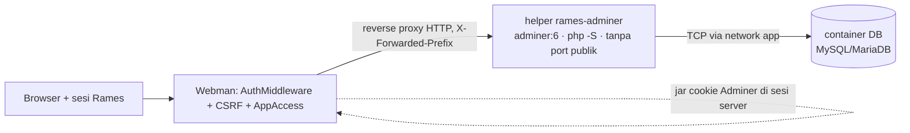
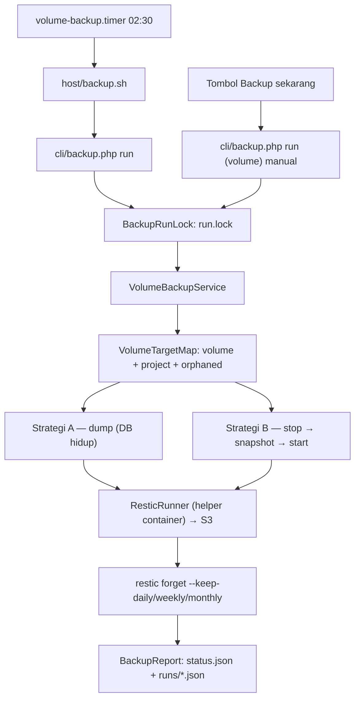

# SPECS.md — Rames (Deploy Dashboard)

## 1. Overview

Dashboard manajemen deployment sederhana (mirip cPanel) untuk mengelola:
- App (project) yang di-deploy dari repo Git yang sudah berisi `docker-compose.yml`
- Container yang dihasilkan oleh tiap app
- Reverse proxy Nginx yang mengarahkan subdomain ke container yang sesuai

**Phase 1 (selesai):** dashboard dan "agent" (logic eksekusi Docker/Nginx) dibangun dan dijalankan di **satu server yang sama**, dibungkus dengan Docker Compose.

**Fase multi-server (F0 + F1 + F2 + F3a + F3b/F3c + F3d + F4 + F4 lanjutan mendarat & terverifikasi):** ekstraksi itu sudah direalisasikan. Kode & image yang **sama** kini bisa dijalankan dalam dua peran runtime (`RAMES_MODE=dashboard|agent`): **control plane** (dashboard: UI, login, registry server, timer) dan **agent** (eksekutor di server tempat app berjalan, tanpa UI). Control plane mengendalikan satu atau lebih server agent lewat **HTTP JSON** di port agent sendiri (HTTPS self-signed + pinning fingerprint); operasi panjang (deploy/rebuild/rollback/…) dijalankan sebagai **job async** karena batas timeout HTTP 30 detik, dan ketersediaan direktori app di server agent diperiksa lebih dulu lewat preflight `POST /apps/check` **sebelum** record app dibuat (saran, bukan penegak — §7.14). Server tempat dashboard berjalan tetap menjadi server `local` bawaan, sehingga instalasi lama berperilaku persis seperti sebelumnya. Rincian kebutuhan fase ini ada di §2a & §5; registry server & scope per server di §7.14; op **tingkat server** (tarik image template di server itu, self-update agen, restore arsip volume) + gerbang versi/kapabilitas agen di §8h.13; halaman `/volumes` & `/apps` sadar-server di §7.15.

## 2. Goals (Phase 1)

- [x] Login dashboard dengan kredensial sederhana (username/password) dari store `auth` (SQLite, dahulu `database/auth.json`)
- [x] User bisa membuat app baru dengan menyuplai URL repo Git yang sudah punya `docker-compose.yml`
- [x] Sistem clone repo, build & jalankan `docker compose` untuk app tersebut
- [x] Sistem mendeteksi port yang dipakai di `docker-compose.yml`, mendeteksi konflik dengan app lain, dan memungkinkan user mengedit port host sebelum build
- [x] Sistem mencatat daftar container yang dihasilkan tiap app, ditampilkan di halaman detail app
- [x] App otomatis bisa diakses lewat `namasite.namadomain.com`, dengan `namadomain.com` diatur lewat `.env`
- [x] Sistem generate & reload config Nginx otomatis setiap ada app baru/berubah
- [x] Multi user untuk login dashboard, tanpa konsep role/permission (semua user punya akses yang sama)
- [x] SSL otomatis per subdomain menggunakan Let's Encrypt
- [x] Reload Nginx host via Docker socket (`NginxReloader`) sebagai pelengkap/fallback watcher (§8.4)
- [x] Rollback app ke versi sukses sebelumnya (checkpoint `deploy_history`, §7.5)
- [x] Dukungan repo private via deploy key SSH per app (§7.1)
- [x] Delete app dengan pilihan pertahankan/purge volume + halaman `/volumes` (§7.4)
- [x] Installer otomatis host (`host/install.sh`) — setup nginx, watcher, renewal certbot, `.env`, build dashboard, provisioning user admin (`host/create-admin.sh`, §6.3)
- [x] Nginx reload watcher host (`host/nginx-reload-watcher.sh` + systemd unit) (§8.3)
- [x] Renewal certbot otomatis (`host/certbot-renew.sh` + systemd timer) (§8a)
- [x] Kepemilikan app per user + sharing ke user lain (role viewer/operator/owner) & role global admin/member (§6.1, §7.7)
- [ ] Log viewer real-time per container (§8c)
- [x] Monitoring resource container & total VM — halaman global `/monitor` (§8d)
- [x] Search / filter / pagination daftar app (§8e) — **sebagian**: filter `name`/`domain`/`owner` selesai (owner admin-only); **belum**: `?q=`, `?status=`, pagination `SITES_PER_PAGE`
- [ ] Rate limiting / proteksi brute-force login (§8f)
- [ ] Backup otomatis data & config sebelum overwrite (§8g)
- [x] Backup volume harian ke object storage (S3) via restic — dump logis (DB) & snapshot (non-DB) (§8h)
- [x] Data domain dashboard (app/user/billing/seleksi+riwayat volume) disimpan di **SQLite** dalam named volume `rames` + **backup berkala** & impor otomatis JSON lama (§8i)
- [x] File manager container per container app (jelajah, unggah multi-berkas, unduh, edit teks, buat berkas baru, buat folder, rename, pindah, hapus, ekstrak arsip) — ability `files` = operator+, hanya saat container berjalan (§7.9)
- [x] Kredit, deposit & penagihan resource (role `member`) — meteran CPU/RAM per jam, tagihan periode otomatis, deposit manual admin + top-up mandiri online via Duitku (§7.12)

## 2a. Goals Multi-Server (fase F0–F4; F4 sebagian)

Kebutuhan fase ini (cek daftar di §12 untuk sisa yang belum):

- [x] **Dua peran runtime dari satu kode & satu image**: `RAMES_MODE=dashboard` (control plane: UI, login, timer) dan `RAMES_MODE=agent` (eksekutor: hanya route mesin, tanpa UI). Bukan fork kode — perbaikan bug berlaku di kedua peran.
- [x] **Satu domain dasar per server** (`servers.domain`, keputusan: satu `APP_DOMAIN` + wildcard DNS per server). Subdomain app = `{label}.{domain server pemilik app}`; app di server `local` tetap memakai `APP_DOMAIN` bila `servers.domain` kosong (tanpa perubahan perilaku).
- [x] **Kelola & pilih server = admin-only**: halaman `/servers` (pola `/nginx`; non-admin → **404**), pemilihan server hanya ada di create app untuk admin — tepatnya di **tiga form masuk wizard** (*Clone repo Git*, *Compose paste/upload*, dan *Template*) **plus langkah konfirmasi** (mode Git/Compose) yang meneruskan pilihan lewat `server_id` tersembunyi (§7.2 “Pemilih server tujuan”). Pemilih hanya dirender bila admin **dan** ada >1 server; non-admin hanya melihat catatan read-only server tujuan. Tidak ada ability per-server baru untuk member dan tidak ada pricing per server.
- [x] **Bootstrap manual + TLS self-signed + pinning**: ops menyiapkan server baru dan menjalankan `agent/install.sh` di server itu; admin menambahkan server lewat **Add Server** (paste token + PEM) lalu **Test connection**. TLS diterminasi **di proses agent** (port `8443`), bukan Nginx host; fingerprint yang di-pin = sertifikat agent sendiri. Karena token agent **tidak pernah ditampilkan ulang** oleh dashboard, form **Add Server**/**Ubah Server** menyediakan **perintah siap-salin** untuk mengambil `AGENT_TOKEN` + `AGENT_TLS_CERT` dari container agent di server tujuan (atau menjalankan ulang `agent/install.sh` — idempoten, tanpa `--force` token/sertifikat dipertahankan), sehingga admin tak perlu menyalin ulang dari terminal instalasi.
- [x] **Job async** (konsekuensi batas timeout HTTP 30 dtk): `POST /jobs` → balas `job_id` + `log_offset` → agent spawn worker `cli/deploy.php` detached → control plane **polling** `GET /jobs/{id}` & `GET /jobs/{id}/log?offset=N`.
- [x] **Preflight ketersediaan nama app sebelum record app dibuat (F1 lanjutan)**: create app di server agent memeriksa lebih dulu apakah direktori artefak `apps/<name>` di server itu bisa dipakai app baru — endpoint mesin `POST /apps/check` (read-only, **bukan job**: tanpa proyeksi, rekaman job, spawn worker, atau mutasi disk), dijalankan `AppController::createAndDeploy()` **paling awal, sebelum efek samping apa pun** (termasuk sebelum entri app dibuat). Nama yang berisi data tak dikenal ditolak sebagai **pesan ramah di wizard**, bukan "deploy gagal" sesudah record app lahir. Peran ganda disengaja: preflight = **saran/early-warning**, penegakan tetap di jalur job (guard kepemilikan direktori + `dropStaleDir()`) dan TOCTOU antara keduanya diterima. Agent versi lama (belum punya endpoint itu ⇒ **404**) **dilewati** supaya create yang sebelumnya jalan tidak mati; respons yang tak terbaca ⇒ **fail-closed**. Direktori tanpa penanda kepemilikan **tidak pernah** dihapus otomatis. Detail: §7.14.
- [x] **Keunikan per server** (bukan lagi global): nama app, host port, nama container, project compose, subdomain, dan custom domain diperiksa terhadap app **di server itu** (dua server boleh memakai nama/port/subdomain yang sama).
- [x] **Kompatibilitas single-server**: app lama otomatis ber-`server_id` = server `local` (migrasi skema v2), tanpa perubahan perilaku.
- [x] **Nginx/domain/SSL di server target (F2, terverifikasi)**: tulis/hapus/reload config Nginx & penerbitan/pencabutan SSL dijalankan sebagai job di agent (`nginx_write|nginx_remove|nginx_reload|ssl_issue|ssl_revoke`), perakitan vhost dibaca dari `GET /apps/{id}/nginx` (agent) sehingga control plane tidak menyalin logika/path Nginx; preflight direktori lewat `POST /nginx/check`. Jalur SSL control plane (`SslController`/`cli/ssl.php`) sadar server (mengirim job `ssl_issue`). Aksi UI subdomain/rute/domain **sadar server** lewat satu pintu per operasi (`AppNginxReloader`/`AppSslRevoker`) — app agent memakai job `nginx_reload`/`ssl_revoke` di servernya, **bukan** `NginxReloader`/`SslIssuer` host control plane (perbaikan bug Tinggi; ARCHITECTURE §5.27 + §8 GOTCHA no. 15).
- [x] **Log container & terminal per server (F3a, terverifikasi)**: `GET /apps/{id}/logs` (Engine server itu) + `POST /terminal/open|/terminal/{token}/input|close` & `GET /terminal/{token}/stream` di agent; control plane mem-proxy SSE **byte-passthrough** dan **sesi agent tidak ditutup saat klien drop**. `Run` (one-shot) untuk app agent sengaja **501** (bukan dieksekusi lokal).
- [x] **File manager per server (F3b, terverifikasi)**: file manager container app server agent dijalankan **di agent** (route agent `GET /files/list|read|download`, `POST /files/write|mkdir|rename|delete|move|upload|extract`; control plane `FileController` mem-proxy lewat `AgentDeployer::file*()`); Engine host control plane tidak disentuh. Library sama dengan jalur lokal ⇒ batas editor 2 MiB, listing 5000 entri, tolak biner, **zip-slip** tetap berlaku; transfer streaming dengan plafon **64 MiB** (`AgentDeployer::MAX_TRANSFER_BYTES`). Envelope galat domain agent HTTP 200 `{code:<status>,msg}` **kecuali** unduhan (status HTTP nyata) — kode 409/413/415/404 sama dengan jalur lokal.
- [x] **Monitoring per server (F3c, terverifikasi)**: `GET /api/monitor/overview` mengembalikan agregat **`data.servers[]`** (entri lokal + tiap server agent; `GET /system/host-usage` & `GET /monitor/containers` di agent — metrik `/proc`/Engine **server itu**, bukan host control plane). Satu server agent mati ⇒ entri `status:'offline'` + `error` tersanitasi, **tanpa** menggagalkan halaman; `GET /api/monitor/host` tetap server lokal saja. Penyaringan hak akses (app mana yang boleh dilihat) tetap di control plane.
- [x] **Daftar server tidak bocor ke non-admin (perbaikan F3c, terverifikasi)**: `data.servers[]` disaring **di server** oleh `ServerAccess::visibleServers()` — admin menerima semua server, non-admin **hanya** server yang menaungi app yang boleh ia lihat (`AppAccess::visible()`), tanpa app terlihat ⇒ tanpa entri agent (fail-closed). Server yang tidak boleh dilihat **tidak pernah dihubungi** (entrinya tidak dirakit) sehingga id/nama/kind/status/host/token-nya tak mungkin bocor lewat JSON; penyaringan di `public/js/monitor.js` hanya lapisan kedua (UX), bukan pengaman.
- [x] **Database/Adminer, network & volume per server (F3d, terverifikasi)**: route agent `GET /database/containers`, `ANY /adminer/{container}[/{path:.*}]`, `GET /networks`, `GET /networks/{id}`, `GET /volumes`, `POST /networks/*` (semuanya Engine **server itu**). Helper Adminer berjalan di server app (tanpa port publik); control plane meneruskan permintaan dengan **body mentah** (multipart/unduhan utuh), `X-Forwarded-Prefix` (hanya dari control plane) dan **jar cookie lewat header** `X-Rames-Adminer-Jar` (base64 JSON) sehingga agent tetap tanpa sesi. Halaman `/database` menampilkan **kolom server**; `/networks` menampilkan **pemilih server admin-only**; sambungan container lintas server **ditolak** (shared network hanya bermakna dalam satu server). Detail: §7.10, §7.14.
- [x] **Data per server (F4 + F4 lanjutan, terverifikasi)**: backup/restore/dump volume app server agent dijalankan **di server itu** sebagai job agent (`backup_run|restore|db_dump` → `BackupJobRunner`), kredensial S3/restic dibaca dari env/berkas 0600 server itu (tidak pernah masuk payload job/log/argv), riwayat backup di control plane **ter-scope `server_id`** (`BackupRegistry::scopeKey()` — tanpa migrasi skema). UI: badge server di detail app, kolom server di `/database`, kartu server di `/monitor`. Detail: §8h.12.
  - **Mendarat (F4 lanjutan, §8h.13)**: jadwal backup **fan-out per server** (timer host tetap `cli/backup.php run` **tanpa** `serverId`, tetapi run itu mengirim volume bertanda `scheduled` milik server agent sebagai job ke server pemiliknya — **satu clock** di control plane; `agent/install.sh` sengaja **tidak** memasang timer) dengan exit code per volume/server; unduh `.sql` **bertahap** dari staging server itu (`GET /backups/dump` + header `X-Rames-*`, dashboard `GET /backups/dump/sql`) + retensi staging (3 knob); restore **arsip volume** server agent (job `restore_archived` + `VolumeArchiveRestore`/`VolumeStateGuard`); template pull per server (§7.13); self-update agen + gerbang versi/kapabilitas (`AgentVersionGate`, `POST /servers/{id}/agent-update`, §7.8). **Sisa**: volume yatim server agent belum terlihat (§8h.13) dan UI belum mengirim `server_id` untuk aksi unduh `.sql`/`Run` baris agent.
- [x] **Metering & tagihan per server (F4b, terverifikasi)**: akrual menuntut **bukti container hidup di server pemilik app** — `UsageProbe` membaca Engine host (server `local`) atau `AgentDeployer::containerStats()` (`GET /monitor/containers`, server agent), **satu pembacaan per server per tick** dengan isolasi galat per server dan pesan tersanitasi. Server tidak terjangkau ⇒ app-nya **dilewati** pada tick itu + alasan dicatat (log + `skipped`), interval terlewat **tidak** ditagih kemudian (tanpa akrual ganda); baris `usage` menyimpan `server_id` yang **selamat** melewati reset periode `Invoicer`; gerbang kredit & auto-stop tidak berubah (admin tetap bebas; auto-stop **tidak pernah** jatuh ke server yang salah). **Satu clock**: timer billing hanya di control plane (`config/process.php` memasang `BillingProcess` **hanya** saat `RAMES_MODE≠agent`; agent tidak punya timer billing). Detail: §7.12. Batas diketahui: app yang nama **compose project-nya ≠ nama app** tidak teramati (skip + log).

## 3. Non-Goals (Phase 1)

- Permission granular per-resource (mis. izin terpisah untuk terminal vs database) — Phase 1 memakai 4 tingkat role tetap: admin, owner, operator, viewer (§7.7)
- Auto-scaling, health-check lanjutan & monitoring resource penuh (metrik historis, alerting) — Phase 1 hanya ringkasan status/usage per container (§8d)
- Log viewer streaming penuh & buffer historis — Phase 1 memakai polling tail sederhana (§8c)
- Podman — Phase 1 tetap pakai Docker Engine yang sudah familiar; migrasi ke rootless Podman jadi pertimbangan keamanan di fase lanjutan
- Refund/void transaksi kredit, rate limiting top-up, dan rekonsiliasi tagihan berbasis riwayat Docker (`StartedAt`) — Phase 1 memakai meteran tick inkremental + cap order pending (§7.12)

## 4. Tech Stack

| Komponen | Pilihan | Catatan |
|---|---|---|
| Backend/dashboard | Webman (PHP) | Sesuai stack yang sudah dikuasai user |
| Container runtime | Docker + Docker Compose | Dieksekusi lewat shell (`proc_open`/`exec`), bukan Docker API SDK, untuk kesederhanaan Phase 1 |
| Reverse proxy | Nginx (jalan sebagai container dalam compose stack yang sama) | Config di-generate ke direktori yang di-mount, reload via `docker exec nginx nginx -s reload` |
| Storage data | SQLite (satu berkas `rames.sqlite` di named volume `rames`), dokumen JSON di kolom `data` | Data domain (app/user/billing/seleksi+riwayat volume) dalam transaksi `BEGIN IMMEDIATE`; cache runtime tetap JSON (§8i) |
| Parsing YAML | Library YAML parser PHP (mis. `symfony/yaml`) | Untuk membaca & menulis ulang `docker-compose.yml` |

## 5. Arsitektur Phase 1

Nginx **tidak** dijalankan sebagai container — sistem memakai instalasi Nginx yang sudah ada langsung di host server (sesuai kebiasaan setup manual user sebelumnya). Dashboard hanya menulis file config ke direktori Nginx di host dan memicu reload; Nginx sendiri tetap dikelola sebagai service level-sistem (systemd), bukan bagian dari compose stack.

```
┌───────────────────────────────────────────────────────────┐
│                        Host Server                          │
│                                                             │
│   ┌────────────────────┐        ┌─────────────────────┐   │
│   │  Nginx (native,     │◀───────│  DNS *.example.com    │   │
│   │  systemd service)   │        └─────────────────────┘   │
│   │  :80 / :443         │                                  │
│   └─────────┬───────────┘                                  │
│             │ proxy_pass ke host_port tiap app             │
│             ▼                                               │
│   ┌────────────────────┐   ┌─────────────────────┐          │
│   │  App A containers   │   │  App B containers   │  ...   │
│   │  (docker compose)    │   │  (docker compose)     │        │
│   └────────────────────┘   └─────────────────────┘          │
│             ▲                        ▲                       │
│             └───────────┬────────────┘                       │
│                          │ docker.sock                        │
│                 ┌─────────────────────┐                       │
│                 │  Dashboard (Webman)   │                     │
│                 │  container            │                     │
│                 │  - Auth                │                     │
│                 │  - App CRUD           │                     │
│                 │  - Deployer           │                     │
│                 │    (LocalDeployer     │                     │
│                 │    + AgentDeployer    │                     │
│                 │    per server)        │                     │
│                 └───────────┬─────────┘                       │
│                              │ tulis file config                │
│                              ▼                                 │
│                 /etc/nginx/sites-available/{name}.conf         │
│                 (mounted volume ke dashboard container)         │
└───────────────────────────────────────────────────────────┘
```

**Reload Nginx tanpa exec langsung ke host:** karena dashboard jalan di dalam container sedangkan Nginx native di host, dashboard **tidak** langsung menjalankan perintah `nginx -s reload` di host (itu butuh akses shell ke luar container). Pendekatan yang dipakai:

- Direktori config Nginx di host (mis. `/etc/nginx/sites-available/`) di-mount sebagai **volume** ke dashboard container — dashboard cukup punya izin **tulis file** di situ, bukan izin eksekusi command host
- Di host, jalankan **watcher script** kecil (systemd service, pakai `inotifywait`) yang memantau perubahan di direktori tsb, lalu otomatis jalankan `nginx -t && nginx -s reload` begitu ada file baru/berubah
- Dashboard tidak pernah butuh sudo/SSH ke host — cukup tulis file, watcher yang urus sisanya

Ini menghindari kebutuhan expose SSH atau sudo dari dalam container ke host, sekaligus tetap memakai Nginx yang sudah ada di server.

**Catatan penting soal `docker.sock`:** Phase 1 tetap membutuhkan dashboard container mount `/var/run/docker.sock` untuk mengeksekusi `docker compose` bagi tiap app. Ini adalah *known risk* yang disengaja diterima untuk fase awal (single admin, tidak ada input publik ke dashboard). Validasi input tetap wajib diterapkan ketat (lihat bagian Security). Isolasi lebih baik lewat **agent terpisah** sudah direalisasikan (§2a/§5 — agent HTTP di server sendiri); rootless Podman sebagai pengganti `docker.sock` masih rencana fase lanjutan.

Struktur kode disiapkan dengan interface `DeployerInterface` (clone, build, up, get containers, generate nginx config) supaya implementasi bisa diganti dari "eksekusi lokal" menjadi "panggil agent HTTP" tanpa mengubah controller/business logic dashboard.

### Arsitektur multi-server (fase F0–F4; F4 sebagian)

Ekstraksi `DeployerInterface` sudah direalisasikan: pemilihan implementasi kini ditentukan oleh **dokumen server** pemilik app (`DeployerFactory::createForApp()` → `LocalDeployer` untuk server `local`, `AgentDeployer` untuk server `kind=agent`). Tidak ada jalur "app remote dijalankan lokal": `server_id` yang tidak dikenal **melempar**, bukan jatuh ke server lokal.

```
┌───────────────────────────────┐        ┌─────────────────────────────────┐
│ Server #1 — CONTROL PLANE      │        │ Server #2..N — AGENT            │
│ (dashboard, RAMES_MODE=dashboard)      │ (RAMES_MODE=agent, kode & image │
│                               │        │  yang sama, tanpa UI)           │
│  UI + Controller + Middleware │        │  AgentAuthMiddleware            │
│  SQLite: users, servers, apps │        │  AgentController / AgentJob…    │
│  (metadata = sumber kebenaran)│        │  SQLite: proyeksi app + job     │
│  ServerResolver + Factory     │  HTTPS │  LocalDeployer + app/library/*  │
│  cli/deploy.php (worker lokal)│ ─────▶ │  worker cli/deploy.php (detached)│
│                               │ ≤30 s  │  docker.sock + Nginx native     │
│  Nginx native (host #1)       │ + token│  Nginx native (host #2)         │
└───────────────────────────────┘        └─────────────────────────────────┘
```

- **Agent = eksekutor tanpa UI.** Mode `agent` menggerbangi `config/route.php`, `config/middleware.php`, dan `config/process.php` (listener TLS di `AGENT_BIND`, default `0.0.0.0:8443`); seluruh route dashboard tidak didaftarkan, dan hanya `AgentAuthMiddleware` (token) yang dipasang global. Tanpa `AGENT_TOKEN`, route agent **tidak didaftarkan sama sekali** (fail-closed → semua 404).
- **Transport**: JSON + bearer token + `X-Rames-Timestamp`/`X-Rames-Nonce` (+ signature HMAC opsional), TLS dengan self-signed cert sebagai trust anchor (`TlsPinMaterializer`), timeout ≤30 s.
- **Protocol**: seluruh route agent wajib token — termasuk `GET /healthz` & `GET /version`; tidak ada route publik di agent.
- **Agent memakai library yang sama** (`LocalDeployer`, `EnvManager`, `NginxConfigGenerator`, `cli/deploy.php`) sehingga tidak ada duplikasi logika deploy; yang berbeda hanya kerangka runtime.
- **Bootstrap**: `agent/install.sh` (di server agent, manual oleh ops) menyiapkan `secrets/agent.env`, sertifikat TLS self-signed, dan `docker-compose.agent.yml` (project `rames-agent`), lalu mencetak blok onboarding (URL/token/fingerprint/PEM). Dashboard menambahkannya lewat halaman **Servers** (§7.14).

Kepemilikan data antar peran (satu sumber kebenaran per bidang, himpunan field **disjoint**) dijelaskan di §7.14.

## 6. Autentikasi

### 6.1 Sumber data
Store `auth` di basis data SQLite (`config('deploy.sqlite_file')`, tabel `auth_users`) — dahulu `database/auth.json`. Tiap user = satu baris (dokumen JSON di kolom `data`; kolom turunan terindeks: `username`, `role`, `email`); berkas JSON lama diimpor otomatis sekali (§8i.3). Dokumen user berbentuk:

```json
[
  {
    "id": "u1",
    "username": "admin",
    "password_hash": "$2y$10$...",
    "role": "admin"
  },
  {
    "id": "u2",
    "username": "budi",
    "password_hash": "$2y$10$...",
    "role": "member"
  }
]
```

- Password disimpan sebagai hash (`password_hash()` PHP, bcrypt), **bukan plaintext**.
- Login membandingkan input dengan `password_verify()` terhadap entry yang `username`-nya cocok.
- **Role global user** (`role`):
  - `admin` — melihat **semua** app (beserta nama pemiliknya) dan **punya kuasa penuh** ke semua app; satu-satunya yang boleh mengelola user.
  - `member` — hanya melihat app miliknya sendiri dan app yang **dibagikan** kepadanya; app user lain tidak terlihat sama sekali.
- **Migrasi dokumen lama**: user tanpa field `role` diperlakukan sebagai user pertama = admin, sisanya member (dibaca saat runtime, tanpa menulis ulang) — instalasi lama tidak pernah kehilangan admin.
- Halaman **Manage Users** (`/users`) hanya bisa diakses admin: tambah/hapus user, ganti password, ubah role. Menghapus user **mengalihkan seluruh app miliknya ke admin yang menghapus**; admin terakhir tidak bisa dihapus/diturunkan. Perubahan role & penghapusan user **langsung berlaku** pada request berikutnya (session disinkronkan dengan store `auth` oleh `AuthMiddleware`, bukan hanya saat login).
- Kepemilikan app diatur terpisah (per app) di store `apps` — lihat §7.7.

### 6.2 Alur
1. User akses `/login`, isi username & password
2. Sistem baca store `auth`, cari entry dengan `username` yang cocok, verifikasi password
3. Jika valid, buat session (Webman session bawaan) yang menyimpan `id`/`username` user tsb
4. Semua route dashboard selain `/login` dilindungi middleware auth
5. Logout menghapus session

### 6.3 Provisioning awal
Entry pertama di store `auth` dibuat lewat console command `php webman make:admin [username] [password]` (password tidak diberikan ⇒ di-generate acak dan dicetak satu kali) yang dijalankan sekali saat setup. User pertama otomatis berrole **admin**. User tambahan berikutnya dibuat lewat halaman "Manage Users" di dashboard (khusus admin). Command `php webman app:assign-owner` menugaskan app lama yang belum punya owner (§7.7).

**Di jalur instalasi host**, provisioning dijalankan `host/create-admin.sh` (dipakai `host/install.sh`, bisa juga dijalankan manual kapan saja: `sudo ./host/create-admin.sh [username] [password]`). Script itu **menunggu bootstrap container selesai lebih dulu**: `command:` compose menjalankan `composer install` (bila `vendor/autoload.php` belum ada) → `php cli/db.php migrate` → `php cli/db.php import-json` → `php start.php start`, sementara container sudah berstatus `running` sejak detik pertama bootstrap — sehingga `docker exec … php webman make:admin` yang dipanggil terlalu cepat gagal dengan `Failed to open stream: … vendor/autoload.php` (gejala + sebab + penangkal: `ARCHITECTURE.md` §3). Probe readiness-nya `GET /healthz` **dari dalam** container (port internal `8787`, bukan `APP_PORT` host) yang membalas JSON `"ok":true` ⇔ vendor terpasang + skema SQLite termigrasi + server listening. Gagal ⇒ exit code non-zero + keluaran `make:admin` dan potongan log container dicetak (tidak lagi ditelan diam-diam).

## 7. App Management

### 7.1 Sumber data
Store `apps` di basis data SQLite (`config('deploy.sqlite_file')`, tabel `apps_apps`) — dahulu `database/apps.json`. Satu baris = satu app (dokumen JSON di kolom `data`; kolom turunan terindeks: `name`, `owner_id`, `status`, `source`, `subdomain`; urutan via kolom `ord`). Berikut bentuk dokumen app:

```json
[
  {
    "id": "b3f1c2a4-...",
    "name": "myapp",
    "server_id": "local",        // id server pemilik app (registry §7.14); kosong/absen = server lokal
    "source": "git",             // git (hasil clone repo) | compose (paste/upload docker-compose.yml)
    "owner_id": "u1",
    "members": {
      "u2": { "role": "operator", "added_at": "2026-09-16T09:10:00+07:00", "added_by": "u1" },
      "u3": { "role": "viewer",   "added_at": "2026-09-16T09:12:00+07:00", "added_by": "u1" }
    },
    "subdomain": "myapp-x7k2",     // label slug (bukan FQDN); kosong/null = {name}.{APP_DOMAIN} (§7.11)
    "repo_url": "https://github.com/user/myapp.git",
    "branch": "main",
    "local_path": "apps/myapp",
    "primary_service": "web",
    "primary_port": 8080,        // port container yang di-proxy Nginx ke domain (dipilih user saat create)
    "container_prefix": "myapp",  // prefix nama container (override container_name) — null/kosong = nama default compose
    "status": "running",
    "auth_method": "none",       // none (publik) | ssh (deploy key per repo)
    "ssh_key": null,              // path relatif private key (mis. "keys/myapp") utk repo private
    "containers": [
      {
        "service_name": "web",
        "container_name": "myapp_web_1",
        "image": "myapp-web:latest",
        "internal_port": 8080,
        "host_port": 30001,
        "status": "running"
      },
      {
        "service_name": "worker",
        "container_name": "myapp_worker_1",
        "image": "myapp-worker:latest",
        "internal_port": null,
        "host_port": null,
        "status": "running"
      }
    ],
    "limits": {                   // batas maksimum CPU/memori per service (§7.6b); null/absen = tanpa limit dashboard
      "web":    { "cpus": 1.5,  "memory_mb": 512 },
      "worker": { "cpus": null, "memory_mb": 256 }
    },
    "nginx_routes": [             // rute proxy tambahan per app (§8.2a); absen/[] = perilaku lama (config identik)
      { "path": "/api/", "target": "http://127.0.0.1:3001" }
    ],
    "host_ports": [                // rencana host port pilihan user (multi-server F1); dipakai merakit override port job agent
      { "service": "web", "container": 8080, "host": 30001 }
    ],
    "compose_content": "services:\n  web:\n    ...", // master compose app server agent (tab Compose); TIDAK diproyeksikan ke agent
    "custom_domain": null,         // FQDN custom domain app (§8b); ikut diproyeksikan ke agent (bukan rahasia)
    "created_at": "2026-08-13T10:00:00+07:00",
    "updated_at": "2026-08-13T10:05:00+07:00"
  }
]
```

> Konvensi: sebutan lama `apps.json` di bagian lain dokumen ini (mis. §7.2, §7.4, §8.2a) merujuk pada store `apps` (SQLite) ini.

Field penting:
- `name` — slug (dipakai sebagai nama project compose, direktori lokal `apps/{name}`, dan subdomain **default** bila `subdomain` kosong, §7.11). Sejak multi-server keunikannya **per server** (`AppStore::findByNameOnServer()`): dua app di server berbeda boleh memakai nama yang sama, tetapi nama tidak boleh duplikat di server yang sama (§7.14)
- `server_id` — id server pemilik app di **registry server** (§7.14); kosong/absen = server `local` (perilaku app lama, migrasi skema v2 mengisi `local`). Dimensi ini menentukan *di mana* app dieksekusi (`DeployerFactory::createForApp()`); normalisasi lewat `AppStore::serverIdOf()` (satu jalur)
- `source` — asal source app: `git` (default bila field absen — dibuat lewat mode *Clone repo Git*) atau `compose` (dibuat lewat mode *Compose (paste/upload)*: file `docker-compose.yml` ditulis langsung ke `apps/{name}` **tanpa repo Git**, untuk image prebuilt). Menentukan perilaku Rebuild (§7.2a) dan ketersediaan Rollback (§7.5)
- `owner_id` — id user pemilik app; app hanya terlihat oleh owner, member yang dibagikan, dan admin (§7.7)
- `members` — map `userId → {role, added_at, added_by}`; role `viewer` | `operator` | `owner` (co-owner)
- `primary_service` — nama service dalam `docker-compose.yml` yang menerima traffic dari subdomain (ditentukan user saat create, default: service pertama yang punya port exposed)
- `primary_port` — **port container** pada service tersebut yang menerima trafik domain app (di-reverse-proxy Nginx). Dipilih user di halaman konfirmasi saat create; absen/null = port pertama service (perilaku app lama). Penting untuk service yang mempublikasikan **lebih dari satu port** (mis. web `9119` + gateway API `8642`): semua port tetap di-*publish* ke host port masing-masing (bisa diakses langsung `http://<host>:<port>`), tetapi hanya satu yang dilayani domain app
- `containers[].host_port` — port di host yang sudah final dipakai (setelah resolusi konflik), inilah yang dipakai Nginx sebagai target `proxy_pass`
- `containers[].ports[]` — daftar **semua** port yang di-publish container (`{host, container}`), **tanpa duplikat**: Docker Engine mengembalikan satu entri per alamat IP untuk publish dual-stack (IPv4 `0.0.0.0` + IPv6 `::`), dashboard menduplikasi-kannya (`AppPorts::forContainer()`). Dipakai untuk menampilkan daftar port & memilih port yang di-proxy (`primary_port`)
- `container_prefix` — prefix **nama container** (`container_name`): bila diisi, setiap service memakai nama `{prefix}-{service}` (mis. `myapp-web`) alih-alih nama default compose `{nama_app}_{service}_{n}`. Absen/null = nama default (perilaku app lama). Ditulis ke `docker-compose.override.names.yml` (`ContainerNames`, §7.6a)
- `auth_method` — metode akses repo: `none` (publik, anonim) atau `ssh` (deploy key per app)
- `ssh_key` — path relatif private key terhadap `database_path` (mis. `keys/myapp`), dipakai saat `git pull` Rebuild; hanya path yang disimpan, private key di file terpisah (`database/keys/`)
- `template` — `{slug, title}` bila app dibuat dari template (§7.2b), `null` untuk app lain. Hanya penanda asal-usul (untuk audit/tampilan); template **tidak** di-*re-sync* setelah create — perubahan sumber dilakukan lewat tab Compose/Deploy Ulang seperti app compose lain
- `env` — map `KEY => value` environment variable app (§7.6); untuk app dari template diisi saat create (nilai form, default template, atau hasil auto-generate)
- `limits` — map `service => {cpus: float|null, memory_mb: int|null}`: batas **maksimum** CPU (core, float) & memori (MB, int) per service (§7.6b). `null`/absen = tidak diatur dashboard (nilai compose repo tetap berlaku); tanpa migrasi untuk app lama. Ditulis ke `docker-compose.override.limits.yml` (`ResourceLimits`, §7.6b). Hanya admin yang boleh mengubah (§7.7)
- `nginx_routes` — daftar rute proxy tambahan per app (§8.2a): `[{path, target}]`, opsional, maks. **20** rute. Absen/`[]` = perilaku lama (config Nginx identik, tanpa perubahan). Dirender ke **serve block** (HTTP 80 & HTTPS 443) saja; tanpa migrasi untuk app lama
- `subdomain` — label slug subdomain app (§7.11): huruf kecil `a-z`, angka, `-`, diawali & diakhiri alfanumerik, maks. **63** karakter (batas label DNS). FQDN efektif = `{label}.{APP_DOMAIN}`; kosong/absen = `{name}.{APP_DOMAIN}` (perilaku lama). Nilai lama yang sudah berupa **FQDN penuh** (mengandung titik) tetap dihormati — tanpa migrasi data. Ditulis lewat tab **Domain & SSL** (`SubdomainManager` + `NginxConfigGuard::applySubdomain()`, §7.11)
- `host_ports` — rencana host port pilihan user (`[{service, container, host}]`, multi-server F1 celah B). Dipakai `AgentArtifactPackager` merakit berkas override port (`artifacts.files`) untuk job app server agent supaya agent tidak memakai port bawaan repo. **Tidak** ikut diproyeksikan ke agent; hanya ada di dokumen app control plane (rekamannya juga tersedia dari `apps/<name>/docker-compose.override*.yml` untuk app lokal)
- `compose_content` — **master compose app server agent** (isi mentah tab Compose) yang disimpan di dokumen app, bukan berkas lokal — trade-off sadar agar tidak ada tulisan file lokal di control plane untuk app agent (ARCHITECTURE §5.24). Didahulukan atas berkas `apps/<name>/` saat merakit artefak job; **tidak** diproyeksikan ke agent. `custom_domain` (FQDN custom domain, §8b) **ikut** diproyeksikan (bukan rahasia) karena state SSL/domain milik agent perlu tahu domain efektif

### 7.2 Alur "Create App"

Ada **tiga mode sumber** di halaman `/apps/create`. Link navigasi berurutan **Template**, **Clone repo Git**, lalu **Compose (paste / upload)**; mode aktif ditandai sebagai state navigasi aktif. Mode default tetap **Clone repo Git**.

| Mode | Sumber | Cocok untuk |
|---|---|---|
| **Template** (§7.2b) | template siap-pakai di folder `templates/<slug>/` (compose prebuilt + deklarasi env) | app docker-ready yang sering dipakai (galeri satu klik) |
| **Clone repo Git** (default) | `git clone` repo yang berisi `docker-compose.yml` | app yang di-build dari source (`build:`/Dockerfile) |
| **Compose (paste / upload)** (§7.2a) | file `docker-compose.yml` yang di-paste/di-upload + file pendukung | app dengan image **prebuilt** (tanpa build context) |

**Pemilih server tujuan (multi-server, admin-only)** — setiap **form masuk wizard** membawa pemilih **Server tujuan** *di dalam* `<form>`-nya: mode *Clone repo Git* (`/apps/create`), *Compose (paste / upload)* (`/apps/create/compose`), dan *Template* (`/apps/create/template/{slug}`). Pemilih dirender hanya bila user berhak memilih server (`ServerAccess::canSelectServer()`) **dan** ada lebih dari satu server; non-admin (atau admin dengan satu server) hanya melihat catatan read-only “App akan dibuat di server `<nama>`” — daftar server lain tidak pernah dirender. Langkah **konfirmasi** (mode *Clone repo Git* & *Compose*, langkah 7) menampilkan ringkasan server terpilih (read-only, tanpa pemilih) dan meneruskan pilihan lewat `<input type="hidden" name="server_id">`. Pilihan dipertahankan saat berpindah layar: tautan nav wizard (tab mode, tautan **Deploy** galeri template, tombol **Batal**/**Kembali**, breadcrumb) membawa `?server_id=<id>` **hanya bila** server terpilih bukan `local` — parameter itu **hanya preselect** (dibaca `createForm()`/`templateForm()`), sedangkan target deploy selalu ditentukan `server_id` di **body form** dan divalidasi ulang fail-fast (`AppController::resolveCreateServer()` — server = sumber kebenaran, dan hidden input sengaja **tidak** ditulis ulang menjadi `local`). Detail teknis: `ARCHITECTURE.md` §5.22, GOTCHA §8 no. 27.

**Batas resource (opsional)** — lintas ketiga mode: **setiap user login** dapat memilih **batas maksimum CPU & memori per service** saat membuat app — di **langkah konfirmasi** (mode *Clone repo Git* & *Compose*, §7.2 langkah 7) dan di **form template** (§7.2b) — lewat **penggeser** (slider) dengan plafon: owner/member dibatasi plafon billing, admin tanpa plafon (kapasitas host). Nilai compose repo ditampilkan sebagai **prefill**; posisi paling kiri slider = **tidak diatur dashboard** (admin: ikut compose repo / tanpa batas; owner/member: dipakai nilai default akun dari `BILLING_DEFAULT_*`). Mengubah limit app yang **sudah ada** tetap **admin-only** (tab Sumber Daya, §7.7). Detail: §7.6b.

**Langkah mode Clone repo Git:**

1. **Input form**: nama app (slug), URL repo Git, branch (default `main`)
2. **Validasi**: nama unik (cek `apps.json`), format slug valid (`a-z0-9-`), URL repo formatnya valid
3. **Clone repo** ke `apps/{name}` (`git clone --branch {branch} {repo_url} apps/{name}`). Untuk repo private, sistem **membangkitkan deploy key SSH per app** (keypair ed25519 di `database/keys/{name}`), menampilkan public key agar user menambahkannya sebagai Deploy Key repo (Settings → Deploy keys), lalu clone memakai `GIT_SSH_COMMAND` (`ssh -i {key} -o IdentitiesOnly=yes -o StrictHostKeyChecking=accept-new`)
4. **Cek keberadaan** `docker-compose.yml` (atau `.yaml`) di root repo — jika tidak ada, tolak dan tampilkan error
5. **Parse** `docker-compose.yml`, ekstrak semua service beserta `ports:` mapping (`HOST:CONTAINER`)
6. **Deteksi konflik port**: bandingkan setiap host port dengan seluruh `host_port` yang sudah terpakai di `apps.json`
   - Jika konflik, sistem sarankan port alternatif dari range yang dikonfigurasi (`PORT_RANGE_START`–`PORT_RANGE_END` di `.env`)
7. **Tampilkan halaman konfirmasi** — user melihat daftar service & port yang terdeteksi (**satu baris per port**, jadi service dengan >1 port punya host port sendiri-sendiri), bisa mengedit host port manapun sebelum lanjut, dan memilih **satu port** yang menerima trafik domain app (radio *Trafik domain* → `primary_port`). Port lain tetap dipublikasikan ke host port-nya dan diakses langsung `http://<host>:<port>`. Di halaman yang sama user boleh mengisi **prefix nama container** (opsional, §7.6a).
8. **Tulis ulang port**: sistem menulis `docker-compose.override.yml` di direktori app (bukan mengubah `docker-compose.yml` asli) berisi override `ports:` sesuai hasil edit user — supaya file asli dari repo tetap bersih dan tidak konflik saat `git pull` update berikutnya. Bila prefix nama container diisi, ditulis juga `docker-compose.override.names.yml` (§7.6a).
9. **Pilih primary service & port** — user pilih service + port container yang akan menerima traffic domain (dropdown/radio dari daftar service yang punya port exposed)
10. **Build & Up**: jalankan `docker compose -p {name} -f docker-compose.yml -f docker-compose.override.yml up -d --build`
11. **Kumpulkan info container**: jalankan `docker compose -p {name} ps --format json` untuk ambil nama container, status, image
12. **Generate config Nginx** untuk `{name}.{APP_DOMAIN}` yang proxy ke `127.0.0.1:{host_port primary_service}`
13. **Validasi config**: `docker exec nginx nginx -t` — jika gagal, rollback (app tetap dibuat tapi status `error`, tampilkan pesan error ke user)
14. **Reload Nginx**: `docker exec nginx nginx -s reload`
15. **Simpan** seluruh data app ke `apps.json` dengan `status: running` dan `owner_id` = user pembuat (§7.7)

**App tanpa port host (didukung)**

Bila tidak ada satu pun service yang mem-publish port (mis. server database yang hanya dipakai internal), halaman konfirmasi tetap bisa dilanjutkan: app dibuat **tanpa** `primary_service`/`primary_port` (keduanya kosong). App seperti itu **tidak dibuatkan vhost & subdomain** — langkah Nginx (12–14) dilewati, config Nginx lama (bila app pernah punya port) dibuang, dan deploy tetap berakhir `running` (bukan `error`). Port juga tidak diteruskan ke host, jadi app hanya bisa dijangkau lewat network Docker (mis. halaman `/database` menyambung sendiri ke network app). Begitu `ports:` ditambahkan pada compose (tab Compose) lalu Deploy Ulang, app otomatis kembali punya domain — begitu pula sebaliknya: bila port hilang (mis. container tidak jalan), deploy tetap sukses tanpa vhost, dan status container yang sebenarnya terlihat di tab Container.

### 7.2a Mode "Compose (paste / upload)"

Mode create kedua: app dibuat **tanpa repo Git**, hanya dari file `docker-compose.yml` yang ditempel (textarea) atau diunggah, plus file pendukung opsional (mis. config yang di-bind mount). Berguna untuk mendeploy app yang **tidak butuh build image custom** (semua service memakai `image:` prebuilt).

**Batasan & validasi (ditolak dengan pesan jelas, bukan gagal di tengah build)**
- Service **wajib** punya `image:` dan **tidak boleh** memakai `build:` — mode ini tidak punya source/build context (`ComposeSource::assertDeployable()`).
- Nama file unggahan wajib relatif & aman: segmen `[A-Za-z0-9._-]+`, tanpa `..`/path absolut, dan **file override generated** (`docker-compose.override*`) tidak boleh diunggah.
- Ukuran unggahan dibatasi (`COMPOSE_UPLOAD_MAX_FILE_BYTES` default 1 MB/file, `COMPOSE_UPLOAD_MAX_TOTAL_BYTES` default 4 MB/request).
- `docker-compose.yml` harus dari **salah satu** sumber: textarea ATAU file unggahan (keduanya sekaligus ditolak supaya tidak ambigu).

**Alur**
1. **Input form** (tab *Compose*): nama app (slug), isi `docker-compose.yml` (paste) dan/atau file unggahan (`files[]`, multipart), plus pemilih **Server tujuan** untuk admin (§7.2 “Pemilih server tujuan”).
2. **Validasi** nama (slug unik & format) lalu file ditulis ke `apps/{name}` (`ComposeSource::store()` → validasi dulu, baru tulis; gagal = direktori dibersihkan & form dirender ulang dengan isi yang sudah diisi user).
3. **Parse** compose (`ComposeParser`) → daftar service & port; sama seperti mode Git, host port yang berkonflik diresolusi ke range `PORT_RANGE_START`–`PORT_RANGE_END`.
4. **Halaman konfirmasi** (§7.2 langkah 7) + pilih primary service — header menampilkan sumber *file compose* (bukan repo/branch).
5. **Tulis override port** (2 lapis `!reset` + `ports`) ke direktori app.
6. **Worker deploy** (`cli/deploy.php {id} deploy`): `docker compose up -d --build` (tanpa langkah git) → collect container → tulis config Nginx → status `running`. `source: "compose"` dan `repo_url`/`branch`/`auth_method` = `null`.

**Penyiapan bind mount (otomatis)**
- Sebelum `docker compose up` (deploy/rebuild/deploy ulang/apply env), `ComposeBinds::ensure()` memindai seluruh source bind mount: device volume bernama dengan `driver_opts: {o: bind}` (mis. `device: ${PWD}/.hermes`) dan bind mount service (`- ./data:/data`, long syntax `{type: bind, source: ...}`) → direktori yang belum ada **dibuat otomatis di dalam direktori app**, **kecuali** entri long syntax yang menyatakan `bind: {create_host_path: false}` — deklarasi itu **dihormati** (tidak dibuat, hanya dilaporkan dengan alasan eksplisit) sehingga path salah ketik membuat deploy gagal, bukan dibuat diam-diam (dipakai template `opencode`, §7.2b). Tanpa ini daemon gagal: `failed to populate volume: ... mount <path>:...: no such file or directory`.
- Substitusi variabel mengikuti docker compose: `${PWD}` = direktori app (runner menyetel env `PWD` ke direktori app agar deterministik) dan `${VAR}` dari managed env app.
- **Tidak** dibuat otomatis (hanya dilaporkan, dan ditambahkan sebagai petunjuk pada pesan error `docker compose up`): source berupa **file** (`./nginx.conf`, `./.env`, `./app.json`), path **di luar** direktori app (`/srv/data`, `../shared`), dan entri long syntax ber-`bind: {create_host_path: false}` — walau path-nya di dalam direktori app. Untuk file, unggah lewat tab Compose.

**Rebuild / Deploy ulang (khusus mode compose)**
- Tombol **Rebuild** di detail app berlabel **Deploy Ulang** dan **tidak** menjalankan `git pull` (tidak ada repo): hanya `docker compose up -d` **tanpa** `--build` dari file compose + image lokal yang ada (`DeployerInterface::apply()` / `LocalDeployer::rebuild()` untuk app compose).
- Worker menerima mode `apply` — dipakai setelah compose diedit lewat tab **Compose** di detail app (§7.3).
- **Rollback & halaman Versi tidak tersedia** untuk app mode ini (tidak ada checkpoint commit Git, §7.5); `deploy_history` tetap dicatat sebagai log deployment dengan `sha` kosong.
- **Tab Compose** (ability `compose` = Operator ke atas) — editor isi `docker-compose.yml` + unggah/ganti/hapus file pendukung. Simpan = validasi (`build:` ditolak) → **regenerate override port** (host port lama dipertahankan per service; konflik dengan app lain digeser otomatis) → spawn worker `apply` (progres via polling status, §7.2 langkah 10).

### 7.2b Mode "Template" (galeri app siap-pakai)

Mode create ketiga: app dibuat dari **template** yang sudah disiapkan di folder `templates/<slug>/` (ikut versi repo dashboard, dikelola admin/dev lewat git — bukan lewat UI). Tujuannya: satu klik untuk app docker-ready yang berulang (mis. gateway WhatsApp, workflow automation, monitoring), tanpa menempel compose dan tanpa menebak variabel environment-nya. Katalog template yang sama juga ditampilkan di halaman **Config → tab Template** (`/nginx?tab=template`) sebagai daftar + tombol **Tarik image** untuk menyegarkan image prebuilt template (§7.13).

**Struktur satu template**

```
templates/<slug>/
  template.yml          # metadata + deklarasi env (lihat tabel di bawah)
  docker-compose.yml    # isi compose app (image prebuilt, tanpa `build:`)
  guide.md              # opsional: panduan Markdown yang dirender di UI (tidak disalin ke app)
  files/                # opsional: file pendukung yang di-bind mount (mis. nginx.conf)
```

| Field `template.yml` | Wajib | Fungsi |
|---|---|---|
| `title`, `description`, `category`, `icon`, `docs_url` | tidak | nama dan detail template di daftar/modal (default: slug / "Lainnya") |
| `env[]` → `{key, label, help, default, secret, generate, required}` | tidak | field di form deploy + aturan nilai (lihat di bawah) |
| `primary` → `{service, port}` | tidak | service + **port container** yang di-proxy ke domain app; default = service pertama yang punya `ports:` |
| `files[]` → nama relatif | tidak | file dari `files/` yang disalin ke direktori app |

**Aturan template (ditegakkan `TemplateCatalog`, ditolak dengan pesan jelas sebelum deploy)**
- Service **wajib** punya `image:` dan **tidak boleh** `build:` — template memakai jalur mode compose (§7.2a), jadi tidak ada build context.
- **DILARANG** `container_name` dan `deploy.replicas`/`scale` > 1: nama container dikelola dashboard (prefix otomatis = nama app, §7.6a) supaya satu template bisa dipakai banyak app.
- **DILARANG** `name:` di level atas: nama project compose ditentukan dashboard dari nama app (dipakai untuk reuse volume saat app dibuat ulang, §7.4).
- `ports:` **opsional**: template tanpa port (mis. server database yang tidak perlu diekspos ke host) menghasilkan app **tanpa vhost/subdomain** — `primary` sengaja dikosongkan, bukan dianggap template rusak (§7.2).
- Setiap `${VAR}`/`$VAR` di compose **tanpa nilai default** wajib dideklarasikan di `env[]` (variabel yang diisi sistem seperti `${PWD}` dikecualikan); tanpa aturan ini compose tetap jalan dengan variabel kosong (docker compose hanya memberi warning) sehingga app bisa diam-diam salah konfigurasi.
- File pendukung wajib relatif & aman (segmen `[A-Za-z0-9._-]+`, tanpa `..`) dan tidak boleh memakai nama file override yang dikelola dashboard (`docker-compose.override*`).
- Template yang rusak **tetap tampil** di daftar; status dan pesan error ditampilkan di modal detail, dan tombol deploy dinonaktifkan (bukan dihilangkan diam-diam).

**Nilai environment** (`TemplateCatalog::resolveEnv()`), urutannya: nilai dari form → `default` template → **auto-generate** (`generate: secret`, nilai acak hex 48 karakter) → tolak bila `required`. Nilai yang dikosongkan tanpa default/generate tidak ditulis. Hasilnya disimpan ke `apps.json.env` **dan** ditulis `EnvManager` ke `database/env/{name}.env` + `docker-compose.override.env.yml` sehingga langsung ter-inject ke seluruh service.

**Panduan template (`guide.md`)** — setiap template boleh menyertakan panduan **Markdown** di root template: `templates/<slug>/guide.md` (**bukan** di `files/` dan **tidak** ikut di-materialize ke `apps/{name}`; panduan murni metadata katalog). Isi panduan dirender aman ke HTML (`Markdown::toHtml()`, ARCHITECTURE §5.1c) dan tampil di **tiga tempat**:
1. **Tab Panduan** pada modal detail di galeri `/apps/create?mode=template` (bersanding dengan tab **Detail**);
2. **Modal tersendiri** di halaman form deploy `/apps/create/template/{slug}` (tombol **📖 Panduan**);
3. **Modal tersendiri** di halaman detail app — hanya bila app dibuat dari template (entri `apps.json` punya `template.slug`) **dan** template itu masih ada di katalog.

Template tanpa panduan tetap menampilkan tab Panduan dengan pesan fallback di galeri, sedangkan modal tidak dirender pada form deploy/detail app. Membaca panduan bersifat **non-fatal**: file tidak ada/kosong/terlalu besar (> 256 KB) atau katalog gagal dibaca **tidak pernah** menggagalkan deploy maupun halaman detail (detail app membungkus bacaannya dengan try/catch). **WAJIB**: seluruh template bawaan galeri (§ di bawah) menyertakan `guide.md` berisi dan menghasilkan HTML — ditegakkan test `TemplateCatalogTest::testShippedTemplatesHaveGuide`, **bukan** lewat `valid=false`, supaya template pihak ketiga tanpa panduan tetap dapat di-deploy.

**Alur deploy (satu langkah, tanpa halaman konfirmasi port)**

1. Link navigasi mode **Template** membuka galeri grid thumbnail. Tiap tile menampilkan logo image lokal (atau fallback icon bila logo tidak tersedia), nama, dan category. Mode ini berada sebelum **Clone repo Git** dan **Compose (paste / upload)**; mode default tetap **Clone repo Git** dan link mode aktif memiliki state navigasi aktif.
2. Klik tile membuka modal detail berisi deskripsi, category, image, port, target domain, jumlah variabel environment dan file, status validitas/pesan error, serta dokumentasi. Modal memiliki tab **Detail | Panduan** (tab Panduan menampilkan `guide.md` yang sudah dirender, atau pesan fallback bila tidak ada). Link dokumentasi hanya menjadi link aktif bila URL menggunakan `http` atau `https`. Tombol **Deploy** aktif untuk template valid dan disabled untuk template invalid.
3. Tombol Deploy pada template valid membuka form `/apps/create/template/{slug}` yang tetap menggunakan alur yang ada: nama app (slug) + field env (field `secret` memakai input password; diberi keterangan "kosongkan untuk dibuat otomatis"). Bila template punya panduan, form menyediakan tombol **📖 Panduan** yang membuka modal tersendiri. Form juga menampilkan kartu **Batas Sumber Daya** (opsional, penggeser/slider CPU & memori per service, prefill dari compose repo — §7.6b) untuk **semua user login** (owner/member dibatasi plafon billing; admin tanpa plafon = kapasitas host). Form ini juga memuat pemilih **Server tujuan** untuk admin (§7.2 “Pemilih server tujuan”); route create dan empty state tetap sama.
4. `POST /apps/create/template/{slug}` → validasi template + nama + nilai env (`TemplateCatalog::resolveEnv()`), lalu **materialisasi** file template ke `apps/{name}` (`ComposeSource::store()` — validasi identik dengan mode paste/upload).
5. Parse compose → **host port diresolusi otomatis** (`PortManager::resolve()`: host port template dipertahankan bila bebas, konflik digeser dari `PORT_RANGE_START`–`PORT_RANGE_END`); `primary_service`/`primary_port` diambil dari `primary` template (template tanpa `ports:` → keduanya kosong = app tanpa vhost/subdomain, §7.2); **prefix nama container = nama app** (dicek bentrok se-host, §5.12/§7.6a).
6. Tulis override port + nama container (+ override limits bila user mengisi, §7.6b), tulis env (managed + override), lalu simpan entri app (`source: compose`, `template: {slug, title}`) dan spawn worker `deploy`.
7. UI memakai AJAX + polling yang sama dengan create biasa: langsung diarahkan ke halaman detail app yang menampilkan progres build (`deploying` → `build` → `collect` → `nginx` → `running`). Halaman detail app menyediakan tombol **📖 Panduan** + modal tersendiri bila app dibuat dari template dan template itu masih ada di katalog.

**Logo template — satu sumber, satu berkas per slug**

Peta logo diturunkan dari isi direktori **nyata** oleh helper **`template_logo_map()`** (`app/functions.php:311`): memindai `public/images/templates/` dan mengembalikan peta `slug → ekstensi`, hanya untuk ekstensi whitelist **`svg`/`png`/`webp`** (case-insensitive) dengan slug aman `[a-z0-9-]+`, dan **satu berkas per slug** (berkas pertama yang ditemukan `glob()` menang). Helper ini **satu-satunya** sumber peta logo dan dipakai **tiga** view pada **empat** titik render: galeri create-app (tile `<span class="template-tile-media">` di `app/view/app/create.php:156`; fallback `<span class="template-tile-fallback">` = emoji `icon` atau `◈`) beserta **judul modal detail** template di halaman yang sama (blok `<h2 class="modal-title">`, `app/view/app/create.php:176`; fallback emoji `icon` atau `◈`), judul form deploy (`app/view/app/template.php:25`; fallback emoji `icon`), dan kartu **tab Template** halaman Config (`app/view/nginx/partials/tab-templates.php:209`; fallback emoji `icon` atau `📦`) — tidak ada glob/map terduplikasi di view. Karena itu menambah/mengganti logo **tidak butuh perubahan kode**: cukup taruh berkas `public/images/templates/<slug>.<ext>`; menghapus berkas mengembalikan keempat titik ke fallback emoji `icon`, dan bila `icon` di `template.yml` kosong yang tampil adalah `◈` (tile & judul modal) atau `📦` (kartu tab Template).

Logo produk dibundel sebagai aset lokal dengan ekstensi apa adanya dari sumbernya (`svg`/`png`): **mayoritas** dari [Dashboard Icons](https://dashboardicons.com/) / [repo dashboard-icons](https://github.com/homarr-labs/dashboard-icons), dan browser tidak mengambil logo dari CDN saat runtime. **Pengecualian (bukan Dashboard Icons)**: `waha.png` memakai logo resmi WAHA lokal, `raisfast.png` diambil dari situs vendor resminya (`https://www.raisfast.com/images/logo.png`), `wabaileys.png` diambil dari URL yang diberikan operator (`https://image.web.id/images/logo-wabaileys.jpg` — JPEG 407×407 dikonversi ke PNG tanpa resizing), serta `static-html.svg` — ilustrasi lokal yang dibuat khusus untuk galeri (tidak ada produk bernama `static-html` yang bisa diambil dari Dashboard Icons; beda struktur berkasnya: `viewBox="0 0 256 256"` + gradien ber-id `static-html-tile`, bukan aset merek 512×512). Berkas PNG lokal saat ini: `openclaw`, `lemp`, `lemp74` (salinan `lemp.png`), `picoclaw`, `ghost`, `raisfast`, `waha`, `wabaileys`; sisanya SVG lokal (mis. `n8n`, `nocodb`, `outline`, `cockpit`, `uptime-kuma`, `mysql`, `mariadb`, `static-html`, serta `opencode` — `public/images/templates/opencode.svg`, satu berkas per slug). **Semua template bawaan sudah punya berkas logo**; fallback emoji `icon` tetap berlaku sebagai jalur untuk template tanpa berkas logo (mis. template baru) atau bila berkas logonya dihapus.

Kegagalan sebelum entri app dibuat membersihkan direktori `apps/{name}` (tidak ada state setengah jadi). Hasil akhirnya adalah **app mode compose biasa**: bisa Stop/Start/Rebuild (Deploy Ulang), atur domain & SSL, kelola env/network/nama container, terminal, log, dan database — dengan catatan **tanpa rollback** karena tidak ada repo Git (§7.5).

**Template bawaan galeri** (ikut versi repo, bukan data runtime): `uptime-kuma`, `n8n`, `waha`, `wabaileys`, `ghost`, `outline`, `nocodb`, `raisfast`, `openclaw`, `picoclaw`, `opencode`, `lemp`, `lemp74`, `cockpit`, `static-html` (situs HTML statis — BusyBox httpd), serta server database `mysql` (MySQL 8.4 LTS) dan `mariadb` (MariaDB 11.4 LTS). Template database hanya menerima dua hal saat create: **password root** (auto-generate bila dikosongkan) dan **nama database awal** — sengaja **tanpa** user aplikasi (`MYSQL_USER`/`MARIADB_USER`), karena `DbCredentialResolver` mengutamakan pasangan user aplikasi di atas root: bila dideklarasikan, sesi Adminer `/database` (dan **dump backup otomatis**) ikut memakai user ber-hak-terbatas, bukan root (kemampuan admin penuh seperti CREATE DATABASE/USER & GRANT tidak lagi jadi alasan — panel `/database` kini Adminer, §7.10). User aplikasi untuk dipakai aplikasi dibuat dari **dalam Adminer** (bukan tab Pengguna yang sudah tidak ada). Keduanya juga sengaja **tidak mem-publish port ke host**: app tanpa vhost/subdomain, port 3306 tidak diteruskan ke host (tidak terekspos jaringan), dan server dikelola lewat `/database` — proxy Adminer (§7.10) menyambung sendiri ke network app lewat helper internal. Data disimpan di volume per app sehingga aman saat container dibuat ulang; blok `ports:` bisa ditambahkan lewat tab Compose lalu Deploy Ulang bila DB perlu dijangkau dari host / app lain.

Template `ghost` adalah template Ghost core minimal: `ghost:6-alpine` + `mysql:8.0`, dengan named volume untuk content dan database. `GHOST_URL` wajib sama dengan domain/subdomain app yang diatur di Rames; `MYSQL_ROOT_PASSWORD` dan `MYSQL_PASSWORD` dibuat otomatis bila dikosongkan. Port container Ghost `2368` dipublish dan host port-nya dikelola Rames untuk Nginx native. Template ini **bukan** compose resmi `ghost-docker` utuh: tidak menyertakan Caddy, service Tinybird/Analytics, atau ActivityPub self-hosted.

#### Template `outline`

Template `outline` menyediakan Outline (image prebuilt), PostgreSQL 18, dan Redis. Port container Outline `3000` dipublish dengan host port yang dikelola Rames untuk reverse proxy Nginx; URL publik `URL` wajib cocok dengan domain/subdomain app Rames, termasuk custom domain bila sudah dikonfigurasi di Rames. Outline mewajibkan provider authentication eksternal: template memakai OIDC automatic discovery dan memerlukan `OIDC_ISSUER_URL`, `OIDC_CLIENT_ID`, serta `OIDC_CLIENT_SECRET`. Login lokal username/password tidak tersedia. `SECRET_KEY`, `UTILS_SECRET`, dan `POSTGRES_PASSWORD` dibuat otomatis bila dikosongkan. Named volumes menyimpan data PostgreSQL dan local file storage Outline. SMTP tidak diperlukan untuk basic OIDC login, tetapi dapat dikonfigurasi kemudian untuk email transaksional. Dokumentasi image/hosting: [Outline Docker](https://docs.getoutline.com/s/hosting/doc/docker-7pfeLP5a8t); dokumentasi OIDC: [Outline OIDC](https://docs.getoutline.com/s/hosting/doc/oidc-8CPBm6uC0I).

#### Template `nocodb`

Template `nocodb` adalah workspace NocoDB mandiri dengan satu service `nocodb/nocodb:latest` pada port container `8080`, dipublish melalui host port yang dikelola Rames untuk reverse proxy Nginx. SQLite adalah database **metadata internal NocoDB**; named volume `nocodb-data` pada `/usr/app/data` mempertahankan data tersebut. Secret `NC_AUTH_JWT_SECRET` dibuat otomatis. Template ini **tidak** menyertakan atau menjalankan MySQL/MariaDB, dan create app tidak meminta kredensial database target.

Setelah deploy, pengguna menambahkan **external data source** melalui UI NocoDB, lalu mengisi host, port, nama database, user, dan password MySQL/MariaDB yang sudah tersedia. Database metadata SQLite internal dan external datasource target adalah dua hal berbeda: volume template menyimpan metadata NocoDB, bukan database target; menghubungkan datasource bukan otomatis dan tidak membuat database target.

Target harus dapat dijangkau dari container NocoDB menggunakan hostname dan port yang routable. Untuk database pada app Compose Rames lain, kedua app harus di-attach ke shared external network yang sama melalui konfigurasi network Rames. Gunakan user database dengan privilege minimum yang diperlukan, dan jangan expose port database ke publik tanpa alasan. Panduan koneksi datasource: [NocoDB Connect to Data Source](https://nocodb.com/docs/product/integrations/data-sources/connect-to-data-source).

#### Template `raisfast`

Template `raisfast` menyediakan RaisFast (headless CMS & backend-as-a-service berbasis **Rust**, satu binary) sebagai satu service dengan image prebuilt `ghcr.io/raisfast/raisfast:latest`. Port container `9898` dipublish dan host port-nya dikelola Rames untuk reverse proxy Nginx native. Data disimpan di **SQLite internal** (bukan database eksternal yang dikelola saat create); named volume `raisfast-data` pada `/app/storage` (default `STORAGE_ROOT_DIR` image) mempertahankan database (`storage/db/raisfast.db`), uploads, dan logs.

Template berjalan dengan `APP_ENV=production`: `JWT_SECRET` dibuat otomatis (hex 48 karakter), sedangkan `BASE_URL` **wajib** diisi (URL publik app, harus cocok dengan domain/subdomain yang diatur di Rames) dan dipakai juga sebagai `CORS_ORIGINS`. `APP_KEY` **wajib** diisi dan harus berupa **base64 dari tepat 32 byte** (`openssl rand -base64 32`; 44 karakter berakhiran `=`) karena dipakai untuk enkripsi AES-256-GCM (mis. token API) dan image **tidak** dapat mem-persist `.env` otomatis (direktori `/app` milik root). Nilai `APP_KEY` harus tetap sama selama data terenkripsi masih dipakai.

Setelah deploy, admin UI tersedia di `/admin` untuk menyiapkan akun admin; health endpoint `/healthz`.

**GOTCHA**: karena `APP_ENV=production`, RaisFast **menolak start** bila `JWT_SECRET` masih default atau `CORS_ORIGINS` kosong — template menyediakan keduanya, jadi jangan menghapus `BASE_URL`. Dokumentasi: [RaisFast Docs](https://www.raisfast.com/en/docs).

#### Template `openclaw`

Template `openclaw` adalah gateway asisten AI self-hosted dengan **Control UI berbasis WebSocket**, memakai satu service `openclaw-gateway` (image prebuilt `ghcr.io/openclaw/openclaw:latest`). Port container `18789` dipublish dan host port-nya dikelola Rames untuk reverse proxy Nginx; command container menjalankan `gateway --bind lan --port 18789` (`--bind lan`, bukan loopback, agar port yang di-publish bisa dijangkau Nginx host). Dua named volume menyimpan data persisten: `openclaw-state` → `/home/node/.openclaw` (state, config `openclaw.json`, workspace) dan `openclaw-auth-profile` → `/home/node/.config/openclaw` (kunci profil autentikasi provider). Hardening mengikuti compose resmi: `cap_drop` `NET_RAW`/`NET_ADMIN`, `no-new-privileges`, dan `extra_hosts host.docker.internal:host-gateway` agar provider model lokal di host bisa dijangkau. Healthcheck bawaan image (`/healthz`) **tidak** diduplikasi di template.

Environment form: `OPENCLAW_GATEWAY_TOKEN` (auto-generate bila dikosongkan) dipakai untuk masuk ke Control UI; `TZ` (default `Asia/Jakarta`). `OPENAI_API_KEY` dan `ANTHROPIC_API_KEY` **opsional** (`required: false`; bila dikosongkan tidak ditulis) — salah satu boleh diisi, atau onboarding dilakukan lewat tab Terminal app.

Sebagian pengaturan **belum otomatis** dan harus dilakukan pengguna lewat tab **Terminal** app: onboarding/penambahan channel, dan `gateway.controlUi.allowedOrigins` untuk origin publik. **Peringatan keamanan**: jangan mengekspos gateway ke publik tanpa token akses, dan tinjau ulang hardening serta eksposur OpenClaw. Logo galeri memakai aset logo lokal `public/images/templates/openclaw.png` (menggantikan `openclaw.svg` lama — WAJIB satu berkas per slug, §7.2b).

#### Template `lemp`

Template `lemp` adalah wadah gaya *shared hosting*: **1 app = nginx + PHP-FPM + MySQL**. Service `web` memakai image prebuilt `yllumi/fpm8.4-nginx` (varian kurasi dari `serversideup/php:8.4-fpm-nginx`; **PHP 8.4**; nginx + php-fpm sudah dikonfigurasi di image, **tanpa** `build:`), dan service `mysql` memakai image resmi **`mysql:8.4`**. Port container `8080` di-publish dan di-proxy ke domain app oleh Nginx host Rames → `primary: {service: web, port: 8080}`. Peruntukannya: pengguna **menaruh aplikasi PHP-nya sendiri** secara manual lewat tab **Terminal** app (tanpa git, tanpa build) — beda dari template aplikasi siap-pakai seperti `outline`/`nocodb`/`raisfast`. Untuk aplikasi **legacy** yang belum kompatibel PHP 8, gunakan varian **`lemp74`** (PHP 7.4, image `yllumi/fpm7.4-nginx`) — lihat sub-bagian **Template `lemp74`** di bawah.

**Penyimpanan**: kode aplikasi di named volume `app-code` → `/var/www/html`, data MySQL di `mysql-data` → `/var/lib/mysql` (keduanya per app). **Docroot publik = `/var/www/html/public`** (nilai `NGINX_WEBROOT` yang di-set eksplisit di compose — juga nilai bawaan image), sehingga file di luar `public/` (vendor, config, `.env`) **tidak** dapat diakses dari browser.

**GOTCHA (WAJIB)** — volume kode **wajib** di-mount ke `/var/www/html`, **bukan** `/app`. Volume baru mewarisi ownership `www-data` dari direktori image sehingga user default container bisa menulis; mount ke path yang tidak ada di image (mis. `/app`) membuat Docker membuat mountpoint `root:root` dan `www-data` gagal menulis. Konsekuensinya: file aplikasi ditaruh lewat tab **Terminal** (berjalan sebagai `www-data`), sedangkan file yang dibuat sebagai `root` (mis. `docker cp`) **tidak bisa** ditulis `www-data` — perbaikannya `chown -R www-data:www-data /var/www/html`. Volume `app-code` yang masih kosong membuat domain menampilkan **404/blank** sampai aplikasi ditaruh (**normal**, bukan kegagalan deploy).

**Environment form (5 field)**: `TZ` (default `Asia/Jakarta`; juga menjadi `PHP_DATE_TIMEZONE`), `MYSQL_ROOT_PASSWORD` (*auto-generate* bila dikosongkan), `MYSQL_DATABASE` (default `app`), `PHP_MEMORY_LIMIT` (default `256M`), `PHP_DISPLAY_ERRORS` (default `Off`). Sisa nilai (`PHP_OPCACHE_ENABLE=1`, `NGINX_WEBROOT`, `APP_BASE_DIR`, `DB_*`) adalah **konstanta compose**, bukan field form.

Aplikasi menyambung ke DB pada host `mysql` (nama service), port `3306`, user `root`, lewat env `DB_HOST`/`DB_PORT`/`DB_DATABASE`/`DB_USERNAME`/`DB_PASSWORD` yang di-inject ke service `web`; port `3306` **tidak** dipublikasikan ke host. Halaman `/database` Rames tetap memakai **root** karena template sengaja **tidak** mendeklarasikan `MYSQL_USER`/`MYSQL_PASSWORD` (aturan yang sama dengan template `mysql`/`mariadb`, §7.2b): `DbCredentialResolver` mengutamakan user aplikasi sehingga menambahkannya membuat panel manager kehilangan hak admin. Backup/restore kedua volume lewat halaman **Volume**. **Tanpa rollback** karena app dibuat mode compose (tanpa repo Git, §7.5).

**GOTCHA 1 (WAJIB)**: service `web` **DILARANG** memakai `init: true` — image `serversideup/php` memakai **s6-overlay** yang wajib PID 1; menambahkannya memicu `s6-overlay-suexec: fatal: can only run as pid 1` → container restart loop (exit 100). Ini **kebalikan** dari pola `mysql`/`openclaw` yang justru memakai `init: true`.

**GOTCHA 2 (WAJIB)**: `mysql:8.4` **tidak** menyediakan healthcheck bawaan, sedangkan service `web` memakai `depends_on: {mysql: {condition: service_healthy}}` → template **wajib** menulis healthcheck `mysqladmin ping` eksplisit; tanpanya deploy gagal dengan `has no healthcheck configured`.

HTTPS ditangani Nginx host Rames yang mengirim `X-Forwarded-Proto` (aplikasi harus mempercayai proxy header; `SSL_MODE=mixed` **tidak** membuat `$_SERVER['HTTPS']` menjadi on). Kartu galeri memakai aset logo lokal `public/images/templates/lemp.png` (**logo PHP** dari Dashboard Icons, disimpan dengan nama slug template), dengan **fallback icon** emoji `🐘` (dari `icon`) hanya bila berkas logo tidak ada. Dokumentasi image: [serversideup/php](https://serversideup.net/open-source/docker-php/docs/).

#### Template `lemp74`

Template `lemp74` adalah varian **legacy** dari `lemp`: service, volume, port, environment, dan healthcheck-nya **identik**, bedanya hanya **versi PHP & image** — service `web` memakai `yllumi/fpm7.4-nginx` (**PHP 7.4.33**, varian kurasi dari `serversideup/php:7.4-fpm-nginx` dengan s6-overlay) alih-alih `yllumi/fpm8.4-nginx`. Karena itu seluruh GOTCHA `lemp` (§ di atas) berlaku sama: volume kode wajib di-mount ke `/var/www/html`, docroot publik `/var/www/html/public`, larangan `init: true` pada service `web`, dan healthcheck `mysqladmin ping` eksplisit pada service `mysql`. **PHP 7.4 sudah EOL** (tanpa patch keamanan sejak November 2022), jadi template ini hanya untuk aplikasi lama yang belum kompatibel PHP 8 — untuk proyek baru pakai `lemp` (PHP 8.4). Template ini **tidak menambah aturan galeri baru**: ia murni entri katalog tambahan dengan pola `template.yml`/`docker-compose.yml`/`guide.md` yang sama, ikut memakai berkas logo `public/images/templates/lemp74.png` — **salinan byte-identik** `lemp.png` (logo PHP, 949×512) — sehingga tidak lagi memakai fallback; bila berkas itu tidak ada, view otomatis jatuh ke fallback emoji (`🐘`) (§7.2b).

#### Template `picoclaw`

Template `picoclaw` menyediakan **PicoClaw** — asisten AI personal ultra-ringan dari Sipeed: satu binary Go, RAM di bawah 10 MB dan boot dalam milidetik (klaim resmi proyek). Ia **bukan** fork/proyek OpenClaw: proyeknya mandiri (diinspirasi NanoBot) dan diposisikan sebagai **alternatif ringan** dari OpenClaw, jadi konfigurasi/compose `openclaw` **tidak** berlaku di sini. Satu service `picoclaw` memakai image resmi `ghcr.io/sipeed/picoclaw:launcher` (registry resmi paralel: `docker.io/sipeed/picoclaw:launcher`; platform `linux/amd64`, `linux/arm64`, `linux/riscv64` — **tanpa** arm/v7). Port container `18800` (Web console launcher) dipublish dan host port-nya dikelola Rames untuk reverse proxy Nginx → `primary: {service: picoclaw, port: 18800}`.

**Kenapa tag `launcher`, bukan `latest` (GOTCHA)**: tag `latest` memakai entrypoint yang menjalankan onboarding lalu **`exit 0`** pada run pertama (`docker/entrypoint.sh`, "First-run setup complete.") sehingga container langsung mati dan masuk **restart-loop** sebelum config terbentuk. Tag `launcher` melakukan onboarding sendiri (non-interaktif) dan tetap hidup, menyajikan Web console, sekaligus **menjalankan gateway chat otomatis** dan mem-proksinya (termasuk WebSocket) — jadi cukup satu port yang dibuka. Tag stabil terakhir saat template ini ditulis: `v0.3.1` (tag `v0.3.1-launcher`); `nightly*` adalah prerelease.

**Port gateway (18790) sengaja tidak dipublish**: di dalam container gateway diikat ke loopback dan Web console sudah mem-proksinya, jadi mengeksposnya hanya menambah permukaan serangan. Publish 18790 hanya bila benar-benar memakai channel mode webhook dari jaringan luar — dan saat itu **wajib** juga men-set `PICOCLAW_GATEWAY_HOST=0.0.0.0` supaya gateway mengikat seluruh antarmuka container.

**Penyimpanan (dua named volume, keduanya WAJIB ikut backup)**: `picoclaw-data` → `/root/.picoclaw` (config `config.json`, workspace sesi/memory/cron/skills, `auth.json`, `launcher-auth.db`, `launcher-config.json`, logs) dan `picoclaw-ssh` → `/root/.ssh`. **GOTCHA**: kunci enkripsi kredensial `picoclaw_ed25519.key` berada di `/root/.ssh` — **di luar** `PICOCLAW_HOME` — sehingga volume `picoclaw-ssh` **wajib** persisten: bila hilang, kredensial yang tersimpan sebagai `enc://` **tidak bisa didekripsi lagi**. Compose memin `HOME=/root` eksplisit supaya resolusi home runtime selalu menunjuk ke dalam volume (bukan bergantung pada nilai HOME image).

**Environment form**: hanya `TZ` (default `Asia/Jakarta`; memengaruhi jadwal cron/reminder asisten & stempel waktu log). Sisa nilai (`HOME=/root`, `PICOCLAW_HOME=/root/.picoclaw`, `PICOCLAW_LOG_LEVEL=warn`) adalah **konstanta compose**, bukan field form. Kredensial model/provider **tidak** diisi lewat form env: diisi di Web console (langkah setelah deploy) atau dengan menyunting `/root/.picoclaw/config.json` lewat tab **Terminal** app.

**Auth = password Web console, bukan token env**: kunjungan pertama ke domain app mengarah ke `/launcher-setup`; password disimpan (bcrypt) di `launcher-auth.db` di dalam volume `picoclaw-data`. **Tidak ada** env untuk men-set password, dan opsi lama `PICOCLAW_LAUNCHER_TOKEN` **sudah tidak didukung** versi sekarang meskipun sebagian dokumentasi/situs masih menyebutnya (basi). Bila password lupa, hapus `launcher-auth.db` di volume lalu buka `/launcher-setup` lagi. Jangan membuka Web console tanpa password: launcher memakai password ini sebagai satu-satunya lapisan auth, dan request yang datang lewat reverse proxy host diperlakukan sebagai loopback (melewati allowlist CIDR launcher).

**Hardening & healthcheck**: `init: true` (launcher adalah PID 1 yang men-spawn gateway/subproses — mencegah proses yatim/zombie & meneruskan SIGTERM dengan rapi saat stop/restart dari dashboard), `cap_drop: NET_RAW`/`NET_ADMIN`, dan `security_opt: no-new-privileges:true`. Image rilis **tidak** membawa HEALTHCHECK, jadi template menulis sendiri `wget -q --spider http://127.0.0.1:18800/api/auth/status` (endpoint publik launcher yang selalu 200 selama launcher hidup, dan tidak ikut gagal saat gateway belum jalan); image berbasis `alpine:3.21` sehingga `wget` busybox tersedia.

**Peringatan pra-1.0**: README resmi PicoClaw memperingatkan jangan memakainya di produksi sebelum v1.0 — perilaku/format config masih bisa berubah antar rilis. Kartu galeri memakai aset logo lokal `public/images/templates/picoclaw.png`, dengan **fallback icon** emoji `🦐` (dari `icon`) hanya bila berkas logo tidak ada.

**Menyegarkan image**: tag `launcher` bergerak, jadi image yang sudah ada di host perlu ditarik ulang lewat tombol **Tarik image** di **Config → tab Template** (§7.13) — image `:latest`/tag bergerak **tidak** diperbarui oleh `docker compose up` (`--pull missing`) — lalu tekan **Deploy Ulang** pada app agar container memakai image baru. Dokumentasi resmi: [PicoClaw Docker](https://docs.picoclaw.io/docs/docker/).

#### Template `opencode`

Template `opencode` menyajikan **OpenCode** — agen koding AI open source — sebagai **server** dengan UI web: satu service `opencode` memakai image prebuilt `ghcr.io/anomalyco/opencode:latest` (repo proyek berpindah dari `sst/opencode`; tag `ghcr.io/sst/opencode` **tidak** ada), command `opencode serve --hostname 0.0.0.0 --port 4096 --print-logs`, UI web di `/`. Port container `4096` dipublish dan host port-nya dikelola Rames untuk reverse proxy Nginx host ⇒ `primary: {service: opencode, port: 4096}`. Pola template biasa tetap dipatuhi: tanpa `build:`/`container_name`/`name:`. Tag `latest` bergerak, jadi menyegarkan image memakai tombol **Tarik image** di **Config → tab Template** (§7.13) lalu **Deploy Ulang**.

**Auth wajib = HTTP basic auth untuk seluruh permukaan UI/API** (UI, WebSocket, SSE): `OPENCODE_SERVER_PASSWORD` (auto-generate hex bila dikosongkan, `generate: secret` + `secret: true`) dan `OPENCODE_SERVER_USERNAME` (default `opencode`). Tanpa password server opencode berjalan **tanpa perlindungan** — password **wajib** dan tidak boleh dihapus selama app hidup.

**Mount project (satu bind mount, READ-WRITE)**: `OPENCODE_PROJECTS_DIR` = **path absolut di host** ke direktori project yang boleh dibaca **dan** diubah opencode, dipasang ke `/home/opencode/project` — **di dalam HOME**, `working_dir` — **karena picker direktori UI opencode berakar di `$HOME`** dan API berkasnya ter-sandbox ke lokasi project (`location.directory`): di luar HOME project tidak muncul di picker (hanya folder state tersembunyi HOME). Nilai ini **wajib diisi saat create** (tanpa `default`, `required: true`) dan **boleh diganti kapan pun** lewat tab **Environment**: apply env menjalankan `docker compose up -d` **tanpa build** sehingga container **di-recreate** dan mount ikut berpindah (terbukti: id container berubah, `/home/opencode/project` pindah). Bind memakai **long syntax + `create_host_path: false`** sehingga path yang belum ada/salah ketik membuat deploy **GAGAL** — daemon menolak dengan `bind source path does not exist`, dan `ComposeBinds::ensure()` **menghormati** deklarasi itu (§7.2a) sehingga **tidak ada** direktori yang dibuat otomatis, **termasuk** bila path-nya berada di dalam direktori app — jadi app tidak bisa "sukses" dengan `/home/opencode/project` kosong alih-alih host mendapat direktori **root-owned** baru secara diam-diam. Nilai kosong ditolak lebih dulu oleh interpolasi wajib `${OPENCODE_PROJECTS_DIR:?…}` (pesan `required variable OPENCODE_PROJECTS_DIR is missing a value`). Project **wajib writable** (mount read-only membuat bootstrap opencode gagal `EROFS`).

**Privilege drop ke pemilik project**: kontainer start sebagai **root** (agar bisa `apk add` + `chown` volume HOME), lalu skrip menjalankan `opencode serve` lewat **`su-exec`** sebagai `uid:gid` **pemilik direktori project** — supaya berkas yang dibuat opencode di project host tetap **milik uid host** (mencegah kepemilikan campuran yang merusak operasi git di host, pola yang sama dengan ARCHITECTURE §8 GOTCHA no. 38). Override `OPENCODE_RUN_AS` (`uid:gid`) divalidasi **dua syarat**: bentuk kanonik `^(0|[1-9][0-9]{0,9}):(0|[1-9][0-9]{0,9})$` **dan** rentang tiap bagian `0..4294967295` (mis. `0033:33` dan `4294967296:0` ditolak); di luar itu **diabaikan + `WARN`** (container **tidak** dibuat gagal/restart loop) lalu jatuh ke deteksi otomatis `stat -c '%u:%g' /home/opencode/project`. Sebelum `exec`, template menjalankan **gerbang pemakaian target** — `chown` **direktori** HOME `/home/opencode` **tanpa `-R`**, kepemilikan `/home/opencode` sama dengan target, dan uji tulis `/home/opencode` sebagai target harus lulus ketiganya; setelah gerbang lolos, isi HOME di-`chown -R` per entri **dengan mengecualikan mountpoint project** (dan mountpoint lain, via `/proc/mounts`) — `chown -R /home/opencode` **dilarang** karena rekursi itu menuruni bind project dan **mengubah kepemilikan berkas project di host** (terbukti: sentinel `root:root` di project tetap `0:0` pada versi ini; pada versi lama berubah menjadi `1000:1000`). Bila salah satu syarat gerbang gagal (nilai bentuk-sah tetapi tak bisa dipakai) target **tidak dipakai**: `WARN` + opencode berjalan sebagai **root**; hal yang sama berlaku bila deteksi gagal/owner root/`su-exec` absen (berkas baru di project jadi milik root — perbaiki dengan `OPENCODE_RUN_AS` yang sah atau `chown` di host).

**git dipasang saat start (fail-soft)**: image resmi **tidak** memuat `git`/`bash`, jadi template menjalankan `apk add --no-cache git bash su-exec` pada **setiap start** (layer container hilang saat recreate ⇒ tidak bisa dipasang sekali saja). Butuh **egress ke repo Alpine**; gagal ⇒ `WARN` + container **tetap hidup**, hanya fitur git yang mati (`opencode serve` tidak bergantung pada git). Untuk user hasil turun hak itu, template juga mendaftarkan `safe.directory '*'` (mencegah `detected dubious ownership`) dan mengisi identitas commit lewat `GIT_USER_NAME`/`GIT_USER_EMAIL` (**opsional**).

**Persistensi & kredensial provider**: named volume `opencode-home` → `/home/opencode` (`HOME` dipin ke sana) menyimpan config, `opencode.db`, `auth.json`, state, dan cache — **di luar** project (menghapus volume = kehilangan login provider & riwayat sesi). Kredensial provider model **opsional** lewat env `ANTHROPIC_API_KEY`/`OPENAI_API_KEY`/`OPENROUTER_API_KEY` (semua `secret`, `required: false`), atau lewat login provider di UI / tab **Terminal** app (`~/.local/share/opencode/auth.json`).

**Runtime & healthcheck**: `init: true` + `stop_grace_period: 5s` (image tanpa tini dan SIGTERM-nya kurang dihormati ⇒ tanpa init `docker stop` menunggu sampai SIGKILL). Healthcheck memanggil `/global/health` dengan header `Authorization: Basic …` yang dirender dari env container (`wget --header`; kredensial dirujuk dari env, **tanpa** password literal di compose) sehingga bekerja juga untuk password ber-karakter khusus.

**Batas yang diketahui**: (1) `apk add` tiap start menuntut egress Alpine (lihat di atas); (2) Nginx host **tidak** menyetel `proxy_buffering off`/`proxy_read_timeout` khusus untuk situs app, sehingga **SSE** bisa terasa lambat/tertunda di balik proxy — WebSocket sendiri sudah diteruskan konfigurasi proxy Rames, jadi UI tetap berfungsi (batas yang diketahui, bukan bug template); (3) image tanpa `git`/`bash`/`tini` — jangan menghapus langkah `apk add` bila butuh git di terminal opencode; (4) mengganti `OPENCODE_PROJECTS_DIR` = recreate ⇒ sesi opencode yang sedang berjalan berhenti (state tetap di volume); (5) path yang **ada tetapi tidak bisa diakses** tidak menggagalkan deploy (bind mount dijalankan root, deteksi uid hanya membaca metadata) tetapi opencode bisa gagal membaca project; (6) **fuzzy file-finder opencode menolak *file system root or home directories*** ⇒ fitur find mati saat picker menelusuri HOME, sedangkan scope project normal (`/find/file?directory=/home/opencode/project`) dan penjelajahan direktori (`GET /file`) yang dipakai picker **tetap** jalan (batas vendor, bukan bug template).

**Peringatan keamanan (WAJIB dipahami operator)**: opencode adalah agen dengan akses shell **di dalam container** yang me-mount direktori project ⇒ siapa pun yang bisa membuka UI/terminal app ini dapat **mengubah isi direktori itu** (apa pun yang dilakukan opencode di project, terjadi di host lewat berkas project). Karena itu: password **wajib**; **jangan sharing** app ini ke user yang tidak dipercaya (owner/operator bisa mengubah `OPENCODE_PROJECTS_DIR` dan env lain); **jangan** mengarahkan `OPENCODE_PROJECTS_DIR` ke direktori berisi rahasia (mis. direktori yang memuat `database/env/` atau `database/keys/`); dan ingat port `4096` dipublish ke host sehingga **hanya** dilindungi password. Kartu galeri memakai aset logo lokal `public/images/templates/opencode.svg`.

Template `static-html` menyajikan **situs HTML statis**: satu service `web` memakai image prebuilt `yllumi/httpd:latest` (**BusyBox httpd** di Alpine 3.24, berjalan sebagai root, healthcheck bawaan `wget -qO- http://127.0.0.1/`), dengan docroot = `working_dir` **`/www`** pada named volume `static-www` — volume di-scope per app (nama project compose = nama app) sehingga aman dipakai banyak app sekaligus dan **sertakan pada backup**. `ports: ["80"]` ditulis **hanya sebagai port container** (tanpa host port): host port dialokasikan dashboard dari `PORT_RANGE_START`–`PORT_RANGE_END` (default 30000–30999, `config/deploy.php`) lalu Nginx host me-reverse-proxy domain/subdomain app ⇒ `primary: {service: web, port: 80}` (app punya vhost/subdomain). **DILARANG menulis `80:80`**: port 80 host sudah dipakai Nginx native Rames, sedangkan `PortManager::resolve()` hanya menganggap port app lain di `apps.json` sebagai terpakai sehingga deploy berisiko gagal `address already in use`. Template **tanpa `env[]`**, tanpa database, dan **tanpa berkas awal**: container start dengan `/www` kosong ⇒ `GET /` = **404** (BusyBox httpd build ini **tidak** membuat daftar direktori) dan URL direktori tanpa `/` lebih dulu **302** ke versi ber-`/` lalu 404. Konsekuensinya healthcheck bawaan image gagal (`unhealthy`) sampai `index.html` pertama ada, tetapi **deploy tetap sukses** — `LocalDeployer` menandai status `running` dari `State` container, **bukan** dari hasil health (tidak ada gating healthcheck). Berkas situs (HTML/CSS/JS/gambar) diunggah lewat tab **Berkas** (file manager, berjalan sebagai root) atau tab **Terminal** ke `/www`, dan bertahan saat container dibuat ulang karena berada di named volume. BusyBox httpd **tidak** punya rewrite/alias/SPA fallback — rute non-berkas (mis. `/detail/42`) = **404**, tidak fallback ke `index.html` (SPA dengan history router perlu hash router atau rute statis). Tidak ada kebocoran berkas di luar docroot: `/../etc/passwd` dan `/%2e%2e/etc/passwd` = **400**, `/etc/passwd` = **404**. Tag `latest` bergerak ⇒ menyegarkan image memakai tombol **Tarik image** di **Config → tab Template** (`images()` = `["yllumi/httpd:latest"]`, §7.13) lalu **Deploy Ulang**. Kartu galeri memakai aset logo lokal `public/images/templates/static-html.svg`.

### 7.3 Halaman Detail App

Menampilkan:
- Info umum: nama, subdomain (dengan link langsung), repo URL, branch — untuk app mode `compose` baris repo/branch diganti **Sumber: Compose (paste/upload)** (§7.2a). Untuk app **tanpa port terpublish** baris Subdomain menampilkan *tidak dipakai* (tanpa link) dan tab Domain & SSL menjelaskan bahwa domain/SSL tidak berlaku (§7.2)
- **Daftar port app**: setiap port container → host port-nya, dengan penanda **di-proxy ke domain** pada `primary_port` (§7.1). Tab **Container** juga menampilkan seluruh port tiap container (badge `di-proxy` pada port yang dilayani domain). Port selain `primary_port` diakses langsung `http://<host>:<port>`
- Badge hak akses user saat ini (Owner/Operator/Viewer/Admin) + tab **Akses** untuk pemilik app (§7.7)
- Tab **Compose** (app mode `compose`, ability `compose` = Operator ke atas): editor `docker-compose.yml` + daftar file sumber (dengan centang hapus) + unggah file pendukung; tombol **Simpan & Deploy Ulang** menerapkan perubahan via worker `apply` (§7.2a)
- Daftar container: nama, image, status (running/stopped/exited), port mapping
- Form **Nama container** di tab Container (ability `compose` = Operator ke atas): prefix nama container app (§7.6a) + tombol *Simpan & Terapkan* (recreate container tanpa build)
- Kartu **Rute Proxy Tambahan** (ability `routes` = Operator ke atas, setara `domain`): tabel rute saat ini + textarea satu rute per baris (`<path> <target>`, mis. `/api/ http://127.0.0.1:3001`) + tombol **Simpan & Terapkan** dan **Hapus semua rute**. Menyimpan menulis ulang config Nginx app, mengujinya (`nginx -t`) lalu me-reload Nginx host; bila uji gagal, rute dikembalikan ke kondisi sebelumnya (§8.2a). App **tanpa host port** menampilkan penjelasan bahwa rute tidak berlaku, bukan form
- Tab **Sumber Daya** (ability `limits` = **admin** untuk mengubah): tabel batas maksimum CPU/memori per service (§7.6b) — admin melihat field editable yang di-prefill dari compose repo, sedangkan role lain melihat nilai **read-only** (termasuk nilai yang berasal dari compose repo)
- **Log container** (popup modal): tombol `⧉ Log` di header app (container default = service primary) dan di tiap baris container pada tab Container → modal berisi dropdown container, pilihan jumlah baris (50–2000), toggle **Auto** (muat ulang tiap 3 detik), tombol muat ulang & salin, serta panel log monospace (auto-scroll bila user ada di dasar panel). Log diambil `docker logs` (stdout+stderr, dengan timestamp) lewat `GET /api/apps/{id}/logs`; bisa dilihat sejak role **Viewer**. Modal tertutup → polling berhenti.
- **Log deploy** (popup modal, on-demand): tombol `⧉ Log build` pada panel progres, `⧉ Lihat log deploy` pada alert error, dan `⧉ Log deploy` di tab Deployment → modal menampilkan tahap worker (`build`, `collect`, `nginx`, …) **plus output build `docker compose` secara live**, dengan toggle **Ikuti** (polling 2 detik), muat ulang, dan salin. Data dari `GET /api/apps/{id}/deploy-log?offset=N[&tail=1]` (≤256 KiB per panggilan, `X-Rames-Offset` sebagai offset lanjutan); bisa dilihat sejak role **Viewer**. Modal tertutup → polling berhenti (tidak ada log yang dimuat sebelum modal dibuka).
- **Batalkan build** (ability `deploy` = Operator ke atas): tombol `■ Batalkan build` pada panel progres menghentikan worker deploy **beserta grup prosesnya** (`docker compose`/build ikut berhenti), bukan sekadar reset status. Untuk app di server agent, job agent dibatalkan lebih dulu (`POST /jobs/{id}/cancel` di agent). Status app dipulihkan (`running` bila container lama masih hidup, selain itu `stopped`) sehingga tidak tertahan `deploying`; jejak `[cancelled]` ditulis ke log deploy. Bila proses tidak ditemukan (worker sudah mati / status macet), status tetap dipulihkan — inilah jalur pemulihan app `deploying` yang menggantung. **Cakupan**: hanya proses yang di-spawn Rames (worker `cli/deploy.php`); `docker compose` yang dijalankan manual dari SSH bukan milik Rames dan harus dihentikan dari terminal itu.
- **File manager container** (tombol `📁 Files` di tiap baris container pada tab **Container**, ability `files` = Operator ke atas, §7.9): modal jelajah berkas + unggah, unduh, edit teks (maks 2 MiB; biner ditolak), **buat berkas baru** (nama/format bebas di folder yang sedang dibuka → editor teks terbuka kosong → berkas **baru tercipta saat Simpan**; nama yang sudah ada dibuka untuk diedit, tidak ditimpa diam-diam), buat folder, rename, pindah, hapus, dan ekstrak `.zip`/`.tar.gz`. Tombol hanya muncul untuk container berstatus `running`; target operasi adalah container app yang **sedang berjalan** (container berhenti → `409`), bukan volume Docker secara langsung
- Aksi: Rebuild (pull ulang + up ulang), Stop, Start, Delete (hapus container + config nginx + file lokal) — tombol yang tidak diizinkan role user **tidak ditampilkan**, dan endpoint-nya tetap menolak di server
- Riwayat Deployment + tombol Rollback (lihat §7.5)

**Catatan operator — app macet di `stage=queued` ("Menunggu worker …"):** bila halaman detail terus menampilkan **"Menunggu worker deploy …"** (status `deploying`, tahap `queued`) tanpa progres **dan** tidak ada berkas `runtime/logs/deploy/<appId>.log`, berarti worker deploy **tidak pernah benar-benar jalan** — ini **bukan** masalah jaringan/DNS, **bukan** masalah template, dan **bukan** antrean (Rames tidak punya antrean worker). Penyebab historisnya: worker yang di-spawn dulu kehilangan **environment** proses pemanggil (mis. `RAMES_DB_DIR`), sehingga membaca store app yang salah, tidak menemukan app, lalu keluar senyap sebelum sempat menulis log — sudah diperbaiki (detail internal: `ARCHITECTURE.md` §8 GOTCHA no. 39). Penting bagi operator: record app yang sudah tertahan **tidak menyembuhkan diri** walau penyebabnya sudah diperbaiki — app harus **dipicu ulang** lewat **Rebuild (Deploy Ulang)** (atau Deploy ulang dari wizard) agar statusnya keluar dari `queued`.

### 7.4 Delete App

Dua mode (dipilih di modal konfirmasi pada halaman detail app):

- **Hapus & pertahankan volume** (default, aman): `docker compose -p {name} down` (tanpa `-v`) → semua named volume tetap ada; hanya named volume yang **tidak** dicentang (dan anonymous volume) yang dihapus via `docker volume rm`. Volume yang dipertahankan akan **dipakai ulang otomatis** bila app dibuat ulang dengan nama yang sama (project name compose = nama app) — data DB tidak hilang.
- **Hapus total**: `docker compose -p {name} down -v` → semua named + anonymous volume terhapus permanen (butuh konfirmasi tambahan).

Langkah umum:
1. **Lepas container asing** dari network project SEBELUM `docker compose down`. Network project tidak bisa dihapus selama masih ada container di luar project yang menempel (mis. helper `rames-adminer` atau container dashboard `rames-webman`) — Docker menolak `Resource is still in use` dan pembersihan network via Engine API gagal 403, sehingga penghapusan app ikut gagal. Container milik project **tidak pernah** dilepas (label `com.docker.compose.project`), dan container asing hanya **dilepas** (tanpa dihentikan/dihapus). Gagal lepas satu container → dicatat, teardown lanjut.
2. Down container sesuai mode volume di atas
3. Hapus config Nginx terkait, reload Nginx
4. Hapus direktori `apps/{name}`
5. Hapus entry dari `apps.json`

Kegagalan **penghapusan network** project **tidak** lagi menggagalkan penghapusan app: dicatat sebagai **PERINGATAN** ke `runtime/logs/deploy/teardown.log` (jalur produksi tanpa logger), karena exception di sini membuat `AppController::delete()` menandai "Gagal menghapus" **tanpa** menghapus record app — app setengah mati (container sudah dibersihkan, entri tetap ada). Operator diberi tahu sisa resource yang perlu dibereskan manual dari halaman **/networks**.

Volume yatim (ditinggalkan app yang dihapus dengan mode preserve) dapat dilihat & dibersihkan di halaman **/volumes** — hanya volume yang project-nya sudah tidak ada di `apps.json` yang bisa di-purge (volume app aktif ditolak).

Halaman **/volumes** juga menampilkan **ukuran storage terpakai tiap volume** (kolom _Ukuran_ + total di footer). Ukuran diambil dari Docker Engine (`GET /system/df`, tipe `volume`) dan dimuat **asinkron** lewat `GET /api/volumes/usage` setelah tabel tampil — Engine harus menelusuri filesystem tiap volume sehingga render halaman tidak boleh menunggunya. Volume yang ukurannya tidak bisa dihitung Engine ditandai `N/A` dan tidak ikut dijumlahkan; hanya volume yang boleh diakses user yang dihitung (aturan penyaringan sama dengan daftar).

### 7.5 Rollback App ke Versi Sebelumnya

Rollback mengembalikan app ke **commit yang pernah sukses** (checkpoint otomatis), berguna saat versi terbaru error.

> Berlaku hanya untuk app mode `source: "git"`. App mode `compose` (§7.2a) tidak punya commit/checkpoint Git: tombol Rollback dan link *Semua versi* disembunyikan, `/apps/{id}/versions` dialihkan ke detail app, dan `LocalDeployer::rollback()` menolak permintaan untuk app tersebut.

**Checkpoint otomatis (`deploy_history`)**
- Setiap deploy/rebuild **sukses** mencatat `git rev-parse HEAD` ke `deploy_history` di `apps.json`: `{sha, short, action, status, message, created_at}` (maksimal 20 entri terakhir).
- Rollback juga menambah entri (reversibel — bisa di-rollback lagi).
- `versi aktif` = entri sukses/restored terakhir; entri inilah target rollback yang valid.

**Alur rollback**
1. Halaman **Versi** (`/apps/{id}/versions`, dibuka lewat "Semua versi" di detail app) → tombol **↶ Rollback** pada entri riwayat yang sukses (bukan versi aktif). Halaman detail menampilkan 5 riwayat terakhir + link ke halaman versi.
2. Validasi: ref harus ada di `deploy_history` berstatus sukses/restored, bukan versi aktif; app tidak boleh berstatus `deploying` (busy) — guard anti-bentrok.
3. `AppController::rollback` set status `deploying` lalu spawn worker `php cli/deploy.php {id} rollback {full_sha}` (detached, pola sama dengan deploy/rebuild).
4. `LocalDeployer::rollback`:
   - `git fetch origin {sha}` (repo diklone **shallow `--depth 1`**, jadi SHA lama di-fetch dari remote; butuh server git yang mengizinkan fetch arbitrary SHA)
   - `git checkout {sha}` (detached HEAD)
   - `docker compose up -d --build` → collect container → tulis ulang config Nginx → status `running`
5. UI polling status (sama dengan rebuild) sampai selesai.

**Fallback otomatis**: bila build versi lama **gagal**, sistem otomatis `git checkout` kembali ke versi yang tadinya aktif + `up -d --build` (restore best-effort). Jika restore juga gagal, status `error`.

**Batasan & keputusan**
- **Non-destruktif**: volume Docker (`down -v`) **tidak** dijalankan — data DB dipertahankan. Risiko: kode lama + schema data baru bisa tidak kompatibel (diterima).
- **Override ports tetap**: `docker-compose.override.yml` & `docker-compose.override.ports.yml` (di-generate dashboard, untracked) **tidak** ikut ter-revert — memegang identitas port host app. `docker-compose.yml` repo ikut ke versi lama secara otomatis (tracked).
- **Detached HEAD**: rebuild berikutnya memanggil `git checkout {branch}` dulu agar `git pull --ff-only` tetap valid.
- Rollback ke versi yang sedang aktif ditolak (no-op).

**Pengujian**: unit test di `tests/` (PHPUnit 10 — jalankan `composer test` atau `vendor/bin/phpunit`):
- `GitServiceTest` — clone shallow, fetch SHA, checkout, re-attach branch, pull.
- `LocalDeployerRollbackTest` — rollback sukses, restore otomatis saat build gagal, no-op ke versi aktif, history cap 20.
- `CliDeployRollbackTest` — end-to-end `cli/deploy.php` mode rollback via subproses dengan fake deployer (`DEPLOYER_CLASS` env override di `DeployerFactory`, tanpa daemon Docker): persistensi status+history, jalur error, validasi argumen.
- `AppStoreTest` — persistensi `deploy_history`.
- `EnvManagerTest` — format managed env file, parse `.env.example`, parser strict konten `.env` upload (`parseEnvContent`: batas ukuran, BOM/CRLF, quote/escape, duplikat & nomor baris, pesan tanpa nilai) + `mergeUploaded` (merge/replace), override env ke semua service, sync/remove.

### 7.6 Environment Variables per App

Setiap app bisa diberi **environment variable** yang dikelola dashboard (mis. kredensial database). Fitur ini melayani dua kebutuhan sekaligus:

- **Substitusi `${VAR}`** di `docker-compose.yml` — dipakai docker compose via flag `--env-file` ke managed env file.
- **Injeksi ke environment container** — variabel di-inject `environment:` **literal** ke SETIAP service melalui override file, sehingga nilai benar-benar sampai ke aplikasi tanpa bergantung pada referensi `${VAR}` di repo.

**Data model (apps.json)**
- `env` — map `{KEY: value}` (urutan terjaga). Absen/null = tidak ada env vars.
- `compose_files` — `docker-compose.override.env.yml` ditambahkan sebagai entri **terakhir** (menang atas repo) saat `env` terisi; dihapus dari daftar bila `env` dikosongkan.

**File di disk (dikelola `EnvManager`)**
- Managed env file: `{database_path}/env/{name}.env` (di **luar** direktori repo app → tidak pernah konflik `git pull --ff-only` saat Rebuild; chmod 0600 karena bisa berisi secret).
- Override file: `apps/{name}/docker-compose.override.env.yml`.

**Alur simpan (POST `/apps/{id}/env`)**
1. Validasi ketat: kunci `^[A-Za-z_][A-Za-z0-9_]*$`, nilai tanpa baris baru, kunci tidak duplikat.
2. Tulis managed env file + override file (gagal → tidak ada state berubah).
3. Persist `env` + `compose_files` ke `apps.json`.
4. **Auto-recreate**: `docker compose up -d` (tanpa build) via `DeployerInterface::applyEnv()` — hanya container yang environment-nya berubah yang diciptakan ulang. Kegagalan penerapan tidak menggagalkan penyimpanan (flash error; recovery via Rebuild).

**Import `.env.example` (POST `/apps/{id}/env/import`)**
- Mengisi hanya kunci yang **belum ada** dari `.env.example` di direktori app (bila ada).
- Tidak auto-recreate — user meninjau nilai hasil import dulu, lalu klik "Simpan & Terapkan".

**Upload `.env` (POST `/apps/{id}/env/upload`)**
- Menerima **satu** file `.env` (field `env_file`, wajib) + `mode` = `merge` (default) | `replace`. Form upload ada di header tab Environment, di samping tombol import `.env.example`; hanya dirender untuk user ber-ability `env` (= **Operator** ke atas) dan kontrolnya **disabled** saat app `deploying`.
- `merge`: kunci dari file **menimpa** kunci yang sama, kunci baru ditambahkan, kunci lama yang tidak ada di file **dipertahankan**. `replace`: seluruh env app diganti isi file — kunci lama yang tidak ada di file **dihapus**.
- **Tidak auto-recreate**: hasil upload ditulis ke managed env file + `docker-compose.override.env.yml` dan `env`/`compose_files` (override env selalu **terakhir**) di `apps.json`, lalu user meninjau dan menekan **Simpan & Terapkan** (`POST /apps/{id}/env`) yang tetap auto-recreate + gerbang kredit. Karena jalur upload tidak menyalakan/menciptakan container, jalur ini **tidak** melewati gerbang kredit.
- **Validasi strict** di `EnvManager::parseEnvContent()`: batas ukuran `deploy.env_upload_max_bytes` (`ENV_UPLOAD_MAX_BYTES`, default 262144 = 256 KiB); tolak NUL/biner/non-UTF8; **nilai yang mengandung karakter kontrol C0 selain TAB** (mis. `\x01`, `\x0B`, `\x0C`) **atau DEL (`\x7F`)** ditolak dengan pesan yang menyebut **nomor baris** tanpa nilai — TAB (`\t`) tetap diizinkan; dukung BOM UTF-8, CRLF/CR/LF, komentar `#`, prefix `export `, nilai single/double quote; komentar inline hanya bila `#` didahului whitespace (`PASS=a#b` tetap utuh); baris tanpa `=` dan kunci di luar `^[A-Za-z_][A-Za-z0-9_]*$` ditolak; kunci duplikat ditolak dengan menyebut **kedua** nomor baris; escape `\n`/`\r` di double-quote ditolak (nilai tidak boleh multi-baris).
- **File kosong ditolak** — file `.env` tanpa variabel valid (kosong atau hanya komentar/baris kosong) **sengaja** ditolak dengan pesan “File .env tidak berisi variabel yang valid.”, **termasuk pada mode `replace`**. Ini keputusan, bukan bug: mengosongkan env tetap lewat form simpan (hapus baris di tabel env).
- **Keamanan**: pesan error & flash **tidak pernah memuat nilai** — flash hanya berisi jumlah (mis. "A baru, B diperbarui" / "R variabel lama dihapus"). App milik server **agent**/server hilang ditolak `appArtifactDirOrFail()` **sebelum** file request dibaca (jalur ini menulis artefak di host lokal).

**Penerapan saat deploy/rebuild/rollback**: `LocalDeployer` selalu memanggil `EnvManager::sync()` (idempoten) sebelum `compose up`, sehingga file env di disk selalu konsisten dengan `apps.json` (aman bila file terhapus manual).

**Batasan & keputusan**
- Semua variabel di-inject ke **semua service** (nilai yang tidak relevan diabaikan runtime service) — tidak ada pemilihan service per-variabel di Phase 1.
- Nilai di-inject **literal** (bukan `${KEY}`) agar kredensial pasti benar, tidak bergantung urutan precedence interpolasi compose.
- Env vars tidak ikut tersimpan saat app dihapus (managed env file dibersihkan; konsisten dengan pembersihan deploy key).
- App lama tanpa field `env` aman (diakses dengan default kosong, tanpa migrasi data).

### 7.6a Nama Container per App

Setiap app bisa diberi **prefix nama container**, mengubah nama bawaan compose `{nama_app}_{service}_{n}` menjadi `{prefix}-{service}` (mis. `hermes-web`, `hermes-worker`). Ini pasangan dari override host port: nama container jadi stabil & mudah dikenali di `docker ps` — berguna bila container app dirujuk dari luar dashboard (script host, monitoring, dokumentasi internal).

**Data model (apps.json)**
- `container_prefix` — string `^[a-z0-9]([a-z0-9-]*[a-z0-9])?$`, maks 20 karakter. Kosong/null = nama default compose.
- `compose_files` — `docker-compose.override.names.yml` disisipkan **setelah** override ports dan **sebelum** override limits/network/env (override env wajib paling akhir agar menang atas repo). Urutan kanonik ini dimiliki satu kelas — `ComposeSource::orderFiles()`; `AppController::orderComposeFiles()` hanya mendelegasi.

**File di disk (dikelola `ContainerNames`)**
- `apps/{name}/docker-compose.override.names.yml` → `services: {<svc>: {container_name: <prefix>-<svc>}}` untuk **semua** service (termasuk service tanpa port, mis. worker).

**Alur simpan (POST `/apps/{id}/container-names`, form di tab Container; ability `compose` = Operator ke atas)**
1. **Validasi prefix**: normalisasi (trim + lowercase) + format/panjang. Prefix kosong = file override dihapus → kembali ke nama default compose.
2. **Tolak service ber-replica**: `deploy.replicas`/`scale` > 1 tidak kompatibel dengan `container_name` (compose tidak bisa menyalin service bernama tetap) — ditolak dengan pesan yang menyebut service-nya.
3. **Fail-fast bentrok nama**: berbeda dari nama default compose, `container_name` **unik se-Docker host tanpa prefix project**. Nama final dicek ke seluruh container di host lewat Engine API (`apps.json` dipakai sebagai cadangan bila Engine tidak terjangkau) — mencakup container app lain, container eksternal, dan container dashboard sendiri. Bentrok = ditolak sebelum file ditulis (tanpa cek ini `docker compose up` gagal di tengah deploy: `Conflict. The container name "/x-web" is already in use`).
4. Tulis/hapus file override, lalu persist `container_prefix` + `compose_files`.
5. **Auto-recreate**: `docker compose up -d` (tanpa build) via `DeployerInterface::applyEnv()`; container lama (nama berbeda) digantikan otomatis oleh compose. Kegagalan penerapan tidak menggagalkan penyimpanan (flash error; recovery via Rebuild).

**Penerapan saat deploy/rebuild/rollback**: `LocalDeployer` selalu memanggil `ContainerNames::sync()` (idempoten) sebelum `compose up`, sehingga file di disk selalu konsisten dengan `apps.json` (aman bila file terhapus manual).

**Catatan & batasan**
- Mengubah nama = container **diciptakan ulang**: isi filesystem container hilang, named volume tetap (§7.4).
- Override ini **menimpa** `container_name` yang mungkin sudah ditulis di base compose repo (mis. `container_name: hermesan`) — sesuai sifat override compose (file terakhir menang untuk field skalar).
- Nama container **tidak** dipakai untuk DNS antar-service (itu tetap nama service), dan tidak mengubah label `com.docker.compose.project` — sehingga discovery container, config Nginx, teardown, dan volume tetap berjalan tanpa perubahan.
- App lama tanpa `container_prefix` aman (dianggap kosong, tanpa migrasi data).
- Hanya lewat form create & tab Container — tab **Compose** tidak mengubah prefix (nilai yang tersimpan dipertahankan).

### 7.6b Batas Resource (CPU & Memori) per Service

Admin dapat menetapkan **batas maksimum** CPU dan memori **per service** sebuah app — melindungi host dari satu container yang "makan" seluruh resource, tanpa mengubah `docker-compose.yml` repo (ditulis sebagai override generated, sepasang dengan override port/nama/env).

**Keputusan produk**
- **Per service** (bukan per app) — tiap service punya batas sendiri.
- **Hard limit saja** — tanpa `reservations` (tidak ada jaminan/kuota resource). Limit hanyalah plafon pemakaian, **bukan** jaminan ketersediaan; total limit seluruh app boleh melebihi kapasitas host.
- Nilai limit **ditampilkan read-only** ke non-admin (viewer/operator/owner) — hanya **admin** yang boleh mengubah (tab Sumber Daya detail app).

**UI pemilih limit saat create (slider)**
- Kartu *Batas Sumber Daya* di form create (halaman konfirmasi mode git/compose & form template) dirender untuk **setiap user login** (`resourceLimits.canManage`, = `$user !== null`), bukan admin saja. Hanya **admin** yang boleh mengubah limit app yang **sudah ada** (tab Sumber Daya, ability `limits`).
- CPU & memori dipilih dengan **penggeser** (`<input type="range" class="form-range">`); nilai nyata disimpan di input **hidden** `limits[<service>][cpus]`/`limits[<service>][memory_mb]` (atribut `name` hanya pada hidden). Skala **diskret**: posisi 0 = `null` = **"tanpa batas / default akun"**; CPU titik pertama `0.5` core lalu **+1 core** (`0.5 · 1 · 2 · 3 …`, konstanta `ResourceLimits::SCALE_CPU_START`/`SCALE_CPU_STEP`); memori titik pertama `512` MB lalu **+1 GB** (`512 · 1024 · 2048 …`, `SCALE_MEMORY_START_MB`/`SCALE_MEMORY_STEP_MB`). Skala per service dihitung `ResourceLimits::cpuScale()`/`memoryScale()`.
- **Batas atas skala** ditentukan `AppController::limitsScaleMax()`: member → plafon `BILLING_MAX_CPUS`/`BILLING_MAX_MEMORY_MB`; admin/bukan member → kapasitas host (`HostUsage::cpuCount()`/`HostUsage::memory()`, memori dibulatkan **ke bawah** ke kelipatan 1 GB); kapasitas host tak terbaca → jatuh ke plafon config. Dikirim ke 4 titik render view sebagai key `limitsScaleMax` dan dinyatakan ke klien lewat `data-limit-stops` (JSON skala).
- **Prefill off-grid tapi dalam jangkauan** (mis. `cpus: 1.5`, `mem_limit: 768m` dari compose repo) **disisipkan menaik** ke skala supaya nilai tidak berubah diam-diam saat form disimpan. **Nilai di luar jangkauan** (`<= 0`, `< MIN_MEMORY_MB`, atau di atas batas atas) **tidak** disisipkan → slider jatuh ke posisi 0 (`index 0`, `value null`); penegakan tetap di server (`Pricing::assertWithinCaps()`).
- Tanpa JavaScript (atau skrip gagal dimuat), form tetap mengirim nilai prefill/`''` dari input hidden — **tidak pernah** nilai salah. Slider hanya lapisan bantu; server tetap sumber kebenaran.

**Data model (apps.json)**
- `limits` — map `service => {cpus: float|null, memory_mb: int|null}`. `cpus` = jumlah core; `memory_mb` = memori dalam MB. `null`/absen = **tidak diatur dashboard** → key tidak ditulis, nilai CPU/memori milik compose repo (bila ada) tetap berlaku. App lama tanpa field `limits` aman (tanpa migrasi).

**File di disk (dikelola `ResourceLimits`)**
- `apps/{name}/docker-compose.override.limits.yml`.
- Posisi di `compose_files`: base → `docker-compose.override.yml` (reset) → `docker-compose.override.ports.yml` → `docker-compose.override.names.yml` → **`docker-compose.override.limits.yml`** → `docker-compose.override.networks.yml` → `docker-compose.override.env.yml` (override env tetap paling akhir agar menang atas repo). Urutan kanonik ini dimiliki satu kelas — `ComposeSource::orderFiles()`; `AppController::orderComposeFiles()` hanya mendelegasi.

**Alur simpan** (POST `/apps/{id}/limits`, tab **Sumber Daya**; ability `limits` = admin saja)

Seluruh logika ada di library — `ResourceLimits::persist()` (controller hanya mediator, sesuai larangan #5): satu transaksi transparan berurutan, sehingga kegagalan tidak meninggalkan penulisan parsial.

1. **Validasi nilai selalu lebih dulu** (`ResourceLimits::normalize()`, dijalankan juga pada jalur mengosongkan agar input berisi nilai invalid tidak diam-diam diabaikan).
2. **Bila ada batas aktif**: daftar nama service dibaca dari **base compose** dan di-whitelist (`ResourceLimits::fromInput()` — nama service dari POST tidak pernah dipercaya); nilai `cpus` numerik `> 0` & `<= 1024`; `memory_mb` digit murni (tanpa satuan) `>= 6` & `<= 1048576`. Input tidak valid → tidak ada file/state yang berubah.
3. **Tulis file**: `ResourceLimits::writeOverride()` menulis/menghapus `docker-compose.override.limits.yml`; bila tidak ada batas aktif, file override lama **dihapus** tanpa mem-parse base compose (lihat "Semantik kosong"). Gagal tulis → state `apps.json` tidak berubah (tidak ada penulisan parsial).
4. **Persist** `limits` + `compose_files` ke `apps.json`, daftar file dirapikan `ComposeSource::orderFiles()` (urutan di atas).
5. **Recreate**: `docker compose up -d` (tanpa build) via `DeployerInterface::applyEnv()` agar batas baru dipakai. Mengubah batas = container **diciptakan ulang** (isi filesystem container hilang, **named volume tetap**).

**Keluarga field (WAJIB meniru base compose — bukan pilihan bebas)**
Compose **menolak** mencampur key legacy (`cpus`/`mem_limit`) dengan blok modern `deploy.resources.limits.*` bila nilainya berbeda (`services.<x>: can't set distinct values on 'cpus' and 'deploy.resources.limits.cpus'`); tag `!override` tidak menolong. Karena itu keluarga field ditentukan **per service**, per resource:

| Base compose | Keluarga yang ditulis override |
|---|---|
| Punya blok `deploy.resources.limits` | **modern** (`deploy.resources.limits.cpus` / `.memory`) |
| Punya blok `deploy.resources.limits` **dan** memakai key legacy canonical (`cpus`/`mem_limit`) untuk resource itu | **keduanya**, nilai identik (legacy + modern) |
| Tanpa blok `deploy.resources.limits` | **legacy** (`cpus`/`mem_limit`) — portabel & terbukti tanpa warning deprecation |

Deteksi gaya **dijalankan ulang setiap `sync()`** (bukan hanya saat simpan) karena base compose app repo Git bisa berubah gaya setelah `git pull`. Base compose yang tidak konsisten antar keluarga field (nilai berbeda, atau key legacy canonical tanpa pasangan modern padahal blok `limits` ada) **ditolak lebih dulu** (fail-fast, file tidak ditulis).

**Semantik "kosong" & penerapan**
- Field kosong = tidak diatur dashboard → key tidak ditulis → nilai compose repo (bila ada) tetap berlaku. Belum ada `!reset` untuk **menghapus** limit yang ditulis repo (lihat batasan).
- **Mengosongkan seluruh batas tetap berhasil walau base compose sedang tidak terbaca** (mis. `git pull` gagal / repo rusak): jalur kosong sengaja tidak mem-parse base compose — file override dihapus, `limits` = `null`, entri dibuang dari `compose_files`, tanpa error. Sebaliknya, **menetapkan batas aktif fail-fast** bila base compose tidak terbaca.
- `ResourceLimits::sync()` idempoten & dipanggil di seluruh jalur `up` (`LocalDeployer::deploy/rebuild/rollback/apply/applyEnv`) sehingga file di disk selalu konsisten dengan `apps.json`; bila tidak ada batas aktif, file override **dihapus** agar limit lama tidak tetap berlaku.
- Di **tab Sumber Daya** detail app, non-admin melihat tabel batas **read-only** (nilai dashboard, atau nilai compose repo yang ditandai "(dari compose repo)"); hanya admin yang boleh mengubah. Sebaliknya, field limit di **form create** (konfirmasi & template) dirender untuk **semua user login** — lihat "UI pemilih limit saat create (slider)" di atas.

**Batasan**
- **Tanpa reservation** — tidak ada `deploy.resources.reservations`; limit bukan jaminan resource.
- Limit per container **bukan kuota host** — total limit seluruh container bisa melebihi kapasitas host.
- **Belum** ada `!reset` → menghapus limit yang ditulis base compose repo belum didukung (mengosongkan field hanya mengembalikan ke nilai repo).
- `--compatibility` **tidak dipakai** (mengubah penamaan project/container → merusak `container_prefix`, §7.6a).
- **Slider hanya di form create** — tab **Sumber Daya** detail app (§7.7) masih memakai `input type="number"`; kesenjangan UI yang disadari, tanpa beda perilaku simpan (kontrak server tetap `ResourceLimits`).
- **Nama service numerik murni** (mis. `0`) belum didukung: `symfony/yaml` menulis key numerik sebagai *sequence*/int sehingga `services` ditolak compose. Penulisan override **fail-fast sebelum file dibuat** dengan pesan jelas — ganti nama service di base compose.
- Kompatibilitas keluarga field baru terverifikasi pada **Compose v5.5.1** non-swarm.
- Sisa risiko: `compose_files` bisa menunjuk file override yang sudah dihapus bila `AppStore::update()` gagal tepat setelah penghapusan — pola sama dengan override env/nama yang sudah ada. **Dimitigasi defensif**: `LocalDeployer::resolveComposeFiles()` menyaring entri override generated yang filenya sudah tidak ada lewat `ComposeSource::filterMissingGenerated()` (dipanggil setelah `repairStaleOverrides()` di semua jalur `deploy/rebuild/rollback/apply/applyEnv/stop/start`), sehingga satu entri yatim tidak membuat seluruh perintah `docker compose -f` gagal `no such file or directory`; base compose tidak pernah dibuang dan daftar hasil tidak pernah kosong.

**Side effect positif**: halaman `/monitor` (memakai `ContainerStats::memLimit()`) kini menampilkan limit memori container.

### 7.6c Entitlement Build `network.host` (BuildKit)

Build app dijalankan BuildKit (buildx). BuildKit **menolak** build yang meminta jaringan host — `build.network: host` di compose app, atau `RUN --network=host` di Dockerfile app — dengan pesan `additional privileges requested: pass "--allow=network.host" to grant requested privileges` / `network.host is not allowed`, lalu deploy berhenti. Legacy builder dulu mengizinkannya diam-diam, jadi app yang sudah jalan bisa tiba-tiba gagal setelah buildx dipasang.

- **Perilaku dashboard**: sebelum setiap build (`docker compose up -d --build` di `LocalDeployer::upCompose()`), dashboard menulis `apps/{name}/docker-compose.override.build.yml` berisi `build.entitlements: [network.host]` untuk **setiap service yang punya `build:`** dan belum menyatakan entitlement itu sendiri (`BuildEntitlements::sync()`). Repo app tidak diubah.
- **Transien, bukan state app**: file ini **tidak** masuk `compose_files` — hanya disisipkan ke daftar `-f` untuk operasi build yang sedang berjalan (tepat sebelum override env, yang tetap paling akhir). Bila tidak ada service ber-`build:` (atau semuanya sudah mendeklarasikan entitlement), file dihapus.
- **Cakupan**: sama untuk app di server lokal maupun agent — build selalu terjadi di host pemilik app dan melewati jalur kode yang sama.
- **Bukan pelonggaran baru**: build app memang berjalan sebagai root pada daemon Docker host; entitlement ini memulihkan perilaku legacy builder yang hilang saat pindah ke BuildKit. Berkas/direktori app tetap tidak bisa dibaca build dari host selain lewat context build (yang dibatasi `.dockerignore`).

### 7.7 Kepemilikan & Sharing App

Setiap app **dimiliki satu user (owner)** dan hanya terlihat oleh user yang berhak. App juga bisa **dibagikan** ke user lain dengan role tertentu.

**Model data (apps.json)**
- `owner_id` — id user pemilik app (dibuat saat Create App → pembuat menjadi owner).
- `members` — `{ userId: { role, added_at, added_by } }`.
- Role efektif user pada app (dari tertinggi): `admin` (role global) > `owner` > `operator` > `viewer`; tidak ada entri = tidak punya akses.

**Matriks hak**

| Aksi | viewer | operator | owner | admin |
|---|:--:|:--:|:--:|:--:|
| Lihat detail/status/versi/riwayat | ✅ | ✅ | ✅ | ✅ (semua app) |
| deploy / rebuild / rollback / stop / start | — | ✅ | ✅ | ✅ |
| Environment variable & external network | — | ✅ | ✅ | ✅ |
| Custom domain & SSL | — | ✅ | ✅ | ✅ |
| Rute proxy tambahan per app (`routes`, §8.2a) | — | ✅ | ✅ | ✅ |
| Terminal container & Database manager (Adminer, §7.10) | — | ✅ | ✅ | ✅ |
| File manager container (`files`, §7.9) | — | ✅ | ✅ | ✅ |
| Atur batas resource CPU/memori per service (`limits`) | — | — | — | ✅ |
| Lihat log container (popup modal) | ✅ | ✅ | ✅ | ✅ |
| Hapus app (preserve/purge volume) | — | — | ✅ | ✅ |
| Atur member & transfer owner | — | — | ✅ | ✅ |
| Operasi global: buat/hapus network, reload Nginx, purge volume yatim | — | — | — | ✅ |

**Penegakan (satu pintu)**
- `app\library\Auth\AppAccess` adalah satu-satunya tempat aturan hak: `roleFor()`, `can($ability, $app, $user)`, `require()` (melempar `AppAccessDenied`), `visible()`. Ability `limits` (batas maksimum CPU/memori per service, §7.6b) khusus **admin**; owner/operator/viewer tidak memilikinya. Ability `routes` (rute proxy tambahan, §8.2a) setara `domain` = **operator** ke atas. Ability `files` (file manager container, §7.9) setara `terminal`/`database` = **operator** ke atas — operator pada app yang sama sudah memegang shell penuh di container yang sama, sehingga file manager tidak menambah kuasa baru.
- Semua controller (App, Terminal, File, Log, Database, SSL, Volume, Network) memanggil `AppAccess`/`visible()`; tidak ada pengecekan `owner_id` yang ditulis ulang di tempat lain. `DatabaseController` memusatkan pemeriksaan pada `findOwningApp()` (dipakai daftar `/database` **dan** proxy Adminer, §7.10).
- **403 vs 404**: akses tidak sah → **404 Not Found** (`AppAccessDenied::render()`), supaya keberadaan app milik user lain tidak bocor. Endpoint `/api/*` menerima JSON `{"code":404}`, halaman biasa menerima halaman 404.
- Semua endpoint aksi tetap menolak di server meski tombolnya disembunyikan di UI (defense in depth).

**Penyaringan resource global**
- `/apps` — hanya app yang boleh diakses; tab filter **Semua (admin) / Milik Saya / Dibagikan ke Saya**; kolom **Owner** untuk admin. Filter query-string **`?name=`/`?domain=`/`?owner=`** (§8e) lewat `AppFilter`; **`?owner=` hanya dihormati untuk admin** (non-admin: parameter diabaikan total) dan id di luar peta `user_names()` diabaikan.
- `/database` — non-admin hanya melihat container MySQL/MariaDB milik app yang bisa diaksesnya (milik sendiri + yang dibagikan); container app user lain dan container eksternal hanya tampil untuk admin. Tombol **Kelola →** (membuka proxy Adminer, §7.10) hanya muncul bila user punya ability `database` (operator ke atas) — endpoint proxy tetap menolak 404 bila dipaksa. Kolom Owner ditampilkan untuk admin.
- Nilai **environment variable** (bisa berisi kredensial) hanya ditampilkan untuk role **operator** ke atas; viewer hanya melihat keterangan tanpa nilainya.
- `/domains` (tab **Semua Domain**), `/database`, `/volumes`, `/networks` — daftar disaring ke app yang boleh diakses (admin: semua); baris domain parkir hanya untuk admin. Volume **yatim** (project sudah tidak ada di `apps.json`) hanya tampil untuk admin.
- Operasi global (buat/hapus network, connect/disconnect container, reload Nginx, purge volume) hanya admin.
- Resource teknis tetap **global** secara sengaja: keunikan `name` app, dan deteksi konflik port (`PortManager`) — agar tidak ada tabrakan port/project compose antar user.

**Migrasi data lama**
- `OwnershipMigrator` (idempoten) menugaskan app tanpa `owner_id` ke **admin pertama**; dijalankan saat login (best-effort), oleh `php webman make:admin`, atau manual:
  - `php webman app:assign-owner [username]` — assign app tanpa owner ke user tsb (default: admin pertama).
  - `php webman app:assign-owner --list` — audit peta owner tiap app.
- User yang dihapus: seluruh app miliknya (dan keanggotaannya di app lain) dialihkan/dibersihkan (`AppStore::transferAllFrom`).
- Transfer owner: owner baru menggantikan `owner_id`; owner lama tetap terdaftar sebagai **co-owner** (role `owner`) agar serah-terima tidak memutus akses mendadak.

**Pengujian**: `tests/AppAccessTest.php` (matriks hak per role), `tests/AppOwnershipTest.php` (owner/members/transfer/migrasi + role user).

### 7.8 Self-Update Dashboard (update rames dari UI)

Tujuan: menggantikan alur "SSH ke server → `git pull`" dengan satu tombol di dashboard. Panel-nya ada di **tab Update Rames** pada halaman **Config (`/nginx`)** — halaman operasional host yang sudah ada, kini bertab (**Update Rames** | **Nginx** | **Template**; tab Template §7.13) supaya tidak menambah menu nav baru. Tab awal dipilih lewat query `?tab=` (whitelist `update|nginx|template`, default `update`); badge **update** di nav sidebar hanya muncul untuk admin bila ada pembaruan. Halaman **`/nginx` admin-only**: menu **Config** (termasuk badge update) **tidak tampil untuk member**, dan akses langsung ditolak **404** (`NginxController::index()` melempar `AppAccessDenied` → 404 — konsisten dengan kebijakan repo: halaman operasional host tidak membocorkan keberadaannya). Aksi `POST /nginx/reload` & endpoint `/api/update/*` memang sudah admin-only.

**Kenapa helper container (bukan langsung dari proses PHP)**
Proses yang menjalankan update adalah proses **di dalam container dashboard**, dan `docker compose up -d` akan **me-recreate container itu sendiri** — ia mematikan dirinya di tengah pekerjaan (container lama di-stop lebih dulu, sehingga kegagalan di jendela itu meninggalkan dashboard mati). Karena itu update dijalankan oleh **helper container terpisah** (`docker run -d`, *bukan* bagian dari compose project) yang tetap hidup saat dashboard di-recreate — pola yang sama dengan `NginxReloader` (memakai Docker socket host):

```
docker run -d --rm --name rames-self-update-<id> \
  --user <uid>:<gid>            # = pemilik direktori repo (bukan root!)
  --group-add <gid socket>      # agar `docker compose` bisa dipakai user non-root
  --network <project>_default   # WAJIB non-internal (mis. rames_default) — lihat catatan di bawah
  --dns <dns dashboard> \
  -v /var/run/docker.sock:/var/run/docker.sock \
  -v <repo>:<repo> -w <repo> <image dashboard> \
  sh -c 'cp "$1" /tmp/rames-self-update.sh && cp "$2" /tmp/rames-update-report.php && exec sh /tmp/rames-self-update.sh "$3"' \
  sh cli/self-update.sh cli/update-report.php <plan.json>
```

Alasan `--user <uid pemilik repo>` (bukan root): (a) `git pull` sebagai root meninggalkan berkas milik **root** di repo milik user host — `git pull` berikutnya dari SSH jadi gagal; dan (b) git sendiri menolak repo ber-owner lain saat dijalankan root (`detected dubious ownership in repository`). `--dns` diambil dari inspect container dashboard karena daemon Docker tidak mewarisi `dns:` compose dan pada sebagian host `/etc/resolv.conf` host rusak. **Network helper bukan sekadar "network dashboard"**: container dashboard juga ter-attach ke network di luar compose — network helper Adminer `rames-helpers` (`internal: true`, permanen) dan network DB app saat dump/restore — dan network `internal: true` **tidak punya route keluar**, sehingga helper di sana gagal resolve walau `--dns` diberikan (`Could not resolve host: github.com` → `git fetch gagal`). Karena itu network dipilih eksplisit: network default project compose (`<project>_default`) yang non-internal; network milik project lain tidak dipakai sebagai pelarian (egress-nya ada, tetapi container dashboard hasil recreate tidak berada di sana sehingga health-check gagal), dan bila tidak ada kandidat layak update ditolak di preflight dengan pesan jelas (bukan gagal di tengah `git fetch`) — kecuali Engine tidak menjawab sama sekali sehingga status `Internal` network tak dapat dipastikan: di situ helper memakai preferensi lama (`<project>_default`, lalu network pertama) agar update tidak terblokir, dan bila network itu ternyata internal kegagalannya terlihat di tahap `git fetch` (log helper menyebut network & DNS-nya). Skrip helper **disalin ke `/tmp` sebelum dijalankan** supaya `git pull` tidak menimpa skrip yang sedang dieksekusi. Seluruh argumen disusun sebagai **array** (tanpa shell); plan berisi nilai validasi (SHA heksadesimal, branch, path) — plus `network` & `dns` yang dipakai helper untuk menulis jejak diagnosis di log — dan diteruskan sebagai argv terpisah.

**Kepemilikan repo adalah prasyarat yang diperiksa, bukan asumsi (fail-fast)**
Karena helper berjalan sebagai **uid:gid pemilik direktori repo**, pertanyaan yang menentukan bukan "bisakah dashboard menulis repo?" melainkan "bisakah **uid:gid itu** menulis repo?" — dan `is_writable()` lama di container dashboard tidak bisa menjawabnya: dashboard berjalan sebagai **root** sehingga jawabannya hampir selalu `true`. Kegagalan yang dilaporkan user berbunyi `error: insufficient permission for adding an object to repository database .git/objects` / `fatal: unpack-objects failed`, padahal UI menyimpulkan "jaringan/DNS" — diagnosis yang menyesatkan, sebab repo **belum** berubah (fetch gagal lebih dulu ⇒ tidak ada rollback yang perlu dibereskan). Kebutuhan:

- **Preflight kepemilikan gitdir (PHP, murni stat)**: `gitDirOwnershipError()` menolak lebih awal bila (a) `.git` **bukan direktori** (layout `gitdir:`/worktree/symlink rusak — helper membaca `.git/HEAD` langsung dan menjalankan git di dalam gitdir) atau (b) **owner `.git` ≠ owner direktori repo**. Deteksi ini perlu karena kasus realistik **lolos** cek izin tulis: repo `user:root` + `.git` `root:root` **0775** (sisa `sudo git …` dengan umask 002) membuat helper (uid `user`, gid `root`) lulus bit grup, tetapi git tetap menolak repo ber-gitdir milik user lain (`fatal: detected dubious ownership in repository at '<root>'` — repo ini sengaja **tidak** menambah `safe.directory`). Pesannya memuat path `.git`, owner yang ditemukan, owner repo (= uid:gid helper), dan sebabnya; klausa `sudo chown -R <uid>:<gid> <root>` bersifat **kondisional** — dicetak **hanya** bila pasangan kepemilikan `.git` benar-benar berbeda (`chown` tidak mengubah apa pun saat owner sama) — pada cabang "`.git` bukan direktori" dengan owner **sama**, pesannya hanya menyarankan perbaikan **layout** (pakai layout repo normal, mis. `git clone`/`git init` ulang di tempat itu, atau jalankan update dari instalasi non-worktree).
- **Preflight kepemilikan (PHP, sebelum efek samping)**: `preflight()` menilai empat path — repo root (worktree), `.git` (indeks/HEAD), `.git/objects` (tempat fetch menulis object), `.git/refs` (tempat ref remote ditulis) — memakai `canUidWritePath()` yang dihitung dari `stat` (owner/group/other + bit mode: direktori butuh `w`+`x`, berkas cukup `w`, path tidak ada ⇒ tidak bisa ditulis, uid 0 ⇒ boleh), bukan `is_writable()`. Satu path saja tidak lolos ⇒ **error preflight** (bukan warning) dan update/rollback **ditolak sebelum menyentuh repo**, dengan pesan yang bisa ditindaklanjuti: path + mode oktalnya, `uid:gid`, sebabnya, dan perintah siap-salin `sudo chown -R <uid>:<gid> <root>`.
- **Gate di helper (authoritative)**: `cli/self-update.sh` memeriksa `[ -w ]` pada repo root, `.git`, `.git/objects`, **dan `.git/refs`** (daftar **sama** dengan `helperWritablePaths()`, supaya kedua pertahanan tidak menyimpang) **sebelum satu pun perintah git** — di situ pemeriksaan dievaluasi sebagai uid helper, jadi tidak bisa disamarkan seperti milik root. Berlaku untuk update **maupun** rollback; gagal ⇒ log + pesan UI berisi `uid:gid` helper, path pelakunya, dan perintah `chown`, **tanpa menjalankan git** (belum ada perubahan pada repo).
- **Klasifikasi izin-vs-jaringan**: seluruh `git fetch/checkout/merge/reset` dijalankan lewat satu pembungkus yang menangkap jejaknya; bila jejak berpola izin/kepemilikan (`insufficient permission`, `Permission denied`, `unable to create/open/write`, `Operation not permitted`, `dubious ownership`, `safe.directory`) ⇒ kesimpulan UI = **kepemilikan/izin** + perintah `chown`; pesan jaringan/DNS lama **hanya** untuk kegagalan yang bukan pola izin (mis. `Could not resolve host`). Jejak mentah git + network/DNS tetap ditulis ke log.
- **Pemulihan instalasi yang sudah terlanjur macet**: perbaiki kepemilikan **di host** — `sudo chown -R <uid>:<gid> <root>/.git` (atau seluruh repo; direktori rahasia seperti `secrets/` sebaiknya tetap `root` 0600). Operator **dilarang** menjalankan `sudo git …` di repo dashboard (itu justru sumber kepemilikan campuran).
- **Jangkauan**: op `self_update` di server agent memakai preflight yang sama, sehingga fail-fast ini juga berlaku saat memperbarui agen dari control plane (bukan hanya dashboard).
- **Batas jujur**: model ini hanya **DAC** — tidak melihat ACL POSIX, mount read-only, SELinux/AppArmor, atau `chattr +i`; **`.git` berupa symlink** tidak ditangkap lebih awal oleh deteksi preflight bila owner **link**-nya bukan uid helper (`is_dir()`/`fileowner()` mengikuti **target**), sehingga preflight bisa lolos tanpa pesan spesifik — kasus itu tetap tertangkap saat git dijalankan (klasifikasi `dubious ownership` ⇒ pesan kepemilikan + `chown`, bukan jaringan/DNS); klasifikasi shell memakai pola berbahasa Inggris (locale git lain ⇒ jatuh ke kesimpulan jaringan, sementara gate menutup penyebab paling umum). **Berkas/direktori worktree yang bukan milik uid helper belum dicek sebelum `merge`** — bila ada, `git checkout`/`merge` bisa gagal **di tengah** (setelah `git fetch` sukses) dan pesan UI-nya **sudah benar** (kepemilikan/izin + `chown`); pemulihannya manual (perbaiki kepemilikan lalu ulangi update, atau rollback seperti biasa), dan memang **belum** ada pra-cek untuk kasus ini.

**Alur satu tombol**
1. `POST /api/update/start` (admin) → **preflight** (gagal cepat di sini, bukan di tengah build): repo git ada & branch terdeteksi, `git` tersedia, berkas helper ada, **repo bersih**, tidak ada update berjalan, **kepemilikan gitdir sehat** (`.git` direktori & owner-nya sama dengan owner direktori repo), **repo bisa ditulis uid:gid helper** (kepemilikan `root`/`.git`/`.git/objects`/`.git/refs` — lihat blok kepemilikan di atas; pemeriksaan `is_writable()` lama tetap ada tetapi dieksplisitkan **tidak membuktikan apa pun** karena dijalankan sebagai root), dan identitas container (project/service/network **non-internal**/image/dns) terbaca dari Engine.
2. Dashboard menulis `plan.json` + status awal (`runtime/logs/update/run.json`) lalu spawn helper (detached, request langsung kembali).
3. Helper: gate kepemilikan (`[ -w ]` repo root/`.git`/`.git/objects`/`.git/refs`) → `git fetch` → `git checkout --force <branch>` → `git merge --ff-only origin/<branch>` → `composer install` (hanya bila `vendor/autoload.php` hilang atau `composer.json`/`composer.lock` berubah) → `docker compose up -d --build --force-recreate <service>`. Kegagalan git diklasifikasi dulu (izin/kepemilikan — termasuk `dubious ownership` — vs jaringan/DNS) sebelum disimpulkan ke UI, dan seluruh jejaknya masuk log.
   - `--force-recreate` penting: bila perubahan hanya berupa kode PHP (image identik), compose **tidak** men-ciptakan ulang container — proses PHP lama akan terus memakai kelas yang sudah dimuat di memori, sehingga kode baru tidak benar-benar aktif.
4. Helper menunggu `GET /healthz` versi baru sehat (default `UPDATE_HEALTH_TIMEOUT`, 180 detik).
5. **Sukses** → status `success`. **Gagal** (build error / tidak sehat) → **rollback otomatis**: `git reset --hard <SHA lama>` → rebuild + recreate → tunggu sehat → status `rolled_back` (atau `error` bila versi lama pun tidak sehat).
6. UI (tab **Update Rames** di halaman Config `/nginx`) memantau lewat `GET /api/update/status` (polling 2 detik) + menampilkan **ekor log**; saat dashboard di-recreate, polling gagal sesaat dan otomatis tersambung kembali, lalu halaman dimuat ulang sekali.
   Konfirmasi sebelum update/rollback memakai **modal Bootstrap** (pola modal hapus app di halaman detail), **bukan** `window.confirm`; tombol konfirmasinya JS (bukan `submit` form) karena aksi dijalankan lewat AJAX + polling — form POST akan menggantung saat container di-recreate. Agar konfirmasi selalu bisa tampil, skrip panel dimuat halaman Config **setelah** markup modal. Bila aset Bootstrap tidak termuat **atau** modal tak ada di halaman, aksi tidak dijalankan dan panel menampilkan pesan agar halaman dimuat ulang (pesannya membedakan kedua sebab itu).

**Cek pembaruan tanpa menyentuh repo**
- `git ls-remote <remote> refs/heads/<branch>` **bukan** `git fetch`: fetch menulis objek/ref ke `.git` sebagai root (masalah kepemilikan di atas). Konsekuensinya jumlah commit tertinggal tidak dihitung; UI menampilkan SHA remote + tautan **lihat perubahan** ke halaman compare GitHub/GitLab.
- Proses `update-check` (Webman timer) menyegarkan cache `runtime/update/check.json` tiap `UPDATE_CHECK_INTERVAL` (default 1800 detik; 0 = tanpa cek berkala). Badge nav & panel membaca **cache ini** sehingga tidak ada panggilan jaringan saat render halaman. Cek manual tersedia lewat tombol **Cek Pembaruan**.

**Status & kepemilikan berkas**
- `runtime/update/check.json` — ditulis **dashboard** (root).
- `runtime/logs/update/run.json` + `<id>.log` — ditulis **helper** (uid pemilik repo). Dashboard menyerahkan kepemilikan direktori/berkas itu ke uid tsb saat membuat status awal (`chown` bila berjalan sebagai root), sehingga helper bisa menulis dan tidak ada perebutan penulis.
- `cli/update-report.php` sengaja **berdiri sendiri** (tanpa autoload/aplikasi) karena ia ikut disalin ke `/tmp` dan harus tetap konsisten walau `git pull` mengganti kode aplikasi; hanya stage/result dari daftar tertutup dan SHA yang diterima.
- Run yang ditinggalkan helper (helper mati mendadak) ditutup sebagai `error` saat panel dibaca — UI tidak pernah macet di status "sedang berjalan".

**Hak akses & batasan**
- `check` boleh dilakukan semua user login (sifatnya pembacaan); **update & rollback hanya admin**. Panel tetap tampil untuk semua user, dengan catatan tombolnya admin-only (server tetap menolak).
- Update **ditolak** bila repo punya perubahan yang belum di-commit (daftar berkasnya ditampilkan). Berkas **untracked** hanya diberi peringatan (git sendiri yang akan menolak bila bentrok).
- Rollback manual (tombol **Rollback**) hanya tersedia tepat setelah update yang **berhasil** — targetnya adalah versi yang digantikan update tersebut; versi yang sudah terbukti tidak sehat tidak boleh jadi target.
- Bila dashboard tetap tidak sehat setelah rollback, pemulihan manual lewat SSH diperlukan (log helper berisi seluruh keluaran command).
- `GET /healthz` bersifat **publik** (tanpa session): dibutuhkan helper untuk memutuskan sehat/rollback, sekaligus berguna untuk monitoring eksternal (mis. Uptime Kuma). Isinya hanya `{ok, service, sha, branch, time}` — tanpa data instalasi.
- Belum ada: penjadwalan update otomatis (mis. cron), notifikasi, changelog terstruktur (hanya tautan compare), dan migrasi database (data dashboard berupa JSON).

**Multi-server (F4 lanjutan) — self-update **agen** dari dashboard.** Server agent punya jalur update-nya sendiri: halaman **Servers** → tombol **Perbarui agen** (`POST /servers/{id}/agent-update`, admin-only ⇒ non-admin 404) memeriksa **versi & kapabilitas** (`AgentVersionGate`: versi agen minimum, `min_control_plane_version` agen, op yang belum dilaporkan di `capabilities`) dan hanya bila kompatibel mengirim job tingkat server `self_update` yang dijalankan **di server itu** (helper container di luar compose project server itu) — tidak pernah dijalankan dari control plane. Job itu memakai preflight yang sama dengan dashboard, jadi **kepemilikan repo yang tidak bisa ditulis uid:gid helper — atau `.git` yang owner-nya berbeda dari owner direktori repo — ditolak lebih awal di server itu** (bukan gagal di tengah fetch). Seluruh op lain ke server itu juga melewati gerbang yang sama sebelum efek samping (§8h.13).

**Pengujian**: `tests/RepoInfoTest.php`, `tests/UpdateCheckerTest.php`, `tests/UpdateStateTest.php`, `tests/UpdateHelperTest.php` (perintah helper bebas injeksi + `cli/update-report.php`), `tests/SelfUpdateOwnershipTest.php` (**22 uji**: preflight kepemilikan `canUidWritePath()`/`unwritableHelperPaths()`, kepemilikan gitdir `gitDirOwnershipError()` termasuk `chown` kondisional, gate `[ -w ]` 4 path helper sebelum git, klasifikasi izin-vs-jaringan termasuk `dubious ownership`), `tests/NginxControllerAdminOnlyTest.php` (halaman `/nginx` admin-only → 404 non-admin). **Catatan cakupan**: bila suite dijalankan **non-root**, **6 dari 22** uji `SelfUpdateOwnershipTest` ter-skip (5 memakai fixture `chown`/`chgrp`, 1 butuh root + `setpriv` dengan uid asing) — jadi jaminan fail-fast kepemilikan hanya teruji bila suite dijalankan **sebagai root di container** (konvensi repo: `docker exec -u root rames-webman php vendor/bin/phpunit`).

### 7.9 File Manager Container

**Tujuan**: mengelola berkas **di dalam container app** langsung dari dashboard — jelajah, unggah multi-berkas, unduh, edit teks, buat berkas baru (format bebas), buat folder, rename, pindah, hapus, dan ekstrak arsip — sebagai pengganti `docker cp`/`docker exec` manual dari SSH. Fitur bekerja pada **container app yang sedang berjalan** (dipilih seperti tombol Log/Terminal), **bukan** pada volume Docker secara langsung.

**Hak akses**
- Ability `files` = **operator** ke atas (setara `terminal`/`database`, §7.7). Alasan keamanan: operator pada app yang sama sudah memegang shell penuh (`terminal`) di container yang sama, sehingga file manager **tidak menambah kuasa baru**; karena itu cukup operator, bukan owner. Viewer ditolak.
- Satu pintu `AppAccess::require('files', $app, $user)`; app yang tidak berhak → **404** (bukan 403) supaya keberadaan app user lain tidak bocor.
- Tombol `📁 Files` hanya dirender untuk container `running` **dan** user ber-ability `files`; endpoint tetap menolak di server (defense in depth).

**Kontrak endpoint (10 rute)**

| Method | Route | Fungsi |
|---|---|---|
| `GET` | `/api/apps/{id}/files` | daftar isi direktori (`path`, default `/`) |
| `GET` | `/api/apps/{id}/files/read` | baca teks berkas (`path`) |
| `GET` | `/apps/{id}/files/download` | unduh berkas (`path`) — respons **file**, bukan JSON |
| `POST` | `/apps/{id}/files/write` | simpan teks (`path`, `text`; fallback `content`) |
| `POST` | `/apps/{id}/files/mkdir` | buat folder (`path` = direktori induk, `name`) |
| `POST` | `/apps/{id}/files/rename` | rename di tempat (`path`, `to`; fallback `name`) |
| `POST` | `/apps/{id}/files/move` | pindah ke direktori lain (`path` = sumber, `dest` = direktori tujuan, `name` opsional) → `{code:0,data:{from,to}}` |
| `POST` | `/apps/{id}/files/delete` | hapus berkas/folder (`path`; menolak akar `/`) |
| `POST` | `/apps/{id}/files/upload` | unggah multi-berkas (`files[]`, `path` = direktori tujuan) |
| `POST` | `/apps/{id}/files/extract` | ekstrak `.zip`/`.tar.gz`/`.tgz` (`path`, `name`, opsional `dest`) |

**Catatan — "berkas baru" tidak memakai rute baru**: pembuatan berkas memakai rute yang sudah ada, yaitu `POST /apps/{id}/files/write` (menulis path yang belum ada ⇒ `cat > path` membuat berkasnya) dan probe eksistensi `GET /api/apps/{id}/files/read` (`404` = belum ada). Jumlah rute §7.9 tetap **10**; tidak ada endpoint/ability/parameter baru.

- Envelope JSON: sukses `{code:0, data:{...}}`; gagal `{code:<status>, msg:<pesan>}`. Route dilindungi `AuthMiddleware`; POST juga kena CSRF.
- Pemetaan error: `FileError` → `{code:<status asli>}` dengan pesan spesifik (400/404/409/413/415) yang dipakai UI; `InvalidArgumentException` (mis. field wajib absen) → **400**; exception **tak terduga** → **500** dengan pesan **generik** ("Gagal memproses operasi berkas.") sementara detailnya dicatat ke log server (`Log::error`) — detail internal tidak pernah dikirim ke klien.
- Parameter `container` = **nama container** yang divalidasi milik app lewat `AppContainers::resolve()` — **jalur yang sama** dengan `TerminalController`/`LogController` (bukan jalur pemeriksaan kedua). Nama container dari request tidak pernah dipercaya.
- `list`/`read`/`download` juga menegakkan "container harus berjalan" → `409`.

**Aturan operasi & batas**
- **Fail-fast container berjalan**: bila container tidak ada/berhenti → **409**; dashboard **tidak** membuat container sementara dan **tidak** menyentuh volume Docker langsung.
- **Semua `docker exec` file manager dijalankan sebagai root** (`docker exec -u 0`, `ContainerFiles::ROOT_USER`): user default image (mis. `www-data`/`node`) tidak berizin atas berkas milik user lain maupun bind mount milik root host, sehingga operasi gagal `permission denied`. Konsekuensi keamanan: operator+ (pemegang ability `files`) kini bisa mengubah/menghapus berkas di bind mount milik root host — batasnya adalah ability `files` (operator+) + audit log; lihat GOTCHA di bawah. Entri **baru** yang dibuat lewat `exec` (edit/mkdir/move/ekstrak) dipulihkan kepemilikannya ke user image (`ownerSpec()`/`restoreOwner()`, best-effort non-rekursif); unggahan `docker cp` **tidak** diubah kepemilikannya.
- **Edit teks**: maksimum **2 MiB** (`TextContent::MAX_TEXT_BYTES`); berkas > 2 MiB → **413**; berkas biner/non-UTF-8 → **415**. Penulisan juga dibatasi 2 MiB.
- **Berkas baru (tombol `📄+ Berkas baru`)**: nama & format **bebas** di folder yang sedang dibuka (`.conf`, `.php`, `.json`, `.env`, atau tanpa ekstensi). Nama diminta lewat `window.prompt` lalu diperiksa di klien `newFile()`: `validName()` (bukan kosong, bukan `.`/`..`, tanpa `/`/`\`) **plus** penolakan awalan `-` (`-` dijaga lokal di alur ini karena `validName()` sengaja tidak diubah — dipakai juga oleh rename/mkdir/unggah). Jenis input sengaja sederhana — belum ada modal nama khusus. **Berkas tidak dibuat saat tombol ditekan**: editor teks terbuka kosong berlabel "Berkas baru <nama>" dengan meta "belum ada — dibuat saat Simpan", dan berkas benar-benar tercipta saat **Simpan** lewat `POST /apps/{id}/files/write` (`cat > path`; `ContainerFiles::write()` memulihkan kepemilikan ke user image **hanya** untuk berkas baru). Batas isi **2 MiB** (`413` di atasnya); berkas biner → `415` → UI mengarahkan ke **Unggah**. Eksistensi diprobe lebih dulu dengan `GET /api/apps/{id}/files/read`: `404` → mode berkas baru; `code:0` → isinya dibuka untuk diedit dengan status "Berkas sudah ada — dibuka untuk diedit" (**tidak** ada penimpaan tanpa sadar); `413`/`415` → editor **tidak** ditawarkan sama sekali (berkas ada tetapi tak bisa dibuka di editor teks).
- **Daftar isi**: parser `stat` portabel BusyBox (Alpine) **dan** GNU (Debian); dibatasi `MAX_LIST_ENTRIES` = 5000 entri (sisanya ditandai `truncated`).
- **Unggah**: multi-berkas (`files[]`); batas klien & `upload_max_filesize` = **64 MiB** per berkas (lihat catatan build di bawah). Direktori tujuan harus sudah ada.
- **Transfer byte** (unggah/unduh/ekstrak) memakai `docker cp` + berkas temp di `runtime/files-transfer/` agar berkas besar **tidak** dimuat ke memori PHP (`memory_limit` tetap 128 MiB).
- **Ekstrak arsip**: hanya `.zip`/`.tar.gz`/`.tgz`; diekstrak **di host dashboard** (tidak bergantung `unzip`/`tar` di container app), dengan proteksi **zip-slip** (entri absolut/`..`/symlink yang keluar dari direktori ekstraksi ditolak) serta batas jumlah entri & total byte hasil ekstrak.
- **Path & nama**: path wajib absolut & dinormalisasi (`PathGuard`); nama entri tidak boleh memuat `/` atau diawali `-`.
- **Awalan `-` pada jalur tulis ditegakkan di klien, bukan di `write()`**: `ContainerFiles::write()` hanya memakai `PathGuard::normalize()` (yang **tidak** menegakkan aturan nama — tanpa cek awalan `-` maupun batas 255 byte), jadi `POST /apps/{id}/files/write` dengan path berkas berawalan `-` masih diterima; awalan `-` dijaga `newFile()` di browser (dan oleh `PathGuard::assertName()` pada `mkdir`/`rename`/`move`/unggah — UI `rename` mengirim field `name`, sedangkan `FilesInput::renameTarget()` hanya memakai `assertName()` bila `to` kosong). Ini **bukan** batas keamanan — path selalu menjadi argumen tujuan redireksi (`cat > '<path>'`) yang di-`escapeshellarg`, dan ability `files` (operator+) memang sudah memegang shell penuh (`terminal`) di container yang sama.
- **Pindah entri (`move`)**: validasi **berurutan sebelum efek samping** — sumber wajib ada (**404**), tujuan wajib direktori yang sudah ada (**400**), tujuan tidak boleh di dalam sumber/diri sendiri (400, `FilesInput::moveTarget`), nama entri di tujuan divalidasi (`PathGuard::assertName`), dan **tidak menimpa** entri yang sudah ada di tujuan (**409**) — pemanggil harus memilih nama lain. Eksekusi `mv` sebagai root. Sumber akar `/` ditolak (`FilesInput::moveSource`). UI menyediakan penjelajah folder tujuan (bukan `window.prompt`), breadcrumb, field nama tujuan, dan tombol confirm yang di-disable untuk no-op/descendant/nama ber-`/`.

**WAJIB — batas unggah baru berlaku setelah dashboard di-build ulang.** Batas 64 MiB berasal dari tiga tempat yang harus konsisten: `config/server.php` (`max_package_size`, dinaikkan ke **68 MiB** untuk menampung overhead multipart), `Dockerfile` (`upload_max_filesize=64M`, `post_max_size=68M`, plus paket `unzip`), dan batas klien di `public/js/app-files.js` (**64 MiB**). Perubahan pada image/PHP **baru berlaku setelah image dashboard di-build ulang dan di-deploy ulang**. Bila dashboard diakses melalui vhost Nginx milik pengguna, vhost itu perlu `client_max_body_size` yang memadai — bila tidak, Nginx membalas **413** sebelum request sampai ke PHP.

**Keamanan**: satu pintu `AppAccess` (penolakan **404**); container divalidasi `AppContainers::resolve`; `docker exec` lewat array + `sh -c` di dalam container dengan setiap argumen di-`escapeshellarg`; perintah host (`docker cp`/`unzip`/`tar`) array + `bypass_shell` (tanpa shell host); ekstraksi arsip di host dengan proteksi zip-slip; berkas temp transfer dibersihkan (`Workerman\Timer` + `prune()`); setiap operasi dicatat ke `runtime/logs/files/{date}.log`.

**GOTCHA/WAJIB** (detail gejala + sebab + penangkal di `ARCHITECTURE.md` §5.16):
- Jangan memuat berkas besar ke memori PHP — pakai `docker cp` + berkas temp.
- Ekstraksi dilakukan di **host** dashboard, bukan di dalam container app (tool `unzip`/`tar` belum tentu ada di sana).
- Respons unduhan di-stream **setelah** handler selesai, sehingga pembersihan berkas temp tidak boleh sinkron (`Workerman\Timer` + `prune()` untuk sisa).
- Parser listing `stat -c` harus bekerja di **BusyBox** (Alpine) **dan** **GNU** (Debian).
- **Root di file manager**: operasi berjalan sebagai root, jadi bind mount milik root host bisa diubah/dihapus lewat UI — ability `files` (operator+) + audit log adalah satu-satunya batas; jangan longgarkan ke viewer.
- **`docker cp` tidak menerima `-u`**: unggahan (via `docker cp`) tetap dimiliki user image; karena itu pemulihan kepemilikan hanya menyasar entri yang dibuat lewat `exec`.
- **`mv` lintas device** (layer container → bind mount) menyalin sebagai root dan bisa mengubah pemilik entri; `rename`/`mv` sengaja **tanpa** hook `chown` otomatis.

**Batasan / future work**: belum ada editor binary/hex, kontrol permission/owner eksplisit dari UI (`chmod`/`chown` — operasi kini berjalan sebagai root, tetapi pemulihan owner hanya best-effort untuk entri baru), kompresi, pencarian isi berkas, atau streaming berkas besar; format arsip terbatas `.zip`/`.tar.gz`/`.tgz`; operasi hanya pada container **hidup** (container berhenti harus dijalankan dulu).

**Pengujian**: `tests/FilePathsTest.php` (`PathGuard`), `tests/FileTextContentTest.php` (`TextContent`), `tests/FileArchiveGuardTest.php` (zip-slip/symlink), `tests/FileListingParserTest.php` (parser BusyBox/GNU), `tests/FileInputTest.php` (kontrak field UI↔controller), `tests/FileMoveTest.php` (validasi `move`), `tests/ContainerFilesRootUserTest.php` (semua exec `-u 0` + pemulihan owner).

### 7.10 Database (Adminer via helper + proxy)

**Tujuan**: mengelola database MySQL/MariaDB yang berjalan di **container app** langsung dari dashboard. Halaman `/database` **bukan** lagi phpMyAdmin-mini buatan sendiri: Rames menjalankan **Adminer** (`adminer:6`) di **helper container** tanpa port publik, lalu meneruskan HTTP lewat **reverse proxy** dari Webman. Antarmuka lengkap (query, tabel, import/export, kelola user) tanpa memelihara klien SQL sendiri dan tanpa mengekspos port DB/Adminer ke jaringan. Ini menggantikan `DbClient`/`DbUserManager` dan 13 aksi lama (`manage`/`connect`/`query`/`row*`/`user*`/`export`/`import`) beserta view `db/manage.php` + `db/partials/*`.



**Kebutuhan**
- Ability `database` = **operator** ke atas (§7.7); penolakan **404** (bukan 403). Controller hanya mediator — logika di `app\library\Adminer\*`.
- Daftar container disaring `AppAccess::visible()` + `DbContainerDetector::detectAll()` (non-admin: hanya app yang boleh diakses; container eksternal & app user lain disembunyikan). Baris **Kelola →** hanya muncul untuk pemilik ability `database`.
- Helper dijalankan otomatis saat pertama dibuka (`AdminerHelper::ensureRunning()`): image `adminer:6` (`ADMINER_IMAGE`), nama `rames-adminer` (`ADMINER_CONTAINER`), worker `php -S` (`PHP_CLI_SERVER_WORKERS` dari `ADMINER_WORKERS`, default 8), `--restart unless-stopped` **tanpa** `--rm`.
- Helper berbagi **network internal** `rames-helpers` (`ADMINER_NETWORK`) dengan dashboard, lalu di-attach ke network app target tempat container DB berada (dipilih `AdminerHelper::targetNetwork()`); host koneksi DB = **nama container** DB (`AdminerHelper::databaseHost()`).
- **Batas umur attach**: helper hanya perlu berada di network app saat melayani `/database`; attach yang idle melebihi `ADMINER_NETWORK_TTL` (default 1800 detik; `0` = nonaktif) dilepas **oportunistik** dari `ensureRunning()` (tanpa scheduler baru). Network `rames-helpers` **tidak pernah** dilepas. Catatan waktu di `runtime/adminer-helper/networks.json` (direktori 0700/berkas 0600, **tanpa kredensial**, lewat `JsonStore`).

**Risiko sisa (diterima — pemilik: operasi).** Selama helper ter-attach ke network app (yang **bukan** `internal`), helper **punya egress** dan **halaman login Adminer (tanpa auth) dapat dijangkau container lain di network itu**. Mitigasinya: TTL + attach hanya saat `/database` diakses. Karena prune bersifat **oportunistik** (berjalan pada request `/database` berikutnya), sebuah network bisa tetap menempel **lebih lama dari TTL** bila tidak ada request `/database` berikutnya. Operator dapat menurunkan `ADMINER_NETWORK_TTL` untuk jendela yang lebih pendek.

**Alur**
1. Browser membuka `/database` → daftar container (deteksi murah tanpa exec).
2. Klik **Kelola →** → `GET /database/{container}/adminer`.
3. `DatabaseController::adminer()`: validasi nama container → **otorisasi** (`findOwningApp()`/`AppAccess`, sebelum efek samping; gagal → 404) → `DbContainerDetector::isDbContainer()` → pastikan helper hidup & ter-attach → resolusi kredensial (`DbCredentialResolver`) + host/port (`AdminerHelper::databaseHost()`, `DbConnectionResolver::internalPort()`) → teruskan lewat `AdminerProxy::forward()`.
4. Proxy mempertahankan **sesi Adminer di server**: auto-login `GET /` (ambil `token`) → `POST /` (`auth[driver|server|username|password|db]`) → 302; jar cookie disimpan di sesi Rames per container (kunci `adminer:<container>`), `Set-Cookie` Adminer **tidak pernah** diteruskan ke browser, dan cookie sesi Rames **tidak pernah** dikirim ke helper.
5. Respons diteruskan kembali; body besar ditulis ke berkas temp `runtime/adminer-proxy/` (`LimitedTempSink`) lalu di-stream Workerman (byte tidak ditahan di memori PHP).

**Kredensial manual (fallback)**: kredensial di-resolve otomatis dari env app/container lewat `DbCredentialResolver` (prioritas pasangan user aplikasi `MYSQL_USER`/`MARIADB_USER`/`DB_USERNAME`/`DB_USER` di atas root). Bila tak ada yang terdeteksi (mis. image DB custom), proxy **tidak** gagal: helper diberi `?server=<host:port>` sehingga **halaman login Adminer** tampil dengan kolom **Server** ter-prefill dan user mengetik kredensialnya sendiri. Jadi kredensial tak terdeteksi **bukan** error/409.

**Perilaku sesi**
- Sesi Adminer (jar cookie) hidup di sesi server → tidak ada cookie Adminer di browser.
- Sesi basi pada **GET** dipulihkan otomatis (login ulang **sekali**, lalu permintaan diulang) — aman karena halaman login berarti Adminer belum memproses apa pun.
- Sesi basi pada request yang **mengubah data** (mis. POST query/import) → Rames menampilkan halaman **`db/session-expired`** berstatus **409**: token form Adminer terikat sesi sehingga aksi tidak dapat diulang otomatis; input user hilang dan harus diulang. Percobaan pertama & kedua **tidak** ber-efek samping.
- Id helper berubah (helper di-recreate → sesi PHP Adminer hilang) → jar lama dibuang supaya auto-login dijalankan ulang.

**Batas (timeout & ukuran)**
- Timeout klien HTTP proxy dibatasi **≤30 detik** (`adminer_proxy_timeout`; env `ADMINER_PROXY_TIMEOUT`, nilai di-cap agar tidak bisa dilanggar).
- Batas ukuran respons **dan** body unggahan `adminer_proxy_max_bytes` (`ADMINER_PROXY_MAX_BYTES`, default **64 MiB**); pelanggaran → **413**.
- **Tidak** ada streaming inkremental: TTFB = durasi unduh penuh. Untuk **dump/import besar**, arahkan ke fitur **Volume/backup** (§8h) atau tab **Terminal** — jangan diakali lewat proxy Adminer (`AdminerProxy::LIMIT_MESSAGE`).
- Rames **tidak pernah** menyunting HTML Adminer; prefix proxy diberitahu via `X-Forwarded-Prefix` sehingga `path` cookie & URL relatif benar.

**Keamanan**
- Helper **tanpa port publik**; hanya dijangkau dashboard lewat **nama container** di network internal `rames-helpers` (`internal: true`).
- Otorisasi **sebelum** efek samping; nama container dari request divalidasi milik app (`AppContainers::resolve`) dan tidak pernah dipercaya.
- Tidak ada kredensial DB di argv helper; kredensial hanya dipakai proxy saat auto-login HTTP sisi server.
- Pengecualian CSRF **path-presisi** untuk proxy (`#^/database/[^/]+/adminer(/|$)#`, dicek **sebelum** `post()` agar body multipart utuh) — detail di `ARCHITECTURE.md` §5.17. Kompensasi: `AuthMiddleware` global tetap berjalan, otorisasi `AppAccess` di controller, cookie sesi ber-`SameSite=lax` yang **ditegakkan** di `config/session.php` (`'same_site' => 'lax'`; kosong = tanpa atribut SameSite, hanya mengandalkan default browser), cookie Adminer tidak pernah ke browser. **Catatan operator**: `config/session.php` memakai `'secure' => false` — cookie sesi **belum** dipaksa hanya-lewat-HTTPS; aktifkan bila dashboard selalu dilayani via HTTPS.
- Berkas respons temp `runtime/adminer-proxy/` ditegaskan direktori **0700** & berkas **0600** (`AdminerTempDir`), dipangkas TTL 3600 s (juga dipanggil dari `ensureRunning()`) sehingga respons (mis. halaman DB terbuka) tidak bisa dibaca pengguna lain di host.
- Header `X-Forwarded-*` dari klien **dibuang**; proxy menyetel sendiri `X-Forwarded-Prefix` (dari konfigurasi prefix), `X-Forwarded-Proto` (dari konteks request dashboard — TLS listener dashboard, atau `X-Forwarded-Proto: https` dari **peer internal**), dan `X-Forwarded-For` (`REMOTE_ADDR` dashboard, satu IP valid). `X-Forwarded-Host`/`X-Real-IP` **tidak** dikirim. `AdminerProxy::normalizePath()` juga menolak bentuk ter-encode `%2e`/`%2f`/`%5c` (case-insensitive) selain `..`/path absolut/`\\`/`//`.
- Audit trail akses: `runtime/logs/db/{date}.log` (per navigasi halaman + sesi kedaluwarsa).

**Batasan / future work**: hanya MySQL/MariaDB (deteksi `DbContainerDetector`); tidak ada streaming dump/import besar (timeout ≤30 s + batas ukuran); tidak ada multi-tab query atau saved query.

**Gap verifikasi (diterima)**: jalur pengembalian body via `Webman\Http\Response::withFile()` + pembersihan berkas temp `Timer` (unduh/ekspor besar) **belum** tercakup uji otomatis ber-sesi — sudah diuji **manual** oleh pemilik, tetapi setiap perubahan di jalur itu wajib diuji manual lagi di browser.

**Pengujian**: `tests/AdminerHelperTest.php`, `tests/AdminerProxyTest.php`, `tests/AdminerProxyForwardTest.php` (fake `tests/FakeAdminerHandler.php`), `tests/CsrfExemptAdminerProxyTest.php`, `tests/AdminerNetworkTtlTest.php` (prune TTL/`ensureOffNetwork`/izin temp; fake Docker client), `tests/AdminerForwardContextTest.php` (`adminerProxyContext()` — proto/for dari konteks dashboard, anti-spoof); `tests/DbContainerDetectorTest.php`, `tests/DbCredentialResolverTest.php`, `tests/DbContainerVisibilityTest.php`, `tests/DatabaseAdminerServerProxyTest.php`, `tests/AgentAdminerControllerTest.php`.

**Server agent (F3d, terverifikasi)** — helper Adminer hidup **di server tempat container DB berjalan**:

- **Server tujuan ditentukan data, bukan input user**: `DatabaseController::findOwningApp($container)` mencari app pemilik container (ability `database`; penolakan **404**) lalu membaca `app.server_id`. App server lokal ⇒ `AdminerProxy` lokal; app server agent ⇒ `AgentDeployer::adminerForward()` ke route agent `ANY /adminer/{container}[/{path:.*}]`. **Tidak ada** parameter `?server=` di jalur Adminer ⇒ user tidak bisa memaksa helper server lain.
- **Body diteruskan mentah** (multipart/unggah `.sql`/unduhan) dan `X-Forwarded-Prefix` disetel **hanya** oleh control plane (header itu dari klien dibuang; agent juga menolak mempercayai klien). HTML Adminer tidak pernah disunting — pratinjau/unduhan kembali apa adanya.
- **State login Adminer (jar cookie) dititipkan lewat header**: jar hidup di sesi control plane dan dikirim per request ke agent sebagai `X-Rames-Adminer-Jar` (base64 JSON); agent mengembalikannya di header yang sama. Jadi agent tetap **tanpa sesi/basis data user**, dan header `X-Rames-Adminer-*` tidak pernah keluar ke browser.
- **Halaman `/database`** menampilkan **kolom server** per baris (`DbContainerDetector` dipanggil **satu kali per server** — bukan per app), plus badge `agent`; baris eksternal (container DB tanpa app) hanya untuk admin. Kegagalan satu server ⇒ pesan di `engineError`/`errors` halaman, bukan kegagalan total.
- **Volume project per server**: daftar volume di **detail app** dibaca lewat `DeployerInterface::getProjectVolumes()` (app agent ⇒ route agent `GET /volumes?project=`), dan `/backups` menggabungkan volume lokal dengan daftar volume **server agent** (`AgentDeployer::backupVolumes()` → agent `GET /backups/volumes`). Catatan: halaman **`/volumes`** (termasuk purge volume yatim) **masih membaca Engine host control plane saja** — belum per server.
- **Belum**: unduh/retensi staging `.sql` server agent (§8h.12) dan Adminer untuk container yang jalan tanpa compose label di server agent (perilaku sama dengan lokal: admin-only).

### 7.11 Subdomain App (label terpisah dari nama)

**Tujuan**: tiap app bisa diberi subdomain yang **berbeda dari nama app** dan diubah kapan pun tanpa mengganti `name` (yang juga dipakai sebagai nama project compose & direktori `apps/{name}`). Sebelumnya subdomain selalu `{name}.{APP_DOMAIN}`, sehingga mengganti subdomain = mengganti nama app.

**Data & resolusi**
- Field `apps.json.subdomain` menyimpan **label** slug (mis. `blog-x7k2`), **bukan** FQDN.
- FQDN efektif = `{label}.{APP_DOMAIN}`; kosong/absen → `{name}.{APP_DOMAIN}` (perilaku lama, **tanpa** migrasi data).
- Nilai lama yang sudah berupa **FQDN penuh** (mengandung titik) tetap dihormati apa adanya, sehingga app lama tidak perlu diubah.
- **Satu-satunya jalur resolusi** adalah helper `app_subdomain_of($app)` — dipakai `LocalDeployer::renderNginxConfig()`, `AppController`, `SslController`, dan `cli/ssl.php`. Helper turunan: `app_subdomain_label()` (label untuk UI) & `app_subdomain_is_custom()` (badge "label vs dari nama app"). Validasi format `app_subdomain_valid()`: slug `[a-z0-9-]`, diawali & diakhiri alfanumerik, maks. **63** karakter (batas label DNS).

**Hak akses**: ability `domain` = **operator** ke atas (setara set/hapus custom domain, §8b); app yang tidak berhak → **404**.

**Kontrak endpoint**: `POST /apps/{id}/subdomain`, body `subdomain` (label slug; **kosong** = hapus field → kembali ke `name`). JSON sukses `{code:0,noop,subdomain,previous,reloaded,message}`; gagal `{code:1,error,subdomain}`. Permintaan non-JSON → flash + `redirect('/apps/{id}')`.

**Alur ubah (uji dulu, rollback bila gagal)** — `SubdomainManager` + `NginxConfigGuard::applySubdomain()`:
1. Validasi format label + keunikan atas **FQDN efektif semua app lain** (termasuk app yang memakai fallback `name`) serta bentrok `custom_domain` app lain, **sebelum** menyimpan.
2. App **tanpa host port** ditolak lebih dulu dengan pesan prasyarat (tidak ada target `proxy_pass`, konsisten ARCHITECTURE §5.1/§5.6).
3. Idempoten: bila FQDN efektif baru **sama** dengan lama → `noop` tanpa efek samping.
4. Simpan `subdomain` → tulis ulang config Nginx → `nginx -t` + reload host. Gagal pada tahap mana pun ⇒ **rollback state** (`subdomain` + seluruh status SSL) **dan** config lama (best-effort, pola §5.6a); reload **tidak** dipanggil bila tidak ada config valid.

**Reset SSL wajib**: sertifikat Let's Encrypt **terikat nama domain lama**, jadi status SSL subdomain di-reset (`ssl_status=disabled`, `ssl_stage`/`ssl_message`/`ssl_error`/`ssl_expires_at` kosong, `needs_ssl=false`) saat subdomain berubah — hanya slot `ssl`; `custom_ssl_*` tidak diubah. Berkas sertifikat **tidak** dihapus/dipindah — user harus **menerbitkan ulang** di tab **Semua Domain** (`/domains`) bila app memakai HTTPS (termasuk bila subdomain hanya redirect).

**Alur create (tiga mode: git / compose / template)**: field `subdomain` **opsional** divalidasi format + keunikan **sebelum** menyentuh disk, lalu disimpan di session `pending_app['subdomain']` **hanya bila tidak kosong**. Halaman konfirmasi menampilkan **FQDN efektif** (read-only, tanpa field POST subdomain di view). Form create mem-prefill `{nama}-{6 karakter alfanumerik acak}` dengan *dirty flag* (berhenti begitu user menyentuh field), `pattern` HTML **identik** `app_subdomain_valid()`, dan pengaman panjang 63 sehingga bagian acak tidak pernah dipotong.

**GOTCHA**: setelah subdomain berubah, sertifikat SSL lama **tidak lagi cocok** untuk domain baru (status SSL di-reset otomatis) — user harus menerbitkan ulang; jangan mengandalkan sertifikat lama. Detail alur + rollback: `ARCHITECTURE.md` §5.6b.

**Pengujian**: `tests/SubdomainTest.php` (helper resolusi/validasi + `SubdomainManager`).

### 7.12 Kredit, Deposit & Penagihan Resource (role `member`)

**Tujuan**: user `member` membayar pemakaian CPU/RAM app-nya lewat **saldo kredit pra-bayar**. Kredit diisi **manual oleh admin** (deposit/adjust) atau **mandiri via payment gateway Duitku**. Pemakaian diakru per jam saat **container app benar-benar terbukti hidup di server tempat app itu berjalan** — bukan sekadar `status=running` di control plane (multi-server F4b: `UsageProbe` membaca bukti dari server pemilik app, § *Meteran* di bawah) — lalu ditagih otomatis di awal periode berikutnya; saldo negatif ⇒ app owner dihentikan otomatis (kebijakan `stop`). Selain CPU/RAM, saldo yang sama membiayai **penyimpanan snapshot volume app** (biaya backup berkala, §8h.10). **Admin (aktor) tidak pernah diblokir gerbang kredit** dan **app milik admin bebas kredit** (tidak diakru, tidak ditagih, tidak dibatasi plafon) — lihat § di bawah; app yang di-*share* tetap ditagih ke **owner**-nya.

**Keputusan produk**
- Hanya app milik user **member** yang ditagih (app owner `admin` dilewati meteran & gerbang). App yang dibagikan ke user lain tetap ditagih ke `owner_id`.
- **Admin (aktor) bebas kredit**: admin **tidak pernah** diblokir gerbang kredit — termasuk saat menyalakan app milik member yang saldonya `0`/negatif. `AppController::billingAssertCanStart()` menguji `BillingGate::isExempt($user)` **lebih dulu**.
- **App milik admin bebas kredit untuk siapa pun**: tidak diakru meteran, tidak ditagih, **tidak dibatasi plafon CPU/RAM** (`Pricing::assertWithinCaps()` hanya ditegakkan untuk member di jalur create/limit `AppController`; app/aktor bebas tagihan dikecualikan), dan **tidak digerbang kredit untuk aktor mana pun** (termasuk operator member tanpa saldo).
- **Deteksi "bebas tagihan" memakai role ter-resolve** (`BillingGate::roleIsExempt()`): role eksplisit `admin`/`member` dipakai apa adanya; user **legacy tanpa field `role`** (bentuk data nyata: user pertama) di-resolve `UserStore::isAdmin()`; store tak terbaca ⇒ sikap **paling ketat** (tidak exempt).
- Saldo **boleh negatif** (penagihan tidak menahan potongan hanya karena saldo kurang); kebijakan lanjutan ditentukan `BILLING_PAYMENT_POLICY` (§ batasan).
- Limit CPU/RAM = **dasar harga**; owner/member memilihnya saat create dalam plafon `BILLING_MAX_CPUS`/`BILLING_MAX_MEMORY_MB`; mengubahnya setelah app jadi tetap **admin-only** (ability `limits`, §7.6b).
- Tarif **simpel & terpusat** (`config/deploy.php` + `.env`) — tanpa tier/hardcode di view; biaya = CPU/RAM (per jam) + **penyimpanan snapshot backup** (per GB/bulan).
- **Biaya backup volume** (baru): `BILLING_RATE_BACKUP_PER_GB_MONTH` = **1.000 kredit/GB/bulan** (default; kurs 1:1 ⇒ Rp1.000/GB/bulan) + **floor minimum per app** `BILLING_BACKUP_MIN_GB` (default `1` GB; `0` = tanpa floor). Basis = **bytes snapshot tersimpan** (koleksi `registry` store `backup` → `BackupRegistry`), GB = Σ bytes / 1024³ (`BackupUsage`) — jadi **semua** volume ber-snapshot milik app member dikenai biaya, termasuk hasil run **manual**, bukan hanya volume ber-flag `scheduled`.
- Biaya backup diakru **per tick** oleh `UsageMeter` bersama CPU/RAM dengan syarat kelayakan yang **sama** (app `status='running'` + owner non-admin); app owner admin gratis dan volume **yatim**/owner tak dikenal tidak ditagih. Konsekuensi: app yang di-`stop` berhenti diakru walau snapshotnya masih ada.
- Gerbang kredit backup dijalankan **hanya saat menyalakan** backup berkala (bukan saat mematikan) dan menilai **aktor → penanggung biaya (owner app)** (lihat *Gerbang kredit* di bawah & §8h.10); setelah menyala, saldo habis **tidak** menghentikan backup — tagihan menumpuk dan penghentian app owner tetap mengikuti `BILLING_PAYMENT_POLICY=stop` saat penagihan.

**Data model — store `billing` di basis data SQLite (`billing_users`/`billing_usage`/`billing_orders`, §8i)**
Dahulu `database/billing.json` (berkas **terpisah**). Semua mutasi lewat **satu transaksi `BEGIN IMMEDIATE`** (`SqliteStore::update()`), diakses `BillingStore`; bentuk kanonik `{version, users, usage, orders}` dipertahankan (`read()` menambahkan `version`).

```json
{ "version": 1,
  "users":  { "u2": { "balance": 250.0, "updated_at": "…",
                       "ledger": [ { "id":"…", "type":"charge|deposit|topup|adjust",
                                     "amount":-312.5, "balance_after":187.5, "period":"2026-10", "items":[…] },
                                   { "id":"…", "type":"topup", "amount":50000.0, "idr":50000,
                                     "balance_after":50000.0, "reference":"…" } ] } },
  "usage":  { "<appId>": { "name":"myapp", "owner_id":"u2", "server_id":"local", "period":"2026-10",
                           "seconds_pending":12345, "credits_pending":118.42,
                           "backup_gb":1.0, "backup_credits_pending":983.6123, "sampled_at":"…" } },
  "orders": { "RM-…": { "id":"RM-…", "user_id":"u2", "amount_idr":10000, "credits":10000.0,
                        "method":"VA", "status":"pending|paid|failed|expired", "created_at":"…",
                        "payment_url":"…", "reference":"…" } } }
```

> Contoh di atas memakai **kurs default 1:1** (`credits = amount_idr`, `idr = amount`). Bila admin menyetel `BILLING_TOPUP_IDR_PER_CREDIT ≠ 1`, entri lama tetap menyimpan angka saat order dibuat (kurs dibekukan di `orders.<id>.credits`; `idr` = nominal nyata yang dibayar).

- `users.<id>.balance` (float 2 desimal, boleh negatif), `.ledger` (riwayat; dipangkas ke `BILLING_LEDGER_KEEP` entri terakhir), `.updated_at`. Entri ledger `topup` mencatat **`idr`** = nominal rupiah yang benar-benar dibayar (dari `orders.<id>.amount_idr`) supaya padanan rupiah riwayat tidak ditebak dari kurs saat ini — kurs bisa berubah setelah order dibuat. Entri `topup` lama tanpa `idr` **tidak** menampilkan padanan rupiah (tidak ditebak).
- `usage.<appId>` — akumulasi meteran + **snapshot `name`/`owner_id`/`server_id`** (agar app yang dihapus di tengah periode tetap bisa ditagih lalu barisnya dipruning; `server_id` = atribusi per server untuk pelaporan/agregasi, ditulis meteran dan **dipertahankan** saat penagihan mereset baris — baris lama tanpa field ini memakai server app saat ini) + field backup **aditif**: `backup_gb` (GB ditagih terakhir teramati, **4 desimal**) & `backup_credits_pending` (akrual kredit backup berjalan, **4 desimal** — sengaja lebih halus dari `credits_pending` CPU/RAM yang tetap 2 desimal, agar bias pembulatan per tick tidak terakumulasi jadi drift; tagihan & entri ledger tetap 2 desimal saat penagihan `Invoicer`). Baris lama tanpa field ini diperlakukan `0` dan **tidak** dipaksa memiliki kunci baru (`BillingStore` hanya meng-cast bila kunci ada).
- Entri ledger `charge` memuat `items[]` ber-`kind`: `compute` (CPU/RAM — `hours`, `cpus`, `memory_mb`, `hourly`, `amount`) dan — bila `backup_credits_pending > 0` pada periode itu — satu item `backup` per app (`backup_gb`, `monthly`, `amount`). `monthly` = estimasi satu bulan penuh (`Pricing::backupMonthlyEstimate()`), **bukan** nilai akrual periode ini.
- `orders` — order top-up Duitku (state machine `pending → paid | failed | expired`).
- App owner admin **tidak pernah** masuk `usage` (gratis).

**Rumus harga** (satu sumber kebenaran: `Pricing`)
`harga_per_jam(app) = Σ_service (cpus × BILLING_RATE_CPU_PER_CORE_HOUR + (memory_mb / 1024) × BILLING_RATE_RAM_PER_GB_HOUR)`. Kredit = angka desimal 2 digit (bukan mata uang; tampilan `Pricing::format()` / `format_credits()`). Kurs top-up default **1:1** (`BILLING_TOPUP_IDR_PER_CREDIT=1`, Rp1 = 1 kredit) sehingga angka tarif di atas = **rupiah per jam**; kurs lain (mis. `10`) menggeser arti rupiah tarif tanpa mengubah angkanya.

`biaya_backup_per_tick(app) = GB_ditagih(app) × BILLING_RATE_BACKUP_PER_GB_MONTH × (seconds / (hari_periode × 86400))`; satu bulan penuh ⇒ `GB × tarif` (akrual **tidak** dibulatkan per tick; pembulatan 2 desimal saat menyimpan pending). `GB_ditagih = max(BILLING_BACKUP_MIN_GB, Σ bytes snapshot volume app / 1024³)` — app **tanpa** snapshot (Σ bytes 0) tidak muncul ⇒ tidak ditagih. Estimasi satu bulan untuk tampilan: `Pricing::backupMonthlyEstimate()` (= `GB × tarif`, 2 desimal).

> **WAJIB — anti-lubang harga.** Service tanpa entri `limits` dianggap memakai `BILLING_DEFAULT_CPUS`/`BILLING_DEFAULT_MEMORY_MB` (`Pricing::hourlyCredits()`), dan saat member men-deploy tanpa mengirim limit, `AppController::defaultLimitsFor()` menulis basis limit nyata per service — sehingga app member **selalu** punya dasar harga yang ditegakkan (bukan "tanpa limit" = gratis). App lama mulai diakru saat fitur aktif, **tanpa** tagihan retroaktif.

**Meteran** (`UsageMeter`)
- Akrual **inkremental per tick** (bukan selisih timestamp): `credits_pending += (seconds/3600) × harga_per_jam(limits)`; `seconds_pending += seconds`.
- Kelayakan akru **dua syarat**: (1) app `status === 'running'` milik owner **non-admin**; **dan** (2) container app **teramati hidup di server pemilik app**. Syarat (2) diperiksa `UsageProbe` — **satu-satunya** sumber bukti "app hidup" per server (menggantikan anggapan lama yang berbasis `status` control plane saja): `server_id` app `local` ⇒ `DockerClient::listContainers()` host ini; `server_id` agent ⇒ `AgentDeployer::containerStats()` (`GET /monitor/containers` **server itu**) — Engine host control plane **tidak pernah** dipakai untuk app agent. "Hidup" = state `running`/`paused`/`restarting` (crash-loop tetap diakru); `created`/`exited`/`dead` tidak. `server_id` tak dikenal ⇒ app dilewati (`server_unknown`), **bukan** fallback ke Engine lokal.
- **Satu pembacaan per server per tick** (bukan per app) dan **isolasi galat per server**: kegagalan satu server tidak pernah menggagalkan server lain (`try/catch(\Throwable)` per grup `server_id`); pesan galat disanitasi (`AgentError::sanitize()` + token server dibuang) agar token server tidak bocor ke log.
- `UsageMeter::sampleReport($seconds, $now)` = **satu-satunya** tempat keputusan "boleh diakru"; mengembalikan `accrued`, `skipped` (`appId => {server_id, cause, detail}`), dan ringkasan `servers`. `sample()` (bentuk lama) adalah pintasan `sampleReport()['accrued']`. Setiap app yang dilewati **selalu** dicatat meteran ke log billing (`metering: N app di server "X" … dilewati tanpa akrual — alasan: …`), satu baris per server agar log tidak membanjir. `BillingRunner` menyuntikkan probe lewat parameter konstruktor terakhir (seam uji).
- `period` diinisialisasi ke bulan berjalan saat baris pertama dibuat (tanpa tagihan retroaktif); perubahan `limits` di tengah bulan otomatis ter-prorata karena harga dihitung saat tick.
- Resolusi = `BILLING_SAMPLE_SECONDS` (default 300 s; `0` = tanpa timer). `period` = `YYYY-MM` zona `app.default_timezone` (`Asia/Jakarta`) — satu sumber `BillingPeriod`.
- **Biaya backup** diakru di tick yang sama: `backup_gb = GB_ditagih(app)` (dibaca **sekali per tick** dari `BackupRegistry` via `BackupUsage::chargedGigabytesByApp()` — tanpa Docker/restic) dan `backup_credits_pending += GB × tarif_backup × (seconds / (hari_periode × 86400))`, **dibulatkan 4 desimal** per tick (CPU/RAM tetap 2 desimal). Alasan presisi: tarif backup besar (1.000 kredit/GB/bulan) membuat pembulatan 2 desimal **per tick** menumpuk jadi bias nyata (terukur 2,5 GB: drift ≈ +0,22 % → ≈ +0,02 % dengan 4 desimal); akumulasi halus ini **bukan** tagihan akhir — `Invoicer` tetap menagih 2 desimal. `UsageMeter::summary()` mengembalikan `backup_gb`/`backup_credits`/`backup_monthly` (2 desimal, untuk tampilan), dan `estimate_month` = estimasi CPU/RAM bulan berjalan **+** `backup_monthly`.

**Kebijakan server tidak terjangkau (keputusan produk, eksplisit)** — bila bukti container dari satu server gagal dibaca (agent offline/timeout/TLS/config cacat, atau Engine lokal tak terjangkau), maka **seluruh app di server itu dilewati pada tick ini** (`cause = server_unreachable`), **tanpa akrual**, dan alasannya **selalu dicatat** (log billing + `skipped` di `sampleReport()`). Konsekuensi yang **diterima sadar**:
- **Interval yang terlewat tidak pernah ditagih kemudian.** Akrual bersifat **inkremental per tick** (tidak menyimpan "utang detik"), jadi tick berikutnya hanya menambah detiknya sendiri — tidak ada akrual ganda maupun tunggakan tersembunyi setelah server pulih.
- **Kerugian = under-count** saat server mati (operator kehilangan sebagian pendapatan). Alternatif "tetap menagih penuh" / "pakai nilai terakhir" **ditolak** karena itu menagih app yang belum tentu hidup (**over-count**) — pelanggaran yang lebih berbahaya.
- Melewati tanpa menulis log akan jadi "menagih nol secara diam-diam" ⇒ setiap pelewatan **wajib** berjejak.

**Penagihan** (`Invoicer`)
- Dijalankan `BillingRunner::tick()` **hanya pada/atau setelah tanggal `BILLING_INVOICE_DAY`** (`invoiceDayReached()` memakai `BillingPeriod::dayOfMonth()`; nilai **dijepit 1–28**). Baris `usage` dengan `period < bulan berjalan` ditagih: saldo owner dipotong `credits_pending` (boleh negatif) + entri ledger `charge` (rincian `items`: satu item `kind=compute` per app — `hours`, `cpus`, `memory_mb`, `hourly`, `amount` — plus satu item `kind=backup` bila `backup_credits_pending > 0`: `backup_gb`, `monthly`, `amount`), lalu `period` direset & akumulasi dinolkan (`backup_credits_pending` → `0`; `backup_gb` **dipertahankan** sebagai GB terakhir teramati; `server_id` **dipertahankan**) — semuanya dalam **satu** `SqliteStore::update()` (transaksi `BEGIN IMMEDIATE`).
- **Catch-up**: bila dashboard mati pada tanggal itu, hari berikutnya tetap menagih karena periode tertunggak (`period < bulan berjalan`) tetap terpilih. Penagihan manual (`POST /credits/charge`, `php cli/billing.php invoice [--period=YYYY-MM]`) **tidak** menunggu tanggal tersebut.
- **Idempoten**: double-run tidak memotong dua kali; dashboard yang mati saat pergantian bulan tetap tertagih pada tick pertama setelah hidup.
- App yang **sudah dihapus** tetap ditagih dari snapshot `usage`, lalu barisnya dipruning; owner yang sudah tidak ada di store `auth` dilewati (baris dibiarkan utuh).
- **Kebijakan `BILLING_PAYMENT_POLICY=stop` (default)**: setelah potongan, bila saldo owner `< 0`, **semua app owner dihentikan** (`AppStopper` → `DeployerInterface::stop()`, status `stopped`, alasan tertulis di `message`). Nilai selain `stop` = `block` (app dibiarkan berjalan; hanya aksi berikutnya diblokir).

**Gerbang kredit** (`BillingGate`)
- **10 titik panggil di `AppController`** — 2 jalur create (`confirmCreate`, `templateDeploy`, dinilai **sebelum** efek samping) + 8 jalur yang menyalakan/menciptakan container (`rebuild`, `rollback`, `start`, `saveCompose`, `saveEnv`, `saveNetworks`, `saveContainerNames`, `saveLimits`), plus **cek ulang sadar-aktor** di `cli/deploy.php` — `AppController::spawnWorker()`/`currentActorId()` mengirim id aktor sebagai `argv[4]` dan worker memakai **paritas penuh**: pengecualian exempt sama (aktor admin / app milik admin ⇒ bebas), lalu menilai **aktor → pembayar/owner** (aktor dulu, owner bila berbeda); gagal ⇒ status `error` + log `BILLING: …`, exit non-zero. Tanpa aktor (pemanggil lama/`argv[4]` kosong) worker menilai **hanya owner** (kompatibel-mundur). Id aktor tampak di `argv` proses worker (bukan rahasia).
- **Urutan keputusan gerbang** (`AppController::billingAssertCanStart()`, kebijakan: **admin bebas kredit & app milik admin tidak dibatasi kredit siapa pun**): (1) `$user === null` (tanpa konteks login) ⇒ `return` — penilaian owner diserahkan worker `cli/deploy.php`; (2) **aktor exempt (admin) ⇒ diizinkan** — tidak pernah diblokir (`BillingGate::isExempt()`); (3) **penanggung biaya** (`billingPayerFor()` = `owner_id`, fallback aktor) **exempt (app milik admin) ⇒ diizinkan untuk siapa pun**; (4) aktor `member` wajib bersaldo; (5) bila pembayar ≠ aktor, pihak pembayar juga dinilai. `BillingGate::assertCanStart/assertCanCreate` melempar `InsufficientCredits` bila `saldo < required` (`required` = estimasi `BILLING_MIN_DEPOSIT_DAYS` hari). Jalur create (`confirmCreate`/`templateDeploy`) memakai `billingAssertCanCreate()` yang early-return bila aktor exempt, lalu menilai limit pilihan.
- **Konsekuensi**: (a) admin **tidak pernah** diblokir kredit; (b) app milik admin **bebas untuk siapa pun** (operator member tanpa saldo pun lolos); (c) **yang tetap berlaku**: member tanpa saldo **tetap diblokir** untuk app miliknya, dan operator member tetap diblokir bila pihak pembayar (owner) member kekurangan saldo. **Konsekuensi jujur**: admin dapat menyalakan app milik member yang bersaldo negatif; app itu **tetap** diakru (saldo member makin negatif) dan **tetap** akan dihentikan lagi oleh kebijakan `stop` (bagian *Penagihan*, §7.12) kecuali admin menyalakannya ulang — jadi bukan jalur "gratis".
- Respons: **402 JSON** `{code:402,…}` untuk AJAX/`/api/*`, **flash + redirect `/credits`** untuk form biasa.
- **Bukan otorisasi**: `AppAccess` tetap satu-satunya pintu hak akses (penolakan tetap **404**); gerbang kredit hanya blokir **fungsional**.
- **Gerbang backup berkala** (`BillingGate::assertCanBackup($gb, $user)`) dipanggil `BackupController::setScheduled()` **hanya saat `scheduled=1`** (mematikan backup tidak pernah digerbang), dengan **urutan keputusan sama seperti `AppController::billingAssertCanStart()`**: (1) billing mati / tanpa konteks login ⇒ lewat; (2) **aktor exempt (admin)** ⇒ lewat; (3) **app milik pemilik exempt (admin)** ⇒ lewat untuk siapa pun; (4) gerbang untuk **aktor**; (5) bila **penanggung biaya** (`billingPayerFor()` = `owner_id` app, fallback aktor bila `owner_id` kosong) **berbeda dari aktor** ⇒ gerbang **juga** untuk owner — biaya diakru ke owner, jadi operator bersaldo cukup **tidak boleh** menyalakan fitur berbayar pada app milik member bersaldo kurang. `required` = `BackupUsage::requiredDeposit($gb)` (= `gb × tarif × BILLING_MIN_DEPOSIT_DAYS/30`). Endpoint membalas **402 JSON `{code:402,error}`** dan seleksi **tidak** berubah; kegagalan di langkah (5) memakai pesan khusus “Saldo kredit pemilik app tidak mencukupi (saldo X, minimum Y). Minta pemilik menambah kredit di halaman Kredit.” **Konsekuensi jujur**: gerbang hanya di titik *menyalakan* — setelah menyala, saldo habis **tidak** mematikan backup (tagihan menumpuk); penghentian app owner tetap mengikuti `BILLING_PAYMENT_POLICY=stop` saat penagihan berikutnya.
- **Perilaku diketahui (N2 — tertutup)**: dahulu untuk app **tanpa owner/owner tak dikenal** controller menolak aktor member sementara worker (menilai owner saja) **meloloskan**. Sejak worker **berparitas penuh** (`argv[4]`, urutan **aktor → pembayar/owner**), worker ikut menilai aktor pada kasus itu sehingga **controller & worker tidak berbeda putusan**; hanya pemanggil lama tanpa identitas aktor yang membuat worker menilai **hanya penanggung biaya/owner** (kompatibel-mundur — tetap tidak mengunci app).

**Anti-escape pengalihan kepemilikan** (`AppStopper::shouldStopOnTransfer`/`stopForBillingEscape`/`stopTransferredToExemptOwner`)
- Saat `AppController::transferOwner()` memindahkan app ke pemilik yang **bebas tagihan** (admin) sementara pemilik lama adalah pihak yang ditagih (member) **dan** app masih hidup (`running`/`deploying`) **dan** `BILLING_ENABLED` aktif ⇒ app **dihentikan otomatis** (`status=stopped`, `message` = `AppStopper::REASON_TRANSFER`) + flash info; admin dapat menyalakannya kembali (admin gratis). Ini menutup celah "app berjalan yang dialihkan ke pemilik bebas tagihan tetap memakai resource tanpa akrual".
- **Jalur hapus user** (`UserController::delete()`) memicu aturan yang sama: sebelum `transferAllFrom()`, daftar app pemilik diambil (`AppStore::ownedBy($id)`) dan `previousOwnerBillable = roleOf($user) !== admin` dihitung **sebelum** user dihapus; bila `BILLING_ENABLED` dan pemilik lama pihak yang ditagih ⇒ `stopTransferredToExemptOwner($appsBefore, true, true)` menghentikan setiap app hasil transfer yang **masih hidup** (`status=stopped`), dan flash menyebut jumlahnya.
- **Alasan `message` dibedakan per sebab**: `stopOwnedBy($userId, $apps = [], ?string $reason = null)` memakai `$reason` untuk `message` app **dan** log (`null`/kosong ⇒ `REASON`). `REASON` = `'Dihentikan otomatis: saldo kredit negatif (billing).'` (jalur saldo negatif); `REASON_TRANSFER` = `'Dihentikan otomatis: app dialihkan ke pemilik bebas tagihan kredit.'` (jalur pengalihan manual & hapus user).
- **N7 (defensif)**: `billingPayerFor()` memakai `try/catch` — bila store `auth` tak terbaca, penilaian jatuh ke **aktor** (bukan gagal aksi); `AuthMiddleware` tetap penjaga utama lapisan autentikasi. Bukan celah, hanya ketahanan.
- **Pengecualian yang disengaja — `AppStore::assignMissingOwners()`**: penugasan owner ke app ber-`owner_id` **kosong** (`AuthController`, `command/AssignOwner`, `command/MakeAdmin`) **tidak** memicu stop, karena app tanpa owner **tidak pernah diakru** (`UsageMeter` melewatinya, `owner_id` kosong ⇒ `continue`). Menugaskan owner karena itu tidak menghapus akrual yang sedang berjalan dan **tidak** menciptakan escape (berbeda dari `transferOwner`/`transferAllFrom` yang menyentuh app tertagih yang berjalan). Bukan bug.

**Deposit** — dua jalur
- **Manual admin** (`POST /credits/deposit`, admin-only → non-admin **404**): nominal positif = `deposit`, negatif = `adjust` (satu-satunya jenis yang boleh negatif), dibatasi `BILLING_ADMIN_DEPOSIT_MAX` per transaksi. Halaman `/credits` juga menyediakan `POST /credits/charge` (admin) untuk memicu penagihan manual (`Invoicer::runNow`).
- **Top-up mandiri Duitku** — lihat di bawah.

**Top-up online via Duitku** (ringkas kontrak)
- Alur: `POST /credits/topup` (nominal + metode) → `TopUpService::start()` membuat order `pending` lalu **inquiry** `POST /v2/inquiry` → **302 redirect** ke `paymentUrl` → member membayar → Duitku `POST` **callback** ke `BILLING_DUITKU_CALLBACK_URL` → `PaymentController::callback()` verifikasi & `TopUpOrder::settle()` (idempoten) + kredit saldo **sekali**.
- **`GET /credits/topup/return` (kontrak)**: order id dibaca dari **dua** nama parameter — `?order=<id>` (kompatibilitas tombol "Cek status" internal) **atau** `?merchantOrderId=<id>` (yang ditambahkan Duitku ke `returnUrl`); input kosong/non-skalar (`merchantOrderId[]=…`) diperlakukan kosong ⇒ **404** (bukan 500). Anti-IDOR **tidak berubah**: order dicari via `TopUpOrder::findForUser($orderId, $user['id'])` ⇒ **404** bila bukan milik user login. `resultCode`/`reference` dari query **tidak dipercaya** (berasal dari browser, bisa dipalsukan) — hanya dipakai sebagai pemicu cek otoritatif dan pemilih pesan flash (`paid` ⇒ sukses, `failed`/`expired` ⇒ error, selain itu ⇒ info); flash hanya muncul bila URL memuat `resultCode`.
- **Cek otoritatif user vs throttle worker**: `TopUpService::reconcile($orderId, $now, $force)` — worker proses billing memakai `$force=false` (throttle normal `BILLING_DUITKU_STATUS_MIN_INTERVAL`, default **900 s**), sedangkan pemicu user (halaman return Duitku **dan** tombol "Cek status" yang memakai URL sama) memakai `$force=true` yang **menurunkan** throttle ke floor yang **dapat dikonfigurasi** `BILLING_DUITKU_FORCED_MIN_INTERVAL` (default `TopUpService::FORCED_MIN_INTERVAL = 15` detik; nilai selalu dijaga `max(1, …)` ⇒ efektif **≥1 s**, tidak bisa dimatikan total). Throttle normal **tidak** dihapus (config `<= 0` tetap tanpa throttle) sehingga pembayaran terkonfirmasi seketika namun refresh beruntun tetap tertahan demi hit-rate Duitku. `last_check_at` diperbarui pada **setiap** percobaan panggilan gateway — **termasuk saat `DuitkuError`** (kegagalan jaringan/HTTP) karena `touchChecked()` dipindah ke `finally` — sehingga throttle (normal maupun floor `force`) tetap berlaku selama gangguan gateway dan refresh berulang saat outage tidak memanggil `transactionStatus` tanpa batas (worker tetap tidak mati: `checked=false`, `changed=false`). Kebenaran akhir tetap dari `transactionStatus`, bukan dari parameter redirect.
- **Base URL**: sandbox `https://sandbox.duitku.com/webapi/api/merchant` · production `https://passport.duitku.com/webapi/api/merchant` (kredensial sandbox & production **berbeda**, jangan dicampur).
- **`BILLING_DUITKU_RETURN_URL` kosong** ⇒ diturunkan otomatis `DuitkuClient::deriveReturnUrl()` dari **origin callback URL** (skema + host + port) + `/credits/topup/return`. Callback URL non-https/relatif ⇒ `isConfigured()=false` ⇒ top-up **404** (fail-safe tetap: tanpa callback https absolut, top-up tidak diaktifkan).
- **`BILLING_DUITKU_ALLOW_HTTP` (default `false`)** — opt-in **khusus uji lokal**: callback `http://` (mis. `http://localhost:8123/...`) diterima **hanya** bila key ini `true` (`DuitkuClient::allowsHttp()`); default produksi tetap **wajib https**. Tanpa ini, callback `http://` membuat `isConfigured()=false` sehingga form top-up (sengaja) disembunyikan; status order tetap bisa diselesaikan lewat `transactionStatus` ("Cek status") karena Duitku tidak dapat menjangkau `localhost`.
- **Signature HMAC-SHA256 hex lowercase** (`DuitkuSignature`; MD5/SHA-256 biasa **obsolete**). String-to-sign: inquiry `merchantCode+merchantOrderId+paymentAmount`; status `merchantCode+merchantOrderId`; daftar metode `merchantCode+paymentAmount+datetime`; callback `merchantCode+amount+merchantOrderId`.
- **Inquiry**: `paymentMethod` (2 huruf) & `email` **wajib**; `expiryPeriod` satuan menit (opsional). Respons sukses `statusCode="00"` dengan `reference` + `paymentUrl`. Error inquiry berbentuk **HTTP status** (400/401/404/409), bukan JSON.
- **Callback**: field dipakai `merchantCode`, `amount`, `merchantOrderId`, `resultCode` (`00` sukses / `01` gagal), `reference`, `paymentCode` (bukan `paymentMethod`), `signature`; parser defensif menerima `productDetail` vs `productDetails` & `merchantUserId` vs `merchantUserInfo`. **WAJIB** membalas **HTTP 200** (bila tidak, Duitku retry sampai 5× lalu kirim email kegagalan).
- **`transactionStatus`**: `00` sukses / `01` pending / `02` canceled — dokumentasi Duitku **melarang** memanggil berulang otomatis (melewati hit-rate ⇒ diblokir ±1 jam). Klien membatasi jeda `BILLING_DUITKU_STATUS_MIN_INTERVAL` per order & `BILLING_DUITKU_STATUS_MAX_PER_TICK` per tick; hanya order `pending` dicek.
- **Allowlist kanal**: daftar `getpaymentmethod` **disaring** allowlist `BILLING_DUITKU_METHODS`; kanal kredit/paylater (`VC, DN, AT, T1–T3`) & account-link (`SL, OL`) **selalu dikecualikan** (`DuitkuClient::HARD_EXCLUDE_METHODS`) karena butuh data kartu/`customerDetail` yang tidak dikirim. Bila panggilan daftar gagal → fallback allowlist statis dari config (**bukan** daftar kosong/hardcode di view).
- **Pengelompokan kanal**: Duitku **tidak** mengirim kategori kanal, jadi kategori diturunkan **lokal** di `PaymentMethodCatalog` (statik murni tanpa I/O) — satu sumber kebenaran. Urutan grup **kanonik** (`Virtual Account → E-Wallet → QRIS → Retail → Lainnya`) menentukan urutan `<optgroup>`; kode tak dikenal & tanpa petunjuk nama → grup **`Lainnya`** (fail-safe, kode asing **tidak** dipaksa masuk grup bank/VA). JS **tidak** menyimpan tabel kode→grup — UI mengikuti urutan `group` dari payload server. Kategori kode lokal mengikuti **nama kanal resmi gateway** (mis. `SP` = "SHOPEEPAY QRIS" ⇒ **QRIS**, `SA` = "SHOPEEPAY APP" ⇒ E-Wallet, `FT` = "RETAIL" ⇒ Retail), dan **kedua jalur** (render server tanpa nama & payload dengan nama) dijamin **sepakat** oleh tes pembanding.
- **Batas nominal**: `BILLING_TOPUP_MIN_IDR` (default Rp10.000 = minimum resmi) & `BILLING_TOPUP_MAX_IDR` (default Rp5.000.000 — aman untuk semua kanal; QRIS maks Rp10jt, retail Indomaret Rp5jt, VA lebih tinggi). Kuota order `pending` dibatasi `BILLING_TOPUP_MAX_PENDING` (pengganti rate limiter — Phase 1 belum ada).
- **Kurs kredit**: `BILLING_TOPUP_IDR_PER_CREDIT` (default **`1`** = 1:1, Rp1 = 1 kredit) ⇒ `kredit = amount_idr / kurs` (2 desimal). Kurs **dibekukan di order** saat dibuat (`orders.<id>.credits`) sehingga mengubah kurs tidak mengubah order lama; entri ledger `topup` menyimpan `idr` (nominal nyata) agar tampilan riwayat tetap benar.
- **`expiryPeriod`**: `BILLING_TOPUP_EXPIRY_MINUTES=0` (default) = field **tidak dikirim** (pakai default kanal Duitku); >0 dikirim apa adanya. Order kedaluwarsa ditandai `expired` **lokal**, tetapi callback valid yang datang terlambat **tetap disettle** selama belum `paid` (uangnya nyata).
- **IP allowlist callback** Duitku (production/sandbox) bersifat **opsional di level Nginx host** (`allow/deny` pada path callback) dan **tidak** ditegakkan di PHP — dashboard di balik Nginx host sehingga `REMOTE_ADDR` bukan IP asli Duitku. Pertahanan utama tetap **verifikasi HMAC**.

**Halaman & field pendukung**
- `GET /credits` (semua user login): **member** melihat saldo, pemakaian berjalan per app, estimasi tagihan periode, riwayat ledger, dan tombol **top-up online** yang membuka **modal** `#topupModal` (form `#credits-topup`, `POST /credits/topup`); **admin** melihat seluruh user (saldo), form deposit/adjust, tombol penagihan manual, dan order pending. Form email **tidak lagi** di halaman ini (kartu "Email notifikasi" dihapus; email kosong ⇒ tautan ke `/profile`).
- **Pemilih metode top-up** (`#topup-method`): `<select>` kini dirender **terkelompok per jenis kanal** (`<optgroup>`) dari payload `methodGroups` (`CreditController::viewData()`, urutan kanonik `PaymentMethodCatalog`); `methods` lama tetap dikirim sebagai fallback daftar `<option>` datar. Opsi sementara berisi **kode** kanal (pra-JS), lalu JS menggantinya dengan **nama + biaya** dari gateway saat modal pertama dibuka (`shown.bs.modal`).
- `GET /profile` (semua user login): halaman **Profil** self-service — kartu **Edit profil** (form email → `POST /profile/email`, input `maxlength=50`, catatan "wajib untuk top-up kredit") + kartu **Akun** baca-saja (username, badge peran via `is_admin()`/`app_role_label()`, saldo via `current_credit_balance()` + tautan `/credits` untuk member). Item nav **Profil** (`$active === 'profile'`) tampil untuk semua user login, ditaruh **sebelum** item **Config** (tetap admin-only).
- Pemilihan CPU/RAM oleh **owner** saat create (form create & template) dengan plafon (plafon hanya berlaku bagi member; admin tak dibatasi); tab **Sumber Daya** detail app menampilkan estimasi biaya read-only — untuk **app milik admin** (`applies === false`) yang ditampilkan adalah catatan **"Bebas kredit"**, bukan angka estimasi (`app/view/app/partials/detail-tab-limits.php:43`; `AppController::billingEstimateFor()` menyetel `applies` dari penanggung biaya/pemilik).
- Nav sidebar menampilkan **badge saldo** untuk member (fail-safe: tidak muncul bila billing mati / pembacaan gagal) — `current_credit_balance()`.
- **Field `email` user** (opsional, store `auth`, `UserStore::setEmail`, ≤50 karakter, `FILTER_VALIDATE_EMAIL`) — **prasyarat** top-up (dipakai inquiry Duitku); **tanpa migrasi** (user lama tanpa email tidak bisa top-up sampai diisi; deposit manual tetap jalan). Admin mengisi lewat `/users` (`POST /users/{id}/email`) atau user mengisi sendiri di halaman **Profil** (`GET /profile` → `POST /profile/email`, hanya email sendiri — anti-IDOR: `id`/`user_id` dari request diabaikan). `POST /credits/email` **masih ada** hanya sebagai **kompatibilitas mundur** — UI tidak lagi memakainya.
- **Diagnostik admin saat top-up nonaktif**: `CreditController::topupIssues()` (dari `DuitkuClient::configurationIssues()` — daftar alasan Bahasa Indonesia: merchant code/API key kosong, callback URL kosong/bukan https, return URL tidak absolut; plus pesan bila `BILLING_TOPUP_ENABLED=false`) dikirim ke view sebagai `topupIssues` **hanya untuk admin**. Blok admin `/credits` menampilkan `alert-info` "Top-up online belum aktif" + daftar alasan — sebelumnya kondisi ini **senyap** (membingungkan). **Member tidak melihat detail infrastruktur** ini.
- **Diagnostik admin non-blocking (callback)**: `DuitkuClient::configurationWarnings()` (advisori — **tidak** memengaruhi `isConfigured()`/`configurationIssues()`, jadi tidak memblokir top-up) memberi peringatan bila (a) path callback ≠ `/payments/duitku/callback`, (b) host callback berakhiran `*.devtunnels.ms` (tunnel dev biasanya menuntut autentikasi ⇒ Duitku menerima 401), atau (c) `BILLING_DUITKU_RETURN_URL` diisi eksplisit tetapi path-nya ≠ `/credits/topup/return`. `CreditController::viewData()` (admin-only) mengirim `topupWarnings` (`string[]`) + `topupCallbackUrl`/`topupReturnUrl` (getter lokal tanpa jaringan; `[]`/`''` bila seam melempar — bukan 500). Blok admin `/credits` menampilkan peringatan "Konfigurasi callback pembayaran perlu diperiksa." + daftar `topupWarnings`, dan blok URL yang **wajib didaftarkan di dashboard Duitku** (URL callback) + URL kembali setelah pembayaran. **Member** menerima `[]`/`''` (tidak bocor detail infrastruktur) — sejalan dengan `topupIssues`.

**Batasan**
- Meteran berbasis **tick**: bila dashboard mati, tick hilang ⇒ **under-count** (bukan over-charge); app yang dihentikan otomatis berhenti diakru saat `status = stopped`.
- **Server tidak terjangkau** ⇒ app di server itu dilewati pada tick itu (tanpa akrual, dengan log + `skipped`); interval yang terlewat **tidak** ditagih kemudian (lihat *Kebijakan server tidak terjangkau*).
- **Batas pengamatan container**: app yang **nama compose project-nya ≠ nama app** (dan baris agent tanpa `app_id`) tidak dapat dipetakan ke app ⇒ **tidak teramati hidup** ⇒ dilewati (skip + log), bukan diakru buta maupun dianggap mati permanen. Sama halnya, container milik app yang tidak sedang dinilai meteran diabaikan. Karena itu pastikan proyeksi/`name` app selaras dengan nama project compose saat deploy.
- **Tidak ada refund/void** top-up maupun pembalikan penagihan; **rate limiting** Phase 1 belum ada (diganti cap `BILLING_TOPUP_MAX_PENDING`).
- **IP allowlist callback tidak ditegakkan di PHP** (lihat di atas).
- `adjust` negatif oleh admin **tidak langsung** memicu auto-stop — auto-stop (`BILLING_PAYMENT_POLICY=stop`) berjalan saat `Invoicer`/tick menutup periode yang punya pemakaian tertunggak (bila saldo `< 0` saat itu). Halaman `/credits` menampilkan **hint eksplisit** pada form deposit: "Pengurangan manual **tidak** langsung menghentikan app — auto-stop berjalan saat penagihan periode berikutnya".
- **Input cacat tidak menjadi 500**: callback pembayaran dengan field non-skalar (`merchantOrderId[]=…`) → **HTTP 400**; `email[]=…` di `POST /profile/email` (dan jalur warisan `POST /credits/email`) ditolak sebagai tidak valid — **flash error + redirect** (`/profile`) dan **tidak** menghapus email lama; field non-skalar lain di `/credits*` diperlakukan sebagai nilai tidak valid (flash + redirect), bukan error server.
- Rekonsiliasi berbasis `StartedAt`/riwayat Docker **belum** ada (meteran inkremental, bukan hitung-ulang) — lihat §12.

> **WAJIB — callback Duitku wajib dapat dijangkau publik tanpa autentikasi (persyaratan lingkungan).** **Gejala**: order tetap `pending` walau gateway sudah `statusCode 00`, `runtime/logs/billing/` tanpa jejak callback, dan "Resend callback" di dashboard Duitku gagal `Unauthorized`/404. **Sebab**: URL callback tidak dapat dijangkau Duitku — (a) host memakai **tunnel pengembangan ber-autentikasi** (`*.devtunnels.ms`) sehingga Duitku menerima **401 dari tunnel, bukan dari aplikasi**; (b) path URL tidak persis `/payments/duitku/callback` (mis. didaftarkan berakhiran `/callback`, padahal route aplikasi hanya `POST /payments/duitku/callback`). **Penangkal**: pakai URL **publik tanpa autentikasi**, path **wajib** `/payments/duitku/callback`, dan **URL yang sama wajib didaftarkan di dashboard Duitku** (halaman "Resend callback" memakai nilai itu); periksa `topupWarnings` di `/credits`. **Catatan penting**: `callbackUrl` ditanam di payload **inquiry saat order dibuat** ⇒ mengubah `.env` hanya berlaku untuk **order baru**, dan container perlu **recreate** (bukan sekadar restart) karena env dibaca saat start.

**Pengujian**: `BillingPricingTest`, `BillingStoreTest`, `CreditAccountTest`, `UsageMeterTest`, `UsageMeterServerScopeTest` (metering per server: bukti dari server app, kebijakan offline tanpa akrual ganda, `server_id` selamat melewati penagihan, auto-stop tidak salah server), `InvoicerTest`, `BillingGateTest`, `BillingPeriodTest`, `BillingRunnerTest`, `AppStopperTest`, `TopUpOrderTest`, `TopUpServiceTest`, `DuitkuSignatureTest`, `DuitkuClientTest`, `DuitkuMethodCatalogTest`, `DuitkuCredentialHygieneTest`, `PaymentCallbackTest`, `CreditControllerTest`, `PaymentMethodCatalogTest`, `AppControllerBillingGateTest`, `AppControllerBillingContextTest`, `CliDeployBillingGateTest` (12 tes), `CsrfExemptPaymentCallbackTest`, `ProfileControllerTest`, `UserStoreEmailTest` (semua di `tests/`) + biaya backup: `BackupUsageTest` (agregasi GB/floor/estimasi/deposit), `BackupScheduleBillingTest` (hak per role + gerbang 402 + `can_schedule`/biaya per baris), `BackupControllerScheduledTest`.

### 7.13 Tarik Image Template (tab Template halaman Config)

**Tujuan & alasan**: menyediakan jalur **eksplisit** untuk menyegarkan **image prebuilt** yang dipakai template (§7.2b) — mis. `yllumi/fpm8.4-nginx` (implisit `:latest`) atau `mysql:8.4`. Tanpa jalur ini, image yang sudah ada di host **tidak pernah** diperbarui: `docker compose up` memakai pull policy default `--pull missing`, sehingga tag lokal yang basi terus dipakai walau tag di registry sudah diperbarui (mis. setelah image ditambah `wget`). `DockerComposeRunner::pull()` sudah ada sejak initial commit tetapi **tidak pernah dipanggil** — jadi sebelum tab ini tidak ada satu pun jalur di Rames untuk memaksa pull image template.

> **Perilaku Rebuild / Deploy Ulang TIDAK berubah** (WAJIB dicatat): Rebuild tetap `docker compose up -d` (mode compose) / `git pull` + `up -d --build` (mode Git). Pull adalah aksi **eksplisit** dan terpisah: ia **tidak** menyentuh app, container, atau `apps.json`. Setelah pull berhasil, app yang memakai template itu perlu ditekan **Deploy Ulang** agar container dibuat ulang memakai image baru — UI mengingatkan hal ini di panel progres.

**Struktur halaman Config (`/nginx`) — tiga tab**
- **Update Rames** — panel self-update dashboard (§7.8);
- **Nginx** — status reload Nginx host terakhir + tombol Reload (§8.4);
- **Template** — katalog `templates/<slug>/` (§7.2b) + tombol tarik image (bagian ini).

Tab awal dibaca dari query `?tab=` lewat whitelist `NginxController::TABS` (`update|nginx|template`; selain itu jatuh ke `update`), dan daftar tab dikirim controller sebagai `$tabs` sehingga **view tidak membaca request sendiri**. Header halaman menampilkan **versi PHP runtime** dashboard (`PHP_VERSION` proses worker, dikirim controller sebagai `$php_version`) agar admin tahu runtime yang sedang melayani halaman. Halaman tetap **admin-only → 404** untuk non-admin (`NginxController::index()` melempar `AppAccessDenied`); menu **Config** juga disembunyikan dari member (penyembunyian UI bukan pengaman — pemeriksaan server yang menolak).

**Isi tab Template**
Tiap template dari `TemplateCatalog::all()` tampil sebagai kartu: logo lokal (`public/images/templates/<slug>.<ext>` lewat `template_logo_map()` — §7.2b) atau ikon emoji bila tidak ada berkas logo, judul, kategori, deskripsi, chip **image** (dari `TemplateCatalog::images()` — murni dari peta service hasil parse compose, bukan regex), status validitas + pesan error, dan **dipakai oleh** app mana saja (field `template.slug` di store app; daftar ini informasional — kegagalan membacanya tidak menggagalkan halaman). Tombol **Tarik image** hanya tampil untuk admin dan **nonaktif** untuk template tidak valid.

**Konsekuensi menghapus template dari galeri**: daftar image yang bisa ditarik berasal dari katalog template (`TemplateCatalog::all()`), sehingga **menghapus sebuah template dari galeri juga mengeluarkan image-nya dari daftar tarik image**. App lama yang dibuat dari template tersebut **tetap berjalan** (file compose-nya sudah ada di direktori app) dan image-nya bisa diperbarui manual dari tab **Compose** + **Deploy Ulang**; hanya panduan template & penyegaran image satu-klik yang tidak lagi tersedia untuk app itu.

**Alur pull (endpoint → worker detached → status/log → polling)**
1. **`POST /nginx/templates/pull`** — body `_token` (CSRF) + `slug`. **Admin-only**: non-admin `code 403` (tanpa ability baru; bentuk respons sama `UpdateController`: `json(['code' => 0|400|403, 'msg' => …, 'data' => …])`). Sukses → `data = {id, images}` (`id` = `YYYYmmdd-His-<6 hex>`; `images` = seluruh image template), `msg` menyebut jumlah image.
2. `TemplatePullService::start()` — **preflight fail-fast** (gagal → `code 400` + pesan jelas): slug tidak kosong, template **ada** & `valid`, template punya minimal satu image prebuilt, dan **tidak ada run yang masih berjalan** (satu run sekaligus). Lalu tulis kerangka status `runtime/logs/template-pull/run.json` (`TemplatePullState::startRun()`) dan spawn worker **detached** `cli/pull.php <slug> <actor>` lewat `Support\DetachedWorker` (`pcntl_fork` + `pcntl_exec`, pola sama `AppController::spawnWorker()`) — request HTTP langsung kembali.
3. Worker menarik **semua** image template satu per satu (`docker pull <ref>` via `ProcessRunner`, array + `bypass_shell`), memperbarui `run.json` tiap tahap (`stage: starting → pulling → finished`) dan menuliskan keluaran mentah `docker pull` ke `<id>.log`. **Satu image gagal TIDAK menghentikan image lain**, tetapi hasil akhir run menjadi `error` (pesannya menyebut image yang gagal).
4. **`GET /nginx/templates/pull/status`** — **admin-only** (non-admin `code 403`) → `{code:0,data:{running,run,log_tail,logs}}`. UI (`public/js/template-pull.js`) mem-`poll` endpoint ini tiap **2 detik** selama run berjalan (timer dijeda saat tab tidak aktif), menampilkan progres per image + log live; run yang ditinggalkan worker (mati tanpa laporan) ditutup `error` saat panel dibaca supaya UI tidak macet di status "berjalan".

**Kontrak `run.json`** (dinormalisasi lengkap oleh `TemplatePullState::run()`):
```
{id, slug, title, stage, message, result, error, started_at, finished_at,
 actor, images[], results[{image, ok, seconds, message}], log, pid}
```
- `results[]` = satu baris per image yang **sudah diproses**: `ok=true` sukses, `ok=false` gagal (pesannya menyebut `exit <code>` atau `timeout <detik>s`); image yang belum diproses **belum** punya entri (UI menampilkannya "Menunggu").
- `stage ∈ starting|pulling|finished`; `result ∈ success|error|null`; `pid` = pid worker (dipakai `TemplatePullState::isRunning()`; `0` = belum dilaporkan **atau** run sudah ditutup).

**Timeout**: `TEMPLATE_PULL_TIMEOUT` (`deploy.template_pull_timeout`, default **1800 detik**) berlaku **per image**, bukan total run — template ber-image banyak bisa berjalan lebih lama.

**Keamanan**
- **Tanpa input bebas**: image yang ditarik **hanya** dari katalog template (`TemplateCatalog::images()`); slug divalidasi terhadap katalog. Tidak ada endpoint yang menerima nama image/`docker pull` arbitrer dari user.
- Kedua endpoint **admin-only** (`code 403` non-admin) dan **tidak** menambah ability baru.
- Perintah dijalankan sebagai **array** lewat `ProcessRunner` (bebas command injection); nama berkas log divalidasi pola whitelist + dikurung di `run_dir` (anti path traversal). Status & log disimpan terpisah dari self-update (`runtime/logs/template-pull/`, bukan `runtime/logs/update/`).
- **DILARANG** mengekstrak `image:` dari isi compose dengan regex (terutama pola yang menyapu seluruh teks, bukan hanya baris `image:` level service): template bawaan memuat baris **komentar** ber-`image:` (mis. `templates/wabaileys`, `templates/raisfast`) — image dibaca dari peta service hasil parser (`TemplateCatalog::withImageRefs()`), dan service ber-`build:` dilewati.

- **Per server (F4 lanjutan)**: tab Template punya **pemilih server** (grup tombol; hanya admin & hanya bila ada >1 server — tanpa pemilih, perilaku = sebelum multi-server) dan permintaan membawa `server=<id>`. Server lokal ⇒ tarik image dijalankan di host dashboard (jalur lama, tanpa parameter `server`); server **agent** ⇒ controller membuat job tingkat server `template_pull` yang dijalankan **di server itu** (preflight + worker tarik image yang sama) sehingga image masuk daemon server itu, dan status/riwayat dipisah per server. Op ini juga menjadi `capabilities` yang dilaporkan agen ⇒ server yang belum mengenalnya ditolak jelas, bukan dijalankan lokal (§8h.13).

**Pengujian**: `TemplateImagesTest`, `TemplatePullServiceTest`, `TemplatePullStateTest`, `CliTemplatePullTest` (worker subproses + seam `TEMPLATE_PULL_RUNNER_CLASS` + fake `tests/FakeTemplatePullRunner.php`), `NginxConfigTabRedirectTest` (whitelist tab + `code 403` non-admin).

### 7.14 Registry Server & Scope per Server (multi-server)

Control plane menyimpan daftar server yang dikelolanya di store `servers` (SQLite, tabel `servers_servers`) — dahulu tidak ada sama sekali. Satu baris = satu server:

```json
{
  "id": "local",                  // "local" = dashboard ini sendiri (di-seed migrasi v2, tidak bisa dihapus)
  "name": "vps-jakarta-2",        // huruf kecil a-z, angka, strip (-); maks. 32 karakter
  "kind": "agent",                // local | agent
  "enabled": true,
  "domain": "",                   // domain dasar server ini; kosong = APP_DOMAIN global
  "notes": "",
  "base_url": "https://10.0.0.12:8443",  // wajib https:// absolut, tanpa query/fragment/userinfo (kind=agent)
  "token": "agt_…",               // bearer token control plane → agent (RAHASIA)
  "tls_cert_pem": "-----BEGIN CERTIFICATE-----…",  // PEM self-signed agent (bukan rahasia) → materialisasi + pinning
  "tls_fingerprint": "ab:cd:…",   // SHA-256 dihitung dashboard dari PEM (untuk verifikasi manual & deteksi rotasi)
  "port_range": { "start": 31000, "end": 31999 },  // opsional; tidak boleh tumpang tindih rentang server lokal
  "status": "online",             // online | offline | unknown (hasil Test connection)
  "agent_version": "0.1.0",
  "capabilities": ["deploy"],
  "last_seen_at": "2026-10-14T12:00:00+07:00"
}
```

**Baris server lokal** (`id=local`) dibuat migrasi skema v2 dan **mengunci field identitas** (`name`, `kind`, `base_url`, `token`, `tls_cert_pem`, `enabled`, `port_range`) — hanya `domain` & `notes` yang bisa diubah; aturannya hanya di `ServerResolver::validateLocal()` (controller tidak menyalin). `port_range` lokal dikunci karena sumber kebenarannya `.env` (`PORT_RANGE_START`/`PORT_RANGE_END`). Rentang port server agent tidak boleh tumpang tindih dengan rentang server lokal.

**Otorisasi**: mengelola **dan** memilih server = **admin-only** — halaman `/servers` & seluruh aksinya menolak non-admin dengan **404** (`ServerAccess::canManageServers()` → `AppAccessDenied`, pola `/nginx`), dan pemilihan server di form create app hanya untuk admin (`ServerAccess::canSelectServer()`). Member hanya boleh melihat server yang menaungi app yang boleh ia lihat (informasi yang sudah ia punya dari halaman app-nya); bukan daftar lengkap, tanpa hak mengubah/memilih. Tidak ada ability per-server baru dan tidak ada pricing per server.

**Onboarding**: ops menjalankan `agent/install.sh` di server baru (membuat token + sertifikat TLS self-signed, mencetak URL/token/fingerprint/PEM), lalu admin **Add Server** (name, `base_url`, token, PEM, `domain`, `port_range`) → **Test connection**. Uji koneksi memanggil `GET /healthz` **dengan pinning** (PEM dipakai sebagai trust anchor, bukan `verify=false`); fingerprint tidak cocok ⇒ gagal tegas (server tidak disimpan), sukses ⇒ `status=online` + `agent_version`/`capabilities`/`last_seen_at` tersimpan. `capabilities` menentukan op yang boleh dikirim control plane (`ServerResolver::assertReadyForCreate()` menolak server nonaktif/offline/tanpa capability dasar).

**Scope per server (F1)** — keunikan yang tadinya global kini diperiksa **terhadap app di server itu** (dimensi dinormalisasi satu jalur, `AppStore::serverIdOf()`):

| Keunikan | Penegak |
|---|---|
| Nama app | `AppStore::nameExistsOnServer()`/`findByNameOnServer()` (create/detail) |
| Host port | `AppPorts::onServer()`/`allOnServer()` + `PortManager` |
| Nama container (`container_name`) | `ContainerNames::usedFromApps(..., $serverId)` |
| Project name compose | mengikuti nama app (per server) |
| Subdomain (FQDN efektif) | `SubdomainManager::assertAvailable(..., $serverId)` — FQDN dirakit dari `server.domain` |
| Custom domain | keunikan diperiksa per server (FQDN di domain lain tidak bentrok) |

Dua server boleh memakai label subdomain, nama app, dan port yang sama karena domain dasar & daemon-nya berbeda.

**Kepemilikan data antar peran** (satu sumber kebenaran per bidang, himpunan field **disjoint**):

| Bidang | Control plane | Agent |
|---|---|---|
| Metadata app (`owner_id`, `members`, `name`, `subdomain`, `custom_domain`, `repo_url`, `branch`, `env`, `compose_files`, `limits`, `nginx_routes`, `container_prefix`, `primary_service`, `primary_port`, `external_networks`, `template`, `auth_method`, `ssh_key`, `source`, `server_id`) | ✅ **kebenaran** | proyeksi — **ditimpa** dari payload job (control plane menang) |
| Metadata **khusus control plane** (`compose_content` = master compose app agent, `host_ports` = rencana port) | ✅ **kebenaran** | **tidak diproyeksikan** — dipakai hanya untuk merakit artefak job (`artifacts.files` = override port + compose); agent menulisnya sendiri |
| State eksekusi (`status`, `stage`, `message`, `error`, `containers`, `deploy_history`, `ssl_status`) | salinan hasil sinkron | ✅ **kebenaran** (hanya agent yang bisa mengamati) |
| Job registry (`runtime/agent-jobs/`) | — | ✅ |
| Billing (ledger, usage, order) & registry/riwayat backup volume | ✅ **kebenaran** | — (agent hanya menjalankan job + menulis log) |

Arah sinkronisasi satu arah per bidang: metadata **push** (control plane → agent, ikut payload job), state eksekusi **pull** (agent → control plane, setelah job & saat refresh status). Agent hilang/dipasang ulang ⇒ proyeksi + artefak dibangun ulang dari metadata pada job berikutnya; control plane rusak ⇒ agent masih menyimpan proyeksi + artefak (regenerasi dari control plane adalah arah normal, bukan andalan). Basis data agent = data turunan (tidak ikut backup DB dashboard §8i); yang harus bertahan di server app adalah volume app (§8h, dijalankan agent).

**Siklus hidup app di server agent (nama app)**: saat app **dihapus di control plane**, job `teardown` membawa penanda `forget` dan worker agent membuang **state app di server itu**: `AgentAppProjection::forget()` (baris proyeksi store) **dan** `AgentArtifactMaterializer::forget()` (direktori app `apps/<name>`, deploy key, managed env file) — sehingga nama app bebas dipakai app berikutnya, di store maupun di disk. Bila job datang untuk nama yang masih dipegang baris/direktori ber-id lain (sisa app yang sudah dihapus), sisa itu dibuang lebih dulu: baris store lewat `dropStaleName()` (baris ber-id sama tidak pernah dibuang) dan direktori lewat `dropStaleDir()` (direktori milik app ini / tanpa penanda tidak disentuh). Tanpa itu, `AppStore::create()` menolak nama yang masih terpakai (**semua** job untuk nama itu ditolak 500 `projection_failed`) dan materialisasi ditolak penanda kepemilikan (create berikutnya gagal setelah record app dibuat): app tidak bisa dibuat maupun dihapus (ARCHITECTURE GOTCHA §8 no. 34 & 35).

**Preflight ketersediaan nama app sebelum record app dibuat (F1 lanjutan)**: `AppController::createAndDeploy()` — jalur bersama ketiga mode create (`createPreview()`/`confirmCreate()`/`templateDeploy()`) — membuat id app **di control plane** lalu memanggil `DeployerFactory::assertAppTargetAvailable()` **sebelum** efek samping apa pun; untuk server `kind=agent` itu berarti `POST /apps/check` di server tersebut (`AgentJobController::checkApp()`). Kontrak penyempitannya: body `{app:{id,name,repo_url?}}` (`repo_url` **opsional**, hanya untuk app repo; `env`/deploy key/token **tidak pernah** ikut), respons `{code:0, op:'app_check', available, state, message}`; payload tak sah ⇒ **400 `invalid_request`**, galat sisi agent ⇒ **500 `app_check_failed`**, selalu JSON. Endpoint ini **bukan job** dan read-only (selesai dalam satu pembacaan direktori). Perilaku yang disepakati: `available:false` ⇒ **pesan ramah** di wizard (menyebut server, nama app, dan tindakan) dan create dibatalkan; agent lama tanpa endpoint itu (**404**) ⇒ preflight **dilewati** (degradasi sengaja, bukan bug); respons 2xx tanpa `available` boolean ⇒ **fail-closed** (create dibatalkan, tidak diam-diam lanjut); galat lain (transport/TLS/5xx) ⇒ create dibatalkan dengan pesan tersanitasi; server `local` ⇒ **no-op**. **Preflight = saran, bukan penegak**: penolakan sesungguhnya tetap di jalur job, dan TOCTOU antara preflight & materialisasi diterima — guard jalur job **wajib** tetap ada. Direktori non-kosong **tanpa** penanda kepemilikan bukan alasan menghapusnya otomatis: Rames meminta operator memindahkan/menghapus manual di server itu atau memakai nama app lain (detail teknis: `ARCHITECTURE.md` §5.22/§5.24, GOTCHA §8 no. 36).

**Scope per server untuk operasional & data (F3d/F4)** — resource Engine/volume milik server tempat app berjalan:

| Bidang | Cakupan | Detail |
|---|---|---|
| Database/Adminer | helper & deteksi container DB dijalankan **di server app** | §7.10 ("Server agent") |
| Network & volume project | dibaca/diubah di Engine server app; **sambungan container lintas server ditolak** (shared network hanya bermakna dalam satu server) | `ARCHITECTURE.md` §5.31 |
| Daftar volume backup & snapshot restic | dibaca di server itu (`AgentDeployer::backupVolumes()`/`backupSnapshots()`); host control plane tidak pernah menyentuh repo/daemon server lain | §8h, §8h.12 |
| Riwayat/seleksi backup | **control plane** (kebenaran), tapi kunci ter-scope `server_id` sehingga dua server boleh punya volume bernama sama | §8h.12 |
| Pilihan volume di UI | `POST /backups/run\|restore\|db-dump` membawa `server_id`; bila nama volume ada di lebih dari satu server, `server_id` **wajib** (tanpa itu ditolak, bukan ditebak) | §8h.12 |
| Daftar server yang terlihat user | `GET /api/monitor/overview` menyaring **di server** (`ServerAccess::visibleServers()`): non-admin hanya server yang menaungi app yang boleh ia lihat; JS hanya lapisan kedua | §8d |

**Keamanan pemilihan server (keputusan produk §2a: kelola & pilih server = admin-only)**: pemilih server di UI (dropdown create app, `/networks`, `server_id` pada op data) **admin-only** untuk *memilih server sembarang*; non-admin hanya boleh memakai server yang menaungi app yang boleh ia lihat. Server di luar jangkauan user ⇒ **404** (`AppAccessDenied` — keberadaan server tidak bocor, bukan 403) dan **tanpa efek samping** (daemon/agent server itu tidak dipanggil). Id server tak dikenal ⇒ operasi ditolak/dihalaman-kosongkan dengan pesan jelas, **tidak pernah** fallback ke server lokal. Detail teknis: `ARCHITECTURE.md` §5.31, §7 (Keamanan).

### 7.15 Halaman `/volumes` & `/apps` Sadar-Server (F4 lanjutan)

**Goal.** Dua halaman daftar yang tadinya "hanya host ini" harus menampilkan resource dari **server yang benar** tanpa membocorkan server di luar jangkauan user.

- **`/apps`**: kolom **Server** (badge `agent` + nama server; `lokal` untuk host dashboard) + filter `?server=<id>`. Pilihan filter dibangun dari `ServerAccess::visibleServers()` ⇒ **non-admin tidak pernah melihat/memilih server di luar jangkauannya** (tanpa pemilih server sama sekali bila tidak ada app terlihat); tab `scope=mine|all` mempertahankan filter.
- **`/volumes`**: baris dari setiap server yang boleh dilihat user (lokal dari Engine host ini; agent dari server itu) + kolom **Server**. **Penyaringan satu pintu**: server agent yang tidak punya satu pun app terlihat oleh user **tidak dihubungi sama sekali** (fail-closed, bukan "tarik semua lalu saring"); server tak terjangkau ⇒ satu pesan per server dan halaman **tetap tampil** (tidak menggagalkan halaman).
- **Purge volume = fail-fast untuk server agent**: `POST /volumes/purge` admin-only; volume milik server agent ditolak **sebelum efek samping apa pun** (pemetaan pemilik dijalankan lebih dulu) sehingga tidak ada volume lokal yang terhapus karena salah atribusi server; `purge_orphans=1` hanya menyasar Engine host ini dan **melaporkan eksplisit** yatim server agent yang tidak dihapus; baris agent selalu tidak bisa dipurge.
- **Baris agent menampilkan `—`** untuk driver/mountpoint/dibuat/ukuran (jalur volume per-project hanya melaporkan nama) — keterbatasan yang disengaja, bukan data yang boleh ditebak.

**Keamanan (kontrak).** Id server **tak dikenal ≡ bukan milik user**: keduanya berakhir **404** dengan respons yang sama (keberadaan server tidak dapat dibedakan) dan **tanpa efek samping** — agent server itu tidak dipanggil dan tidak ada fallback ke server lokal. (Nuansa yang terdokumentasi: pada jalur halaman tertentu yang menolak lewat `ServerResolver::resolve()` — mis. filter `/networks` — id tak dikenal bisa berakhir sebagai halaman kosong + pesan, bukan 404; yang tetap dikunci adalah **tanpa panggilan agent & tanpa fallback lokal**, ARCHITECTURE GOTCHA no. 17.)

**Pengujian**: `tests/VolumeServerScopeTest.php`, `tests/AppListServerScopeTest.php`, `tests/AppControllerServerScopeTest.php`, `tests/VolumeAppServerViewTest.php`, `tests/MultiServerViewTest.php`, `tests/ServerAccessTest.php`.

## 8. Reverse Proxy / Subdomain Routing

### 8.1 Domain dasar
Dikonfigurasi lewat `.env`:
```
APP_DOMAIN=example.com
```
App bernama `myapp` otomatis dapat subdomain `myapp.example.com`. Subdomain **efektif** bisa berbeda dari nama app lewat field `apps.json.subdomain` (label slug, §7.11) — diresolusi **hanya** lewat `app_subdomain_of($app)`; nilai lama berupa FQDN penuh tetap dihormati. DNS wildcard (`*.example.com`) diasumsikan sudah diarahkan oleh user ke IP server ini — di luar tanggung jawab sistem (dicatat sebagai prasyarat, bukan fitur).

### 8.2 Template Nginx config
Disimpan sebagai template, di-render per app langsung ke direktori Nginx **di host** (dimount ke dashboard container), mis. `/etc/nginx/sites-available/{name}.conf`, lalu di-symlink otomatis ke `sites-enabled/` (atau ditulis langsung ke `sites-enabled/` kalau setup host tidak memisahkan keduanya):

```nginx
server {
    listen 80;
    server_name {{name}}.{{APP_DOMAIN}};

    location / {
        proxy_pass http://127.0.0.1:{{host_port}};
        proxy_set_header Host $host;
        proxy_set_header X-Real-IP $remote_addr;
        proxy_set_header X-Forwarded-For $proxy_add_x_forwarded_for;
        proxy_set_header X-Forwarded-Proto $scheme;

        # Teruskan WebSocket (Upgrade) ke app.
        proxy_http_version 1.1;
        proxy_set_header Upgrade $http_upgrade;
        proxy_set_header Connection "upgrade";
    }
}
```

**Serve block** (HTTP 80 dan HTTPS 443) selalu memuat direktif penerusan **WebSocket** di atas — dibutuhkan app dengan antarmuka real-time berbasis WS (mis. Control UI OpenClaw, §7.2b). Untuk request HTTP biasa `$http_upgrade` kosong, sehingga nginx tidak mengirim header `Upgrade` dan request tetap berjalan normal. **Redirect block** (mis. subdomain → custom domain) dan blok `location /.well-known/acme-challenge/` sengaja **tidak** memuat direktif ini. Generator juga merender blok `listen 443 ssl` + redirect 80→HTTPS serta blok ACME sesuai kebutuhan app (tidak ditampilkan di contoh ringkas di atas).

### 8.2a Rute proxy tambahan per app

Selain `location / { … }` (seluruh app) tiap app bisa mendeklarasikan rute `location` tambahan yang di-proxy ke target lain (mis. gateway/API terpisah). Rute disimpan **terstruktur** (path + target), **bukan** snippet Nginx mentah — supaya dashboard tetap bisa memvalidasi & membatasi sebelum menulis config Nginx.

**Data model (`apps.json`)**
- `nginx_routes` — array `[{ "path": "/api/", "target": "http://127.0.0.1:3001" }]`, opsional, maks. **20** rute. Absen/`[]` = perilaku lama (config identik). Field diakses dengan `??` → app lama aman tanpa migrasi.

**Aturan validasi** (`NginxRoutes`, fail-fast; pesan berbahasa Indonesia menyebut rute/path mana yang salah & cara memperbaikinya):
- `path` wajib absolut (`/…`), hanya karakter `A-Z a-z 0-9 . _ ~ - /`, panjang ≤ 200; **tidak boleh** `/` (sudah dipakai `location /`), **tidak boleh** diawali `/.well-known` (jalur ACME dicadangkan), **tidak boleh** duplikat, dan **tidak boleh** mengandung segmen `..` (dicek terpisah dari regex — `.` tetap karakter sah, jadi `/a.b/` diterima sedangkan `/a/../b` ditolak).
- `target` wajib `http(s)://` + host, opsional `:port` (1–65535) & opsional path; **tanpa** userinfo, query, fragment, spasi, atau `..`.
- **Pesan error menyebut `Baris N:`** untuk kesalahan **per baris** textarea — baik format baris **maupun** isi `path`/`target` — mis. `Baris 3: Target rute #1 tidak valid: …`. Kesalahan **lintas-entri** (duplikat `path` & batas `MAX` = 20) diperiksa sekali di akhir oleh `normalize()` sehingga tampil **tanpa** nomor baris tetapi menyebut nilai path-nya, mis. `Path "/api/" dipakai lebih dari satu kali. Gabungkan menjadi satu rute.`

**Perilaku rendering** (`NginxConfigGenerator::render($hostPort, $servers, $routes)`)
- Tiap rute → blok `location ^~ {path}` berisi `proxy_pass {target}` + header proxy (`Host`, `X-Real-IP`, `X-Forwarded-For`, `X-Forwarded-Proto`) + WebSocket (`Upgrade`/`Connection`, `proxy_http_version 1.1`), dirender **setelah** `location / { … }`.
- Blok rute **hanya** dirender di **serve block** (HTTP 80 serve & HTTPS 443) — **tidak** di redirect block (subdomain → custom domain) maupun blok 80→https, karena blok-blok itu tidak mem-proxy ke app.
- Rute mengikuti jalur regenerate yang sudah ada (`LocalDeployer::renderNginxConfig` memanggil `NginxRoutes::all($app)`), sehingga otomatis ditulis ulang saat deploy/rebuild/rollback/SSL — rute tetap berlaku setelah setiap regenerate.

**Ability & endpoint**
- Ability `routes` = **operator** ke atas (setara `domain`, §7.7); ditolak **404** lewat `AppAccess` bila tanpa hak.
- `POST /apps/{id}/routes` (textarea `routes`, satu rute per baris `<path> <target>`, baris diawali `#` = komentar; kosong = hapus semua). App **tanpa host port** ditolak lebih dulu dengan pesan prasyarat (tidak ada vhost/target `proxy_pass`).

**Alur "Simpan & Terapkan" + rollback** (`NginxConfigGuard::applyRoutes()`)
1. Snapshot `nginx_routes` lama → simpan rute baru (`apps.json`).
2. Tulis ulang config Nginx app.
3. Jalankan `nginx -t` + reload host (`NginxReloader::reload()`, §8.4).
4. Bila tulis config **atau** uji/reload gagal → **rollback**: kembalikan `nginx_routes` ke nilai lama + tulis ulang config lama; host **tidak** di-reload. `applyRoutes()` **tidak pernah melempar** — selalu mengembalikan 4 kunci `{ok, reloaded, rolled_back, error}` yang wajib ditampilkan konsumen (UI). Semantik `rolled_back`/`error`:
   - `rolled_back=true` = rute lama **berhasil dipulihkan** di `apps.json`;
   - `rolled_back=false` + `error` memuat `… — PERINGATAN: rollback gagal: …` = pemulihan rute di `apps.json` **gagal** (app terhapus konkuren / IO / JSON korup) → **rute baru tetap tersimpan** walau config ditolak;
   - `rolled_back=true` tetapi `error` memuat `… — PERINGATAN: config lama gagal ditulis ulang: … (periksa/Deploy Ulang)` = rute lama pulih, **tetapi** file config di disk bisa tetap versi baru — jadi `rolled_back=true` **tidak** menjamin disk bersih. Konsumen wajib menampilkan `error`, bukan hanya membaca `rolled_back`.

**Alasan desain**: `nginx -t` memvalidasi **seluruh** config Nginx host. Config invalid yang tertinggal di disk memblokir reload Nginx **seluruh host** (watcher sengaja tidak reload saat `nginx -t` gagal, §8.3) sehingga semua app + renewal SSL ikut macet — karena itu kegagalan rute wajib di-rollback dalam satu transaksi.

**Jebakan**
- **GOTCHA (G1)** — `target` berupa *hostname* **WAJIB** resolvable dari host Nginx: nginx me-resolve `proxy_pass` saat memuat config, hostname non-resolvable → `nginx -t` gagal (`emerg: host not found in upstream`). **Penangkal**: alur Simpan & Terapkan + rollback di atas; IP literal (mis. `http://127.0.0.1:3001`) bebas masalah ini. **Catatan**: "resolvable" berarti resolvable **dengan konteks host** — helper `NginxReloader` yang menjalankan uji memakai network namespace host (§8.4), jadi hostname yang **hanya** bisa di-resolve oleh resolver lokal host tetap lolos `nginx -t`; jangan menyimpulkan hostname non-publik akan selalu ditolak.
- **DILARANG (G2)** — jangan menghapus/menimpa `location ^~ /.well-known/acme-challenge/`: renewal certbot bergantung padanya (karena itu prefix `/.well-known` ditolak oleh validasi).
- **GOTCHA (G3)** — cakupan guard terbatas pada jalur **rute**: `setDomain`/`removeDomain`/`cli/ssl.php` (dan jalur deploy/rebuild) tetap menulis config langsung via `applyNginxConfig()`/`writeNginxConfig()` **tanpa** uji-dulu + rollback guard — jangan diasumsikan tercakup. Rute memang ikut ter-render di jalur deploy (lewat `renderNginxConfig`), tetapi kegagalannya **tidak** di-rollback transaksional oleh guard.
- **GOTCHA (G4)** — rollback bersifat *best-effort* dan bisa gagal sebagian: `rolled_back=true` hanya berarti store `apps` sudah pulih; bila penulisan ulang config lama gagal (disk/kewenangan), file config di disk bisa tetap versi baru sehingga watcher terus menolak reload. **Penangkal**: `error` menyertakan `PERINGATAN: config lama gagal ditulis ulang … (periksa/Deploy Ulang)` — UI wajib menampilkan `error`. Bila pemulihan rute di store `apps` sendiri yang gagal (app terhapus konkuren / IO / dokumen korup) → `rolled_back=false` + `PERINGATAN: rollback gagal: …`, dan **rute baru tetap tersimpan**; pengguna harus memperbaiki manual / simpan ulang.
- **GOTCHA (G5)** — race dua penyimpanan rute bersamaan pada app yang sama: hanya `SqliteStore::update()` (satu transaksi `BEGIN IMMEDIATE`) yang terkunci; urutan snapshot→persist→write→reload→rollback **tidak atomik** sehingga bisa terjadi *lost update* (yang terakhir menang). **Penangkal**: belum ada lock per-app — dicatat sebagai future work (§12).
- **GOTCHA (G7)** — `NginxRoutes::all()` bersifat **best-effort** (entri rusak dilewati, rute valid tetap dipakai, hasil ≤ `MAX`) sedangkan `normalize()`/`parse()` **fail-fast** — jangan tertukar.
- **GOTCHA (G8)** — non-atomik terhadap crash: bila proses mati antara persist store `apps` dan reload/rollback, store `apps` bisa memuat rute baru sementara config/reload di disk belum konsisten (tidak ada transaksi lintas-langkah). **Penangkal**: jalankan ulang Simpan & Terapkan atau **Deploy Ulang** agar config ditulis & diuji ulang.

**Prasyarat**
- App mem-publish host port (`AppPorts::hasHostPort`, §7.2) — app tanpa host port tidak punya vhost.
- Watcher reload Nginx (§8.3) atau `NginxReloader` (§8.4) aktif agar perubahan rute berlaku.

**Pengujian**: `tests/NginxRoutesTest.php` (validasi & toleransi), `tests/NginxConfigGuardTest.php` (alur simpan/uji/rollback), `tests/NginxConfigGeneratorTest.php` (rendering hanya di serve block).

### 8.3 Mekanisme reload

1. Dashboard menulis/menghapus file `.conf` di direktori yang di-mount dari host
2. Watcher service di host (systemd unit, mis. `dashboard-nginx-watcher.service`) mendeteksi perubahan lewat `inotifywait`, lalu:
   - Jalankan `nginx -t` — kalau gagal, log error dan **jangan** reload (config lama tetap aktif)
   - Kalau valid, jalankan `nginx -s reload` (zero-downtime, bukan restart)
3. Dashboard bisa polling status terakhir watcher (mis. baca file log/status sederhana) untuk menampilkan ke user apakah reload sukses atau gagal — berguna untuk feedback di UI setelah create/delete app

Pendekatan ini sengaja menghindari dashboard container butuh akses eksekusi command langsung di host (tidak perlu SSH/sudo dari container), cukup akses tulis file di volume yang di-mount.

**Implementasi watcher** disertakan di repo: `host/nginx-reload-watcher.sh` (loop `inotifywait` + `nginx -t`/`-s reload` + tulis status), unit `host/systemd/dashboard-nginx-watcher.service`, dan `host/systemd/dashboard-nginx-watcher.sudoers` (izin khusus binary `nginx` untuk user non-root). Semuanya dipasang otomatis oleh `host/install.sh` (fitur 1).

### 8.4 Reload dari dashboard (via Docker socket) — pelengkap/fallback watcher

Dashboard juga bisa me-reload nginx HOST sendiri lewat **Docker socket** (`NginxReloader`) — berjalan sebagai pelengkap watcher (§8.3) dan fallback bila watcher belum aktif/rusak:

1. Helper container berbagi **network namespace host** (`--network host`) dan **PID namespace host** (`--pid host`) serta **me-chroot ke root host** (volume `-v /:/host`), sehingga memakai binary, config, module, dan user nginx HOST yang persis (bukan binary Alpine). `--network host` **wajib**: karena chroot, helper membaca `resolv.conf` HOST, tetapi tanpa netns host `127.0.0.1` di dalamnya menunjuk loopback container — resolver lokal host (`nameserver 127.0.0.1`, mis. systemd-resolved/dnsmasq) jadi tak terjangkau dan resolusi DNS gagal, padahal nginx HOST sendiri bisa me-resolve. Dengan netns host, resolusi & konektivitas uji identik dengan nginx host (lihat Jebakan di bawah).
2. Tahap **validasi** (`nginx -t`): mount host **rw** + tmpfs `/host/run` (nginx -t menulis log ke host seperti `sudo nginx -t` manual; tmpfs melindungi pid file host dari tertimpa pid test).
3. Tahap **reload** (`nginx -s reload`): mount host **ro** — hanya membaca `/run/nginx.pid` lalu mengirim SIGHUP. Karena PID namespace dibagi host, sinyal sampai ke master nginx HOST (zero-downtime reload).
4. `--privileged` dipakai karena sebagian host membatasi capability/seccomp sehingga sinyal ke proses root host ditolak (EPERM); konsisten dengan threat model project (docker.sock sudah di-mount). Kegagalan reload tidak menggagalkan deploy/SSL (dicatat di log & status).
5. Hasil ditulis ke `nginx-status/last-reload.json` (format sama dengan watcher, dibaca `NginxStatusReader`) untuk feedback UI.

Pemicu reload:
- **Tombol "Reload Nginx"** di halaman detail app (`POST /nginx/reload`) — manual/kapan saja.
- **Otomatis** (best-effort, non-fatal) setelah: set/hapus custom domain (`AppController`), sukses deploy/rebuild (`cli/deploy.php`), dan sukses penerbitan SSL (`cli/ssl.php`) — karena ketiganya menulis ulang config Nginx.

Prasyarat: image helper `NGINX_RELOAD_IMAGE` (default `alpine`, cukup `sh`+`chroot`); path config host (`NGINX_HTTP_CONF`) dan binary nginx host (`NGINX_BIN`, default `/usr/sbin/nginx`) sesuai host; daemon Docker mengizinkan `--privileged`.

**Jebakan**
- **GOTCHA** — `nginx -t` di helper gagal `[emerg] host not found in upstream "<hostname>"` pada vhost ber-`proxy_pass` **hostname yang sah** (host me-resolve nama itu), sehingga jalur "Simpan & Terapkan" rute proxy / tombol Reload Nginx melaporkan **kegagalan + rollback padahal config valid** (false negative). **Sebab**: helper `chroot` ke root host sehingga membaca `/etc/resolv.conf` **host**, tetapi tanpa `--network host` ia tetap berada di network namespace **container** — `127.0.0.1` di dalamnya menunjuk loopback container sendiri, bukan host, sehingga resolver lokal host (`nameserver 127.0.0.1`, mis. systemd-resolved/dnsmasq) tak terjangkau dan resolusi DNS gagal. **Penangkal**: helper **WAJIB** `--network host` (jangan dihapus tanpa menggantinya dengan mekanisme DNS yang setara) agar resolusi & konektivitas uji identik dengan nginx host. Terbukti pada host ber-resolver lokal.

## 8a. SSL Otomatis (Let's Encrypt)

Nginx tetap native di host; **certbot dijalankan di dalam dashboard container** (root) oleh worker `cli/ssl.php`, dipicu tombol "Aktifkan SSL" di halaman `/domains` (tab **Semua Domain**; `GET /ssl` kini **302 → `/domains`**). Dashboard tetap satu-satunya penulis file config Nginx — blok `listen 443 ssl` di-render sendiri, bukan dimodifikasi certbot (menghindari konflik kepemilikan config).

### Alur penerbitan sertifikat
1. Halaman `/domains` (tab **Semua Domain**) menampilkan satu tabel domain app **dan** domain parkir (parkir hanya untuk admin) beserta status SSL (`disabled`/`pending`/`active`/`failed`) + tombol **Aktifkan SSL** / **Retry**. Status SSL **per slot**: bila `custom_domain` di-set, app menampilkan **dua baris** — custom domain (`serve`, slot `custom_ssl`) dan subdomain (`redirect`, slot `ssl`) — sehingga subdomain redirect pun bisa punya SSL sendiri (blok 80→https + 443 yang meneruskan redirect). Untuk domain non-publik (`APP_DOMAIN` `.local` dll) fitur dinonaktifkan. App **tanpa port terpublish** tidak muncul di daftar ini (tidak punya vhost/domain yang bisa di-SSL, §7.2); endpoint enable-nya juga menolak dengan pesan jelas. Domain parkir memakai alur terpisah (§8j.6a) yang tetap berujung pada `certbot`/cert yang sama.
2. Klik tombol → dashboard set `ssl_status=pending`, `needs_ssl=true`, spawn worker `cli/ssl.php` (detached; log `runtime/logs/ssl/{appId}.log`).
3. Worker menentukan domain = `{name}.{APP_DOMAIN}` lalu menjalankan `certbot certonly`:
   - `SSL_CHALLENGE=http` (default): `--webroot -w {SSL_WEBROOT}` — webroot dilayani nginx host lewat `location /.well-known/acme-challenge/` yang selalu dirender di tiap app conf; berlaku untuk semua DNS provider asal port 80 publik terbuka.
   - `SSL_CHALLENGE=dns-cloudflare`: `--dns-cloudflare --dns-cloudflare-credentials {CLOUDFLARE_CREDS}` — validasi via record TXT; cocok saat record Cloudflare proxy aktif, tidak butuh port 80 publik.
   - `SSL_CA_SERVER=staging` → tambah `--staging` untuk uji tanpa rate limit production.
4. Sukses → update `ssl_status=active` + `ssl_expires_at`, lalu **regenerate config Nginx** dengan blok `listen 443 ssl` + redirect HTTP→HTTPS (path cert `/etc/letsencrypt/live/{domain}/...` yang di-mount dari host). Watcher host me-reload.
5. Gagal → `ssl_status=failed` + pesan error; app tetap `running` via HTTP, tombol **Retry SSL** muncul. Pesan galat **memuat blok `Detail:` dari `stdout` certbot** (mis. `404`, `Timeout during connect`, `DNS problem`) — bukan hanya ringkasan `stderr` ("Some challenges have failed") — sehingga sebabnya terbaca langsung di UI & log worker `runtime/logs/ssl/{appId}.log` (state `ssl_error`) tanpa membuka log container.

### Mode AJAX (tanpa reload halaman)
Tombol **Aktifkan SSL** / **Retry SSL** di halaman `/domains` (tab **Semua Domain**) berjalan **tanpa reload halaman** (detail teknis: `ARCHITECTURE.md` §5.36): baris tabel diperbarui **di tempat** dari JSON (menggantikan `window.location.reload()` tiap 5 dtk yang lama — **sudah dihapus**). Rentang kontrak:
- `GET /api/domains/status` (`DomainController::apiStatus`) — **endpoint status utama** halaman, **read-only** (hanya membaca store; Docker/agent tidak disentuh): `{"code":0,"ssl_supported":bool,"pending":bool,"rows":[…]}`. Baris memakai dekorasi yang sama dengan `index()`: app disaring `AppAccess::visible()` + parkir hanya admin, dengan kunci `kind` (`app|parked`), `id`, `role` (`serve|redirect|parkir`), `ssl_slot` (`ssl|custom_ssl`, khusus baris app), `can_ssl`, `form_url`, `ajax_url`, `source`, serta `ssl_status`/`ssl_message`/`ssl_expires_at`/`ssl_error`. Objek `app` **dibuang** dari payload (tidak membocorkan dokumen app mentah).
- `POST /api/ssl/{id}/enable` (`SslController::apiEnable`) — jalur AJAX **baris app**. Inti kerjanya **sama** dengan jalur halaman `POST /ssl/{id}/enable` (keduanya memanggil privat `enableDomain()`): validasi → efek samping (status store + spawn worker) → hasil terstruktur. Sukses ⇒ `{"code":0,"ok":true,"status":"pending","domain":…,"message":…}`. **Penolakan bisnis apa pun** (tanpa host port, domain bukan milik app, domain non-publik, sudah `active`/`pending`, atau **gagal spawn worker**) ⇒ HTTP **200** `{"code":1,"ok":false,"error":…}` (amplop sengaja sama supaya JS membedakan lewat `code`/`error` lalu menyinkronkan ulang status). App tidak ada / tanpa ability `ssl` ⇒ **404** `{"code":404,…}` (bukan 403). CSRF **wajib** dan **tidak dikecualikan** (tidak ada pengecualian baru di `CsrfMiddleware`; `_token` dikirim di body) — CSRF salah ⇒ **419**.
- `POST /api/domains/parked/{id}/enable` (`DomainController::apiEnableParked`) — jalur AJAX **baris parkir**, **admin-only** (non-admin ⇒ JSON **404** tanpa menyentuh store): penolakan bisnis ⇒ HTTP 200 `{code:1,ok:false,error}`, sukses ⇒ `{code:0,ok:true,status:"pending",domain,message}`.
- `GET /api/ssl/status` (`SslController::apiStatus`) — **alias kompatibel** untuk konsumen lama: baris **app saja** (`app_id`,`app_name`,`domain`,`is_custom`,`status`,`message`,`expires_at`,`error`,`can_ssl`, ditambah `kind`/`role`), read-only dan disaring `AppAccess::visible()`. Halaman `/domains` **tidak** memakainya lagi.
- **Fallback tanpa JS tetap ada**: baris app memakai `<form method="post" action="/ssl/{id}/enable">`, baris parkir `<form method="post" action="/domains/parked/{id}/ssl">` (progressive enhancement); keduanya berakhir **302 → `/domains`** + flash.
- **Polling browser**: 5 dtk **hanya** selama ada baris `pending`, **dijeda saat tab tidak terlihat** (`visibilitychange`) dan **dibersihkan saat halaman ditinggalkan** (`pagehide`/`beforeunload`, plus `AbortController`) — tidak ada permintaan latar belakang. URL status dibaca dari `data-ssl-status-url` pada `<table>` (`/api/domains/status`); peta status→kelas badge tetap milik view (`$badges`) dan dikirim ke JS lewat `data-ssl-badge-map` (tidak diduplikasi di JS).

### Renewal
Sertifikat diterbitkan dengan `--keep-until-expiring` sehingga `certbot renew` (atau tombol Enable/Retry) tidak menerbitkan ulang selama masih valid. Ini berlaku untuk **semua** cert di `{LETSENCRYPT_PATH}/live/*`, termasuk cert domain parkir (§8j.6a). Otomasi renewal di host memakai **systemd timer**: script `host/certbot-renew.sh` menjalankan `certbot renew` (2×/hari, `RandomizedDelaySec`), lalu `nginx -s reload` + tulis status **hanya bila** ada sertifikat yang benar-benar diperbarui (bandingkan mtime `live/*/fullchain.pem`). Unit `host/systemd/certbot-renew.{service,timer}` dipasang otomatis oleh `host/install.sh` (fitur 3).

### Prasyarat
- DNS wildcard/record subdomain mengarah ke server (untuk HTTP-01 juga butuh port 80 publik terbuka di firewall host)
- Port 80 dan 443 terbuka di firewall host
- Nginx reload watcher host (SPECS §8.3) aktif — dashboard hanya menulis `.conf`, watcher yang `nginx -t && reload`
- `ADMIN_EMAIL` diisi **di setiap server yang menerbitkan sertifikat** — dashboard *dan* tiap **server agent**, karena job `ssl_issue` dijalankan `cli/deploy.php` **di server itu** memakai konfigurasi server itu (pemetaan: env `ADMIN_EMAIL` → `config/deploy.php:136` `deploy.admin_email` → `SslIssuer::buildCommand()` (`app/library/SSL/SslIssuer.php:514-518`) yang **menolak** dengan "ADMIN_EMAIL belum diatur …" bila kosong; di server agent nilainya tinggal di `secrets/agent.env` server itu, **bukan** `.env` dashboard — lihat `agent/README.md` "Prasyarat SSL"). Untuk DNS-01 Cloudflare: `CLOUDFLARE_CREDS` menunjuk file berisi `dns_cloudflare_api_token = <token>` yang terbaca container tempat certbot berjalan (dashboard atau agent)
- `LETSENCRYPT_PATH` (default `/etc/letsencrypt`) di-mount ke container dari host
- Webroot HTTP-01 (`SSL_WEBROOT`) **wajib *traversable* oleh user nginx host** (bit `x` pada **setiap** komponen path): webroot di balik direktori `0700` (mis. instalasi di bawah `/root/...`) selalu berakhir `403`. `SslIssuer` menolaknya lebih dulu lewat preflight (menghemat rate limit Let's Encrypt) dan ukuran berbasis bit mode, jadi setup grup yang sah (`0750 root:www-data`, `0711`) tetap lolos — detail & jalan keluar: `ARCHITECTURE.md` §8 GOTCHA no. 28.
- Opsional **persist log debug certbot**: arahkan `CERTBOT_LOGS_DIR`/`CERTBOT_WORK_DIR` (default `/var/log/letsencrypt` & `/var/lib/letsencrypt`) ke path yang di-bind, mis. `CERTBOT_LOGS_DIR=${PWD}/runtime/logs/letsencrypt`, supaya log diagnosa challenge **tidak hilang saat container di-recreate** (default = lokal container). Perubahan env butuh **recreate** container (`docker compose … up -d`), bukan `restart`; path di luar repo butuh bind mount tambahan.

**Diagnosa kegagalan** — pesan kegagalan certbot yang tampil di UI/log kini memuat blok `Detail:` dari `stdout` (sebab asli: `404`/timeout/masalah DNS), bukan sekadar ringkasan `stderr`. Bila pola kegagalan memuat `Invalid response` **dan** token `403`, pesan galat otomatis menyertakan **hint** langkah diagnosa (cek `error.log` nginx, `namei -l <webroot>`, jalur perbaikan webroot) tanpa melebihi batas 2000 karakter; sebelum certbot dipanggil, `SslIssuer` juga **menolak lebih dulu** webroot yang tak *traversable* (preflight berbasis bit mode — GOTCHA no. 28), sehingga rate limit tidak terbuang. Log debug certbot (`--logs-dir /var/log/letsencrypt`) **default** bersifat **lokal container** (direktori itu tidak di-mount ke host, jadi hilang saat container di-recreate) — dapat dipersist lewat `CERTBOT_LOGS_DIR` (§Prasyarat di atas); bila pesan galat kurang, baca di dalam container tempat certbot berjalan — `docker exec rames-webman cat /var/log/letsencrypt/letsencrypt.log` (penerbitan app di server agent dijalankan di server itu, jadi log ada di container `rames-agent`).

## 8b. Custom Domain per App

Setiap app bisa diberi **satu custom domain** (FQDN publik, mis. `example.org`). Subdomain bawaan `{name}.{APP_DOMAIN}` tetap aktif tetapi **redirect 301** ke custom domain. Custom domain & subdomain sama-sama di-proxy ke `127.0.0.1:{host_port primary_service}`.

### Data model (apps.json)
Field tambahan per app:
- `custom_domain` — string FQDN publik, atau `null` bila tidak ada
- `custom_ssl_status` — `disabled|pending|active|failed` (SSL custom domain)
- `custom_ssl_stage`, `custom_ssl_message`, `custom_ssl_error`
- `custom_ssl_expires_at` — tanggal kedaluwarsa cert custom domain

`ssl_status`/`ssl_stage`/`ssl_message`/`ssl_error`/`ssl_expires_at` (yang lama) tetap berlaku untuk **subdomain bawaan** — termasuk saat custom domain aktif, karena subdomain hanya redirect dan status SSL-nya tetap disimpan di slot `ssl` (`custom_ssl_*` terpisah). Semua field diakses dengan default (`??`), sehingga app lama tanpa field ini tetap aman (tanpa migrasi data).

### Alur set / ganti / hapus custom domain
1. Halaman detail app → form **Set Custom Domain**. Validasi:
   - FQDN publik valid (`SslIssuer::isPublicDomain` — menolak localhost/IP/TLD non-publik)
   - bukan subdomain bawaan app itu sendiri
   - **unik** di semua app (tidak boleh sama dengan subdomain maupun custom domain app lain)
2. Set → simpan `custom_domain` + reset status SSL custom → tulis ulang config Nginx:
   - subdomain bawaan → server block **redirect `301`** ke `http(s)://{custom_domain}`; bila slot subdomain (`ssl_status`) `active`, generator juga merender blok **`listen 443 ssl`** untuk subdomain + blok 80 yang mengalihkan ke https (subdomain redirect punya cert sendiri — bukan cert custom domain)
   - custom domain → server block serve app (80, +443 ssl bila `custom_ssl_status=active`)
   - Target redirect memakai `https` **hanya** bila SSL custom sudah `active`; sebelum itu `http` agar akses tidak terputus. Ini **disengaja**: cert subdomain yang aktif tidak mengubah target redirect — target mengikuti kesiapan cert custom domain.
3. Ganti custom domain → custom domain lama (bila punya cert) di-`revoke` dulu, lalu set yang baru
4. Hapus → `certbot revoke` cert custom domain (bila ada) + hapus field + tulis ulang config Nginx (subdomain kembali melayani app). Bila revoke gagal, domain tetap dihapus dari config (recovery via Rebuild)

### SSL custom domain
- Tombol **Aktifkan SSL** / **Retry** muncul di halaman detail app & halaman `/domains` (tab **Semua Domain**) — bila custom domain aktif, app tampil sebagai **dua baris**: custom domain (`serve`, slot `custom_ssl`) dan subdomain (`redirect`, slot `ssl`) — masing-masing dengan status & tombolnya sendiri
- Worker `cli/ssl.php <appId> <domain>` — argumen domain menentukan slot:
  - `domain == custom_domain` → update `custom_ssl_*`
  - `domain == subdomain` (atau argumen kosong → default) → update `ssl_*`
- Cert disimpan di `{LETSENCRYPT_PATH}/live/{domain}/` (per-domain; path cert di server block mengikuti domain tsb)
- HTTP-01 tetap jalan: `location /.well-known/acme-challenge/` dirender di **setiap** server block (termasuk block redirect) sebelum `return 301`

### Prasyarat
- DNS custom domain harus diarahkan ke server ini (untuk HTTP-01: port 80 publik terbuka; bila record Cloudflare proxy aktif, gunakan `SSL_CHALLENGE=dns-cloudflare`)
- Sama seperti §8a: watcher reload Nginx (§8.3), `ADMIN_EMAIL`, mount `LETSENCRYPT_PATH`, dll

## 8c. Log Viewer Real-time per Container

**Tujuan:** melihat log stdout/stderr container app secara real-time dari halaman detail app, tanpa SSH ke server.

**Alur:**
1. Halaman detail app → panel **Logs** → pilih container (dropdown dari `app['containers']`).
2. Mode tampilan: **tail** (N baris terakhir, default 200) dan **follow** (auto-scroll ke baris terbaru).
3. Implementasi awal memakai **polling** `docker logs --tail/--since` (via Docker socket) tiap 2–3 detik; upgrade ke streaming (SSE) bila latency kurang responsif (tetap di Future Work §12).
4. Batas baris tampil (mis. maks 1000) + tombol **clear** untuk mengosongkan buffer UI (bukan log container).

**Implementasi (Phase 1):**
- `DockerClient::logs(string $container, int $tail = 200, ?string $since = null): string` — GET `/containers/{id}/logs?stdout=1&stderr=1&tail={n}&timestamps=1`.
- Endpoint `GET /api/apps/{id}/containers/{name}/logs?tail={n}&since={iso}` di `AppController` (dilindungi auth middleware).
- View `app/detail.php`: panel log + polling `fetch`.

## 8d. Monitoring Resource Container & Total VM

**Tujuan:** satu halaman global **`/monitor`** (nav sidebar) yang menampilkan pemakaian resource tiap container dan **total VM** (CPU, memori, load, uptime host) — cukup untuk deteksi dini, bukan monitoring historis/alerting penuh.

**Data:**
- **Host (total VM)** — dibaca dari pseudo-filesystem `/proc` host (`stat`, `meminfo`, `loadavg`, `uptime`, `cpuinfo`). Di dalam container dashboard, `/proc` **sudah** menampilkan nilai host (Docker tidak men-*namespace*-kan metrik ini) sehingga tidak perlu mount tambahan; path bisa di-override `HOST_PROC_PATH` bila host memakai lxcfs. Nilai yang tidak terbaca → ditampilkan **N/A**, bukan error.
- **Per container** — dari Docker Engine API, dibaca `DockerClient`:
  - `inspect` — `State.Status`, `State.Running`, `State.StartedAt`, `RestartCount`, `State.Health` (bila healthcheck didefinisikan di compose);
  - `stats?stream=false` — CPU% (`cpu_delta/system_delta × online_cpus × 100`), memori (`usage` dikurangi page cache `inactive_file`/`total_inactive_file`, seperti `docker stats`), `pids`.
  - Container yang benar-benar idle dilaporkan **0%**, sedangkan data yang tak ada (container berhenti, `precpu_stats` kosong) dilaporkan **N/A**.
- **Disk** — hanya **volume** (`GET /system/df?type=volume`) dan ditampilkan sebagai satu angka total; daftar per volume sudah ada di `/volumes`. Karena Engine harus menelusuri filesystem, angka ini dimuat dari endpoint yang sama dengan `/volumes` (`GET /api/volumes/usage`) agar tidak menahan kartu lain.

**Alur:**
1. `/monitor` merender kerangka halaman (kartu + tabel), lalu `public/js/monitor.js` memanggil `GET /api/monitor/overview` **sekali** saat halaman dibuka (metrik host + seluruh container sekaligus, paralel).
2. Kartu ringkas: CPU host (dengan jumlah vCPU), memori host (terpakai/total + tersedia), agregat container (jumlah, yang jalan, CPU total, memori), uptime host, dan total volume terpakai.
3. Tabel per container: status (+ badge health bila ada), uptime, restart count, CPU%, memori (terpakai/limit + bar), dan jumlah PID.
4. **Polling kartu host** — CPU, memori, load, dan uptime host diperbarui otomatis tiap `MONITOR_POLL_MS` (default **7000 ms**; `0` = tanpa polling) lewat `GET /api/monitor/host`. Endpoint ini **hanya** membaca `/proc` (±0,25 detik, **tidak** menyentuh Docker Engine), sehingga interval 5–10 detik tetap ringan — berbeda dengan `stats` container yang memblokir ±1 detik per container.
5. **Polling hanya hidup selama halaman `/monitor` terbuka**: interval dijeda saat tab tidak terlihat (`visibilitychange`, disegarkan sekali saat kembali terlihat) dan dimatikan saat halaman ditinggalkan (`pagehide`) — tidak ada permintaan latar belakang. Tabel container **tidak** ikut dipoll; dimuat ulang lewat tombol **Refresh** (`overview`).
6. Data **tidak persisten** (tanpa field baru di `apps.json`) dan tidak ada state/cache di server.

**Hak akses (bertingkat, ditegakkan di sisi server):**
- **Admin** — semua container di host, termasuk container di luar app dashboard (ditandai *eksternal*).
- **User lain** — hanya container milik app yang boleh diakses (aturan sama dengan `/volumes`, `/database`, `/networks`); container eksternal tidak dikirim ke UI. Angka host tetap tampil sebagai ringkasan.

**Multi-server (F3c/F4, terverifikasi):**
- `GET /api/monitor/overview` mengembalikan `data.servers[]` — satu entri untuk server **lokal** + satu per server agent (`kind:agent`), masing-masing berisi `host`/`containers`/`totals`/`error`/`status` dari server itu. Container server agent diambil dari agent (`GET /monitor/containers`) dan disaring dengan aturan visibilitas yang sama (baris milik app yang boleh dilihat user; baris "eksternal" hanya admin).
- **Angka host control plane tidak pernah dipakai sebagai pengganti** server agent (dan sebaliknya); satu server mati ⇒ entri `status:'offline'` + `error` tersanitasi, halaman tetap 200.
- **Daftar server disaring di server**: non-admin hanya menerima server yang menaungi app yang boleh ia lihat (`ServerAccess::visibleServers()`; tanpa app terlihat ⇒ tanpa entri agent — fail-closed). Server lain **tidak pernah dihubungi**, sehingga nama/id/status/host-nya tak bisa bocor lewat JSON; penyaringan di `public/js/monitor.js` hanya lapisan kedua (UX).
- **UI `/monitor`** (F4) merender kartu ringkasan **per server** (badge `online`/`offline`/`unknown`/`nonaktif` + tabel container per server); tautan registry `/servers` hanya untuk admin. `GET /api/monitor/host` tetap **server lokal saja** (dipoll berkala).

**Implementasi:** `MonitorController` (mediator) → `Monitor\ResourceCollector` (aturan visibilitas + perakitan baris) → `System\HostUsage` (`/proc`) + `Docker\ContainerStats` (rumus) + `DockerClient::containersOverview()`.

**Catatan performa:** `stats?stream=false` memblokir ±1 detik per container, sedangkan handler Guzzle default (`CurlHandler`) serial. `DockerClient::containersOverview()` memakai `CurlMultiHandler` sehingga seluruh container diambil **paralel** (terukur 19 container ±2,5 detik, bukan ±19 detik); kegagalan satu container tidak menggagalkan yang lain.

## 8e. Search / Filter / Pagination Daftar App

**Tujuan:** memudahkan navigasi saat jumlah app banyak (daftar `/apps`).

**Terimplementasi — filter `name` / `domain` / `owner`** (query string; `AppController::index()` + `app\library\Storage\AppFilter` + form GET di `app/view/app/index.php`):
1. `/apps` menerima `?name={substring}&domain={substring}&owner={user id}`.
2. **`name`** — cocok **case-insensitive** (substring) pada `name` app.
3. **`domain`** — cocok (substring, case-insensitive) pada **domain efektif** (`app_subdomain_of()` — satu sumber resolusi subdomain, bukan tebakan dari `name`) **atau** `custom_domain`.
4. **`owner`** — cocok **persis** dengan `owner_id`; **hanya dihormati untuk admin**. Bagi non-admin parameter itu **diabaikan total** (tidak menyaring, tidak membocorkan app user lain — penyaringan tetap `AppAccess::visible()`); id di luar peta `user_names()` juga **diabaikan** (pola sama `?server=<id asing>` — bukan oracle keberadaan user, dan halaman tidak dikosongkan).
5. Digabung **AND** dengan `?scope=all|mine|shared` & `?server=<id>` yang sudah ada; karena filter diterapkan **sebelum** perhitungan tab, angka `counts` tab ikut menyempit. Urutan tampilan tidak berubah (**milik sendiri dulu, lalu alfabetis**).
6. Filter berbasis **query string** (bukan JS state) sehingga URL bisa di-share & tombol back bekerja; tautan tab mempertahankan filter aktif, tombol **Reset** membuang filter sambil menyisakan `scope`/`server`.
7. Nilai yang ditampilkan di form = nilai **efektif dari controller** (satu pintu `AppFilter::normalize()`: `trim()`; `name`/`domain` lowercase) — view hanya merender, tidak menormalkan ulang.
8. Implementasi: kelas `AppFilter` (`apply()`/`matches()`/`normalize()`/`isActive()`; **statik murni**, tanpa I/O **dan tanpa otorisasi**) — satu-satunya tempat pencocokan filter; pengaman daftar tetap `AppAccess::visible()`.
9. **Satu toolbar** — semua kontrol filter di atas (Server/Nama/Domain/Owner) berada dalam **satu toolbar** tepat di bawah tab scope, bukan tersebar di beberapa form; aksi utama **Create App** tetap di header halaman. Bagi **non-admin** (tanpa pemilih server), filter `?server=` yang datang dari tautan tetap **dipertahankan** saat menekan **Terapkan**.

**Belum diimplementasikan (tetap rencana):** `?q={keyword}` (search gabungan `name`/`subdomain`/`custom_domain`/`repo_url`), `?status={running|stopped|deploying|error}`, dan **pagination** `SITES_PER_PAGE` (default 20, tombol prev/next + info "menampilkan x–y dari z"). Sebelumnya §8e menyebut ketiganya seolah sudah ada — kini ditandai eksplisit **belum**. Murni di `AppController::index` + view `app/view/app/index.php` (`request()->get()`), tanpa perubahan data model.

**Pengujian**: `tests/AppFilterTest.php` (unit murni pencocokan: substring case-insensitive/Unicode-safe, domain efektif vs `custom_domain`, `owner` persis, AND, urutan input terjaga, `normalize()`/`isActive()`), `tests/AppListFilterTest.php` (integrasi controller+view: penyempitan baris & `counts` tab, AND dengan `scope`/`server`, `owner` admin-only, id owner asing & non-admin diabaikan, non-admin tetap ter-scope `visible()`).

## 8f. Rate Limiting & Proteksi Brute-Force Login

**Tujuan:** memperlambat serangan brute-force ke halaman login (satu-satunya endpoint publik yang menerima input).

**Alur:**
1. Setiap percobaan login (gagal) dicatat per **IP + username** (dan per IP sebagai fallback).
2. Bila dalam jendela `LOGIN_MAX_ATTEMPTS` (default 5) percobaan gagal melewati ambang, maka untuk durasi `LOGIN_LOCKOUT_MINUTES` (default 15) endpoint `/login` POST ditolak dengan pesan "Terlalu banyak percobaan. Coba lagi nanti.".
3. Pencatatan di **file JSON** (`database/login_attempts.json`, `flock`) — konsisten dengan storage Phase 1, tanpa Redis. Entry basi dibersihkan otomatis saat akses (TTL).
4. Cek lockout dilakukan di `AuthController::login` **sebelum** verifikasi kredensial; setelah verifikasi, catat hasil.

**Config (.env):** `LOGIN_MAX_ATTEMPTS`, `LOGIN_LOCKOUT_MINUTES`.

## 8g. Backup Otomatis Data & Config

**Status per migrasi SQLite (§8i):** skema lama "backup otomatis = salinan `.bak` ber-timestamp per berkas (`database/backups/…`)" **sudah tidak berlaku** untuk data domain:

- **Data domain** (app/user/billing/seleksi+riwayat volume) kini di **SQLite** dengan backup berkala sendiri (§8i.4). Mutasi atomik lewat **satu transaksi `BEGIN IMMEDIATE`** (`SqliteStore::update()`) — tidak ada lagi penulisan parsial, sehingga tidak perlu salinan `.bak` per berkas. Pemulihan = snapshot SQLite (`php cli/db.php restore <berkas> --yes` / tombol **Restore** di `/backups`), bukan menyalin `.bak` manual.
- **Config Nginx** tidak lagi menulis salinan ke `nginx-status/backups/`; keamanan penulisan config kini lewat **alur uji + rollback transaksional** `NginxConfigGuard` (`nginx -t` dulu, config/state lama dipulihkan bila gagal — §5.6a/§5.6b).
- Env lama `BACKUP_ENABLED`/`BACKUP_RETENTION`/`BACKUP_PATH` **sudah tidak ada** di `config/deploy.php`/§9.

Yang **masih** memakai salinan `.bak`: **cache runtime JSON** (bukan data domain, §8i.2) — `JsonStore` menyalin berkas ke `<file>.bak` sebelum menimpa (mis. `runtime/update/check.json`, `runtime/backup/catalog.json`/`status.json`/`runs/*.json`, state Adminer). Ini cache yang bisa dibangun ulang, bukan sumber kebenaran.

**Config (.env):** — (tidak ada variabel §8g lagi; backup data dashboard memakai `DB_BACKUP_*`, §8i/§9).

## 8h. Backup Volume Harian ke S3 (restic)

**Tujuan:** mem-backup **volume Docker milik app** ke object storage eksternal (S3) secara **harian** dengan **restic** (inkremental + dedup + enkripsi + retensi native `forget`). Terpisah dari §8g (backup data/config dashboard) dan §8i (basis data dashboard SQLite) — **jangan digabung**. Fitur mencakup **restore** dari UI, bukan sekadar prosedur manual.

### 8h.1 Dua strategi konsistensi (keputusan D1)

`BackupStrategyResolver` memilih **satu** strategi per volume:

**Strategi A — logical dump (container DB, tanpa downtime)**
- Berlaku bila volume dipakai **container DB yang layak-dump** (`DbContainerDetector::isDumpableForBackup()`: image DB, atau sinyal env `MYSQL_*` yang **terbukti** punya `mysqldump`/`mariadb-dump`) **dan** container itu hidup. Container env-only tanpa binary dump (mis. Ghost) otomatis jatuh ke Strategi B sehingga volume tetap ter-backup.
- Dijalankan **selagi container hidup** via `docker exec` (`mysqldump`/`mariadb-dump` — memakai ulang `DbDump`; kredensial lewat `MYSQL_PWD`, **bukan** argv).
- Hasil dump disalurkan ke staging `runtime/backup/staging/{project}/{timestamp}/{database|all-databases}.sql`, lalu di-backup restic.
- **Restore = import dump** ke container DB hidup — **bukan** menimpa volume.
- Bila container DB justru **mati**, atau `VOLUME_BACKUP_DB_DUMP_ENABLED=false` → fallback ke Strategi B (snapshot aman).

**Strategi B — filesystem snapshot (volume non-DB)**
- Untuk volume non-DB.
- **Harian** dengan urutan **stop → snapshot → start** (policy default `stop`), diproses **serial per app**: `docker compose stop` (`-p {project}`, **tanpa** `-v`) **sekali** untuk seluruh container app, snapshot **semua** volume non-DB app itu, lalu `docker compose start`. Container **selalu** di-start ulang lewat blok `finally` (termasuk bila snapshot/upload gagal) agar app tidak tertinggal mati.
- Snapshot **DITOLAK** (`VolumeStateGuard::assertStopped()`) bila masih ada container `running` yang me-mount volume — **tidak ada jalur paksa dari UI**.
- Restore = isi volume ditimpa dari snapshot (`restic restore --delete --include /data`), container **wajib** berhenti.
- Policy `skip` mematikan snapshot otomatis (hanya backup manual dari UI).

### 8h.2 Cakupan

- **Named volume** berlabel `com.docker.compose.project` saja (`VolumeTargetMap`). Bind mount host & anonymous volume **di luar cakupan**.
- **Volume yatim** (project sudah tidak ada di `apps.json`) tetap di-backup sampai retensi habis, tetapi **hanya admin** yang melihat/memulihkannya (`BackupAccess`).

### 8h.3 Alur run



1. Ambil `run.lock` (`flock`, cegah run harian vs manual tumpang tindih).
2. Enumerasi volume ber-label → `VolumeTargetMap::build()` (pemetaan `project → app`, tandai `orphaned`).
3. Iterasi **serial per app** (group project): pilih strategi → (A) dump lalu `restic backup` direktori staging; atau (B) stop → `assertStopped` → snapshot tiap volume → start (`finally`).
4. Retensi: `restic forget --prune --keep-daily/--keep-weekly/--keep-monthly` **per volume** (tag `volume:<nama>`).
5. Tulis laporan `runtime/backup/status.json` + `runtime/backup/runs/*.json` (`BackupReport`, `JsonStore`), log per project `runtime/logs/backup/{project}.log`. Staging dibersihkan di `finally`.

Kegagalan satu volume **tidak** menghentikan volume lain; status run `ok` / `partial` / `failed`.

### 8h.4 Restore (sadar-strategi)

- Snapshot menandai strategi lewat tag `strategy:`; bila absen, fallback deteksi container DB (`BackupStrategyResolver::isDb()`).
- **Dump** → `restic restore` ke direktori sementara (helper, target `/restore`) → `DbDump::import()` ke container DB **hidup**.
- **Snapshot** → container app **wajib berhenti** → `restic restore --target / --delete --include /data` pada volume yang di-mount `rw` → start ulang di `finally`. **Tanpa** `docker volume rm` (isi ditimpa di tempat).
- Fail-fast: validasi nama volume, id snapshot, keberadaan snapshot di repo, dan kepemilikan volume **sebelum** efek samping apa pun.
- Restore **arsip** (volume sudah dihapus) ke volume **baru** dijelaskan di §8h.11.

### 8h.5 Otorisasi

- Ability `backup` = **operator**, `restore` = **owner** (destruktif). Satu pintu `AppAccess` lewat `BackupAccess`.
- `POST /backups/schedule` (seleksi berkala) dijaga ability **`backup`** ⇒ **owner & operator** app pemilik volume boleh menyalakan/mematikan backup berkala; **viewer** & stranger → **404** (bukan 403). Volume **yatim** tetap **admin-only**. `POST /backups/refresh` (hitung live + tulis cache) **tetap admin global**; non-admin → **404**. Fitur mati (`VOLUME_BACKUP_ENABLED=false`) ⇒ refresh **422** tanpa menyentuh Engine.
- **Gerbang kredit hanya saat menyalakan** (`scheduled=1`), menilai **aktor lalu penanggung biaya/owner** app (`billingPayerFor()`; pesan 402 khusus menyebut pemilik bila owner yang kurang saldo): saldo < `required` ⇒ **402 JSON `{code:402,error}`** dan seleksi tidak berubah; mematikan backup tidak pernah digerbang. Backfill otomatis (`scheduled=true` karena volume sudah punya snapshot) **bukan** aksi user ⇒ tidak digerbang.
- Penolakan akses = **404** (bukan 403); daftar volume disaring `BackupAccess::visible()`.
- Respons status disanitasi daftar-putih (`publicStatus()`): `volumes`/`error` mentah pada `status.json` **dibuang** agar cache bersama tidak bocor lintas-app.

### 8h.6 Penjadwalan & helper container

- **Timer host** `volume-backup.timer` (`OnCalendar=*-*-* 02:30:00`, `RandomizedDelaySec=10m`, `Persistent=true`) → `host/backup.sh` → `docker exec <container> php cli/backup.php run`. Nama container dari `VOLUME_BACKUP_HOST_CONTAINER` (host, `/etc/rames/volume-backup.env`, default `rames-webman`). Timer ini adalah **satu-satunya clock** penjadwalan (agent **tidak** memasang timer): run tanpa daftar volume memfans-out volume bertanda `scheduled` milik server agent sebagai job `backup_run` ke server pemiliknya, dan exit code mengikuti hasil **per volume/server** (job agent sukses ⇒ 0 walau Engine host lokal tak terbaca) — §8h.13. Timer ini adalah **satu-satunya clock** penjadwalan (agent **tidak** memasang timer): run tanpa daftar volume memfans-out volume bertanda `scheduled` milik server agent sebagai job `backup_run` ke server pemiliknya, dan exit code mengikuti hasil **per volume/server** (agent sukses ⇒ 0 walau Engine host lokal tak terbaca) — §8h.13.
- restic **tidak** dijalankan di container dashboard (tidak melihat filesystem volume app), melainkan di **helper container**: `docker run --rm -v <volume>:/data:ro … <image> restic …`. Image helper default = **image container dashboard** (memuat restic), override `VOLUME_BACKUP_IMAGE`.
- Helper **tidak** mewarisi `dns:` compose, sehingga dashboard meneruskan **DNS** helper secara eksplisit (`--dns` dari `HostConfig.Dns` container dashboard) — wajib agar `restic`/S3 dapat di-resolve saat `/etc/resolv.conf` host rusak.
- `GET /api/backups/status` **bukan lagi cache-read murni**: baris `volumes[]` tetap dari cache ringkasan (`runtime/backup/catalog.json`) + status run/lock, tetapi kolom **Status container** (`container_state`) kini dihitung **live setiap respons** lewat **satu** panggilan Engine read-only `GET /containers/json?all=1` (`VolumeBackupService::containerStatesLive()` → `DockerClient::listContainers()`, timeout per-request **5 dtk**; klien membatasi `timeout` ke **30 dtk**). Peta container→volume diambil dari `Mounts[]` (`Type === 'volume'` **dan** `Name` non-kosong) dan diringkas presedensi `containerState()` (`running` > state non-kosong > `none`); **satu** panggilan per **respons** (400 baris ⇒ 1 panggilan; 0 baris ⇒ 0 panggilan). Engine gagal/timeout ⇒ nilai **cache** dipakai (respons tetap `code:0`, tanpa error). Kolom lain (`snapshots`, `last_run_at`, `last_ok`, `last_message`, `strategy`, `orphaned`, `app_*`) dan baris **arsip** (`archived[]`) tetap dari cache. Ringkasan **live** penuh (Engine + `restic snapshots`) dihitung oleh tombol **Segarkan status** (`POST /backups/refresh`, admin) dan ditulis akhir run. Penghitungan snapshot memakai timeout **pendek** (15 dtk) sehingga S3 lambat/down tidak menggantung; jumlah snapshot `0` bila timeout.
- Backend API: `GET /backups`, `GET /api/backups/status`, `GET /api/backups/snapshots`, `POST /backups/run`, `POST /backups/restore` (ability dijaga `BackupAccess`), `POST /backups/schedule` (ability `backup` — owner/operator), `POST /backups/refresh` (**admin global**), halaman panduan in-app `GET /backups/guide` (**admin-only** — merender Markdown repo `host/restic-setup.md`), serta endpoint **arsip** `GET /api/backups/archive/snapshots`, `POST /backups/archive/restore`, `GET /backups/archive/sql` (**admin-only**, §8h.11). Worker `run`/`restore`/`restore-archived` di-spawn **detached** (`pcntl_fork` + `pcntl_exec`).

### 8h.7 Prasyarat deploy (WAJIB)

Image dashboard harus memuat binary `restic` (`Dockerfile`: paket `restic` dari Alpine). Pada instalasi yang container-nya dibuat **sebelum** fitur ini, **wajib rebuild image** (`docker compose up -d --build`) sebelum fitur dipakai, dan **wajib** menyiapkan `RESTIC_REPOSITORY`, kredensial `AWS_*`, serta file passphrase `database/restic/password` (chmod 0600). Bukti restic tersedia: `docker exec <container> restic version`.

**DNS:** service dashboard **wajib** mempertahankan blok `dns:` di `docker-compose.yml` — dashboard membacanya dari `inspect` diri sendiri dan meneruskannya ke helper restic (`--dns`); tanpa itu helper tidak dapat resolve endpoint S3 saat `/etc/resolv.conf` host rusak.

**Panduan in-app.** Langkah-langkah di atas juga tersedia **di dalam UI** sebagai halaman **`/backups/guide`** (**admin-only**; non-admin → **404**): dashboard merender Markdown repo `host/restic-setup.md` (`Markdown::toHtml()`, fail-safe `''` bila berkas tak ada/kosong) sehingga admin tidak perlu membuka README. Tombol **📖 Panduan setup** di toolbar `/backups` (khusus admin) menuju halaman ini.

### 8h.8 Aturan kredensial (DILARANG)

- **DILARANG** menyematkan kredensial di dalam nilai `RESTIC_REPOSITORY` — nilai repo masuk **argv** helper (`ps` dapat membacanya). Kredensial `AWS_*` hanya lewat **env-file sementara 0600** (`--env-file`), passphrase restic hanya lewat **`--password-file`** (file di-mount `:ro`).
- **DILARANG** menaruh kredensial di store `apps`/SQLite, log, atau respons JSON (backup volume **bukan** backup data dashboard §8i).
- **DILARANG** membungkus nilai env-file kredensial dengan kutip: `docker run --env-file` (dipakai helper) **tidak** mengupas kutip (beda dari `docker compose env_file:`), sehingga kutip menjadi bagian nilai → tanda tangan S3 salah → `Access Denied`. Env-file ditulis **mentah** `KEY=VALUE`.
- **DILARANG** menaruh password DB pada string command/argv host: `DbDump` mengirim password sebagai **baris pertama stdin** (`IFS= read -r __pw`), bukan di argv (`ps` aman). Batasan: password tidak boleh mengandung newline.
- **DILARANG** menyediakan jalur "paksa" snapshot saat container hidup.

### 8h.9 Risiko & trade-off

- **Downtime singkat harian** pada volume non-DB (jendela `stop → snapshot → start`) — mitigasi: jadwal jam sepi (`02:30`), serial per app, `VOLUME_BACKUP_STOP_TIMEOUT`, dan start ulang dijamin `finally`.
- Snapshot volume DB **hidup** tidak konsisten → dijaga dengan Strategi A (dump logis).
- Biaya/ukuran S3 → retensi `forget --keep-*` + lifecycle policy S3. Penghitungan snapshot untuk ringkasan **live** (Segarkan/akhir run) memakai timeout pendek (15 dtk) agar S3 lambat/down tidak mengunci UI (jumlah snapshot `0` saat timeout).
- **Biaya backup ditagihkan ke member, bukan diserap admin** (§7.12): `1.000 kredit/GB/bulan` dengan floor `1` GB per app, dihitung dari bytes snapshot **tersimpan** — jadi volume besar/ber-snapshot banyak membebani pemiliknya. **Trade-off**: angka registry (`bytes`) bisa tertinggal satu run (diperbarui akhir run berikutnya) sehingga tagihan satu periode memakai ukuran terakhir teramati, bukan ukuran detik ini; volume yang **dihapus** app-nya (yatim) tetap ada di S3 tetapi **tidak** ditagih (tidak ada owner member yang bisa ditagih) — biaya itu diserap operator infrastruktur.

### 8h.10 Seleksi berkala per volume & status cache

**Kebutuhan.** Pemilik app (dan operator yang diberi akses) dapat memilih **volume mana** yang ikut backup **terjadwal** (timer), tanpa mengubah policy stop/skip, dan halaman `/backups` dimuat murah (tanpa memanggil Engine/restic tiap poll). Default bersifat **opt-in**: volume baru tidak ikut run harian sampai diaktifkan, sedangkan volume yang sudah pernah di-backup aktif otomatis (backfill).

- **Seleksi per volume** disimpan di store `backup` (SQLite), koleksi `volumes` (tabel `backup_volumes`, §8i) — dahulu `database/backup.json`: tiap entri `{"<nama>":{"scheduled":bool,"updated_at":ISO,"updated_by":id}}`. **Default OFF (opt-in)**: entri/kunci `scheduled` absen ⇒ volume **tidak** ikut run harian; hanya volume yang **eksplisit** diaktifkan yang diproses. Pengecualian: volume yang **sudah punya snapshot** (`snapshots > 0`) di-**backfill** otomatis ke `scheduled=true` (`updated_by="system"`) oleh `refreshCatalog()`/akhir run agar backup yang sudah ada tidak berhenti terjadwal; entri eksplisit (ON/OFF) **tidak** ditimpa (idempotent). Diubah lewat `POST /backups/schedule` (**ability `backup`** — owner & operator app pemilik volume; viewer/stranger → **404**; volume yatim admin-only) atau toggle kolom **Berkala** di UI, ditulis via `SqliteStore::update()` (satu transaksi).
- **Biaya & gerbang (baru)** — menyalakan backup berkala berarti pemilik app menanggung biaya penyimpanan (tarif & floor §7.12): `POST /backups/schedule` dengan `scheduled=1` memanggil `BillingGate::assertCanBackup()` (hanya saat menyalakan; mematikan bebas) **untuk aktor lalu penanggung biaya/owner app** (`billingPayerFor()`; owner berbeda dari aktor ⇒ pesan 402 khusus "Saldo kredit pemilik app tidak mencukupi …") dan membalas **402 `{code:402,error}`** bila saldo < `required` (`BackupUsage::requiredDeposit()`) — seleksi tidak berubah. Tiap baris `volumes[]` yang dikirim ke UI membawa `can_schedule` (`BackupAccess::can('backup', …)`) serta biaya baris itu: `backup_gb` (GB ditagih, termasuk floor) & `backup_credits_month` (`Pricing::backupMonthlyEstimate()`); peta GB dibaca **sekali per respons** (bukan per baris) agar `GET /api/backups/status` tetap murah untuk polling. Halaman `/backups` menampilkan tarif + minimum; halaman `/credits` menampilkan kolom GB & kredit backup per app. Biaya **mengikuti snapshot tersimpan** — volume yang di-ON-kan tanpa snapshot tetap **belum** ditagih sampai ada snapshot, dan volume hasil run **manual** tetap ditagih walau `scheduled=false`.

> **GOTCHA — app tanpa snapshot ⇒ `required` 0, gerbang belum menghalangi.** **Gejala**: member tanpa saldo tetap bisa menyalakan **Berkala** pada app yang belum pernah di-backup, dan baru "ditagih"/tergerbang setelah snapshot pertama ada. **Sebab**: `required` diturunkan dari **GB snapshot tersimpan** (`BackupUsage::chargedGigabytes(appId)` ⇒ Σ bytes registry; app tanpa snapshot = 0) sehingga `requiredDeposit(0) = 0` — gerbang hanya menolak bila `saldo < 0`. Ini konsekuensi desain (biaya mengikuti pemakaian nyata), **bukan** bug: setelah snapshot pertama ada (run terjadwal/manual), akrual & tagihan berjalan seperti biasa dan `stop` tetap menghentikan app owner saat saldo `< 0`. **Penangkal**: jangan mengandalkan gerbang saat menyala sebagai jaminan saldo untuk app baru; pantau kolom **Backup (GB)**/**Kredit backup** di `/credits` dan tambahkan kredit sebelum snapshot pertama terbentuk.
- **Filter run terjadwal murni baca seleksi**: run `trigger=schedule` (tanpa `volumes` eksplisit) menyaring target dari store `backup` (koleksi `volumes`) **tanpa** panggilan Engine/restic tambahan.
- **Status: cache + `container_state` live**: `GET /api/backups/status` membaca cache `runtime/backup/catalog.json` (`BackupCatalog`) + status run/lock, lalu **satu** panggilan Engine read-only (`GET /containers/json?all=1`, timeout 5 dtk) yang **hanya** menyegarkan kolom **Status container** (`VolumeBackupService::overlayLiveContainerStates()`); Engine tak terjangkau/timeout ⇒ nilai cache dipertahankan (respons tetap `code:0`, bukan error). Kolom `snapshots`/**Backup terakhir** tetap cache — baru akurat setelah run/Segarkan. Cache ditulis akhir run (**best-effort**) & tombol **Segarkan status** (`POST /backups/refresh`, **admin**) yang menghitung live penuh (`targets()` + `overview()`); refresh juga memicu backfill seleksi (memutasi store `backup` — hanya menandai volume ber-snapshot, lihat di atas). Respons `{running, cached_at, status, volumes[], archived[]}`; tiap baris `volumes[]` menyertakan `scheduled` **segar** (bukan dari cache) + `can_schedule`/`backup_gb`/`backup_credits_month` (`withScheduled()`); `archived[]` (riwayat volume terhapus) **admin-only** — `[]` untuk non-admin, §8h.11 dan **tidak** ikut di-overlay live; footer UI menampilkan `cached_at`.
- **Keamanan**: `POST /backups/refresh` **admin global** (non-admin → **404**); `POST /backups/schedule` dijaga ability `backup` (owner/operator app pemilik volume; viewer/stranger → **404**, volume yatim admin-only); `VOLUME_BACKUP_ENABLED=false` → refresh **422** tanpa menyentuh Engine. Status disanitasi daftar-putih (`publicStatus()` — `volumes`/`error` mentah **dibuang**) dan baris volume disaring `BackupAccess::visible()`, sehingga **cache bersama tidak bocor lintas-app**.
- **Seleksi ≠ policy**: flag ini hanya memengaruhi run **terjadwal**; `VOLUME_BACKUP_SNAPSHOT_POLICY` tetap mengatur stop/skip, dan aksi **manual** (tombol Backup sekarang / `volumes` eksplisit) **tidak** disaring.

**Config (.env):** lihat §9 (`VOLUME_BACKUP_*`, `RESTIC_*`, `AWS_*`).

- **Biaya poll status (dipantau)**: karena kolom **Status container** dihitung live, tiap poll `GET /api/backups/status` memuat **daftar seluruh container host** (`GET /containers/json?all=1`), bukan filter per-volume — pada host ber-container ratusan payload respons Engine lebih besar daripada pendekatan per-volume. Ini trade-off yang disengaja (**satu** panggilan per respons, timeout 5 dtk, gagal → nilai cache) dan **belum** ada cache pendek; rincian + penangkal di `ARCHITECTURE.md` §5.15.

### 8h.11 Riwayat volume ter-backup (arsip) & restore ke volume baru

**Kebutuhan.** Menghapus app (mode purge) menghapus volumenya dari Engine, tetapi snapshot restic-nya tetap ada di S3. Tanpa riwayat, dashboard lupa nama volume/project/strateginya sehingga snapshot itu tak bisa dipulihkan. Fitur ini menyimpan riwayat permanen volume yang **pernah** ter-backup, menampilkannya sebagai **arsip** (khusus admin), memulihkannya ke **volume baru**, atau mengunduh dump `.sql` untuk arsip berstrategi dump.

**Penyimpanan.** Store `backup` (SQLite, §8i) menyimpan **dua koleksi**: `volumes` (tabel `backup_volumes`, seleksi berkala, `BackupSelection` §8h.10) dan `registry` (tabel `backup_registry`, riwayat, `BackupRegistry`) — dahulu satu berkas `database/backup.json` dengan dua kunci. Bentuk entri registry: `{"<nama volume>":{"project":str,"app_id":?str,"app_name":?str,"strategy":str,"first_backed_up_at":ISO,"last_backed_up_at":ISO,"last_snapshot":?str,"snapshots":int,"bytes":int}}`. `first_backed_up_at` dipertahankan sekali; `snapshots` disinkronkan dari repo restic.

- **Pencatatan**: tiap volume berstatus `ok` pada akhir run dicatat (`VolumeBackupService::recordRegistry()`); nama volume divalidasi **sebelum** menulis.
- **Backfill riwayat**: `refreshCatalog()`/akhir run juga mengisi registry untuk volume ber-`snapshots > 0` yang **belum tercatat** (`VolumeBackupService::backfillRegistry()` → `BackupRegistry::backfill()`, idempotent — tak menimpa entri eksisting) — menjamin volume yang sudah ter-backup **sebelum** fitur ini ada tetap tercatat sehingga tetap dapat direstore dari tab **Arsip** walau app+volumenya dihapus. **Urutan**: dijalankan **setelah** sinkronisasi/prune agar `syncCounts()` tidak memangkas entri yang baru di-backfill; entri hasil backfill punya `last_snapshot: null`/`bytes: 0` ⇒ **Unduh SQL** baru tersedia setelah run berikutnya mencatat snapshot id (`recordRegistry()`).
- **Sinkronisasi & prune**: `refreshCatalog()` & akhir run menyegarkan jumlah snapshot (`syncCounts()`); entri yang snapshot live-nya habis (`0`) **dipangkas** dari riwayat.
- **Pengecualian prune (WAJIB)**: peta jumlah snapshot **kosong** (`[]` — repo terjangkau tetapi kosong / salah bucket) **tidak** memicu prune; peta `null` (tak diketahui) bahkan tidak dipanggilkan (`VolumeBackupService::syncRegistryCounts()` melewatinya lebih dulu). Keduanya dianggap **"tidak diketahui" ⇒ tidak mem-prune** — mencegah seluruh riwayat terhapus keliru. Konsekuensi yang disengaja: bila repo benar-benar kosong seluruhnya, entri tertinggal `snapshots:0` (tanpa tombol Restore) — lebih aman daripada kehilangan riwayat.

**Arsip (UI & API).** Tab **Arsip** di `/backups` (**admin-only**) menampilkan entri registry yang **bukan** volume aktif dari katalog (`VolumeBackupService::archived()` — murni baca berkas). `GET /api/backups/status` & `POST /backups/refresh` menyertakan `data.archived` hanya untuk admin (`[]` untuk non-admin); tiap baris diberi `restorable = (strategy==='snapshot' && snapshots>0)`. Endpoint arsip (semua **admin-only → 404** untuk non-admin):

- `GET /api/backups/archive/snapshots?volume=` — daftar snapshot restic ber-tag `volume:<nama>` (**tanpa** butuh volume ada di Engine, sehingga volume yang sudah dihapus tetap bisa dipulihkan).
- `POST /backups/archive/restore` (`volume, snapshot, target_name`) — restore arsip ke **volume Docker BARU** (keputusan 1c): `docker volume create --label com.docker.compose.project=<project> <target_name>`, lalu pulihkan snapshot (tag nama volume **asal**) via `VolumeRestoreService::restore(..., $sourceVolume)`; dijalankan **detached** (`cli/backup.php restore-archived`). **422** bila strategi `dump`, `target_name` sudah ada, atau input invalid (fail-fast lewat `planArchiveRestore()` — satu sumber kebenaran controller & CLI).
- `GET /backups/archive/sql?volume=&snapshot=` — **unduhan** berkas `.sql` dari snapshot strategi `dump` (keputusan 2a), header `Content-Disposition: attachment` + nama aman (`safeDownloadName()`); direktori temp dibersihkan `finally`.

**Alur `restore-archived`.** Worker detached: validasi nama volume/target/id snapshot → baca entri registry → cek volume target (Engine) → gate `planArchiveRestore()` → `docker volume create` ber-label project → `restic restore` snapshot asal ke volume baru. Bila restore gagal **setelah** volume dibuat, volume target yang baru dihapus lagi (best-effort) agar tidak meninggalkan volume setengah jadi ber-label project; snapshot sumber tetap utuh di S3.

**CLI.** `php cli/backup.php restore-archived <volume> <snapshot> <targetName>`.

**Keamanan.** Seluruh endpoint arsip **admin global** (non-admin → **404**, bukan 403); arsip tidak menyentuh volume lama (selalu volume baru), nama target divalidasi regex + label project divalidasi `VolumeStateGuard::assertProjectName()`; spawn array + `bypass_shell`; unduhan `.sql` memakai `nosniff`.

**Config (.env):** tidak ada variabel baru (memakai `RESTIC_*`/`AWS_*`/`VOLUME_BACKUP_*` §8h/§9).

### 8h.12 Backup / Restore / Dump per Server (F4a, terverifikasi)

**Kebutuhan.** Volume app hidup di server tempat app berjalan, dan repo restic + kredensial S3 adalah milik **server itu**. Control plane tidak boleh menjalankan restic untuk volume server agent (repo/volume yang salah), dan agent tidak boleh melihat kredensial control plane.

**Cakupan & alur.** App ber-`server_id` agent; op `run` (backup), `restore`, `db-dump`. UI `/backups` (atau CLI) → controller (otorisasi ability, §8h.5) → worker control plane `php cli/backup.php … <serverId>` → `BackupDispatcher` memilih **server**: kosong/`local` ⇒ jalur lama tidak berubah; selain itu ⇒ job agent (`POST /jobs` op `backup_run|restore|db_dump`) → worker `cli/deploy.php` **di server itu** → `BackupJobRunner` (restic, helper container, `DumpRunner` di daemon server itu). Sukses ⇒ control plane mencatat riwayat di `BackupRegistry` (kunci `<server_id>::<volume>`), UI membaca cache + registry seperti biasa.

**Jaminan yang dikunci:**

- **Kredensial tidak pernah berpindah**: payload job hanya `volume`/`snapshot`/`trigger` + metadata app (`app_id`, `ref`, `actor_id`, `preserve_volumes`, `domain`, dokumen app tanpa kredensial) — **tidak ada** kredensial restic/S3/passphrase DB di payload, rekaman job (`runtime/agent-jobs/`), log, atau `argv`. Server agent memakai env/berkas kredensialnya sendiri (`CredentialEnvFile`, 0600).
- **`VolumeStateGuard` tetap berlaku di server itu**: strategi `snapshot` dengan policy `stop` memanggil `assertStopped()` (tidak ada container me-mount volume) sebelum `restic backup`, dan container di-`start` kembali di `finally` — library yang sama dengan jalur lokal.
- **Otorisasi tidak berubah**: `backup` = **operator**, `restore` = **owner** (destruktif) lewat `BackupAccess`→`AppAccess`; tanpa hak ⇒ **404**; volume yatim ⇒ admin-only; fitur mati/nama volume tak sah ⇒ **422**; tidak ada efek samping sebelum otorisasi.
- **Penolakan lintas server (sebelum efek samping)**: server tak dikenal / `enabled:false` / bukan agent; volume tidak ditemukan atau tidak terhubung app (yatim); app pemilik volume terdaftar di `server_id` **berbeda** ⇒ operasi dibatalkan dengan pesan jelas — **tidak pernah** fallback ke server lokal.
- **Kapabilitas sebelum spawn**: bila nama volume ada di lebih dari satu server, `server_id` **wajib** (tanpa itu ditolak, bukan ditebak); server agent yang **melaporkan** `capabilities` **tanpa** op data ⇒ **422** tanpa spawn worker (server yang belum pernah melaporkan capability ⇒ diteruskan; agent yang tidak mengenal op membalas **501 `unsupported`**).
- **Restore arsip volume agent (kini didukung)**: `POST /backups/archive/restore` dengan `server_id` non-lokal membuat job tingkat server `restore_archived` di server itu (payload `snapshot` + `target_name`; `VolumeArchiveRestore` + `VolumeStateGuard`) — volume target dibuat & restic dijalankan di sana, tanpa jalur mundur ke control plane (§8h.13). Yang **masih 422** untuk `server_id` non-lokal: `GET /api/backups/archive/snapshots` & `GET /backups/archive/sql` (unduh `.sql` arsip) — arsip & repo restic volume agent hidup di server itu, dibaca lewat `GET /api/backups/snapshots?volume=…&server_id=…` atau di-dump dengan job `db_dump`, bukan dari repo restic control plane yang bisa punya volume bernama sama.
- **Belum ada (F4 sisa)**: **volume yatim server agent belum terlihat** (jalur baca volume agent bekerja per project & hanya melaporkan nama ⇒ yatim tak teramati), sehingga `purge_orphans` tetap **lokal-only** dan penghapusan volume agent belum punya op di agent — laporan eksplisit ke admin **ada**, penghapusan tidak (§8h.13, ARCHITECTURE GOTCHA no. 23); **UI belum mengirim `server_id`** untuk aksi unduh `.sql` & `Run` pada baris agent (endpoint/job-nya sudah ada); redaksi `base_url` belum seragam antar-controller.

**UI (F4).** Badge **server** di detail app, kolom **Server** di `/database`, kartu per server di `/monitor`, dan pemilih server **admin-only** di `/networks` (§7.10, §8d, `ARCHITECTURE.md` §5.31/§5.32).

**CLI.** `php cli/backup.php run [volume] [trigger] [serverId]`, `restore <appId|-> <volume> <snapshot> [serverId]`, `db-dump <appId|-> <volume> [serverId]`; `restore-archived` tetap **lokal saja** (agent ⇒ ditolak).

**Pengujian**: `tests/BackupServerScopeTest.php` (job agent, payload tanpa kredensial, registry ter-scope, fail-fast), `tests/AgentBackupOpsTest.php` (setiap op punya jalur eksekusi; guard filesystem; runner agent tidak menulis riwayat), `tests/BackupControllerAgentTargetsTest.php` (routing `server_id`, 422 kapabilitas, 404 tanpa efek samping), `tests/BackupRegistryTest.php`, `tests/VolumeBackupRegistryTest.php`, `tests/VolumeBackupCredentialHygieneTest.php`, `tests/VolumeRestoreCredentialHygieneTest.php`, `tests/ResticArgvTest.php`, `tests/BackupControllerArchivedTest.php`.

## 8h.13 Op Tingkat Server & Versi Agen (F4 lanjutan, terverifikasi)

**Goal.** Tiga kelas pekerjaan yang **tidak terikat satu app** harus dijalankan di **server yang benar**, bukan di control plane: (1) menarik image template ke daemon server tempat app akan berjalan; (2) memperbarui **agen** di server itu dari dashboard; (3) memulihkan **volume arsip** (volume yang sudah dihapus, tanpa app) ke volume baru di server tempat volume itu dulu hidup. Ditambah dua kebutuhan operasional: jadwal backup terjadwal harus menjangkau volume server agent **tanpa timer kedua** di agent, dan hasil dump logis di server agent harus bisa diunduh & dibatasi umurnya.

**Tiga op agent baru** (mode `cli/deploy.php`, tidak terikat app ⇒ `argv[1]` berisi *target*):

| Op | Target | Perilaku | Keamanan |
|---|---|---|---|
| `template_pull` | slug template | worker **di server itu** menjalankan preflight + tarik image yang sama dengan jalur lokal (`TemplatePullService`/`cli/pull.php`) ⇒ image masuk daemon server itu | preflight gagal (slug tak dikenal/template invalid/tanpa image/ada run berjalan) ⇒ ditolak **tanpa** `docker pull`; non-admin ⇒ **404** |
| `self_update` | `agent` (tetap) | `UpdateService` (helper container di luar compose project server itu) dengan mode `update`\|`rollback` | **hanya** `RAMES_MODE=agent` (dashboard ⇒ ditolak: perbarui lewat Config → tab Update); prasyarat `preflight()` gagal ⇒ fail-closed tanpa start; control plane yang terlalu tua ditolak **di agen** |
| `restore_archived` | nama volume arsip | `VolumeArchiveRestore` di server itu: `docker volume create` → `restic restore` → hapus volume target bila gagal | payload wajib `snapshot` + `target_name` (divalidasi library yang sama dengan jalur lokal); `VolumeStateGuard` tetap berlaku; nama volume divalidasi aturan volume (bukan pola slug) |

**Gerbang versi & kapabilitas (`AgentVersionGate`) — satu sumber versi, `capabilities` diutamakan atas string versi.** `GET /version` agent mengembalikan `agent_version`, `capabilities` (= `AgentJobController::OPS` = daftar mode `cli/deploy.php`), dan `min_control_plane_version`; nilai-nilai itu disimpan di baris server saat Test connection. Keputusan:

- op yang diminta **tidak ada di `capabilities`** yang sudah dilaporkan ⇒ ditolak `unsupported` (pesan menyuruh perbarui agen + Test connection) — tanpa menebak dari nomor versi;
- `capabilities` **kosong** (belum pernah diuji) ⇒ **tidak** ditolak di control plane (hanya peringatan; keputusan akhir di agen: op tak dikenal ⇒ 501);
- `agent_version` di bawah `MIN_AGENT_VERSION` ⇒ seluruh op ditolak ("perbarui agen lebih dulu");
- `min_control_plane_version` agen lebih baru dari versi dashboard ⇒ ditolak ("perbarui dashboard lebih dulu") — termasuk permintaan self-update (memperbarui agen hanya memperparah ketidakcocokan); sisi agen menegakkan hal yang sama dari payload `control_plane_version` (kosong pun ditolak).
- Pesan galat hanya memuat **nama + id** server — tanpa token/`base_url`.

**`POST /servers/{id}/agent-update`** (admin-only ⇒ non-admin **404**; JSON) → gerbang kompatibilitas **dulu** (tidak kompatibel ⇒ 400 tanpa job) → job `self_update` target `agent` di server itu. UI `/servers` menampilkan kolom **Versi & kompatibilitas** (badge kompatibel/tidak kompatibel/belum diketahui) + tombol **Perbarui agen** (dinonaktifkan bila tidak kompatibel).

**Route agent baru & route dashboard:**

| Route | Sisi | Kontrak |
|---|---|---|
| `GET /backups/dump?volume&offset&limit` | agent | body = potongan berkas `.sql` staging server itu; header `X-Rames-File`, `X-Rames-Offset` (offset lanjutan), `X-Rames-Size`, `X-Rames-Eof`; `limit` dipagari batas baca; belum ada dump ⇒ **404** (bukan 500); tanpa `eof` & tanpa isi ⇒ respons dianggap cacat, bukan diulang selamanya |
| `POST /terminal/run` | agent | perintah **satu-kali** lewat mekanisme yang sama dengan jalur lokal (non-interaktif, timeout ≤600 dtk, stdout/stderr/exit code) — bukan sesi terminal, tidak ada sesi/FIFO tertinggal |
| `GET /backups/dump/sql?volume&server_id` | dashboard | unduh `.sql` hasil `db_dump`; ability `backup` (**operator+**); `server_id` dipilih lewat satu pintu (`BackupController::findTarget()`) — volume server agent diunduh **dari server itu** (potongan), volume lokal dari staging host ini |

**Jadwal backup fan-out per server — satu clock di control plane.** Timer host (`host/systemd/volume-backup.timer` → `cli/backup.php run`) tetap satu-satunya pemicu; run tanpa daftar volume memproses volume **lokal** di host itu dan mengirim volume **server agent** yang bertanda `scheduled` sebagai job `backup_run` (trigger `schedule`) ke server pemiliknya. `agent/install.sh` **tidak** memasang timer (sengaja: satu tempat melihat jadwal & hasil). **Exit code `cli/backup.php run` mengikuti hasil nyata per volume/server**: sukses job agent ⇒ **0** walau Engine host lokal tidak terbaca (cron tidak boleh menandai backup agent gagal), kegagalan agent ⇒ non-nol walau jalur lokal sukses; identitas kegagalan dicetak (`volume=… server=…`).

**Retensi staging & batas unduh (3 knob).** `VOLUME_BACKUP_DUMP_KEEP` (default 5 dump terbaru per project), `VOLUME_BACKUP_DUMP_MAX_AGE_DAYS` (default 7 hari), `VOLUME_BACKUP_DUMP_DOWNLOAD_MAX_BYTES` (default 128 MiB satu unduhan) — retensi dijalankan **di sisi yang menjalankan dump** (host maupun agent) setelah dump sukses; tidak pernah menghapus berkas di luar root staging.

**Kegagalan yang disengaja (jangan "diperbaiki"):** volume yatim server agent belum terlihat ⇒ penghapusan volume via `purge_orphans` tetap lokal-only (dilaporkan eksplisit ke admin); UI belum mengirim `server_id` untuk aksi unduh `.sql`/`Run` baris agent; baris volume agent menampilkan `—` untuk driver/mountpoint/dibuat/ukuran (jalur per-project hanya melaporkan nama).

**Pengujian**: `tests/AgentServerOpsTest.php`, `tests/AgentVersionGateTest.php`, `tests/CliDeployServerOpsTest.php`, `tests/AgentArchiveRestoreTest.php`, `tests/AgentBackupScheduleFanoutTest.php`, `tests/AgentDumpDownloadTest.php`, `tests/AgentTerminalRunTest.php`, `tests/DeployWorkerLauncherTest.php`, `tests/VolumeStateGuardDumpabilityTest.php`.

## 8i. Basis Data Dashboard (SQLite) & Backup Berkala

**Tujuan:** memindahkan data domain dashboard (app, user, billing, seleksi+riwayat volume) dari berkas JSON ke **satu basis data SQLite** di **named volume `rames`**, sehingga (a) mutasi lintas-tabel atomik (transaksi), (b) data tidak hilang saat `git clean`/update dashboard, dan (c) tersedia **backup berkala** + restore dari UI/CLI. Fitur ini **terpisah** dari §8g (data JSON lama) dan §8h (volume app ke S3) — jangan mencampur konfigurasi (`DB_BACKUP_*` vs `VOLUME_BACKUP_*`/`RESTIC_*`).

### 8i.1 Skema & penyimpanan
- **Satu berkas** `rames.sqlite` (`config('deploy.sqlite_file')`, default `<RAMES_DB_DIR>/rames.sqlite`) memuat semua store logis; di produksi `<RAMES_DB_DIR>` = isi named volume `rames` (mount `/var/lib/rames`). Berkas DB gitignored (`database/*.sqlite*`, §11) sehingga tidak pernah ter-commit.
- **Store → koleksi** (`SchemaMigrations::storeDefinitions()`): `apps.apps`; `auth.users`; `billing.{users,usage,orders}`; `backup.{volumes,registry}`; `servers.servers`; `parked.domains` (§8j). Nama tabel fisik = `{store}_{koleksi}` (mis. `apps_apps`, `auth_users`, `billing_users`, `billing_usage`, `billing_orders`, `backup_volumes`, `backup_registry`, `servers_servers`, `parked_domains`) — prefiks store mencegah tabrakan koleksi bernama sama (`users` di `auth` vs `billing`).
- **Kolom** tiap tabel: `id` (PK), `ord` (urutan list), `data` (dokumen JSON = **sumber kebenaran**), `updated_at`, plus kolom **turunan terindeks** dari dot-path (mis. `apps`: `name`, `owner_id`, `status`, `source`, `subdomain`; `auth`: `username`, `role`, `email`; `parked`: `domain`, `server_id`, `mode`). Kolom turunan hanya indeks bantu kueri; tipe JSON asli tetap di `data`. Field SSL domain parkir (`ssl_status`, `ssl_stage`, `ssl_message`, `ssl_error`, `ssl_expires_at`) berada **di dokumen JSON `data`** — tidak ada kolom baru dan **tidak perlu migrasi skema** (`SchemaMigrations::LATEST` tetap 3).
- **Versi skema** di tabel `schema_migrations` (`version`, `applied_at`); migrasi dijalankan otomatis saat koneksi pertama (`SchemaMigrations::migrate()`, idempoten multi-proses lewat `BEGIN IMMEDIATE`).
- **PRAGMA** koneksi: `journal_mode=WAL`, `synchronous=NORMAL`, `foreign_keys=ON`, `busy_timeout=5000`. Semua mutasi lewat transaksi `BEGIN IMMEDIATE` yang re-entrant per berkas (`SqliteDatabase::transaction()`).
- **API tidak berubah**: `SqliteStore` menyediakan `path()/read()/write()/update()` identik `JsonStore`, sehingga `AppStore` (store `apps`), `UserStore` (`auth`), `BillingStore` (`billing`, bentuk `{version,users,usage,orders}` dipertahankan), `BackupSelection`/`BackupRegistry` (`backup`) tidak berubah dari sisi pemakai.

### 8i.2 Cache runtime TETAP JSON
Bukan data domain (tidak ada di SQLite): `runtime/update/check.json` (`UpdateState`), state jaringan Adminer, `runtime/backup/catalog.json` (`BackupCatalog`), `runtime/backup/status.json` + `runtime/backup/runs/*.json` (`BackupReport`), dan `runtime/db-backup/state.json` (`DbBackup::state()`) tetap berkas JSON lewat `JsonStore`. Konfigurasi `database_path` (`keys/`, `env/`, `restic/password`) **tidak berubah** — hanya lokasi SQLite yang punya knob baru.

### 8i.3 Impor otomatis data lama + rollback
- **Sekali**: saat koneksi DB pertama, bila `DB_IMPORT_LEGACY_JSON=true` dan flag `kv.legacy_imported_at` belum ada, `JsonImporter` menyalin `database/{apps,auth,billing,backup}.json` ke store SQLite (satu transaksi per store; store yang **sudah** berisi baris **tidak** ditimpa). Berkas JSON lama **tidak** dihapus (bukti/migrasi balik).
- **Idempoten**: flag `legacy_imported_at` mencegah impor ulang; `php cli/db.php import-json [--force]` untuk memaksa. Kegagalan impor otomatis **tidak** mematikan worker (dicatat ke `runtime/logs/storage/`), bisa diulang manual.
- **Rollback ke JSON**: `php cli/db.php export-json [--dir=<dir>]` menulis balik 4 berkas JSON (`JsonImporter::exportToJson()`).

### 8i.4 Backup berkala + retensi
- **Proses timer** `db-backup` (`config/process.php`, count 1): tick 300 s; `DbBackup::isDue()` (fitur aktif + jam `DB_BACKUP_HOUR` terlewati + belum ada run/snapshot hari ini) → `run('scheduled')`. Snapshot = `VACUUM INTO {db_backup_dir}/rames-YYYYmmdd-HHMMSS.sqlite`.
- **Mutex `flock` non-blocking** (`<backup_dir>/.lock`): backup/restore yang tumpang tindih **dilewati** (`skipped=busy`), bukan error.
- **Retensi** meniru `restic forget`: pertahankan snapshot terbaru per hari (`DB_BACKUP_KEEP_DAILY`), per pekan ISO (`…_WEEKLY`), per bulan (`…_MONTHLY`); snapshot terbaru selalu dipertahankan; nilai `0` → tingkat itu **diabaikan** (bila semua tingkat `0`, hanya snapshot terbaru yang tersisa). Safety snapshot `pre-restore-*` **tidak** ikut retensi.
- **Restore defensif** (`DbBackup::restore()`), semua validasi **sebelum** efek samping: nama = basename & di dalam direktori backup (`realpath` prefix) → `PRAGMA integrity_check` → tabel inti wajib ada (`apps_apps`, `auth_users`, `billing_users`) → safety snapshot `pre-restore-*` → ganti berkas atomik (copy→rename) → buang sidecar WAL/SHM lama → `SqliteDatabase::reset()`.

### 8i.5 UI & API (halaman `/backups`)
Kartu **"Database dashboard (SQLite)"** (**admin-only**): path/ukuran DB, snapshot terakhir, jumlah + total, retensi, status terjadwal, error terakhir / busy, tombol **Backup sekarang**/**Prune sekarang**, daftar 10 snapshot + **Unduh** + **Restore** (wajib mengetik `RESTORE`).

- `POST /backups/db/run` — snapshot manual (`run('manual')`).
- `POST /backups/db/prune` — retensi saja.
- `POST /backups/db/restore` — pulihkan dari snapshot (butuh `confirm=RESTORE`).
- `GET /backups/db/download?file=…` — unduh snapshot (`Content-Disposition: attachment`, `nosniff`).

Semua route **admin-only** — non-admin → **404** (bukan 403).

### 8i.6 CLI
`php cli/db.php status | migrate | import-json [--force] | export-json [--dir=…] | integrity | backup [--reason=] | list | prune | restore <berkas> --yes`.

### 8i.7 Volume dashboard dikecualikan dari backup volume (§8h)
`docker-compose.yml` memberi named volume `rames` (mount `/var/lib/rames`) label **`rames.role=dashboard-db`**. Volume itu juga ber-label `com.docker.compose.project`, sehingga lolos filter §8h — padahal ia **bukan** volume app. Bila ikut menjadi target backup, kebijakan snapshot `stop` akan menghentikan container dashboard (proses yang menjalankan backup) → run gagal / dashboard mati. Karena itu `VolumeTargetMap::isDashboardVolume()` **membuang** volume ini dari target backup/restore/schedule **dan** `VolumeController` membuangnya dari daftar `/volumes` + peta purge.

### 8i.8 Runbook deploy/upgrade (WAJIB)
1. **Recreate kontainer** (`docker compose up -d --build`) agar named volume `rames` + env `RAMES_DB_*`/`DB_BACKUP_*` berlaku. `command:` compose menjalankan **`php cli/db.php migrate && php cli/db.php import-json`** sebelum `php start.php start` — tanpa `|| true` (fail-fast: bila gagal, kontainer exit non-zero dan server **tidak** start dengan skema/DB yang belum siap). **JANGAN** hanya `restart`/`reload`: env & mount volume tidak berubah, sehingga DB hidup di `base_path()/database/rames.sqlite` (**di dalam repo**, bukan volume) dan perubahan data di sana **hilang** saat kontainer di-recreate kemudian (volume masih kosong → impor ulang JSON lama). `php cli/db.php status` mencetak `WARNING` bila DB berada di dalam direktori repo.
2. **Verifikasi**: `docker exec rames-webman php cli/db.php status` (berkas, migrasi, jumlah baris, backup terakhir) dan `docker exec rames-webman php cli/db.php integrity`.
3. **Restart kontainer** (`php start.php restart -d`) saat **proses** `db-backup` baru pertama kali di-deploy — proses baru tidak ter-load oleh `reload` (pola sama dengan §8h.7).
4. **Setelah restore snapshot**: `php start.php reload` — worker lama masih memegang handle PDO ke inode lama; UI hanya menampilkan peringatan, tidak me-reload.
5. **Rollback ke JSON** (bila perlu): `php cli/db.php export-json` lalu jalankan versi lama. **Pulihkan snapshot** DB: `php cli/db.php restore <berkas> --yes` (atau tombol **Restore**; safety snapshot `pre-restore-*` dibuat lebih dulu).

**Config (.env):** §9 (`RAMES_DB_*`, `DB_BACKUP_*`, `DB_IMPORT_LEGACY_JSON`).

**Pengujian:** `tests/SqliteDatabaseTest.php`, `tests/SqliteStoreTest.php`, `tests/DomainStoreSqliteTest.php`, `tests/JsonImporterTest.php`, `tests/LegacyAutoImportTest.php`, `tests/SqliteConcurrencyTest.php`, `tests/DbBackupTest.php`, `tests/DbBackupUiTest.php`.

## 8j. Domain Parking (halaman /domains)

**Tujuan:** mengelola **FQDN global di luar app** — tidak terikat `apps.json`, tidak punya container, tidak lewat deploy. Satu entri parkir melayani **halaman statis** (`mode='html'`) atau **redirect** (`mode='redirect'`, 301/302) lewat config Nginx tersendiri. Varian `www` adalah **entri terpisah** (bukan alias), dan opsi cepat **`add_www`** saat create membuat entri kedua dengan domain `www.{domain}` + isi/mode identik tetapi **id & direktori konten sendiri**.

### 8j.1 Non-goals fase 1
- **Hanya server lokal**: `server_id` selain `local` ditolak fail-fast (`ParkedDomainManager::LOCAL_ONLY_MESSAGE`) di create/update/delete **sebelum** efek samping.
- **Tanpa wildcard**: `*.contoh.com` bukan domain sah (validasi label DNS).
- **Tanpa query/fragment pada target redirect**: path & query **permintaan asli** dipertahankan (`$request_uri`), bukan dari target.

**Bukan non-goal lagi:** SSL/`listen 443` **didukung per entri parkir** (Let's Encrypt) — lihat §8j.6a. Blok ACME tetap dirender hanya di blok 80.

### 8j.2 Data model
- Store logis **`parked`** (SQLite, §8i) → tabel fisik **`parked_domains`**; kolom turunan `domain`, `server_id`, `mode`. Bentuk dokumen entri:
  `{id:'pd_'+12 hex, domain, mode, redirect_to, redirect_code, server_id:'local', created_by, created_at, updated_at, ssl_status, ssl_stage, ssl_message, ssl_error, ssl_expires_at}` (`created_at`/`updated_at` = ISO 8601 `date('c')`; field `ssl_*` = §8j.6a, tanpa kolom/migrasi baru — §8i.1).
- `id` dibuat `ParkedDomainStore::ID_PREFIX . bin2hex(random_bytes(6))` = `pd_` + 12 heksadesimal; pola ini **wajib** (`ParkedDomainContent::ID_PATTERN = /^pd_[a-f0-9]{12}\z/`) karena id masuk ke path berkas & nama config.
- **Konten mode HTML tidak disimpan di SQLite**: berkas `{PARKED_ROOT}/{id}/index.html` (ditulis `ParkedDomainContent`, atomik via `index.html.tmp` + `rename()`). `PARKED_ROOT` default `{proyek}/database/parked` (`config('deploy.parked_root')`, env `PARKED_ROOT`) dan direktori ini **gitignored**.
- Keunikan `domain` case-insensitive ditegakkan **di dalam transaksi tulis** (`SqliteStore::update()`) — dua penulis paralel tidak bisa lolos. `all()` mengurutkan `domain` menaik (case-insensitive), tie-break `id`.

### 8j.3 Hak akses & route
Halaman `/domains` adalah **satu halaman domain + SSL** dengan **dua tab**: **Semua Domain** (`?tab=all`) dan **Domain Parkir** (`?tab=parking`).

- **`GET /domains` + `GET /api/domains/status` terbuka untuk semua user login.** Baris app difilter `AppAccess::visible()` dan tombol SSL mengikuti ability `ssl` (`can_ssl`); baris domain parkir **hanya** dikirim untuk admin (`$parked = []` untuk non-admin). Non-admin **tidak** pernah mendapat tab/aksi parkir (`tab()` selalu `all`).
- **Pengelolaan domain parkir (CRUD) + aktivasi SSL parkir tetap admin-only.** Non-admin ⇒ **404** (bukan 403) dari `DomainController::guard()`/`apiEnableParked()` — dievaluasi **sebelum** membaca store/memanggil manager. Konsisten dengan halaman host lain (`/nginx`, `/servers`, `/backups/db/*`).
- Menu **Domains** di `app/view/partials/header.php` tampil untuk user login; tombol/tab pengelolaan parkir hanya dirender untuk admin — lapisan kedua, bukan pengaman.

| Method | Path | Method controller | Akses |
|---|---|---|---|
| GET | `/domains` | `DomainController::index()` | semua user login (baris app difilter; baris parkir admin) |
| GET | `/api/domains/status` | `DomainController::apiStatus()` | semua user login (baris sama dengan `index()`, tanpa objek `app`) |
| GET | `/domains/create` | `DomainController::createForm()` | admin (non-admin ⇒ 404) |
| POST | `/domains` | `DomainController::create()` | admin (non-admin ⇒ 404) |
| GET | `/domains/{id}/edit` | `DomainController::editForm()` | admin (non-admin ⇒ 404) |
| POST | `/domains/{id}` | `DomainController::update()` | admin (non-admin ⇒ 404) |
| POST | `/domains/{id}/delete` | `DomainController::delete()` | admin (non-admin ⇒ 404) |
| POST | `/domains/parked/{id}/ssl` | `DomainController::enableParked()` | admin (non-admin ⇒ 404) |
| POST | `/api/domains/parked/{id}/enable` | `DomainController::apiEnableParked()` | admin (non-admin ⇒ JSON 404) |
| GET | `/ssl` | `DomainController::legacySsl()` | semua user login — **302 → `/domains`** |
| POST | `/ssl/{id}/enable` | `SslController::enable()` | jalur halaman SSL **app** (ability `ssl`; 302 → `/domains` + flash) |
| GET | `/api/ssl/status` | `SslController::apiStatus()` | **alias kompatibel** — baris app saja |
| POST | `/api/ssl/{id}/enable` | `SslController::apiEnable()` | jalur AJAX SSL **app** (ability `ssl`) |

`/domains/create` didaftarkan **sebelum** pola `/domains/{id}/edit` agar tidak tertukar. Entri tidak ada ⇒ 404 sebelum efek samping (`editForm`/`update`/`delete`/`enableParked`); `add_www` **hanya** diproses di create.

### 8j.4 Validasi
- **Domain** (`ParkedDomainValidator::normalizeDomain()` + `isValidDomain()`): trim, lowercase, buang satu titik akhir FQDN; panjang ≤ **253**; minimal 2 label; tiap label ≤ **63** (`[a-z0-9](?:[a-z0-9-]{0,61}[a-z0-9])?`); TLD alfabet `^[a-z]{2,63}$`. Ditolak: IP literal (v4/v6), `localhost`, wildcard (`*`), underscore, spasi, skema/path (`http://`, `/`), dan `..`.
- **Mode**: hanya `html` | `redirect`.
- **HTML**: wajib non-kosong setelah `trim()`; ukuran ≤ **`ParkedDomainValidator::MAX_HTML_BYTES` = 1048576 (1 MiB)**. Upload `html_file` (satu berkas) **menimpa** isi textarea; ukuran diperiksa dari metadata (`getSize()`) **dan** diulang setelah isi dibaca; kode error upload selain `UPLOAD_ERR_OK`/`UPLOAD_ERR_NO_FILE` ditolak dengan pesan berisi kodenya.
- **Target redirect** (`isValidRedirectTarget()`, panjang ≤ **2048**): wajib `http://`/`https://`; host FQDN publik **atau IPv4**; port opsional 1–65535; path opsional **absolut**. Ditolak: userinfo (`@`/`user`/`pass`), query (`?`), fragment (`#`), spasi & seluruh karakter kontrol `\x00-\x20\x7f`, karakter yang bisa memecah quoting direktif (`"'\\<>{}$;`|^`), dan segmen `..` (termasuk ter-encode `%2e%2e`).
- **Kode redirect** (`normalizeRedirectCode()`): hanya **301**/**302** (int atau string numerik); kosong ⇒ default **301**; nilai lain ditolak.
- Domain parkir divalidasi **ulang** saat render config (`ParkedNginxConfig::render()`) — pertahanan berlapis bila data store rusak/diedit manual.

### 8j.5 Keunikan dua arah
- Arah **parkir → app**: `ParkedDomainValidator::assertDomainAvailable(domain, AppStore, ParkedDomainStore, excludeId)` menolak bila domain sama dengan **FQDN efektif app** (`app_subdomain_of()`), **`custom_domain`** app mana pun, atau **domain entri parkir lain** (`excludeId` untuk edit entri sendiri).
- Arah **app → parkir**: `SubdomainManager::assertAvailable()` menerima `ParkedDomainStore` opsional (disuntik `AppController`; `null` = pemeriksaan dilewati untuk kompatibilitas) dan menolak subdomain yang FQDN efektifnya sudah diparkir; `AppController::assertDomainUnique()` juga menolak `custom_domain` yang sudah diparkir. Tanpa ini dua `server_name` identik akan ditulis ke Nginx.

### 8j.6 Config Nginx
- Satu entri = satu berkas **`_parked_{id}.conf`** di direktori config host + symlink `sites-enabled` (ditulis lewat `NginxConfigGenerator::write()`, yang kini atomik: berkas `.tmp.{hex}` → `rename()`). Prefiks `_parked_` tidak mungkin bentrok: nama app tidak boleh berawalan `_`.
- Mode `html`: `listen 80` + `server_name {domain}` + `root {PARKED_ROOT}/{id}` + `index index.html` + `try_files $uri $uri/ =404`. Bila SSL aktif: blok 80 hanya memuat ACME + `return 301 https://$host$request_uri`, sedangkan blok `listen 443 ssl` menyajikan `root`/`index`/`try_files` yang sama.
- Mode `redirect`: `listen 80` + `server_name {domain}` + `location / { return {301|302} {target}$request_uri; }` — path & query permintaan asli dipertahankan. Bila SSL aktif: **kode & target yang sama** dirender di blok 80 **dan** blok `listen 443 ssl`; blok 80 **tidak** dialihkan ke https agar tidak terjadi redirect ganda.
- `location ^~ /.well-known/acme-challenge/ { root {SSL_WEBROOT}; }` dirender **hanya di blok 80** (cukup untuk HTTP-01), juga saat SSL aktif. Sertifikat dibaca dari `{LETSENCRYPT_PATH}/live/{domain}/{fullchain,privkey}.pem`.
- Path `root` wajib **absolut** dan bebas karakter berbahaya (spasi, kutip, `;`, `{}`, `#`, `\`, `$`) serta tanpa segmen `..` (`ParkedNginxConfig::assertPath()`).
- **Tidak ada saling timpa**: config app tidak pernah menulis/menghapus `_parked_*.conf`, dan sebaliknya config parkir tidak menyentuh berkas app (nama berkas berbeda domain).

### 8j.6a SSL domain parkir (Let's Encrypt)
- Field status per entri: `ssl_status` (`disabled|pending|active|failed`), `ssl_stage`, `ssl_message`, `ssl_error`, `ssl_expires_at` — semuanya di dokumen JSON `parked` (§8i.1), **tanpa migrasi kolom**.
- Aktivasi **admin-only** lewat `POST /domains/parked/{id}/ssl` (halaman) atau `POST /api/domains/parked/{id}/enable` (AJAX). `ParkedSslEnabler::enable()` memvalidasi entri + domain publik, menolak status `active`/`pending` sebagai info (bukan error), lalu menulis `ssl_status='pending'` + `ssl_stage='queued'` **sebelum** spawn worker detached `cli/parked-ssl.php {id}` (log `runtime/logs/ssl/parked-{id}.log`); gagal spawn ⇒ `ssl_status='failed'` + `ssl_error` (tombol Retry muncul).
- Worker → `ParkedSslIssuer::issue()`: validasi ulang entri/domain → certbot (dilewati bila status `active` **dan** cert masih ada) → simpan `ssl_status='active'` + `ssl_expires_at` → tulis ulang config (`ParkedNginxConfig::write()` → blok 443) → reload Nginx.
- Cert hilang saat status `active` (mis. restore DB tanpa `/etc/letsencrypt`): render **jatuh kembali ke HTTP-only** (tidak melempar) supaya `nginx -t` **seluruh host** tidak ikut gagal. Status di store tetap `active`; pemulihan dilakukan dengan menjalankan ulang worker (`php cli/parked-ssl.php {id}`) atau memulihkan berkas cert — tombol Retry UI hanya tersedia untuk status `failed` (GOTCHA `ARCHITECTURE.md` §8 no. 47).
- Gagal terbit ⇒ `failed` + `ssl_error` dan `ssl_expires_at=null`. Gagal **tulis/reload config setelah cert terbit** ⇒ tetap `failed` + tombol Retry, tetapi `ssl_expires_at` **dipertahankan** karena sertifikatnya valid dan hanya config yang perlu diperbaiki (GOTCHA §8 no. 49).
- **Worker idempoten/reconcile:** status `active` + cert ada (mis. worker dijalankan langsung) ⇒ config ditulis ulang + reload **tanpa certbot**; status `failed` + cert ada ⇒ certbot dipanggil dengan `--keep-until-expiring` (tidak menerbitkan ulang selama cert valid) lalu config ditulis ulang. Tidak ada penerbitan ulang yang membuang rate limit. (`ParkedSslEnabler` menolak status `active`/`pending` sebagai info, jadi jalur reconcile status `active` hanya lewat worker/pemanggilan langsung.)
- **Rename domain** me-reset seluruh field `ssl_*` (sertifikat terikat nama domain lama) lalu me-revoke cert lama **best-effort** setelah sukses; **delete** juga me-revoke **best-effort**. Kegagalan revoke hanya `PERINGATAN` — metadata/config tetap diproses, operator dapat membersihkan cert secara manual.

### 8j.7 Transaksi "uji dulu + rollback"
`NginxReloader::reload()` menjalankan `nginx -t` atas **seluruh** config host; satu berkas invalid memblokir reload semua app + renewal SSL. Karena itu `ParkedDomainManager` memakai pola uji-dulu dan **selalu** mengembalikan `{ok, error, reloaded, rolled_back}` (tidak pernah melempar):

| Operasi | Urutan | Rollback bila gagal |
|---|---|---|
| `create()` | validasi + keunikan → `ensureWritable()` (mode html) → simpan 1–2 entri → tulis konten (html) → tulis config tiap entri → **reload sekali** | hapus config (terbalik) → hapus direktori konten → hapus entri; `reloaded=false` |
| `update()` | snapshot entri + konten lama → persist → tulis konten baru (html) → tulis config → reload | pulihkan entri + konten lama (`remove()` bila mode baru html & lama redirect) → tulis ulang config lama → **tanpa reload** |
| `delete()` | hapus metadata → hapus config → reload | buat ulang entri → tulis ulang config lama → tanpa reload; direktori konten dihapus **hanya setelah** sukses (gagal = catatan di `error`) |

- Reload **tidak** dipanggil bila tulis config gagal (exception ditangkap → rollback).
- `add_www` menulis **kedua** config lalu reload **sekali**.
- `rolled_back=false` + `PERINGATAN: rollback gagal: …` = pemulihan gagal (entri/metadata bisa tertinggal); `error` **wajib** ditampilkan konsumen termasuk saat `ok=true` (mis. konten lama gagal dibersihkan).
- Perubahan mode `html → redirect` menghapus konten lama **setelah** reload sukses; kegagalannya hanya catatan.
- UI: validasi gagal ⇒ form dirender ulang (HTTP 200) dengan input lama; pemanggil AJAX (`expectsJson()`) menerima JSON `{code:1,error}` status **422**. Sukses ⇒ flash + redirect `/domains`.

### 8j.8 Prasyarat deploy (WAJIB)
- **DNS**: record `A`/`AAAA` domain parkir harus menunjuk server ini (propagasi DNS di luar kendali dashboard).
- **`PARKED_ROOT` absolut dan sama persis di host**: direktif `root` dibaca **Nginx host**, bukan container dashboard. Path relatif di-resolve relatif oleh Nginx host ⇒ halaman 404 senyap; `$` ditolak (diekspansi sebagai variabel Nginx). Arahkan ke path absolut di bawah bind mount `${PWD}` (default `{proyek}/database/parked`).
- **Izin baca Nginx host**: direktori `0755`, berkas `index.html` `0644`, dan seluruh komponen path *traversable* (bit `x`) oleh user nginx host (pola sama dengan GOTCHA webroot SSL, `ARCHITECTURE.md` §8 no. 28).
- **Host meng-include** `sites-enabled/*.conf` (prasyarat config Nginx yang sudah berlaku untuk app).
- **SSL parkir** memakai prasyarat §8a: `ADMIN_EMAIL`, mount `LETSENCRYPT_PATH` (baca/tulis), `SSL_WEBROOT` yang *traversable* oleh user nginx host, port 80 publik (HTTP-01) **dan** 443 terbuka. Domain harus publik; TLD `.local`/IP ditolak `ParkedSslEnabler` sebelum spawn.

### 8j.9 Batasan backup (WAJIB dicatat)
Snapshot SQLite (§8i.4) **hanya** memuat **metadata** (`parked_domains`). Konten `database/parked/{id}/index.html` **tidak** ikut snapshot DB. Konsekuensi: restore DB saja ⇒ entri kembali tetapi **mode html 404 tanpa peringatan** (config & metadata ada, berkasnya tidak). **Penangkal**: backup host/berkas wajib mencakup `database/parked/` (mis. restic/rsync direktori proyek atau subset `database/`), dan pemulihan wajib memulihkan **pasangan** metadata + konten dari titik waktu yang sama. Urutan pemulihan yang benar: (1) restore snapshot DB, (2) restore pohon `database/parked/`, (3) `php start.php reload` (worker lama memegang handle PDO lama, §8i.8 butir 4), (4) buka `/domains` dan uji satu domain mode html. Mode `redirect` tidak membutuhkan berkas konten sehingga tidak terpengaruh.

### 8j.10 Pengujian
`tests/ParkedDomainValidatorTest.php` (domain/redirect/ukuran/kode/`suggestedWwwVariant`/konflik app+custom+parkir), `tests/ParkedDomainStoreTest.php` (CRUD, duplikat case-insensitive, migrasi v3, `parked_domains`), `tests/ParkedDomainContentTest.php` (id aman, root relatif/`..` ditolak, tulis atomik, `ensureWritable`), `tests/ParkedDomainManagerTest.php` (create/update/delete + rollback reload & tulis config, `add_www`, non-lokal, html→redirect, reset + revoke SSL saat rename/delete), `tests/ParkedNginxConfigTest.php` (render html/redirect HTTP-only, SSL 443 + 80→https untuk `html`, kode/target sama di 80 & 443 untuk `redirect`, ACME hanya di 80, fallback HTTP-only saat cert hilang, path berbahaya, symlink), `tests/ParkedSslEnablerTest.php` (pending sebelum spawn, gagal spawn ⇒ failed, status aktif/pending ditolak, domain non-publik), `tests/ParkedSslIssuerTest.php` (aktif + 443 + reload sekali, no-op saat cert ada, gagal terbit ⇒ failed, gagal reload/config pasca-issue ⇒ failed + expiry dipertahankan, domain non-publik), `tests/SslDomainRowsTest.php` (dua baris app saat custom domain, slot `ssl`/`custom_ssl`, baris parkir), `tests/DomainControllerTest.php` (non-admin: index hanya baris app yang boleh & tanpa baris parkir, method pengelolaan parkir 404, payload view, 422 AJAX, upload kebesaran, `GET /ssl` redirect tanpa menyentuh store, envelope `apiStatus`/`apiEnableParked`), `tests/ParkedDomainConflictTest.php` (arah app → parkir, `null` store = dilewati). Tes lama yang disesuaikan: `tests/SchemaMigrationsV2Test.php`, `tests/AgentModeTest.php` (baseline route).

### 8j.11 Future work
Dukungan multi-server (kolom `server_id` sudah ada; fase 1 menolak non-`local`), backup konten terintegrasi ke §8h/§8i, SSL **wildcard** (`*.contoh.com`) dan alias `www` otomatis (saat ini `www` = entri terpisah, `add_www` hanya saat create).

## 9. Environment Variables (`.env`)

```
APP_DOMAIN=example.com
APP_PORT=8000
SESSION_SECRET=change-me
PORT_RANGE_START=30000
PORT_RANGE_END=30999
# Multi-server (§2a/§5/§7.14): mode runtime & identitas server agent.
# Untuk instalasi single-server (dashboard saja) biarkan default; server agent
# diisi `agent/install.sh` pada checkout terpisah.
RAMES_MODE=dashboard                      # dashboard (default) | agent
# AGENT_TOKEN=                            # bearer token control plane → agent (RAHASIA). Kosong di mode agent ⇒
                                          # seluruh route agent tidak didaftarkan (fail-closed, semua 404)
# AGENT_BIND=0.0.0.0:8443                 # alamat listen agent (HTTPS self-signed); TLS diterminasi di proses agent
# AGENT_TLS_CERT=/path/secrets/agent/tls.crt   # WAJIB di mode agent (start ditolak tanpa TLS)
# AGENT_TLS_KEY=/path/secrets/agent/tls.key
APPS_PATH=/app/apps
NGINX_CONF_PATH=/etc/nginx/sites-available   # dimount dari host ke dashboard container
NGINX_RELOAD_STATUS_FILE=/app/nginx-status/last-reload.json  # ditulis watcher, dibaca dashboard
LOGIN_MAX_ATTEMPTS=5        # rate limiting login (§8f)
LOGIN_LOCKOUT_MINUTES=15    # durasi lockout setelah percobaan gagal
SITES_PER_PAGE=20           # pagination daftar app (§8e)
# Basis data SQLite dashboard (named volume `rames`) + backup berkala (§8i).
RAMES_DB_DIR=/var/lib/rames                # direktori DB (isi named volume `rames`)
# RAMES_DB_FILE=                            # berkas DB (kosong = <RAMES_DB_DIR>/rames.sqlite)
RAMES_DB_BACKUP_DIR=/var/lib/rames/backup  # direktori snapshot backup DB
DB_BACKUP_ENABLED=true                      # false = matikan backup DB terjadwal
DB_BACKUP_HOUR=3                            # jam snapshot harian (0-23, waktu container)
DB_BACKUP_KEEP_DAILY=7                      # retensi harian (0 = tingkat diabaikan)
DB_BACKUP_KEEP_WEEKLY=4                     # retensi pekanan (ISO)
DB_BACKUP_KEEP_MONTHLY=3                    # retensi bulanan
DB_IMPORT_LEGACY_JSON=true                  # impor SEKALI database/*.json lama ke SQLite
HOST_PROC_PATH=/proc        # sumber metrik "total VM" (§8d; ubah bila host pakai lxcfs)
MONITOR_STATS_TIMEOUT=20    # timeout satu siklus stats container (detik)
MONITOR_POLL_MS=7000        # interval polling metrik host di /monitor (ms, 0 = mati)
FILES_TIMEOUT=120           # timeout perintah singkat file manager di dalam container (detik, §7.9)
FILES_TRANSFER_TIMEOUT=600  # timeout docker cp & ekstraksi arsip file manager (detik, §7.9)
# Adminer sebagai mesin halaman /database (§7.10) — helper tanpa port publik + reverse proxy.
ADMINER_IMAGE=adminer:6             # image helper Adminer
ADMINER_CONTAINER=rames-adminer     # nama container helper
ADMINER_NETWORK=rames-helpers       # network internal (internal: true) dashboard + helper
ADMINER_NETWORK_TTL=1800            # detik; attach helper ke network app dilepas bila idle ≥ TTL (0 = nonaktif)
ADMINER_WORKERS=8                   # worker `php -S` di helper (PHP_CLI_SERVER_WORKERS)
ADMINER_PROXY_TIMEOUT=30            # timeout klien HTTP proxy (detik; di-cap ≤30)
ADMINER_PROXY_MAX_BYTES=67108864    # batas ukuran respons/body proxy (byte, 64 MiB)
ADMINER_PREFIX_BASE=/database       # basis prefix URL publik Adminer per container
DB_IMPORT_TIMEOUT=600       # timeout restore dump logis (DbDump) pada Volume/backup (§8h) — bukan halaman /database
TEMPLATES_PATH={proyek}/templates   # folder galeri template create app (§7.2b)
UPDATE_ENABLED=true         # false = sembunyikan seluruh fitur self-update (§7.8)
UPDATE_BRANCH=              # branch yang di-update (kosong = branch aktif repo)
UPDATE_CHECK_INTERVAL=1800  # cek pembaruan berkala di background (detik, 0 = mati)
UPDATE_HEALTH_TIMEOUT=180   # batas tunggu versi baru sehat sebelum rollback (detik)
UPDATE_ROLLBACK_TIMEOUT=180 # batas tunggu versi lama pulih setelah rollback (detik)
UPDATE_PATH={proyek}        # direktori repo dashboard (path host)
UPDATE_IMAGE=               # image untuk helper (kosong = image container dashboard)
TEMPLATE_PULL_RUN_DIR=      # direktori status+log tarik image template (§7.13); kosong = runtime/logs/template-pull
TEMPLATE_PULL_TIMEOUT=1800  # timeout `docker pull` PER image (§7.13; detik)

# SSL otomatis (§8a). Berlaku untuk server INI; server agent punya berkasnya
# sendiri (`secrets/agent.env`) — job `ssl_issue` dijalankan di server itu dan
# membaca env server itu, jadi ADMIN_EMAIL wajib ada di SETIAP server yang
# menerbitkan sertifikat (lihat agent/README.md "Prasyarat SSL").
ADMIN_EMAIL=                # kontak ACME Let's Encrypt — kosong ⇒ SslIssuer menolak menerbitkan
SSL_CHALLENGE=http          # http (webroot HTTP-01) | dns-cloudflare (DNS-01)
SSL_CA_SERVER=production    # production | staging (uji; sertifikat tidak dipercaya)
SSL_WEBROOT={proyek}/webroot  # webroot HTTP-01 — HARUS terbaca user nginx host & terlihat di dalam container (lihat ARCHITECTURE §8 GOTCHA no. 28)
PARKED_ROOT={proyek}/database/parked  # akar konten domain parking (§8j) — WAJIB absolut & path SAMA di host (di bawah bind mount ${PWD}) agar `root` Nginx host menemukan berkas; direktori 0755/berkas 0644
LETSENCRYPT_PATH=/etc/letsencrypt  # direktori sertifikat, dimount dari host
# CERTBOT_WORK_DIR=/var/lib/letsencrypt   # kerja certbot (jarang diubah; env → deploy.certbot_work_dir; nilai rusak → default)
# CERTBOT_LOGS_DIR=/var/log/letsencrypt   # log debug certbot — arahkan ke path yang di-bind (mis. {proyek}/runtime/logs/letsencrypt) agar tidak hilang saat recreate
# CLOUDFLARE_CREDS=/path/cloudflare.ini  # ini-file `dns_cloudflare_api_token = <token>` (wajib saat dns-cloudflare)

# Backup volume harian ke S3 via restic (§8h). Namespace VOLUME_BACKUP_*/RESTIC_*/AWS_*
# TERPISAH dari BACKUP_* (§8g) — jangan digabung.
VOLUME_BACKUP_ENABLED=true           # false = matikan seluruh fitur backup volume
VOLUME_BACKUP_DB_DUMP_ENABLED=true   # Strategi A: dump logis container DB (container hidup)
VOLUME_BACKUP_SNAPSHOT_POLICY=stop   # stop (default: stop→snapshot→start harian) | skip (manual saja)
VOLUME_BACKUP_REQUIRE_STOPPED=true   # tolak snapshot bila ada container running memakai volume
VOLUME_BACKUP_STOP_TIMEOUT=120       # detik, tunggu container berhenti sebelum snapshot
VOLUME_BACKUP_DUMP_TIMEOUT=600       # detik, timeout dump logis (batas keras ada di timer host)
VOLUME_BACKUP_DUMP_KEEP=5            # retensi staging: jumlah dump terbaru per project yang dipertahankan
VOLUME_BACKUP_DUMP_MAX_AGE_DAYS=7    # retensi staging: umur maksimum (hari) di luar itu
VOLUME_BACKUP_DUMP_DOWNLOAD_MAX_BYTES=134217728  # plafon satu unduhan .sql (byte; default 128 MiB) — §8h.13
VOLUME_BACKUP_TIMEOUT=3600           # detik, timeout satu run restic di helper container
VOLUME_BACKUP_IMAGE=                 # image helper (kosong = image container dashboard)
VOLUME_BACKUP_KEEP_DAILY=7           # restic forget --keep-daily
VOLUME_BACKUP_KEEP_WEEKLY=4          # restic forget --keep-weekly
VOLUME_BACKUP_KEEP_MONTHLY=3         # restic forget --keep-monthly
RESTIC_REPOSITORY=                   # mis. s3:https://s3.amazonaws.com/<bucket>/rames (TANPA kredensial)
RESTIC_PASSWORD_FILE={proyek}/database/restic/password   # passphrase restic, chmod 0600, gitignored
AWS_ACCESS_KEY_ID=                   # kredensial S3 (diteruskan ke helper via --env-file)
AWS_SECRET_ACCESS_KEY=
AWS_DEFAULT_REGION=

# Kredit, deposit & penagihan resource (§7.12). Semua opsional (default aman).
BILLING_ENABLED=true                 # false = fitur billing mati total (tanpa meteran & tanpa gerbang)
BILLING_RATE_CPU_PER_CORE_HOUR=100   # tarif kredit per core-jam CPU
BILLING_RATE_RAM_PER_GB_HOUR=20      # tarif kredit per GB-jam RAM
BILLING_RATE_BACKUP_PER_GB_MONTH=1000 # tarif biaya snapshot backup volume (kredit per GB per bulan)
BILLING_BACKUP_MIN_GB=1              # floor GB ditagih per app (0 = tanpa floor; app tanpa snapshot tak ditagih)
BILLING_DEFAULT_CPUS=0.5             # default CPU untuk service tanpa entri `limits`
BILLING_DEFAULT_MEMORY_MB=512        # default memori (MB) untuk service tanpa entri `limits`
BILLING_MIN_DEPOSIT_DAYS=30          # deposit minimum = estimasi biaya N hari (0 = cukup saldo >= 0)
BILLING_SAMPLE_SECONDS=300           # resolusi meteran = interval tick proses billing (detik; 0 = tanpa timer)
BILLING_INVOICE_DAY=1                # tanggal penagihan periode (dijepit 1–28; catch-up bila dashboard sempat mati)
BILLING_PAYMENT_POLICY=stop          # stop (default) = saldo negatif → hentikan app owner; selain 'stop' = block
BILLING_MAX_CPUS=4                   # plafon CPU yang boleh dipilih owner saat create
BILLING_MAX_MEMORY_MB=8192           # plafon RAM yang boleh dipilih owner saat create
BILLING_LEDGER_KEEP=200              # jumlah entri ledger terakhir per user (0/negatif = tanpa batas)
BILLING_LOG_PATH=                    # direktori log billing (kosong = runtime/logs/billing); seam pengujian
BILLING_ADMIN_DEPOSIT_MAX=10000000   # batas nominal satu deposit/adjust manual admin (kredit)
# Top-up mandiri member via Duitku (§7.12)
BILLING_TOPUP_ENABLED=false          # true = aktifkan top-up online (butuh kredensial merchant)
BILLING_TOPUP_IDR_PER_CREDIT=1       # kurs: Rp1 = 1 kredit (1:1)
BILLING_TOPUP_MIN_IDR=10000          # minimum nominal top-up (minimum resmi gateway)
BILLING_TOPUP_MAX_IDR=5000000        # maksimum nominal top-up (aman untuk semua kanal)
BILLING_TOPUP_EXPIRY_MINUTES=0       # 0 = field expiryPeriod TIDAK dikirim (pakai default kanal Duitku)
BILLING_TOPUP_MAX_PENDING=3          # cap order pending per user (pengganti rate limiter)
BILLING_DUITKU_MODE=sandbox          # sandbox | production → base URL Duitku
BILLING_DUITKU_MERCHANT_CODE=        # merchant/project code (bukan secret)
BILLING_DUITKU_API_KEY=              # RAHASIA (HMAC-SHA256 key) — jangan log/tampilkan/commit
BILLING_DUITKU_CALLBACK_URL=         # WAJIB https absolut & publik (dipanggil Duitku)
BILLING_DUITKU_RETURN_URL=           # opsional; kosong ⇒ diturunkan dari origin callback URL + /credits/topup/return
BILLING_DUITKU_ALLOW_HTTP=false      # true = izinkan callback http:// (KHUSUS uji lokal; produksi wajib https)
BILLING_DUITKU_METHOD_TTL=3600       # cache daftar metode pembayaran (detik)
BILLING_DUITKU_METHODS=BC,BT,I1,M2,VA,B1,DM,BV,BR,NC,A1,AG,S1,FT,IR,OV,DA,SA,LF,LA,SP,NQ,SQ  # allowlist kanal (fallback statis)
BILLING_DUITKU_TIMEOUT=15            # timeout HTTP ke Duitku (detik; di-cap ≤30)
BILLING_DUITKU_STATUS_MIN_INTERVAL=900   # jeda minimum cek transactionStatus per order (detik)
BILLING_DUITKU_STATUS_MAX_PER_TICK=20    # maksimum order yang dicek statusnya per tick
```

> `VOLUME_BACKUP_HOST_CONTAINER` (default `rames-webman`) adalah env **host** yang dibaca `host/backup.sh`, disimpan di `/etc/rames/volume-backup.env` — bukan `.env` container.

## 10. Struktur Direktori (usulan)

```
/dashboard
├── app/                      # source Webman
├── database/                 # tetap: keys/env/restic + berkas JSON lama (impor sekali, §8i.3)
│   ├── apps.json             # warisan JSON (TIDAK dihapus; diimpor sekali ke SQLite, §8i.3)
│   ├── auth.json             # warisan JSON (idem)
│   ├── backup.json           # warisan JSON (idem)
│   ├── billing.json          # warisan JSON (idem)
│   ├── restic/
│   │   └── password          # passphrase restic (chmod 0600, gitignored) — §8h
│   └── keys/                 # deploy key SSH per app (private 0600) + known_hosts
├── host/                     # skrip & unit systemd untuk infra host (installer/watcher/renewal)
│   ├── install.sh
│   ├── create-admin.sh       # provisioning user admin pertama: menunggu dashboard siap
│   │                         #   (GET /healthz dari dalam container) lalu `php webman make:admin` (§6.3)
│   ├── nginx-reload-watcher.sh
│   ├── certbot-renew.sh
│   ├── backup.sh             # jembatan timer host → cli/backup.php run (§8h)
│   └── systemd/              # dashboard-nginx-watcher.{service,sudoers}, certbot-renew.{service,timer},
│                             #   volume-backup.{service,timer} (§8h)
├── runtime/
│   ├── backup/               # state backup volume (§8h, gitignored): status.json, runs/, run.lock,
│   │                         #   staging/ (dump logis), restore/ (kerja restore), tmp/ (env kredensial)
│   ├── db-backup/            # state backup DB SQLite (§8i, gitignored): state.json
│   ├── files-transfer/       # berkas temp transfer file manager (§7.9, gitignored): staging unduh/unggah/
│   │                         #   ekstrak, dibersihkan Workerman\Timer + prune()
│   └── logs/files/           # audit operasi file manager, satu berkas per hari (§7.9)
├── apps/                    # hasil clone repo tiap app (gitignored)
│   └── {name}/
│       ├── docker-compose.yml           # asli dari repo user
│       └── docker-compose.override.yml  # hasil edit port oleh sistem
├── .env
├── docker-compose.yml        # compose untuk stack dashboard saja (nginx tidak ikut di-compose)
└── SPECS.md

# Named volume Docker (di luar direktori dashboard) — §8i:
rames                        # named volume DB dashboard: rames.sqlite + snapshot backup
                             #   (mount /var/lib/rames; label `rames.role=dashboard-db`)

# Di host (di luar direktori dashboard, dikelola install.sh):
/etc/nginx/sites-available/{name}.conf   # digenerate dashboard, dimount sbg volume
/etc/nginx/sites-enabled/{name}.conf     # symlink, dibuat watcher atau dashboard
/etc/systemd/system/dashboard-nginx-watcher.service   # watcher inotify + reload
/etc/systemd/system/certbot-renew.{service,timer}     # renewal certbot otomatis (2×/hari)
/etc/systemd/system/volume-backup.{service,timer}     # backup volume harian (02:30) (§8h)
/usr/local/bin/rames-volume-backup.sh                 # salinan host/backup.sh (dipasang install.sh)
/etc/rames/volume-backup.env                          # env host: nama container/timeout (§8h)
```

## 11. Security Considerations (Phase 1)

- Password admin di-hash (bcrypt), tidak pernah disimpan/di-log plaintext
- **Rate limiting pada login** (§8f): batasi percobaan per IP+username, lockout sementara bila melewati ambang — memperlambat brute-force pada satu-satunya endpoint publik
- Semua input user (nama app, repo URL, branch, port) disanitasi sebelum dipakai dalam perintah shell — **hindari command injection** (gunakan `escapeshellarg()`, jangan concatenate string mentah ke `exec()`)
- Validasi format port (integer, dalam range yang wajar) sebelum ditulis ke `docker-compose.override.yml`
- Data domain (`apps`/`auth`/`billing`/`backup`) disimpan di **SQLite** (named volume `rames`) — mutasi atomik lewat transaksi `BEGIN IMMEDIATE` (`SqliteStore::update()`), sehingga tidak ada penulisan parsial; berkas DB gitignored (`database/*.sqlite*`) dan **tidak** pernah ter-commit. Cache runtime JSON tetap dipakai `JsonStore` (`flock` + salinan `.bak`)
- Dashboard container yang mount `docker.sock` adalah titik sensitif — akses ke dashboard **harus** selalu di balik autentikasi, tidak boleh ada endpoint yang expose eksekusi shell tanpa lolos middleware auth
- **Backup data dashboard** (§8i): snapshot `VACUUM INTO` berkala (`DB_BACKUP_*`) + `pre-restore-*` sebelum restore; `restore()` defensif (basename+`realpath`, `integrity_check`, tabel inti wajib) — semua **admin-only** (non-admin → **404**). Nama berkas/route nyata disanitasi; bukan salinan `.bak` per berkas lagi (§8g)
- **Backup volume (§8h):** ability `backup` = operator, `restore` = owner (destruktif) — satu pintu `AppAccess` (`BackupAccess`), penolakan **404**, volume yatim hanya admin. Kredensial S3 hanya lewat **env-file sementara 0600** (`--env-file`) dan passphrase restic lewat **`--password-file`** (file di-mount `:ro`) — **tidak pernah** di argv/`ps`, log, atau JSON. Nama volume & id snapshot divalidasi regex sebelum masuk argv helper; semua spawn berbentuk array + `bypass_shell` + `SigchldGuard`. Snapshot filesystem **hanya** sah saat container berhenti (`VolumeStateGuard`), tanpa jalur paksa dari UI
- Direktori Nginx host yang di-mount ke dashboard container dibatasi sesempit mungkin (hanya `sites-available/`, bukan seluruh `/etc/nginx`), agar dashboard tidak bisa menimpa `nginx.conf` utama atau config app lain di luar mekanisme yang disediakan
- **Domain parking & SSL (§8j)**: `GET /domains` + `GET /api/domains/status` terbuka untuk **semua user login**, tetapi baris app disaring `AppAccess::visible()` dan baris parkir **hanya** untuk admin; seluruh aksi pengelolaan parkir serta aktivasi SSL parkir **admin-only** ⇒ non-admin **404** (sebelum membaca store/memanggil manager). Config Nginx dirender dari data yang **divalidasi ulang** (`ParkedNginxConfig::render()` → `ParkedDomainValidator`) sehingga tidak ada karakter yang bisa menyuntik direktif: domain = FQDN (label DNS ketat), target redirect menolak userinfo/query/fragment/spasi/kontrol serta `"'\\<>{}$;`|^`, dan path `root` wajib absolut, bebas spasi/kutip/`;`/`{}`/`#`/`$` serta tanpa segmen `..`. **Path traversal** dicegah: id entri wajib `pd_` + 12 hex (`/^pd_[a-f0-9]{12}\z/`) dan diperiksa **sebelum** operasi filesystem apa pun, sehingga id berisi `../` tidak bisa menulis di luar `PARKED_ROOT`. Isi HTML mode `html` adalah **konten mentah tepercaya admin** (bukan input user biasa) — ia disajikan sebagai berkas statis oleh Nginx host, sehingga **form/CRUD parkir** tidak boleh dibuka untuk non-admin (tabel "Semua Domain" tetap boleh, tanpa baris parkir). **Fallback cert hilang**: status `active` tetapi berkas cert tidak ada ⇒ config parkir dirender HTTP-only agar `nginx -t` seluruh host tidak gagal. Rollback wajib karena `nginx -t` memvalidasi seluruh config host (satu berkas `_parked_*.conf` invalid memblokir reload semua app)
- Watcher service di host dijalankan dengan user yang punya izin reload Nginx (lewat `sudoers` khusus untuk `nginx -s reload` saja) — bukan root penuh, dan tidak menerima input dari dashboard secara langsung (dashboard cuma menulis file, bukan mengirim perintah)
- Deploy key SSH per repo disimpan privat (chmod 0600, gitignored); hanya public key yang ditampilkan ke user. `git` memakai `GIT_SSH_COMMAND` dengan `IdentitiesOnly=yes` & `StrictHostKeyChecking=accept-new` (host key tersimpan di file `known_hosts` sistem)
- **File manager container (§7.9)**: ability `files` = operator (satu pintu `AppAccess`, penolakan **404**; operator sudah memegang shell penuh di container yang sama sehingga tidak menambah kuasa). Nama container dari request tidak dipercaya (`AppContainers::resolve`); semua path dinormalisasi `PathGuard` (wajib absolut, `.`/`..` diselesaikan, karakter kontrol ditolak) dan nama entri tidak boleh memuat `/` atau diawali `-` sebelum masuk `docker exec`/`docker cp`; argumen `docker exec` di-`escapeshellarg` (array + `sh -c` di dalam container), perintah host (`docker cp`/`unzip`/`tar`) array + `bypass_shell`. Ekstraksi arsip dilakukan **di host dashboard** (bukan di container app) dengan proteksi **zip-slip** (entri absolut/`..`/symlink keluar ditolak). Byte ditransfer via berkas temp `runtime/files-transfer/` yang dibersihkan (`Workerman\Timer` + `prune()`), bukan ke memori PHP. Operasi hanya ke container **berjalan** (berhenti → **409**), tanpa container sementara maupun volume langsung. **Semua `docker exec` dijalankan sebagai root** (`-u 0`) agar tidak `permission denied` atas berkas milik user lain / bind mount root host — konsekuensinya operator+ bisa memodifikasi berkas tersebut lewat UI; batasnya ability `files` (operator+) + audit `runtime/logs/files/{date}.log` (jangan turunkan ke viewer)
- **Rute proxy tambahan (§8.2a)**: rute disimpan **terstruktur** (path + target), bukan snippet Nginx mentah, sehingga dashboard bisa memvalidasi & membatasi sebelum menulis config Nginx; `path`/`target` divalidasi ketat (`NginxRoutes` — batas **20** rute, path absolut, prefix `/.well-known` **dicadangkan** untuk ACME/challenge certbot, tolak `/`, duplikat, `..`, userinfo/query/fragment). Ability `routes` = operator (satu pintu `AppAccess`, penolakan **404**). Penyimpanan memakai alur uji + **rollback** (`NginxConfigGuard`): `nginx -t` memvalidasi seluruh config host, jadi config invalid yang tertinggal memblokir reload nginx **seluruh** host (semua app + renewal SSL) — kegagalan karena itu tidak boleh meninggalkan config rusak di disk. `applyRoutes()` **tidak pernah melempar**: kegagalan rollback (pemulihan `apps.json` maupun tulis ulang config) dilaporkan lewat `error` dengan `rolled_back` yang mencerminkan keberhasilan pemulihan `apps.json` — konsumen **wajib** menampilkan `error`, bukan hanya membaca `rolled_back`

- **Callback pembayaran publik (§7.12):** pengecualian CSRF **kedua & sempit** — `#^/payments/duitku/callback$#` (eksak, **hanya POST**; pengecualian Adminer tidak dilebarkan, route lain termasuk `/credits/deposit` tetap **wajib** token). Pertahanan di controller: verifikasi signature **HMAC-SHA256** dengan `hash_equals`, kecocokan **amount** dengan order tersimpan, **idempotensi** (`pending → paid` sekali), **tanpa session** (`AuthMiddleware` path publik eksak), dan respons polos tanpa data sensitif (HTTP 200 `OK`; 400/403/404 tanpa detail). Bila fitur/kredensial tidak lengkap → endpoint **404** (disembunyikan). **Produksi wajib `BILLING_DUITKU_CALLBACK_URL` https absolut**; `BILLING_DUITKU_ALLOW_HTTP=true` (callback `http://`) adalah **opt-in khusus pengujian lokal** (default `false`) dan **tidak** untuk produksi. Diagnostik alasan top-up nonaktif hanya ditampilkan ke admin.
- **Higienitas kredensial (§7.12):** `BILLING_DUITKU_API_KEY` hanya dibaca `config()`/`getenv()` dari `.env` — **tidak pernah** muncul di log, pesan error, view, atau JSON (`DuitkuClient::sanitize()` mengganti kemunculannya dengan `[redacted]`; diawasi `DuitkuCredentialHygieneTest`). Pesan error untuk user sudah tanpa kredensial/raw payload.
- **Halaman operasional host admin-only (§7.8):** `/nginx` (termasuk panel self-update) menolak non-admin dengan **404** (`NginxController::index()` → `AppAccessDenied`), bukan 403 — konsisten dengan kebijakan tidak membocorkan keberadaan halaman host. Menu **Config** (beserta badge *update*) juga disembunyikan untuk member di UI (`app/view/partials/header.php`) — penyembunyian menu hanyalah **lapisan kedua**; penegakan sebenarnya di server. Aksi `POST /nginx/reload` & endpoint `/api/update/*` sudah admin-only sebelumnya.
- **Anti-escape pengalihan kepemilikan (§7.12):** saat app berjalan (`running`/`deploying`) dialihkan dari pemilik yang **ditagih** (member) ke pemilik **bebas tagihan** (admin) dan `BILLING_ENABLED` aktif, app **dihentikan otomatis** (`status=stopped`, `message`=`REASON_TRANSFER`) agar tidak ada pemakaian gratis — berlaku pada pengalihan manual (`transferOwner` → `shouldStopOnTransfer`/`stopForBillingEscape`) **dan** pada **hapus user** (`UserController::delete()` → `stopTransferredToExemptOwner($appsBefore, true, true)`, dengan `previousOwnerBillable` dihitung sebelum user dihapus). Admin dapat menyalakannya kembali (admin gratis). `billingPayerFor()` defensif `try/catch (\Throwable)` ⇒ jatuh ke aktor bila `auth.json` tak terbaca (N7; `AuthMiddleware` tetap penjaga utama).
- **Gerbang kredit bukan otorisasi (§7.12):** `BillingGate` menilai saldo **aktor** dan **pemilik** app — **tetapi aktor exempt (admin) & pemilik exempt (app milik admin) dikecualikan lebih dulu** (`BillingGate::roleIsExempt()`) sehingga **admin tidak pernah diblokir kredit** dan **app milik admin bebas untuk siapa pun**; yang tersisa dinilai: aktor `member` (wajib bersaldo) dan pihak pembayar bila berbeda (blokir fungsional — 402/redirect `/credits`); `AppAccess` tetap satu-satunya pintu hak akses (penolakan **404**). Aksi admin-only (`POST /credits/deposit`, `POST /credits/charge`) → non-admin **404**, bukan 403. `POST /profile/email` (jalur utama; `POST /credits/email` dipertahankan sebagai **kompatibilitas mundur**) hanya mengubah email **user login sendiri** (id tidak dibaca dari request — anti IDOR; input non-skalar ditolak tanpa menghapus email lama); `GET /credits/topup/return` hanya membaca order **milik user login** (order lain → 404).

- **Multi-server (agent)**: seluruh permukaan agent tertutup token — `AgentAuthMiddleware` (bearer token `hash_equals` + timestamp ±60 s + nonce sekali-pakai + signature HMAC opsional) dipasang **global** di mode agent, termasuk untuk `GET /healthz`/`GET /version` (tanpa route publik); tanpa `AGENT_TOKEN` route agent **tidak didaftarkan** (fail-closed, semua 404). TLS diterminasi di proses agent (self-signed) dan **di-pin** dari sisi control plane — PEM sertifikat dipakai sebagai trust anchor sendiri (`TlsPinMaterializer`), bukan `verify=false`; `base_url` wajib `https://`. Port agent hanya boleh dibuka untuk IP control plane lewat firewall (bukan UI). Token agent tersimpan di kolom SQLite `servers` **belum terenkripsi at-rest** dan tidak pernah dirender ulang setelah disimpan; sertifikat agent berlaku 825 hari **tanpa rotasi otomatis** (`install.sh --force` mengganti cert+token ⇒ admin wajib memperbarui di halaman Servers). Respons gagal auth selalu **401 tanpa detail** (tanpa oracle header mana yang salah); detail protokol & penangkal di `ARCHITECTURE.md` §4.2/§7/§8.
- **Penyaringan daftar server di sisi server (§8d, §7.14):** `GET /api/monitor/overview` **tidak pernah** mengirim server yang tidak boleh dilihat user — `data.servers[]` disaring `ServerAccess::visibleServers()` (non-admin: hanya server yang menaungi app yang boleh ia lihat; tanpa app terlihat ⇒ tanpa entri agent), dan server lain **tidak pernah dihubungi** sehingga tidak ada bocoran lewat latensi/error. Penyaringan di `public/js/monitor.js` hanyalah lapisan kedua (UX) — **DILARANG** mengandalkannya sebagai pengaman.
- **Pemilihan server non-admin = 404 fail-closed (§7.14):** server di luar jangkauan user (`?server=…` di `/networks` dan seluruh aksi mutasinya, `server_id` pada op data) ditolak **404** lewat `AppAccessDenied` — bukan 403 (keberadaan server tidak bocor) dan bukan fallback ke server lokal — **sebelum** efek samping apa pun (agent/daemon server itu tidak dipanggil). Id tak dikenal juga tidak pernah disubstitusi; detail nuansa (id tak dikenal ⇒ halaman kosong berpesan jelas) di `ARCHITECTURE.md` §5.31 & GOTCHA §8 no. 17.
- **Data per server (F4, §8h.12):** op `backup_run|restore|db_dump` dijalankan **di server pemilik volume**; payload job hanya membawa penanda (`volume`/`snapshot`/`trigger`) + metadata app — kredensial S3/restic/DB **tidak pernah** ikut payload, rekaman job, log, atau `argv` (agent membaca env/berkas 0600 **miliknya**). `VolumeStateGuard` tetap ditegakkan di agent; op yang **memang** belum didukung di control plane (unduh `.sql` dari **arsip** volume agent) ⇒ **422 fail-fast**, bukan dieksekusi di control plane dengan repo/volume yang salah; restore arsip volume agent **kini didukung** sebagai job tingkat server `restore_archived` di server itu (§8h.13).

## 12. Future Work (di luar Phase 1)

**Multi-server (F0 + F1 + F2 + F3a + F3b/F3c + F3d + F4 + F4 lanjutan + F4b) sudah mendarat & terverifikasi (suite + probe)** — ekstraksi `DeployerInterface` menjadi agent HTTP, registry server + scope per server, mode runtime agent (`RAMES_MODE`), job async, TLS self-signed + pinning, materialisasi artefak, op tingkat server (`template_pull`/`self_update`/`restore_archived`), gerbang versi & kapabilitas (`AgentVersionGate`, `POST /servers/{id}/agent-update`), jadwal backup fan-out satu-clock, unduh `.sql` bertahap + retensi staging, `Run` one-shot di agent, halaman `/volumes` & `/apps` sadar-server (§5, §7.13–§7.15, §8h.12–§8h.13).

- **F3 sisa**: gateway Docker generik `/docker/*` belum ada (operasi per-resource sudah lewat route khusus). **Sudah selesai** (bukan sisa): F3d (DB/Adminer diproksi, daftar volume project di agent, networks per server, view `/monitor` merender `servers[]`), `DatabaseController`/`NetworkController` **sudah** punya penjaga server (jalur control-plane untuk app agent menembak Engine **server pemilik app**), `/apps` **sudah** merender kolom server + filter `?server=`, `/volumes` **sudah** sadar-server (§7.15), dan **`Run` (one-shot) app agent sudah diproksi** ke agent (`POST /terminal/run`) — bukan lagi 501.
- **F4 sisa**: (1) **volume yatim server agent belum terlihat** — jalur baca volume agent bekerja per project & hanya melaporkan nama, sehingga yatim tak teramati; akibatnya `purge_orphans` **tetap lokal-only** dan penghapusan volume agent belum punya op di agent (laporan eksplisit ke admin **ada**, penghapusan tidak); (2) **UI belum mengirim `server_id`** untuk aksi unduh `.sql` & `Run` pada baris agent (endpoint `GET /backups/dump/sql` + job `db_dump`/`run` **sudah** ada, pemanggil dari tabel belum); (3) redaksi `base_url` belum seragam antar-controller (baru di `AgentError::sanitizeForServer()` + `AgentVersionGate`); (4) baris volume agent menampilkan `—` untuk driver/mountpoint/dibuat/ukuran. **Sudah selesai** (bukan sisa): jadwal fan-out + exit code per volume/server, unduh `.sql` bertahap + retensi staging (3 knob), restore arsip volume agent, template pull per server, self-update agen + version gating, dan **metering & tagihan per server** (§7.12).

- **Terperbaiki (F3b, bug Tinggi)**: aksi UI control-plane subdomain (`setSubdomain`), rute (`saveRoutes`), dan custom domain (`setDomain`/`removeDomain`) kini **sadar server** — satu pintu per operasi (`AppNginxReloader`/`AppSslRevoker`): app agent memakai job `nginx_reload`/`ssl_revoke` di servernya, **bukan** `NginxReloader`/`SslIssuer` host control plane (ARCHITECTURE §5.27 + §8 GOTCHA no. 15; `tests/AppControllerAgentHostIsolationTest.php`). Sisa jebakan operasional lain yang **masih** berlaku: template yang hanya ada di checkout control plane (slug wajib sama di checkout agent), artefak non-UTF-8 (payload JSON), clone di `POST /jobs` (operasi tetap ≤30 s per panggilan), dan penjaga local-only untuk env var/limits/network/prefix. **Sudah selesai** (bukan sisa): `saveCompose` app agent (`compose_content`) & override port app agent (`artifacts.files`), serta **cleanup sisa app saat delete di agent** — penanda `forget` pada job `teardown` membuang proyeksi store + direktori app + deploy key + managed env (§7.14), dan sisa direktori app ber-id lain dibuang lebih dulu saat proyeksi app berikutnya (`dropStaleDir()`; ARCHITECTURE GOTCHA §8 no. 35).
- Role & permission antar user (mis. admin vs. member dengan akses app terbatas)
- Migrasi dari JSON file ke SQLite/RDBMS jika jumlah app/user bertambah signifikan — **sudah dilakukan** (§8i: data domain di SQLite dalam named volume `rames`); sisa: cache runtime JSON (§8i.2) tetap berkas
- Rootless Podman sebagai pengganti Docker socket untuk mengurangi risiko root-escape
- Log viewer streaming penuh (SSE) & buffer historis — polling tail sudah masuk Phase 1 (§8c)
- **Snippet Nginx mentah per app (Lapis B)** — sengaja di luar lingkup §8.2a: hanya rute **terstruktur** (path + target) yang didukung agar dashboard tetap bisa memvalidasi & membatasi sebelum menulis config; `include`/`server`/`listen`/`server_name` dari user **dilarang**. Guard rollback juga belum mencakup jalur `applyNginxConfig()` langsung (`setDomain`/`removeDomain`/`cli/ssl.php`, §8.2a G3). Belum ada **lock per-app** untuk penyimpanan rute yang bersamaan (§8.2a G5) — saat ini hanya `SqliteStore::update()` yang terkunci sehingga urutan snapshot→persist→reload→rollback tetap dapat balapan (*lost update*).
- Monitoring resource penuh (metrik historis, graf, alerting) — ringkasan per-container sudah masuk Phase 1 (§8d)
- **Kredit & penagihan (§7.12):** refund/void top-up, rate limiting khusus top-up, dan **rekonsiliasi tagihan berbasis riwayat Docker** (`StartedAt`) untuk menutup *under-count* saat dashboard mati (saat ini meteran tick inkremental; §7.12 batasan)
- **Domain parking & SSL (§8j):** (1) **multi-server** — kolom `server_id` sudah disimpan tetapi fase 1 menolak non-`local`; (2) **backup konten terintegrasi** — snapshot SQLite hanya metadata sehingga `database/parked/` wajib di-backup host/berkas secara terpisah (prosedur §8j.9); (3) **SSL wildcard** (`*.contoh.com`) dan alias/`www` otomatis (saat ini `www` = entri terpisah, `add_www` hanya saat create); (4) **penyegaran `ssl_expires_at` otomatis** setelah `certbot renew` di host — timer hanya me-reload Nginx, sedangkan nilai di UI baru diperbarui saat Retry/reconcile.