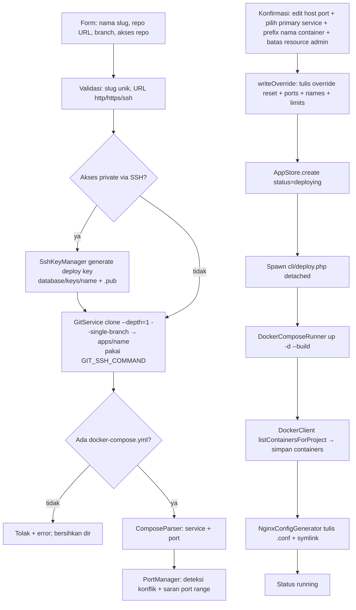

# 5. Alur Utama — Siklus Hidup App

> Bagian dari [dokumentasi arsitektur](../ARCHITECTURE.md) · Spesifikasi: [SPECS.md](../SPECS.md) · Panduan operasional: [DETAILS.md](../../DETAILS.md)

## 5.1 Create App (end-to-end)



Detil penting:

- **Clone selalu shallow (`GitService::clone`)**: `--depth=1 --single-branch` — riwayat lokal hanya commit terbaru di branch yang dipilih, sehingga create app cepat & tidak menghabiskan disk untuk repo besar. Konsekuensi yang disengaja: HEAD~N tidak tersedia lokal; rollback mengambil SHA lama dari remote (`fetchSha()`, §5.5) dan `git pull --ff-only` pada rebuild tetap shallow (tidak menarik riwayat penuh). **GOTCHA uji**: git **mengabaikan** `--depth` saat clone dari **path lokal polos** ("`--depth` is ignored in local clones; use `file://` instead") — uji yang memeriksa `.git/shallow` wajib memakai URL `file://`; URL app di produksi sudah divalidasi berskema `http(s)`/`ssh`.
- **Repo private via deploy key SSH**: sistem membangkitkan keypair ed25519 per app (`database/keys/{name}`) sebelum clone. Public key ditampilkan di form/konfirmasi untuk ditambahkan user sebagai Deploy Key repo (Settings → Deploy keys). Bila clone gagal karena key belum ditambahkan, form dirender ulang bersama public key (kunci dipakai ulang saat percobaan berikutnya). `git pull` saat Rebuild memakai key yang sama.
- **Override port dua lapis** (`writeOverride`): karena docker compose **menggabungkan** daftar `ports` (base + override, bukan mengganti), port bawaan repo harus di-reset dulu:
  1. `docker-compose.override.yml` → `ports: !reset []` (tag YAML, via `Symfony\Component\Yaml\Tag\TaggedValue`)
  2. `docker-compose.override.ports.yml` → `ports: [host:container]` (hasil edit user)
  → `compose_files` menyimpan ketiganya. File compose asli repo tetap bersih.
- **Lapis ketiga (opsional) = nama container** (§5.12): bila user mengisi *Prefix nama container*, `writeOverride()` menulis `docker-compose.override.names.yml` (`container_name: {prefix}-{service}` per service) dan menambahkannya ke `compose_files` setelah override ports. Bila user **admin** mengisi batas resource di halaman konfirmasi (§5.12a), `ResourceLimits::writeOverride()` menulis `docker-compose.override.limits.yml` yang disisipkan **setelah** override nama dan **sebelum** override network/env. Urutan kanonik akhir dimiliki **satu** kelas, `ComposeSource::orderFiles()` (`AppController::orderComposeFiles()` hanya mendelegasi).
- Service **tanpa port exposed** (mis. `php-fpm`) dilewati di validasi port & tidak ditulis override; tidak bisa dipilih sebagai primary service. Bila **tidak ada satu pun** service yang mem-publish port (mis. server database yang hanya dipakai internal), app tetap bisa dibuat/di-deploy: `primary_service`/`primary_port` dibiarkan kosong dan app **tidak dibuatkan vhost/subdomain**.
- **Port yang di-proxy dipilih user**: halaman konfirmasi menampilkan **satu baris per port** (service dengan >1 port — mis. web `9119` + gateway API `8642` — punya host port sendiri-sendiri, input `services[<svc>][ports][<containerPort>][host_port]`) dan satu radio *Trafik domain* (`primary` = `<service>:<port>`). Hasilnya disimpan sebagai `primary_service` + `primary_port` di `apps.json`; semua port tetap di-publish (port lain diakses langsung `http://<host>:<port>`). Target `proxy_pass` Nginx dihitung `AppPorts::primaryHostPort()` — `primary_port` diprioritaskan, fallback port pertama service untuk app lama (§4.3).
- **Id app & preflight dibuat/dijalankan sebelum efek samping apa pun** (`AppController::createAndDeploy()` = jalur bersama ketiga mode create): id app dibuat di control plane (`bin2hex(random_bytes(8))`, format sama dengan `AppStore::create()` — store tetap menerima id terisi & tidak memvalidasi keunikannya, tidak berubah), lalu `DeployerFactory::assertAppTargetAvailable()` dijalankan sebelum berkas override/managed env ditulis dan sebelum entri app dibuat; server `kind=agent` ⇒ `POST /apps/check` (agent lama 404 ⇒ dilewati, `available:false` ⇒ pesan ramah di wizard), server `local` ⇒ no-op (§5.22, GOTCHA §8 no. 36).
- Langkah konfirmasi memanggil `ensureWritable()` (cek izin tulis direktori Nginx) agar gagal cepat dengan pesan jelas, bukan di tengah build — **hanya bila ada service ber-`ports:`**; app tanpa port tidak menyentuh direktori Nginx, jadi direktori itu tidak boleh menggagalkan deploy-nya.
- **App tanpa host port = tanpa vhost/subdomain** (`AppPorts::hasHostPort()`, satu pintu untuk deployer & view): seluruh langkah Nginx (`ensureNginxPrecondition()` + `writeNginxConfig()`) dilewati dan config lama **dibuang** (supaya tidak menyisakan vhost menunjuk port mati) — berlaku di deploy/rebuild/rollback/apply, saat set/hapus custom domain, dan di worker SSL (`cli/ssl.php`); logger menulis pesan jujur `Tidak ada host port terpublish — app tidak di-proxy ke domain`. `LocalDeployer::ensureNginxPrecondition()` menilai dari container yang sudah ada (`hasHostPort`) **atau** deklarasi `ports:` compose (`ComposeSource::declaresPorts`, untuk deploy pertama). Ini juga menutup kondisi container yang **tidak jalan**: Engine tidak melaporkan port untuk container berhenti, sehingga app dianggap tanpa port — deploy tidak lagi gagal dengan pesan menyesatkan `Tidak ada host port untuk app ...` (status container yang sebenarnya tetap terlihat di tab Container). Perubahan port di compose (tab Compose) otomatis mengembalikan/menghapus domain pada Deploy Ulang.

## 5.1b Create App — Mode "Compose (paste / upload)"

Cara kedua membuat app (SPECS §7.2a), untuk aplikasi yang memakai image **prebuilt** (tanpa build context):

1. Tab **Compose** di `/apps/create` → nama app + isi `docker-compose.yml` (paste di textarea) dan/atau file unggahan (`files[]`, multipart, boleh file pendukung seperti `nginx.conf`).
2. `AppController::composePreview` → `ComposeSource::store()` menulis file ke `apps/{name}` (validasi dulu: nama relatif aman tanpa `..`/absolut, tolak file override generated, batas ukuran) → `ComposeSource::assertDeployable()` (setiap service wajib `image:`, `build:` ditolak). Gagal = direktori dibersihkan + form dirender ulang dengan isi user.
3. Parse compose (`ComposeParser`) + resolusi konflik port (sama seperti mode git) → session `pending_app` → halaman konfirmasi yang sama → `confirmCreate` menyimpan `source: "compose"` (`repo_url`/`branch`/`auth_method` = `null`) lalu spawn worker `deploy` (tanpa langkah git).
4. Perubahan sumber berikutnya lewat tab **Compose** di detail app (ability `compose`, Operator ke atas) — lihat §5.2.

> **Bind mount**: `LocalDeployer::upCompose()` memanggil `ComposeBinds::ensure()` sebelum `up` — direktori source bind yang belum ada (mis. `device: ${PWD}/.hermes` atau `- ./data:/data`) dibuat otomatis di direktori app, **kecuali** entri long syntax yang menyatakan `bind: {create_host_path: false}`: deklarasi compose dihormati (tidak dibuat, dilaporkan `missing` dengan alasan eksplisit ⇒ `up` gagal, bukan "sukses" dengan mount kosong); bila `up` tetap gagal, pesan error diberi daftar source yang belum siap. `DockerComposeRunner` menyetel env `PWD` ke direktori app agar substitusi `${PWD}` deterministik.
>
> **Entitlement build**: sebelum build, `upCompose()` memanggil `BuildEntitlements::sync()` — menulis `docker-compose.override.build.yml` (`build.entitlements: [network.host]`) untuk service ber-`build:` dan menyisipkannya ke daftar `-f` tepat sebelum override env. Tanpa itu BuildKit menolak app ber-`build.network: host`/`RUN --network=host` (GOTCHA §3, SPECS §7.6c). Grant-nya sendiri diberikan `DockerComposeRunner::up()` lewat `docker buildx bake … --allow network.host` (definisi bake dihasilkan Compose), karena Compose tidak meneruskan entitlement ke `--allow`. File transien — tidak masuk `compose_files`, dihapus bila tidak diperlukan.

## 5.1c Create App — Mode "Template" (galeri siap-pakai)

Cara ketiga membuat app: memilih **template** yang sudah disiapkan di folder repo `templates/<slug>/` — app docker-ready (image prebuilt) plus deklarasi variabel environment-nya. Di `/apps/create`, urutan link mode adalah **Template**, **Clone repo Git**, **Compose (paste / upload)**; mode aktif ditandai pada navigasi dan default tetap **Clone repo Git**. Tujuannya satu klik, tanpa menempel compose dan tanpa menebak env.

```mermaid
flowchart TD
    A[Link mode: Template -> Clone repo Git -> Compose<br/>default Clone repo Git] --> B[TemplateCatalog::all<br/>grid tile: logo lokal/fallback + nama + category]
    B --> C[Klik tile -> modal detail<br/>deskripsi, category, image, port, domain, env/files]
    C --> D{Valid?}
    D -->|Tidak| E[Status/error di modal<br/>Deploy disabled]
    D -->|Ya| F[Deploy -> form existing<br/>/apps/create/template/slug]
    F --> G[POST /apps/create/template/slug]
    G --> H[TemplateCatalog::resolveEnv:<br/>input -> default -> generate rahasia]
    H --> I[TemplateCatalog::materialize:<br/>compose + files/ -> apps/name]
    I --> J[PortManager::resolve:<br/>port template dijaga, konflik digeser]
    J --> K[writeOverride port + nama container<br/>prefix = nama app (+ limits admin)]
    K --> L[EnvManager::write + writeOverride<br/>+ persist env ke apps.json]
    L --> M[AppStore.create source=compose<br/>template=slug + spawn worker deploy]
    M --> N[Halaman detail: polling progres<br/>deploying -> running]
```

- **Definisi template** (folder repo, bukan UI): `template.yml` (title/description/category/icon/docs_url, `env[]` = `{key,label,help,default,secret,generate,required}`, `primary` = `{service,port}`, `files[]`), `docker-compose.yml` (semua service `image:`, tanpa `build:`), `files/` (file pendukung yang di-bind mount).
- **Aturan yang ditegakkan `TemplateCatalog`** (lihat §4.3): tanpa `build:`/`container_name`/`name:`/replica > 1, `ports:` **opsional**, dan tiap `${VAR}` tanpa default wajib dideklarasikan di `env[]` — mencegah app jalan dengan variabel kosong (docker compose hanya memberi warning, bukan error).
- **Satu app = satu salinan materialized**: `materialize()` memakai jalur `ComposeSource::store()` (validasi nama file & compose identik dengan mode paste/upload) sehingga app hasil template adalah **app mode compose biasa** — sumbernya bisa diedit lewat tab Compose lalu Deploy Ulang. Template tidak di-*re-sync* setelah create (tanpa rollback, §5.7).
- **Nama container & port**: template dilarang menulis `container_name` (nama dikelola dashboard: `{nama_app}-{service}`, §5.12) dan host port diresolusi otomatis (`PortManager::resolve()` — port bawaan template dipertahankan bila bebas, konflik digeser dari rentang `PORT_RANGE_START`–`PORT_RANGE_END`), sehingga template yang sama bisa dipakai berkali-kali tanpa saling bentrok.
- **Env**: nilai dari form → `default` template → auto-generate (rahasia acak hex) → tolak bila `required`; hasilnya ditulis ke `database/env/{name}.env` + `docker-compose.override.env.yml` **dan** dipersist ke `apps.json.env` (kalau tidak, `EnvManager::sync()` di `LocalDeployer` akan menghapus file env saat deploy).
- **Daftar dan detail UI**: galeri berupa grid tile thumbnail yang menampilkan logo image lokal atau fallback icon, nama, dan category; klik tile membuka modal berisi deskripsi, category, image, port, target domain, jumlah env/file, validitas/error, dan dokumentasi. Modal detail memakai tab **Detail | Panduan**. URL dokumentasi hanya ditautkan untuk skema `http`/`https`; Deploy aktif hanya untuk template valid. Tombol valid membuka form dan route create template yang sudah ada; form serta empty state tidak berubah.
- **Panduan template (`guide.md`)**: alurnya `templates/<slug>/guide.md` → `TemplateCatalog::readGuide()` (kunci `guide`, non-fatal) → `app\library\Support\Markdown::toHtml()` (statik murni; mendukung heading, daftar, kode, tautan, dan **tabel pipe GFM**) → `guide_html`/`guideHtml` yang disuntik `AppController` → view. Tampil di **tiga tempat**: (a) tab **Panduan** pada modal detail galeri (`app/view/app/create.php`, `guide_html` per template; tanpa panduan → pesan fallback), (b) modal `#template-guide-modal` di form deploy (`app/view/app/template.php`), dan (c) modal `#app-guide-modal` di detail app (`app/view/app/detail.php`, `guideHtml` hanya bila entri `apps.json` app punya `template.slug` **dan** template masih ada di katalog — dibaca dalam `try/catch` agar kegagalan katalog tidak menggagalkan halaman detail). Modal tidak dirender bila panduan kosong (form/detail). **Keamanan**: `html_input=escape` (HTML mentah di Markdown di-escape, bukan dirender), `allow_unsafe_links=false` (tautan `javascript:`/`data:` ditolak), dan `ExternalLinkExtension` (`target="_blank"` + `rel="noopener noreferrer"` untuk tautan eksternal). Karena output sudah tersanitasi, view merender `guide_html`/`guideHtml` **tanpa `e()`**. Seluruh template bawaan (16) menyertakan `guide.md` — ditegakkan test `TemplateCatalogTest::testShippedTemplatesHaveGuide`, **bukan** `valid=false`, supaya template pihak ketiga tanpa panduan tetap dapat di-deploy. Salah satu entri bawaan, **`lemp74`**, adalah varian **PHP 7.4** (legacy, image `yllumi/fpm7.4-nginx`) dari `lemp` (PHP 8.4) — susunan service/volume/port-nya identik, hanya berbeda versi PHP & image, jadi keduanya **tidak menambah aturan** `TemplateCatalog` (murni entri katalog).
- **Aset logo template — satu sumber peta (`template_logo_map()`)**: helper `template_logo_map()` (`app/functions.php:311`) memindai direktori **nyata** `public/images/templates/` dan mengembalikan peta `slug → ekstensi` (whitelist `svg`/`png`/`webp` case-insensitive, slug harus cocok `[a-z0-9-]+`; **berkas pertama yang ditemukan `glob()` menang**). Peta dihitung **sekali per render** oleh view pemakainya — tidak ada glob/map inline yang diduplikasi antar view — dan dipakai **tiga** view pada **empat** titik render: galeri create-app (tile `<span class="template-tile-media">` di `app/view/app/create.php:156`, ``; fallback `<span class="template-tile-fallback">` = emoji `icon` atau `◈`), judul **modal detail** template di galeri (blok `<h2 class="modal-title">` di `app/view/app/create.php:176`, ``; fallback emoji `icon` atau `◈`), judul form deploy (blok `<h1 class="h3">` di `app/view/app/template.php:25`, ``; fallback emoji `icon`), dan kartu **tab Template** halaman Config (kartu `.template-logo-card` di `app/view/nginx/partials/tab-templates.php:209`; fallback emoji `icon` atau `📦`). CSS ketiga kelas ada di `public/css/app.css:217-222` — ukuran tetap agar sejajar teks dan latar netral agar logo pucat/ber-halo tetap terbaca. Logo produk dari Dashboard Icons dibundel lokal dari [Dashboard Icons](https://dashboardicons.com/) dan [repo dashboard-icons](https://github.com/homarr-labs/dashboard-icons), tanpa pemuatan CDN saat runtime. **Pengecualian sumber** (repo tidak menyimpan manifes sumber per berkas, jadi dicatat di sini): `waha.png` = logo resmi WAHA (belum tersedia di Dashboard Icons), `raisfast.png` = logo dari situs vendor RaisFast (`https://www.raisfast.com/images/logo.png`), dan `wabaileys.png` = logo dari URL yang diberikan operator (`https://image.web.id/images/logo-wabaileys.jpg`, JPEG dikonversi ke PNG). Ekstensi mengikuti berkas yang ada (`svg`/`png` — `ghost` PNG karena katalog menyediakan PNG/WebP), **semua template bawaan punya berkas logo**, dan emoji `icon` hanya tersisa sebagai fallback untuk template tanpa berkas logo (atau bila berkas logonya dihapus).

> **GOTCHA — satu berkas logo per slug; ganti format tanpa menyentuh kode.** **Gejala**: logo template "berkedip"/berbeda antar muat — mis. `openclaw.svg` di satu render dan `openclaw.png` di render lain. **Sebab**: `template_logo_map()` hanya menyimpan berkas **pertama** yang ditemukan `glob()` per slug (`!isset($map[$slug])`), dan urutan hasil `glob` mengikuti nama berkas (alfabetis) — menyisakan dua berkas untuk slug yang sama membuat pemenang ditentukan **nama**, bukan maksud penulis (`openclaw.png` menang atas `openclaw.svg`). **Penangkal**: simpan **tepat satu** `public/images/templates/<slug>.<svg|png|webp>` dan **hapus** berkas format lama saat mengganti (mis. hapus `openclaw.svg` setelah menambahkan `openclaw.png`). Menambah/mengganti logo **tidak butuh perubahan kode** — cukup taruh berkas ber-slug (view & tiga pemakaian di atas otomatis memakai peta terbaru); nama berkas tetap (tanpa hash/`?v=`), jadi setelah isi berkas berganti dengan nama sama, browser/proxy masih bisa menyajikan logo lama sampai cache-nya kedaluwarsa (paksa muat ulang bila perlu).
- **Jalur create bersama**: `AppController::createAndDeploy()` menulis file (override port/nama + limits untuk admin + env) **sebelum** entri `apps.json` dibuat, lalu spawn worker — dipakai baik oleh halaman konfirmasi (mode git/compose) maupun deploy template, sehingga kegagalan tidak meninggalkan app setengah jadi.
- **Hak akses**: membuat app (termasuk dari template) terbuka untuk semua user yang sudah login — sama seperti dua mode create lain; app otomatis dimiliki pembuatnya (§5.10). Mengubah/menambah template bukan operasi UI: hanya lewat file di repo (admin/dev).
- **Template service database** (`templates/mysql`, `templates/mariadb`): app **tanpa port host** (tanpa vhost/subdomain, port 3306 tidak diteruskan ke host) — dikelola lewat `/database` (proxy Adminer, §5.17: helper internal menyambung sendiri ke network app) atau dengan menambahkan `ports:` lewat tab Compose bila DB perlu dijangkau dari host / app lain. Dua hal WAJIB saat menambah/mengubah template ini:
  1. **DILARANG mendeklarasikan `MYSQL_USER`/`MARIADB_USER`** (alias `DB_USERNAME`/`DB_USER`). `DbCredentialResolver` mengutamakan pasangan user aplikasi di atas root, sehingga menambahkannya membuat sesi Adminer `/database` **dan dump backup otomatis** berjalan sebagai user ber-hak-terbatas (mis. `mysqldump` kehilangan objek yang butuh hak admin) — bukan lagi soal panel kehilangan hak admin UI. Template karena itu **hanya** menyediakan password root; user aplikasi dibuat dari **dalam Adminer** `/database`.
  2. Host port di compose template ditulis ulang dashboard (§5.1c) — deklarasi `127.0.0.1:` pada `ports:` **hilang** (override port selalu menulis `host:container`), jadi jangan mengandalkannya untuk membatasi akses; gunakan firewall.
  Verifikasi empiris: `mysql:8.4` menyediakan `mysqladmin` (healthcheck `mysqladmin ping -h 127.0.0.1`, tanpa kredensial), sedangkan `mariadb:11.4` **tidak** menyediakannya — healthcheck-nya memakai `healthcheck.sh --connect --innodb_initialized` bawaan image. Keduanya memberi `root@'%'` (default `*_ROOT_HOST` = `%`) sehingga dashboard/klien luar bisa terhubung sebagai root.
- **Template `outline`** (`templates/outline`): Outline memakai image prebuilt dengan PostgreSQL 18 dan Redis; port container `3000` dipublish untuk reverse proxy Nginx Rames, dengan host port dikelola seperti template lain. `URL` publik harus cocok dengan domain/subdomain app yang diatur di Rames, termasuk custom domain yang telah dikonfigurasi. Login memakai OIDC dengan automatic discovery dan wajib menerima issuer URL, client ID, serta client secret dari provider eksternal; tidak ada login lokal username/password. Template meng-auto-generate `SECRET_KEY`, `UTILS_SECRET`, dan password PostgreSQL yang kosong. Named volumes mempertahankan data PostgreSQL dan local file storage Outline. SMTP tidak wajib untuk basic OIDC login. Referensi: `docs_url` template mengarah ke [Outline Docker](https://docs.getoutline.com/s/hosting/doc/docker-7pfeLP5a8t), sedangkan kontrak OIDC dijelaskan di [Outline OIDC](https://docs.getoutline.com/s/hosting/doc/oidc-8CPBm6uC0I). Callback URI spesifik tidak ditetapkan di dokumentasi ini.
- **Template `nocodb`** (`templates/nocodb`): satu service `nocodb/nocodb:latest`, port container `8080` untuk reverse proxy Rames, metadata internal SQLite dengan named volume `nocodb-data` di `/usr/app/data`, dan `NC_AUTH_JWT_SECRET` auto-generated. Template ini tidak menyertakan database target atau meminta kredensial target saat create. Setelah deploy, pengguna menambahkan MySQL/MariaDB existing sebagai external data source dari UI NocoDB; SQLite metadata internal bukan datasource target dan koneksi tidak otomatis. Target wajib routable dari container NocoDB. Untuk DB app Compose Rames lain, attach kedua app ke shared external network lewat konfigurasi network Rames. Gunakan user DB dengan privilege minimum dan jangan expose port DB publik tanpa alasan. Referensi koneksi: [NocoDB Connect to Data Source](https://nocodb.com/docs/product/integrations/data-sources/connect-to-data-source).
- **Template `raisfast`** (`templates/raisfast`): satu service `ghcr.io/raisfast/raisfast:latest`, port container `9898` dipublish untuk reverse proxy Nginx (host port dikelola seperti template lain), named volume `raisfast-data` di `/app/storage` (default `STORAGE_ROOT_DIR` image) menyimpan SQLite `storage/db/raisfast.db`, uploads, dan logs. Template berjalan `APP_ENV=production` sehingga `JWT_SECRET` non-default dibuat otomatis dan `CORS_ORIGINS` diambil dari `${BASE_URL}` (interpolasi compose memakai `--env-file` milik `EnvManager`); `BASE_URL` dan `APP_KEY` wajib diisi user. **GOTCHA**: `APP_KEY` harus base64 dari tepat 32 byte (AES-256-GCM) dan image tidak dapat mem-persist `.env` otomatis, jadi `APP_KEY` tidak boleh di-`generate` template (generator hanya hex) dan nilainya harus stabil. Referensi: `docs_url` mengarah ke https://www.raisfast.com/en/docs.
- **Template `picoclaw`** (`templates/picoclaw`): satu service `picoclaw` memakai image prebuilt `ghcr.io/sipeed/picoclaw:launcher` (asisten AI personal ultra-ringan Sipeed berbasis Go — proyek **mandiri**, **bukan** fork OpenClaw, jadi jangan menganggap konfigurasi `openclaw` berlaku), port container `18800` (Web console launcher) dipublish untuk reverse proxy Nginx (host port dikelola seperti template lain), `init: true`, `cap_drop NET_RAW`/`NET_ADMIN`, `no-new-privileges: true`, dan healthcheck eksplisit `wget -q --spider http://127.0.0.1:18800/api/auth/status` (image rilis tanpa HEALTHCHECK; endpoint publik launcher, `wget` busybox tersedia karena image berbasis `alpine:3.21`). Dua named volume: `picoclaw-data` → `/root/.picoclaw` (config, workspace, sesi, skills, `launcher-auth.db`) dan `picoclaw-ssh` → `/root/.ssh`. Dua **GOTCHA**: (1) **tag `latest` mati setelah onboarding** — entrypoint `latest` menjalankan setup lalu `exit 0` pada run pertama (`docker/entrypoint.sh`) sehingga container restart-loop sebelum config terbentuk; tag **`launcher`** melakukan onboarding sendiri (`EnsureOnboarded`) dan tetap hidup sambil menjalankan gateway otomatis (18790, loopback di dalam container, **tidak** dipublish karena sudah diproksi Web console). (2) **Kunci kredensial ada di `~/.ssh`, bukan di `PICOCLAW_HOME`** — `picoclaw_ed25519.key` disimpan di `/root/.ssh`, jadi volume `picoclaw-ssh` **wajib** persisten: hilang ⇒ kredensial `enc://` tak bisa didekripsi. Auth hanya password Web console di `/launcher-setup` (bcrypt di `launcher-auth.db`), tanpa env password; `PICOCLAW_LAUNCHER_TOKEN` **sudah tidak didukung**. Proyek masih **pra-1.0** (README resmi melarang deploy produksi sebelum v1.0). Referensi: `docs_url` mengarah ke https://docs.picoclaw.io/docs/docker/.
- **Template `opencode`** (`templates/opencode`): satu service `opencode` memakai image prebuilt `ghcr.io/anomalyco/opencode:latest` (agen koding AI open source; repo berpindah dari `sst/opencode` — tag `ghcr.io/sst/opencode` **tidak** ada), command `opencode serve --hostname 0.0.0.0 --port 4096 --print-logs`, port container `4096` dipublish untuk reverse proxy Nginx (host port dikelola seperti template lain). Karena image resmi berjalan sebagai **root** tanpa `git`/`bash`/`tini`, template **meng-override `entrypoint`** ke `/bin/sh -c`: (a) `apk add --no-cache git bash su-exec` **fail-soft** tiap start (butuh egress Alpine; gagal ⇒ `WARN`, container tetap hidup tanpa fitur git), (b) menentukan `uid:gid` tujuan — `OPENCODE_RUN_AS` bila lolos bentuk kanonik `^(0|[1-9][0-9]{0,9}):(0|[1-9][0-9]{0,9})$` **dan** rentang tiap bagian `0..4294967295`, jika tidak pemilik `/home/opencode/project`; nilai tak sah **diabaikan + `WARN`** (GOTCHA §8 no. 38), (c) **gerbang pemakaian target sebelum `exec`**: `chown <uid:gid> /home/opencode` **tanpa `-R`** (lalu isi HOME di-`chown -R` **per entri, mengecualikan mountpoint project** — `chown -R /home/opencode` dilarang karena menuruni bind project dan mengubah kepemilikan berkas project di host) + `stat` kepemilikan **sama dengan** target + `su-exec … test -w /home/opencode` harus lulus ketiganya, lalu `git config --global --add safe.directory '*'` + identitas commit opsional (`GIT_USER_NAME`/`GIT_USER_EMAIL`) **sebagai user itu**, (d) `exec su-exec … opencode serve` (gerbang gagal ⇒ berjalan sebagai root + `WARN`, bukan restart loop; exit code server tetap diteruskan) dengan `HOME=/home/opencode` di-set ulang eksplisit (`su-exec` menimpa `HOME` dari passwd). Auth = **HTTP basic auth seluruh permukaan UI/API**: `OPENCODE_SERVER_PASSWORD` (auto-generate, `secret`) + `OPENCODE_SERVER_USERNAME` (default `opencode`). Named volume `opencode-home` → `/home/opencode` (config, `opencode.db`, `auth.json`, state, cache — di luar project); bind mount project `${OPENCODE_PROJECTS_DIR}` → `/home/opencode/project` (**di dalam HOME**, agar picker direktori UI opencode — yang berakar di `$HOME` dan ter-sandbox ke `location.directory` — bisa melihat & memilihnya) **long syntax + `create_host_path: false`** (path wajib sudah ada — **termasuk** bila path-nya di dalam direktori app, karena `ComposeBinds::ensure()` menghormati deklarasi itu sehingga tidak ada direktori yang dibuat diam-diam, SPECS §7.2a/§7.2b; komponen `environment` memakai bentuk wajib `${OPENCODE_PROJECTS_DIR:?…}` karena source kosong pada long syntax **tidak** ditolak compose melainkan menjadi anonymous volume, sedangkan entri `volumes:` tetap `${OPENCODE_PROJECTS_DIR}` polos agar `ComposeBinds::collect()` bisa me-resolve path-nya). `init: true` + `stop_grace_period: 5s`; healthcheck `wget --header "Authorization: Basic …"` ke `/global/health` dengan kredensial dirujuk dari env container (tanpa password literal). Batas yang diketahui (egress Alpine tiap start, **SSE lambat** di balik Nginx karena tanpa `proxy_buffering off`/`proxy_read_timeout` — WebSocket tetap diteruskan —, dan ganti `OPENCODE_PROJECTS_DIR` = recreate container) dirinci di SPECS §7.2b + `templates/opencode/guide.md`; jebakan pola `entrypoint`-override + turun hak dicatat sebagai GOTCHA §8 no. 38.
- **Template rusak tampil apa adanya**: `all()` mengembalikan `valid=false` + pesan error yang ditampilkan pada modal detail, dengan tombol Deploy dinonaktifkan, supaya admin tahu template mana yang perlu diperbaiki.

> **GOTCHA — `guide.md` tidak pernah ikut ke direktori app.** Gejala: panduan tampil di galeri/form/detail tapi tidak ada `apps/{name}/guide.md` (dan memang tidak seharusnya ada). Sebab: `guide.md` bukan bagian `files[]`, dan `materialize()` hanya menyalin `docker-compose.yml` + file di `files/`. Penangkal: panduan adalah **metadata katalog** — ubah di `templates/<slug>/guide.md` (repo) dan jangan mengandalkannya tersalin ke app.
>
> **DILARANG menambahkan `e()` di sekitar `guide_html`/`guideHtml`.** Output `Markdown::toHtml()` **sudah tersanitasi** (`html_input=escape` + tolak tautan tidak aman); membungkusnya dengan `e()` akan menampilkan HTML sebagai teks mentah. Sebaliknya, penulis `guide.md` **tidak** boleh mengandalkan HTML mentah (`<script>`, ``, dst.) — semuanya di-escape, bukan dirender. Jaga `Markdown::toHtml()` sebagai satu-satunya pintu render (duplikasi konverter tanpa `escape`/`allow_unsafe_links=false` = jalur XSS).

## 5.2 Rebuild / Deploy Ulang

`AppController::rebuild` → spawn worker mode `rebuild` → `LocalDeployer::rebuild`:
- **Mode git**: `git pull --ff-only` → `docker compose up -d --build` → collect container → tulis ulang config Nginx → status `running`.
- **Mode compose** (tanpa repo): `docker compose up -d` **tanpa** `--build` → collect container → tulis ulang config Nginx → status `running`. Tombol di UI berlabel **Deploy Ulang** (tooltip menjelaskan tanpa build/git).

Perubahan compose untuk app mode compose lewat tab **Compose** di detail app: `AppController::saveCompose` memvalidasi isi (YAML + `image:`/tanpa `build:`) → menulis file (compose utama + file pendukung baru, hapus yang dicentang) → `ComposeSource::planHostPorts()` merencanakan host port (port lama per service dipertahankan, konflik dengan app lain digeser) → tulis ulang override port → spawn worker mode `apply` (`DeployerInterface::apply()` = `up -d` tanpa build + collect + tulis Nginx + riwayat).

## 5.3 Stop / Start

Sinkron via `DockerComposeRunner->stop()/start()` (cepat), lalu update status di `apps.json`.

## 5.4 Delete

Delete dua mode (modal konfirmasi di detail app):

- **Hapus & pertahankan volume** (default, aman): `LocalDeployer::teardown($app, $preserveVolumes)` → `docker compose down` (tanpa `-v`), lalu `docker volume rm` hanya volume project yang **tidak** dicentang (via `DockerClient::listVolumesForProject` + `DockerComposeRunner::removeVolumes`). Named volume yang dipertahankan akan **dipakai ulang otomatis** saat app dibuat ulang dengan nama yang sama (project name compose = nama app) — data DB tidak hilang.
- **Hapus total** (`mode=purge`): `LocalDeployer::teardown($app, null)` → `docker compose down -v` (semua named + anonymous volume terhapus permanen; butuh konfirmasi tambahan).

**Sebelum `docker compose down`**, `LocalDeployer::detachForeignContainers()` melepas container **di luar project** yang menempel di network project (mis. helper `rames-adminer`, dashboard `rames-webman`, helper backup) — tanpa menghentikan/menghapusnya. Tanpa ini network project tidak bisa dihapus ("Resource is still in use" → `removeNetwork` **403**) sehingga **Hapus App gagal**. Container milik project **tidak pernah** dilepas (label `com.docker.compose.project`); network app lain tidak disentuh; gagal lepas satu container dicatat, teardown lanjut (juga diulang di jalur `teardownViaApi()`). Kegagalan penghapusan network **tidak lagi** menggagalkan penghapusan app: dicatat sebagai **PERINGATAN** ke `runtime/logs/deploy/teardown.log` (jalur produksi tanpa logger) — karena exception di sini membuat `AppController::delete()` menandai "Gagal menghapus" **tanpa** menghapus record app (app setengah mati: container sudah bersih, entri tetap ada). Operator diberi tahu sisa resource untuk dibereskan dari halaman `/networks`.

Lalu: hapus config Nginx (+ symlink) → hapus direktori `apps/{name}` → hapus entri dari `apps.json`. Volume **yatim** (project-nya sudah tidak ada di `apps.json`) dapat dilihat & dibersihkan di halaman `/volumes` (`VolumeController`).
