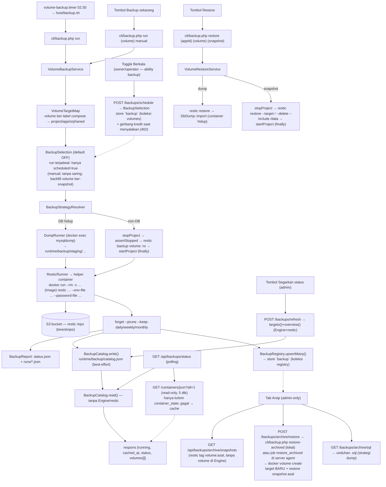

# 5. Alur Utama — Monitoring, Self-Update & Backup

> Bagian dari [dokumentasi arsitektur](../ARCHITECTURE.md) · Spesifikasi: [SPECS.md](../SPECS.md) · Panduan operasional: [DETAILS.md](../../DETAILS.md)

## 5.13 Monitoring Resource Container & Total VM

Halaman global **`/monitor`** (nav sidebar — bukan di detail app) menampilkan pemakaian resource tiap container dan ringkasan "total VM".

1. **Sumber data**: metrik host dari `/proc` (`HostUsage`) + **storage server** dari `statvfs` (`HostUsage::disk()`, path `DISK_PATH`), dan metrik container dari Engine (`stats?stream=false` + `inspect`) — tidak ada field baru di `apps.json` dan tidak ada state di server.
2. **Paralel**: `DockerClient::containersOverview()` mengambil `stats` **dan** `inspect` semua container sekaligus lewat `CurlMultiHandler`. Satu `stats` butuh ±1 detik (daemon mengambil dua sampel CPU); serial 19 container ≈ 19 detik vs paralel ≈ 2,5 detik (terukur). Kegagalan satu container diisolasi (`error` per container), tidak mengosongkan halaman.
3. **Halaman & endpoint**: `MonitorController::index` merender kerangka (`view/monitor/index.php` + `partials/panel.php`), lalu `public/js/monitor.js` memanggil `GET /api/monitor/overview` sekali saat halaman dibuka; tombol **Refresh** memuat ulang semuanya. Kartu **host** dipoll tiap `MONITOR_POLL_MS` (default 7 detik) lewat `GET /api/monitor/host` — endpoint ini **hanya** membaca `/proc` + `statvfs` (±0,25 detik) sehingga tidak membebani Engine, berbeda dari `stats` container. Interval hidup **hanya selama halaman terbuka**: dijeda saat tab tidak terlihat (dan disegarkan sekali saat kembali), dimatikan saat halaman ditinggalkan — tanpa permintaan latar belakang. Tabel container tidak ikut dipoll. Halaman tidak punya state di server (tidak ada cache/interval server-side).
4. **Isi**: kartu CPU host (dengan vCPU), memori host (terpakai/total/tersedia), **storage server** (terpakai/total + bar + sisa tersedia + path yang diukur), agregat container (jumlah, jalan, CPU, memori), uptime host, total volume terpakai (angka disk diambil dari `GET /api/volumes/usage` yang sudah disaring hak akses, karena `/system/df` mahal); tabel per container berisi status (+ badge health), uptime, restart count, CPU%, memori (terpakai/limit + bar), dan PID.
   - **WAJIB — storage ≠ volume.** Kartu *Storage server* = pemakaian **filesystem host** (`statvfs` pada `DISK_PATH`, default direktori repo yang di-mount `${PWD}:${PWD}`), sedangkan *volume terpakai* = total volume Docker (`GET /api/volumes/usage`). Keduanya metrik berbeda dan tidak boleh dijumlahkan/dipertukarkan. `used` = `total − available` (`df` juga memakai `available`/`bavail`), jadi `used + available = total` dan angka konsisten di UI.
   - **GOTCHA — path storage harus bind mount host.** Bila dashboard dijalankan tanpa bind mount `${PWD}:${PWD}` (mis. dimount ke `/app`), `statvfs` melaporkan overlay container (angka hampir selalu kecil & salah). Ubah lewat `DISK_PATH` bila app/volume disimpan di filesystem berbeda dari direktori repo.
5. **Otorisasi bertingkat**: admin melihat **semua** container di host (container di luar compose project dashboard ditandai *eksternal*); user lain hanya menerima container milik app yang boleh diakses (`AppAccess::visible()`), persis seperti `/volumes`, `/database`, dan `/networks`. Penyaringan dilakukan di sisi server (`ResourceCollector`), bukan sekadar menyembunyikan di UI.
6. **Nilai jujur**: container idle dilaporkan `0%` (dua sampel valid walau delta nol), sedangkan data yang memang tak ada (container berhenti, `precpu_stats` kosong, `/proc` tak terbaca) dilaporkan **N/A** — bukan 0 yang menyesatkan.
7. **Tanpa mount tambahan**: `/proc` di dalam container dashboard sudah menampilkan nilai host (Docker tidak men-*namespace*-kan `stat`/`meminfo`/`loadavg`); `HOST_PROC_PATH` disediakan bila host memakai lxcfs.
8. **Storage server ≠ volume**: `HostUsage::disk()` memakai `statvfs` (`disk_total_space`/`disk_free_space`) pada `DISK_PATH` (default direktori repo = bind mount `${PWD}:${PWD}`) sehingga melaporkan filesystem **host**; hasilnya masuk `host.disk_path/disk_total/disk_used/disk_available/disk_percent` dan ikut dikirim agent lewat `GET /system/host-usage`.

**Pengujian**: `tests/HostUsageTest.php` (CPU delta, memori, load, uptime, jumlah CPU, `disk()`/`percent()` termasuk path hilang & `used + available = total`), `tests/ResourceCollectorTest.php` (visibilitas container, `hostSnapshot()` tanpa Engine + metrik disk), `tests/MultiServerViewTest.php` (render kartu/`monitor.js`).

## 5.13a Metrik per-App di Tab Info (CPU, Memori, Storage)

Melengkapi `/monitor` (§5.13) dengan sudut pandang **satu app**: tab **Info** detail app (`app/view/app/partials/detail-tab-info.php`) merender tiga kartu — CPU (grafik + nilai), Memori (grafik + used/limit/%), Storage (total + breakdown volume/container) — dan `public/js/app-metrics.js` mengisinya dari endpoint dashboard.

1. **Endpoint**: `GET /api/apps/{id}/metrics[?storage=1]` (`AppMetricsController::show`). Ability **`view`** (Viewer ke atas). App tak dikenal / user tanpa hak ⇒ `AppAccessDenied` yang dirender **404** (bukan 403) **sebelum** menyentuh Engine. Parameter `storage` yang bentuknya array/objek (`?storage[]=1`) ⇒ **400** `{code:1,…}` — bukan 500 dan nilainya tidak digemakan. Respons sukses selalu `200 {code:0,data:{at, usage, storage}}`: `usage` berisi `cpu_percent`/`mem_used`/`mem_limit`/`mem_percent` (bisa `null`), `containers`/`running`, `containers_detail[]` (`name`,`service`,`state`,`cpu_percent`,`mem_used`,`mem_limit`,`mem_percent`,`uptime_seconds`,`health`), dan `error` (`null`/pesan); `storage` bernilai `null` tanpa `?storage=1`.
2. **Usage**: `Monitor\AppMetrics::usage()` memilih sumber dari deployer — app lokal ⇒ `ResourceCollector::collect([$app], false, DockerClient host ini)`; app server agent ⇒ `AgentDeployer::containerStats()` (`GET /monitor/containers`) yang dibaca **di** server itu. Baris disaring ke app lewat `app_id` **atau** nama compose project (`apps.name`) supaya container project tetap terhitung bila proyeksi `app_id` belum ada, lalu diagregasi `ContainerStats::aggregate()`.
   - **WAJIB — jangan ubah `ContainerStats::aggregate()` demi fitur ini.** `aggregate()` meng-*coalesce* nilai `null` menjadi `0` (perilaku `/monitor` yang sudah ada). Metrik per-app menimpanya kembali ke `null` bila **tidak satu pun** baris punya `cpu_percent`/`mem_used` — sehingga app tanpa container / semua container berhenti tampil "—" alih-alih `0%`. Mengubah `aggregate()` akan mengubah arti angka di `/monitor` juga (regresi lintas fitur).
3. **Storage**: `Monitor\AppStorage::summarize($df, $project)` (murni statik, tanpa I/O) menjumlahkan `Volumes[].UsageData.Size` + `Containers[].SizeRw` yang berlabel `com.docker.compose.project` = nama app; hasil `{available, volumes_bytes, containers_bytes, total_bytes, total_human, volumes[], containers[], error}`. Jalur lokal memakai `DockerClient::getDiskUsage(['volume','container'])`; jalur agent memakai `AgentDeployer::diskUsage($project)` → route agent `GET /system/disk-usage?project=<app>` (§5.30).
   - **GOTCHA — `docker system df` mahal.** Gejala: tab Info terasa lambat/Engine sibuk saat halaman dibuka berulang kali. Sebab: Engine menelusuri filesystem tiap volume/container, jauh lebih mahal dari `stats?stream=false`. Penangkal: blok storage **hanya** dihitung bila `?storage=1` (tanpa flag ⇒ `null`), dan browser meminta storage hanya saat load + tiap **60 detik**, terpisah dari poll metrik 5 detik.
   - **DILARANG menghitung image/shared layer** ke "ukuran app": image dipakai bersama banyak app sehingga totalnya menyesatkan; image tidak pernah ikut dijumlahkan. Ukuran negatif (Engine tidak bisa menghitung objek yang sedang dipakai) dilaporkan `size_human:"N/A"` oleh `Docker\VolumeUsage::human()` dan **tidak** dijumlahkan.
4. **Browser (grafik)**: `public/js/app-metrics.js` mem-poll `GET /api/apps/{id}/metrics` tiap **5 detik** (maks **60** titik = 5 menit) dan endpoint yang sama dengan `?storage=1` tiap **60 detik**. Grafik digambar sebagai SVG `<path>` vanilla (tanpa library chart), sumbu X = **indeks titik**, bukan waktu riil. Polling dijeda saat `document.hidden` (dilanjutkan + disegarkan sekali saat tab kembali), timer dibersihkan pada `pagehide`/`beforeunload`, dan dinyalakan lagi lewat `pageshow` (`event.persisted` — kembali dari bfcache). Data server hanya ditulis via `textContent` (tanpa `innerHTML`), fetch/JSON yang gagal diabaikan tanpa alert/console, dan respons dibuang bila elemen sudah lepas dari DOM.
   - **GOTCHA — grafik bukan histori.** Setiap reload/penutupan tab mengosongkan deret; jangan menjanjikan grafik lintas sesi atau angka setelah dashboard lama tidak dibuka (tidak ada sampler/persistensi di server, worker Webman tidak boleh menyimpan state lintas-request).
   - **WAJIB — naikkan `?v=` saat mengubah `public/js/app-metrics.js`** di `app/view/app/partials/detail-scripts.php` (lihat §4.6).
5. **Kegagalan tidak pernah 500**: server app hilang/konfigurasi deployer rusak ⇒ `usage` kosong (semua angka `null`, `containers`/`running` = 0) + `usage.error` generik dan `storage.available:false`; Engine gagal ⇒ `usage.error` berisi pesan (jalur lokal, paritas `/monitor`); agent lama/tak mendukung `/system/disk-usage` (404) ⇒ `storage.available:false` dengan pesan "belum mendukung". Pesan galat jalur agent disanitasi satu pintu `AgentError::sanitizeForServer()` di controller (token/host/PEM tidak sampai UI).

**Pengujian**: `tests/AppStorageTest.php` (filter label project, penjumlahan volume+container, ukuran negatif `N/A` tidak dijumlah, project kosong, `human()` SI), `tests/AppMetricsTest.php` (penyaringan baris per app, metrik `null` bukan 0, galat Engine jadi `error`, storage lokal/agent, agent lama ⇒ belum mendukung), `tests/AppMetricsControllerTest.php` (app tak dikenal/stranger ⇒ 404, viewer boleh, bentuk respons, storage hanya dengan query eksplisit, app yatim tetap 200, sanitasi pesan agent, parameter array/objek ⇒ 400), `tests/AppMetricsViewTest.php` (blok metrik + hook kontrak, escape `data-app-id`, script dimuat), `tests/AgentDiskUsageTest.php` (validasi project tanpa menyentuh Engine, filter label compose, Engine gagal ⇒ 502, tanpa muatan mentah Engine).

## 5.14 Self-Update Dashboard (update rames dari UI)

Menggantikan alur "SSH → `git pull`". Panel ada di **tab Update Rames** pada halaman **Config (`/nginx`)** — halaman bertab: **Update Rames** | **Nginx** | **Template** (§5.20 / SPECS §7.13) | **Branding** (§5.40 / SPECS §7.16); tab awal dari `?tab=` (default `update`) — (+ badge `update` di nav sidebar untuk admin, dibaca dari `check.json` tanpa jaringan).

```mermaid
flowchart TD
    A[Panel /nginx: Cek Pembaruan + tombol Update] --> B[UpdateController::start]
    B --> C[UpdateService::preflight]
    C -- gagal --> C1[Pesan jelas: repo kotor / bukan git / helper tidak ada /<br/>update berjalan / kepemilikan gitdir / repo tak bisa ditulis uid:gid helper]
    C -- lolos --> D[Tap tulis plan.json + run.json<br/>runtime/logs/update]
    D --> E[spawn helper: docker run -d<br/>uid pemilik repo + --group-add gid socket<br/>--network: &lt;project&gt;_default (non-internal)<br/>--dns dari inspect dashboard]
    E --> E1[helper: gate kepemilikan -w ROOT, .git, .git/objects, .git/refs<br/>sebelum git apa pun - update DAN rollback]
    E1 -- gagal --> C2[pesan error: uid:gid + path +<br/>sudo chown -R uid:gid root - TANPA menjalankan git]
    E1 -- lolos --> F[cli/self-update.sh:<br/>git fetch + merge --ff-only origin/branch]
    F --> G[composer install bila vendor/autoload.php hilang atau composer.* berubah]
    G --> H[docker compose up -d --build --force-recreate]
    H --> I{GET /healthz sehat?}
    I -- ya --> J[run.json: success]
    I -- tidak --> K[git reset --hard SHA lama + rebuild + recreate]
    K --> L{sehat?}
    L -- ya --> M[run.json: rolled_back]
    L -- tidak --> N[run.json: error]
    D -. polling 2 dtk .-> O[GET /api/update/status + ekor log]
    J --> O
    M --> O
    N --> O
    C2 --> O
```

**Poin kunci**
- **Helper container, bukan worker PHP** (sama seperti `NginxReloader`): `docker compose up` akan me-recreate container dashboard — proses di dalamnya akan mematikan dirinya sendiri di tengah pekerjaan (container lama di-stop lebih dulu, jadi kegagalan di jendela itu meninggalkan dashboard mati). Helper hidup di luar lifecycle itu.
- **Helper berjalan sebagai pemilik repo** (`--user <uid>:<gid>` + `--group-add <gid socket Docker>`): `git pull` sebagai root meninggalkan berkas milik root di repo milik user host (merusak `git pull` dari SSH berikutnya) dan git menolak repo ber-owner lain saat dijalankan root (`detected dubious ownership`). UID/GID diambil dari `fileowner()`/`filegroup()` direktori repo, gid socket dari socket Docker.
- **Kepemilikan gitdir diperiksa tersendiri — izin tulis yang cukup tidak menjamin git mau jalan.** `preflight()` memanggil `UpdateService::gitDirOwnershipError()` lebih dulu (murni `fileowner`/`filegroup`/`is_dir`, tanpa menjalankan git): (a) `.git` ada tetapi **bukan direktori** (layout `gitdir:`/worktree/symlink rusak — helper membaca `.git/HEAD` langsung dan menjalankan git di dalam gitdir) ⇒ ditolak; (b) **owner `.git` ≠ owner direktori repo** ⇒ ditolak, karena helper berjalan sebagai pemilik direktori repo dan git menolak repo ber-gitdir milik user lain — `fatal: detected dubious ownership in repository at '<root>'` (repo ini sengaja **tidak** menambah `safe.directory`). Kombinasi realistis yang lolos cek izin tulis tetapi tetap gagal di git: repo `user:root` + `.git` `root:root` **0775** (sisa `sudo git …` dengan umask 002) — helper (uid `user`, gid `root`) lulus bit grup, tetapi git menolak. Pesannya memuat path `.git`, owner yang ditemukan, owner repo (= uid:gid helper), dan kutipan galat git-nya. **Klausa `Perbaiki di host: sudo chown -R <uid>:<gid> <root>` bersifat kondisional**: ia dicetak **hanya bila** pasangan kepemilikan `.git` benar-benar berbeda dari owner direktori repo (uid **atau** gid). Pada cabang "`.git` bukan direktori" dengan owner **sama**, `chown` tidak akan mengubah apa pun sehingga tidak dicetak — pesannya hanya menyarankan perbaikan **layout**: *"Perbaiki layoutnya: pakai layout repo normal (gitdir direktori di dalam repo — mis. `git clone`/`git init` ulang di tempat ini) atau jalankan update dari instalasi non-worktree."*; bila kepemilikannya juga campur, teks layout itu ditutup dengan *"Kepemilikannya juga campur — samakan dulu: Perbaiki di host: sudo chown -R <uid>:<gid> <root>."*
- **Kepemilikan repo adalah prasyarat yang diperiksa, bukan asumsi.** Karena helper berjalan sebagai **uid:gid pemilik direktori repo**, pertanyaan yang benar bukan "bisakah dashboard (root) menulis repo?" melainkan "bisakah **uid:gid itu** menulis repo?". `preflight()` memakai `UpdateService::canUidWritePath()` (dihitung dari `stat`: owner/group/other + bit mode, direktori butuh `w`+`x`) atas empat path — `root`, `root/.git`, `root/.git/objects`, `root/.git/refs`; `is_writable(repo root)` lama dipertahankan (masih dapat menggagalkan preflight) dengan komentar eksplisit bahwa ia **tidak membuktikan apa pun** — dievaluasi sebagai **root** di container dashboard ⇒ hampir selalu `true`. Satu path saja tidak lolos ⇒ **error preflight** (bukan warning) dan `start()` menolak **sebelum menyentuh repo**, dengan pesan berisi path + mode oktal, `uid:gid`, sebab, dan perintah siap-salin:
  `Repo tidak bisa ditulis oleh helper update (uid:gid 1000:1000): /srv/rames/.git/objects (mode 0755). … Perbaiki di host: sudo chown -R 1000:1000 /srv/rames`
- **Gate `[ -w ]` di helper bersifat authoritative dan memakai daftar path yang sama** (`cli/self-update.sh`): sebelum **satu pun** perintah git ia memeriksa `$ROOT`, `$ROOT/.git`, `$ROOT/.git/objects`, `$ROOT/.git/refs` — **sengaja identik** dengan `UpdateService::helperWritablePaths()` supaya kedua pertahanan tidak menyimpang. Di situ `[ -w ]` dievaluasi **sebagai uid helper**, bukan sebagai root, sehingga tidak bisa disamarkan seperti `is_writable()` di preflight. Gagal ⇒ log + pesan UI berisi `uid=$(id -u):$(id -g)`, path pelakunya, dan perintah `chown`, **tanpa menjalankan git**. Gate ditempatkan sebelum percabangan mode sehingga berlaku untuk **update maupun rollback**.
- **Galat git diklasifikasi izin-vs-jaringan, bukan langsung diatribusikan ke DNS.** Semua `git fetch/checkout/merge/reset` lewat `run_git()`; bila jejak keluaran berpola izin/kepemilikan (`insufficient permission`, `Permission denied`, `unable to create/open/write`, `Operation not permitted`, **`dubious ownership`, `safe.directory`**) ⇒ pesan UI menyimpulkan **kepemilikan/izin** + perintah `chown`; bila bukan, pesan jaringan/DNS lama dipertahankan (`git fetch gagal (jaringan/DNS pada network <network>?)`, mis. `Could not resolve host`). Jejak mentah git + `network=… dns=…` tetap ditulis ke log. **Pemulihan instalasi yang sudah terlanjur macet**: perbaiki kepemilikan di host — `sudo chown -R <uid>:<gid> <root>/.git` (atau seluruh repo; direktori rahasia seperti `secrets/` sebaiknya tetap `root` 0600). Karena `git fetch` gagal sebelum repo berubah, tidak ada rollback/kerusakan yang perlu dibereskan.
- **Batas jujur**: `canUidWritePath()` hanya model **DAC** — tidak melihat ACL POSIX, mount read-only, SELinux/AppArmor, atau `chattr +i`; **`.git` berupa symlink** tidak ditangkap lebih awal oleh deteksi preflight bila owner **link**-nya bukan uid helper — `is_dir()`/`fileowner()` mengikuti **target**, jadi preflight bisa lolos dan pesannya tidak spesifik; kasus itu tetap tertangkap saat git dijalankan (klasifikasi `dubious ownership` ⇒ pesan kepemilikan + `chown`, bukan jaringan/DNS); klasifikasi shell memakai pola berbahasa Inggris (locale git non-Inggris ⇒ jatuh ke kesimpulan jaringan, sedangkan gate menutup penyebab paling umum). **Berkas/direktori worktree yang bukan milik uid helper belum dicek sebelum `merge`**: bila ada, `git checkout`/`merge` bisa gagal **di tengah** (setelah `git fetch` sukses) dan pesan UI-nya **sudah benar** (kepemilikan/izin + `chown`) — tidak ada pra-cek untuk itu; pemulihannya manual (perbaiki kepemilikan lalu ulangi update, atau rollback seperti biasa).
- **Jangkauan**: op `self_update` per server-agent memakai `preflight()` yang sama (§5.33/§5.34), jadi fail-fast ini juga berlaku saat memperbarui agen dari control plane.
- **DNS diwarisi dari dashboard, network dipilih eksplisit** (bahan keduanya dari `inspect` diri sendiri): daemon Docker tidak mewarisi `dns:` compose dan pada sebagian host `/etc/resolv.conf` host rusak → tanpa `--dns` helper tidak bisa resolve remote Git. Network **tidak** diambil apa adanya dari `NetworkSettings.Networks` (dashboard juga ter-attach ke network internal di luar compose — helper Adminer & network DB app), melainkan dipilih `UpdateService::chooseHelperNetwork()`: network default project compose (`<project>_default`) yang non-internal, lalu network lain ber-prefix `<project>_`; network milik project lain **tidak** dipakai sebagai pelarian (egress-nya ada, tapi container dashboard hasil recreate tidak berada di sana → `/healthz` gagal → rollback), dan tanpa kandidat layak preflight menolak dengan pesan jelas. Network yang status `Internal`-nya tidak terbaca (inspect gagal) dianggap layak agar update tidak diblokir keterbatasan Engine; bila Engine tidak menjawab sama sekali, method jatuh ke preferensi lama (`<project>_default` → network pertama) dengan konsekuensi kegagalan muncul di tahap `git fetch`. Network terpilih juga tempat container dashboard hasil recreate berada, sehingga nama container dashboard resolve → target `/healthz` tanpa bergantung `APP_PORT`.
- **`--force-recreate`**: bila perubahan hanya kode PHP (image identik karena kode di bind-mount), compose TIDAK men-ciptakan ulang container — proses lama tetap memakai kelas di memori dan kode baru tidak aktif.
- **Cek pembaruan tanpa `fetch`**: `git ls-remote` tidak menulis ke `.git` (lihat §6); jumlah commit tertinggal tidak dihitung, UI menautkan halaman compare remote.
- **Kepemilikan berkas status diserahkan ke helper**: `runtime/logs/update/` di-`chown` ke uid pemilik repo saat dashboard (root) membuatnya; satu penulis per berkas (`check.json` = dashboard, `run.json` = helper) → tidak ada perebutan.
- **Guard**: repo kotor → update ditolak (daftar berkas ditampilkan); `check` boleh semua user login, `update`/`rollback` admin; rollback hanya setelah update **berhasil**; run yang ditinggalkan helper ditutup `error` saat panel dibaca (UI tidak macet).
- **WAJIB — `/js/update.js` dimuat oleh halaman Config SETELAH markup modal, bukan oleh partial tab.** Skrip dimuat `app/view/nginx/index.php` di dalam guard `<?php if (!empty($update)): ?>` (syarat muat = syarat panel `#update-panel` yang dirender `partials/tab-update.php`), cache-buster `?v=3`; partial `tab-update.php` **tidak** lagi memuat skrip. Markup `#update-confirm-modal`/`#rollback-confirm-modal` (berisi `#update-confirm-btn`/`#rollback-confirm-btn`) memang **wajib** di luar `.tab-pane` di `index.php` (pane non-aktif `display:none` ⇒ modal di dalamnya tak pernah tampil) dan dirender **sebelum** tag skrip. Supaya urutan DOM tak lagi jadi syarat, `public/js/update.js` me-resolve modal **saat dipakai** — `showModal(id)`/`hideModal(id)` memanggil `document.getElementById(id)` di dalam handler (bukan di awal skrip); lookup elemen lain (`#update-flash`, `#update-log`, `#update-start-btn`, …) tetap di awal skrip karena dirender sebelum tag skrip. Pesan galat dibedakan: `NO_MODAL` ("aset Bootstrap belum termuat") bila elemen ada tapi `window.bootstrap`/`Modal` tidak ada, `NO_MARKUP` ("modal tidak ada di halaman ini") bila elemen tak ditemukan — cabang `NO_MARKUP` defensif (kontrak controller praktis tak memicunya). **Gejala bila dilanggar**: tombol **⬆ Update Sekarang**/**↶ Rollback** selalu memunculkan "Modal konfirmasi tidak dapat ditampilkan …" padahal Bootstrap (footer) termuat normal, dan tombol konfirmasi tanpa handler. **Jangan** menaruh skrip apa pun yang menyentuh `window.bootstrap` saat parse-time — Bootstrap tetap dimuat `partials/footer.php` paling akhir (lihat GOTCHA §8 no. 33).

**Pengujian**: `tests/NginxServerViewTest.php` (`testUpdateScriptIsLoadedAfterTheConfirmModals`, `testUpdateScriptIsSkippedWhenThePanelIsNotRendered`), `tests/SelfUpdateOwnershipTest.php` — **22 uji**, mencakup `canUidWritePath()`/`unwritableHelperPaths()`/`helperWritablePaths()` (`testUidAndGidMismatchWithMode755IsNotWritable`, `testMissingPathIsNeverWritableForNonRoot`, `testRootMayWriteRegardlessOfMode`, `testRegularFileNeedsOnlyWriteBit`, `testHelperWritablePathsCoverWorktreeAndGitInternals`, `testUnwritableHelperPathsReportsModeForDiagnosis`), kepemilikan gitdir (`testPreflightFailsWhenGitDirIsOwnedByAnotherUser`, `testPreflightRejectsGitDirThatIsNotADirectory`, `testLayoutErrorStillOffersChownWhenGitFileOwnerDiffers`), preflight kepemilikan (`testPreflightFailsWhenGitInternalIsNotWritableByRepoOwner`, `testPreflightPassesOwnershipCheckWhenRepoOwnerCanWriteEverything`), gate sebelum git (`testOwnershipGateIsDeclaredBeforeAnyRepoMutatingGitCall`, `testHelperRefusesToTouchGitWhenRepoPathIsNotWritableByHelper`, `testHelperGateIsAuthoritativeWhenRunAsAForeignUid`), dan klasifikasi galat (`testHelperClassifiesDubiousOwnershipAsOwnershipNotNetwork`, `testHelperClassifiesPermissionFailureAsOwnershipNotNetwork`, `testHelperReportsOwnershipWhenCheckoutHitsWorktreeFilePermissions`, `testHelperKeepsNetworkConclusionForGenuineNetworkFailure`). **GOTCHA cakupan**: bila suite dijalankan **non-root**, **6 dari 22** uji ter-skip — 5 memakai fixture `chown`/`chgrp` (`testUnwritableHelperPathsReportsModeForDiagnosis`, `testPreflightFailsWhenGitInternalIsNotWritableByRepoOwner`, `testPreflightPassesOwnershipCheckWhenRepoOwnerCanWriteEverything`, `testPreflightFailsWhenGitDirIsOwnedByAnotherUser`, `testLayoutErrorStillOffersChownWhenGitFileOwnerDiffers`) dan 1 butuh root + `setpriv` dengan uid asing (`testHelperGateIsAuthoritativeWhenRunAsAForeignUid`) — jadi jaminan fail-fast kepemilikan hanya teruji bila suite dijalankan **sebagai root di container** (konvensi repo: `docker exec -u root rames-webman php vendor/bin/phpunit`; terverifikasi 22/22 tanpa skip pada jalan root).

## 5.15 Backup Volume Harian ke S3 (restic)

Halaman **`/backups`** (nav **Backup**) mem-backup volume Docker milik app ke object storage (S3) via **restic** — **terpisah** dari backup data dashboard §8g. Meniru pola `NginxReloader`/`UpdateService`: restic **tidak** dijalankan di container dashboard (tidak melihat filesystem volume app), melainkan di **helper container**. Spesifikasi: `SPECS.md` §8h.

Kontrak: `GET /backups` (halaman), `GET /api/backups/status` (**cache + `container_state` live** — selain cache `BackupCatalog`, **satu** panggilan Engine read-only `GET /containers/json?all=1` dipakai **hanya** untuk menyegarkan kolom **Status container**; Engine gagal ⇒ nilai cache dipakai), `GET /api/backups/snapshots?volume=…`, `POST /backups/run` (ability `backup`), `POST /backups/restore` (ability `restore`), `POST /backups/refresh` (**admin global**), `POST /backups/schedule` (**ability `backup`** — owner/operator; viewer & stranger → **404**; volume yatim admin-only; gerbang kredit **hanya saat menyala** → **402**), serta endpoint **arsip** `GET /api/backups/archive/snapshots?volume=…`, `POST /backups/archive/restore`, `GET /backups/archive/sql?volume=&snapshot=` (**admin-only**). Ability `backup` = operator, `restore` = owner; penolakan **404** (satu pintu `BackupAccess` → `AppAccess`); non-admin memanggil refresh/arsip → **404**, bukan 403; `schedule` oleh viewer/stranger → **404**.



**Poin kunci**
1. **Cakupan = named volume ber-label `com.docker.compose.project` saja** (`VolumeTargetMap`). Bind mount host & anonymous volume di luar cakupan. Volume **yatim** (project tak ada di `apps.json`) tetap di-backup sampai retensi habis, tetapi hanya admin yang melihat/memulihkannya.
2. **Dua strategi konsistensi (D1)** dipilih `BackupStrategyResolver` (statik murni): `dump` bila container DB **layak-dump** (`DbContainerDetector::isDumpableForBackup()` — image DB, atau sinyal env DB yang **terbukti** punya binary dump) **dan** hidup; `snapshot` untuk sisanya (fallback aman bila DB mati, container env-only tanpa tool, atau `VOLUME_BACKUP_DB_DUMP_ENABLED=false`).
3. **Serial per app**: `VolumeBackupService::processProject()` mengelompokkan volume per project; fase 1 dump (tanpa downtime), lalu fase 2 snapshot dengan `stop → snapshot → start` **sekali per app** (`docker compose stop\|start` tanpa `-v`, dibatasi `VOLUME_BACKUP_STOP_TIMEOUT`).
4. **Start ulang dijamin `finally`**: penanda `stoppedForBackup` di-set **sebelum** stop sehingga bila stop gagal di tengah, `startProject()` tetap dipanggil; app tidak pernah ditinggalkan mati. Kegagalan satu volume tidak menular (dicatat per baris).
5. **Staging & lock**: dump logis ke `runtime/backup/staging/{project}/{timestamp}/` (dibersihkan `DumpRunner::cleanup()` di `finally`); `BackupRunLock` mencegah run harian vs manual tumpang tindih.
6. **UI**: `view/backup/index.php` (kerangka) + `public/js/backup.js` (polling `GET /api/backups/status` tiap `data-interval`, dijeda saat `document.hidden`, dibersihkan `pagehide`/`beforeunload`); tombol **Backup sekarang** (per volume), **Restore** (konfirmasi ketik nama volume), **Segarkan status** yang **admin-only** (`POST /backups/refresh` — memicu live + tulis cache); kolom **Berkala** (toggle interaktif hanya bila server menandai `can_schedule` — owner/operator; badge read-only untuk viewer/stranger); halaman juga menampilkan **tarif & floor** biaya backup (`Pricing::backupMonthlyRate()`/`BackupUsage::minGigabytes()` dari controller, tidak di-hardcode); footer menampilkan `cached_at`. Modal daftar snapshot read-only. Halaman memakai **dua tab**: **Volume aktif** (tabel di atas) & **Arsip** (**admin-only**) — riwayat volume terhapus dengan aksi **Lihat snapshot**, **Restore ke volume baru…** (prefill nama asli), dan **Unduh SQL** (entri strategi `dump`), plus modal daftar snapshot arsip & modal restore. Tombol = lapisan kedua, server tetap menolak.
7. **Worker detached**: controller spawn `cli/backup.php` via `pcntl_fork` + `pcntl_exec` (bukan `proc_open` yang memblokir request sampai selesai).
8. **Status = cache + kolom `container_state` live**: `GET /api/backups/status` membaca cache `BackupCatalog` (`runtime/backup/catalog.json`) + status run/lock, lalu **satu** panggilan Engine read-only (`VolumeBackupService::overlayLiveContainerStates()` → `containerStatesLive()` → `DockerClient::listContainers([], 5)` ⇒ `GET /containers/json?all=1`, konstanta `LIVE_STATE_TIMEOUT` **5 dtk**; klien membatasi `timeout` permintaan ke **30 dtk**) yang **hanya** menyegarkan kolom **Status container**. Peta container→volume dibangun dari `Mounts[]` (`Type === 'volume'` **dan** `Name` non-kosong; bind/tmpfs/anonymous diabaikan) lalu diringkas presedensi `containerState()` (`running` > state non-kosong > `none`). **Satu** panggilan per **respons**, bukan per volume (400 baris ⇒ 1 panggilan; 0 baris ⇒ 0 panggilan); baris **arsip** (`archived[]`) tidak ikut di-overlay. Engine gagal/timeout ⇒ nilai cache dipertahankan (respons tetap `code:0`, tanpa error). Kolom **Snapshot**/**Backup terakhir** tetap cache (akurat setelah run atau tombol **Segarkan status**). Cache ditulis akhir run (**best-effort**) & saat Segarkan (`refreshCatalog()` = `targets()` + `overview()`).
9. **Seleksi berkala per volume**: `BackupSelection` (store `backup`, koleksi `volumes`, §5.19; default **OFF**/opt-in) menentukan volume mana yang ikut run **terjadwal** (`trigger=schedule`, tanpa `volumes` eksplisit); filter ini **murni membaca** store `backup` (tanpa panggilan Engine/restic tambahan). `volumes` eksplisit (manual) **tidak** disaring. Volume ber-snapshot (`snapshots > 0`) tanpa entri eksplisit di-`backfill()` otomatis ke ON oleh `refreshCatalog()`/akhir run. Flag `scheduled` **tidak** disimpan di cache — di-merge segar saat respons (`BackupController::withScheduled()`), bersama `can_schedule` (`BackupAccess::can('backup', …)` per baris) dan biaya baris `backup_gb`/`backup_credits_month` (`BackupUsage` + `Pricing::backupMonthlyEstimate()`; peta GB `chargedGigabytesByApp()` dibaca **sekali per respons** — `withScheduled()` menghindari N+1 scan registry karena endpoint ini dipolling ±20 s); akrual biaya sendiri dijalankan `UsageMeter`, bukan oleh endpoint backup.
10. **Riwayat & restore volume arsip**: tiap volume `ok` dicatat permanen (`VolumeBackupService::recordRegistry()` → `BackupRegistry`, store `backup` koleksi `registry`) sehingga volume yang sudah dihapus (app dihapus total) tetap bisa dipulihkan; `refreshCatalog()`/akhir run menyegarkan jumlah snapshot & **memangkas** entri yang snapshot-nya habis (`syncRegistryCounts()`). `archived()` = entri registry ∩ **bukan** volume di katalog (murni baca store, tanpa Engine/restic); tiap baris diberi `restorable = (strategy==='snapshot' && snapshots>0)`. **Restore arsip** membuat **volume Docker BARU** ber-label compose-project (bukan menimpa volume lama) lalu memulihkan snapshot (tag nama volume **asal**) via worker detached `cli/backup.php restore-archived` (server lokal) atau job tingkat server `restore_archived` di server agent (§5.34); arsip strategi `dump` **tidak** dapat direstore ke volume → gunakan **Unduh SQL**. Seluruh endpoint arsip **admin-only** (non-admin → **404**); `data.archived` pada status/refresh bernilai `[]` untuk non-admin.
   - **Backfill riwayat**: `refreshCatalog()`/akhir run **juga** memanggil `VolumeBackupService::backfillRegistry()` → `BackupRegistry::backfill()` (idempotent; hanya koleksi `registry`) untuk volume ber-`snapshots > 0` yang **belum tercatat** — menutup celah snapshot yang dibuat **sebelum** fitur arsip ada, sehingga volume tetap bisa direstore dari tab **Arsip** walau app+volumenya dihapus lebih dulu. **Urutan penting**: backfill dijalankan **setelah** `syncRegistryCounts()` — bila dibalik, `syncCounts()` dapat mem-prune entri yang baru di-backfill (entri belum ada di peta counts live). Entri hasil backfill memakai `last_snapshot: null` & `bytes: 0` (timestamp dari `last_run_at` baris, atau waktu sekarang) ⇒ tombol **Unduh SQL** belum tersedia sampai run berikutnya mencatat snapshot id lewat `recordRegistry()`; tombol **Restore** tetap muncul selama `snapshots > 0`.

> **WAJIB — image dashboard harus memuat `restic`.** Seluruh run restic terjadi di **helper container** yang memakai image dashboard (`Dockerfile` memasang paket `restic` Alpine). Instalasi yang container-nya dibuat sebelum fitur ini **wajib rebuild image** (`docker compose up -d --build`) sebelum dipakai; bukti `docker exec <container> restic version`. Override image helper lewat `VOLUME_BACKUP_IMAGE` (`HelperImageResolver`: override → inspect image dashboard sendiri → fail-fast, **tidak** menebak nama image).

> **WAJIB — snapshot filesystem hanya saat container berhenti.** restic mem-backup volume yang di-bind `:ro`; `VolumeStateGuard::assertStopped()` menolak snapshot bila ada container `running` yang me-mount volume (Engine filter `volume=<n>`), dan `VOLUME_BACKUP_REQUIRE_STOPPED=true` (default) menjaga restore snapshot. **Tidak ada jalur paksa dari UI** — run harian selalu `stop → snapshot → start`.

> **GOTCHA — helper container nge-bind volume, jadi binary restic harus ada di IMAGE HELPER (bukan sekadar di dashboard).** Gejala: `exec: "restic": executable file not found` / `restic: not found` saat run. Sebab: restic dipanggil **di dalam** helper (`docker run … <image> restic …`), sedangkan `ResticRunner` hanya menyusun argv — tidak memasang binary. Penangkal: pastikan image helper (dashboard, atau `VOLUME_BACKUP_IMAGE`) benar-benar memuat restic; `HelperImageResolver` fail-fast bila image tak bisa ditentukan, tetapi **tidak** memverifikasi isi image.

> **GOTCHA — kredensial S3 tidak boleh masuk argv; passphrase restic harus file.** `docker run -e AWS_SECRET_ACCESS_KEY=…` bocor ke `ps`. `CredentialEnvFile` menulis env-file **0600 per-run** (chmod **sebelum** menulis isi) dan `ResticRunner` meneruskannya via `--env-file`; passphrase lewat `--password-file` dengan file di-mount `/restic-password:ro`. Sisa env-file dari run yang crash dibersihkan `sweepStale()`; semuanya dihapus dari `finally` (backup & restore). **DILARANG** menyematkan kredensial di `RESTIC_REPOSITORY` (nilai repo masuk argv → terlihat `ps`).

> **GOTCHA — `docker run --env-file` tidak mengupas kutip; tulis env-file mentah `KEY=VALUE`.** Gejala: `restic gagal: Stat(<config/>) failed: Stat: Access Denied …` padahal kredensial benar. Sebab: `CredentialEnvFile` dulu menulis `AWS_ACCESS_KEY_ID="…"`; `docker run --env-file` (beda dari `docker compose env_file:` yang mengupas kutip) meneruskan kutip sebagai **bagian nilai** → tanda tangan S3 mengandung `"` → `Access Denied`. Penangkal: `CredentialEnvFile::create()` menulis baris **mentah** `KEY=VALUE` (tanpa kutip) + membuang `\r`/`\n` (satu baris = satu variabel). **DILARANG** menambahkan kutip pada env-file yang dikonsumsi `docker run --env-file`.

> **WAJIB — helper restic butuh `--dns` eksplisit dari container dashboard.** Gejala: halaman `/backups` macet di "Memuat …"; `restic` menggantung / `GET /api/backups/status` tak kembali (bukan kasus `RESTIC_REPOSITORY belum dikonfigurasi`). Sebab: pada sebagian host `/etc/resolv.conf` adalah symlink rusak sehingga resolver internal Docker tak punya upstream; hanya **service dashboard** yang punya blok `dns:` di `docker-compose.yml`, sedangkan helper `docker run --rm` **tidak** mewarisinya. Penangkal: `HelperImageResolver` mengambil `HostConfig.Dns` dari inspect container dashboard (**satu** panggilan Engine, `chooseDns()` murni, best-effort) dan `ResticRunner::buildHelperArgv()` meneruskannya sebagai `--dns` (backup, snapshots, restore, forget, check). **WAJIB** mempertahankan blok `dns:` pada service dashboard saat deployment.

> **GOTCHA — deteksi container DB untuk backup harus sadar-kapabilitas, bukan hanya env.** Gejala: volume non-DB yang container-nya mewarisi env `MYSQL_*` (mis. `ghost` mendapat `MYSQL_ROOT_PASSWORD`) dipilih untuk strategi `dump` → `Export gagal (exit 127): sh: --host=127.0.0.1: not found` → volume tak ter-backup. Sebab: `DbContainerDetector::isDbContainer()` cocok lewat env `MYSQL_*` walau image bukan image DB dan container tak punya binary dump. Penangkal: `isDumpableForBackup()` — image DB → `true`; env-only → diverifikasi `command -v mysqldump || command -v mariadb-dump` (memoize, timeout 10 dtk, gagal → `false` → strategi `snapshot`). `isDbContainer()` **tidak** berubah → konsekuensinya container env-only seperti Ghost **tetap terdaftar** di `/database` (nuansa yang disengaja: klasifikasi tampilan ≠ kelayakan dump).

> **WAJIB — hitung snapshot untuk ringkasan status memakai timeout pendek.** `VolumeBackupService::snapshotCountsByVolume()` (dipakai `overview()` saat tombol **Segarkan**/akhir run — **bukan** polling cache) memakai `SNAPSHOT_COUNT_TIMEOUT` (**15 dtk**), **bukan** `VOLUME_BACKUP_TIMEOUT` (3600 dtk): ini pemuatan interaktif, jadi S3 lambat/tak terjangkau tidak boleh mengunci. Timeout → jumlah snapshot `0` (ringkasan tetap kembali).

> **GOTCHA — namespace env `VOLUME_BACKUP_*`/`RESTIC_*`/`AWS_*` (§8h) terpisah dari `DB_BACKUP_*` (§8i).** `VOLUME_BACKUP_*` mengatur backup **volume app** ke S3 (restic); `DB_BACKUP_*` mengatur snapshot **basis data dashboard** SQLite. Env lama `BACKUP_ENABLED`/`BACKUP_RETENTION` (salinan `.bak` per berkas data) **sudah tidak ada** — jangan memakai nama itu. Konfigurasi backup volume **hanya** dibaca dari `config('deploy.volume_backup_*')`/`restic_*`/`aws_*` (`config/deploy.php`).

> **GOTCHA — restore snapshot menimpa (termasuk menghapus berkas basi) tanpa `docker volume rm`.** `restic restore --target / --delete --include /data` menulis ulang isi volume di tempat; `--delete` **wajib** disertai `--include /data` (restic menolak `--delete` tanpa filter) agar penghapusan terbatas pada isi volume, bukan filesystem helper. Container app di-stop sebelum restore dan di-start ulang `finally`. Berkas yang tidak ada di snapshot **hilang** — karena itu ability `restore` = owner + konfirmasi ganda (ketik nama volume).

> **GOTCHA — `/backups` menampilkan data CACHE, kecuali kolom Status container.** **Gejala**: kolom **Status container** berubah sendiri tanpa menekan **Segarkan status** (start/stop container terlihat langsung), tetapi kolom **Snapshot**/**Backup terakhir** "nyangkut" seperti UI berhenti menyegarkan. **Sebab**: `GET /api/backups/status` membaca cache `BackupCatalog` hasil run/Segarkan terakhir, lalu **hanya** kolom `container_state` yang dihitung **live** lewat **satu** panggilan Engine read-only `GET /containers/json?all=1`. **Penangkal**: pisahkan kedua jenis kolom — Status container = live (hanya melalui satu panggilan Engine, timeout 5 dtk), Snapshot/Backup terakhir = cache (baru akurat setelah run/Segarkan; footer menampilkan `cached_at`). **Jangan** mengira seluruh baris per-volume live, dan jangan mengira kolom Status container cache.

> **GOTCHA — Engine tak terjangkau ⇒ kolom Status container memakai nilai CACHE (bukan kosong/error).** **Gejala**: setelah Docker Engine mati/timeout, tabel `/backups` tetap menampilkan Status container "running" (nilai lama) seolah tidak terjadi apa-apa; tidak ada pesan error. **Sebab**: `containerStatesLive()` menangkap `\Throwable` dan mengembalikan `null` ⇒ `overlayLiveContainerStates()` mengembalikan baris cache apa adanya (kontrak: respons tetap `code:0`). **Penangkal**: perlakukan nilai Status container sebagai **basi** ketika Engine mati — cek kesehatan Engine terpisah bila keputusan bergantung pada status container; kesegaran `cached_at` (footer) **tidak** mencerminkan kegagalan live ini.

> **GOTCHA — daemon sangat lama yang tidak mengirim `Mounts[]` ⇒ semua volume dilaporkan `none`.** **Gejala**: kolom Status container menampilkan `none` untuk **semua** baris walau container jelas hidup. **Sebab**: peta container→volume dibangun **hanya** dari `Mounts[].Type === 'volume'` dengan `Name` non-kosong; daemon lawas/tidak lengkap yang tidak menyertakan `Mounts[]` (atau mount tanpa `Name`) menghasilkan peta kosong ⇒ tiap volume jatuh ke `none` (bukan `running`). **Penangkal**: ini keterbatasan **penandaan Engine**, bukan bukti container mati — pastikan daemon mengembalikan `Mounts[]` bernama sebelum mempercayai nilai `none`; nilai cache `container_state` dari run terakhir bisa jadi lebih benar.

> **WAJIB — biaya poll naik: tiap poll memuat daftar SELURUH container host (`all=1`).** **Gejala**: pada host dengan ratusan container, respons `GET /containers/json?all=1` lebih besar daripada pendekatan filter **per-volume**, walau jumlah baris volume kecil. **Sebab**: `containerStatesLive()` sengaja memilih **satu** panggilan `all=1` per respons (agar `N` volume tidak berarti `N` panggilan Engine) dan **belum** ada cache pendek. Ini trade-off yang disengaja & **dipantau**: satu panggilan/5 dtk per respons tetap jauh lebih murah daripada per-volume, tetapi payload tumbuh seiring jumlah container host. **Penangkal**: jangan menambah panggilan Engine lain di jalur polling; bila host sangat padat, pantau ukuran respons dan pertimbangkan filter `label` compose (§5.15) atau cache pendek sebelum mengubahnya.

> **WAJIB — kolom `snapshots`/Backup terakhir tetap CACHE.** **Gejala**: setelah menambah snapshot di luar dashboard (atau sebelum run selesai), jumlah snapshot/**Backup terakhir** tidak berubah. **Sebab**: hanya `container_state` yang di-overlay live; `snapshots`, `last_run_at`, `last_ok`, `last_message`, `strategy`, `orphaned`, `app_*` berasal dari cache `BackupCatalog` (dan `archived[]` tidak di-overlay sama sekali). **Penangkal**: setelah run backup selesai (cache ditulis **best-effort**) atau setelah admin menekan **Segarkan status** (`POST /backups/refresh`, menghitung live Engine+restic), barulah kolom-kolom itu akurat; jangan menyamakannya dengan Status container yang live.

> **WAJIB — refresh status mahal & wajib admin-only.** `POST /backups/refresh` memicu Engine + `restic snapshots` (S3) atas **SEMUA** volume dan menulis **cache bersama** (`BackupCatalog`), jadi ia hanya boleh dipicu **admin global** (non-admin → **404**, bukan 403). **Jangan** membuka endpoint ini ke semua user login: N pemanggil = N pass Engine+S3 dan balapan tulis cache. `VOLUME_BACKUP_ENABLED=false` → **422** tanpa menyentuh Engine (fail-fast sebelum efek samping).

> **DILARANG — jangan kirim `status.json` mentah ke klien.** `BackupReport::readStatus()` memuat `volumes[]` (nama/error volume run terakhir — bisa milik app user lain) & `error`. `BackupController::publicStatus()` menyaring ke daftar-putih (`running, started_at, finished_at, duration_ms, status, trigger, totals`) — **`volumes` & `error` dibuang**; baris per-volume dikirim terpisah **setelah** disaring `BackupAccess::visible()` lalu di-merge `scheduled`. Semua respons status **wajib** lewat `publicStatus()` (termasuk untuk non-admin).

> **GOTCHA — seleksi Berkala ≠ policy snapshot.** Flag **Berkala** per volume (`BackupSelection`) hanya memengaruhi run **terjadwal** (timer `trigger=schedule`): volume bertanda `scheduled=false` dilewati run harian (default kini **OFF**/opt-in — volume baru **tidak** ikut sampai diaktifkan atau di-`backfill()` karena sudah punya snapshot). Ia **tidak** mengubah `VOLUME_BACKUP_SNAPSHOT_POLICY` (`stop`/`skip`) maupun aksi **manual** — tombol **Backup sekarang** dan `volumes` eksplisit **tidak** disaring seleksi. Mematikan Berkala bukan berarti volume tak akan di-backup saat manual.

> **WAJIB (operasional) — pasca-upgrade, `backfill()` belum berjalan sebelum run/refresh pertama.** Gejala: run terjadwal pertama setelah upgrade memproses **0 volume** namun berstatus `ok` (seolah delay satu siklus). Sebab: store `backup` (koleksi `volumes`) masih kosong ⇒ semua volume default **OFF**; `BackupSelection::backfill()` hanya dijalankan saat `refreshCatalog()` (tombol **Segarkan status**) atau **di akhir** run. Penangkal: **admin** menekan **Segarkan status** sekali setelah upgrade (memicu backfill volume ber-snapshot), atau mencentang volume yang diinginkan; volume **baru** memang opt-in.

> **CATATAN — `POST /backups/refresh` menulis store `backup` (koleksi `volumes`).** `refreshCatalog()` selain menyegarkan `runtime/backup/catalog.json` juga memanggil `backfill()` sehingga endpoint ini **memutasi seleksi** (admin-only; hanya menandai volume yang punya snapshot, tidak menimpa entri eksplisit). Jangan menganggap refresh hanya membaca.

> **DILARANG (diperkuat) — jangan menyimpan state seleksi backup di store `apps`.** Seleksi berkala tetap di store `backup` (`BackupSelection`, §5.15/§5.19): store `apps` tidak berubah dan seleksi bersifat global per-**nama volume** (bukan per-app).

> **Default OFF ≠ policy.** Flag `scheduled` hanya memengaruhi run **terjadwal**; manual/eksplisit (`volumes`) bebas — tidak disaring seleksi dan tidak mengubah `VOLUME_BACKUP_SNAPSHOT_POLICY`.

> **WAJIB — biaya backup mengikuti snapshot TERSIMPAN, bukan flag `scheduled`.** **Gejala**: member mematikan toggle **Berkala** tetapi tagihan backup tetap bertambah di `/credits`; sebaliknya volume yang di-ON-kan tetapi belum pernah di-backup **tidak** ditagih. **Sebab**: basis biaya = Σ `bytes` entri `BackupRegistry` milik app (`BackupUsage::chargedGigabytesByApp()`), sehingga snapshot hasil run **manual**/backfill tetap ditagih walau `scheduled=false`, dan Σ bytes `0` ⇒ 0 GB (tidak muncul) — termasuk entri hasil backfill riwayat yang masih `bytes: 0` (baru ditagih setelah run berikutnya mencatat bytes). **Penangkal**: putuskan biaya dari kolom **Backup (GB)** di `/credits`/`/backups`, bukan dari posisi toggle; untuk benar-benar berhenti ditagih, hapus snapshot (retensi `forget`/arsip) — bukan sekadar mematikan Berkala.

> **GOTCHA — floor `BILLING_BACKUP_MIN_GB` berlaku PER APP, bukan per volume/owner.** **Gejala**: app dengan 3 volume kecil (total 0,3 GB) ditagih `1` GB (bukan `3` GB), tetapi dua app masing-masing 0,3 GB ditagih `1` GB **per app**. **Sebab**: `chargedGigabytesByApp()` menjumlahkan `bytes` seluruh volume milik satu `app_id` lebih dulu, lalu menerapkan `max(floor, Σ)` **satu kali per app** (bukan per volume, bukan per owner). **Penangkal**: hitung ekspektasi biaya per app (Σ volume → satu floor); `BILLING_BACKUP_MIN_GB=0` mematikan floor (nilai non-numerik/negatif jatuh ke `1.0`).

> **GOTCHA — akrual backup hanya untuk app `running`.** **Gejala**: app di-`stop` ⇒ tagihan backup berhenti bertambah walau snapshot masih ada di S3. **Sebab**: `UsageMeter::sample()` melewatkan app non-`running` untuk **semua** komponen (CPU/RAM **dan** backup) — aturan kelayakan sengaja **disamakan**, satu loop. **Penangkal**: jangan menganggap `stop` sebagai penghematan permanen (snapshot tetap ada & kembali ditagih begitu app `running` lagi); hapus snapshot bila ingin benar-benar berhenti menyimpan.

> **WAJIB — gerbang kredit backup hanya di titik MENYALAKAN (dan menilai aktor → penanggung biaya).** **Gejala**: member menyalakan backup saat saldo minim, lalu saldo habis ⇒ backup **tetap** berjalan dan `backup_credits_pending` menumpuk; atau operator ber-saldo cukup **ditolak** saat pemilik app kekurangan saldo. **Sebab**: `BackupController::setScheduled()` memanggil `BillingGate::assertCanBackup()` **hanya** untuk `scheduled=1` (mematikan tidak pernah digerbang) — dan itu **dua kali**: untuk **aktor** lalu untuk **penanggung biaya/owner** (`billingPayerFor()` = `owner_id`, fallback aktor) bila berbeda, karena akrual ditagihkan ke owner; tidak ada gerbang di tick. **Penangkal**: satu-satunya penjaga adalah `required` = `BackupUsage::requiredDeposit(gb)` (estimasi `BILLING_MIN_DEPOSIT_DAYS` hari) saat menyala — ingat `gb` = snapshot **tersimpan** (app tanpa snapshot ⇒ `required` **0**, lihat GOTCHA SPECS §8h.10); tagihan akumulasi tetap ditagih di penagihan periode dan `BILLING_PAYMENT_POLICY=stop` menghentikan **app** owner (bukan backup) saat saldo `< 0`. Penolakan langkah owner memakai pesan khusus ("Saldo kredit pemilik app tidak mencukupi …").

> **GOTCHA — arsip strategi `dump` tidak bisa direstore ke volume; gunakan Unduh SQL.** Gejala: tombol **Restore** tidak muncul / `POST /backups/archive/restore` menolak **422** untuk volume yang aslinya container DB. Sebab: backup `dump` adalah `.sql` logis, bukan snapshot filesystem — restore-nya butuh container DB hidup (buat ulang app dulu). Penangkal: `VolumeRestoreService::planArchiveRestore()` memblokir `strategy !== 'snapshot'` dengan **422** + pesan mengarahkan ke **Unduh SQL** (`GET /backups/archive/sql`), dan `restorable=false` untuk baris dump (`BackupController::archivedRows()`).

> **WAJIB — jangan prune riwayat saat peta counts kosong (`[]`).** Gejala: seluruh riwayat hilang dari tab **Arsip** setelah refresh/run padahal snapshot masih ada di S3. Sebab: repo restic yang terjangkau tetapi kosong / salah bucket mengembalikan peta counts `[]`, yang **tak dapat dibedakan** dari "seluruh snapshot habis"; mem-prune berdasarkan itu akan menghapus semua entri. Penangkal: `BackupRegistry::syncCounts()` memperlakukan peta kosong `[]` sebagai **"tidak diketahui" ⇒ mutasi tidak dijalankan sama sekali** (bukan hanya jangan prune); peta `null` bahkan **tidak** dipanggilkan (dilewati lebih dulu oleh `VolumeBackupService::syncRegistryCounts()`). Prune hanya sah bila peta non-kosong. Konsekuensi yang disengaja: repo benar-benar kosong → entri tertinggal `snapshots: 0` tanpa tombol Restore (lebih aman daripada kehilangan riwayat); pembersihan manual lewat `remove()`. `BackupRegistry::syncCounts([])` karenanya **no-op**.

> **WAJIB — seluruh endpoint arsip admin-only (404), bukan 403.** `GET /api/backups/archive/snapshots`, `POST /backups/archive/restore`, dan `GET /backups/archive/sql` memberi **404** ke non-admin (satu pintu `is_admin()`; keberadaan endpoint tidak bocor), dan `data.archived` pada `GET /api/backups/status`/`POST /backups/refresh` bernilai `[]` untuk non-admin (`archivedRows(..., false)`). **DILARANG** menaruh cek otorisasi hanya di view/tombol — server tetap menolak.
