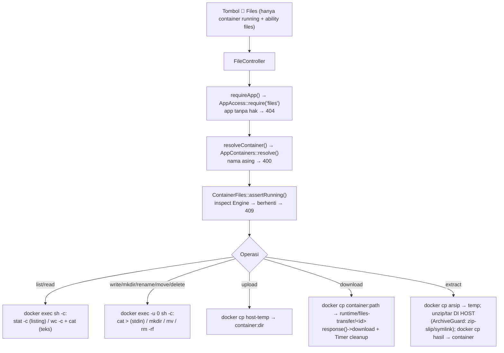
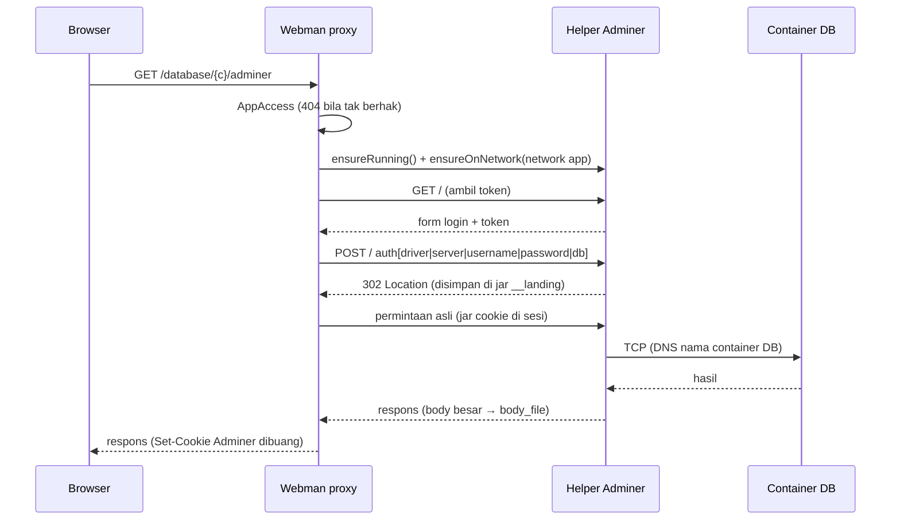
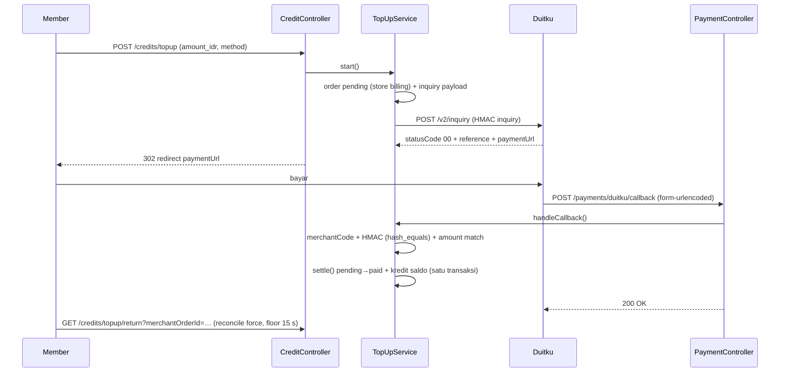
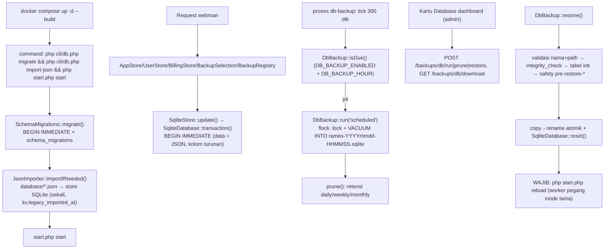
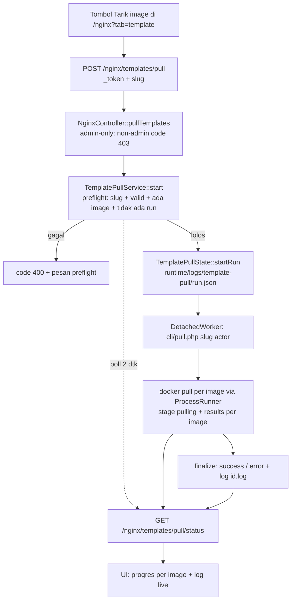

# 5. Alur Utama — File, Database, Billing, SQLite & Template

> Bagian dari [dokumentasi arsitektur](../ARCHITECTURE.md) · Spesifikasi: [SPECS.md](../SPECS.md) · Panduan operasional: [DETAILS.md](../../DETAILS.md)

## 5.16 File Manager Container (docker exec + docker cp)

Tab **Container** di detail app menampilkan tombol **📁 Files** di tiap baris container — hanya bila container `running` **dan** user punya ability `files` (operator+). Klik → modal `#files-modal` (`public/js/app-files.js`): breadcrumb + daftar isi, editor teks (aksi **`📄+ Berkas baru`** membuka editor kosong — berkas baru tercipta saat **Simpan**), tombol unggah (multi + progres), unduh, mkdir, rename, **pindah**, hapus, ekstrak. Target = **container app yang berjalan** (dipilih seperti Log/Terminal), bukan volume Docker. Spesifikasi produk: `SPECS.md` §7.9.

Kontrak route: `GET /api/apps/{id}/files` (list), `GET …/files/read`, `GET /apps/{id}/files/download`, `POST /apps/{id}/files/{write,mkdir,rename,move,delete,upload,extract}` (10 rute). Semua di balik `AuthMiddleware`; POST kena CSRF; envelope `{code:0,data}` / `{code:<status>,msg}` (unduh = respons file). Parameter `container` divalidasi `AppContainers::resolve()` — **jalur yang sama** dengan `TerminalController`/`LogController`. Aksi **berkas baru** memakai ulang `read` (probe eksistensi) + `write` (pembuatan berkas) sehingga **jumlah rute tetap 10**.

**Poin kunci**
- **Controller tipis, otorisasi sebelum efek samping**: `requireApp()` (app + `AppAccess::require('files')`) dan `resolveContainer()` dijalankan **sebelum** instance `ContainerFiles` menyentuh Engine/docker; `FileError` dipetakan ke `{code:<status>,msg}` (pesan spesifik dipertahankan karena dipakai UI), `InvalidArgumentException` → **400**, exception **tak terduga** → **500 generik** + detail dicatat `Log::error` (tidak pernah bocor ke klien), dan `AppAccessDenied` dibiarkan merender **404** (tidak ditangkap `run()`). Semua logika bisnis ada di `app\library\Files\*`; perilaku envelope ini dikunci test `tests/FileControllerEnvelopeTest.php`.
- **Container wajib berjalan → 409 fail-fast** (`assertRunning()` via `DockerClient::inspectContainer()`): dashboard **tidak** membuat container sementara dan **tidak** menyentuh volume Docker langsung — termasuk untuk `list`/`read`/`download`.
- **Semua `docker exec` file manager sebagai root** (`ContainerFiles::ROOT_USER = '0'` → `docker exec -u 0`): user default image (mis. `www-data`/`node`) tidak berizin atas berkas milik user lain maupun bind mount milik root host (`permission denied`). Kompensasi: entri **baru** hasil `exec` (write/mkdir/move/ekstrak) dipulihkan ke user image via `ownerSpec()` (dari inspect `Config.User`) + `restoreOwner()` (best-effort, **non-rekursif**; `missingAncestors()` untuk rantai `mkdir -p`).
- **`move()` — validasi sebelum efek samping**: `FilesInput::moveTarget()` menolak akar `/` (`moveSource()`), tujuan di dalam sumber/diri sendiri, dan nama tak valid (`PathGuard::assertName`); `ContainerFiles::move()` lalu mengecek sumber ada (**404**) → tujuan direktori (**400**) → tidak bentrok (**409**) **sebelum** `mv` (sebagai root). Route `POST /apps/{id}/files/move` (ability `files`) mengembalikan `{code:0,data:{from,to}}`. UI memakai penjelajah folder tujuan (bukan `window.prompt`), folder sumber/descendant dirender non-klik, dan confirm di-disable untuk no-op/descendant/nama ber-`/`.
- **Berkas baru — memakai ulang `read`/`write`, tanpa rute baru (10 rute tetap)**: tombol `#files-new` → `newFile()` meminta nama lewat `window.prompt` (beda dari `move` yang punya penjelajah folder sendiri di modal) dan menolak nama ber-`/`, `.`/`..`, atau berawalan `-` **di klien** (aturan `PathGuard::assertName()` versi klien; `validName()` sengaja **tidak** diubah karena dipakai juga oleh rename/mkdir/unggah — beda dari `assertName()`, `validName()` tak memeriksa panjang 255 byte), lalu **memprobe eksistensi** dengan `GET /api/apps/{id}/files/read`: `404` → `openNewEditor()` (textarea kosong, label `#files-edit-verb` → "Berkas baru", meta "belum ada — dibuat saat Simpan", `ST.editIsNew = true`); `code:0` → `fillEditor(name, path, data, 'Edit')` + status "Berkas sudah ada — dibuka untuk diedit" (**tidak** ada penimpaan tanpa sadar); `413`/`415` → editor tidak ditawarkan, alert mengarahkan ke **Unggah**. Berkas benar-benar dibuat saat **Simpan** (`POST …/files/write`; `ContainerFiles::write()` memulihkan kepemilikan hanya bila `containerType()` = `missing`), lalu `ST.editIsNew` kembali `false`, label `#files-edit-verb` kembali "Edit", status "Berkas dibuat.", dan daftar dimuat ulang. Backend tidak disentuh (`FileController`/route/library sama), jadi kontrak §5.16 tetap 10 rute; hanya `app/view/app/partials/detail-modal-files.php`, `public/js/app-files.js`, dan cache-buster `?v=` di `detail-scripts.php` yang berubah.
- **Transfer byte tidak lewat memori PHP**: unggah → `docker cp` dari berkas temp unggahan ke `container:dir`; unduh → `docker cp` dari `container:path` ke `runtime/files-transfer/<id>/` lalu `response()->download()`; ekstrak → `docker cp` arsip ke temp, ekstrak **di host**, lalu `docker cp` hasilnya ke container. `memory_limit` dibiarkan **128 MiB**.
- **Ekstraksi di host, bukan di container app**: `ContainerFiles::extract()` memakai `unzip`/`tar` **host dashboard** (paket `unzip` ada di `Dockerfile`) karena container app belum tentu punya tool itu. Sebelum ekstrak: `ArchiveGuard::unsafeEntry()` menolak entri ber-**path absolut**/drive Windows/`..` (zip-slip), dan `escapingSymlink()` menolak symlink yang menunjuk keluar direktori ekstraksi; setelah ekstrak `measure()` membatasi `MAX_ENTRIES` (10000) & `MAX_EXTRACT_BYTES` (1 GiB).
- **Listing portabel**: perintah listing memakai `stat -c` per entri (field US `\x1f`, record RS `\x1e`) agar bekerja di **Alpine/BusyBox** *dan* **Debian/GNU**; `ListingParser` memetakan deskripsi tipe kedua varian dan mengurutkan direktori lebih dulu.
- **UI anti-XSS & bebas kebocoran state**: `public/js/app-files.js` **tidak pernah** menaruh nama/path dari server sebagai `innerHTML` (selalu `textContent`/`createElement`); token CSRF dari `<meta name="csrf-token">`; XHR/unggahan dibatalkan saat modal ditutup / `pagehide`.

> **WAJIB — jangan membaca/menulis berkas besar lewat PHP.** Gejala: unggah/unduh berkas puluhan MiB memicu `Allowed memory size exhausted` atau worker mati. Sebab: `file_get_contents()`/`cat` ke variabel PHP memuat seluruh byte ke memori (`memory_limit` = 128 MiB) dan `docker cp` lewat pipe PHP menambah salinan kedua. Penangkal: transfer **selalu** lewat `docker cp` + berkas temp `runtime/files-transfer/` (`ContainerFiles::downloadToTemp()`/`uploadOne()`/`extract()`); perintah teks (`cat`/`wc -c`) hanya untuk berkas ≤ 2 MiB.

> **GOTCHA — berkas temp unduhan tidak boleh dihapus sinkron.** Gejala: unduhan gagal/terpotong (`file not found`) acak untuk sistem yang sibuk. Sebab: `response()->download()` membaca berkas **setelah** handler kembali (Workerman meng-stream respons setelahnya), jadi `cleanup()` di akhir handler menghapus berkas sebelum terkirim. Penangkal: `scheduleCleanup()` menunda penghapusan lewat `Workerman\Timer` (default 300 dtk); bila Timer tak tersedia (tanpa event loop) sisa direktori dibersihkan `prune()` (yatim > 1 jam) pada operasi transfer berikutnya.

> **WAJIB — path & nama tervalidasi sebelum masuk `docker exec`/`docker cp`.** Gejala: opsi diinterpretasi sebagai argumen (mis. nama berawalan `-`), atau perintah pecah karena karakter kontrol. Sebab: nama/path berasal dari request. Penangkal: `PathGuard::normalize()` (wajib absolut, `.`/`..` diselesaikan, NUL/CR/LF ditolak), `assertName()` (tanpa `/`/`\`, tanpa awalan `-`, `.`/`..`, ≤ 255 byte), `assertDeletable()` (tolak akar `/`); perintah `docker exec` dijalankan array + `sh -c` **di dalam container** dengan setiap argumen di-`escapeshellarg`; perintah host array + `bypass_shell` (tanpa shell host).

> **WAJIB — root di file manager adalah batas keamanan, bukan kenyamanan.** Gejala: berkas/bind mount milik root host tampak bisa diubah/dihapus dari UI (padahal sebelumnya `permission denied`). Sebab: semua `docker exec` file manager memakai `-u 0` agar operasi konsisten lintas image. Penangkal: ability `files` tetap **operator+** (jangan turunkan ke viewer) + audit `runtime/logs/files/{date}.log`; sadari bahwa operator di app apa pun bisa menyentuh berkas yang di-bind ke container app itu.

> **GOTCHA — `docker cp` tidak menerima `-u` (kepemilikan unggahan tetap user image).** Gejala: berkas yang diunggah dimiliki user image, sedangkan berkas yang dibuat lewat edit/mkdir dimiliki user image juga karena dipulihkan — tetapi restore itu **tidak** berlaku untuk `docker cp`. Sebab: `docker cp` tidak punya opsi `-u` dan menulis sebagai user proses daemon. Penangkal: jangan mengandalkan `docker cp` menghasilkan pemilik tertentu; pemulihan kepemilikan (`restoreOwner()`) hanya menyasar entri yang dibuat lewat `exec` (`write`/`mkdir`/`move`/ekstrak), bukan unggahan.

> **GOTCHA — `mv` lintas device (layer container → bind mount) menyalin sebagai root.** Gejala: entri yang dipindahkan dari layer container ke bind mount host berubah pemilik (milik root), padahal setelah pindah diharapkan tetap user image. Sebab: `mv` lintas filesystem = salin+hapus, dijalankan sebagai root, dan `rename`/`mv` sengaja **tanpa** hook `chown` otomatis (untuk menghindari perubahan kepemilikan yang tidak diminta pada berkas user). Penangkal: bila pemilik penting, buat/ubah berkas di dalam target bind mount (bukan pindah lintas device) atau perbaiki `chown` manual lewat Terminal.

> **WAJIB — batas unggah 64 MiB baru berlaku setelah image dashboard di-build ulang.** Batas dijaga tiga tempat: `config/server.php` (`max_package_size` = **68 MiB**, menampung overhead multipart), `Dockerfile` (`upload_max_filesize=64M`, `post_max_size=68M`, paket `unzip`), dan batas klien `public/js/app-files.js` (**64 MiB**). Gejala: berkas ~64 MiB ditolak `413`/`400` padahal batas klien lolos. Sebab: perubahan `Dockerfile`/`config` hanya aktif setelah image di-build ulang & container di-deploy ulang, dan bila dashboard berada di belakang vhost Nginx milik pengguna, `client_max_body_size` vhost itu harus memadai — jika tidak, Nginx membalas **413 sebelum** request sampai ke PHP. Penangkal: rebuild + deploy ulang image dashboard, lalu selaraskan `client_max_body_size` vhost.

**Pengujian**: `tests/FilePathsTest.php` (`PathGuard`), `tests/FileTextContentTest.php` (`TextContent`), `tests/FileArchiveGuardTest.php` (zip-slip/symlink), `tests/FileListingParserTest.php` (parser BusyBox/GNU), `tests/FileInputTest.php` (kontrak field UI↔controller), `tests/FileMoveTest.php` (validasi `move`), `tests/ContainerFilesRootUserTest.php` (semua `exec` `-u 0` + pemulihan owner; fake `DockerExec`/client). Smoke render view + uji Compose tiri memakai direktori temp, bukan data runtime nyata. Aksi **berkas baru** di UI belum punya test PHPUnit khusus (murni view + JS) — verifikasinya lewat smoke render view dengan harness DOM-stub di temp (di luar repo), bukan test yang di-commit.

## 5.17 Database / Adminer — helper container + reverse proxy

Halaman `/database` memakai **Adminer** (`adminer:6`) yang dijalankan di **helper container** tanpa port publik, bukan klien SQL di dalam dashboard. Alur: browser → Webman (`AuthMiddleware` + `CsrfMiddleware` + `AppAccess`) → **reverse proxy HTTP** (`AdminerProxy`) → helper `rames-adminer` (`php -S`, dijangkau via DNS nama container) → container DB (TCP, lewat network app yang di-attach). Otorisasi **sebelum** efek samping; penolakan → **404** (`findOwningApp()`).

- **Daftar** `/database` (GET) memakai `DbContainerDetector::detectAll()` tanpa exec; baris **Kelola →** hanya untuk ability `database` (operator+).
- **Proxy** (`AdminerHelper` + `AdminerProxy`): nama container dari request divalidasi milik app (`AppContainers::resolve`) & tidak dipercaya; kredensial dari `DbCredentialResolver`; host DB = nama container (`AdminerHelper::databaseHost()`).
- **Jar Adminer di sesi server** (kunci `adminer:<container>`), bukan browser; `Set-Cookie` Adminer tidak pernah diteruskan, cookie sesi Rames tidak pernah dikirim ke helper.
- **Mode manual**: kredensial tak terdeteksi ⇒ helper diberi `?server=<host:port>` sehingga **halaman login Adminer** tampil dengan Server ter-prefill (bukan error/409).
- **Batas umur attach**: `ensureRunning()` menjalankan `pruneIdleNetworks()` — network app yang idle ≥ `adminer_network_ttl` (`ADMINER_NETWORK_TTL`, default **1800** detik; `0` = nonaktif) dilepas via `ensureOffNetwork()`; network `rames-helpers` **tidak pernah** dilepas. Waktu pakai dicatat di `runtime/adminer-helper/networks.json` (direktori `0700`/berkas `0600`, **tanpa** kredensial, lewat `JsonStore`).
- **Pengerasan**: `normalizePath()` menolak `..`, path absolut, `\\`, `//`, karakter kontrol, dan bentuk ter-encode `%2e`/`%2f`/`%5c` (case-insensitive). Berkas respons temp `runtime/adminer-proxy/` dibuat direktori **0700** / berkas **0600** (`AdminerTempDir`), dipangkas TTL 3600 s (juga saat `ensureRunning()`).
- **Header ke helper**: `X-Forwarded-*`/`Forwarded`/`X-Real-IP` kiriman **klien dibuang** (`CLIENT_FORWARDED_HEADERS`); proxy menyetel sendiri `X-Forwarded-Prefix` (konfigurasi prefix), `X-Forwarded-Proto` (konteks dashboard via `adminerProxyContext()` — TLS listener dashboard, atau `X-Forwarded-Proto: https` dari **peer internal**), dan `X-Forwarded-For` (`REMOTE_ADDR` dashboard, satu IP valid). `X-Forwarded-Host` tidak pernah dikirim; `Referer`/`Origin` ditulis ulang ke host helper.

> **WAJIB — helper harus berbagi network dengan dashboard & dijangkau lewat nama container.** Gejala: `cURL error 6: Could not resolve host: rames-adminer` atau koneksi timeout dari dashboard. Sebab: bila dashboard dan helper tidak berada di network Docker yang sama, DNS nama container gagal; IP antar-bridge tidak routable. Penangkal: `AdminerHelper::ensureRunning()` membuat network **internal** `rames-helpers` (`AdminerHelper` **dan** `deploy.dashboard_container` di-attach) dan `baseUrl()` memakai nama container, bukan IP.

> **WAJIB — helper hanya boleh menempel di network app sesaat; pahami risiko sisa.** Gejala: helper `rames-adminer` (Adminer **tanpa auth**) terus terlihat container lain di network app dan **punya egress** ke jaringan itu. Sebab: agar helper bisa menjangkau container DB via DNS, ia harus di-attach ke network app — yang **bukan** `internal`. Penangkal: `ADMINER_NETWORK_TTL` (default 1800 dtk) + attach hanya saat `/database` diakses, dijalankan `pruneIdleNetworks()` dari `ensureRunning()`. **Risiko sisa yang diterima**: prune **oportunistik** (tanpa scheduler) ⇒ bila tidak ada request `/database` berikutnya, network bisa tetap menempel **lebih lama dari TTL**; pemilik residual = **operasi** (turunkan `ADMINER_NETWORK_TTL` bila perlu jendela lebih pendek). Jangan menghapus TTL/prune ini.

> **GOTCHA — `DockerClient::connectContainerToNetwork()` TIDAK idempoten.** Gejala: pembukaan Adminer berulang gagal `403 endpoint … already exists`. Sebab: `POST /networks/{id}/connect` menolak container yang sudah terhubung. Penangkal: `AdminerHelper::attach()` **selalu** membaca `NetworkSettings.Networks` lebih dulu (lewati bila sudah ada) **dan** tetap menangkap error `already exists` sebagai sukses (race) — jangan hapus guard ini.

> **DILARANG — menggabungkan `--rm` dengan `--restart`.** Gejala: helper tidak pernah jalan, `docker create` keluar **exit 125** (`Conflicting options: --restart and --rm`). Sebab: dua opsi itu saling eksklusif. Penangkal: `buildRunArgv()` memakai `--restart unless-stopped` **tanpa** `--rm`; lifecycle eksplisit (`remove()` lalu `run` bila image berubah). Test `AdminerHelperTest::testRunArgvNeverCombinesRmWithRestart` menjaganya.

> **GOTCHA — token form Adminer terikat sesi; POST dari sesi basi tidak bisa diulang sukses.** Gejala: setelah Adminer login ulang, aksi user (query/import) hilang tanpa penjelasan. Sebab: `get_token()`/`verify_token()` Adminer mengikat token ke sesi, jadi memasok token baru ke body user akan melemahkan CSRF Adminer (dan melebarkan pengecualian CSRF kita). Penangkal: **GET** memulihkan sesi otomatis (login ulang sekali, permintaan diulang); request yang **mengubah data** dengan sesi basi ⇒ proxy mengembalikan `session_expired` dan controller merender view Rames **`db/session-expired`** berstatus **409** (input user harus diulang). Percobaan pertama & kedua **tidak ber-efek samping** (halaman login = Adminer belum memproses form). **Jangan** menambahkan tombol "kirim ulang" (token tetap basi).

> **DILARANG — melebarkan pengecualian CSRF proxy.** Gejala: celah CSRF untuk route non-Adminer. Sebab: `CsrfMiddleware::isAdminerProxyPath()` hanya boleh cocok untuk `#^/database/[^/]+/adminer(/|$)#` dan **sebelum** `$request->post()` (agar body multipart import diteruskan mentah via `rawBody()`). Penangkal: pertahankan pola path-presisi; kompensasi lain (`AuthMiddleware` global, otorisasi `AppAccess` di controller, cookie sesi `SameSite=lax` yang **ditegakkan** `config/session.php` `'same_site' => 'lax'` — kosong = tanpa atribut, hanya default browser —, cookie Adminer tidak ke browser) **wajib** tetap ada. **Catatan operator**: `'secure' => false` (cookie belum dipaksa HTTPS). Test: `tests/CsrfExemptAdminerProxyTest.php`.

> **DILARANG — menyunting HTML Adminer.** Gejala: tautan/aset Adminer rusak setelah upgrade image atau XSS dari patch string. Sebab: Adminer menghasilkan URL relatif; prefix proxy diberitahu lewat header `X-Forwarded-Prefix` sehingga `path` cookie & URL sudah benar tanpa menyentuh body. Penangkal: **jangan** rewrite HTML; kirim `X-Forwarded-Prefix: <prefix>` dan biarkan Adminer membentuk URL relatif. (Proxy hanya menormalkan status halaman login yang membawa `?username=` dari `403` → `200`, tanpa mengubah body.)

> **WAJIB — klien Guzzle dibangun dengan `HandlerStack`+`CurlHandler` eksplisit & `expect => false`.** Gejala: opsi `curl` per-request diabaikan, atau setiap POST tertunda ~1 detik. Sebab: Guzzle 8 mengganti handler saat `stream => true`, dan `curl`/`CURLOPT_*` per-request dilarang; `php -S` tidak menjawab `100-continue` sehingga body menunggu. Penangkal: konstruktor `AdminerProxy` menyusun `HandlerStack::create(new CurlHandler())`, `expect => false`, `allow_redirects => false`, `http_errors => false`, `decode_content => false`, `Accept-Encoding: identity`.

> **GOTCHA — tidak ada streaming inkremental; dump/import besar wajib lewat jalur lain.** Gejala: impor/ekspor besar timeout atau `413`, TTFB lama. Sebab: `adminer_proxy_timeout` **di-cap ≤30 detik** dan `adminer_proxy_max_bytes` (default 64 MiB, ditegakkan **saat menulis** oleh `LimitedTempSink` + `on_headers`) membatalkan transfer; tidak ada streaming inkremental (TTFB = durasi unduh penuh). Penangkal: arahkan dump/import besar ke fitur **Volume/backup** (§5.15) atau tab **Terminal** (`AdminerProxy::LIMIT_MESSAGE`); jangan menaikkan batas proxy untuk mengakalinya.

> **GOTCHA — `403` dari Adminer ≠ kebijakan `404` repo.** Gejala: user mengira app miliknya hilang, atau sebaliknya otorisasi bocor. Sebab: Adminer memakai `403` untuk galat autentikasinya sendiri (`auth_error()`), sedangkan kebijakan dashboard adalah **404** menyembunyikan keberadaan app user lain — keduanya berbeda lapisan. Penangkal: otorisasi app tetap di controller (`AppAccess` → 404); `403` Adminer hanya muncul di dalam area yang sudah lolos otorisasi (mis. `?username=` di URL) dan dinormalkan menjadi halaman biasa.

**Gap verifikasi (diterima)**: jalur pengembalian body hasil proxy via `Webman\Http\Response::withFile()` + pembersihan berkas temp `Timer` (unduhan/ekspor besar) **belum** tercakup uji otomatis/verifikasi ber-sesi (butuh login dashboard) — **sudah diuji manual oleh pemilik**, namun setiap perubahan di jalur itu (`AdminerProxy` + `withFile()`/`Timer`) **wajib diuji manual lagi di browser**.

**Pengujian**: `tests/AdminerHelperTest.php` (argv/`targetNetwork`/`databaseHost`), `tests/AdminerProxyTest.php` (normalisasi path/limits/header/jar), `tests/AdminerProxyForwardTest.php` (auto-login, sesi basi, mode manual; fake `tests/FakeAdminerHandler.php`), `tests/CsrfExemptAdminerProxyTest.php` (pengecualian sempit), `tests/AdminerNetworkTtlTest.php` (prune TTL/`ensureOffNetwork`/izin temp), `tests/AdminerForwardContextTest.php` (konteks `X-Forwarded-Proto`/`For` anti-spoof).

## 5.18 Kredit, Deposit & Penagihan Resource (billing)

Fitur role `member` (SPECS §7.12): saldo kredit pra-bayar membiayai pemakaian CPU/RAM app. Seluruh logika di `app\library\Billing\*` (§4.3) + `app\process\BillingProcess.php`/`cli/billing.php` (§4.4); controller & worker hanya mediator/pemicu. Data di `database/billing.json` (§4.5).

**(i) Create app dengan pemilihan limit + gerbang kredit**
1. Owner/member (dan admin) boleh memilih CPU/RAM saat create — kartu *Batas Sumber Daya* di halaman konfirmasi & form template dirender untuk `canManage` (= user login), bukan `is_admin()` saja. Pemilih berupa **slider diskret** (`public/js/limits-scale.js` + `data-limit-stops`; posisi 0 = tanpa batas/default akun); batas atas dari `AppController::limitsScaleMax()` (member → plafon billing; admin/bukan member → kapasitas host, fallback plafon config).
2. Server tetap sumber kebenaran: `Pricing::assertWithinCaps($limits)` menolak nilai > `BILLING_MAX_CPUS`/`BILLING_MAX_MEMORY_MB` **fail-fast** (sebelum efek samping). Bila member tidak mengirim limit, `AppController::defaultLimitsFor()` mengisi basis limit default per service (**anti-lubang harga**).
3. `BillingGate` menegakkan gerbang pada jalur app-lama (`AppController::billingAssertCanStart`) dengan **urutan keputusan final** (kebijakan produk: **admin bebas kredit & app milik admin tidak dibatasi kredit siapa pun**): (1) `$user === null` ⇒ `return` (penilaian owner diserahkan `cli/deploy.php`); (2) **aktor exempt (admin) ⇒ diizinkan**, tak pernah diblokir — dijaga `BillingGate::isExempt()`; (3) **penanggung biaya** (`billingPayerFor()` = `owner_id`, fallback aktor) **exempt (app milik admin) ⇒ diizinkan untuk siapa pun**; (4) aktor `member` wajib bersaldo; (5) bila pembayar ≠ aktor, pihak pembayar juga dinilai. Ini **menggantikan** aturan lama "dua pihak": admin **tidak** bisa ditolak, dan app milik admin bebas untuk operator member tanpa saldo. **Yang tetap berlaku**: member tanpa saldo tetap diblokir untuk app miliknya; operator member tetap diblokir bila owner member kekurangan saldo. Gerbang yang sama hadir di `confirmCreate` & `templateDeploy` (`assertCanCreate`, early-return bila aktor exempt lalu menilai limit pilihan) + **8 jalur app-lama** (`rebuild`/`rollback`/`start`/`saveCompose`/`saveEnv`/`saveNetworks`/`saveContainerNames`/`saveLimits`) = **10 titik** di `AppController`; `cli/deploy.php` mengulang cek dengan **paritas penuh**: `spawnWorker()` mengirim id aktor via `argv[4]`, worker memakai urutan penilaian **aktor → pembayar/owner** dengan pengecualian exempt yang sama (aktor admin **atau** owner admin ⇒ dilewati), lalu menilai **aktor lebih dulu** (`$actor ?? $owner`) dan **owner** hanya bila berbeda dari aktor; tanpa aktor (pemanggil lama) worker menilai **hanya penanggung biaya/owner** — sehingga controller & worker **tidak berbeda putusan**.

**(ii) Meteran tick per server** (`UsageMeter::sampleReport`, §4.4)
`BillingProcess` (atau `cli/billing.php sample`) memanggil `UsageMeter::sampleReport(BILLING_SAMPLE_SECONDS)` (bentuk lama `sample()` = `sampleReport()['accrued']`): calon = app `status=running` milik owner non-admin, lalu `UsageProbe::observe()` mengambil **bukti container dari server pemilik app** — `server_id=local` ⇒ `DockerClient::listContainers()` host ini, server agent ⇒ `AgentDeployer::containerStats()` (`GET /monitor/containers`, **bukan** Engine host control plane) — **satu pembacaan per server per tick**, terisolasi per server (`try/catch` per grup `server_id`, pesan tersanitasi). App diakru hanya bila container-nya **teramati hidup** (`running`/`paused`/`restarting`) di server itu: `credits_pending += (seconds/3600) × Pricing::hourlyCredits(ResourceLimits::of($app), $rates->ratesFor($serverId))`, `seconds_pending += seconds`, `name`/`owner_id`/`server_id` disegarkan. `period` diinisialisasi ke bulan berjalan saat baris pertama dibuat (tanpa tagihan retroaktif). Inkremental (bukan selisih timestamp) ⇒ tahan restart worker; perubahan limit di tengah bulan otomatis ter-prorata.

**Kebijakan server tidak terjangkau** (keputusan produk, SPECS §7.12): app di server yang gagal dibaca (`server_unreachable`) atau containernya tidak teramati (`container_not_running`) **dilewati** tick ini; `server_id` tak dikenal ⇒ `server_unknown` (fail-fast, **tanpa** fallback ke Engine lokal). Setiap pelewatan **selalu** dicatat — `skipped` di `sampleReport()` + log billing (satu baris per server, sebut cause + detail tersanitasi). Karena akrual inkremental, interval yang terlewat **tidak** ditagih kemudian (tanpa akrual ganda/tunggakan); kerugian under-count diterima, dan alternatif "menagih tanpa bukti" ditolak. **Batasan**: app yang nama compose project-nya ≠ nama app tidak terpetakan ⇒ tidak teramati (skip + log). **Biaya backup** diakru di tick yang sama: `chargedGb = BackupUsage::chargedGigabytesByApp()` dibaca **sekali per tick** (tanpa Docker), lalu `backup_gb = chargedGb[appId]` dan `backup_credits_pending += Pricing::backupCredits(gb, seconds, daysInPeriod)` — kelayakan identik (hanya app `running` + owner non-admin; app admin & volume yatim bebas). `summary()` karena itu juga mengembalikan `backup_gb`/`backup_credits`/`backup_monthly`, dengan `estimate_month` = estimasi CPU/RAM bulan berjalan **+** `backup_monthly`.

**(ii-b) Tarif per server (overlay)** — SPECS §7.12, §7.14
1. **Resolusi**: `server_id` app (`AppStore::serverIdOf()`, untuk invoice: snapshot `usage.server_id` dengan fallback server app saat ini) → `ServerRates` → baris registry → `Pricing::rates($server)`/`Pricing::backupMonthlyRate($server)`. Hanya key `rates.{cpu,ram,backup}` **numerik > 0** yang meng-overlay; key kosong/0/negatif/rusak ⇒ tarif global `BILLING_RATE_*` (data tarif cacat tidak boleh membuat app gratis). `ServerRates` ber-cache **per instance** (satu tick/satu render) dan tidak pernah mengembalikan secret; registry tak terbaca ⇒ fallback global, operasi uang tidak gagal.
2. **Titik pakai**: `UsageMeter` (akrual CPU/RAM + backup), `Invoicer` (rincian `items[].hourly`/`items[].monthly`, sekarang memuat `server_id`), `BillingGate` (`requiredFor`/`assertCanCreate`/`assertCanBackup` menerima `?string $serverId`; `$rates` eksplisit tetap menang untuk tes/BC), `AppController` (estimasi create/start memakai tarif server **target**), `BackupController` (`backup_rate` per baris volume = tarif server baris itu, fallback global).
3. **Waktu perhitungan**: tarif dibaca **saat tick** — tanpa pembekuan historis. Perubahan tarif server berlaku pada akrual berikutnya; akrual yang sudah tersimpan (`credits_pending`, `backup_credits_pending`) menjadi `amount` invoice apa adanya, jadi mengganti tarif **tidak** menagih ulang/meretroaktif. Plafon `BILLING_MAX_CPUS`/`BILLING_MAX_MEMORY_MB` tetap global (tidak per server).
4. **Input**: form `/servers` mengirim `rate_cpu`/`rate_ram`/`rate_backup`; `ServerResolver::validate()`/`validateLocal()` menormalkan ke `rates` (hanya numerik > 0). Semua field kosong = hapus override (array kosong disimpan); form lama tanpa field tarif tidak menghapus tarif tersimpan. Baris `local` boleh mengubah `rates` — identitasnya tetap terkunci.

**(iii) Penagihan (tanggal `BILLING_INVOICE_DAY`) + auto-stop** (`Invoicer::runDue`)
`BillingRunner::tick()` menjalankan `runDue()` **hanya bila `invoiceDayReached()`** — `BillingPeriod::dayOfMonth()` ≥ `BILLING_INVOICE_DAY` yang **dijepit 1–28**. Baris `usage` dengan `period < bulan berjalan` ditagih dalam **satu** `SqliteStore::update()`: potong saldo owner (`CreditAccount::applyCharge`), tulis ledger `charge` (item `kind=compute` per app **dan** item `kind=backup` bila `backup_credits_pending > 0` — `backup_gb`/`monthly`/`amount`), reset `period`+akumulasi (`backup_credits_pending` → `0`, `backup_gb` **dipertahankan** sebagai GB terakhir teramati; `server_id` **dipertahankan** sebagai atribusi per server), prune baris app yang sudah dihapus. Idempoten. **Catch-up**: bila dashboard mati pada tanggal itu, hari berikutnya tetap menagih (periode tertunggak tetap terpilih). Setelah potongan, `applyStopPolicy()` memanggil callback `AppStopper::stopOwnedBy()` bila saldo owner `< 0` **dan** `BILLING_PAYMENT_POLICY='stop'` — semua app owner yang masih `running`/`deploying` dihentikan (`DeployerInterface::stop()`, `status=stopped`, alasan di `message`). Penagihan manual (`POST /credits/charge`, `php cli/billing.php invoice [--period=YYYY-MM]`) **tidak** menunggu tanggal itu.

**(iii-b) Anti-escape pengalihan kepemilikan** (`AppStopper::shouldStopOnTransfer`/`stopForBillingEscape`/`stopTransferredToExemptOwner`)
Pada `AppController::transferOwner()`: bila `BILLING_ENABLED` aktif **dan** app masih hidup (`running`/`deploying`) **dan** pemilik lama adalah pihak yang ditagih (member) **dan** pemilik baru bebas tagihan (admin) ⇒ app **dihentikan** (`stopForBillingEscape()`, `status=stopped`, `message`=`REASON_TRANSFER`) + flash info; admin dapat menyalakannya kembali (admin gratis). **Jalur hapus user** (`UserController::delete()`) memakai aturan yang sama: `ownedBy($id)` + `previousOwnerBillable` dihitung **sebelum** `transferAllFrom()`/hapus, lalu `stopTransferredToExemptOwner($appsBefore, true, true)` menghentikan app hasil transfer yang masih hidup (flash menyebut jumlah). Menutup celah app berjalan tanpa akrual setelah dialihkan ke pemilik bebas tagihan. Alasan `message` dibedakan per sebab (`REASON` = saldo negatif, `REASON_TRANSFER` = pengalihan). `billingPayerFor()` juga defensif (`catch (\Throwable)` → jatuh ke aktor bila `auth.json` tak terbaca — N7).

**(iv) Deposit manual admin** — `POST /credits/deposit` (admin-only → 404 non-admin)
`CreditController::deposit()` memetakan nominal positif → `CreditAccount::deposit(..., type='deposit')`, negatif → `type='adjust'`; validasi & cap `BILLING_ADMIN_DEPOSIT_MAX` di library. `POST /credits/charge` (admin) memicu `Invoicer::runNow`/`runDue` manual dengan kebijakan auto-stop yang sama.

**(v) Top-up mandiri Duitku + callback + settle idempoten**

- `TopUpService::start()` memvalidasi email user (prasyarat), membuat order `pending`, membangun payload inquiry lengkap, lalu `DuitkuClient::inquiry()`; gagal ⇒ order `markFailed` (tidak meninggalkan pending yatim). Sukses ⇒ 302 ke `paymentUrl`. `returnUrl` kosong diturunkan `DuitkuClient::deriveReturnUrl()` dari origin `callbackUrl` (skema+host+port) + `/credits/topup/return`; `callbackUrl` non-https/relatif ⇒ `isConfigured()=false` ⇒ top-up 404 (fail-safe).
- `PaymentController::callback()` (publik, tanpa session) memanggil `TopUpService::handleCallback()`: urutan verifikasi merchantCode → signature HMAC `hash_equals` → order ada → **amount cocok** → `resultCode='00'` settle+kredit / `'01'` failed. **Idempoten**: kredit hanya pada transisi `belum paid → paid`; transisi + saldo + ledger dalam **satu** `BillingStore::update()` (lewat `TopUpOrder::settle($onTransition)`).
- `GET /credits/topup/return` membaca order id dari `?order=` **atau** `?merchantOrderId=` (Duitku menambahkan `merchantOrderId`/`resultCode`/`reference` ke `returnUrl`); input kosong/non-skalar ⇒ 404, dan order tetap dicari via `TopUpOrder::findForUser()` ⇒ **404** bila bukan milik user login (anti-IDOR). Bila order masih `pending`, halaman memicu `TopUpService::reconcile($orderId, null, true)` — **cek otoritatif sekali-jalan**.
- **Throttle worker vs pemicu user**: worker billing (`BillingProcess`) memakai `reconcile()` tanpa `$force` (throttle normal `BILLING_DUITKU_STATUS_MIN_INTERVAL`, default 900 s); pemicu user (return Duitku **dan** tombol "Cek status") memakai `$force=true` yang menurunkan jeda ke floor yang dapat dikonfigurasi `BILLING_DUITKU_FORCED_MIN_INTERVAL` (`deploy.billing_duitku_forced_min_interval`; default `TopUpService::FORCED_MIN_INTERVAL` = **15 s**, dijaga `max(1, …)` ⇒ efektif ≥1 s). Throttle tidak dihapus; config `<= 0` tetap tanpa throttle. `touchChecked()` dipindah ke blok `finally` ⇒ `last_check_at` diperbarui pada **setiap** percobaan panggilan gateway **termasuk saat `DuitkuError`** (outage), sehingga throttle (normal & floor force) tetap berlaku dan refresh berulang saat gateway bermasalah tidak memanggil `transactionStatus` tanpa batas — `DuitkuError` tetap ditelan (`checked=false`, `changed=false`). `resultCode`/`reference` dari redirect browser **tidak dipercaya** — hanya pemicu + pemilih pesan flash, dan flash hanya muncul bila URL memuat `resultCode`. Kebenaran saldo **tidak** disimpulkan dari redirect browser.
- **Fail-safe**: `BILLING_TOPUP_ENABLED=false` atau kredensial tidak lengkap ⇒ tombol top-up disembunyikan, `POST /credits/topup` & callback **404**, sedangkan deposit manual admin tetap berfungsi. Untuk **admin**, `CreditController::topupIssues()` (`DuitkuClient::configurationIssues()`) menampilkan `alert-info` "Top-up online belum aktif" + daftar alasan di `/credits` (sebelumnya senyap); member tidak melihat detail infrastruktur.
- **UI kredit**: tombol top-up di kartu saldo `/credits` membuka **modal** `#topupModal` (form `#credits-topup`, submit modal-footer memakai `form="credits-topup"`); daftar metode (`GET /api/credits/methods`) dimuat **sekali saat modal pertama dibuka** (`shown.bs.modal`) — bukan saat page load. Opsi metode dirender **terkelompok `<optgroup>` per jenis kanal**: render awal server dari `methodGroups` (label = nama grup, opsi = **kode** kanal, pra-JS; fallback daftar `<option>` datar `methods`), lalu JS menggantinya dengan **nama + biaya** dari gateway **mengikuti urutan grup dari payload** (`credits.js` bucket `Object.create(null)`, tanpa tabel kode→grup hardcode); cache-buster `credits.js?v=4`. Bila email user kosong tombol top-up **tidak** ditampilkan (alasan + tautan ke `/profile`). Email diubah di halaman **Profil** (`POST /profile/email`); `POST /credits/email` hanya **warisan/BC**. **Blok diagnostik admin** (admin-only): peringatan **non-blocking** "Konfigurasi callback pembayaran perlu diperiksa." + daftar `topupWarnings`, dan blok URL yang **wajib didaftarkan di dashboard Duitku** (`topupCallbackUrl` + catatan bahwa callback hanya diterima di `POST /payments/duitku/callback` dan host wajib publik tanpa auth) beserta `topupReturnUrl`; member menerima `[]`/`''` (tidak bocor detail infrastruktur).
- **`BILLING_DUITKU_ALLOW_HTTP` (default `false`)**: callback `http://` diterima **hanya** bila `true` (`allowsHttp()`) — opt-in uji lokal (mis. `http://localhost:8123/...`); default produksi **wajib https**. Status order tetap dapat diselesaikan lewat `transactionStatus` ("Cek status").

> **GOTCHA — meteran berbasis tick, bukan akrual host.** Bila dashboard mati, tick hilang ⇒ tagihan **under-count** (tidak pernah over-charge). App yang dihentikan otomatis berhenti diakru begitu `status=stopped`. Penangkal: jalankan `php cli/billing.php tick`/`sample` manual (mis. via `docker exec`) setelah dashboard hidup lagi.

> **WAJIB — callback Duitku harus dibalas HTTP 200.** Respons non-200 memicu Duitku **retry sampai 5×**; `PaymentController` karena itu membalas 200 `OK` untuk semua payload yang **diproses** (status apa pun), dan hanya 400 (payload cacat) / 403 (verifikasi gagal) / 404 (fitur-kredensial mati) untuk kasus lain — tanpa detail internal.

> **DILARANG — mempoll `transactionStatus` agresif.** Melewati hit-rate Duitku ⇒ diblokir ±1 jam. Re-konsiliasi **wajib** menghormati jeda `BILLING_DUITKU_STATUS_MIN_INTERVAL` per order & batas `BILLING_DUITKU_STATUS_MAX_PER_TICK` per tick (keduanya sudah ditegakkan `TopUpService::reconcile` & `BillingRunner`).

> **GOTCHA — `adjust` negatif tidak memicu auto-stop seketika.** Auto-stop hanya berjalan di jalur penagihan/tick berikutnya saat saldo `< 0` (satu aturan, bukan efek samping `adjust`).

> **WAJIB — view `confirm`/`template` memakai `canManage` dari controller, bukan `is_admin()`.** Sejak owner/member boleh memilih limit saat create, kartu *Batas Sumber Daya* dirender untuk semua user login; admin tetap `canManage=true` dan tak dibatasi plafon, sedangkan penegakan plafon tetap `Pricing::assertWithinCaps()` di server.

> **WAJIB — naikkan `?v=N` setiap mengubah `public/js/limits-scale.js`.** **Gejala**: skrip slider baru sudah ada di disk tetapi browser (atau proxy) tetap memakai versi lama — perilaku slider/label/estimasi kredit tidak berubah walau hard refresh tidak selalu cukup. **Sebab**: `app/view/app/template.php` & `app/view/app/confirm.php` memuat `<script src="/js/limits-scale.js?v=1">`; query `?v=` adalah **satu-satunya** cache-buster (tanpa hash/nama ber-hash di URL) — pola sama dengan `app-terminal.js`/`app-files.js` (§4.6). **Penangkal**: setiap perubahan `limits-scale.js` **wajib** menaikkan `?v=` di **kedua** view (template & confirm).

> **DILARANG — menduplikasi tabel kode→grup kanal di JS atau view.** Kategori kanal hidup **hanya** di `PaymentMethodCatalog` (`GROUPS`/`group()`); UI mengikuti **urutan grup dari server** (key `group` per item `/api/credits/methods` & payload `methodGroups` `GET /credits`). **Gejala bila dilanggar**: saat allowlist admin (`BILLING_DUITKU_METHODS`) berubah atau gateway menambah kanal, kanal **berpindah/tergabung salah** karena urutan render server (`<optgroup>` pra-JS) dan urutan JS berbeda. **Sebab**: Duitku tidak mengirim kategori, sehingga tabel lokal adalah satu-satunya kebenaran. **Penangkal**: bentuk `<optgroup>` selalu dari urutan `group` payload (bucket `Object.create(null)` di `credits.js`, tanpa peta hardcode).

> **WAJIB — callback Duitku wajib dijangkau publik tanpa autentikasi.** **Gejala**: order tetap `pending` walau gateway `statusCode 00`, `runtime/logs/billing/` tanpa jejak callback, dan "Resend callback" di dashboard Duitku gagal `Unauthorized`/404. **Sebab**: URL callback tak dapat dijangkau Duitku — tunnel pengembangan ber-autentikasi (`*.devtunnels.ms` ⇒ Duitku menerima **401 dari tunnel**, bukan aplikasi) atau path URL tidak persis `/payments/duitku/callback` (mis. didaftarkan berakhiran `/callback`). **Penangkal**: URL **publik tanpa autentikasi** + path **wajib** `/payments/duitku/callback` + **daftarkan URL yang sama di dashboard Duitku** + periksa `topupWarnings` di `/credits`. `callbackUrl` ditanam di payload inquiry **saat order dibuat** ⇒ mengubah `.env` butuh **order baru** dan container **recreate** (env dibaca saat start).

**(vi) Biaya penyimpanan backup volume & gerbang saat menyalakan** (baru)
Saldo kredit member juga membiayai **snapshot volume** app-nya (`1.000` kredit/GB/bulan — `BILLING_RATE_BACKUP_PER_GB_MONTH`, floor `BILLING_BACKUP_MIN_GB` per app; §4.3 `BackupUsage`/`Pricing`; SPECS §7.12/§8h.10).
- **Basis = snapshot tersimpan**: `BackupUsage` menjumlahkan `bytes` entri `BackupRegistry` per `app_id` (÷ 1024³) lalu menerapkan `max(floor, Σ)` **satu kali per app**; app tanpa snapshot (Σ 0) tidak muncul. Flag `scheduled` **tidak** dipakai ⇒ snapshot hasil run **manual** ikut ditagih, dan volume yang di-ON-kan tetapi belum bersnapshot belum ditagih.
- **Akrual per tick** (lihat (ii)) — bukan sekali per run: `UsageMeter` menambah `backup_credits_pending` **dibulatkan 4 desimal** per tick (CPU/RAM tetap 2; tarif backup besar ⇒ bias 2-desimal-per-tick menumpuk jadi drift — terukur 2,5 GB/bulan ≈ +0,22 % → ≈ +0,02 %); tagihan/ledger tetap 2 desimal (`Invoicer`). `summary()` mengirim `backup_gb`/`backup_credits`/`backup_monthly` (2 desimal, tampilan) ke `/credits` (kolom **Backup (GB)**/**Kredit backup**, catatan tarif+floor di footer) dan `withScheduled()` menambahkan `can_schedule`/`backup_gb`/`backup_credits_month` ke tiap baris `/backups` (peta GB dibaca **sekali** per respons).
- **Gerbang hanya saat menyalakan** — dan menilai **dua subjek** seperti §7.12: `BackupController::setScheduled()` → `assertCanScheduleBackup()`; lewat bila billing mati / tanpa user / aktor exempt / **app milik penanggung biaya exempt (admin)**; lalu `BillingGate::assertCanBackup($gb, aktor)`; lalu — bila **penanggung biaya** (`billingPayerFor()` = `owner_id`, fallback aktor) berbeda dari aktor — `assertCanBackup($gb, owner)` dengan pesan khusus "Saldo kredit pemilik app tidak mencukupi …". `required` = `BackupUsage::requiredDeposit($gb)`. Gagal ⇒ **402 JSON `{code:402,error}`** dan seleksi **tidak** berubah; mematikan tidak pernah digerbang. Respons sukses: `data: {volume, scheduled, explicit, backup_gb, required}`; baris UI 402 ditangani `public/js/backup.js` (toggle dikembalikan ke posisi semula).
- **Jebakan** (gejala + sebab + penangkal) ada di §5.15 & SPECS §8h.10: floor per **app** (bukan per volume/owner), biaya mengikuti snapshot tersimpan (bukan flag `scheduled`), akrual hanya app `running`, gerbang hanya di titik menyalakan (menilai aktor → owner), dan app **tanpa snapshot ⇒ `required` 0** sehingga gerbang efektif belum menghalangi pada penyalaan pertama.

**Pengujian**: `tests/BillingPricingTest.php`, `tests/BillingStoreTest.php`, `tests/CreditAccountTest.php`, `tests/UsageMeterTest.php`, `tests/UsageMeterServerScopeTest.php` (metering per server: bukti dari server app, kebijakan offline, `server_id`, auto-stop aman), `tests/BackupUsageTest.php`, `tests/InvoicerTest.php`, `tests/BillingGateTest.php`, `tests/BillingPeriodTest.php`, `tests/BillingRunnerTest.php`, `tests/BackupScheduleBillingTest.php`, `tests/BackupControllerScheduledTest.php`, `tests/ServerRatesTest.php` (cache per instance, fallback global, tanpa secret, registry rusak), `tests/BillingServerRateWiringTest.php` (meteran/invoice/gate/estimasi create/`backup_rate` per baris), `tests/AppStopperTest.php`, `tests/TopUpOrderTest.php`, `tests/TopUpServiceTest.php`, `tests/DuitkuSignatureTest.php`, `tests/DuitkuClientTest.php`, `tests/DuitkuMethodCatalogTest.php`, `tests/DuitkuCredentialHygieneTest.php`, `tests/PaymentCallbackTest.php`, `tests/CreditControllerTest.php`, `tests/PaymentMethodCatalogTest.php`, `tests/AppControllerBillingGateTest.php`, `tests/AppControllerBillingContextTest.php`, `tests/CliDeployBillingGateTest.php` (12 tes), `tests/CsrfExemptPaymentCallbackTest.php`, `tests/ProfileControllerTest.php`, `tests/UserStoreEmailTest.php`, `tests/UserStorePasswordTest.php`, `tests/ProfilePasswordRouteGuardTest.php`.

## 5.19 Penyimpanan SQLite & Backup DB Dashboard

Spesifikasi produk: `SPECS.md` §8i. Data domain dashboard (app/user/billing/seleksi+riwayat volume) disimpan di **satu berkas SQLite** `rames.sqlite` (named volume `rames` → `/var/lib/rames`), menggantikan berkas JSON lama. **Cache runtime tetap JSON** (`JsonStore`) — lihat §4.5.

**Poin kunci**
1. **Satu berkas, banyak store**: `SchemaMigrations::storeDefinitions()` mendefinisikan store→koleksi; tabel fisik `{store}_{koleksi}` (mis. `apps_apps`, `auth_users`, `billing_users`, `backup_volumes`). Kolom `data` menyimpan dokumen JSON lengkap (**sumber kebenaran**); kolom turunan (mis. `name`/`owner_id`) hanya indeks kueri.
2. **Transaksi `BEGIN IMMEDIATE`**: `SqliteStore::update()` (baca→mutator→tulis balik) berjalan dalam satu transaksi re-entrant (`SqliteDatabase::transaction()`); exception ⇒ rollback penuh. PRAGMA: WAL + `synchronous=NORMAL` + `foreign_keys=ON` + `busy_timeout=5000`.
3. **Urutan boot fail-fast**: `docker-compose.yml` `command:` menjalankan `php cli/db.php migrate && php cli/db.php import-json` **sebelum** `php start.php start` (tanpa `|| true`) — server tidak pernah start dengan skema/DB yang belum siap.
4. **Impor legacy sekali**: `SqliteDatabase::maybeImportLegacy()` (koneksi pertama, bila `DB_IMPORT_LEGACY_JSON=true` + flag `kv.legacy_imported_at` belum ada) memanggil `JsonImporter`; berkas JSON lama **tidak** dihapus; `php cli/db.php export-json` = jalur rollback. Kegagalan impor otomatis dicatat ke runtime, **tidak** mematikan worker.
5. **Backup berkala**: proses `db-backup` (tick 300 dtk) → `DbBackup::run('scheduled')` = `VACUUM INTO` snapshot + `prune()` (retensi `keep_daily/weekly/monthly`, snapshot terbaru selalu dipertahankan). Mutex `flock` non-blocking pada `<backup_dir>/.lock` — run yang tumpang tindih **dilewati** (`skipped=busy`), bukan error.
6. **Restore defensif**: `DbBackup::restore()` memvalidasi **sebelum** efek samping (basename+`realpath`, `integrity_check`, tabel inti wajib `apps_apps`/`auth_users`/`billing_users`), membuat safety snapshot `pre-restore-*`, lalu mengganti berkas secara **atomik** (copy→rename) dan `SqliteDatabase::reset()`. Tidak me-reload worker.
7. **UI admin-only**: kartu "Database dashboard (SQLite)" di `/backups` + route `POST /backups/db/run|prune|restore`, `GET /backups/db/download` — non-admin → **404** (satu pintu `BackupController::isAdmin()`).
8. **Volume dashboard dikecualikan**: named volume `rames` ber-label `rames.role=dashboard-db`; `VolumeTargetMap::isDashboardVolume()` membuangnya dari target backup/restore/schedule §5.15 **dan** `VolumeController` membuangnya dari daftar `/volumes` + peta purge (kalau tidak, kebijakan snapshot `stop` dapat menghentikan dashboard sendiri / tombol purge menghapus volume DB).
9. **`db-backup` = proses BARU**: butuh **restart** kontainer (`php start.php restart -d`), bukan `reload`, saat pertama kali di-deploy (pola sama dengan proses persistent lain, §4.4).

> **GOTCHA — setelah restore snapshot, worker masih memegang handle PDO ke inode lama.** Gejala: data DB tampak "kembali lama" setelah restore padahal berkas `.sqlite` di disk sudah snapshot baru (atau tulisan baru tidak terlihat). Sebab: worker persistent membuka koneksi PDO sekali (cache handle per `realpath#dev:ino`, poin 6); berkas diganti (rename atomik) membuat inode baru, tapi proses lama memegang handle ke inode lama. Penangkal: **WAJIB** `docker exec rames-webman php start.php reload` setelah restore; UI/CLI hanya menampilkan peringatan, tidak me-reload. `DbBackup::restore()` sudah memanggil `SqliteDatabase::reset()` (membuang cache handle **proses pemanggil**), tetapi worker **lain** tetap harus reload.

> **WAJIB — proses `db-backup` yang baru butuh restart, bukan reload.** Gejala: backup harian tidak pernah jalan setelah upgrade walau `DB_BACKUP_ENABLED=true`. Sebab: `config/process.php` menambah proses baru; worker persistent memuat daftar proses saat boot sehingga `reload` (hot-reload kode) **tidak** menambahkan proses. Penangkal: `docker exec rames-webman php start.php restart -d` (atau recreate kontainer) sekali setelah deploy.

> **GOTCHA — `busy_timeout=5000` + mutex backup: backup/restore panjang membuat request menunggu.** `PRAGMA busy_timeout=5000` menahan penulis maks ±5 dtk saat `VACUUM INTO`/restore memegang kunci tulis; snapshot terjadwal vs restore vs CLI **diserialkan** mutex `flock` (`skipped=busy` **bukan** error). Jangan menormalkan `skipped:busy` sebagai kegagalan.

> **DILARANG — meng-backup/mem-purge named volume `rames` lewat fitur volume app (§5.15).** Volume DB dashboard **bukan** volume app; ia dikecualikan lewat label `rames.role=dashboard-db`.

**Pengujian**: `tests/SqliteDatabaseTest.php`, `tests/SqliteStoreTest.php`, `tests/DomainStoreSqliteTest.php`, `tests/JsonImporterTest.php`, `tests/LegacyAutoImportTest.php`, `tests/SqliteConcurrencyTest.php`, `tests/DbBackupTest.php`, `tests/DbBackupUiTest.php` (helper `tests/Support/SqliteFixture.php`).

## 5.20 Tarik Image Template (tab Template halaman Config)

Halaman **Config (`/nginx`)** kini bertab: **Update Rames** (§5.14), **Nginx**, **Template**. Tab Template menampilkan katalog template (§5.1c) + tombol **Tarik image** yang menarik ulang **seluruh** image prebuilt template (`TemplatePullService` + `TemplatePullState` + `Support\DetachedWorker`; SPECS §7.13).

**Poin kunci**
- **Masalah yang diselesaikan**: template memakai image prebuilt; `docker compose up -d` default `--pull missing` tidak menarik ulang tag yang sudah ada di lokal, sehingga tag basi tetap dipakai. `DockerComposeRunner::pull()` (ada sejak awal) **tetap tidak dipakai** — helper memakai `docker pull` per image karena image diambil dari **katalog template**, bukan dari project compose app (jalur deploy tidak boleh tersentuh).
- **Detached worker** (`Support\DetachedWorker`, `pcntl_fork` + `posix_setsid` + `pcntl_exec` tanpa shell): request HTTP langsung kembali; worker lanjut walau HTTP worker di-restart atau browser ditutup. Spawn mewarisi lingkungan pemanggil secara eksplisit (GOTCHA §8 no. 39).
- **Satu run sekaligus**: preflight menolak bila `TemplatePullState::isRunning()` masih true; run yang ditinggalkan worker ditutup `error` saat panel dibaca (UI tidak macet "berjalan").
- **Satu image gagal ≠ berhenti** — image lain tetap ditarik, hasil akhir `error`.
- **Timeout per image** (`TEMPLATE_PULL_TIMEOUT`, default 1800 dtk) — bukan total run.
- **Admin-only**: `POST /nginx/templates/pull` & `GET /nginx/templates/pull/status` membalas `{code:403}` untuk non-admin (pola `UpdateController`, tanpa ability baru); halaman `/nginx` sendiri admin-only → 404.
- **Dua berkas status** di `TEMPLATE_PULL_RUN_DIR` (default `runtime/logs/template-pull`): `run.json` (kerangka ditulis service, diperbarui worker, ditutup panel bila worker hilang) + `<id>.log` (keluaran mentah `docker pull`); pola penulisan atomik `UpdateState`.
- **Keamanan**: image hanya dari katalog (`TemplateCatalog::images()`), slug divalidasi, `ProcessRunner` array + `bypass_shell`, nama log divalidasi + dikurung di `run_dir`.

**GOTCHA**

> **GOTCHA — tag `:latest` yang sudah ada di host tidak ditarik ulang oleh `docker compose up`.** **Gejala**: image template yang baru diperbarui di registry (mis. `yllumi/fpm8.4-nginx` ditambah `wget`) tetap "tidak terlihat" di app walau **Rebuild/Deploy Ulang** ditekan. **Sebab**: `docker compose up` memakai pull policy default `--pull missing` — tag yang sudah ada di lokal dianggap cukup. **Penangkal**: tekan **Tarik image** di `/nginx?tab=template` (pull eksplisit), lalu **Deploy Ulang** app terkait.

> **GOTCHA — jangan regex `image:` dari isi compose.** **Gejala**: tarik image mencoba menarik string contoh/digest dari baris komentar. **Sebab**: beberapa template bawaan memuat baris **komentar** ber-`image:` (mis. `templates/wabaileys`, `templates/raisfast`) sehingga regex yang menyapu teks compose salah baca. **Penangkal**: baca dari peta service hasil parse (`TemplateCatalog::withImageRefs()` → `TemplateCatalog::images()`), bukan pencocokan teks.

> **Tech debt (disengaja) — fork+exec `DetachedWorker` masih terduplikasi di `BackupController::spawnWorker()`.** **Gejala**: **dua** salinan logika fork+exec (reset `SIGCHLD`, `posix_setsid`, redireksi `/dev/null`) — `AppController::spawnWorker()` **sudah tidak** memilikinya lagi (hanya mendelegasikan ke `DeployWorkerLauncher` → `DetachedWorker`). **Sebab**: menyatukan implementasi saat ini berarti menyentuh jalur backup yang sudah terbukti stabil dan punya test sendiri. **Penangkal**: **jangan** mengekstrak helper bersama sebagai efek samping perubahan fitur lain — lakukan pada refactor tersendiri; bila memperbaiki perilaku fork+exec, periksa **kedua** salinan.

**Per server (F4 lanjutan)**: halaman Config → tab **Template** punya **pemilih server** (grup tombol, hanya admin & hanya bila ada >1 server; tanpa pemilih ⇒ perilaku lama = server lokal) dan `public/js/template-pull.js` mengirim `server=<id>` pada `POST /nginx/templates/pull` & `GET /nginx/templates/pull/status` — server lokal **tidak** mengirim parameter apa pun. Untuk server agent, controller membuat job tingkat server `template_pull` ke server itu (§5.34): worker **di agen** menjalankan `TemplatePullService::preflight()` + worker `cli/pull.php` yang sama, sehingga image masuk ke daemon **server itu**, bukan daemon control plane; status/riwayat dipisah per server (`TemplatePullState` ber-kunci id server). Koordinator control plane-nya `AgentTemplatePull` (konstruktor menerima dokumen server `array $server = []` **khusus redaksi** `run.message`/`error` lewat `AgentError::sanitizeForServer()`; `log_tail` job ditampilkan apa adanya). Preflight gagal (slug tak dikenal/template invalid/tanpa image/ada run berjalan) ⇒ job ditolak **tanpa** `docker pull`.

**Pengujian**: `tests/TemplateImagesTest.php`, `tests/TemplatePullServiceTest.php`, `tests/TemplatePullStateTest.php`, `tests/CliTemplatePullTest.php` (subproses + seam `TEMPLATE_PULL_RUNNER_CLASS`, fake `tests/FakeTemplatePullRunner.php`), `tests/NginxConfigTabRedirectTest.php`.
