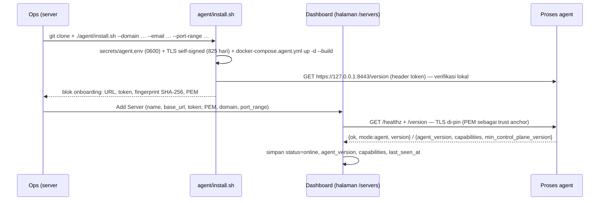

# 5. Alur Utama — Multi-Server: Inti

> Bagian dari [dokumentasi arsitektur](../ARCHITECTURE.md) · Spesifikasi: [SPECS.md](../SPECS.md) · Panduan operasional: [DETAILS.md](../../DETAILS.md)

## 5.21 Onboarding Server Kedua (`agent/install.sh` → Add Server → Test connection)

Bootstrap satu perintah `install.agent.sh` (§5.41) menjalankan bagian **clone + `agent/install.sh`** diagram ini secara otomatis (Docker/nginx/certbot dipasang lebih dulu lewat `host/install.sh --deps-only`); langkah **Add Server → Test connection** tetap manual di dashboard.

- Installer **idempoten** (tanpa `--force`, token/sertifikat/nilai lama dipertahankan). `--force` mengganti token + sertifikat ⇒ admin **wajib** memperbarui server di dashboard.
- Dashboard menghitung fingerprint **sendiri** dari PEM yang di-paste (`ServerResolver::fingerprintFromPem()`) — tidak ada peluang salah ketik; fingerprint tetap ditampilkan untuk verifikasi manual.
- **Ambil ulang kredensial dari server tujuan (server `agent`)**: `token`/`tls_cert_pem` tidak pernah dirender ulang halaman `/servers` (payload form hanya `has_token`), jadi view `app/view/server/form.php` merender blok bantu **"Ambil token & sertifikat dari server tujuan"** — perintah siap-salin yang **bukan field form** (tidak ikut POST) untuk dijalankan **di server tujuan**: `docker exec rames-agent sh -lc 'printf "TOKEN=%s\n\n" "$AGENT_TOKEN"; cat "$AGENT_TLS_CERT"'`. Kedua nilai ada di dalam container karena `env_file: ./secrets/agent.env` (`docker-compose.agent.yml`, container `rames-agent`) ⇒ `docker exec` tidak butuh `sudo` **bila** user punya akses daemon Docker (root atau anggota grup `docker`, lihat peringatan `agent/install.sh`; jika bukan, jalankan dengan `sudo`). Seksi + `<script>`-nya hanya dirender untuk server non-`local` (`$isLocal`). Opsi lain yang **dirender view**: menjalankan ulang `./agent/install.sh` dari direktori paket agent di server tujuan (butuh akses daemon Docker) — idempoten, tanpa `--force` token/sertifikat dipertahankan — untuk mencetak ulang seluruh blok onboarding bila container agent tidak hidup. **Jalur berbasis berkas sengaja TIDAK dirender** meskipun sah di level OS (`sudo grep '^AGENT_TOKEN=' secrets/agent.env` + `sudo cat secrets/agent/tls.crt`; izin 0600/0700 ⇒ perlu root) — karena `tests/ServerViewTest.php::assertNoSecretLeak()` melarang HTML halaman `/servers` memuat substring `secret` (juga `Bearer` & token contoh); pesan view memakai id `agent-onboarding-cmd`, bukan `agent-secret-cmd`. Token & PEM tetap kredensial: **jangan** ditempel ke chat/tiket/commit.
- Fingerprint tidak cocok saat Test connection ⇒ **gagal tegas** ("sertifikat agent berubah, verifikasi manual"), bukan retry, dan server **tidak** disimpan.
- Baris server `local` selalu `status=online` tanpa panggilan jaringan (dashboard ini sendiri).
- `capabilities` dari `/version` disimpan; `assertReadyForCreate()` menolak server nonaktif/offline/tanpa capability `deploy` saat app akan dibuat di sana.

**Pengujian**: `tests/ServerControllerTest.php`, `tests/ServerStoreTest.php`, `tests/ServerResolverTest.php`, `tests/ServerResolverValidateLocalTest.php`, `tests/TlsPinMaterializerTest.php`, `tests/AgentClientTest.php`, `tests/AgentControllerTest.php`, `tests/ServerViewTest.php`, `tests/ServerAccessTest.php`, `tests/SchemaMigrationsV2Test.php`.

## 5.22 Create App di Server Agent

1. **Pemilih server tujuan ada di setiap form masuk wizard** — `app/view/app/create.php` (dua form: mode *compose* `action="/apps/create/compose"` & mode *git* `action="/apps/create"`), `app/view/app/template.php` (`action="/apps/create/template/{slug}"`), plus langkah konfirmasi `app/view/app/confirm.php`. Blok kepala defensif (proyeksi `$wizardServerOptions`/`$wizardSelectedServer`, `$wizardLocalServerProjection`, helper `$wizardNavUrl()`) + markup picker **disalin di tiga view** (create/template/confirm) dan **dikunci** `tests/CreateWizardServerPickerTest.php` — mengubah markup di satu view tanpa menyamakan yang lain membuat suite **merah** (desinkron = bug, bukan pilihan gaya). `<select class="form-select" name="server_id">` hanya dirender bila `canSelectServer === true` **dan** `count(servers) > 1`; `AppController::serverFormContext()` = satu pintu payload view (`servers`, `selectedServerId`, `canSelectServer`) dan mengirim **seluruh registry** untuk admin, **`local` + allowlist** untuk pemegang grant `server_select` (`ServerAccess::selectableServers()`; allowlist kosong = semua), sedangkan non-grant menerima **baris server lokal saja** sehingga nama/host server lain tidak pernah sampai ke browser. Opsi: `value=id`, `selected` bila `id === selectedServerId`, `enabled === false` ⇒ `disabled` + label “(nonaktif)”, agent ber-`status !== online` diberi catatan kesiapan di `form-text` (badge kelas baku repo). Non-admin/hanya satu server ⇒ **tanpa** select, hanya catatan read-only “App akan dibuat di server `<nama>`”; guard view adalah **pertahanan lapis kedua** (`!$wizardCanSelectServer && !$wizardSelectedServer['local']` ⇒ proyeksi baris lokal dipaksa) agar id/nama server non-lokal tak ikut ter-render dari payload di luar kontrak. Langkah konfirmasi (`confirm.php`) menampilkan **ringkasan server terpilih** (read-only) + `<input type="hidden" name="server_id">` **tanpa** select; hidden itu sengaja **tidak** ditulis ulang menjadi `local` bila otorisasi tidak cocok — `confirmCreate()` memanggil `resolveCreateServer()` yang **fail-fast**, supaya target deploy tidak berpindah diam-diam. Tautan nav wizard membawa `?server_id=<id>` **hanya bila** server terpilih bukan `local`; parameter itu **hanya preselect** (dibaca `createForm()`/`templateForm()` dari **GET**), karena seluruh jalur create membaca `requestedServerId()` dari **POST**. Jalur re-render kegagalan memakai id server yang **diminta request** (bukan `$serverId` yang masih default lokal) di `createPreview()`, `composePreview()`, `templateDeploy()` fase-1 & fase-2, dan cabang non-SSH `createPreview()` mengembalikan `Location` `/apps/create?server_id=<id>` bila pemilih berhak. Penegakan terakhir tetap `ServerAccess::maySelect()` di `resolveCreateServer()`: user tanpa grant (atau id di luar allowlist-nya) yang mengirim `server_id` server agent ditolak dengan pesan generik, **tanpa** membocorkan keberadaan server (dan tanpa diam-diam memakai server lokal).
2. `AppController::resolveCreateServer()` = **satu pintu**: `server_id` kosong/`local` ⇒ perilaku lama; hak pilih diperiksa **dulu** lewat `ServerAccess::maySelect()` (admin → semua; grant → `local` + allowlist, kosong = semua; selain itu ditolak **sebelum** id dicari); id tak dikenal ⇒ `ServerResolver::resolve()` **melempar** (tidak pernah jatuh ke server lokal); server belum siap ⇒ `assertReadyForCreate()` menolak.
3. Validasi yang tadinya global kini dijalankan **terhadap server itu**: nama app (`findByNameOnServer`), host port (`AppPorts::onServer`/`PortManager`), nama container (`ContainerNames::usedFromApps(..., $serverId)`), subdomain (`SubdomainManager::assertAvailable(..., $serverId)`), custom domain.
4. App disimpan dengan `server_id` + `status=deploying`; deploy dijalankan lewat `DeployerFactory::createForApp()` → `AgentDeployer` (job async §5.23).

**Preflight ketersediaan nama app (F1 lanjutan).** `AppController::createAndDeploy()` — jalur bersama `createPreview()`/`confirmCreate()`/`templateDeploy()` — sekarang membuat **id app di control plane** (`bin2hex(random_bytes(8))`, format sama dengan `AppStore::create()`; `AppStore` tetap menerima id yang sudah diisi dan **tidak** memvalidasi keunikannya, tidak berubah) lalu memanggil `DeployerFactory::assertAppTargetAvailable($server, $preflightApp, $agentClient)` **paling awal, sebelum efek samping apa pun** — sebelum berkas override/managed env ditulis, sebelum `(new AppStore())->create($appData)`, dan sebelum worker di-spawn. Id dibuat lebih dulu semata-mata agar preflight membandingkan id yang **sama** dengan penanda kepemilikan/`dropStaleDir()` di jalur job nanti. Dokumen `$preflightApp` sengaja sempit (`{id,name,source}`, plus `repo_url` bila app repo dan `template.slug` bila dari template) — agent memakai `repo_url` hanya untuk membandingkan remote checkout yang **sudah ada di sana** (read-only); `env`, deploy key, dan token **tidak pernah** ikut. Ketiga jalur create itu sudah menangkap exception untuk ditampilkan di wizard, sehingga penolakan muncul sebagai pesan ramah di wizard, **bukan** "deploy gagal" setelah record app lahir.

- `kind=local` ⇒ `assertAppTargetAvailable()` **no-op** (jalur lokal tidak punya guard direktori: `createPreview()` membersihkan `apps/<name>` sendiri); `kind=agent` ⇒ agent menjawab `POST /apps/check` (`AgentJobController::checkApp()`), kontrak `{code:0, op:'app_check', available, state, message}` — body tak sah (`app.id` di luar `APP_ID_PATTERN`, `app.name` kosong/tak sah sebagai nama direktori) ⇒ **400 `invalid_request`**, kegagalan sisi agent ⇒ **500 `app_check_failed`** (pesan galat sisi agent hanya **dipangkas** `AgentJobController::sanitizeMessage()` ≤300 karakter — **bukan** redaksi; token/PEM/`base_url` tetap dijaga **sisi master**, yang membungkus pesan itu lewat `AgentError::sanitizeForServer()` di `AgentDeployer::assertAppTargetAvailable()`); selalu JSON. Endpoint ini **bukan job**: tanpa proyeksi app, tanpa rekaman `AgentJobStore`, tanpa spawn worker, tanpa mutasi disk — selesai dalam satu pembacaan direktori.
- `available:true` (`free`/`owned`/`stale`) ⇒ create lanjut; `stale` aman karena `dropStaleDir()` membuangnya saat job benar-benar datang. `available:false` (`blocked`) ⇒ `RuntimeException` ramah (label server + nama app + tindakan: pindahkan/hapus direktori itu atau pakai nama lain) — **bukan** `AgentError`, supaya tidak diperlakukan sebagai kegagalan infrastruktur.
- **Degradasi agent lama**: agent yang belum punya endpoint ini menjawab **404** ⇒ `AgentError` `NOT_FOUND` **dilewati**. Deteksinya murni lewat 404 karena endpoint mesin tidak dilaporkan di `capabilities` (`GET /version` = daftar op job). Create app yang tadinya jalan tidak boleh mati hanya karena control plane lebih dulu di-update; guard jalur job tetap berlaku di agent itu.
- **Fail-closed** untuk respons 2xx tanpa `available` boolean (absen/`0`/`"false"`/`null`) ⇒ `AgentError` `bad_response` + pesan aksi — **tidak** dilewati, sebab preflight yang diam-diam dilewati mengembalikan persis masalah yang dicegah ("deploy gagal" setelah record app dibuat). Galat lain (transport/TLS/5xx) ⇒ `AgentError` ber-`label()` + pesan tersanitasi.
- **Perannya saran/early-warning, bukan penegak**: penegakan tetap di jalur job (`AgentJobController::create()` → `dropStaleDir()` + `materialize()`; `ensureOwnedDir()`/`ensureRepoClone()` menolak direktori milik app lain / data tak dikenal). Ada **TOCTOU** antara preflight & materialisasi (operator lain bisa membuat direktori `apps/<name>` di sela itu) — jaring terakhir tetap guard jalur job (GOTCHA §8 no. 36).

5. **Status fase** (diverifikasi ke kode + suite, multi-server sesi ini): F0 + F1 **selesai** (termasuk **F1 lanjutan**: preflight ketersediaan nama app `POST /apps/check` — §5.22 — dan sanitasi satu pintu `AgentError::sanitizeForServer()` pada jalur pesan `AgentDeployer` — job & preflight, **bukan** kelas-wide: galat mentah dari `AgentClient` masih di luar pintu itu untuk pesan **worker/log** (temuan pra-eksisting C-1), sedangkan pesan yang tampil ke user sudah diredaksi di controller — §7 “Keamanan”); **F2 (Nginx & SSL per server) mendarat** — deploy/rebuild/rollback/apply/applyEnv/stop/start/teardown/delete + status/containers/log deploy, plus op job `nginx_write|nginx_remove|nginx_reload|ssl_issue|ssl_revoke`, route `GET /apps/{id}/nginx` & `POST /nginx/check`, dan `SslController`/`cli/ssl.php` sadar server (jalur SSL control plane **sudah** mengirim job `ssl_issue`). **F3a mendarat**: **log container** & **terminal** app server agent diproxy (§5.28). **F3b/F3c mendarat & terverifikasi** (assurance): **file manager** per server (§5.29) & **monitoring** per server (`/api/monitor/overview` → `data.servers[]`, §5.30; daftar server disaring **di server** lewat `ServerAccess::visibleServers()` — non-admin tak menerima & tak menghubungi server asing), plus op-job/route agent terkait. **F3d mendarat & terverifikasi** (assurance): **database/Adminer, network & volume project per server** (§5.31) — route agent `/database/containers`, `/adminer/{container}`, `/networks*`, `/volumes`; pemilih server di `/networks` untuk admin **atau** pemegang grant `server_select` (non-admin di luar jangkauan ⇒ **404** fail-closed), kolom **server** di `/database`. **F4a mendarat & terverifikasi (sebagian)**: **backup/restore/dump volume per server** sebagai job agent (`backup_run|restore|db_dump`, `BackupDispatcher`/`BackupJobRunner`, riwayat ter-scope `server_id`) + **UI F4** (kartu server di `/monitor`, badge server di detail app) — §5.32. **Perbaikan bug Tinggi (F2)**: jalur UI **subdomain/rute/domain** kini sadar server lewat `AppNginxReloader`/`AppSslRevoker` — tidak ada lagi `NginxReloader`/`SslIssuer` **lokal** untuk app agent (§5.27, GOTCHA §8 no. 15). **Masih ditolak eksplisit** untuk app server agent (penjaga antar-fase): ubah **environment variable**, **external network**, **nama container (prefix)**, dan **batas CPU/memori** (`AppController::appArtifactDirOrFail()`/`localArtifactsError()` — pesan menyebut fase F2/F3, **bukan** dieksekusi ke server lokal). `saveCompose` app agent **sudah** menulis `compose_content` ke dokumen app (§5.24) — bukan lagi celah. **Belum** (hal. §5.32 & §8): timer jadwal backup volume **server agent**, unduh/retensi `.sql` staging agent, template pull per server, self-update agent + version gating, metering/tagihan per server, kolom server di `/apps`, gateway `/docker/*`.

**Pengujian**: `tests/CreateWizardServerPickerTest.php` (pemilih server di tiga form + konfirmasi, guard view, tautan nav preselect), `tests/AppControllerServerScopeTest.php` (preflight dijalankan sebelum record app dibuat, agent lama 404 ⇒ create tetap jalan, preflight gagal ⇒ create dibatalkan), `tests/DeployerFactoryServerAwareTest.php`, `tests/AgentDeployerTest.php` (payload sempit, state aman, fail-closed, pesan ramah tanpa PEM), `tests/AgentJobControllerTest.php` (`checkApp`), `tests/AgentArtifactMaterializerTest.php` (`appDirState`), `tests/ServerResolverTest.php`, `tests/AppStoreServerScopeTest.php`, `tests/AppPortsServerScopeTest.php`, `tests/ContainerNamesServerScopeTest.php`, `tests/SubdomainPerServerTest.php`.

## 5.23 Job Async (deploy di server agent)

Operasi panjang tidak bisa ditunggu dalam satu request (batas timeout HTTP ≤30 s), jadi agent menerimanya sebagai **job**:

| Endpoint (agent) | Isi |
|---|---|
| `POST /jobs` | `{op, app: {…}, ref?}`. `op ∈ DeployWorkerLauncher::MODES`. Agent memvalidasi → `AgentAppProjection::upsert()` (§5.25) → `AgentArtifactMaterializer::dropStaleDir()` + `materialize()` (§5.24) → spawn worker detached (`DeployWorkerLauncher`). Balas `{code:0, job_id, op, log_offset}` |
| `GET /jobs/{id}` | Status job: `{id, op, app_id, status (pending\|running\|done\|error), stage, message, error, created_at, started_at, finished_at}` |
| `GET /jobs/{id}/log?offset=N` | Potongan log deploy app (≤256 KiB, dipotong di batas baris) + header **`X-Rames-Offset`** = offset panggilan berikutnya |

- **Offset wajib**: log deploy adalah berkas **per-app** (`runtime/logs/deploy/{appId}.log`), dipakai bersama antar-job, sehingga control plane harus mulai dari `log_offset` yang dikembalikan `POST /jobs` (atau `X-Rames-Offset`) — kalau tidak, baris lama terulang (GOTCHA §8).
- Di sisi agent, worker menandai rekaman `AgentJobStore` lewat env `RAMES_JOB_ID` (lihat §4.4); di sisi control plane `AgentDeployer` mem-*poll* dan meneruskan tiap baris baru ke `$logger`, sehingga UI & log lokal **tidak berubah** bentuknya.
- Validasi op: `AgentJobController::OPS` = `DeployWorkerLauncher::MODES` = daftar mode `cli/deploy.php` (satu sumber); op di luar itu → galat (bukan didiamkan). Payload app disaring whitelist; `env` & deploy key dipakai agent tetapi tidak pernah dipulihkan ke control plane lewat `GET /apps/{id}` (`APP_FIELDS` whitelist).
- **Bukan job — endpoint mesin read-only**: `POST /nginx/check` (preflight direktori Nginx server itu, §5.27) dan `POST /apps/check` (preflight ketersediaan direktori artefak `apps/<name>` **sebelum** record app dibuat di control plane, §5.22). Keduanya tidak memakai `AgentJobStore`, tidak men-spawn worker, dan tidak menulis apa pun — dijadikan job justru salah, sebab jawabannya dibutuhkan **sebelum** efek samping, bukan sesudahnya. `POST /apps/check` juga tidak dilaporkan di `capabilities` (`GET /version` = daftar op job), sehingga control plane mendeteksi agent lama murni dari **404** (GOTCHA §8 no. 36).
- **Penanda payload khusus op `teardown`**: `preserve_volumes` (daftar volume yang dipertahankan; `null` = `down -v`) dan `forget` (`true` = control plane menghapus app itu ⇒ worker agent membuang proyeksi app di server ini setelah teardown sukses, §5.25). Keduanya direkam di `AgentJobStore.payload` dan **hanya** dibaca worker dari sana — bukan dari argv — sehingga jalur control plane/manual tidak pernah menyentuh record app.

**Pengujian**: `tests/AgentJobControllerTest.php`, `tests/AgentJobStoreTest.php`, `tests/DeployWorkerLauncherTest.php`, `tests/AgentDeployerTest.php`, `tests/CliDeployJobAwarenessTest.php`.

**Ketahanan konektivitas (GOTCHA)**:
- **Polling job toleran gangguan sesaat**: `AgentDeployer::pollJob()` mengulang (backoff) saat `jobStatus`/`jobLog` gagal dengan `unreachable`/`server_error`, hingga `MAX_POLL_FAILURES` (5) kegagalan **berturut-turut** dan selama deadline job belum lewat. `unauthorized`/`tls_failed`/`invalid_config` tetap langsung dilempar. Gejala sebelumnya: satu timeout 5 s menandai deploy gagal padahal worker agent masih jalan.
- **Monitoring tidak menunggu agent mati berulang kali**: `MonitorController::agentEntry()` memakai `ServerHealthGate` (`runtime/agent-health.json`, cooldown 20 s, `JsonStore`). Server yang baru gagal langsung tampil `offline` dengan pesan terakhir (tersanitasi) tanpa menyentuh jaringan; sukses menghapus catatan. **DILARANG** memakai gate ini untuk operasi mutasi/job. Saat monitoring berhasil menjangkau server yang tercatat `offline`, status registry dipulihkan ke `online` (`markServerOnline()`), sehingga kegagalan Test connection sesaat tidak memblokir `assertReadyForCreate()` selamanya.
- **`NonceStore` di-shard 16 berkas** (`agent-nonces.<0-f>.json`, menurut karakter pertama hash nonce): antrean `flock` antar worker dan ukuran tulis ulang turun ±16×; replay selalu jatuh ke shard yang sama. Berkas lama `agent-nonces.json` diabaikan (TTL 120 s). `count()` menghitung entri tersimpan di semua shard; shard dingin dipangkas saat ditulis atau lewat `purge()`.
- **Selisih jam ≠ token salah**: `AgentAuthMiddleware` menolak timestamp di luar ±60 s; **setelah token terbukti sah**, 401-nya membawa header `X-Rames-Server-Time` (body tetap generik; token salah tidak mendapat header ini). `AgentClient::httpError()` memakainya untuk pesan "selisih jam N detik — sinkronkan NTP". **WAJIB**: header ini jangan dipasang pada 401 sebelum cek token (menjadi oracle).

## 5.24 Materialisasi Artefak di Agent

Agent hanya memegang **metadata** (proyeksi) + direktori artefaknya sendiri, jadi tiga hal yang tidak bisa ia regenerasi harus dikirim control plane di payload job:

1. **file compose utama** app mode `compose` (hanya ada di control plane, `apps/<name>/`);
2. **deploy key SSH** app repo private (`database/keys/`) — agent butuh untuk `git clone`/`git fetch`;
3. **slug template** app dari katalog — agent membaca `templates/<slug>/` dari checkout-nya sendiri (payload tetap kecil; wajib slug sama di checkout agent, kalau tidak **fail-fast**).

- `AgentArtifactPackager` (control plane) memaketkan sebelum `POST /jobs`: gagal memaketkan (mis. file compose hilang) ⇒ **tidak ada** job dikirim — agent tidak boleh menerima job yang pasti gagal separuh jalan. Op yang tidak menyentuh artefak (`apply_env`, `stop`, `start`, `teardown`, op `nginx_*`/`ssl_*`) tidak memaketkan apa pun.
- `AgentArtifactMaterializer` (agent) menulis compose, deploy key **0600** (direktori 0700), menjalankan `TemplateCatalog::materialize()` bila ada template, dan menulis marker `.rames-artifact.json`. Pesan galat disanitasi (`sanitizeError()`) supaya isi rahasia tidak bocor.
- **Direktori sisa app lain dibuang sebelum menulis** (`dropStaleDir()`, dipanggil `AgentJobController` **sesudah** proyeksi): `apps/<name>` yang penandanya milik id app lain = sisa app yang sudah dihapus di control plane (nama itu kini milik app ini), jadi guard "penimpaan diam-diam dilarang" tidak berlaku untuknya. Direktori milik app ini dan direktori **tanpa** penanda tetap ditolak `ensureOwnedDir()` (data tak dikenal tidak pernah dihapus, GOTCHA §8 no. 35).
- **Preflight-nya memakai keputusan yang sama** — `appDirState($app)` (§4.3), dilayani endpoint `POST /apps/check` untuk `AppController::createAndDeploy()` (§5.22): `free`/`owned`/`stale` ⇒ `available=true`; `blocked` ⇒ `available=false` (non-kosong tanpa penanda & bukan checkout ber-remote sama, path bukan direktori, penanda tak terbaca/remote berbeda). Read-only **tanpa mutasi** (tidak ada `mkdir`/`unlink`/penulisan penanda; `mtime` isi direktori dibiarkan). Probe `git remote get-url origin` (`REMOTE_TIMEOUT`) hanya jalan bila direktori non-kosong, **tanpa** penanda, `.git` berupa **direktori**, dan payload membawa `repo_url`; `.git` berupa berkas (worktree/submodule) ⇒ `blocked` tanpa probe (fail-safe). Pesan yang menyebut remote lain meredaksi userinfo.
- **Artefak ikut dibuang saat app dihapus** (`forget($app)`, penanda `forget` di payload job `teardown`, §5.25): direktori app + deploy key (+ `.pub`) + managed env file — cermin `AppController::delete()` di host lokal (cleanupDir + `SshKeyManager::remove()` + `EnvManager::remove()`). Tanpa langkah ini nama app tetap terpakai oleh direktori sisanya.
- Batas yang diketahui fase ini (bukan bug yang disembunyikan): berkas pendukung **non-template** belum dilacak (`files` sekarang **khusus** override port, lihat di bawah); berkas non-UTF-8 ditolak (payload JSON).
- **`artifacts.files` = override port** (bukan berkas pendukung): `AgentArtifactPackager::portOverrideFiles()` meregenerasi dua berkas yang sama dengan jalur lokal (`ComposeSource::RESET_OVERRIDE_FILE` + `PORTS_OVERRIDE_FILE`, §5.1b) dari metadata `host_ports` app — `docker-compose.override.yml` (`ports: !reset []` per service) + `docker-compose.override.ports.yml` (port final pilihan user). Dikirim di **setiap** op yang membawa artefak supaya agent tidak memakai port bawaan repo.
- **Master compose app agent hidup di dokumen app** (field `compose_content`, `apps_apps`), bukan berkas di host control plane: `AgentArtifactPackager::composeOf()` mendahulukan `compose_content` (hasil tab Compose, ditulis `AppController::saveComposeOnAgent()`), baru file lokal `apps/<name>/` (app repo/template). Karena itu `compose_content` + `host_ports` **tidak** ikut diproyeksikan ke agent (`AgentAppProjection::METADATA` sengaja tidak memuatnya) — nilainya hanya dipakai control plane untuk merakit artefak (GOTCHA §8). `custom_domain` **ikut** di `METADATA` (state SSL/domain milik agent perlu tahu domain efektif).

**Pengujian**: `tests/AgentArtifactPackagerTest.php`, `tests/AgentArtifactMaterializerTest.php`.

## 5.25 Pemetaan `server_id` → `local` saat Proyeksi & Kepemilikan Data

Agent selalu mengeksekusi **di dirinya sendiri**, sedangkan registry server milik control plane tidak ada di agent. Karena itu `AgentAppProjection::upsert()` **memetakan `server_id` payload ke `ServerStore::LOCAL_ID`** — tanpa pemetaan ini `DeployerFactory::createForApp()` di agent akan melempar (`server_id` control plane tak dikenal) dan **seluruh** deploy di agent gagal (GOTCHA §8).

Kepemilikan data (SPECS §7.14) ditegakkan oleh himpunan field yang **disjoint**: **metadata** ditimpa dari payload job (control plane menang), **state eksekusi** (`status`,`stage`,`message`,`error`,`containers`,`deploy_history`,`ssl_status`) tidak pernah ditimpa bila app sudah ada (agent menang — hanya ia yang mengamati). Pada proyeksi **pertama** nilai payload dipakai sebagai benih. Arah sinkronisasi satu arah per bidang: metadata **push**, state eksekusi **pull** (`AgentDeployer` memanggil `GET /apps/{id}` sesudah job).

**Siklus hidup app di server agent (nama app)** — proyeksi punya `create()`/`update()` **dan** `forget()`, artefaknya punya `materialize()`/`dropStaleDir()`/`forget()`; sisi store dan sisi disk **wajib berjalan bersama**:

- **Saat app dihapus di control plane**: `AgentDeployer::teardown()` menyertakan `forget: true` di payload job `teardown`; worker agent memanggil `AgentArtifactMaterializer::forget($app)` (**direktori app + deploy key + managed env file**) lalu `AgentAppProjection::forget($appId)` — keduanya **setelah** penulisan status terakhir (`$store->update()`; tidak ada lagi yang menulis dokumen itu) — sehingga nama app bebas dipakai app berikutnya, di store **maupun** di disk. Kegagalan pembersihan bersifat best-effort dan **tidak** menggagalkan job (teardown sudah sukses — control plane tidak boleh membatalkan penghapusan app karena bookkeeping): dicatat sebagai peringatan di log deploy app. Tanpa flag itu worker tidak menyentuh record/artefak app (jalur control plane/manual tidak pernah menghapus record app-nya sendiri).
- **Bila job datang untuk nama yang masih dipegang baris id lain**: `upsert()` membuang baris basi itu lebih dulu (`dropStaleName()`, hanya scope `local`) baru `create()`. Tanpa langkah ini `AppStore::create()` melempar dan **semua** job untuk nama itu — termasuk `teardown` saat app dihapus — ditolak 500 `projection_failed`, sehingga app tidak bisa dibuat **maupun** dihapus (GOTCHA §8 no. 34). Baris dengan **id yang sama** tidak pernah dibuang: itu jalur `update()`, jadi state eksekusi milik agent tetap utuh. Baris tanpa id sengaja dibiarkan (tidak bisa ditarget; job ditolak terlihat, bukan ditebak).
- **Sisi disk-nya sepadan**: sesudah proyeksi itu (nama app dijamin milik app ini), `AgentArtifactMaterializer::dropStaleDir()` membuang `apps/<name>` yang penandanya milik **id lain** — sisa app yang sudah dihapus. Tanpa langkah ini materialisasi ditolak guard kepemilikan ("penimpaan diam-diam dilarang") dan create app dengan nama sama **selalu** gagal setelah record app dibuat di control plane (deploy `error`, GOTCHA §8 no. 35). Direktori **tanpa** penanda tetap ditolak — data tak dikenal tidak pernah dihapus otomatis.
- **Preflight create = saran, bukan penegak.** `POST /apps/check` (§5.22) memindahkan penolakan ke **sebelum** record app lahir (pesan ramah di wizard), tetapi penegakan tetap di jalur job di atas: `dropStaleDir()` + `ensureOwnedDir()`/`ensureRepoClone()` menolak direktori milik app lain & data tak dikenal. Di antara preflight & materialisasi ada **TOCTOU** (operator lain bisa membuat `apps/<name>` di sela itu) ⇒ create tetap bisa gagal di jalur job dengan pesan yang wajar. Karena itu guard jalur job **DILARANG** dilepas dengan alasan "sudah ada preflight", dan preflight yang tak tersedia (agent lama ⇒ 404, dilewati) tidak boleh membuat create menjadi tidak aman (GOTCHA §8 no. 36).

Konsekuensi praktis: agent hilang/dipasang ulang ⇒ proyeksi + artefak dibangun ulang dari metadata; control plane rusak ⇒ pemulihan metadata sebagian mungkin dari proyeksi (regenerasi dari control plane adalah arah normal, bukan andalan). DB agent = data turunan (tidak ikut backup DB dashboard §5.19); yang perlu bertahan di server app adalah volume app (§5.15).

**Pengujian**: `tests/AgentAppProjectionTest.php`, `tests/AgentDeployerTest.php`, `tests/AgentModeTest.php`.

## 5.26 Registry Server & Pemilihan Deployer

- **Pemilihan deployer**: `DeployerFactory::createForApp($app)` → `ServerResolver::resolveForApp($app)` → `createFor($server)`. `kind=local` ⇒ `LocalDeployer` (hook uji `DEPLOYER_CLASS` tetap berlaku), `kind=agent` ⇒ `AgentDeployer` (`AgentClient` dibangun dari `base_url`/token/PEM, fail-fast bila cacat), `kind` tak dikenal ⇒ **RuntimeException**. **Wajib**: tidak ada jalur yang membuat app `server` agent dieksekusi `LocalDeployer`.
- **Aturan baris lokal** hanya di `ServerResolver::validateLocal()` (mengapa field identitas dikunci, mengapa `port_range` lokal dikunci) — controller tidak menyalin. `ServerResolver::validateLocal()` hanya mengizinkan `domain`, `notes`, & `rates` pada baris lokal; `rates` dinormalisasi (`normalizeRates()`: hanya `{cpu,ram,backup}` numerik > 0, key lain/nilai cacat dibuang) sehingga baris lama tanpa `rates` tetap sah.
- **Dua kuasa terpisah (§4.3 `ServerAccess`, SPECS §6.1/§7.14)**: (a) **kelola registry** (tambah/ubah/hapus/test/token/PEM) **admin-only** → 404; (b) **memilih server** = admin **atau** pemegang grant `server_select` (allowlist `server_ids`; kosong = semua; `local` selalu boleh). Grant disetel admin via `POST /users/{id}/servers`. `visibleServers()` = union server app yang lolos `AppAccess::visible()` + server grant — dipakai `/apps`, `/network`, `/volumes`, `/backups`, `/monitor`.
- **DILARANG memperluas allowlist saat semua id invalid**: `POST /users/{id}/servers` yang menerima `server_ids` tidak kosong tetapi seluruh id-nya tidak dikenal registry **menolak** perubahan (flash error, store tidak berubah). Menyimpan `[]` justru berarti "semua server" — itu eskalasi hak, bukan pembersihan data. Registry tak terbaca ⇒ tolak (fail-closed). Karena itu form `/users` hanya menampilkan server dari `ServerResolver::option()` (`id`/`name`).
- **WAJIB menyaring baris lewat `AppAccess`/`BackupAccess` meski server terlihat**: grant server **tidak** menambah ability `AppAccess` (`viewer`/`operator`/`owner`) dan **tidak** membuka app/backup user lain; daftar app tetap `AppAccess::visible()`, backup tetap `BackupAccess::can()`. Grant hanya memperluas *pemilihan/visibilitas server*, bukan baris data.
- **DILARANG mengirim metrik `host` server tanpa app terlihat lewat monitor**: `/api/monitor/overview` hanya merakit entri server yang menaungi minimal satu app yang user lihat (grant/allowlist tidak membuka metrik host); server di luar itu **tidak dihubungi** sama sekali (lapisan JS hanya kosmetik).
- **Tarif per server bukan otorisasi**: `rates` hanya memengaruhi harga (§5.18 (ii-b)); ia tidak memberi hak pilih/kelola dan tidak pernah ikut ke payload UI (`ServerResolver::option()` membuang `rates`).
- **Memo per-proses**: `ServerResolver::$memo` meng-cache snapshot registry (kunci cap berkas DB path+mtime+size termasuk `-wal`/`-shm`) supaya daftar app tidak menembak store per baris; `forgetMemo()` untuk invalidasi paksa. Ini **pengecualian sadar** larangan cache lintas-request (§6) dan aman karena selalu divalidasi ulang terhadap cap berkas.
- **Fail-fast di semua jalur**: `resolve()` id tak dikenal melempar; accessor `kind=agent` yang kosong (`base_url`/token/PEM) melempar lewat `AgentClient`/`AgentError('invalid_config')` — semua **sebelum** efek samping.
- **App yatim (server sudah dihapus dari registry)**: menghapus baris server **tidak** menghapus app-nya (teks konfirmasi UI menyatakan itu), sehingga `server_id` menunjuk baris yang tidak ada lagi. Semua **operasi** tetap ditolak fail-fast (`resolveForApp()`) dan **halaman detail tetap terbuka** (`detail()` menangkap kegagalan pembuatan deployer ⇒ `$deployer = null`, daftar container/volume kosong) supaya tab Hapus App terjangkau. **Satu pengecualian operasi: `POST /apps/{id}/delete`** — satu-satunya jalur yang harus bisa menuntaskan pekerjaan lokalnya memakai `ServerResolver::findForApp()`: `null` hanya bila baris server **benar-benar hilang** (teardown remote dilewati, **tidak pernah** dialihkan ke server lokal; record + artefak lokal tetap dibersihkan, flash `info` menyuruh membersihkan container/volume manual), sedangkan registry yang **tidak terbaca** tetap melempar. Tanpa pengecualian ini record app yatim tak bisa dihapus sama sekali (GOTCHA §8 no. 53).

**Pengujian**: `tests/ServerResolverTest.php` (`findForApp()`: `null` hanya untuk baris hilang, tetap melempar saat registry rusak; normalisasi `rates`), `tests/ServerResolverDomainTest.php`, `tests/ServerAccessTest.php` (kelola vs pilih, allowlist, `visibleServers()` union & dedup), `tests/UserStoreServerAccessTest.php` (normalisasi `server_select`/`server_ids`, `setServerAccess()` atomik), `tests/UserControllerServerAccessTest.php` (grant disimpan, allowlist kosong = semua, seluruh id invalid ditolak, registry tak terbaca fail-closed, non-admin ditolak dengan flash + redirect `/apps`), `tests/AppControllerServerGrantTest.php` (pemilih server & penolakan generik), `tests/DeployerFactoryServerAwareTest.php`, `tests/AgentAuthMiddlewareTest.php`, `tests/NonceStoreTest.php`, `tests/AppControllerServerScopeTest.php` (`testDeleteOfAppOnRemovedServerSkipsTeardownAndKeepsTheRecordRemovable`).
