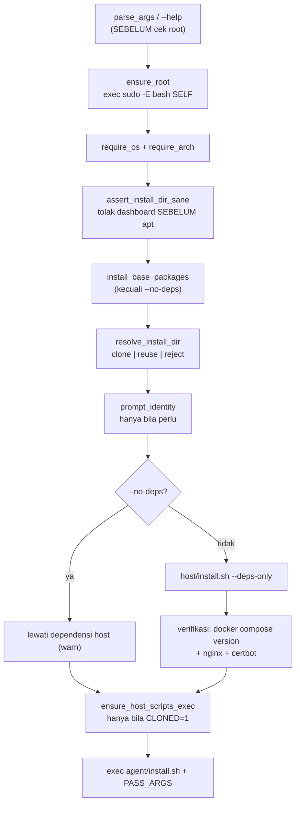
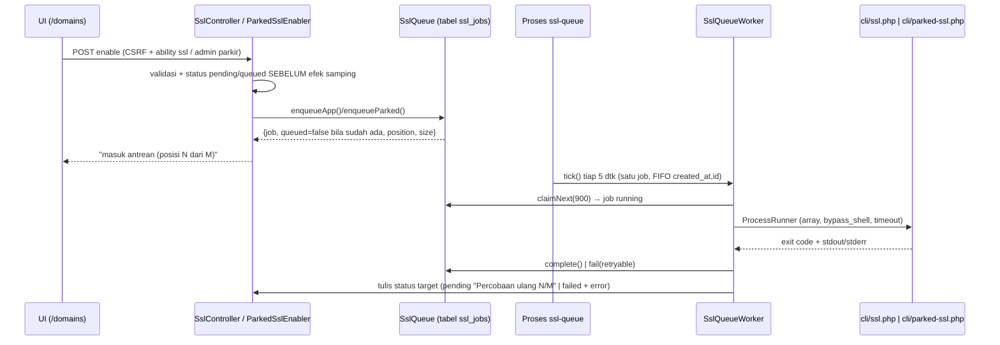

# 5. Alur Utama — Fitur Lain

> Bagian dari [dokumentasi arsitektur](../ARCHITECTURE.md) · Spesifikasi: [SPECS.md](../SPECS.md) · Panduan operasional: [DETAILS.md](../../DETAILS.md)

## 5.36 SSL Mode AJAX (tanpa reload)

Halaman `/domains` (tab **Semua Domain**) memperbarui barisnya **di tempat** lewat JSON — menggantikan `window.location.reload()` tiap 5 dtk (yang kini **dihapus**). Kontrak produk: SPECS §8a/§8j.3.

- **Satu inti, dua respons (app).** Isi `enable()` lama diekstrak ke privat `enableDomain()` (validasi → efek samping: status slot `pending`/`*_stage='queued'` + **enqueue** job `ssl_jobs` → hasil terstruktur). Jalur halaman `POST /ssl/{id}/enable` (`SslController::enable()`) dan jalur JSON `POST /api/ssl/{id}/enable` (`SslController::apiEnable()`) memakai **satu** implementasi sehingga validasinya tidak bisa menyimpang; kontrak lama (pesan flash, transisi `*_status`/`*_stage`/`*_message`/`*_error`, `needs_ssl`/`custom_needs_ssl`) **tidak berubah**, kecuali pesan sukses kini memuat posisi antrean ("SSL untuk `<domain>` masuk antrean (posisi N dari M)."). Antrean & eksekusinya: **§5.44**.
- **Kontrak JSON `apiEnable`** (`app/controller/SslController.php`): sukses ⇒ `{"code":0,"ok":true,"status":"pending","domain":…,"message":…}` (message memuat posisi antrean, §5.44); **penolakan bisnis apa pun** (tanpa host port, domain bukan milik app, domain non-publik, sudah `active`/`pending`, **gagal enqueue ke antrean**) ⇒ HTTP **200** `{"code":1,"ok":false,"error":…}`; app tidak ada / tanpa ability `ssl` ⇒ **404** via `AppAccessDenied` (bukan 403); CSRF salah ⇒ **419**. CSRF **tidak dikecualikan** (tak ada pengecualian baru di `CsrfMiddleware`; `_token` dikirim di body — GOTCHA no. 3).
- **Aktivasi SSL parkir (AJAX)** — `POST /api/domains/parked/{id}/enable` (`DomainController::apiEnableParked()`, **admin-only**): non-admin ⇒ JSON **404** tanpa menyentuh store; penolakan bisnis ⇒ HTTP 200 `{code:1,ok:false,error}`; sukses ⇒ `{code:0,ok:true,status:"pending",domain,message}`. Jalur halaman pasangannya `POST /domains/parked/{id}/ssl` (`enableParked()`) → flash + 302 `/domains?tab=parking`. Inti validasi/spawn = `ParkedSslEnabler` (§4.3, §5.38).
- **`GET /api/domains/status`** (`DomainController::apiStatus()`) — **endpoint status utama** halaman: **read-only** (hanya store; Docker/agent tidak disentuh), `{"code":0,"ssl_supported":bool,"pending":bool,"rows":[…]}`. Baris = dekorasi yang sama dengan `index()`: `kind` (`app|parked`), `id`, `app_id`, `app_name`, `domain`, `role` (`serve|redirect|parkir`), `ssl_slot` (`ssl|custom_ssl`, khusus baris app), `is_custom`, `mode`, `source`, `ssl_status`/`ssl_message`/`ssl_expires_at`/`ssl_error`, `ssl_queue_position`/`ssl_queue_size` (hanya baris `pending`; §5.44), `can_ssl`, `form_url`, `ajax_url` — **tanpa objek `app`**. App disaring `AppAccess::visible()` + `can_ssl` = `AppAccess::can('ssl', …)`; baris parkir hanya untuk admin.
- **`GET /api/ssl/status`** (`SslController::apiStatus()`) — **alias kompatibel** untuk konsumen lama: baris **app saja** (`app_id,app_name,domain,is_custom,status,message,expires_at,error,can_ssl` + `kind`/`role`), memakai `SslDomainRows::appRows()` (tanpa duplikasi logika domain/`hasHostPort`) + `AppAccess::visible()`. Halaman `/domains` **tidak** memakainya lagi (peta `data-ssl-status-url`).
- **UI** (`app/view/domain/index.php` + `public/js/ssl.js`; form `app/view/domain/form.php`): tombol tetap `<form>` (progressive enhancement) dengan `action` = `form_url` baris (`/ssl/{id}/enable` untuk app, `/domains/parked/{id}/ssl` untuk parkir); JS mencegat `submit` → `fetch` ke `ajax_url` dan baris diperbarui via `textContent` (tanpa `innerHTML`). Peta status→kelas badge tetap milik view (`$badges`) dan dikirim ke JS lewat `data-ssl-badge-map` pada `<table>`; URL status dibaca dari `data-ssl-status-url` (`/api/domains/status`) — **jangan** diduplikasi di JS (satu sumber). Tab **Domain Parkir** sengaja tanpa `data-ssl-row` agar tidak ikut polling.
- **WAJIB (aturan polling browser).** Polling 5 dtk **hanya** selama ada baris `pending`, **dijeda saat tab tidak terlihat** (`visibilitychange`), dan **dibersihkan saat halaman ditinggalkan** (`pagehide`/`beforeunload` + `AbortController.abort()`) — tidak ada permintaan latar belakang.
- **Keputusan:** amplop `{code:1}` dipakai **bersama** untuk penolakan bisnis **dan** gagal spawn; JS membedakan lewat teks `error` lalu **menyinkronkan ulang status** dari URL status pada tabel (bukan menebak transisi).

**Pengujian**: `tests/SslControllerApiTest.php` (amplop sukses/penolakan/gagal-spawn, 404 tanpa hak & app asing, slot `custom_ssl`, baris `apiStatus()` setara `sslRows()`, flag `pending`); `tests/DomainControllerTest.php` (payload `apiStatus()` app+parkir, envelope `apiEnableParked`, 404 non-admin, `legacySsl` redirect); regresi jalur halaman `tests/SslControllerServerTest.php`; baseline jumlah route di `tests/AgentModeTest.php` ikut naik.

## 5.37 Environment Variables per App — Assign saat Create, Simpan, Import `.env.example` & Upload `.env`

Tiga jalur pasca-create (simpan/import/upload) berbagi satu sumber data (`apps.json.env`). Berkas env tetap ditulis `EnvManager::sync()` — tetapi **tempatnya bergantung server pemilik app**: app **lokal** ditulis control plane di host ini, app **server agent** ditulis worker `apply_env` **di agent** dari metadata app (§5.23). **Hanya** jalur simpan yang menyentuh container.

- **Assign env saat create (halaman konfirmasi wizard)** — `AppController::createPreview()`/`composePreview()` menghitung `env_template` **saat repo masih ada di disk** (checkout analisis server agent dibuang di `finally`) lewat `EnvTemplate::detect($dest, [$composeFile])` dan menyimpannya di session `pending_app`. Sumber prioritas: (1) `.env.example` (root repo/app, termasuk yang ikut di-upload di mode compose) — nilai contoh jadi prefill, lalu **diperkaya syarat compose**: kunci yang dipakai `${VAR}` tanpa default dan masih kosong ditandai wajib, dan kunci wajib yang belum tercantum di contoh ikut ditambahkan; (2) bila tidak ada: referensi `${VAR}`/`$VAR` di compose base — `${VAR:-x}`/`${VAR-x}` → prefill default + opsional, `${VAR}`/`${VAR:?err}` → **wajib**, `$$VAR` dilewati; komentar YAML diabaikan. Variabel yang disediakan dashboard/compose (`PWD`, `COMPOSE_*` — `EnvTemplate::RESERVED_KEYS`) **tidak** ditampilkan dan **ditolak** bila dikirim; `PWD` di-set `DockerComposeRunner` ke direktori app, jadi menimpanya akan merusak bind mount `${PWD}/…`. Halaman konfirmasi merender kartu **Environment Variables** (`env[KEY]`, input password + tombol reveal) plus tombol **Tambah variabel** (`env_extra[i][key|value]`). `confirmCreate()` mengumpulkan keduanya (`collectCreateEnvInput()`), memvalidasi **sebelum efek samping apa pun** lewat `EnvTemplate::resolveValues()` (pola kunci, tanpa baris baru/NUL, batas panjang/jumlah, variabel `required` tidak boleh kosong), lalu meneruskan map hasilnya sebagai `$env` ke `createAndDeploy()` — jalur yang sama dengan tab Environment (managed env file + override env + `apps.json.env`). Isian user disimpan sebagai `pending_app.env_draft` bila create gagal (redirect balik ke konfirmasi tidak membawa POST) sehingga form terisi lagi.
- **WAJIB — template env hanya dari repo, bukan `.env` nyata.** Deteksi membaca `.env.example` (bukan `.env`) supaya nilai rahasia repo tidak pernah masuk session/log/UI; isi `env_template` tidak boleh ditulis ke log deploy.

- **Simpan & Terapkan** (`POST /apps/{id}/env` → `AppController::saveEnv()`, ability `env` = Operator ke atas): `findApp($id, 'env')` (tanpa hak = 404) → tolak status `deploying` → `ServerResolver::isLocal($this->serverForApp($app))` menentukan **cabang** (server `server_id` tak dikenal/hilang ⇒ redirect + flash, bukan 500) → normalisasi kunci/nilai lewat satu salinan `normalizedEnvFromRequest()` (aturan kunci tidak bisa menyimpang antar cabang). Dua cabang:
  - **server lokal** — perilaku lama, **tidak berubah**: `appArtifactDirOrFail()` → **gerbang kredit** `billingAssertCanStart()` → `EnvManager::sync()` menulis `database/env/{name}.env` + `docker-compose.override.env.yml` → persist `env` + `compose_files` → **auto-recreate** `docker compose up -d` via `DeployerInterface::applyEnv()` **sinkron**. Tulis file gagal = `apps.json` belum berubah; apply gagal = env tersimpan + flash error (recovery via Rebuild).
  - **server agent** — `saveEnvOnAgent()`: control plane **tidak menulis artefak app apa pun** (tidak ada `apps/<name>` maupun `database/env/*` di host ini). Gerbang kredit **sebelum** metadata ditulis → persist **metadata** `env` + `compose_files` (`composeFilesWithEnv()`) + status `deploying`/stage `queued` → worker `apply_env` di-spawn (`DeployWorkerLauncher` → `cli/deploy.php <appId> apply_env`) → `AgentDeployer::applyEnv()` mengirim job `apply_env` → di agent `LocalDeployer::applyEnv()` menulis managed env + override env **dari metadata job** (`AgentAppProjection::METADATA` sudah memuat `env`/`compose_files`) lalu `up -d` **tanpa build**. Spawn gagal ⇒ status `error` + flash "… tersimpan, tetapi gagal menjalankan worker penerapan … Coba Rebuild"; spawn sukses ⇒ flash "… diciptakan ulang di server agent (tanpa build)" — progres nyata tetap dibaca dari status app.
- **Import `.env.example`** (`POST /apps/{id}/env/import` → `AppController::importEnv()`): parse `.env.example` di direktori app, **hanya** menambah kunci yang belum ada, lalu `persistEnvForReview()` (tulis file + `apps.json`) — **tanpa** recreate dan **tanpa** gerbang kredit; user meninjau lalu menekan Simpan & Terapkan. **App server agent ditolak** lebih dulu (sebelum I/O apa pun, tanpa efek samping) dengan pesan akurat "Import `.env.example` belum tersedia untuk app di server agent — unggah file `.env` atau isi variabel manual, lalu klik *Simpan & Terapkan*" — bukan pesan menyesatkan "Direktori app tidak ada", sebab `.env.example` hanya ada di checkout **server agent**.
- **Upload `.env`** (`POST /apps/{id}/env/upload` → `AppController::uploadEnv()`): field `env_file` (satu file) + `mode` `merge` (default) | `replace`. Alur: `findApp()` → tolak `deploying` → cabang server: lokal ⇒ `appArtifactDirOrFail()`, agent ⇒ `$dir = null` (**tanpa** menyentuh filesystem host ini) → `envUploadContent()` (validasi error upload + batas ukuran) → `EnvManager::parseEnvContent()` → `EnvManager::mergeUploaded($existing, $uploaded, $replace)` → `persistEnvForReview(..., $dir)`. App agent karena itu **review-only**: hanya metadata `env`/`compose_files` yang berubah, **tanpa spawn** — penerapan menunggu "Simpan & Terapkan". File tanpa variabel valid (kosong/komentar saja) **ditolak lebih dulu** dengan “File .env tidak berisi variabel yang valid.” — juga pada `mode=replace`; mengosongkan env hanya lewat form simpan. Flash hanya berisi **jumlah** (baru/diperbarui/dihapus), tidak pernah nilai.
- **UI** (`app/view/app/partials/detail-tab-env.php`): form multipart `env_file` + `<select name="mode">` + tombol **⇧ Upload .env** di header card, di samping tombol import `.env.example`; seluruh kontrol `disabled` saat `$isBusy` (status `deploying`) dan hanya dirender bila `$canEnv` (ability `env`). **Gerbang Import:** tombol import hanya dirender bila `$envExampleExists = empty($isRemoteServer) && is_file(<apps_path>/<name>/.env.example)` — untuk app server agent flag itu selalu `false`, jadi tombol tak pernah muncul; sebagai gantinya paragraf bantuan menampilkan catatan bahwa **Simpan & Terapkan** dikirim sebagai job ke server agent dan progresnya terlihat di status app. `$isRemoteServer`/`$appServerName` berasal dari `detail-setup.php` (server id ≠ `local`).
- **WAJIB — upload tidak auto-apply.** Upload/import hanya mengubah **metadata** `env` + `compose_files` untuk **ditinjau** (lokal: sekaligus menulis artefak; agent: **tidak**, worker yang menulis); recreate container dan gerbang kredit tetap hanya di `POST /apps/{id}/env`. Jangan menambahkan `applyEnv()`/`BillingGate`/`spawnWorker()` ke jalur upload.
- **WAJIB — parser strict tanpa membocorkan nilai.** `parseEnvContent()` menegakkan batas `deploy.env_upload_max_bytes` (`ENV_UPLOAD_MAX_BYTES`, default `EnvManager::MAX_UPLOAD_BYTES` = 262144), menolak NUL/biner/non-UTF8, kunci `^[A-Za-z_][A-Za-z0-9_]*$`, baris tanpa `=`, duplikat (sebut **kedua** nomor baris), escape `\n`/`\r` (nilai multi-baris), serta **karakter kontrol C0 selain TAB** di nilai (`\x00-\x08`, `\x0B`, `\x0C`, `\x0E-\x1F`) **dan DEL (`\x7F`)** — mis. `\x01`/`\x0B`/`\x0C` — dengan pesan berisi nomor baris; TAB (`\t`) tetap diizinkan. Semua pesan error/flash wajib tetap **tanpa nilai** — nilai bisa berupa secret.
- **WAJIB — `compose_files` override env paling akhir.** `EnvManager::sync()`/`persistEnvForReview()` membuang lalu menambahkan `EnvManager::OVERRIDE_FILE` di **akhir** daftar saat env tidak kosong, agar override env menang atas compose repo (urutan kanonik `ComposeSource::orderFiles()`, §5.12; SPECS §7.6a). Sejak jalur env sadar-server, aturan itu dipegang satu helper `AppController::composeFilesWithEnv(array $files, array $env)` (dipakai `saveEnv()` lokal, `saveEnvOnAgent()`, dan `persistEnvForReview()`): urutan relatif file lain tidak berubah, entri `docker-compose.override.env.yml` duplikat/stale tidak bisa tertinggal, dan entri hilang saat `env === []`. Jangan menulis ulang logika filter-append itu di controller/jalur baru.
- **WAJIB — hitung ulang `compose_files` SESUDAH sinkron override.** `LocalDeployer::syncManagedOverrides()` menjalankan `env/network/ContainerNames/ResourceLimits::sync()` lalu **memanggil ulang `resolveComposeFiles()`**, dan hasilnya yang dipakai `deploy/rebuild/rollback/apply/applyCompose/applyEnv`. Tanpa langkah hitung ulang, override env yang **baru ditulis** `EnvManager::sync()` tidak ikut ke `docker compose -f …` (`ComposeSource::filterMissingGenerated()` membuang entri yang berkasnya belum ada) — gejala: `apply_env` pertama di server agent berjalan **tanpa** env, dan saat env dikosongkan justru entri yatim yang terkirim (GOTCHA §5.12a).
- **WAJIB — guard app server agent.** Guard `appArtifactDirOrFail()` tetap berlaku untuk jalur yang **masih** menulis artefak di host ini (**external network** dan **nama container** — §5.12a untuk limits sudah punya jalur agent sendiri) dan menolak app server agent dengan pesan fase F2/F3. Jalur env **tidak** lagi memakai guard itu untuk menolak: ketiganya memutuskan cabang lewat `ServerResolver::isLocal()` **sebelum** efek samping (membaca file upload/menulis file), sehingga app agent tidak pernah menulis artefak app di control plane dan server `server_id` hilang tetap ditolak dengan redirect + flash, bukan 500.

**Pengujian**: `tests/EnvManagerTest.php` (`parseEnvContent`: sintaks dotenv, BOM/CRLF, baris tanpa `=`, kunci invalid, duplikat + kedua baris, ukuran, biner/NUL, karakter kontrol C0/DEL (TAB tetap diterima), escape `\n`/`\r`, pesan tanpa nilai; `mergeUploaded`: overlay + replace), `tests/EnvTemplateTest.php` (prioritas `.env.example` → fallback compose, `${VAR:-x}` vs `${VAR}` vs `${VAR:?err}` vs `$$VAR`, komentar YAML tidak terdeteksi, `resolveValues` menolak kunci/nilai invalid + variabel wajib kosong), `tests/CreateEnvFormViewTest.php` (smoke render kartu Environment Variables: prefill, badge wajib, draft menimpa prefill), `tests/AppControllerServerScopeTest.php` (cabang agent: `testSaveEnvOnAgentPersistsMetadataAndSpawnsApplyEnvWorker`, `testSaveEnvOnAgentWithEmptyEnvDropsOverrideEntry`, `testSaveEnvOnAgentSpawnFailureMarksErrorAndKeepsEnv`, `testUploadEnvOnAgentStoresMetadataWithoutLocalArtifacts`, `testImportEnvOnAgentIsRejectedWithAccurateMessage`, `testEnvPathRejectsAppOnRemovedServerWithoutTouchingLocalArtifacts`), `tests/LocalDeployerNoPortTest.php` (`testApplyEnvSendsEnvOverrideToComposeAfterSync`, `testApplyEnvDropsEnvOverrideEntryWhenEnvEmptied` — mengunci invarian hitung ulang `compose_files`), `tests/DetailEnvTabViewTest.php` (smoke render partial tab Environment: lokal + `.env.example` ⇒ tombol **Import** tampil; app server agent ⇒ Import hilang + catatan job agent, Upload `.env` tetap ada; lokal tanpa `.env.example`; `$canEnv=false` ⇒ tanpa form aksi; escaping nilai env; `$isBusy` ⇒ input/select/tombol disabled), `tests/AgentModeTest.php` (baseline route +1: `POST /apps/{id}/env/upload`).

## 5.38 Domain Parking (halaman `/domains`)

Entitas **global di luar app**: FQDN yang tidak punya container dan tidak lewat deploy. Satu entri = satu `server_name` Nginx entah menyajikan **halaman statis** (`mode=html`) atau **redirect** (`mode=redirect`, 301/302). Sejak penggabungan, `/domains` adalah **satu halaman domain + SSL** dengan dua tab: **Semua Domain** (tabel app + parkir + aksi SSL) dan **Domain Parkir** (CRUD). Spesifikasi produk & batasan fase 1: `SPECS.md` §8j.

**Alur end-to-end** (`app/controller/DomainController.php`):

```
GET /domains / GET /api/domains/status            # terbuka semua user login
  → table(): AppAccess::visible(AppStore->all())   # baris app yang boleh dilihat
             + (isAdmin ? ParkedDomainStore->all() : [])   # baris parkir admin-only
  → SslDomainRows::appRows()/parkedRows() → decorateRows()
       # can_ssl (AppAccess::can('ssl') | admin), form_url, ajax_url, source; objek `app` DIBUANG
  → DomainFilter::apply(rows|parked, ?domain=)   # filter SETELAH otorisasi (kedua tab)
  → view domain/index: rows, domains, isAdmin, tab(all|parking), active,
                       maxHtmlBytes, appDomain, errors, sslSupported,
                       filter, filterActive

POST /domains* / POST /domains/parked/{id}/ssl     # admin-only
  → DomainController::guard()            # non-admin ⇒ 404 SEBELUM I/O
  → [create/update] inputFrom() + applyHtmlUpload()   # html_file menimpa textarea
  → ParkedDomainManager::create()/update()/delete()
       ├─ normalizeInput()               # ParkedDomainValidator: domain/mode/html/redirect(+code)
       ├─ assertDomainAvailable()        # AppStore + ParkedDomainStore: konflik dua arah (SPECS §8j.5)
       ├─ ParkedDomainContent::ensureWritable()/write()/remove()   # {PARKED_ROOT}/{id}/index.html
       ├─ ParkedDomainStore::create()/update()/delete()            # tabel parked_domains (termasuk ssl_*)
       ├─ ParkedNginxConfig::write()/remove()                      # _parked_{id}.conf + symlink
       └─ NginxReloader::reload()        # `nginx -t` seluruh host + reload, TEPAT SEKALI
  → sukses: flash + redirect /domains | gagal validasi: form ulang (200) / JSON 422 (AJAX)

POST /domains/parked/{id}/ssl | POST /api/domains/parked/{id}/enable
  → ParkedSslEnabler::enable($id)        # validasi + status pending/queued SEBELUM enqueue
       → SslQueue::enqueueParked()       # job ssl_jobs (dedupe per entri+domain)
  → proses ssl-queue (dashboard-only, 1 job sekaligus — §5.44)
       → SslQueueWorker: php cli/parked-ssl.php {id}   # sinkron via ProcessRunner
            → ParkedSslIssuer::issue($id)  # certbot / reconcile → active|failed
            → ParkedNginxConfig::write()   # blok 443 (bila cert ada) → NginxReloader::reload()
```

- **Controller = mediator tipis**: tanpa logika bisnis & **tanpa property state** lintas-request (worker persistent). Dependensi dibangun per pemanggilan lewat seam `store()`/`content()`/`manager()`/`parkedSslEnabler()`/`isAdmin()`/`renderView()`, sehingga tes menyuntik store SQLite temp + direktori konten temp + spawn palsu.
- **Akses & tab**: `index()`/`apiStatus()` **tidak** memanggil `guard()` — terbuka semua user login; baris app disaring `AppAccess::visible()`, baris parkir `[]` untuk non-admin, dan `tab()` memaksa `all` untuk non-admin. Method pengelolaan (`createForm/create/editForm/update/delete/enableParked/apiEnableParked`) memanggil `guard()`/cek admin **pertama** ⇒ non-admin `response('', 404)` (bukan 403, keberadaan pengelolaan tidak bocor); entri tidak ada ⇒ `notFound()` sebelum manager.
- **Baris tabel "Semua Domain"** (`SslDomainRows`, §4.3): app tanpa host port dilewati; tanpa `custom_domain` ⇒ satu baris subdomain `serve` slot `ssl`; dengan `custom_domain` ⇒ **dua baris** — custom domain (`serve`, slot `custom_ssl`) lalu subdomain (`redirect`, slot `ssl`, urutan dikunci). Baris parkir ⇒ `kind='parked'`, `role='parkir'`. `decorateRows()` menambah `can_ssl` (`AppAccess::can('ssl', …)` untuk app, admin untuk parkir), `form_url` (`/ssl/{id}/enable` | `/domains/parked/{id}/ssl`), `ajax_url` (`/api/ssl/{id}/enable` | `/api/domains/parked/{id}/enable`), `source`, lalu **membuang objek `app`** (payload view/JSON tidak memuat dokumen app mentah).
- **Otorisasi view bukan pengaman**: menyembunyikan tab/tombol hanya lapisan kedua — server tetap menyaring baris & menolak aksi (404). Jangan pernah mengandalkan `$isAdmin` di view.
- **Kontrak view**:
  - `domain/index`: `rows` (baris terdekorasi), `domains` (entri parkir untuk tab CRUD; `[]` non-admin), `isAdmin`, `tab` (`all|parking`), `active='domains'`, `maxHtmlBytes`, `appDomain` (petunjuk contoh), `errors`, `sslSupported`, `filter` (kata kunci `?domain=` efektif), `filterActive` (`DomainFilter::isActive()`).
  - `domain/form`: `domain` (null = create), `input` (`domain,mode,html,redirect_to,redirect_code,add_www`; edit = seluruh field entri + `html` dari berkas konten), `errors`, `isEdit`, `active`, `maxHtmlBytes`, `appDomain`, `wwwSuggestion` (`ParkedDomainValidator::suggestedWwwVariant()`, hanya create), `ssl` (`status/message/error/expires_at/can_ssl/form_url/ajax_url`; hanya informatif — aktivasi lewat route khusus admin).
- **Create** urutannya: validasi + keunikan (tanpa efek samping) → `ensureWritable()` (mode html) → simpan entri → tulis konten → tulis config tiap entri → reload **sekali** (dua entri `add_www` = dua config, satu reload). Gagal di tahap mana pun setelah entri tersimpan ⇒ `rollbackCreate()`: hapus config (urutan terbalik) → hapus direktori konten → hapus entri.
- **Update**: snapshot entri + konten lama → `store->update()` → tulis konten baru → tulis config → reload. Gagal ⇒ `rollbackUpdate()`: pulihkan entri, pulihkan konten lama (atau buang konten baru bila mode lama `redirect`), tulis ulang config lama, **tanpa reload**. Perubahan `html → redirect` menghapus konten lama **hanya setelah** reload sukses (kegagalan = catatan pada `error`, bukan rollback). **Rename domain** me-reset seluruh `ssl_*` (cert terikat nama lama) dan me-revoke cert lama best-effort setelah sukses; `delete()` juga me-revoke best-effort.
- **Delete**: hapus metadata → hapus config → reload; gagal ⇒ buat ulang entri + tulis ulang config lama (tanpa reload). Direktori konten dihapus best-effort **setelah** sukses.
- **`add_www`**: hanya di create; membuat entri kedua `www.{domain}` dengan mode/isi identik tetapi **id & direktori sendiri** (dua baris `parked_domains`, dua `_parked_*.conf`). Domain yang sudah berawalan `www.` ditolak untuk opsi ini; `add_www` **diabaikan** saat update (tambah/hapus varian = create/delete).
- **Konflik dua arah**: `ParkedDomainValidator::assertDomainAvailable()` (parkir → app) vs `SubdomainManager::assertAvailable()` + `AppController::assertDomainUnique()` (app → parkir). Keduanya wajib dipertahankan; menghapus salah satu arah menghasilkan dua `server_name` identik di Nginx.
- **SSL parkir** (`ParkedSslEnabler` → antrean `ssl_jobs` → `SslQueueWorker` → `cli/parked-ssl.php` → `ParkedSslIssuer`): status `pending`+`ssl_stage='queued'` disimpan **sebelum** enqueue; gagal enqueue ⇒ `failed` + `ssl_error` (Retry). Issuer: certbot (`--keep-until-expiring`) → simpan `active` + `ssl_expires_at` → tulis ulang config (`ParkedNginxConfig`: blok 443 untuk `html`/`redirect`) → reload. Status `active` + cert ada ⇒ **reconcile** saat worker dijalankan langsung (config+reload, tanpa certbot); gagal config/reload **setelah** cert terbit ⇒ `failed` dengan `ssl_expires_at` **dipertahankan**; gagal terbit ⇒ `failed` dengan expiry `null`. Status `active` tetapi cert hilang ⇒ config dirender **HTTP-only** (fallback; mencegah `nginx -t` global gagal).
- **Alias `/ssl`**: `GET /ssl` → `DomainController::legacySsl()` = **302 `/domains`** (tanpa menyentuh store); `POST /ssl/{id}/enable`, `GET /api/ssl/status`, `POST /api/ssl/{id}/enable` tetap dilayani `SslController` sebagai jalur app/kompatibilitas. **Jangan menambah logika baru di route `/ssl`** — halaman nyata ada di `/domains`.
- **Batasan fase 1**: `server_id` selain `local` ditolak (`LOCAL_ONLY_MESSAGE`) sebelum efek samping; `www` bukan alias otomatis; target redirect tanpa query/fragment. Blok `/.well-known/acme-challenge/` hanya di blok 80 (HTTP-01) — SSL per entri didukung (§8j.6a).
- **Prasyarat & jebakan**: lihat SPECS §8j.8 dan GOTCHA §8 no. 40–51 (rollback wajib, `PARKED_ROOT` absolut & sama di host, izin baca nginx host, backup konten, server lokal-only, prefiks `_parked_`, `www` tak tersinkron, fallback cert hilang, redirect 443 butuh cert subdomain, config gagal pasca-issue, `/ssl` hanya alias, baris non-admin).

**Pengujian**: `tests/DomainControllerTest.php` (index non-admin hanya baris app yang boleh + tanpa baris parkir, 404 method pengelolaan parkir, payload view, 422 AJAX, upload kebesaran, envelope `apiStatus`/`apiEnableParked`, `legacySsl` redirect), `tests/ParkedDomainManagerTest.php` (create/update/delete + rollback reload & tulis config, `add_www`, non-lokal, html→redirect, reset/revoke SSL), `tests/ParkedDomainValidatorTest.php`, `tests/ParkedDomainStoreTest.php`, `tests/ParkedDomainContentTest.php`, `tests/ParkedNginxConfigTest.php` (termasuk 443 + fallback), `tests/SslDomainRowsTest.php`, `tests/ParkedSslEnablerTest.php`, `tests/ParkedSslIssuerTest.php`, `tests/ParkedDomainConflictTest.php`.

## 5.39 Instalasi Satu-Perintah (`install.sh` → `host/install.sh`)

Dua lapis: **bootstrap** (root `install.sh`) lalu **installer host** (`host/install.sh`). Bootstrap dipakai untuk mesin baru; installer host tetap bisa dijalankan langsung dari checkout (alur lama). Bootstrap untuk **server agent** dibahas terpisah di §5.41 (`install.agent.sh`).

```bash
curl -fsSL https://raw.githubusercontent.com/yllumi/rames/main/install.sh -o /tmp/rames-install.sh \
  && sudo bash /tmp/rames-install.sh
# pipe (prompt lewat /dev/tty):
curl -fsSL https://raw.githubusercontent.com/yllumi/rames/main/install.sh | sudo bash
```

Urutan:

1. **Bootstrap** (`install.sh`): `parse_args` (termasuk `--help` **sebelum** cek root) → eskalasi root (`exec sudo -E bash "$SELF"`) → `require_os` (Ubuntu/Debian) → `require_arch` (`x86_64`/`aarch64`) → `setup_prompt_fd` → `install_base_packages` → `resolve_install_dir` → `ensure_host_scripts_exec` → `exec "$INSTALL_DIR/host/install.sh" "${PASS_ARGS[@]}"`.
2. **Resolusi direktori:** tanpa `--dir` dan CWD adalah checkout Rames ⇒ pakai CWD; direktori sudah berisi Rames ⇒ dipakai ulang **tanpa** reset/checkout; direktori kosong ⇒ `git clone --depth=1 --single-branch --branch "$REF"`; direktori berisi hal lain ⇒ `die` sebelum efek samping.
3. **Installer host** (`host/install.sh`): `parse_args` → (kecuali `--env-only`) `ensure_root` → `.env` sudah ada? `handle_existing_env` (chmod 0600, rotasi `SESSION_SECRET` kosong/`change-me`) : `collect_config` + `validate_config` → `install_deps` (kecuali `--no-deps`) → `preflight` (daemon Docker + `docker compose` v2 + nginx **wajib** ada; certbot hanya peringatan karena SSL opsional saat boot; `docker-compose.yml` wajib) → **baru** `write_env` bila `.env` belum ada → `ensure_nginx_dirs`/`ensure_nginx_include` → `create_watcher_user` → `start_dashboard` (`docker compose up -d --build`) → `create_admin` (`host/create-admin.sh`, menunggu `/healthz`) → `install_watcher` → `install_certbot_timer` → `install_volume_backup_timer` → `print_summary`.
4. `--env-only` berhenti setelah `.env` ditulis (tanpa `/etc`, Docker, systemd) — **hanya untuk pengujian**.

> **WAJIB — validasi sebelum efek samping, tulis `.env` setelah preflight.** Nilai env dikumpulkan & divalidasi lebih dulu, tetapi `write_env` baru dipanggil **setelah** `preflight` lolos. Bila Docker/Nginx gagal, tidak ada `.env` setengah jadi yang pada rerun akan mengabaikan flag (`handle_existing_env` mempertahankan `.env` yang ada). Sebaliknya `--env-only` sengaja menulis `.env` tanpa preflight.

> **GOTCHA — `curl … | sudo bash` membuat stdin berisi skrip, bukan keyboard.** **Gejala**: wizard `.env` tidak bertanya, `read` mengembalikan potongan skrip, atau prompt tampak "dilewati" sehingga `APP_DOMAIN` kosong. **Sebab**: `read` tanpa fd eksplisit membaca stdin = isi skrip. **Penangkal**: `setup_prompt_fd` membuka `/dev/tty` di fd 3 dan mengekspor `RAMES_PROMPT_FD=3`; `host/install.sh` memakai `PROMPT_FD="${RAMES_PROMPT_FD:-0}"` di semua `ask`/`ask_secret`/konfirmasi. Tanpa TTY (mis. cron) gunakan `--non-interactive --domain …` — jangan menambal dengan `read` dari stdin.

> **GOTCHA/WAJIB — `.env` memuat `SESSION_SECRET` + kredensial S3.** **Gejala**: secret terlihat di terminal, log instalasi, atau `ps`. **Sebab**: `.env` hasil `cp` ber-permission 0644, atau nilai dicetak saat ringkasan/debug. **Penangkal**: `write_env` memakai `umask 077` + `chmod 0600`; `SESSION_SECRET` default `gen_secret()` (`openssl rand -hex 32`; `--session-secret` eksplisit tetap diterima, `change-me` ditolak); nilai secret tidak pernah dicetak; `--admin-password` lewat argv memunculkan peringatan karena terlihat di `ps`. Jangan memvalidasi compose dengan `docker compose config` tanpa `--quiet`.

> **WAJIB — Docker dari repo resmi, daemon harus siap sebelum `compose up`.** Repo resmi memakai `/etc/apt/keyrings/docker.asc` + `/etc/apt/sources.list.d/docker.list` (fallback `docker.io` + `docker-compose-v2`/`docker-compose-plugin`). Setelah instalasi — atau bila Docker sudah ada tetapi daemon mati — installer menjalankan `systemctl enable --now docker` dan `wait_docker()` (`docker info`, 30×2 detik). `compose up` tanpa daemon hidup gagal dengan pesan yang menyesatkan.

> **WAJIB — instalasi ulang idempoten.** Checkout Rames yang sudah ada dipakai ulang **tanpa** `git reset`/`git checkout` (perubahan lokal tidak boleh hilang); `.env` dipertahankan dan flag env diabaikan (kecuali `--admin-user`/`--admin-password`); unit systemd di-reload; user admin hanya dibuat bila store user masih kosong (`host/create-admin.sh`). Update dilakukan lewat panel self-update (§5.14) atau `git -C <dir> pull` lalu `host/install.sh --no-deps`.

> **DILARANG — memakai `--env-only` sebagai jalur instalasi produksi.** Flag ini internal: berhenti setelah `.env`, tidak menyentuh `/etc`, Docker, atau systemd, dan tidak membutuhkan root. Gunanya hanya menguji wizard/penulisan `.env` tanpa menyentuh host.

**Pengujian**: `tests/InstallShHostEnvWizardTest.php` — menjalankan skrip di sandbox temp (tidak menyentuh `database/`, `apps/`, `runtime/`): sintaks `bash -n`, `--help` memuat opsi baru, `--env-only` menulis nilai flag + `SESSION_SECRET` acak + permission 0600, idempotensi rerun, nilai berkarakter khusus verbatim, validasi gagal tanpa membuat `.env`, preflight gagal tidak meninggalkan `.env`, reuse checkout + argumen diteruskan utuh, penolakan direktori non-Rames, dan jalur pipe `curl | bash`. Mode `--deps-only` diuji di `tests/InstallAgentShBootstrapTest.php` (§5.41).

## 5.40 Rebranding (nama & logo dashboard)

**Alur**: form tab **Branding** (`app/view/nginx/partials/tab-branding.php`, `enctype="multipart/form-data"` + `csrf_field()`) → `POST /nginx/branding` → `NginxController::saveBranding()` (admin-only **404** sebelum efek samping; `name` non-skalar ditolak sebagai input tidak valid) → `uploadedLogo()` (hanya menganggap berkas yang benar-benar diunggah; nama asli tidak pernah dipakai/dilog) → `BrandingManager::update(trim($name), $upload)`:

1. `normalizeName()` — wajib, 1..32 karakter, tanpa karakter kontrol (`InvalidArgumentException` → flash error);
2. `BrandingLogo::validate($upload)` — MIME klaim whitelist + `getimagesize()` nyata, ≤512 KiB, ≤4096 px; **tanpa menulis berkas** ⇒ unggahan ditolak tidak mengubah store/berkas lama;
3. `BrandingStore::save($name, $newLogo ?? $logo)` — **DB dulu**;
4. `BrandingLogo::store($upload, $newLogo)` — berkas `logo.<ext>` atomik (`logo.<ext>.tmp` → `rename`, `0644`, varian lama dibersihkan); gagal ⇒ `RuntimeException` → flash error, tetapi `current()` sudah fallback ke `/logo-small.png` saat `etag()` null (self-healing, halaman tetap tampil).

Respons **selalu** `redirect('/nginx?tab=branding')` (PRG, sukses maupun gagal). `POST /nginx/branding/reset` → `NginxController::resetBranding()` → `BrandingManager::reset()` (hapus berkas `logo.*` → hapus dokumen store) ⇒ nama `Rames` + `/logo-small.png`; idempoten.

**Render**: tiap request `partials/header.php`/`auth/login.php`/`index/hello.php` memanggil helper (tanpa cache) → `BrandingManager::current()` membaca store + `BrandingLogo::etag()`; logo kustom memakai URL `/branding/logo?v=<etag>` (cache-buster) yang disajikan `BrandingController::logo()` lewat route publik eksak. Store/berkas bermasalah ⇒ helper menelan `Throwable` dan halaman tetap dirender dengan default.

> **DILARANG — menerima SVG/GIF sebagai logo.** **Gejala**: logo dapat mengeksekusi skrip di origin dashboard (SVG = vektor XSS). **Sebab**: validasi berbasis ekstensi/`Content-Type` klien. **Penangkal**: `BrandingLogo::ALLOWED` hanya `image/png|jpeg|webp`; isi diverifikasi `getimagesize()` + `image_type_to_mime_type()` dan harus sama dengan MIME klaim — berkas teks yang mengaku PNG ditolak (`tests/BrandingLogoTest.php`).

> **WAJIB — berkas logo bernama tetap `logo.<ext>` di direktori store.** **Gejala**: path traversal lewat nama unggahan (`../../evil.png`). **Sebab**: memakai `$_FILES['logo']['name']`. **Penangkal**: nama final berasal dari `validate()` (`logo.png|jpg|webp`); `store()` menolak nama lain; `BrandingStore` hanya menyimpan **basename** berpola `logo.(png|jpg|jpeg|webp)`; nama asli unggahan tidak pernah dipakai, dicatat, atau ditampilkan.

> **WAJIB — `GET /branding/logo` publik & path eksak, bukan prefix `/branding*`.** **Gejala**: makin banyak rute terbuka tanpa sesi. **Penangkal**: satu entri `AuthMiddleware::PUBLIC_PATHS` (`/branding/logo`); controller **tidak** menerima parameter path/nama — satu-satunya sumber `BrandingLogo::path()`; respons hanya byte gambar brand dengan `X-Content-Type-Options: nosniff` + `Cache-Control: no-cache` + `ETag` (`If-None-Match` → **304**).

> **DILARANG — cache statik pada helper brand.** **Gejala**: nama/logo baru tidak muncul sampai worker di-restart. **Sebab**: worker Webman persistent memegang nilai statik lintas-request. **Penangkal**: `brand_name()`/`brand_logo_url()`/`brand_logo_is_custom()` membuat `BrandingManager` per panggilan dan tetap **fail-safe** (`try/catch \Throwable`) agar halaman login tidak 500 saat DB bermasalah.

> **WAJIB — mutasi branding tetap admin-only (member ⇒ 404) dan wajib CSRF.** Kedua route `POST /nginx/branding` & `POST /nginx/branding/reset` diperiksa `isAdmin()` **sebelum** efek samping dan berada di bawah `AuthMiddleware` + `CsrfMiddleware` — **DILARANG** menambah pengecualian CSRF/route publik untuk keduanya.

> **GOTCHA — berkas logo bukan bagian snapshot DB.** **Gejala**: restore snapshot DB tidak memulihkan logo; logo hilang setelah `docker compose down -v`. **Sebab**: `BrandingLogo` menulis `{RAMES_DB_DIR}/branding/logo.<ext>` (named volume `rames`), sedangkan `DbBackup` hanya `VACUUM INTO` SQLite (§5.19/§8i). **Penangkal**: ikutkan direktori store pada backup host; bila hilang, dashboard kembali ke logo bawaan (bukan error).

**Pengujian**: `tests/BrandingStoreTest.php` (default/normalisasi/basename saja/reset), `tests/BrandingLogoTest.php` (SVG/GIF, isi palsu, MIME mismatch, ukuran, dimensi, atomik + varian ekstensi), `tests/BrandingManagerTest.php` (urutan efek samping, unggahan gagal tidak menyentuh store, kegagalan berkas pasca-DB), `tests/NginxControllerBrandingTest.php` (admin-only 404, PRG, validasi nama, unggahan invalid), `tests/BrandingControllerTest.php` (`/branding/logo` 200/404, header, ETag/304), `tests/BrandingRouteGuardTest.php` (publik eksak + wajib CSRF), `tests/BrandingHelperTest.php` (default saat store kosong/rusak — fail-safe), `tests/BrandingTabViewTest.php` (render tab/escape XSS).

## 5.41 Instalasi Satu-Perintah Server Agent (`install.agent.sh`)

Bootstrap **kedua** di root repo, sejajar §5.39 tetapi untuk peran **agent** (bukan dashboard). Tujuannya: satu perintah di server kosong menyiapkan Docker/nginx/certbot, checkout Rames, lalu menyerahkan seluruh instalasi agent ke `agent/install.sh` (§5.21) — **satu sumber kebenaran** untuk `secrets/agent.env`, TLS, compose agent, dan blok onboarding.

```bash
curl -fsSL https://raw.githubusercontent.com/yllumi/rames/main/install.agent.sh -o /tmp/rames-install-agent.sh \
  && sudo bash /tmp/rames-install-agent.sh --domain agent.example.com --email ops@example.com
# pipe (prompt lewat /dev/tty, fd 3 — sama seperti §5.39):
curl -fsSL https://raw.githubusercontent.com/yllumi/rames/main/install.agent.sh \
  | sudo bash -s -- --domain agent.example.com --email ops@example.com
```



Urutan:

1. **Argumen sebelum root**: `parse_args` (termasuk `-h/--help`, validasi nilai) dijalankan **sebelum** `ensure_root` ⇒ `--help` dan penolakan argumen bekerja tanpa sudo. Tanpa root, `ensure_root` mengeksekusi ulang diri sendiri (`exec sudo -E bash "$SELF" "$@"`, path absolut dihitung **sebelum** eskalasi); bentuk pipe tanpa `$SELF` (tidak bisa dieskalasi) ⇒ pesan agar mengunduh dulu. `setup_prompt_fd` membuka `/dev/tty` di fd 3 (`RAMES_PROMPT_FD`) bila stdin berisi skrip.
2. **Guard OS/arsitektur**: `require_os` menerima `ID`/`ID_LIKE` `ubuntu`/`debian` (Ubuntu 22.04/24.04 utama, Debian fallback), `require_arch` menerima `x86_64`/`aarch64`/`arm64`; distro/arsitektur lain `die` sebelum efek samping.
3. **Validasi direktori fail-fast**: `assert_install_dir_sane` (memakai `install_dir_verdict`) berjalan **sebelum** `install_base_packages` — direktori yang jelas tidak boleh dipakai tidak perlu menunggu `apt-get`. Tanpa `--dir`, CWD yang merupakan checkout Rames ikut dinilai.
4. **Paket dasar** `BASE_PKGS=(ca-certificates curl git gnupg lsb-release openssl)`; `--no-deps` melewati langkah ini.
5. **Resolusi direktori** (`resolve_install_dir`, default `/opt/rames-agent` — **berbeda** dari dashboard `/opt/rames`): CWD checkout Rames tanpa `--dir` ⇒ dipakai; direktori ada ⇒ `reuse` (checkout agent: `docker-compose.agent.yml` + `agent/install.sh` + `app/functions.php`) atau `clone` (kosong) atau `reject`; clone memakai `git clone --depth=1 --single-branch --branch "$REF"` dan menandai `CLONED=1`. Reuse **tidak** reset/checkout — update lewat `git pull`.
6. **Prompt identitas** (`prompt_identity`): dilewati bila `--domain` diberikan **atau** `secrets/agent.env` sudah berisi `APP_DOMAIN` (rerun idempoten); bila tidak ada TTY dan `--domain` tidak ada ⇒ `die`. Nilai yang dikumpulkan ditambahkan ke `PASS_ARGS` (`--domain`, `--email`).
7. **Dependensi host**: `bash "$INSTALL_DIR/host/install.sh" --deps-only`. Mode `--deps-only` di `host/install.sh` memanggil `install_deps` (kecuali `--no-deps`), lalu **memverifikasi** `docker compose version` + `command -v nginx` + `command -v certbot`, mencetak `ok` hanya bila ketiganya benar-benar ada (`warn` bila tidak), lalu `return 0` **sebelum** blok `handle_existing_env`/`collect_config`, `preflight`, `compose up`, dan unit systemd. Kombinasi `--deps-only --env-only` ditolak saat `parse_args`.
8. **`chmod` selektif**: `ensure_host_scripts_exec` hanya menyentuh `host/*.sh` + `agent/install.sh` bila `CLONED=1`; checkout yang dipakai ulang tidak diubah modenya (`git diff` pemilik repo harus tetap bersih).
9. **Delegasi**: `exec` `agent/install.sh` dengan `PASS_ARGS` (urutan dipertahankan): `--domain`, `--email`, `--ip`, `--bind`, `--port-range <start> <end>`, `--ssl-challenge`, `--ssl-ca-server`, `--cloudflare-creds`, `--force`. Flag bootstrap (`--dir`/`--ref`/`--repo`/`--no-deps`) **tidak** diteruskan; argumen asing `die`. Bila skrip agent belum executable (checkout reuse), dijalankan lewat `bash` tanpa mengubah mode. Onboarding setelahnya = §5.21 (Add Server → Test connection).

> **WAJIB — `install.agent.sh` mandiri, jangan refactor dengan mengimpor berkas repo.** **Gejala**: `curl … | sudo bash` gagal karena helper "tidak ditemukan", atau memakai helper dari checkout lama. **Sebab**: skrip dijalankan **sebelum** repo ada sehingga tidak boleh `source` berkas repo. **Penangkal**: boilerplate guard OS/root/clone **diduplikasi dari `install.sh`** dengan sengaja; kode bersama hanya boleh hidup di `host/install.sh`/`agent/install.sh` (setelah clone).

> **DILARANG — menjalankan `install.agent.sh` dengan `--dir` menunjuk instalasi dashboard.** **Gejala**: container `rames-agent` naik di repo dashboard + `secrets/` tertulis di sana (kasus nyata pernah terjadi). **Sebab**: repo yang sama dipakai kedua peran, sehingga pemeriksaan berbasis **struktur repo** saja tidak membedakan dashboard dari agent. **Penangkal**: `is_dashboard_install()` menang atas `is_agent_install()` — `.env`, `database/apps.json`, atau `apps/` tidak kosong ⇒ `refuse_install_dir()` `die`; host yang menjalankan dashboard memakai `--dir` lain (default `/opt/rames-agent` sudah terpisah).

> **DILARANG — `--deps-only` menyentuh `.env`, `preflight`, `compose up`, atau unit systemd.** **Gejala**: instalasi dashboard yang hidup tiba-tiba ter-recreate / `.env` tertimpa saat bootstrap agent dijalankan di host yang sama. **Sebab**: memakai jalur installer penuh. **Penangkal**: `--deps-only` `return 0` sebelum blok `.env`/preflight/compose/systemd; klaim "dependensi siap" hanya dicetak setelah `docker compose version` + `nginx` + `certbot` terverifikasi (bukan setelah `apt-get` selesai).

> **WAJIB — `--port-range` dua bilangan bulat 1..65535.** **Gejala**: `--port-range 31000 --force` menelan `--force` sebagai port akhir sehingga `--force` hilang. **Penangkal**: kedua nilai divalidasi `is_port_number()` dan `$#` minimal 3 (opsi + dua nilai); gagal ⇒ `die "--port-range butuh DUA bilangan bulat 1..65535"`.

> **DILARANG — menambahkan berkas tracked ke `apps/`.** **Gejala**: semua checkout Rames (termasuk dashboard) tampak seperti instalasi dashboard sehingga `install.agent.sh` menolak dipakai di sana. **Sebab**: `is_dashboard_install()` menganggap `apps/` **tidak kosong** sebagai penanda instalasi. **Penangkal**: `apps/` tetap gitignored dan hanya berisi hasil clone app saat runtime; berkas contoh/placeholder dilarang.

**Pengujian**: `tests/InstallAgentShBootstrapTest.php` (20 uji; sandbox temp — `id` palsu mencetak 0, `apt-get`/`docker` shim di `PATH`, tidak menyentuh `database/`, `apps/`, `runtime/`, `nginx-status/`): `bash -n` + executable `0755`, `--help` tanpa root & bentuk pipe, `host/install.sh --help` menyebut `--deps-only`, passthrough argumen agent utuh & berurutan, reuse checkout agent, penolakan direktori non-Rames, penolakan checkout dashboard (`.env`/`database/apps.json`/`apps/` berisi) + penanda dashboard menang atas penanda agent, reuse checkout agent terpasang/belum diinstal (warning), prompt identitas idempoten (`--domain` vs `APP_DOMAIN` di `secrets/agent.env`), `--no-deps` tidak memanggil host installer, `--deps-only` berhenti sebelum wizard `.env`, `--port-range` menolak flag sebagai nilai kedua, opsi bernilai wajib menolak nilai kosong, `chmod` hanya pada clone baru. Gabungan dengan suite installer lama (`InstallShHostEnvWizardTest`, `InstallShAgentBindFailFastTest`) = **75 tests, 514 assertions** di host ber-bash; container `rames-webman` (Alpine, tanpa `bash`) **skip** test installer.

## 5.42 Tema Tampilan (mode gelap)

Fitur **murni klien** (SPECS §7.17): preferensi `light|dark|system` hidup di `localStorage`, tidak ada route/controller/POST maupun kolom store baru. Yang dijaga adalah **urutan render** (anti-flash), **satu sumber nilai ter-resolve**, dan **satu set token warna**.

**Kontrak atribut**

| Atribut `<html>` | Nilai | Pemakai |
|---|---|---|
| `data-bs-theme` | `light` **atau** `dark` (nilai **ter-resolve**, tidak pernah `system`) | Bootstrap 5.3.3 (komponen) + blok `[data-bs-theme="dark"]` di `public/css/app.css` |
| `style.color-scheme` | `light` **atau** `dark` | Kontrol native browser (scrollbar, control, canvas) |
| `data-theme-mode` | `light`/`dark`/`system` | **Hanya** pemilih ikon tombol (CSS `:root[data-theme-mode=…]`), bukan Bootstrap |

**Boot anti-flash (urutan wajib).** Partial `app/view/partials/theme-boot.php` adalah **satu-satunya** pembaca tema pertama: `<meta name="color-scheme" content="light dark">` + IIFE `try/catch` yang membaca `localStorage['rames.theme']`, me-resolve `system` lewat `matchMedia('(prefers-color-scheme: dark)')`, lalu menyetel `data-bs-theme` + `data-theme-mode` + `style.colorScheme`. Partial di-include **di `<head>` sebelum stylesheet** pada `app/view/partials/header.php`, `app/view/auth/login.php`, dan `app/view/index/hello.php`:

```php
<head>
  <?php include app_path() . '/view/partials/theme-boot.php'; ?>
  <title>…</title>
  <link rel="stylesheet" href="/vendor/bootstrap/bootstrap.min.css">
  <link rel="stylesheet" href="/css/app.css">
</head>
```

`try/catch` menelan kegagalan `localStorage` (mode privat/storage penuh) ⇒ halaman tetap dirender dengan tema hasil `prefers-color-scheme`; kegagalan **tidak** boleh menjadi error JS yang menghentikan skrip lain.

**`public/js/theme.js`** (vanilla IIFE, dimuat `app/view/partials/footer.php` **setelah** `layout.js`):

- `getMode()` (baca kunci, normalisasi ke `light|dark|system`, fallback `system`), `resolve(mode)` (`system` → `matchMedia`), `apply(mode)` (set ketiga atribut di tabel), `setMode(mode)` (simpan + apply + sinkronkan UI).
- **Dua kontrol sinkron**: tombol siklus `[data-theme-toggle]` di footer sidebar (`light → dark → system`) dan radio `[data-theme-choice]` di kartu **Tema tampilan** halaman `/profile` (tanpa `<form>`/CSRF — tidak ada request). `syncUi()` menyamakan `checked` radio, ikon (via `data-theme-mode`), serta `aria-label`/`title` dinamis.
- **Ikut sistem live**: listener `matchMedia` **hanya** dipasang/dipertimbangkan saat mode `system`; mode eksplisit tidak boleh berubah karena OS berganti tema.
- **Sinkron antar-tab**: listener `storage` (kunci `rames.theme`) memanggil `apply()` + `syncUi()` tanpa menulis ulang `localStorage`.
- Mengekspos `window.ramesTheme = {get, set}` untuk kebutuhan lain; semua akses `localStorage` dibungkus `try/catch`.

**CSS dua lapis (`public/css/app.css`).** Lapis 1 = variabel Bootstrap (`--bs-body-bg`, `--bs-body-color`, `--bs-card-bg`, `--bs-link-color*`, dll). Lapis 2 = token semantik milik dashboard: `--surface`, `--surface-solid`, `--surface-subtle`, `--surface-strong`, `--overlay`, `--chip-bg`, `--chip-fg`, `--heading-fg`, `--label-fg`, `--muted-fg`, `--grid-line`, `--tint`, `--glow-1`/`--glow-2`, `--shadow-color`, `--link-soft`, `--template-media-bg`. Blok `:root[data-bs-theme="dark"]` menimpa **keduanya** (`--bs-body-bg: #0b1116`, `--bs-body-color: #d7e3ea`, link `#2dd4bf`/`#5eead4`, `--bs-card-bg: var(--bs-secondary-bg)`), ditambah override khusus dark untuk `.badge-*`, `.text-bg-light`, dan `.nav-pills … .active`. Komponen baru **wajib** memakai token semantik, bukan warna literal, agar ikut kedua tema.

**Penyesuaian view.** `bg-white` → `bg-body` pada header kartu di `app/view/profile/index.php`, `app/view/credits/index.php`, `app/view/backup/index.php`; `bg-light` → `bg-body-tertiary` di `app/view/nginx/partials/tab-branding.php`; kontrol tema `/profile` = tiga radio `[data-theme-choice]` (presentasi murni). **Pengecualian sengaja**: `.template-tile-media` (kotak logo galeri template) tetap terang di kedua tema (`#f8fafb` light, `#e7edf0` dark) karena logo transparan berwarna gelap; teks non-kode (log/terminal `#0d1117`/`#101014`/`#0b1020`) tetap gelap.

**Batasan.** Tanpa JS hanya skrip boot yang berjalan (tidak ada deteksi `prefers-color-scheme` live/tombol); `app.css`/`theme.js` belum memakai query `?v=` (cache-busting pre-existing); dua kontras elemen lama tema terang (`a { color:#4CAF50 }`, `.nav-pills .active` putih di `#23c8b5`) masih di bawah AA — pre-existing dan tidak diubah.

**Pengujian**: `php -l` seluruh file PHP yang berubah, `node --check public/js/theme.js`, smoke render view (28 pemeriksaan: partial boot hadir sebelum stylesheet, radio/aria), uji runtime browser headless (dark/light/system, siklus, sinkron radio, rail 72px + tombol 30px, tanpa error konsol). Jebakan tema: §8 **T1–T5**.

## 5.43 Rekam Error (error klien + exception server 5xx)

Fitur self-hosted untuk mengumpulkan error yang **tidak tertangani** user sebagai bahan bug fix: tanpa SaaS, tanpa telemetri keluar, tanpa dependency baru. Kontrak produk: SPECS §7.18; penyimpanan: §4.5.

**Dua sumber, dua kebijakan.**

- **Klien** — `public/js/error-report.js` (dimuat `partials/footer.php` **hanya bila `current_user() !== null`**; halaman login tidak melapor) memasang listener `error`/`unhandledrejection`, lalu `POST /api/errors` (JSON, `_token` dari `<meta name="csrf-token">`). Payload: `kind=client`, `message`, `stack` (≤8192 byte), `source` (pathname saja), `line`, `column`, `route` (pathname halaman asal), `occurred_at` ISO, `context` (viewport + referrer same-origin + nilai skalar manual). Throttle lokal: maks 10 laporan per page-load & 1/fingerprint per 5 dtk; reporter berhenti untuk page-load itu saat server membalas **419/429**. Tidak pernah mengirim cookie/localStorage/isi form; `reason` non-Error **tidak** di-`JSON.stringify` (objek sembarang bisa memuat token/body).
- **Server** — `app/exception/Handler::report()` menjalankan `parent::report()` (log webman lama tetap ditulis **mentah**), lalu `ErrorReporter::reportServer()`. Reporter melewati mode `agent` (control plane saja) dan `BusinessException` (validasi/4xx/`AppAccessDenied` bukan error server), lalu menyimpan exception **best-effort**: tidak pernah melempar dan tidak menahan request. `http_status=500`, `context=[]`, `route` dari request aktif, `stack` exception dengan base path host dibuang.

**Alur capture → redaksi → dedupe → simpan → UI.**

1. **Capture** — JS/`Handler` mengumpulkan pesan, stack, lokasi, route, app, user, user-agent (dari header, bukan payload), dan `occurred_at` (laporan klien di-clamp ke `now ±10 menit`; di luar jendela/tidak sah ⇒ `now`; `ErrorStore` menormalkan semua waktu ke ISO UTC sebelum disimpan).
2. **Auth + kuota + validasi/redaksi** — `POST /api/errors` mensyaratkan user login; `ErrorRateLimiter` menolak lebih dari 20 laporan/menit/user **sebelum** payload diproses. `ErrorInput::clientPayload()` memeriksa ukuran total body (≤`ERROR_REPORT_MAX_BYTES`, default 16 KiB), `kind=client`, pesan tidak kosong (≤2000 karakter), stack/source/route (≤8192/512/512 byte; route wajib diawali `/` bila diisi), `app_id` pola aman (atau diturunkan dari `/apps/{id}`); saat disimpan hanya dipertahankan bila app ada & user boleh melihat, selain itu `null`, serta `line`/`column` 1..1.000.000. Semua teks lewat `ErrorRedactor`: Bearer/Authorization/Cookie/Set-Cookie, blok PEM, URL ber-userinfo, pasangan kunci sensitif (`password|secret|token|api_key|signature|_token|csrf|…`), pola token (`sk-`/`ghp_`/`xox*`/JWT), lalu truncate UTF-8-safe. `context` rekursif ≤5 level/50 kunci, hanya string, tiap string diredaksi & dipotong 1024 byte; nilai non-string dibuang. `_token` dan semua kunci asing **tidak** masuk hasil (daftar putih).
3. **Dedupe/fingerprint** — `ErrorFingerprint` menormalkan pesan (kutip, UUID, hex, deret angka, path absolut `/home|/var|/tmp`, whitespace) dan memakai frame `app/`/`public/` teratas sebagai jangkar; fallback route. Klien: `sha256(kind | pesan | frame teratas/route)`. Server: `sha256(kelas | pesan ternormalisasi | frame app teratas/route)`. Satu fingerprint = satu baris `error_groups`; grup `resolved` yang muncul lagi **reopen** (`open`, `resolved_at/by` dikosongkan), grup `ignored` **tetap ignored**.
4. **Simpan** — `ErrorStore::record()` di dalam satu transaksi `BEGIN IMMEDIATE`: upsert grup (`count++`, `first_seen`/`last_seen` min/max), sisip event, buang sampel tertua hingga `ERROR_LOG_MAX_SAMPLES` (default 20), lalu `enforceTotalCap()` membuang event tertua bila total > `ERROR_LOG_MAX_EVENTS` (default 5000). Prune retensi (`ERROR_LOG_RETENTION_DAYS`, default 30 hari untuk event & grup) berjalan **maks 1×/jam lintas worker** lewat klaim UPSERT atomic di `kv.errors:prune_at`. Tiap laporan yang diterima menulis baris event + grup, satu UPSERT klaim prune, dan satu counter rate limit — bukan scan seluruh tabel per laporan.
5. **Baca/UI** — `GET /errors` (filter `status` default `open`, `kind`, `app_id`, `q` + pagination `per_page`/50) dan `GET /api/errors` (JSON). `GET /errors/{id}` menampilkan metadata + maks 20 sampel event; stack/context dari klien adalah **data tak tepercaya** ⇒ selalu `e()`/teks. `POST /errors/{id}/status` & `POST /errors/{id}/delete` ber-CSRF; badge nav `error_badge_count()` hanya admin dan fail-safe `0`.

**HTTP & otorisasi.** Route dashboard-only (`config/route.php`; mode agent `return` sebelum blok route dashboard): `POST /api/errors`, `GET /errors`, `GET /api/errors`, `GET /errors/{id}`, `POST /errors/{id}/status`, `POST /errors/{id}/delete`. Halaman/API baca serta aksi status/hapus **admin-only → 404** non-admin (bukan 403; kecuali `POST /api/errors`: semua user login + CSRF), dievaluasi sebelum menyentuh store. `POST /api/errors` wajib login **dan** CSRF — **tidak ada** pengecualian di `CsrfMiddleware`; respons `{"code":0}` (200), 401 (sesi hilang), 422 (payload invalid), 429 (kuota), 500 generik (galat store, tanpa detail). Urutan middleware `CSRF → Auth`: tanpa `_token` **dan** tanpa sesi ⇒ **419**; 401 hanya bila token sah tetapi sesi hilang. `ErrorRateLimiter` memberi kuota 20/menit per user (bucket `kv`); jalur server memakai kunci per fingerprint (`srv:` + 64 karakter). Kegagalan DB pada limiter = **fail-open** karena fitur diagnostik, bukan gerbang bisnis.

> **GOTCHA — jangan menyimpan event append-only lewat `SqliteStore`.** **Gejala**: badai error membuat tulisan lambat/antre lock dan ukuran DB membengkak. **Sebab**: `SqliteStore::write()/update()` menulis ulang **seluruh koleksi** per mutasi (cocok untuk dokumen kecil, bukan ribuan event). **Penangkal**: `ErrorStore` memakai `SqliteDatabase::pdo()` + prepared statement/transaksi, hanya `INSERT` event + update baris grup; tabel dibuat migrasi v4 (§4.5), bukan `storeDefinitions()`.
> **WAJIB — prune global maksimal sekali per jam & diklaim atomic.** **Gejala**: setiap laporan memicu `COUNT(*)`/`DELETE` besar; beberapa worker prune bersamaan dan saling mengunci. **Sebab**: tidak ada koordinasi lintas worker. **Penangkal**: klaim `INSERT … ON CONFLICT(key) DO UPDATE … WHERE value <= threshold` pada `kv.errors:prune_at`; hanya pemanggil dengan `rowCount() === 1` yang menjalankan `prune()`, dan kegagalan prune diabaikan.
> **WAJIB — handler pelaporan error harus best-effort, anti-rekursi, dan tidak mencatat `BusinessException`.** **Gejala**: exception baru muncul saat mencatat error, request 500 berlipat, atau 404 yang disengaja (akses app) ikut tercatat sebagai error server. **Sebab**: reporter melempar dari jalur exception handler. **Penangkal**: `reportServer()` membungkus semuanya `try/catch (\Throwable)` (gagal = diam), melewati `config('deploy.mode') === 'agent'` dan `instanceof BusinessException`; panggil **sesudah** `parent::report()`.
> **WAJIB — fingerprint wajib menormalisasi nilai acak.** **Gejala**: satu bug menghasilkan ribuan grup karena pesan berisi UUID/angka/path berbeda. **Sebab**: fingerprint memakai pesan mentah. **Penangkal**: normalisasi kutip/UUID/hex/angka/path/whitespace + jangkar frame `app|public` teratas (fallback route), dengan batas 300 byte per komponen.
> **WAJIB — jangan mengklaim log webman diredaksi.** `parent::report()` tetap menulis exception **mentah** ke `runtime/logs/webman.log` (perilaku lama). Redaksi hanya berlaku untuk salinan yang masuk `error_events`; jangan menyalin log itu ke tempat lain tanpa redaksi.

**Konfigurasi**: `config/errors.php` — env `ERROR_LOG_RETENTION_DAYS`, `ERROR_LOG_MAX_EVENTS`, `ERROR_LOG_MAX_SAMPLES`, `ERROR_REPORT_MAX_BYTES`, `ERROR_REPORT_RATE_PER_MIN` (tabel lengkap di [DETAILS.md](../../DETAILS.md#konfigurasi-env)); `max_message_chars=2000`, `max_stack_bytes=8192`, dan `per_page=50` adalah nilai tetap di `config/errors.php` (bukan env).

**Pengujian**: `php -l` seluruh file PHP baru; `composer test`; suite `tests/ErrorControllerTest.php` (otorisasi 404, filter/pagination, status/hapus, 401/422/429/500, CSRF 419), `tests/ErrorStoreTest.php` (sampel 20, cap 5000, retensi, reopen/ignored, prune), `tests/ErrorRedactorTest.php`, `tests/ErrorInputTest.php`, `tests/ErrorFingerprintTest.php`, `tests/ErrorReporterTest.php`, `tests/ErrorRateLimiterTest.php`, `tests/ErrorQueryTest.php`, `tests/ErrorHandlerTest.php`, `tests/ErrorReportViewTest.php`; smoke render `app/view/errors/{index,detail}.php`. Fase 2 & batasan uji: §8.

## 5.44 Antrean Aktivasi SSL (satu job pada satu waktu)

Aktivasi SSL — app (`POST /ssl/{id}/enable`, `POST /api/ssl/{id}/enable`) maupun domain parkir (`POST /domains/parked/{id}/ssl`, `POST /api/domains/parked/{id}/enable`) — **tidak** men-spawn worker sendiri. Permintaan ditulis sebagai job ke tabel `ssl_jobs` (skema **v5**, §4.5) lalu dieksekusi **satu per satu** oleh proses timer `ssl-queue` (SPECS §8a).

**Kenapa diserialkan**: certbot memakai lock global (`/var/lib/letsencrypt/.certbot.lock`) dan Let's Encrypt punya rate limit per akun. Beberapa worker paralel membuat sebagian besar permintaan gagal karena lock/rate limit — bukan karena domainnya bermasalah.



- **Satu baris = satu job** `(target_type app|parked, domain, slot)`. `dedupe_key` = `app:{appId}:{domain}:{slot}` / `parked:{parkedId}:{domain}` dan indeks parsial unik `uniq_ssl_jobs_active` (`WHERE status IN ('queued','running')`) menegakkan **satu job aktif per domain/slot** — klik ganda tidak menduplikasi antrean; permintaan kedua mengembalikan job yang sama (`queued=false`) beserta posisinya.
- **Status & transisi**: `queued` (menunggu; `available_at` = waktu paling awal boleh jalan) → `running` (diklaim `SslQueue::claimNext()`, `attempts` naik) → `done` (worker CLI sudah menulis status target) | `failed`. Job `running` yang `started_at`-nya lebih tua dari `ssl_queue_stale_seconds` (default 900 dtk) ditandai `failed` (proses drainer mati di tengah jalan) **sebelum** klaim berikutnya.
- **Retry**: hanya galat **transien** (`SslQueue::isRetryable()`: lock certbot, timeout, jaringan, 502/503/504, agent tak dapat dihubungi, …). Non-retryable diperiksa lebih dulu (rate limit, `Invalid response`, NXDOMAIN, webroot, `ADMIN_EMAIL` belum, dst.) dan default = **tidak** diulang. Maksimum percobaan `ssl_queue_max_attempts` (3) dengan backoff `[30, 120]` dtk; selama menunggu, target kembali `pending` dengan pesan "Percobaan ulang N/M ...". Habis percobaan ⇒ `failed` + `error` (teks certbot utuh; ringkasan 80 karakter di kolom Aksi lewat `SslErrorSummary`).
- **Target hilang** (app/entri parkir dihapus saat menunggu) ⇒ job `failed` permanen; status target **tidak** ditulis ulang bila target sudah tidak ada. Semua penulisan status target bersifat best-effort (kegagalan store tidak membatalkan pencatatan job — sumber kebenaran antrean tetap `ssl_jobs`).
- **Posisi antrean di UI**: `ssl_queue_size` = jumlah job `queued`+`running`; `ssl_queue_position` = 1 untuk job `running`, dan untuk `queued` dihitung dari urutan FIFO `created_at, id`. Baris domain mendapat kedua field lewat `SslDomainRows::appRows()/parkedRows()` → `SslQueue::decorate()` (hanya baris `ssl_status='pending'`; **fail-safe**, galat basis data ⇒ `null` sehingga halaman tetap dirender). View menampilkan "antrean #N dari M", dan tanpa kedua field tetap "proses ...". Kontrak JSON `/api/domains/status` & `/api/ssl/status` memuat kedua field. Aset: `public/js/ssl.js?v=4` (halaman `/domains`) & `v=3` (halaman legacy `/ssl`).
- **Proses drainer** (`app/process/SslQueueProcess`, `config/process.php`): hanya didaftarkan pada blok `!$ramesIsAgent` (`count=1`, `reloadable=true`); `onWorkerStart()` memeriksa `config('deploy.mode')` sekali lagi sebagai pertahanan kedua. Tick pertama 10 dtk setelah boot, lalu tiap 5 dtk; `$busy` hanya penjaga re-entrancy **di dalam proses**, bukan state lintas-request. Semua `Throwable` ditangkap dan dicatat ke `runtime/logs/ssl/queue.log` (tanpa secret) — proses persistent tidak boleh mati.
- **Worker CLI tidak berubah**: `SslQueueWorker` hanya memanggil `cli/ssl.php <appId> <domain>` / `cli/parked-ssl.php <parkedId>` lewat `ProcessRunner` (array + `bypass_shell`, timeout `ssl_queue_timeout` default 900 dtk). Pipeline certbot/Nginx tetap milik skrip CLI (termasuk job `ssl_issue`/`ssl_revoke` ke server agent, §5.27) — tidak ada logika penerbitan yang diduplikasi di worker antrean.
- **Retensi**: job `done`/`failed` dipangkas setelah `ssl_queue_prune_days` (default 7 hari); prune oportunistik maksimal sekali per jam, diklaim atomic di `kv.ssl_queue_prune_at` (pola `ErrorStore`). Kegagalan prune tidak pernah menggagalkan enqueue.
- **Otorisasi & CSRF** tidak berubah: ability `ssl` (operator+) untuk app — app tanpa hak ⇒ **404**; parkir **admin-only** ⇒ **404**; `_token` wajib di semua mutasi (§5.36, §7 keamanan).
- **`GET /ssl`** tetap **302 → `/domains`** (`DomainController::legacySsl()`, tanpa menyentuh store); halaman nyata adalah `/domains`, yang kini juga menampilkan posisi antrean.

> **GOTCHA — `SslQueueProcess` adalah proses BARU: butuh `restart`, bukan `reload`.** Gejala: setelah deploy pertama, klik Aktifkan SSL tidak pernah diproses (baris tetap `pending`, posisi antrean tidak berubah, `runtime/logs/ssl/queue.log` tidak pernah dibuat) padahal `ssl_jobs` terisi. Sebab: `reload` Workerman hanya memuat ulang worker yang **sudah** terdaftar di `config/process.php` saat master start; definisi proses baru tidak ikut terdaftar tanpa restart container/master. Penangkal: setelah deploy yang menambahkan proses timer (pola yang sama dengan `db-backup`), jalankan **restart** dashboard (bukan `reload`/`restart` worker).
>
> **WAJIB — antrean hanya di dashboard.** `config/process.php` mendaftarkan `ssl-queue` di blok `!$ramesIsAgent`, dan `onWorkerStart()` mengembalikan lebih awal di mode `agent`. Jangan "membantu" dengan memasang timer ini di agent: agent tidak punya store otoritatif maupun rekaman job control plane, sehingga job akan dieksekusi dua kali (control plane + agent) untuk domain yang sama — persis kondisi yang hendak dicegah antrean.
>
> **GOTCHA — jangan menganggap "pending" berarti worker sedang berjalan.** Baris `pending` bisa berarti `queued` menunggu giliran, menunggu backoff retry, atau job-nya sudah `failed` sementara target belum tersinkron. Sumber kebenaran adalah `ssl_jobs`; UI hanya menampilkan posisi sebagai pelengkap (`decorate()` fail-safe, `null` bila tak ada job aktif), dan tombol Retry hanya dirender untuk status `failed`.

**Pengujian**: `tests/SslQueueTest.php` (dedupe/posisi/klaim FIFO/stale/retry-backoff/prune/isRetryable), `tests/SslQueueWorkerTest.php` (klaim → jalankan CLI → `done`/`retry`/`failed`, target hilang), `tests/SslQueueProcessTest.php` (tick tak pernah melempar, mode agent tanpa timer), `tests/AgentProcessConfigTest.php` (proses dashboard-only + `count=1`), `tests/SslQueuePositionViewTest.php` (smoke render posisi "antrean #N dari M" di `/domains` & `/ssl`), `tests/SslControllerApiTest.php`/`tests/DomainControllerTest.php`/`tests/ParkedSslEnablerTest.php` (enqueue + posisi pada envelope JSON).
